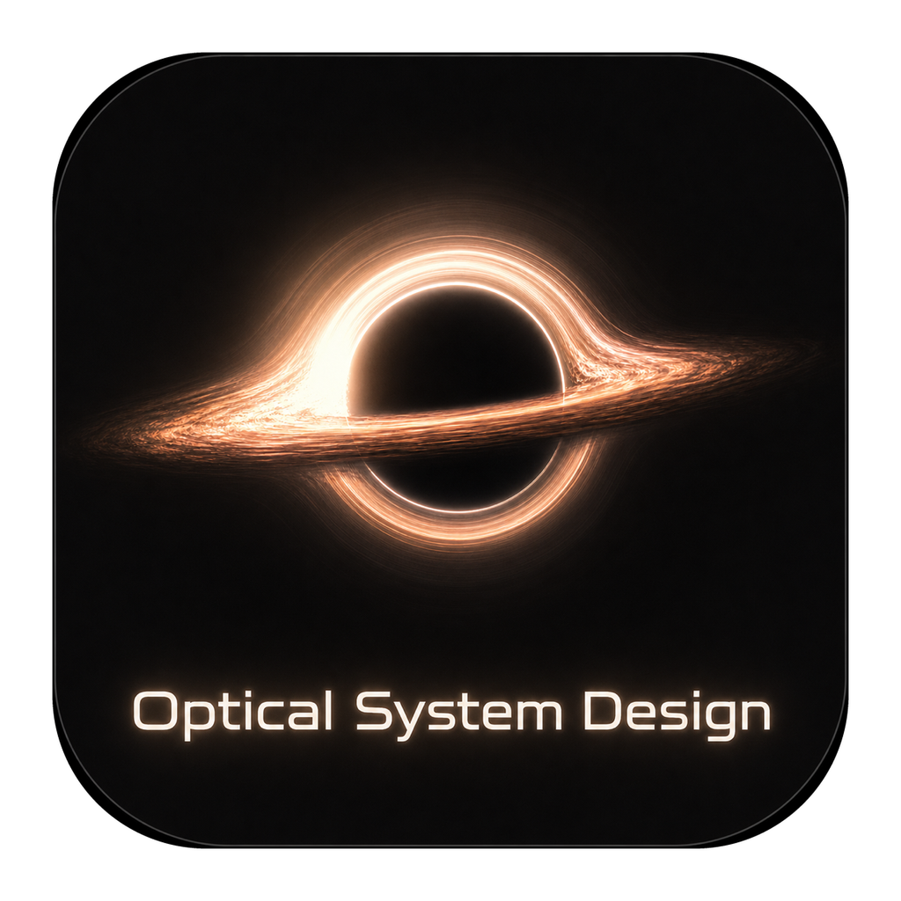
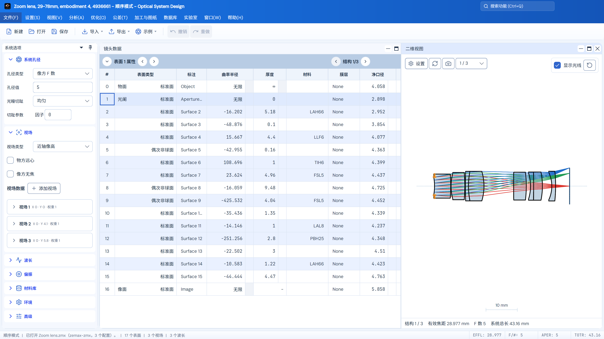

<p align="center">
  
</p>

<p align="center">
  <strong>简体中文</strong> · <a href="README_EN.md">English</a>
</p>

<h1 align="center">Optical System Design</h1>

<p align="center">
  <strong>光学系统设计与仿真工作台</strong><br />
  在同一桌面应用中完成顺序与非序列建模、光线追迹、成像分析、优化与公差分析。
</p>

<p align="center">
  <a href="https://github.com/VendettaMask/opticalsystem/actions/workflows/ci.yml"></a>
  <a href="global.json"></a>
  <a href="docs/ARCHITECTURE.md"></a>
  <a href="https://github.com/VendettaMask/opticalsystem/releases"></a>
</p>

<p align="center">
  <a href="#功能一览"><strong>功能一览</strong></a> ·
  <a href="#安装与启动"><strong>下载与安装</strong></a> ·
  <a href="#开发者快速开始"><strong>快速开始</strong></a> ·
  <a href="docs/README.md"><strong>阅读文档</strong></a> ·
  <a href="https://github.com/VendettaMask/opticalsystem/issues"><strong>反馈问题</strong></a>
</p>

<br />

<p align="center">
  <picture>
    <source media="(prefers-color-scheme: dark)" srcset="docs/assets/readme/2026-10-27/workbench-dark.png" />
    <source media="(prefers-color-scheme: light)" srcset="docs/assets/readme/2026-10-27/workbench-light.png" />
    
  </picture>
</p>

<p align="center">
  <sub>2026 年 10 月的工作台截图，展示内置变焦镜头示例的镜头数据、二维布局和系统选项。</sub>
</p>

---

## 桌面工作台

镜头编辑器、二维和三维布局及分析页支持停靠、分栏与浮动。**实验室** 菜单提供 AI 初始结构、光学镀膜设计、相机成像仿真和光学装调。四项功能内置于主程序，共用 C#/.NET 光学计算内核，随同一个安装包交付。

界面支持简体中文、英语和日语，提供普通、暗夜、光域、异世界和像素五种主题。异世界主题采用英文界面和 Almendra 字体。各主题使用项目自绘的[科学 SVG 图标](docs/LOCAL_ICONS.md)。

从 **文件 → 示例** 浏览 [14 类、95 支顺序镜头](docs/USER_GUIDE.md#镜头示例)。这 95 支镜头构成精度验收基准，可查阅[逐镜头数值对照](validation/rechecks/2026-11-08/menu-all95-current-replay/README.md)和[当前状态](docs/CURRENT_STATUS.md)。

## 功能一览

<table>
  <tr>
    <td width="50%" valign="top">
      <h3>🔭 镜头建模与布局</h3>
      <p>编辑曲率、厚度、材料、面型、孔径、视场和波长，设置变量、解与拾取。多配置可在镜头表头前后切换，并与系统选项、布局和撤销/重做联动。</p>
      <a href="docs/GUI_QUICKSTART_REFACTOR.md">桌面工作流 →</a>
    </td>
    <td width="50%" valign="top">
      <h3>📈 追迹与成像分析</h3>
      <p>按视场、波长和镜头配置计算几何像差、波前、干涉条纹、PSF、MTF、包围能量和相对照度。</p>
      <a href="docs/PARITY_MATRIX.md">分析与模型一览 →</a>
    </td>
  </tr>
  <tr>
    <td width="50%" valign="top">
      <h3>🎯 优化与公差</h3>
      <p>通过变量、评价函数和约束驱动优化。用双侧灵敏度、反向公差、镜组补偿和 Monte Carlo 评估制造偏差，查看多配置联合分析的直方图、良率与报告。</p>
      <a href="docs/OPTIMIZATION_ALGORITHMS.md">优化算法</a> · <a href="docs/TOLERANCING.md">公差分析 →</a>
    </td>
    <td width="50%" valign="top">
      <h3>🧩 初始结构设计</h3>
      <p>根据设计规格生成或检索起始镜头，开展自主拓扑搜索、受约束补偿及胶合结构搜索。使用托管 AutoLens 的 CPU 或 CUDA 路径生成候选，通过检查点续跑，并将按规格验收的方案收录到方案库。</p>
      <a href="labs/InitialStructure/README.md">内置模块说明 →</a>
    </td>
  </tr>
  <tr>
    <td width="50%" valign="top">
      <h3>🌈 光学镀膜设计</h3>
      <p>设计减反、高反和窄带膜系，编辑膜厚与 n/k 材料，计算 R/T/A 和 OD 光谱。支持膜厚优化、膜系结构搜索、制造公差分析及实验保存。</p>
      <a href="labs/CoatingDesign/README.md">内置模块说明 →</a>
    </td>
    <td width="50%" valign="top">
      <h3>🛠️ 工程、材料与制造资料</h3>
      <p>使用材料库和镜头库，以 .staropt 保存工程。导出处方和分析 CSV、PNG 图像、Word/PDF/Markdown/HTML 设计报告、制造图纸和分面 STEP。文件指南列出 ZMX、SEQ、LEN 的交换格式与字段。</p>
      <a href="docs/FILE_FORMATS_AND_PLUGINS.md">文件与交换格式</a> · <a href="docs/MARKDOWN_REPORT_EXPORT.md">设计报告 →</a>
    </td>
  </tr>
  <tr>
    <td width="50%" valign="top">
      <h3>🔦 非序列与杂散光</h3>
      <p>在独立对象文档中编辑光源、光学对象、机械 STL 网格与探测器；通过分支追迹、光线数据库、路径筛选和探测器重建检查传播与能量。</p>
      <a href="docs/NON_SEQUENTIAL_TRACING.md">非序列工作流</a> · <a href="docs/NONSEQUENTIAL_PHASE2_STRAY_LIGHT.md">杂散光链路 →</a>
    </td>
    <td width="50%" valign="top">
      <h3>📷 相机成像仿真</h3>
      <p>将三维直射、标量衍射及非序列探测功率接入传感器、RAW/ADC 和基础 ISP。比较 A/B 成像结果，按波段生成场景图像，并对多个斜边区域测量 SFR。</p>
      <a href="docs/CAMERA_IMAGING_LAB.md">相机成像实验室</a> · <a href="docs/SCENE_SLANTED_EDGE_SFR.md">场景斜边分析 →</a>
    </td>
  </tr>
</table>

### 分析与显示

| 工作 | 当前可用内容 |
| --- | --- |
| 几何像质 | 点列、光线扇形、场曲/畸变、横向色差、RMS 随视场/波长/焦点变化、赛德尔系数及柱形图自动量程 |
| PSF、MTF 与能量 | FFT 和惠更斯 PSF，傅里叶、惠更斯和几何 MTF，包围能量与相对照度。傅里叶 MTF 随视场支持六个可独立设置的频率，另有三维 FFT MTF、二维惠更斯 MTF 和二维视场 FFT/几何 MTF |
| 波前与干涉 | 波前图提供曲面、等高线、二维热图；干涉图提供灰度、伪彩色、等高线及两光束、倾斜、分析面和子孔径设置 |
| Zernike 系数 | Fringe、Standard、Annular 三种具名系数表与拟合统计，另有系数随视场分析；波前分布通过“波前图”查看 |
| 交互与导出 | 切换绘图、数据和文本页，调整曲线、图例与线宽，缩放或平移图像。图幅可自动适应或固定为 16:9、4:3，支持适应窗口、原始大小查看及完整 PNG 导出 |
| 布局与实体 | 二维布局、三维布局与实体模型，支持视角预设、方向指示、光线显示及 PNG 导出 |

分析设置见[用户指南](docs/USER_GUIDE.md)，干涉条纹的采样与计算见[干涉条纹说明](docs/INTERFEROGRAM_2026-10-26.md)。

## 安装与启动

### 下载安装包

打开 [GitHub Releases](https://github.com/VendettaMask/opticalsystem/releases)，在预览版的 **Assets（附件）** 中选择对应安装包。

| 平台 | 附件标识与格式 |
| --- | --- |
| Windows x64 | `win-x64` · EXE |
| Windows ARM64 | `win-arm64` · EXE |
| Mac Apple Silicon（M 系列） | `osx-arm64` · DMG |

安装包内含 .NET 运行时、四个内置实验室和应用字体。版本记录随安装包发布。

### 使用 Windows 安装包

运行对应架构的 EXE，按向导安装。完整安装包也可用于原位升级。安装、修复和恢复步骤见 [Windows 安装指南](docs/WINDOWS_INSTALLATION_UPGRADE_2026-10-12.md)。

### 使用 Apple Silicon Mac 版

打开 `osx-arm64` DMG，将 **Optical System Design.app** 拖入“应用程序”。首次启动步骤见 [Mac 安装说明](packaging/macos/README.txt)。

### 软件更新与用户指南

在 **帮助 → 关于** 检查并下载更新，再选择 **安装更新并重启**。**包含测试版**开关用于接收预览版更新。

在 **帮助 → 用户指南** 中搜索功能、分析和操作步骤。

### 从源码启动

安装 [global.json](global.json) 指定的 .NET SDK，在仓库根目录运行以下命令。

```powershell
dotnet restore OpticalSystemDesign.slnx --locked-mode
dotnet build OpticalSystemDesign.slnx -c Release --no-restore /m:1 /nr:false
dotnet run --project src/OpticalSystemDesign.App/OpticalSystemDesign.App.csproj -c Release --no-build
```

也可使用 Windows 的 [Run-OpticalSystemDesign.cmd](Run-OpticalSystemDesign.cmd) 或 macOS 的 [Run-OpticalSystemDesign.command](Run-OpticalSystemDesign.command) 构建并启动应用。

## 开发者快速开始

根解决方案包含主程序、内置模块及回归测试。

```powershell
# 在上面的 Release 构建后运行测试
dotnet test OpticalSystemDesign.slnx -c Release --no-build --no-restore /m:1 /nr:false

# 构建 Windows 安装包
.\Build-Installer.cmd
```

打包所需工具与命令见[构建指南](docs/BUILD_AND_RELEASE.md)。

<details>
<summary><strong>展开查看代码结构</strong></summary>

| 路径 | 职责 |
| --- | --- |
| `src/OpticalSystemDesign.Core` | 共享光学模型、材料、追迹、分析、优化、公差与文件内核 |
| `src/OpticalSystemDesign.Application` | 无 UI 的应用服务、事务、工作区与 DTO 映射 |
| `src/OpticalSystemDesign.App` | 桌面工作台、内置模块 UI 与恢复入口 |
| `src/OpticalSystemDesign.Modules` | 内置模块显示适配，复用共享计算与规范 DTO |
| [`labs/`](docs/ARCHITECTURE.md#内置实验室) | 四个内置实验室的专用计算引擎 |
| `tests/`、`tools/` | 回归测试、离线验证与维护工具 |
| `docs/` | 当前指南、功能契约与带日期的阶段报告 |
| `validation/`、受版本管理的 `artifacts/` | 保留文件、设置、版本及哈希身份的验证证据 |

[系统架构](docs/ARCHITECTURE.md) · [代码地图](docs/CODE_READING_MAP.md) · [协作说明](AGENTS.md)

</details>

## 参与改进

欢迎通过 [Issues](https://github.com/VendettaMask/opticalsystem/issues) 提交问题与建议，或通过 [Pull Requests](https://github.com/VendettaMask/opticalsystem/pulls) 参与改进。

报告计算问题时，请附上软件版本、分析设置、复现步骤、预期结果和实际结果。有可公开分享的最小示例工程时，也欢迎一并附上。代码贡献流程见[协作说明](AGENTS.md)。

## 项目定位与致谢

**Optical System Design** 是由 **S.T.A.R. Labs** 维护的非商业项目。感谢以下项目及其贡献者。

- **运行与桌面界面**：[.NET](https://github.com/dotnet/runtime)、[Avalonia](https://github.com/AvaloniaUI/Avalonia)、[Dock](https://github.com/wieslawsoltes/Dock)、[CommunityToolkit.Mvvm](https://github.com/CommunityToolkit/dotnet)。
- **图形、文字与平台适配**：[SkiaSharp / HarfBuzzSharp](https://github.com/mono/SkiaSharp) 及其上游 [Skia](https://skia.org/)、[HarfBuzz](https://github.com/harfbuzz/harfbuzz)，以及 [Avalonia ANGLE](https://github.com/AvaloniaUI/angle)、[MicroCom](https://github.com/kekekeks/MicroCom)、[Tmds.DBus](https://github.com/tmds/Tmds.DBus)。
- **光学算法与交互参考**：[Optiland](https://github.com/optiland/optiland)、[AutoLens](https://github.com/AI4Optics/AutoLens)、[DeepLens](https://github.com/vccimaging/DeepLens)、[TFStudio](https://github.com/aai2k/TFStudio)、[tmmcore](https://github.com/aai2k/tmmcore)。感谢其在光学建模、初始结构与镀膜设计方面的工作。
- **开放材料数据**：[refractiveindex.info database](https://github.com/polyanskiy/refractiveindex.info-database)。
- **字体**：[DM Sans](https://github.com/google/fonts/tree/main/ofl/dmsans)、[思源黑体](https://github.com/adobe-fonts/source-han-sans)、[JetBrains Mono](https://github.com/JetBrains/JetBrainsMono)、[Noto Sans CJK](https://github.com/notofonts/noto-cjk)、[Inter](https://github.com/rsms/inter)、[Fusion Pixel Font](https://github.com/TakWolf/fusion-pixel-font)、[Almendra](https://github.com/google/fonts/tree/main/ofl/almendra)、[STIX Two Math](https://github.com/stipub/stixfonts)。字体用途与许可见[字体说明](docs/TYPOGRAPHY.md)。
- **图标**：桌面界面采用项目自绘的[科学 SVG 图标](docs/LOCAL_ICONS.md)。[Lucide](https://github.com/lucide-icons/lucide) 通用图标作为备用资源随应用分发，[许可文件](src/OpticalSystemDesign.App/Assets/Icons/LUCIDE-LICENSE.txt)保留 Lucide 的 ISC 许可和源自 [Feather](https://github.com/feathericons/feather) 的图标署名及许可。
- **构建、测试与测试依赖**：[MSBuild](https://github.com/dotnet/msbuild)、[NuGet](https://github.com/NuGet/NuGet.Client)、[PowerShell](https://github.com/PowerShell/PowerShell)、[VSTest / .NET Test SDK](https://github.com/microsoft/vstest)、[xUnit.net](https://github.com/xunit/xunit)、[Coverlet](https://github.com/coverlet-coverage/coverlet)、[Newtonsoft.Json](https://github.com/JamesNK/Newtonsoft.Json)、[Inno Setup](https://github.com/jrsoftware/issrc)。
- **离线验证与报告工具**：[Python](https://github.com/python/cpython)、[NumPy](https://github.com/numpy/numpy)、[SciPy](https://github.com/scipy/scipy)、[Matplotlib](https://github.com/matplotlib/matplotlib)、[Pillow](https://github.com/python-pillow/Pillow)、[pythonnet](https://github.com/pythonnet/pythonnet)、[python-docx](https://github.com/python-openxml/python-docx)、[ReportLab](https://pypi.org/project/reportlab/)、[FreeCAD](https://github.com/FreeCAD/FreeCAD) / [Open CASCADE Technology](https://github.com/Open-Cascade-SAS/OCCT)、[Node.js](https://github.com/nodejs/node)。

来源、署名与许可见[算法参考声明](third_party/autolens/AutoLens-NOTICE.txt)、[镀膜参考归档](third_party/coating-reference/README.md)和[材料目录说明](src/OpticalSystemDesign.Core/Materials/Data/README.md)。

<p align="center">
  <sub>Optical System Design · S.T.A.R. Labs</sub>
</p>
