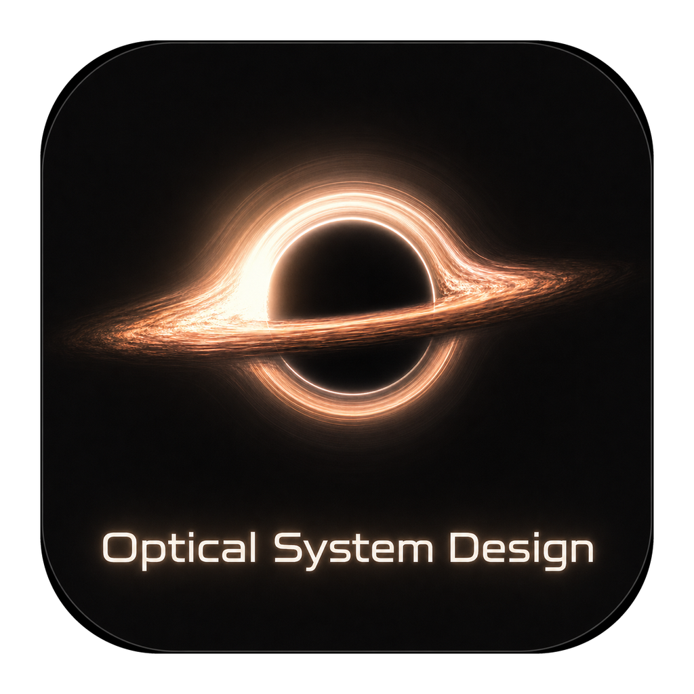

<p align="center">
  
</p>

<p align="center">
  <strong>简体中文</strong> · <a href="README_EN.md">English</a>
</p>

<h1 align="center">Optical System Design</h1>

<p align="center">
  <strong>让光学设计，从一个想法走向可分析的系统。</strong><br />
  建模、追迹、优化、初始结构与镀膜设计，汇聚在同一个桌面工作台。
</p>

<p align="center">
  <a href="https://github.com/VendettaMask/opticalsystem/actions/workflows/ci.yml"></a>
  <a href="global.json"></a>
  <a href="docs/ARCHITECTURE.md"></a>
  <a href="docs/CURRENT_STATUS.md"></a>
</p>

<p align="center">
  <a href="#功能一览"><strong>功能一览</strong></a> ·
  <a href="#安装与启动"><strong>安装与启动</strong></a> ·
  <a href="#开发者快速开始"><strong>快速开始</strong></a> ·
  <a href="docs/README.md"><strong>阅读文档</strong></a> ·
  <a href="https://github.com/VendettaMask/opticalsystem/issues"><strong>反馈问题</strong></a>
</p>

<br />

<p align="center">
  <picture>
    <source media="(prefers-color-scheme: dark)" srcset="docs/assets/readme/workbench-dark.png" />
    <source media="(prefers-color-scheme: light)" srcset="docs/assets/readme/workbench-light.png" />
    
  </picture>
</p>

<p align="center">
  <sub>明暗主题下的桌面工作台。预览来自 2026-10-15 实际 Avalonia 控件的离屏渲染，展示布局，不代表数值或跨平台验收。</sub>
</p>

---

## 为什么是 Optical System Design？

这是 S.T.A.R. Labs 的非商业光学设计项目：用纯 C#/.NET 构建共享计算内核，用 Avalonia 提供桌面工作流，让镜头模型、分析结果和设计过程在一处衔接。

- **一个工作台**：镜头编辑、二维/三维布局、分析、优化和公差共用工程与工作区。
- **三种界面语言**：默认简体中文，可即时切换 English 与日本語并记住选择。
- **一套计算内核**：主程序、初始结构和镀膜模块复用共享 Core，不依赖外部 Python 光学运行时。
- **一个完整产品**：两个模块均为同进程、必装内置功能，标准安装一次包含，无须另外启动或安装。
- **可追溯的验证**：区分已实现能力、冻结参考、数值对照和待验证边界，不把界面展示当作精度证明。

> 项目仍在持续开发，尚未完成完整发布验收。当前包身份、验证范围与待解决问题统一见[当前状态](docs/CURRENT_STATUS.md)，本页不以历史测试数量代替当前结论。

## 功能一览

<table>
  <tr>
    <td width="50%" valign="top">
      <h3>🔭 镜头建模与布局</h3>
      <p>编辑表面、材料、孔径、视场与波长，在二维/三维布局中检查系统；支持多配置以及独立的非序列文档工作流。</p>
      <a href="docs/GUI_QUICKSTART_REFACTOR.md">桌面工作流 →</a>
    </td>
    <td width="50%" valign="top">
      <h3>📈 追迹与成像分析</h3>
      <p>从点列、光线像差和波前，到 PSF、MTF、累计能量与图像模拟，围绕当前光学模型查看结果。</p>
      <a href="docs/PARITY_MATRIX.md">能力与支持边界 →</a>
    </td>
  </tr>
  <tr>
    <td width="50%" valign="top">
      <h3>🎯 优化与公差</h3>
      <p>设置变量与评价目标，使用已实现的优化算法；通过灵敏度、补偿和 Monte Carlo 检查制造偏差的影响。</p>
      <a href="docs/OPTIMIZATION_ALGORITHMS.md">优化算法</a> · <a href="docs/TOLERANCING.md">公差分析 →</a>
    </td>
    <td width="50%" valign="top">
      <h3>🧩 初始结构设计</h3>
      <p>从规格出发生成与细化候选结构，使用共享 Core 进行真实光学评价。候选结果仍需按设计目标独立复验。</p>
      <a href="labs/InitialStructure/README.md">内置模块说明 →</a>
    </td>
  </tr>
  <tr>
    <td width="50%" valign="top">
      <h3>🌈 光学镀膜设计</h3>
      <p>编辑膜层与材料，计算 R/T/A 光谱，开展减反、高反和窄带膜系的生成、优化、公差与实验保存。</p>
      <a href="labs/CoatingDesign/README.md">内置模块说明 →</a>
    </td>
    <td width="50%" valign="top">
      <h3>🛠️ 工程、材料与制造资料</h3>
      <p>使用材料与镜头库，保存完整工程，生成制造图纸或导出 STEP；支持范围明确的 ZMX、SEQ、LEN 交换子集。</p>
      <a href="docs/FILE_FORMATS_AND_PLUGINS.md">文件与交换格式</a> · <a href="docs/MANUFACTURING_DRAWINGS.md">制造制图 →</a>
    </td>
  </tr>
</table>

## 安装与启动

### 使用 Windows 安装包

安装包通过 [GitHub Releases](https://github.com/VendettaMask/opticalsystem/releases) 分发。使用正式发布中的 `OpticalSystemDesign-*-Setup.exe`，按向导完成安装后启动主程序。Windows x64 标准包为自包含交付，使用者无须另装 .NET、初始结构或镀膜模块。

软件版本可在“帮助 → 关于”或“帮助 → 检查更新”查看；检查更新仅由用户手动发起，并可打开 GitHub 发布页下载完整包。在线自动升级先预留，不会自动下载或安装。版本与发布规则见[构建与发布](docs/BUILD_AND_RELEASE.md#软件版本与-github-分发)；开发版本不代表已有对应公开安装包。

在主程序的 **实验室 → AI 初始结构 / 光学镀膜设计** 中进入两个内置模块。

完整使用方法可在主程序的 **帮助 → 用户指南** 中搜索查看；该图文指南包含真实界面截图和主题自适应说明图，覆盖当前注册的全部功能命令和分析，并随界面切换中文、英文或日文。仓库内的范围说明见[用户指南](docs/USER_GUIDE.md)。

当前安装包未签名，系统可能显示未知发布者提示；源码更新不会自动替换已有安装。安装、修复和恢复方式见 [Windows 安装说明](docs/WINDOWS_INSTALLATION_UPGRADE_2026-10-12.md)，实际包身份以[交付记录](docs/BUILT_IN_MODULES_2026-10-13.md)为准。

### 从源码启动

安装 [global.json](global.json) 指定兼容范围的 .NET SDK，在仓库根目录运行：

```powershell
dotnet restore OpticalSystemDesign.slnx --locked-mode
dotnet build OpticalSystemDesign.slnx -c Release --no-restore /m:1 /nr:false
dotnet run --project src/OpticalSystemDesign.App/OpticalSystemDesign.App.csproj -c Release --no-build
```

也可使用 Windows 的 [Run-OpticalSystemDesign.cmd](Run-OpticalSystemDesign.cmd) 或 macOS 的 [Run-OpticalSystemDesign.command](Run-OpticalSystemDesign.command)。这两个开发入口会依次还原、清理、构建并启动，不删除用户工程、主题或工作区。

Windows ARM64、macOS 发布入口与 Linux CI 构建不等于对应平台已完成实机安装或全部桌面验收。跨平台交付范围见[构建与发布](docs/BUILD_AND_RELEASE.md)。

## 开发者快速开始

主技术栈：**C# / .NET · Avalonia · 共享光学 Core**。根解决方案统一包含主程序、内置模块与对应测试；普通构建和回归测试不需要安装 Zemax。

```powershell
# 在上面的 Release 构建后运行测试
dotnet test OpticalSystemDesign.slnx -c Release --no-build --no-restore /m:1 /nr:false

# 在 Windows 上构建包含全部必装模块的安装包
.\Build-Installer.cmd
```

首次打包需要联网准备依赖、目标运行时和安装编译器。详细要求、冻结证据门禁与发布边界见[构建指南](docs/BUILD_AND_RELEASE.md)。

<details>
<summary><strong>展开查看代码结构</strong></summary>

| 路径 | 职责 |
| --- | --- |
| `src/OpticalSystemDesign.Core` | 共享光学模型、材料、追迹、分析、优化、公差与文件内核 |
| `src/OpticalSystemDesign.Application` | 无 UI 的应用服务、事务、工作区与 DTO 映射 |
| `src/OpticalSystemDesign.App` | 桌面工作台、内置模块 UI 与恢复入口 |
| `src/OpticalSystemDesign.Modules` | 内置模块显示适配，复用共享计算与规范 DTO |
| `labs/InitialStructure`、`labs/CoatingDesign` | 内部领域库、设计流程与测试，不是独立产品 |
| `tests/`、`tools/` | 回归、离线验证与维护工具，不进入产品运行依赖 |
| `docs/` | 当前指南、功能契约与带日期的阶段报告 |
| `validation/`、受版本管理的 `artifacts/` | 保留文件、设置、版本及哈希身份的验证证据 |

继续阅读：[系统架构](docs/ARCHITECTURE.md) · [代码地图](docs/CODE_READING_MAP.md) · [协作约束](AGENTS.md)。

</details>

## 文档与进展

| 我想…… | 从这里开始 |
| --- | --- |
| 上手桌面工作流 | [使用指南](docs/GUI_QUICKSTART_REFACTOR.md) |
| 查阅全部文档 | [文档索引](docs/README.md) |
| 了解当前验证、安装包与剩余工作 | [当前状态](docs/CURRENT_STATUS.md) · [问题清单](docs/OPEN_ISSUES_2026-10-08.md) |
| 了解支持的模型和文件 | [能力矩阵](docs/PARITY_MATRIX.md) · [文件格式](docs/FILE_FORMATS_AND_PLUGINS.md) |
| 查看数值依据与验证边界 | [数值验证](docs/NUMERICAL_PARITY.md) · [操作数支持](docs/ZEMAX_OPERAND_SUPPORT.md) |

默认主要外部精度基准是已提交的 Zemax OpticStudio 2026 R1 `123456.ZMX` 捕获，结论仅覆盖所捕获的文件、设置与版本。导入、保留某个字段不代表对应计算已经实现，也不承诺与其它软件全面等价；未支持的能力应明确拒绝。

Optiland 0.5.8 资料只作为冻结历史辅助证据保留，不重新生成比较，也不进入产品依赖。

## 参与改进

欢迎通过 [Issues](https://github.com/VendettaMask/opticalsystem/issues) 提交问题与建议，或通过 [Pull Requests](https://github.com/VendettaMask/opticalsystem/pulls) 参与改进。

报告计算问题时，请尽量附上可分享的最小工程、软件版本、分析设置、复现步骤，以及期望结果与实际结果；不要上传保密处方或无权分享的数据。修改代码前请先阅读[协作约束](AGENTS.md)，并为行为变化补充测试与相关文档。

## 项目定位与致谢

本项目由 **S.T.A.R. Labs** 按非商业定位维护。非商业用途不等于自动取得全部第三方资源的使用或再分发权；代码、依赖、字体、图标和材料数据仍须分别遵守适用授权。

感谢 .NET、Avalonia 及相关项目提供的基础设施。第三方材料来源和授权说明保留在各资源目录，分发时不得省略。

<p align="center">
  <sub>Optical System Design · S.T.A.R. Labs<br />让设计过程清晰，让计算依据可追溯。</sub>
</p>
