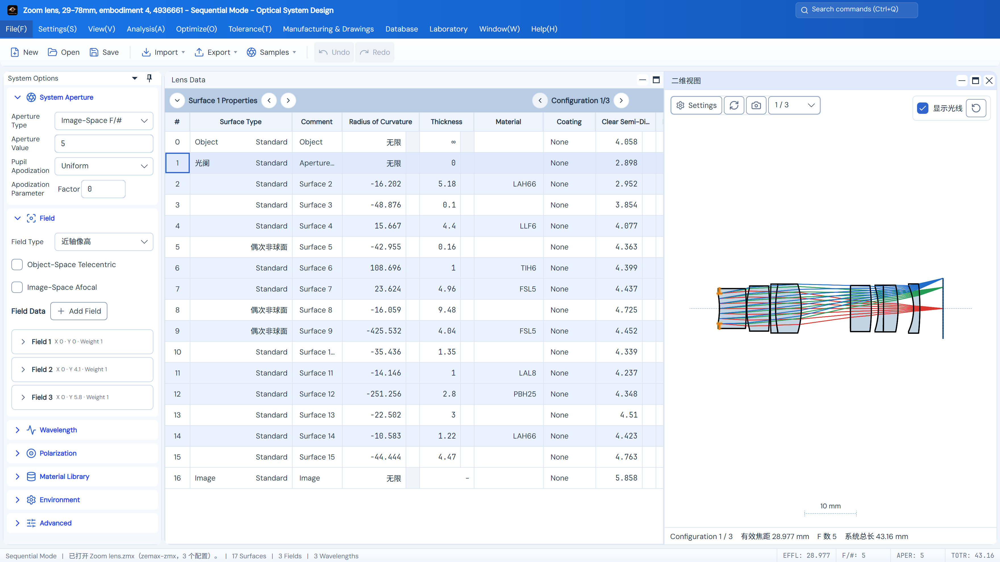

<p align="center">
  
</p>

<p align="center">
  <a href="README.md">简体中文</a> · <strong>English</strong>
</p>

<h1 align="center">Optical System Design</h1>

<p align="center">
  <strong>Turn an optical idea into a system you can analyze.</strong><br />
  Sequential and non-sequential modeling, image analysis, optimization, tolerancing, initial-structure generation, and coating design in one desktop workbench.
</p>

<p align="center">
  <a href="https://github.com/VendettaMask/opticalsystem/actions/workflows/ci.yml"></a>
  <a href="global.json"></a>
  <a href="docs/ARCHITECTURE.md"></a>
  <a href="docs/CURRENT_STATUS.md"></a>
</p>

<p align="center">
  <a href="#features"><strong>Features</strong></a> ·
  <a href="#installation-and-startup"><strong>Download & Install</strong></a> ·
  <a href="#developer-quick-start"><strong>Quick Start</strong></a> ·
  <a href="docs/README.md"><strong>Documentation</strong></a> ·
  <a href="https://github.com/VendettaMask/opticalsystem/issues"><strong>Report an Issue</strong></a>
</p>

<br />

<p align="center">
  <picture>
    <source media="(prefers-color-scheme: dark)" srcset="docs/assets/readme/2026-10-27/workbench-dark-en.png" />
    <source media="(prefers-color-scheme: light)" srcset="docs/assets/readme/2026-10-27/workbench-light-en.png" />
    
  </picture>
</p>

<p align="center">
  <sub>The actual main window in light and dark themes, showing lens data, the 2D layout, and system options. Rendered off-screen using a bundled lens example.</sub>
</p>

---

## Why Optical System Design?

Optical System Design is a non-commercial optical-design project maintained by S.T.A.R. Labs. It combines a shared optical computation core written entirely in C#/.NET with an Avalonia desktop workflow, keeping lens models, analysis results, and the design process in one place.

- **From prescription to delivery:** move between lens editing, 2D/3D layouts, analysis, optimization, tolerancing, and design reports within one project.
- **Three UI languages:** Simplified Chinese is the default; English and Japanese can be selected instantly, and the choice is remembered.
- **One computation core:** the main application, initial-structure module, and coating module reuse the shared Core without an external Python optical runtime.
- **One complete product:** both modules are required, in-process features included by the standard installation; they do not need separate launchers or installers.
- **Categorized lens examples:** browse 95 Zemax Sequential examples in 14 categories through **File → Examples**, with each model handled according to the [documented import scope](docs/USER_GUIDE.md#镜头示例).
- **Traceable validation:** implemented capabilities, frozen references, numerical comparisons, and open validation boundaries are kept distinct. UI presentation is not treated as proof of numerical accuracy.

> Development continues with test packages available for all three platforms. See [Current Status](docs/CURRENT_STATUS.md) for package identity, verified scope, and remaining work, and the relevant guides for each analysis and model's applicable scope.

## Features

<table>
  <tr>
    <td width="50%" valign="top">
      <h3>🔭 Lens modeling and layout</h3>
      <p>Edit curvature, thickness, materials, surface geometry, apertures, fields, and wavelengths, with variables, solves, and pickups. Step through configurations from the lens header, keeping system options, layouts, and undo/redo in sync.</p>
      <a href="docs/GUI_QUICKSTART_REFACTOR.md">Desktop workflow →</a>
    </td>
    <td width="50%" valign="top">
      <h3>📈 Ray tracing and image analysis</h3>
      <p>Use spots, ray fans, field curvature/distortion, RMS, wavefronts, real interference fringes, FFT/Huygens PSF, FFT/Huygens/geometric MTF, energy, illumination, and image simulation, with explicit field, wavelength, and configuration settings.</p>
      <a href="docs/PARITY_MATRIX.md">Capabilities and support boundaries →</a>
    </td>
  </tr>
  <tr>
    <td width="50%" valign="top">
      <h3>🎯 Optimization and tolerancing</h3>
      <p>Set variables, merit operands, weights, and constraints; run implemented algorithms such as Damped Least Squares and Nelder–Mead, then evaluate manufacturing variation through sensitivity, compensation, and Monte Carlo workflows.</p>
      <a href="docs/OPTIMIZATION_ALGORITHMS.md">Optimization algorithms</a> · <a href="docs/TOLERANCING.md">Tolerance analysis →</a>
    </td>
    <td width="50%" valign="top">
      <h3>🧩 Initial-structure design</h3>
      <p>Generate, optimize, and refine candidates from specifications and random seeds through the AutoLens workflow, with budgets, saved runs, and resume support. Select automatic CUDA preference, GPU, or CPU; evaluate candidates independently through the shared Core and export projects.</p>
      <a href="labs/InitialStructure/README.md">Built-in module guide →</a>
    </td>
  </tr>
  <tr>
    <td width="50%" valign="top">
      <h3>🌈 Optical coating design</h3>
      <p>Generate anti-reflection, high-reflection, and narrowband candidates; edit layer thickness and n/k materials, calculate R/T/A and OD spectra, optimize thickness, search finite structures, evaluate tolerances, and save separate experiments.</p>
      <a href="labs/CoatingDesign/README.md">Built-in module guide →</a>
    </td>
    <td width="50%" valign="top">
      <h3>🛠️ Projects, materials, and manufacturing data</h3>
      <p>Use material and lens libraries and save complete STAROPT projects. Export prescription and analysis CSV, complete PNGs, Markdown design reports, manufacturing drawings, and faceted STEP, with scoped ZMX, SEQ, and LEN exchange.</p>
      <a href="docs/FILE_FORMATS_AND_PLUGINS.md">Files and exchange formats</a> · <a href="docs/MARKDOWN_REPORT_EXPORT.md">Design reports →</a>
    </td>
  </tr>
  <tr>
    <td width="50%" valign="top">
      <h3>🔦 Non-sequential and stray-light workflows</h3>
      <p>Edit sources, optical objects, mechanical STL meshes, and detectors in a separate object document. Inspect propagation and energy through branch tracing, ray databases, path filters, and detector reconstruction.</p>
      <a href="docs/NON_SEQUENTIAL_TRACING.md">Non-sequential workflow</a> · <a href="docs/NONSEQUENTIAL_PHASE2_STRAY_LIGHT.md">Stray-light pipeline →</a>
    </td>
    <td width="50%" valign="top">
      <h3>📷 Camera imaging simulation</h3>
      <p>Combine a current-lens snapshot, sensor settings, QE, illuminant, and reflectance spectra. Inspect optical, noise, ADC, and basic ISP stages, with continuous spectral integration, A/B comparisons, and result export.</p>
      <a href="docs/CAMERA_IMAGING_LAB.md">Imaging laboratory and model scope →</a>
    </td>
  </tr>
</table>

### Analysis and display

| Task | Available capabilities |
| --- | --- |
| Geometric image quality | Spots, ray fans, field curvature/distortion, lateral color, RMS versus field/wavelength/focus, and Seidel coefficients with automatic bar-chart range |
| Diffraction and energy | FFT/Huygens PSF, FFT/Huygens/geometric MTF, encircled energy, relative illumination, and supported scan settings |
| Wavefront and interference | Surface, contour, and 2D heatmap wavefront views; grayscale, false-color, and contour interferograms with beam, tilt, analysis-surface, and subaperture settings |
| Zernike coefficients | Named Fringe, Standard, and Annular coefficient tables and fit statistics, plus coefficients versus field; use Wavefront Map for wavefront distributions |
| Interaction and export | Named-curve legend selection, zoom/pan, plot/data/text views, readable reflow or scrolling in small panes, and complete analysis PNG export |
| Layouts and solids | 2D layout, 3D layout, and solid model, with view presets, orientation indicators, ray display, and current-viewport PNG export |

Interferograms display fringe intensity computed by the shared Core from wavefront differences. See the [interference guide](docs/INTERFEROGRAM_2026-10-26.md) for settings and physical assumptions. Each analysis has its own sampling, reference, units, and applicable scope; see the [User Guide](docs/USER_GUIDE.md) and [capability matrix](docs/PARITY_MATRIX.md).

### A typical workflow

1. **Open or create a system:** import a supported sequential file or choose a categorized example, then save the complete project as `.staropt`.
2. **Check the prescription and layout:** adjust system options, materials, and surfaces, switch configurations, and inspect 2D/3D propagation.
3. **Analyze and improve:** choose the actual fields, wavelengths, and sampling, compare image quality, and set variables, merit targets, and tolerances as needed.
4. **Save and deliver:** save the project, or use **Database → Design Report** to select analyses and configurations for Markdown and image export; explicitly export STEP for mechanical exchange.

Open AI Initial Structure and Optical Coating Design from **Laboratory**; they maintain their own experiments and run records. Initial-structure candidates require independent acceptance against the design goals, and coating experiments do not automatically modify the current lens. The [GPU guide](docs/AUTOLENS_GPU.md) describes device support and fallback scope. Autonomous topology insertion/deletion and search currently provide experimental CPU library interfaces; progress is tracked in the [implementation plan](docs/AUTONOMOUS_TOPOLOGY_V1_IMPLEMENTATION_PLAN.md).

## Installation and startup

### Download a package

| Platform | Package |
| --- | --- |
| Windows x64 | [Download EXE](https://github.com/VendettaMask/opticalsystem/releases/download/v1.0.4-test.20261019/OpticalSystemDesign-1.0.4-win-x64-UnsignedTest-Setup-6b4ccf31.exe) |
| Windows ARM64 | [Download EXE](https://github.com/VendettaMask/opticalsystem/releases/download/v1.0.4-test.20261019/OpticalSystemDesign-1.0.4-win-arm64-UnsignedTest-Setup-6b4ccf31.exe) |
| Mac Apple Silicon | [Download DMG](https://github.com/VendettaMask/opticalsystem/releases/download/v1.0.4-test.20261019/OpticalSystemDesign-1.0.4-osx-arm64-AdHocTest.dmg) |

All three platforms use self-contained packages with the runtime, both required modules, and fonts; no separate .NET installation is required. Find version history, release notes, and file checksums on [GitHub Releases](https://github.com/VendettaMask/opticalsystem/releases).

### Windows installer

Choose the EXE matching your system architecture and follow the installer. An existing installation can be updated in place with the complete installer; uninstalling first is not required.

Use **Help → About** for versions and updates. **Include prereleases** is selected by default. After a manual check, download and verify the matching update, then choose **Install Update and Restart**. Unsaved changes offer save, discard, or cancel; installation and application shutdown are not forced in the background. Signed build numbers also distinguish newer test builds of the same version. See the [update rules](docs/BUILD_AND_RELEASE.md#软件版本与-github-分发).

Open the two built-in modules from **Laboratory → AI Initial Structure / Optical Coating Design** in the main application.

Open **Help → User Guide** for the searchable illustrated manual. It combines an actual workbench screenshot with theme-aware explanatory diagrams, covers every currently registered feature command and analysis, and follows the selected Chinese, English, or Japanese interface language. See the repository [User Guide scope](docs/USER_GUIDE.md) for coverage details.

Windows installers do not yet have an Authenticode publisher signature and may display an unknown-publisher warning; RSA verification of update metadata does not replace that certificate. See the [Windows installation guide](docs/WINDOWS_INSTALLATION_UPGRADE_2026-10-12.md) for installation, repair, and recovery, and [Releases](https://github.com/VendettaMask/opticalsystem/releases) for version and package details.

### Apple Silicon Mac package

Mac releases target M-series chips only (`osx-arm64`). For the first installation, open the DMG and drag **Optical System Design.app** into Applications. The package includes .NET, both built-in modules, and fonts. Versions containing the updater support checks, verified downloads, installation and restart through **Help → About**. Earlier Mac versions need one manual installation of a complete package containing the updater. Mac packages use ad-hoc signing and are not notarized; first launch may require approval in macOS settings. See [Current Status](docs/CURRENT_STATUS.md) for actual artifacts and verification, and the [release guide](docs/GITHUB_CLOUD_RELEASE.md#apple-silicon-mac-包) for packaging.

### Run from source

Install a .NET SDK within the compatible range specified by [global.json](global.json), then run these commands from the repository root:

```powershell
dotnet restore OpticalSystemDesign.slnx --locked-mode
dotnet build OpticalSystemDesign.slnx -c Release --no-restore /m:1 /nr:false
dotnet run --project src/OpticalSystemDesign.App/OpticalSystemDesign.App.csproj -c Release --no-build
```

You can also use [Run-OpticalSystemDesign.cmd](Run-OpticalSystemDesign.cmd) on Windows or [Run-OpticalSystemDesign.command](Run-OpticalSystemDesign.command) on macOS. These development launchers restore, clean, build, and start the application in sequence; they do not delete user projects, themes, or workspaces.

The Windows ARM64 installer is cross-built on Windows x64. Mac runs focused regressions and native package checks without a GUI on an Apple Silicon cloud runner. A Linux CI build does not imply a Linux installer is available. See [Build and Release](docs/BUILD_AND_RELEASE.md) for real-device installation and full desktop acceptance scope.

## Developer quick start

Primary stack: **C# / .NET · Avalonia · shared optical Core**. The root solution includes the main application, built-in modules, and their tests. Ordinary builds and regression tests do not require Zemax.

```powershell
# Run tests after the Release build above
dotnet test OpticalSystemDesign.slnx -c Release --no-build --no-restore /m:1 /nr:false

# Build the Windows installer with all required modules
.\Build-Installer.cmd
```

The first packaging run needs network access to prepare dependencies, target runtimes, and the installer compiler. See the [build guide](docs/BUILD_AND_RELEASE.md) for full requirements, frozen-evidence gates, and release boundaries.

<details>
<summary><strong>Show the code structure</strong></summary>

| Path | Responsibility |
| --- | --- |
| `src/OpticalSystemDesign.Core` | Shared optical models, materials, tracing, analysis, optimization, tolerancing, and file core |
| `src/OpticalSystemDesign.Application` | UI-independent application services, transactions, workspace, and DTO mapping |
| `src/OpticalSystemDesign.App` | Desktop workbench, built-in module UI, and recovery entry points |
| `src/OpticalSystemDesign.Modules` | Display adapters for built-in modules, reusing shared computation and canonical DTOs |
| `labs/InitialStructure`, `labs/CoatingDesign` | Internal domain libraries, design workflows, and tests—not separate products |
| `tests/`, `tools/` | Regression, offline validation, and maintenance tools; not product runtime dependencies |
| `docs/` | Current guides, feature contracts, and dated stage reports |
| `validation/`, version-controlled `artifacts/` | Validation evidence retaining file, setting, version, and hash identity |

Continue reading: [System Architecture](docs/ARCHITECTURE.md) · [Code Map](docs/CODE_READING_MAP.md) · [Collaboration Rules](AGENTS.md).

</details>

## Documentation and progress

| I want to… | Start here |
| --- | --- |
| Learn the desktop workflow | [User guide](docs/GUI_QUICKSTART_REFACTOR.md) |
| Explore analysis, reports, and imaging | [User Guide](docs/USER_GUIDE.md) · [Design reports](docs/MARKDOWN_REPORT_EXPORT.md) · [Camera imaging](docs/CAMERA_IMAGING_LAB.md) |
| Browse all documentation | [Documentation index](docs/README.md) |
| Understand the current validation, installer, and remaining work | [Current status](docs/CURRENT_STATUS.md) · [Open issues](docs/OPEN_ISSUES_2026-10-08.md) |
| Review supported models and files | [Capability matrix](docs/PARITY_MATRIX.md) · [File formats](docs/FILE_FORMATS_AND_PLUGINS.md) |
| Review numerical foundations and validation boundaries | [Numerical validation](docs/NUMERICAL_PARITY.md) · [Operand support](docs/ZEMAX_OPERAND_SUPPORT.md) |

The default primary external accuracy reference is the committed Zemax OpticStudio 2026 R1 capture for `123456.ZMX`. Its conclusions cover only the captured file, settings, and software version. Importing or retaining a field does not mean its computation is implemented, and the project does not promise comprehensive equivalence with other software. Unsupported capabilities must be rejected explicitly.

## Contributing

Use [Issues](https://github.com/VendettaMask/opticalsystem/issues) for problems and suggestions, or contribute through [Pull Requests](https://github.com/VendettaMask/opticalsystem/pulls).

When reporting a computation issue, please include a shareable minimal project, software version, analysis settings, reproduction steps, and expected and actual results. Do not upload confidential prescriptions or data you are not authorized to share. Before changing code, read the [collaboration rules](AGENTS.md) and add tests and relevant documentation for behavioral changes.

## Project positioning and acknowledgments

This project is maintained by **S.T.A.R. Labs** as a non-commercial project. Non-commercial use does not automatically grant rights to use or redistribute every third-party resource; code, dependencies, fonts, icons, and material data remain subject to their respective licenses.

We thank the following open-source projects and their contributors. Direct and transitive dependencies are grouped by upstream project; algorithm references, assets, and offline tools are identified separately. A reference project is not necessarily a product runtime dependency.

- **Runtime and desktop UI:** [.NET](https://github.com/dotnet/runtime), [Avalonia](https://github.com/AvaloniaUI/Avalonia), [Dock](https://github.com/wieslawsoltes/Dock), and [CommunityToolkit.Mvvm](https://github.com/CommunityToolkit/dotnet).
- **Graphics, text, and platform integration:** [SkiaSharp / HarfBuzzSharp](https://github.com/mono/SkiaSharp) and their upstream projects [Skia](https://skia.org/) and [HarfBuzz](https://github.com/harfbuzz/harfbuzz), plus [Avalonia ANGLE](https://github.com/AvaloniaUI/angle), [MicroCom](https://github.com/kekekeks/MicroCom), and [Tmds.DBus](https://github.com/tmds/Tmds.DBus).
- **Optical algorithms and interaction references:** [Optiland](https://github.com/optiland/optiland), [AutoLens](https://github.com/AI4Optics/AutoLens), [DeepLens](https://github.com/vccimaging/DeepLens), [TFStudio](https://github.com/aai2k/TFStudio), and [tmmcore](https://github.com/aai2k/tmmcore). We appreciate their work on optical modeling, initial-structure design, and thin-film coating design.
- **Open material data:** [refractiveindex.info database](https://github.com/polyanskiy/refractiveindex.info-database).
- **Fonts:** [DM Sans](https://github.com/google/fonts/tree/main/ofl/dmsans), [Source Han Sans](https://github.com/adobe-fonts/source-han-sans), [JetBrains Mono](https://github.com/JetBrains/JetBrainsMono), [Noto Sans CJK](https://github.com/notofonts/noto-cjk), [Inter](https://github.com/rsms/inter), and [Fusion Pixel Font](https://github.com/TakWolf/fusion-pixel-font). See the [desktop typography and license notes](docs/TYPOGRAPHY.md).
- **Icons:** [Lucide](https://github.com/lucide-icons/lucide) and its source project [Feather](https://github.com/feathericons/feather), [Game-icons.net](https://game-icons.net/) (Delapouite, Lorc, and other contributors), and [FatCow / Farm-Fresh](https://github.com/gammasoft/fatcow) (FatCow Web Hosting / Marcis Gasuns).
- **Build, test, and test dependencies:** [MSBuild](https://github.com/dotnet/msbuild), [NuGet](https://github.com/NuGet/NuGet.Client), [PowerShell](https://github.com/PowerShell/PowerShell), [VSTest / .NET Test SDK](https://github.com/microsoft/vstest), [xUnit.net](https://github.com/xunit/xunit), [Coverlet](https://github.com/coverlet-coverage/coverlet), [Newtonsoft.Json](https://github.com/JamesNK/Newtonsoft.Json), and [Inno Setup](https://github.com/jrsoftware/issrc).
- **Offline validation and report tools:** [Python](https://github.com/python/cpython), [NumPy](https://github.com/numpy/numpy), [SciPy](https://github.com/scipy/scipy), [Matplotlib](https://github.com/matplotlib/matplotlib), [Pillow](https://github.com/python-pillow/Pillow), [pythonnet](https://github.com/pythonnet/pythonnet), [python-docx](https://github.com/python-openxml/python-docx), [ReportLab](https://pypi.org/project/reportlab/), [FreeCAD](https://github.com/FreeCAD/FreeCAD) / [Open CASCADE Technology](https://github.com/Open-Cascade-SAS/OCCT), and [Node.js](https://github.com/nodejs/node). These tools do not perform optical calculations in the product runtime.

Specific provenance, credits, and licenses are retained in the [algorithm reference notice](third_party/autolens/AutoLens-NOTICE.txt), [coating reference archive](third_party/coating-reference/README.md), [material catalog notes](src/OpticalSystemDesign.Core/Materials/Data/README.md), and the font and icon license files. Acknowledgments do not replace licenses; distributions must retain the copyright, license, and attribution files required by each project.

<p align="center">
  <sub>Optical System Design · S.T.A.R. Labs<br />Make the design process clear. Keep the computational basis traceable.</sub>
</p>
