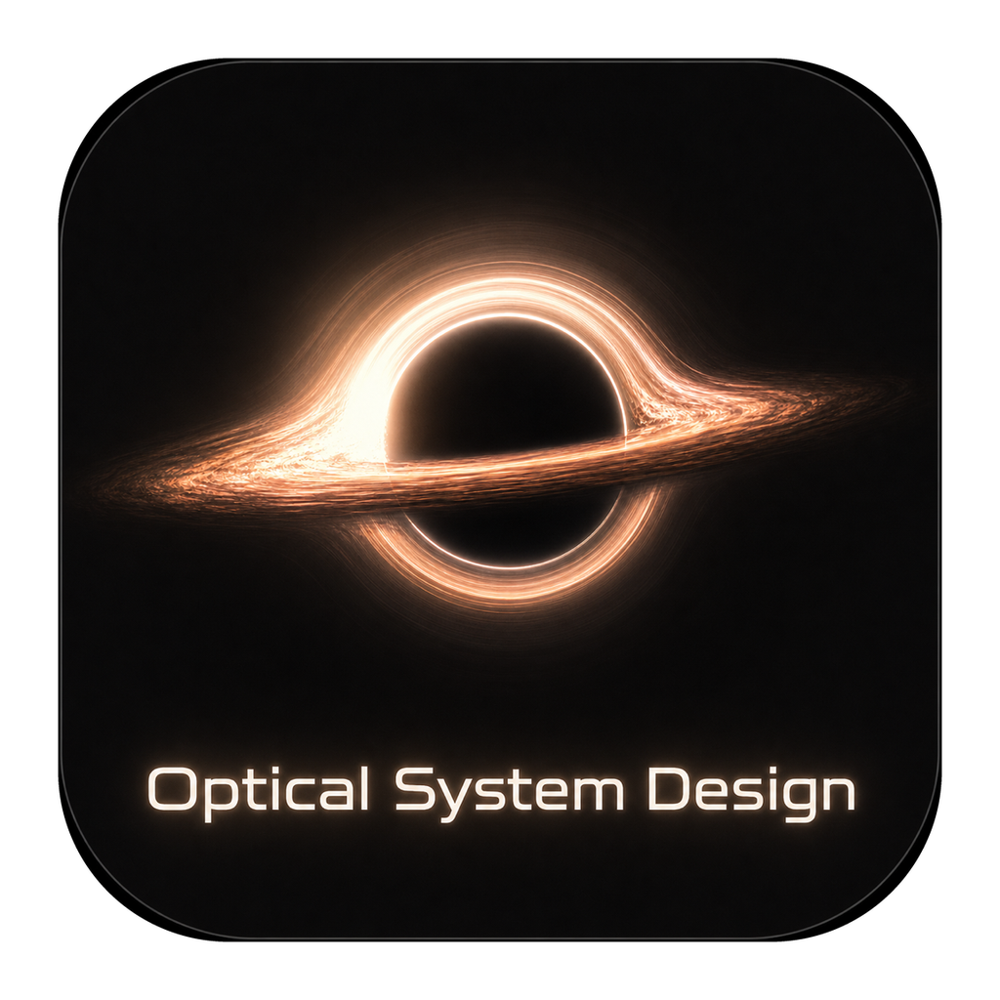
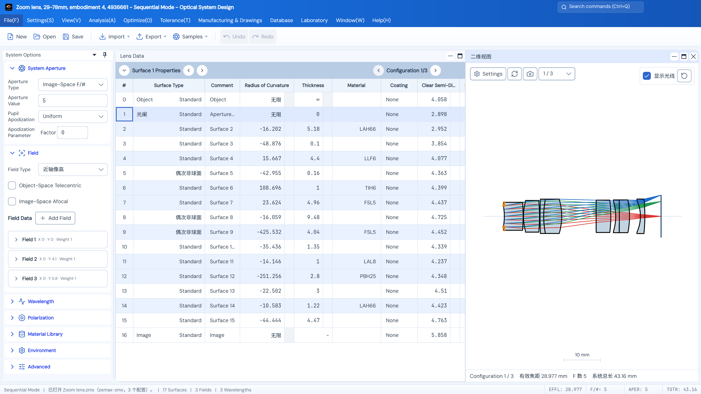

<p align="center">
  
</p>

<p align="center">
  <a href="README.md">简体中文</a> · <strong>English</strong>
</p>

<h1 align="center">Optical System Design</h1>

<p align="center">
  <strong>A desktop workbench for optical design and simulation</strong><br />
  Model sequential and non-sequential systems, trace rays, analyze image quality, optimize designs, and evaluate tolerances.
</p>

<p align="center">
  <a href="https://github.com/VendettaMask/opticalsystem/actions/workflows/ci.yml"></a>
  <a href="global.json"></a>
  <a href="docs/ARCHITECTURE.md"></a>
  <a href="https://github.com/VendettaMask/opticalsystem/releases"></a>
</p>

<p align="center">
  <a href="#features"><strong>Features</strong></a> ·
  <a href="#installation-and-startup"><strong>Download & Install</strong></a> ·
  <a href="#developer-quick-start"><strong>Quick Start</strong></a> ·
  <a href="docs/README.md"><strong>Documentation</strong></a> ·
  <a href="https://github.com/VendettaMask/opticalsystem/issues"><strong>Report an Issue</strong></a>
</p>

<br />

<p align="center">
  <picture>
    <source media="(prefers-color-scheme: dark)" srcset="docs/assets/readme/2026-10-27/workbench-dark-en.png" />
    <source media="(prefers-color-scheme: light)" srcset="docs/assets/readme/2026-10-27/workbench-light-en.png" />
    
  </picture>
</p>

<p align="center">
  <sub>October 2026 workbench screenshot showing the bundled zoom lens example, its 2D layout, and system options.</sub>
</p>

---

## Desktop workbench

Dock, split, or float the lens editor, 2D and 3D layouts, and analysis views. The main application shares a C#/.NET optical core with AI Initial Structure and Optical Coating Design, both available from the **Laboratory** menu.

The interface supports Simplified Chinese, English, and Japanese. Choose from Light, Dark, Lumen, Isekai, and Pixel themes. Isekai uses an English interface and the Almendra typeface. All themes use the project's [custom scientific SVG icons](docs/LOCAL_ICONS.md).

Open **File → Examples** to browse [95 sequential lenses in 14 categories](docs/USER_GUIDE.md#镜头示例). [Current Status](docs/CURRENT_STATUS.md) collects feature updates, numerical comparisons by lens, and validation records.

## Features

<table>
  <tr>
    <td width="50%" valign="top">
      <h3>🔭 Lens modeling and layout</h3>
      <p>Edit curvature, thickness, materials, surface geometry, apertures, fields, and wavelengths, with variables, solves, and pickups. Step through configurations from the lens header, keeping system options, layouts, and undo/redo in sync.</p>
      <a href="docs/GUI_QUICKSTART_REFACTOR.md">Desktop workflow →</a>
    </td>
    <td width="50%" valign="top">
      <h3>📈 Ray tracing and image analysis</h3>
      <p>Evaluate geometric aberrations, wavefronts, interference fringes, PSF, MTF, encircled energy, and relative illumination by field, wavelength, and lens configuration.</p>
      <a href="docs/PARITY_MATRIX.md">Analyses and models →</a>
    </td>
  </tr>
  <tr>
    <td width="50%" valign="top">
      <h3>🎯 Optimization and tolerancing</h3>
      <p>Optimize designs with variables, merit functions, and constraints. Evaluate manufacturing variation with two-sided sensitivity, inverse tolerancing, lens-group compensation, and Monte Carlo. Review histograms, yield, and reports for joint studies across configurations.</p>
      <a href="docs/OPTIMIZATION_ALGORITHMS.md">Optimization algorithms</a> · <a href="docs/TOLERANCING.md">Tolerance analysis →</a>
    </td>
    <td width="50%" valign="top">
      <h3>🧩 Initial-structure design</h3>
      <p>Generate or retrieve starting lenses from a design specification. Run autonomous topology searches, constrained compensation, and searches for cemented structures. Generate candidates with the managed AutoLens CPU or CUDA path, resume from checkpoints, and collect designs that meet the specification in the solution library.</p>
      <a href="labs/InitialStructure/README.md">Built-in module guide →</a>
    </td>
  </tr>
  <tr>
    <td width="50%" valign="top">
      <h3>🌈 Optical coating design</h3>
      <p>Design antireflection, high-reflection, and narrowband coatings. Edit layer thickness and n/k materials, calculate R/T/A and optical-density spectra, optimize layer stacks, evaluate manufacturing tolerances, and save coating experiments.</p>
      <a href="labs/CoatingDesign/README.md">Built-in module guide →</a>
    </td>
    <td width="50%" valign="top">
      <h3>🛠️ Projects, materials, and manufacturing data</h3>
      <p>Use the material and lens libraries and save projects as .staropt files. Export prescription and analysis CSV files, PNGs, Word/PDF/Markdown/HTML design reports, manufacturing drawings, and faceted STEP. The file guide lists the available ZMX, SEQ, and LEN exchange fields.</p>
      <a href="docs/FILE_FORMATS_AND_PLUGINS.md">Files and exchange formats</a> · <a href="docs/MARKDOWN_REPORT_EXPORT.md">Design reports →</a>
    </td>
  </tr>
  <tr>
    <td width="50%" valign="top">
      <h3>🔦 Non-sequential and stray-light workflows</h3>
      <p>Edit sources, optical objects, mechanical STL meshes, and detectors in a separate object document. Inspect propagation and energy through branch tracing, ray databases, path filters, and detector reconstruction.</p>
      <a href="docs/NON_SEQUENTIAL_TRACING.md">Non-sequential workflow</a> · <a href="docs/NONSEQUENTIAL_PHASE2_STRAY_LIGHT.md">Stray-light pipeline →</a>
    </td>
    <td width="50%" valign="top">
      <h3>📷 Camera imaging simulation</h3>
      <p>Feed 3D direct-light, scalar-diffraction, and non-sequential detector power into sensor, RAW/ADC, and basic ISP stages. Compare A/B imaging results, generate scene images by spectral band, and measure slanted-edge SFR across multiple regions.</p>
      <a href="docs/CAMERA_IMAGING_LAB.md">Camera Imaging Lab</a> · <a href="docs/SCENE_SLANTED_EDGE_SFR.md">Scene slanted-edge analysis →</a>
    </td>
  </tr>
</table>

### Analysis and display

| Task | Available capabilities |
| --- | --- |
| Geometric image quality | Spots, ray fans, field curvature/distortion, lateral color, RMS versus field/wavelength/focus, and Seidel coefficients with automatic bar-chart range |
| PSF, MTF, and energy | FFT and Huygens PSF, Fourier, Huygens, and geometric MTF, encircled energy, and relative illumination. Fourier MTF versus field accepts six independently set frequencies. Additional views include 3D FFT MTF, 2D Huygens MTF, and 2D FFT and geometric MTF versus field |
| Wavefront and interference | Surface, contour, and 2D heatmap wavefront views; grayscale, false-color, and contour interferograms with beam, tilt, analysis-surface, and subaperture settings |
| Zernike coefficients | Named Fringe, Standard, and Annular coefficient tables and fit statistics, plus coefficients versus field; use Wavefront Map for wavefront distributions |
| Interaction and export | Switch between plot, data, and text views. Toggle curves, adjust line widths, zoom, and pan. Use automatic, 16:9, or 4:3 sheets, fit to the window or view at original size, and export the full sheet as a PNG |
| Layouts and solids | 2D layout, 3D layout, and solid model with view presets, orientation indicators, ray display, and PNG export |

See the [User Guide](docs/USER_GUIDE.md) for analysis settings and the [interferogram guide](docs/INTERFEROGRAM_2026-10-26.md) for fringe sampling and computation.

## Installation and startup

### Download a package

Open [GitHub Releases](https://github.com/VendettaMask/opticalsystem/releases) and choose the installer for your system under **Assets** in the preview release.

| Platform | Asset identifier and format |
| --- | --- |
| Windows x64 | `win-x64` · EXE |
| Windows ARM64 | `win-arm64` · EXE |
| Mac Apple Silicon (M-series) | `osx-arm64` · DMG |

Each package includes the .NET runtime, AI Initial Structure, Optical Coating Design, and the application fonts. Release notes are published with the installers.

### Windows installer

Run the EXE for your system architecture and follow the setup wizard. The full installer also supports in-place upgrades. See the [Windows installation guide](docs/WINDOWS_INSTALLATION_UPGRADE_2026-10-12.md) for installation, repair, and recovery.

### Apple Silicon Mac package

Open the `osx-arm64` DMG and drag **Optical System Design.app** into Applications. See the [Mac installation guide](packaging/macos/README.txt) for first-launch steps.

### Updates and help

Open **Help → About** to check for and download updates, then choose **Install update and restart**. Select **Include prereleases** to receive preview updates.

Open **Help → User Guide** to search for features, analyses, and instructions.

### Run from source

Install the .NET SDK specified by [global.json](global.json) and run these commands from the repository root.

```powershell
dotnet restore OpticalSystemDesign.slnx --locked-mode
dotnet build OpticalSystemDesign.slnx -c Release --no-restore /m:1 /nr:false
dotnet run --project src/OpticalSystemDesign.App/OpticalSystemDesign.App.csproj -c Release --no-build
```

You can also build and launch the application with [Run-OpticalSystemDesign.cmd](Run-OpticalSystemDesign.cmd) on Windows or [Run-OpticalSystemDesign.command](Run-OpticalSystemDesign.command) on macOS.

## Developer quick start

The root solution contains the main application, built-in modules, and regression tests.

```powershell
# Run tests after the Release build above
dotnet test OpticalSystemDesign.slnx -c Release --no-build --no-restore /m:1 /nr:false

# Build the Windows installer
.\Build-Installer.cmd
```

See the [build guide](docs/BUILD_AND_RELEASE.md) for packaging tools and commands.

<details>
<summary><strong>Show the code structure</strong></summary>

| Path | Responsibility |
| --- | --- |
| `src/OpticalSystemDesign.Core` | Shared optical models, materials, tracing, analysis, optimization, tolerancing, and file core |
| `src/OpticalSystemDesign.Application` | UI-independent application services, transactions, workspace, and DTO mapping |
| `src/OpticalSystemDesign.App` | Desktop workbench, built-in module UI, and recovery entry points |
| `src/OpticalSystemDesign.Modules` | Display adapters for built-in modules, reusing shared computation and canonical DTOs |
| `labs/InitialStructure`, `labs/CoatingDesign` | Domain libraries, workflows, and tests for initial-structure and coating design |
| `tests/`, `tools/` | Regression tests, offline validation, and maintenance tools |
| `docs/` | Current guides, feature contracts, and dated stage reports |
| `validation/`, version-controlled `artifacts/` | Validation evidence retaining file, setting, version, and hash identity |

[System architecture](docs/ARCHITECTURE.md) · [Code map](docs/CODE_READING_MAP.md) · [Contribution guide](AGENTS.md)

</details>

## Contributing

Use [Issues](https://github.com/VendettaMask/opticalsystem/issues) for problems and suggestions, or contribute through [Pull Requests](https://github.com/VendettaMask/opticalsystem/pulls).

When reporting a computation issue, include the software version, analysis settings, steps to reproduce it, and the expected and observed results. A small example project you can share publicly helps reproduce the issue. See the [contribution guide](AGENTS.md) for the development workflow.

## Project positioning and acknowledgments

**S.T.A.R. Labs** maintains **Optical System Design** as a non-commercial project. We thank the following projects and their contributors.

- **Runtime and desktop UI:** [.NET](https://github.com/dotnet/runtime), [Avalonia](https://github.com/AvaloniaUI/Avalonia), [Dock](https://github.com/wieslawsoltes/Dock), and [CommunityToolkit.Mvvm](https://github.com/CommunityToolkit/dotnet).
- **Graphics, text, and platform integration:** [SkiaSharp / HarfBuzzSharp](https://github.com/mono/SkiaSharp) and their upstream projects [Skia](https://skia.org/) and [HarfBuzz](https://github.com/harfbuzz/harfbuzz), plus [Avalonia ANGLE](https://github.com/AvaloniaUI/angle), [MicroCom](https://github.com/kekekeks/MicroCom), and [Tmds.DBus](https://github.com/tmds/Tmds.DBus).
- **Optical algorithms and interaction references:** [Optiland](https://github.com/optiland/optiland), [AutoLens](https://github.com/AI4Optics/AutoLens), [DeepLens](https://github.com/vccimaging/DeepLens), [TFStudio](https://github.com/aai2k/TFStudio), and [tmmcore](https://github.com/aai2k/tmmcore). We appreciate their work on optical modeling, initial-structure design, and thin-film coating design.
- **Open material data:** [refractiveindex.info database](https://github.com/polyanskiy/refractiveindex.info-database).
- **Fonts.** [DM Sans](https://github.com/google/fonts/tree/main/ofl/dmsans), [Source Han Sans](https://github.com/adobe-fonts/source-han-sans), [JetBrains Mono](https://github.com/JetBrains/JetBrainsMono), [Noto Sans CJK](https://github.com/notofonts/noto-cjk), [Inter](https://github.com/rsms/inter), [Fusion Pixel Font](https://github.com/TakWolf/fusion-pixel-font), [Almendra](https://github.com/google/fonts/tree/main/ofl/almendra), and [STIX Two Math](https://github.com/stipub/stixfonts). See the [typography guide](docs/TYPOGRAPHY.md) for font roles and licenses.
- **Icons.** The desktop UI uses [scientific SVG icons drawn for this project](docs/LOCAL_ICONS.md). The app includes general-purpose [Lucide](https://github.com/lucide-icons/lucide) icons as fallbacks. The [license file](src/OpticalSystemDesign.App/Assets/Icons/LUCIDE-LICENSE.txt) retains Lucide's ISC license and the credits and license for icons derived from [Feather](https://github.com/feathericons/feather).
- **Build, test, and test dependencies:** [MSBuild](https://github.com/dotnet/msbuild), [NuGet](https://github.com/NuGet/NuGet.Client), [PowerShell](https://github.com/PowerShell/PowerShell), [VSTest / .NET Test SDK](https://github.com/microsoft/vstest), [xUnit.net](https://github.com/xunit/xunit), [Coverlet](https://github.com/coverlet-coverage/coverlet), [Newtonsoft.Json](https://github.com/JamesNK/Newtonsoft.Json), and [Inno Setup](https://github.com/jrsoftware/issrc).
- **Offline validation and report tools.** [Python](https://github.com/python/cpython), [NumPy](https://github.com/numpy/numpy), [SciPy](https://github.com/scipy/scipy), [Matplotlib](https://github.com/matplotlib/matplotlib), [Pillow](https://github.com/python-pillow/Pillow), [pythonnet](https://github.com/pythonnet/pythonnet), [python-docx](https://github.com/python-openxml/python-docx), [ReportLab](https://pypi.org/project/reportlab/), [FreeCAD](https://github.com/FreeCAD/FreeCAD) / [Open CASCADE Technology](https://github.com/Open-Cascade-SAS/OCCT), and [Node.js](https://github.com/nodejs/node).

See the [algorithm reference notice](third_party/autolens/AutoLens-NOTICE.txt), [coating reference archive](third_party/coating-reference/README.md), and [material catalog notes](src/OpticalSystemDesign.Core/Materials/Data/README.md) for sources, credits, and licenses.

<p align="center">
  <sub>Optical System Design · S.T.A.R. Labs</sub>
</p>
