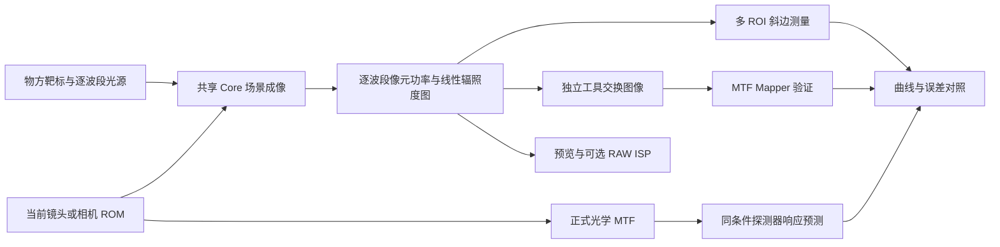

# Ansys 场景成像与斜边 SFR 实现计划

日期：2026-11-02。状态：实施中；M1 场景最小闭环、M2 预算内全幅与逐源谱交换已接入，原例全分辨率及完整验收尚未完成。目标读者：产品、光学计算与桌面开发人员。

首批入口、冻结数据和适用边界见[物方棋盘说明](SCENE_SLANTED_EDGE_SFR.md)。已取得真实 Lens 710 处方与原包，但原例二进制 ROM、完整 5000×3000 预算及几何适用性仍未解决，不据当前小幅面控制图关闭原例目标。

目标是在 Optical System Design 内完成物方靶标、镜头相机、场景成像、线性图像、选边测量和正式 MTF 对照的完整流程，使用户可以完成 Ansys 原文展示的工作。现有局部 PSF 斜边功能作为算法校验保留；本计划的交付依据是实际场景图像及独立对照，已有测试通过数不计为新流程验收。

## 目标和原文基准

基准为 [Ansys 斜边相机 MTF 原文](https://optics.ansys.com/hc/en-us/articles/38443588650899-Camera-MTF-calculation-using-the-slanted-edge-method-in-Ansys-Speos)，按其 2025 R1 工作流实现。原例用 5° 物方棋盘，分别计算 486、588、656 nm 的场景图像，经 ROM 相机取得辐照度图，再在线性设置下选边测量，并与单波长几何 MTF 对照；该对照关闭衍射极限乘项。文中后处理像元为 0.5 µm，并建议以半倍、原值、双倍计算时长检查噪声。ROM 采样 30、196 个发光面及 7–10 分钟运行是原例设置，不是产品通用默认值。

功能对应关系如下。右列均为本项目的实施目标。

| 原文环节 | 本软件需要交付 |
| --- | --- |
| 倾斜物方棋盘与光源 | 具有物理尺寸、位置、朝向和逐波段发光量的场景靶标 |
| 镜头与 ROM 相机 | 当前镜头直接追迹，以及可保存、加载的相机 ROM |
| 逆向场景仿真 | 从探测器穿过相机采集场景，生成完整图像 |
| 辐照度结果与导出 | 逐波段浮点结果、无滤波线性图像和完整物理元数据 |
| 外部选边分析 | 本机多 ROI 测量，并导出同一数据供独立工具验证 |
| 光学 MTF 比较 | 正式 MTF 路径、视场与方向对应、统一频率单位 |
| 黑盒使用 | 仅持有有效 ROM 时也能成像，运行不要求原镜面处方 |

完成范围包含上述工作流及 ROM／黑盒功能。Ansys `.OPTDistortion` 文件兼容另设明确验收项；原示例文件无法直接读取时，该项保持未完成，不能以原生镜头成功成像代替。目标不包含替代 Speos 的全部照明、杂散光、动态快门或供应商 ISP 功能。

原文相机属于场景辐射成像流程；不能因为参考使用几何 MTF，就改用只看 CAD 外观的简化渲染。相机模式及可用辐照度输出以 [Ansys 相机说明](https://optics.ansys.com/hc/en-us/articles/32043119534355-Getting-started-with-Speos-Camera-Sensor-and-running-an-example) 为依据。

## 首先固定的物理口径

### 几何基线和衍射扩展

原文复现先走几何传播，参考采用共享 Core 的正式几何 MTF，并关闭衍射极限乘项。当前局部斜边默认的衍射模型不能直接用于这一基线。

衍射场景成像作为后续独立模式：使用真实物距的共享波动传播，与同条件 Huygens／适用的 FFT MTF 比较。已经包含完整像差和衍射的图像，不再叠加一次完整 PSF。两种模式分别记录模型身份和验收结果。

2026 R1.03 的 ROM 新增了衍射数据能力，见 [新版 ROM 文档](https://ansyshelp.ansys.com/public/views/secured/zemax/v26103/en/opticstudio_user_guide/OpticStudio_Help/topics/Export_Reduced_Order_Model_to_Speos.html)。它不追溯改变本计划的 2025 R1 基线，新增能力须单独验证。

### 波长和功率

原文逐波长任务先分别实现，三个结果保留独立图像、ROI、SFR 和 MTF。当前镜头波长表也可生成相应任务，但必须冻结实际数值，不能用标签中的近似波长改写处方。

场景中的权重表示源辐射量，必须有明确单位或总功率归一化规则。每条光线携带真实传输损失，不能把每个波长的像面功率重新归一化为相等能量。多波长合成属于扩展模式，按实际到达像面的线性功率合成；需要纯光学分析权重时，使用单独标识，保留现有局部实验的原含义。

| 因子 | 负责环节 | 防止的重复或遗漏 |
| --- | --- | --- |
| 发光谱、带宽和源权重 | 场景光源 | 区分谱密度与带积分量，权重只应用一次 |
| 镜头透过、遮挡与渐晕 | 直接追迹或 ROM | 不用每波段单位能量归一化消除实际损失 |
| 相机附加透射谱 | 相机配置 | 与 ROM 已含的传输量逐项核对，不重复乘透过率 |
| 像元面积和有效孔径 | 探测器积分 | W/pixel 已含面积，转辐照度仅除一次面积 |
| 曝光与 QE | 可选电子链路 | 辐照度基线不加入 QE；电子计算只做一次能量至光子转换 |
| Gamma 与显示拉伸 | 预览分支 | 不进入 SFR 输入，不改变物理数组 |

原文采用的相机透射文件、发光谱和发光面选择必须在 M0 从资源包固定。窄带光谱的具体带宽不能擅自替换成理想单线；光谱文件名中的 Gaussian 也不代表使用高斯空间模糊核。

### 坐标和分辨率

固定世界、靶标、镜头、相机和像素五套坐标的变换，记录光轴方向、单位、手性、行顺序、像元中心和相机原点。镜头版本不同的相机原点必须明确转换；原例的 X 轴反向设置不能变成所有相机的隐含规则。

传感器物理尺寸、像元尺寸和分辨率须互相一致。原例 0.5 µm 对应 Nyquist 频率 1000 cycles/mm；文中 690 cycles/mm 换算为 0.345 cycles/pixel。比较按真实像元尺寸换算，禁止以缩放图片的方式对齐横轴。

棋盘在物方定义，其像面边缘角度、大小、位置与弯曲由成像决定。ROI 从实际图像选择，不预先把理想像面边缘送入测量器。

## 现有能力和缺口

以下结论对应当前仓库的接口和实现，不表示已完成新工作流验收。

| 能力 | 可复用实现 | 新流程缺口 |
| --- | --- | --- |
| 物理场景与逆向几何成像 | [DirectCameraScene](../src/OpticalSystemDesign.Core/Analysis/Imaging/DirectCameraScene.cs)、[DirectCameraRenderer](../src/OpticalSystemDesign.Core/Analysis/Imaging/DirectCameraRenderer.cs) | 接入标准靶标、相机姿态和批量实验；补齐适用范围检查 |
| 棋盘与发光面 | [EmissiveCheckerboard](../src/OpticalSystemDesign.Core/Analysis/Imaging/EmissiveCheckerboard.cs) 已在一张实际表面上分区发光，旧反射棋盘保持身份 | 原例姿态、源光谱/单位与相机条件的完整核对及验收继续开放，不能再把分区发光列为未实现 |
| 逐波段功率 | [SpectralDetectorPower](../src/OpticalSystemDesign.Core/Analysis/Imaging/SpectralDetectorPower.cs) 与新场景线性出口保留 W/pixel 和 W/m²，不经过电子/显示处理 | 原分辨率流式处理及标准线性交换仍待 M2 |
| 场景服务 | [SceneSfr](../src/OpticalSystemDesign.Application/Services/CameraImagingService.SceneSfr.cs) 已有独立请求、1–16 显式波段、冻结镜头和线性场景帧；旧 Scene3D 传感器链仍按原协议 | 本批界面限单波段任务；多波段/源光谱任务编排、原例完整幅面及 M2 继续开放 |
| 场景衍射 | [DiffractionCameraRenderer](../src/OpticalSystemDesign.Core/Analysis/Imaging/DiffractionCameraRenderer.cs) | 独立完成衍射模式验证，不能当作原文几何基线的替代 |
| SFR 计算 | 原估计器已有实际线性图像适配，单 ROI 可声明近竖直/近水平，不使用靶标角度或光学参考拟合图像 | 多 ROI、外部工具、畸变/边缘质量与原文测量验收未完成 |
| 光学参考 | 正式几何、FFT、Huygens MTF 分析 | 建立 ROI 像面位置到视场和实际测量方向的对应 |
| 保存与重放 | 首批 `.scene-sfr.zip` 已冻结靶标、镜头、原始功率、单 ROI 或失败并支持独立重放；旧相机/局部斜边协议不升级 | 完整原例相机、ROM、全部逐带任务、多 ROI 和独立比较记录仍待后续 |
| ROM 与黑盒 | 本条相机路径未形成相应交付 | 新增生成、加载、适用域和误差验证；单列 Ansys 格式兼容 |
| 全幅与资源 | 现有图像、光线和变换有明确上限 | 原例完整传感器必须先核算；局部诊断 API 不能冒充全幅渲染 |

现有局部单色 V3 和多波长实验继续保持其协议、结果和校验用途，见[当前说明](MONOCHROME_SLANTED_EDGE_SFR.md)。新场景实验使用独立身份，不静默升级旧记录。

## 实施结构

光学传播、辐射量和测量数学均在共享 Core，Application 只负责冻结、调度和结果映射，App 负责场景配置、选边和展示。产品计算保持 C#/.NET，不引入第二套镜头引擎。独立工具只作互操作和验证，不能作为产品计算的隐藏后备。

线性图像结果至少包含：逐波段 W/pixel、可追溯的 W/m² 图、物理尺寸、波长和源权重、有效面积、像元响应、坐标变换、镜头／ROM 摘要、传播模式、计算量和采样统计。以浮点数组为计算真值，RGB 预览和电子图像为独立派生结果。

## 分阶段交付

### M0 固定原文样例和验收配置

获取原文资源包并建立唯一原件目录与哈希清单。核对实际镜头文件、ROM 版本、场景尺寸、发光面、全部光谱文件、相机位置、像元与完整分辨率、原文图中未列入正文的设置及参考曲线。识别 `.zda` 设置文件与镜头处方的区别，不把原文文件名当作已取得镜头数据的证明。

建立独立的原文配置、当前镜头配置和解析控制配置。既有 Zemax 2026 R1 基准保持原文件、设置和公差；原文 2025 R1 记录独立保存。若样例只有二进制 ROM，则将其读取能力列入复现的依赖，不用另一镜头替换后宣布原例通过。

同时固定比较频段、ROI 对应、MTF50 定义、误差指标、收敛档位、工具版本和资源预算。原文截图不足以定义数值公差，截图不能作为逐点曲线真值。

交付：资源索引、参数表、适用范围、预算估算和验收配置。M0 未完成前，不开发针对某张参考图的补偿常数。

### M1 物方发光棋盘和单波段场景图

在现有三维场景中新增物理棋盘靶标，参数包括尺寸、格数／格距、物方距离、三维姿态、明暗发光谱与可选反射谱。采用真实表面上的发光分区；可以用一张共面几何加发光分区表达多个共面发光面，但须验证边界和面积等价，不能受现有对象数限制而删掉靶标内容。

从当前镜头构造只读相机快照，复用逆向追迹得到单波段整幅探测结果。先在小尺寸解析控制中验证姿态、视场、成像反转、功率比例和像元积分，再运行实际棋盘。无效共轭或不支持的相机模型明确失败，不自动聚焦或改处方。

交付：物方棋盘预览、相机取景、单波段浮点成像和最小实验重放。此阶段完成不等于原文全流程完成。

### M2 全幅线性结果和逐波段任务

已实现的预算内任务、浮点/16 位交换、全局计算量及分块一致性见[M2 实测记录](../validation/rechecks/2026-11-02/scene-linear-batch/README.md)。当前镜头 512×512 三波长和 128×128 三种有限源谱为显式原生控制传感器；5000×3000 的预检保留原尺寸并报告超限。因此 M2 的原例完整幅面条件尚未关闭，不能将这些控制图计作其验收。

将场景结果从固定三个颜色通道推广为声明的波段数组。提供原文三个独立任务和当前镜头波长任务；每个任务均冻结同一场景、镜头、像面与相机设置，改变的只有声明的光源谱。

成像出口直接接逐波段像元功率，绕过 Gamma、白平衡、去噪、锐化和显示标定。增加完整浮点数据导出及线性灰度交换图；16 位 PNG 作为拟定的独立工具交换格式，配套编码、缩放、位深、Gamma／色彩配置和原始尺寸清单。原文的图像导出是功能参照，不能把显示截图作为测量原件。

全幅预算须包括全部像元、波段、采样和场景工作。若采用流式／分块实现，使用统一传感器坐标、全局总预算、必要的源保护区域和确定的随机序列，验证块边界连续性。不得重复调用局部诊断接口来重置预算，也不得缩小物理传感器、降低分辨率或只生成中央 ROI 后声称全幅完成。现有限额保持；需要新的正式任务预算时单独评审，并保留资源不足状态。

交付：原分辨率全幅图、逐波段数据、外部交换文件、进度／取消和计算量记录。

### M3 实际图像上的多 ROI 测量

SFR 输入接口只接收线性图像、像元元数据和用户 ROI。增加手动选边、多 ROI 管理、近水平与近竖直边支持，保留 ESF、LSF、拟合残差、有效样本、SFR、MTF50 和质量原因。

ROI 必须避开棋盘交点、邻边、遮挡、裁切和不可用的饱和区。强畸变导致直线拟合失效时，先给出质量失败；后续曲边拟合使用独立算法版本，不能用已知靶标边缘或参考 MTF 代替实际测量。

提供供 MTF Mapper 使用的图像和参数清单，并读回同一 ROI 的外部曲线、边缘坐标和 MTF50。线性输入、像元尺寸、平滑和 ESF 方法必须固定，参考 [MTF Mapper 作者的输入说明](https://mtfmapper.blogspot.com/2018/02/device-profile-support.html)；不同版本的具体选项在 M0 固定，不能凭默认设置推断一致。独立工具采用后台 CLI 或隔离人工验证，不自动占用用户桌面。

交付：整幅图上的多个测量位置及方向、内部与独立工具逐 ROI 对照。

### M4 正式 MTF 和完整收敛闭环

将 ROI 像素坐标换算为传感器毫米坐标，再按实际镜头／ROM 映射求对应视场。不能以整幅传感器中心代替任意 ROI，也不能仅取最近一个已定义视场而忽略偏差。自由选点可以作为连续视场求值，原定义视场仍显示原 Field 编号；所有映射数值存入元数据。

正式参考使用场景实际物距和共轭的派生分析快照，保留镜片间隔与保存像面，记录与原工程的条件映射且不回写工程。有限距离靶标不能沿用无穷远物距的参考，也不能为使结果匹配而重新聚焦。

比较沿实际边缘法线进行。T/S 根据视场、相机坐标和法线关系确定；明显偏离 T/S 的边保留真实方向参考，不能强行贴方向标签。图中只使用 T/S 简写，像面距离、角度和频率单位保留。

缺少任意方向求值入口时在共享 Core 补齐，不能按角度混合两条 T/S 幅值曲线来代替斜向 MTF。

同时给出纯光学 MTF 与包含真实像元响应的预测。SFR 测量包含像元面积效应，适用局部线性模型时对光学参考正向施加一次像元响应；不在图像中再次积分，也不直接把两种定义强制当成相同曲线。辐照度基线不混入 RAW／ISP MTF。

收敛覆盖三个层面：

1. 成像：瞳孔／每像元光线、像元面积积分、靶标边界与物方面积采样；随机算法保留种子、实际样本数和统计误差。
2. 测量：ROI 大小、ESF 分箱、LSF 窗口、边缘角度和亚像元位置；区分测量偏差与成像误差。
3. 相机模型：ROM 的视场、波长、距离与瞳面采样，以及插值留出误差。

先做独立单轴加密，再做至少一组联合加密。采用半倍、原值、双倍时长或等价实际工作量检查 Monte Carlo 噪声；确定性积分采用声明的密度阶梯。计算时长到达、全部像元有值和数值收敛是不同状态。不能用缩小窗口来替代瞳面与窗口配套加密。

交付：同条件正式参考、独立测量对照、误差分解和完整收敛报告。

### M5 相机 ROM 和黑盒能力

复用共享 Core 从只读镜头生成原生 ROM，保存其光谱、视场、物距、像元／相机坐标、传输量、渐晕、畸变和几何像差信息。单独的畸变中心映射不足以生成具有正确 SFR 的模糊图像；保留能表达光线束或空间变化响应的数据与误差指标。

原生 ROM 用直接追迹留出样本验证，覆盖中央、边场和至少一个中间距离／波段位置；未声明的域禁止静默外推。加载 ROM 后不读取原镜面处方，验证黑盒成像的可移植性。黑盒隐藏的是处方，不是模型身份、适用域和验收范围。

原文 ROM 的像方到物方传播及坐标处理参照 [2025 R1 ROM 说明](https://ansyshelp.ansys.com/public/Views/Secured/Zemax/v251/en/OpticStudio_User_Guide/OpticStudio_Help/topics/Export_Reduced_Order_Model_to_Speos.html)。实现中只转换派生模型，不修改用户工程。

Ansys 格式兼容先识别公开样例的具体版本和可取得的格式依据，分别记录读取、模型解释及数值比较结果。不能把 CRA 几何文件、完整光学 ROM 和后续衍射 ROM 混为同一能力。若二进制格式或必要依赖不可获得，该兼容项保持开放；不得猜测字段、调用未声明外部引擎，或生成一张相似图冒充互通。

交付：原生 ROM 生成／保存／加载、黑盒重放、直接模型留出对照和明确的 Ansys 格式支持矩阵。

### M6 原文工作流集成和验收

在现有相机实验室增加“场景靶标 SFR”完整工作流：设置靶标和相机 → 检查取景 → 运行各波段 → 查看线性图像 → 选择多条边 → 对照参考与收敛 → 保存或导出。现有局部 PSF 页面明确为校验用途，复用测量组件与绘图组件，不让两条来源混淆。

保存实验包含场景几何与发光定义、原始文件哈希、镜头或 ROM、相机姿态和像面、完整光谱、物理单位、浮点图像、ROI、采样任务、随机状态、各参考与工具版本。新实验采用独立模型身份；打开、取消、换工程和按快照复算均有验证。三语、可访问性、曲线选择、共享线宽和统一图签／PNG 使用现有规范；分析图导出尺寸与传感器数据尺寸分开处理。

用原文资源执行三个波段的中心位置及两个测量方向，再用当前镜头在边场补充验证。验收分为“原生工作流功能等价”和“原文示例文件复现”两项：前者包含 ROM／黑盒、完整分辨率、外部测量、正式参考和误差判定；后者还要求原例 ROM 在本软件中读取并通过对照。两项分别交付，全部通过才称完整复现；接口未完成时保留原生成果，但不关闭总目标。

交付：可重开的原文实验、当前镜头实验、用户操作指南和逐项验收账目。

### M7 衍射与多波长系统扩展

在 M6 基线上增加真实物距衍射、按实际功率合成的多波长图及相应复数 OTF 对照。继续区分光学分析权重和场景辐射权重，区分光学响应、探测器响应和电子／ISP 响应。

该阶段扩展原文能力，不回写成原文 2025 R1 的既有功能，也不替换 M6 的逐波长几何结果。RAW／ISP、传感器噪声与动态场景按独立任务开展，不能影响原辐照度测量入口。

## 验收规则

M0 固定新增指标与频段后再实施，禁止看到结果后放宽公差。既有光学参考沿用[数值验收规则](NUMERICAL_PARITY.md)及其具体基准设置；已有局部实验的 0.01 只继续作为该协议的数值差检查，不能自动升级成所有新场景的物理精度标准。

| 验收层面 | 必须记录和检查 |
| --- | --- |
| 几何与量纲 | 靶标尺寸、距离、姿态、成像倍率、视场位置、反转、像元与频率换算；解析控制和正式映射相符 |
| 辐射传输 | 逐波段总功率、平场／明暗区功率、透过与渐晕；全源功率翻倍时像面功率同比变化，未截断图像的归一化 SFR 保持一致 |
| 独立测量 | 同一图像、同一 ROI、相同线性解释下的曲线与 MTF50；不以可视化相似或仅一个 MTF50 代表全曲线通过 |
| 正式光学参考 | 模式、波长、共轭、视场、方向、像元响应和单位一致；非局部平稳 ROI 标为不适用或单独建模 |
| 数值收敛 | 成像、测量与 ROM 的加密误差；至少三个级别或等价误差估计，联合加密及随机重复支持结论 |
| ROM 和黑盒 | 域内留出误差、边界行为、无处方重放；格式兼容与数值等价分别验证 |
| 全幅与保存 | 原分辨率完整数据、全局工作预算、源身份、断点／取消、跨工程精确重放或声明的统计复现 |

新增误差表应分别规定曲线逐点最大差、有效频段、MTF50 的绝对和相对误差、辐射量误差及统计置信要求。MTF50 没有有效交叉、曲线过平、ROI 质量不足或参考未收敛时，不产生“通过”。频率离散本身造成的定位误差须计入阈值。

解析控制覆盖无像差／已知响应、几何像移、两波段不同透过率和响应、方形像元、功率缩放及单位变换；合成高斯边缘仅用于测量器测试，不能作为镜头成像后备。回归同时保护现有单色 V3、多波长局部实验、场景功率、传感器和正式 MTF 基准。

## 依赖和完成条件

实施顺序为 M0 → M1 → M2 → M3 → M4；M5 在 M1 和 M4 的直接模型与误差基准稳定后交付；M6 汇合 M2 至 M5；M7 随后独立开展。优先把真正场景数据接入测量器，界面细节随可验收功能交付。

- [ ] 原文资源、参数、比较指标和资源预算已冻结。
- [ ] 物方发光棋盘经当前镜头生成全幅逐波段线性图。
- [ ] 像元、姿态、波长、辐射单位和传输因子均有明确归属。
- [ ] 支持实际图像多 ROI、两类边缘方向及质量判定。
- [ ] 同一图像通过独立 SFR 工具验证，正式 MTF 对照条件匹配。
- [ ] 成像端、测量端和相机模型收敛均有证据。
- [ ] 原生 ROM 与无处方黑盒重放已验证。
- [ ] Ansys 原例 ROM 已在声明版本读取并通过数值对照，其他版本的支持范围明确。
- [ ] 原例、当前镜头、浮点数据、实验重放和用户指南共同验收。

上述清单是完整交付条件，首批 M0/M1 实现没有使其全部成立。现有局部八视场结果只证明其已记录的局部协议，不勾选本清单。每个阶段更新[当前状态](CURRENT_STATUS.md)和对应证据，保留未完成、失败和不适用的真实结论。
