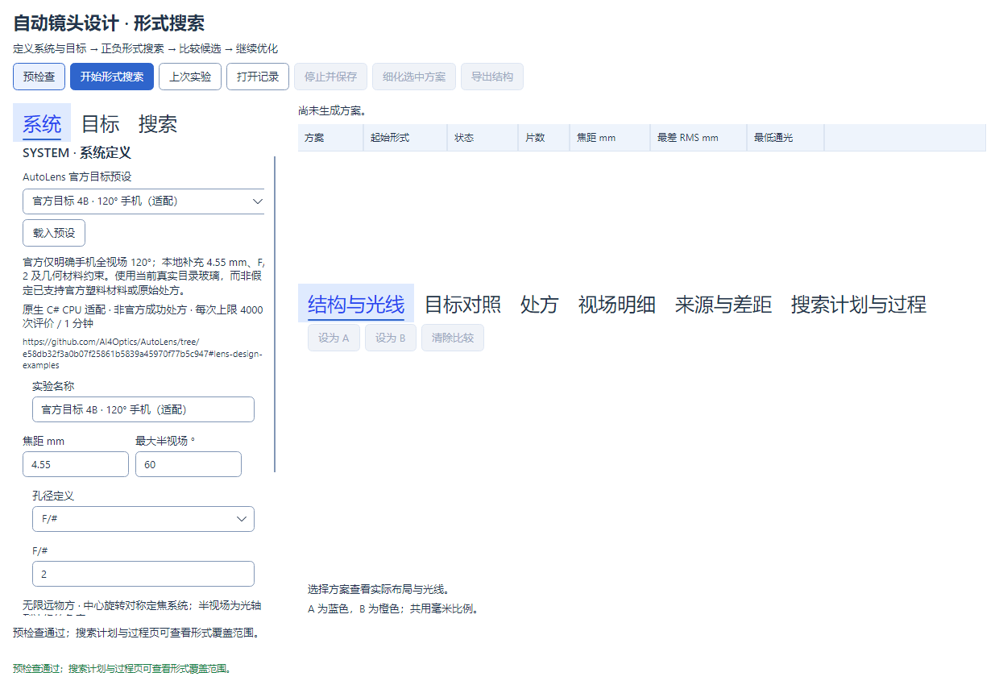

# AutoLens 官方目标的原生预设与验证

2026-10-24 增加独立的 **原版脚本默认 · 5 mm F/1.8 全视场 90°** 条目并作为新窗口默认值，来源为固定提交 `1_autolens.py` 的 MOBILE_CONFIG：20000 mm 有限物距、六片、r⁴–r¹⁸、前置独立光阑、原版 61 项 CDGM 常用表、种子 42、2001 + 3001 次更新。该条目不同于下文五项 README 目标；6000 次评价/6 小时是本地资源上限，不是原版运行承诺。新桌面搜索使用 `autolens-upstream-e58-v2` 规则，历史专用 CPU 协议和静态预设数据保留原身份。详见[对齐范围](AUTOLENS_UPSTREAM_ALIGNMENT_2026-10-24.md)。

更新：2026-10-22。

## 使用入口

在主程序 **实验室 → AI 初始结构 → 系统 → 从预设开始** 中选择官方目标，点击 **载入预设**。“来源与适配说明”展开后显示所选条目的限制和固定来源；AutoLens 面型、材料优化及阶段步数在 **搜索 → AutoLens 参数** 中展开。载入填入系统、目标、材料和搜索参数，清除旧结果，但不自动运行、不修改主工作台工程，也不把未运行的目标标成已达标。先点“预检查”，再点“开始形式搜索”。结果仍可比较、查看目标差距、保存记录和导出 STAROPT。当前分组截图见[界面整理记录](INITIAL_STRUCTURE_UI_2026-10-22.md)。

这是原生 C# CPU 的**目标预设**，不是从上游导入的已优化镜头。DeepLens JSON 文件导入、GPU 和上游数值等价不在本次范围。预设名称及来源说明提供中文、英文、日文。



## 官方指标与本地适配边界

固定来源：[AutoLens e58db32 的 Lens Design Examples](https://github.com/AI4Optics/AutoLens/tree/e58db32f3a0b07f25861b5839a45970f77b5c947#lens-design-examples)。不追踪随时变化的默认分支。Apache-2.0 许可证与原适配声明随主程序提供。

| 原生预设 ID | 官方明确指标 | 本地补充或转换 |
| --- | --- | --- |
| `wide-80` | 4.55 mm、F/2、全视场 80° | 半视场 40°；种子 42 |
| `full-frame-50` | 50 mm、F/2、全画幅对角线 43.3 mm | 按理想无畸变关系得到半视场 23.4126115889501°；种子 42 |
| `wide-80-seeds` | 同一广角目标的 20 个随机设计 | 官方没有公布这 20 个种子的编号；本地固定为 1–20 |
| `ultra-camera-f12` | 大光圈相机 F/1.2 | 50 mm、43.3 mm 对角线及对应半视场由本地补充；种子 42 |
| `ultra-mobile-120` | 手机镜头全视场 120° | 4.55 mm、F/2 由本地补充，半视场 60°；种子 42 |

全画幅 README 正文与动画替代文字冲突：正文为 F/2，替代文字为 F/3，本预设采用正文的 F/2，不能称为动画原处方。43.3 mm 仅用于预设视场换算，当前验收不单独认证畸变后的实际像面覆盖，不能把角度验收称为像圈认证。

极端规格图只有八幅布局，没有逐幅完整规格和处方。这里把明确公开的两个目标做成**适配预设**，不虚构八套原始处方，不声称八幅图都已复现。官方已提交的 `cellphone.json` 和 `test_camera_aspheric.json` 的文件头也不是以上 README 目标的同一组指标，不能用它们冒充对应示例的成功结果。

下文五项 README 目标的历史静态数据固定为六片、真实目录玻璃 `N-BK7 / N-F2 / N-SF6`、三个等权波长 486.1/587.6/656.3 nm（587.6 nm 为主波长）、实体光阑、自动变径、偶次非球面至 r¹⁰。这些本地适配数据不改写；载入后开始新搜索会采用当前 e58 规则和前置光阑。它们不能宣称完整复现原 CAMERA_CONFIG；独立原版默认条目则使用原源目录数据。原生信赖域、旧启发式及 target polish 仍不开放为桌面选项。

2026-10-23 起，界面载入预设保留上述设计目标，但新运行固定关闭原生目标精修（预算为零），只使用 AutoLens；旧混合算法记录仅可查看、比较和导出。下文 `autolens-official-targets-cpu-v1` 的专用验收工具和冻结记录仍保留原协议的 400 次原生精修上限，用于解释既有证据，不能作为当前纯 AutoLens 界面的新成功率或数值认证。

| 本地约束 | 广角 / 120° 手机 | 全画幅 / F/1.2 相机 |
| --- | --- | --- |
| 最大总长 / 最小后焦 | 12 / 1 mm | 120 / 10 mm |
| 最小中心厚度 / 空气隙 / 边厚 | 0.4 / 0.1 / 0.1 mm | 2 / 0.5 / 0.5 mm |
| 最差面积 RMS / 最大光斑半径 | 0.01 / 0.03 mm | 0.05 / 0.15 mm |
| 初始光阑面 | 1 | 7 |

焦距相对容差 2%、F/# 相对容差 5%、每视场每波长通光门槛 98%，独立边界检查不放宽。门槛是本产品的固定验收选择，不是从上游图片测得的官方像质。未达标不改阈值、不隐去失光、不用幸存光线的较小 RMS 冒充完整光束像质。

## 固定 CPU 验证协议

协议身份 `autolens-official-targets-cpu-v1`。五个条目共 **24 次独立运行**：四个单种子目标，加同一广角目标的 20 种子系列。每次上限 4000 次评价、60 秒、单搜索任务；初始优化和目录精修步数上限分别 2000/3000，原生完整目标精修最多 400 次评价。评价与时间预算优先，记录实际完成步数，不能把设定上限说成实际完成迭代。

这不是上游训练步数的等量复现。20 种子系列遵循本产品的严格平板根与显式形式初始化；种子参与采样及搜索调度，不等于已复制上游随机处方初始化。六片固定片数、统一非球面阶次和当前允许玻璃也不等于官方演示的原始拓扑与材料。

时间在已有计算边界检查，不强杀共享 Core 调用。独立加密复核、导出和重载复核在搜索预算之外，因此单条验证总用时可能超过 60 秒。长时间运行的机器负载影响实际优化步数，结果不能据此宣称 GPU 性能或上游成功率等价。

专用工具与 UI 使用同一份 `AutoLensOfficialExamples` 预设和同一 `FlatStartSearchService`，不另写光学公式。每次保存原始输入、带校验的搜索记录、选中候选（若有）、独立完整口径物理复核、STAROPT 及重载复核。失败处方也保留以便诊断，不表示可用设计；无候选时明确记录，绝不补造成功处方。

```powershell
dotnet build labs/InitialStructure/tools/OpticalSystemDesign.InitialStructure.Benchmarks -c Release --no-restore
dotnet run --no-build -c Release --project labs/InitialStructure/tools/OpticalSystemDesign.InitialStructure.Benchmarks -- --autolens-official artifacts/autolens-official/new-run
```

可追加一个精确预设 ID 做诊断子集。输出目录必须是新的或空目录，不覆盖既有证据。退出码 0 表示所有请求设计达标且复核一致，2 表示至少一个未达标或出错，3 表示用户中断；测试通过数与设计达标数分别报告。选择“20 随机种子”后，UI 载入的是第一个种子；该条目全部 20 次运行由上述工具执行，UI 不暗中启动批量任务。

2026-10-22 已完成全部 24 次本地有界运行，0/24 达标；均先触发时间限制，未完成全部两阶段训练。逐目标和全部种子的真实焦距、F 数、RMS、违规项及证据见[本轮报告](AUTOLENS_OFFICIAL_EXAMPLES_2026-10-22.md)和[机器账目](validation/AUTOLENS_OFFICIAL_EXAMPLES_2026-10-22.json)。

工程定向测试及后续状态见 [当前状态](CURRENT_STATUS.md)。此协议不替代历史完整搜索协议、上游性能/数值等价验证或外部 Zemax 认证；“加载了预设”和“设计达标”是不同状态。
