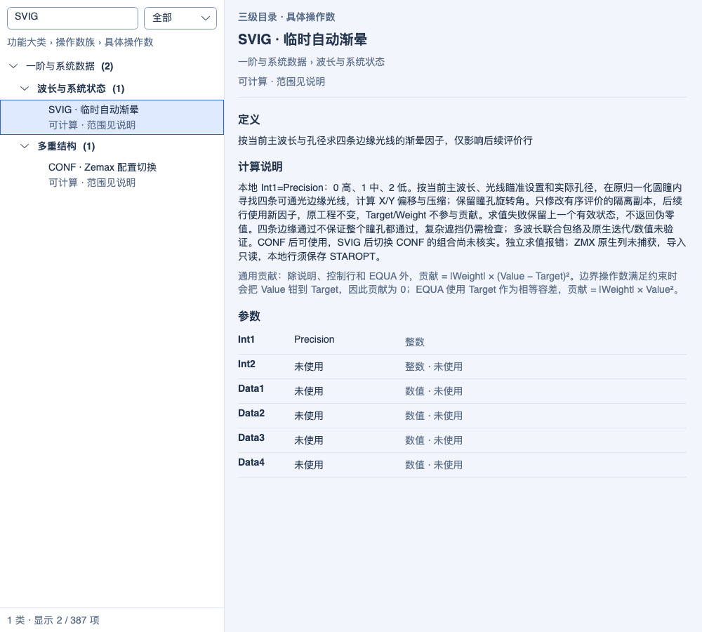
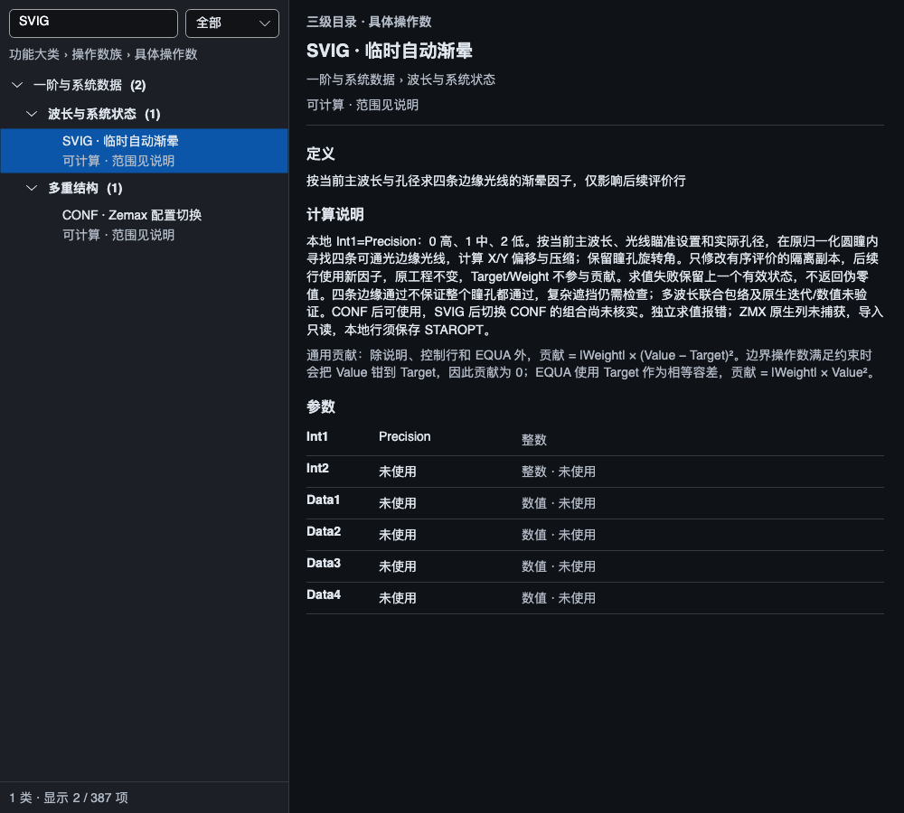
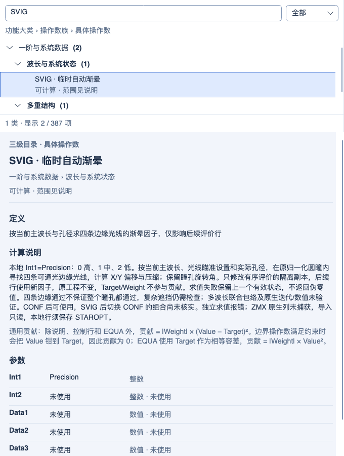

# SVIG 自动渐晕

2026-10-13 最新交付约束：初始结构与镀膜设计已改为主程序同进程、同安装包的必装内置模块；不再支持独立程序、可选安装或外部路径启动。当前构建、定向测试、安装包证据及全量审计的已知失败见[统一产品交付记录](BUILT_IN_MODULES_2026-10-13.md)。下方各阶段的独立架构、包身份及计数只保留历史范围，不能作为当前交付说明。

2026-10-13 当前安装维护：已增加旧载荷自动清理和跨会话目录文件锁；一键版本回退按用户要求不纳入范围。默认 Debug/Release 构建零警告、零错误；相同相关集合各 **146/146**、实际 x64 隔离安装矩阵 **98/98** 通过，集合不相加。新增 25 个清理/文件锁案例；此前 CSV/恢复修复阶段完整 Release **4785/4785** 与冻结 **2668/2668** 保留阶段身份，本次未重跑光学全量或实机故障/ARM64/完整人工桌面验收。已构建 1.0.3 独立测试包，旧 1.0.2 正式包保留，修改尚未提交推送。见[最新实现、证据与边界](CURRENT_STATUS.md)。

2026-10-12 历史恢复扩展（1.0.2）：30 秒工程副本、崩溃恢复入口、安装持久日志/启动重放、同发布损坏载荷修复及受支持旧格式迁移已实现。默认 Debug/Release 构建零警告、零错误；正式完整 Release **4770/4770**、Debug/Release 相关各 **66/66**、实际 x64 隔离安装矩阵 **78/78** 通过，均零失败、零跳过，集合不相加。最终 1.0.2 未签名包 **1179** 个载荷文件核验及实际 EXE 只读工程/旧设置检查通过。物理断电、完整 GUI 与 ARM64 实机仍未认证；此前光学数值和安装阶段记录保留历史身份。源码同步状态见恢复报告。见[实现、证据与限制](WINDOWS_INSTALLATION_UPGRADE_2026-10-12.md)。

2026-10-12 历史安装升级验收（1.0.1，恢复扩展之前）：默认采用无需购买证书的未签名交付；版本载荷校验、失败恢复、运行互斥、入口更新及用户数据保留已实现。实际 x64 隔离安装矩阵 **48/48**，默认 Debug/Release 构建零警告、零错误，相关回归各 **32/32**；最终 1.0.1 未签名包 **1179** 个载荷文件核验通过。本阶段未重跑光学全量，下方 4733/182 等保留为安装改动前的光学阶段结果，不代表当前完整发布验收。断电恢复、完整 GUI 和 ARM64 实机仍开放；未提交推送。见[安装方案、证据与限制](WINDOWS_INSTALLATION_UPGRADE_2026-10-12.md)。

2026-10-12 出瞳扩展阶段验证（安装改动之前）：新增受限三维几何光阑像、无焦物理平面刀口及非磁均匀介质 Maxwell 矢量角谱；默认 F 数近似和焦面 FFT 模式保留。已修复三个有效角点被固定对角线遗漏的边界问题，默认/宽窗口严格反例通过。最终默认 Debug/Release 构建零警告、零错误；正式完整 Release **4733/4733**、完整比较工具 **182/182**、Debug 相关 **554/554**、实际绘图新回归 **36/36**，零失败、零跳过，重叠集合不相加。原正式 4697 项与工具 182 项身份/次数保留，新增 36 项；Debug 原 440 项保留，另选 78 项既有与 36 项新增，不替代完整 Debug。原 N04 两组强度指标不变，306 份捕获及冻结工作区/Git **2668/2668** 保持原字节。修正前 4731 项通过和宽窗失败另存，不冒充修正后验收。唯一精确波动出瞳、全系统 POP、真实刀刃散射、GRIN/吸收接口完整场及新原生/发布认证仍开放；独立 Cooke/Tessar 排除。本轮未连接 Zemax、未提交推送。详见[扩展实现、严格验收与边界](PUPIL_FOUCAULT_EXTENSION_2026-10-12.md)。

历史验收记录（2026-10-08）：正式默认 Debug/Release 构建零警告、零错误，完整主测试两配置各 **4501/4501** 通过；比较工具完整 Release **178 通过 / 2 失败 / 共 180 项**，均零跳过。保留原 4494 个正式测试身份并新增 7 项；负向渐晕、Headless 会话竞态与辅助历史有限物距契约已处理，四份派生 Tessar 原生发射共 **512/512** 通过。六原文件 132 项完整重算为 **100 Pass / 9 Close / 14 Difference / 8 Incomparable / 1 Error**，此前 95 个 Pass 无回退，冻结证据、设置和容差保持不变。Huygens 截面与 DEE 残差仍开放；实验室结果和发布检查分别记录，整体发布门禁未关闭。该阶段修复的提交与远端状态见同步记录，详见[该阶段修复与完整验收](CONFIRMED_ISSUE_REPAIR_2026-10-08.md)；下方旧计数保留历史范围。

历史波前图验收记录：2026-10-08 波前图修复验收：默认 Debug/Release 构建零警告、零错误；正式完整 Release **4430 通过 / 4 失败 / 共 4434 项**，比较工具完整 Release **178 通过 / 2 失败 / 共 180 项**，均零跳过。新增 **25/25** 与原相关 **743/743** 在正式全量中均通过，本轮 Debug 定向 **49/49**；集合不相加。正式失败包括既有有限物距历史参考差异及 3 项界面会话关闭异常，其中 2 个界面失败身份本轮新增观察；两次隔离各 **13/13** 不替代全量失败。波前图瞄准修复通过专项验收，整体发布不通过。六组原生精确共节点与参考哈希复核一致，主 Zemax 基准完整性通过；新原生对照因缺少 ZOS-API 未执行。原 132 项矩阵、完整 Debug、实验室及发布包未验收，其旧计数保留历史范围；其他瞄准旁路、出瞳显示形状、带符号渐晕和 RA 波前节点仍待验证，见[完整结果与整改优先级](WAVEFRONT_ACCEPTANCE_2026-10-08.md)。

修复阶段记录：2026-10-08 波前图系统瞄准修复：均匀与六角采样均遵循系统瞄准，不再由出瞳形状显示开关决定物理光线；实际图与六组冻结原生 OPD 光扇的精确共节点复验通过，参考与容差未修改。默认 Debug/Release 构建零警告、零错误；正式相关回归两配置各 **743/743**（包含新增 **25/25**），比较工具相关各 **45/45**，零失败、零跳过，集合不相加。完整全量与原 132 项外部矩阵未重跑，下方计数均保留修复前历史范围，发布门禁未关闭。FFT 与零离焦瞄准、实际出瞳形状投影、带符号 Y 渐晕及 RA 波前节点仍未完成，见[修复与验证](WAVEFRONT_AIMING_REPAIR_2026-10-08.md)。

历史阶段记录：2026-10-08 RMS 采样与偏振链路修正：五个 RMS 入口按 GQ 环数 / RA 每边点数验证，RA64/128/256 不再静默降到 32；桌面支持方法相关标签、范围和显式 GQ 角向点数，波前 RMS 开启偏振时使用正式系统透过强度。默认 Debug/Release 构建零警告、零错误，新增两配置各 **25/25**、相关回归各 **222/222** 通过；集合重叠，不相加。正式完整 Release **4407 通过 / 2 失败 / 共 4409 项**（1 项既有历史参考、1 项界面会话关闭异常），比较工具完整 Release **178 通过 / 2 个既有失败 / 共 180 项**，均零跳过。图纸 6 项与新增设置 5 项隔离复跑 **11/11** 通过；最后的测试隔离调整后未重跑完整全量，发布门禁仍未通过，详见[本轮验证记录](RMS_SAMPLING_POLARIZATION_REPAIR_2026-10-08.md)。吸收接口/GRIN 等未支持的偏振明确报错；RA 波前节点、带符号 Y 渐晕插值及更高密度原生收敛仍待认证。未重跑六文件 132 项外部矩阵或实验室全量，旧外部分类和此前计数保留历史范围。

历史记录：2026-10-07 RA256 与单光线深入复验：正式默认 Debug/Release 构建零警告、零错误；正式完整 Release **4383 通过 / 1 失败 / 共 4384 项**，比较工具完整 Release **178 通过 / 2 个既有失败 / 共 180 项**，均零跳过；新增正式 **20/20**、工具 **16/16** 通过。正式导入/单光线/RMS/GRIN 定向两配置各 **153/153**，工具定向 Debug **54/54**。六份官方镜头原设置 132 项的旧快照与重新导入两条路径均为 **95 Pass / 12 Close / 16 Difference / 8 Incomparable / 1 Error**，已有 85 Pass 无回退；独立五文件 RMS 控制为旧 17 项加新 RA256 6 项，**23/23 Pass**，分开计数。六个完整边缘光瞳共 308808 条输入、2521932 个逐面结果，修复自动 STOP 后接纳/首次截断差异均归零；更高密度收敛、Relay 瞄准、衍射、其余 21 份镜头及发布门禁未完成，见[修复与证据](ZEMAX_RA256_SINGLE_RAY_REPAIR_2026-10-07.md)。完整 Debug 和实验室本轮未重跑，2026-10-06 Debug **4336/1/4337**、初始结构 Release **258/2/260**、镀膜两配置各 **47/47** 保留历史范围。此前阶段计数不相加。

2026-10-04 MTF 制造公差：指定频率 FFT/几何 MTF、逐视场反求与联合良率、有界间隔/单表面偏心/倾斜补偿及 startol v3 已实现；参数变更清除旧结果。默认 Debug/Release 累计回归各 **3500/3500** 通过（保留此前 3426 项，新增 38 项功能/界面用例并纳入 36 项相邻回归），构建零警告、零错误；独立渲染 **3/3**、9 张实际控件截图已检查。操作数统计仍为 **341/383 项受限执行、42 项兼容保留**，另 4 项扩展；没有新增原生 Zemax 公差数值认证。见[实现、边界与验证](MTF_TOLERANCING_2026-10-04.md)。下方保留各历史阶段的范围和计数。

历史 GRIN 材料编辑阶段（2026-10-04）：Gradient 1～5 桌面系数、显式色散、积分设置及受支持系数变量已接入；修复整行编辑和多配置同名材料状态保留。当前 **341/383 项受限执行、42 项兼容保留**（35 项已知功能、2 项定义待核实、5 项 Unused），另 4 项扩展；LPTD 残差与原生捕获仍未完成。默认 Debug/Release 累计回归各 **3426/3426** 通过（保留此前 3389 项，新增 34 项功能和 3 项界面用例），零失败、零跳过；默认双配置构建零警告、零错误。界面/架构 **45/45**、独立渲染 **3/3** 通过，12 张真实控件截图已检查。见[本批实现与验证](GRIN_MATERIAL_EDITOR_2026-10-04.md)。下方保留历史阶段记录。

历史 Gradient 5 基础阶段：2026-10-03 Gradient 5：共享 Core 新增四次轴向分布、广义 Sellmeier 色散、连续/近轴追迹和严格保存；已有六点材料约束读取所选波长。LPTD 约束残差、边界倾斜项、桌面系数编辑和原生捕获仍未完成。当前 **341/383 项受限执行、42 项兼容保留**（35 项已知功能、2 项定义待核实、5 项 Unused），另 4 项扩展。默认 Debug/Release 累计回归各 **3389/3389** 通过（保留全部 3342 项，新增 44 项功能和 3 项帮助测试），零失败、零跳过、零编译警告/错误。帮助/架构 **26/26**，独立渲染 **3/3**，三张真实控件截图已检查。见[本批实现与验证](GRADIENT5_DISPERSION_2026-10-03.md)。下方保留历史阶段记录。

2026-10-03，第三十九批。SVIG 从兼容保留升级为受限执行：当前 **341/383 项受限执行、42 项兼容保留**（35 项已知功能、2 项定义待核实、5 项 Unused），另 4 项本程序扩展。原生数值等价仍待捕获验证。

## 已实现

在评价函数中添加 SVIG，Precision 使用 0/1/2，分别为高/中/低精度。当前配置中每个定义视场都通过共享 Core 光线生成器和表面追迹器搜索四条边缘光线；使用当前主波长、瞄准设置和实际物理孔径，包括像面孔径。计算 X/Y 压缩与偏移，保留已有瞳孔旋转角。再次执行先清除旧压缩与偏移进行搜索，避免累积压缩。

- SVIG 只发布到当前有序评价的隔离副本；后续操作数使用新渐晕因子，原始视场不变。Target/Weight 不计入贡献或归一化。禁用、GOTO 跳过和 ENDX 之后的行不执行，独立求值明确报错。
- PRIM 先改变主波长时，随后的 SVIG 使用新主波长；IMSF 先选择像面时，搜索只考虑到该像面的孔径。CVIG 清除临时因子；CONF 可先选择配置，再执行 SVIG。
- 所有视场完成后才发布结果。未找到通光区域、未收敛、非法精度、缺少或重复主波长、带散射模型的系统都明确失败。求值失败保留上一有效状态，优化器收到失败，取消请求继续传播。
- 参数编辑和 STAROPT v7 保存/回读已接通，不改变工程负载版本或顺序快照 schema 6。原生 ZMX 的 SVIG 列映射未捕获：导入及旧快照保持只读，不自动升级；本地 SVIG 通过四种文本格式导出会明确拒绝，避免伪造原生映射。
- 帮助沿用“大类 → 操作数族 → 具体代码”三级组织，8 大类、51 族、387 条目不变。SVIG 详情直接列出主波长、孔径、状态作用范围与限制。

## 算法边界

本地算法只在原归一化单位圆瞳中搜索，先寻找通光种子，再交替更新水平/垂直可通光区间的中心，最后检查所发布因子对应的四条边缘光线。高/中/低精度的归一化边缘容差分别为 1e-7/1e-5/1e-3，种子环密度为 64/32/16，每视场最多 200000 个不同探测点；这些是本程序的实现选择，不是 Zemax 公开规格或普遍默认值。

四条边缘光线通过不代表整个瞳孔内部通过，也不保证找到非凸或分离区域的全局最大通光椭圆；有限种子采样可能漏掉很窄的区域。当前不扩大原单位圆瞳，不执行多波长联合包络，不求解旋转角。复杂遮挡仍需完整采样检查。SVIG 后再次 CONF 的临时状态组合未核实，明确拒绝。上述范围不能表述成完整 Zemax SVIG 等价。

## 官方依据与未实现项目

[2026 R1.02 Changing System Data](https://ansyshelp.ansys.com/public/Views/Secured/Zemax/v26102/en/OpticStudio_User_Guide/OpticStudio_Help/topics/Changing_System_Data.html)确认 SVIG 的三档 Precision 和后续行作用域、评价结束恢复。官方 [How to use vignetting factors](https://optics.ansys.com/hc/en-us/articles/42661826659347-How-to-use-vignetting-factors)说明自动渐晕按每个视场的上、下、左、右边缘光线检查各孔径，并指出复杂遮挡不能由渐晕因子完整表达。[2026 R1 Vignetting Factors](https://ansyshelp.ansys.com/public/Views/Secured/Zemax/v261/en/OpticStudio_User_Guide/OpticStudio_Help/topics/Vignetting_Factors.html)说明偏移、压缩、旋转和瞄准坐标约定。上述网页只作为定义依据，未提供本地迭代常数或原生数值捕获。

同时核对了 [2026 R1 一阶属性](https://ansyshelp.ansys.com/public/Views/Secured/Zemax/v261/en/OpticStudio_User_Guide/OpticStudio_Help/topics/First_Order_Optical_Properties.html)、[2026 R1.03 Power Field Map](https://ansyshelp.ansys.com/public/Views/Secured/Zemax/v26103/en/OpticStudio_User_Guide/OpticStudio_Help/topics/Power_Field_Map.html)与 [Power Pupil Map](https://ansyshelp.ansys.com/public/Views/Secured/Zemax/v26103/en/OpticStudio_User_Guide/OpticStudio_Help/topics/Power_Pupil_Map.html)：POWF/POWP 依赖围绕主光线或指定参考光线的一圈实际光线。环半径、有限共轭焦距定义及原生符号/数值仍需核实，本批保持兼容保留，不能用现有近轴光焦度替代。

## 验证

默认 Debug/Release 输出累计回归各 **3342/3342** 通过（保留前批全部 3291 项，新增 51 项），零失败、零跳过、零编译警告/错误。状态/帮助/架构子集 **167/167**，独立渲染 **3/3**，三张真实控件截图已检查。

覆盖圆形/矩形/椭圆孔径、三档精度、瞄准开关、偏心和无主光线通光种子、离轴视场、旋转和大角度归约、遮挡瞳孔内部、失败原子性、主波长色散、像面选择、有序状态与控制流、缓存隔离、优化候选与最终评价值、保存回读及原生兼容保护。

验证分四部分记录：当前 Workbench 重算；解析几何参考与优化后评价值一致性；29 份已提交 Zemax 基线文件完整性；真实 Avalonia/Skia 界面截图。没有新增 Zemax 原生数值捕获，截图与基线完整性不能证明 SVIG 的原生数值等价。详见[机器记录](../artifacts/validation/automatic-vignetting-20261003/verification.json)和[累计过滤器](../artifacts/validation/automatic-vignetting-20261003/test-filter.txt)。

## 源码

- [共享计算入口](../src/OptilandWorkbench.Core/Services/VignettingSolver.cs)与[孔径搜索](../src/OptilandWorkbench.Core/Services/VignettingSolver.Search.cs)
- [有序状态发布](../src/OptilandWorkbench.Core/Optimization/MeritFunction.SystemState.cs)
- [数值和应用回归](../tests/OptilandWorkbench.Tests/AutomaticVignettingTests.cs)
- [实际帮助界面回归](../tests/OptilandWorkbench.Tests/AutomaticVignettingPanelTests.cs)

## 实际界面渲染

Light/Dark 1000 DIP 和 Light 680 DIP 的真实 Avalonia/Skia 控件已逐张检查。SVIG 所属大类与操作数族、完整计算说明和 Precision 名称可见；窄窗口沿用上下分栏与独立垂直滚动。原合并测试的无绘图会话曾产出空白帧，最终图片由独立 Skia 会话重新生成，并检查了非空像素数据。

