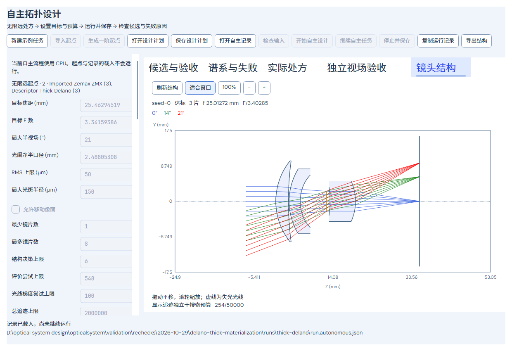

# 自主拓扑设计：镜头结构显示

在 **AI 初始结构 → 自主拓扑设计 → 镜头结构** 查看已载入起点或当前选中的候选。页面参照用户提供的剖面/分视场光线形式，显示实际镜片轮廓、玻璃填充、光阑、像面和毫米坐标，提供适合窗口、缩放百分比、放大/缩小、拖动平移和滚轮缩放；Home恢复适合窗口，键盘加减也可缩放。

从“候选与验收”选中方案后切换到结构页，即可查看该方案；未达标候选同样可看，标题保留其状态。尚无运行记录时查看当前起点，手动刷新会读取当前有效输入。参考面、曲率、厚度和光阑均来自同一实际处方。结构页优先分配画布空间，完整搜索预算和验收详情仍在其他结果页；窄窗口标签换行、页面垂直滚动，文字不随画布缩小。

## 数据与工作边界

显示使用现有共享Core `Layout2DBuilder` 和正式Scene DTO，不在界面中重算光学形状或拼造光线路径。按主波长、每个定义视场7条光线绘制；颜色对应视场，图例显示实际X/Y角度。保留Core提供的可用失光路径并用虚线区分，像面来自明确的结构面编号。坐标映射保持横纵毫米等比例，平移缩放不重新追迹。

只在用户打开结构页或点击刷新时生成显示，普通计划/记录载入不追迹。显示在后台执行，每次独立CPU硬限50,000实际追迹、单个窗口只派发一个显示构建，设有取消/超时请求；已完成的显示追迹单独列出，失败也保留实际计数，不写入搜索检查点或改变原验收/预算。搜索运行时不派发新的显示任务；未改变来源的缓存图可继续浏览。

切换处方、文件、新计划或候选会清理不匹配的场景和缩放状态；迟到/已取消的结果不会覆盖新来源。没有在运行中自动追踪每个候选，也没有将结构图当作完整光学验收。

## 验证

后台离屏最终4个定向用例通过，覆盖真实Core布局一致性、主波长/视场分组、计划与搜索记录不变、载入零追迹、平移缩放零新增追迹、中英日文本、宽/480 DIP窄窗口、合格与失败候选切换、无效输入及取消后的旧图清理。测试、默认Release构建与范围保留在[本批证据](../validation/rechecks/2026-10-29/autonomous-structure-view/README.md)。旧初始结构预览的渲染入口保持，未重新运行广角优化、全套测试或原生桌面交互。

[窄屏滚动后的结构显示](../validation/rechecks/2026-10-29/autonomous-structure-view/structure-narrow.png)。图中的原合格三片与未达标新起点来自此前保存的同预算记录，本次仅作显示，不构成新的像质结果。
