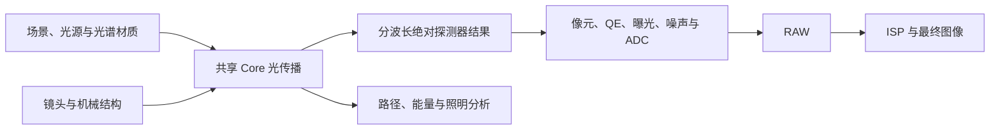

# 相机成像仿真实验室

入口：**实验室 > 成像系统 > 相机成像仿真**。该功能是主程序中的自有窗口，重复打开会聚焦同一窗口，不加入默认双页工作区，不修改当前工程，也不启动外部计算程序。

数值编辑按当前控件的数字格式校验文本、范围与整数要求。非法文本会保留供修正、清除旧 B 并保留 A，不能用旧值悄悄运行或保存完整实验；修正后恢复运行。实验保存、A/B 复算、标定及相关提示已补齐三语，修复与定向验证见[审查问题修复](CODE_REVIEW_FIXES_2026-10-31.md)。

## 产品目标：ImSym 与 Speos 能力融合

2026-10-30 用户明确要开发 ImSym 与 Speos 能力融合的软件。本产品方向扩展为同一 Optical System Design 主程序、同一工程体系与共享 Core 上的成像、照明和杂散光仿真；现有相机实验室是其中的传感器/ISP 起点，不能把其流程测试通过当作完整产品完成。

[ImSym](https://www.keysight.com/us/en/products/software/optical-solutions-software/optical-design-solutions/imsym-imaging-system-simulator.html)的镜头—传感器—ISP 组合、阶段观察和组件影响分析，与 [Speos](https://ansys.synopsys.com/products/optics/ansys-speos)的三维光传播、光源、材料/BSDF、机械结构及照明/杂散光分析作为能力参照。两者均覆盖部分成像与杂散光，不把它们机械划成互斥引擎。实现保持自有纯 C#/.NET，不引入第二套基础光学计算。



图示为产品目标。现已接入三维几何直射、有界标量衍射，以及已完成 NSC 分析到 RAW/ISP 的桌面链路。NSC 镜面反射/折射分支、机械路径及正式不透明 Lambertian 多次方向散射可按保存的筛选进入同一传感器；已接入实测 CSV、Speos v8/v11 文本、镜面增强/White Specular 与已核验二进制 BSDF/BTDF、Zemax 单色辐射度及校准 XYZ .BSDF 和固定材料轴各向异性；相干路径仍未实现。散射模型、文件约定、波长/辐射度声明、采样与能量验收见[专项说明](SPEOS_V11_XYZ_2026-10-31.md)，后续差距见[路线图](NONSEQUENTIAL_ZEMAX_PARITY_ROADMAP.md#与成像传感器共享的产品主线)。

### 统一计算边界

1. 场景阶段保留光谱、方向、位置和真实三维遮挡，不能把任意场景先压成二维灰度图再宣称完成三维成像。现有图片/反射率标签模式继续作为明确的简化输入。
2. 顺序主成像、非序列鬼像/机械杂散光使用同一光学和材料基础。若混合 PSF 与非序列结果，必须先建立不重叠的路径集合与同一入射能量基准；非序列已经包含直接成像时，不能再叠加另一份直接 PSF 或再次传播。
3. 光学输出与传感器之间共享有单位的绝对光谱数据。`SpectralDetectorPower` 的单位是每波长带、每物理像元的功率 W，已包含光学传播与像元面积；不能混用 W/nm、辐照度、曝光量或归一化显示图。曝光、QE 与物理传感器噪声只在传感器阶段施加一次。
4. 坐标方向、像元尺寸、波长表和工程来源须显式保存。NSC 原始数组从负局部 Y 排起，进入相机前按声明转换为正局部 Y 起始，Bayer 排列按输出栅格解释。应用层读取时校验同一冻结会话的场景哈希、探测器定义及波长快照，不能拿当前编辑状态替代旧结果来源。
5. 蒙特卡洛追迹误差与真实散粒/读出噪声分别记账。光学贡献先合并，再执行一次传感器/ISP；不能把追迹采样颗粒当作真实相机噪声。
6. 功率接口用于已经形成的探测器强度；相干路径需要在光学层保留并组合复场/光程后再生成强度，不能通过直接相加路径功率冒充相干计算。

### 分阶段交付与验收

| 阶段 | 交付目标 | 完成条件与当前状态 |
|---|---|---|
| M0 共同数据与正确性 | 光谱探测器接口、NSC 到电子数/RAW 的桥接；修复像元填充采样退化 | 三维路径采用实际感光区求积；旧二维非满填充仅保留历史复算。NSC 会话冻结与 RAW/ISP 桌面链路已接通，仍不代表 M2 全部完成或完整商业能力 |
| M1 首个完整成像用例 | 用户已选择三维场景与照明 → 实际镜头 → 传感器 → ISP | 几何直射及有界标量衍射已接入，保留绝对功率和冻结实验；一般场景收敛、矢量/多次散射与商业对标仍开放 |
| M2 照明与杂散光 | 正式漫反射/散射方向采样、光谱材料、机械结构、多次反射、辐射/光度/色度探测与路径归因 | 不透明 Lambertian 的 Evaluate/Sample/Pdf、能量、采样统计与 RAW/ISP 链路已实现；实测 CSV/Speos 文本及二进制、Zemax 单色/校准 XYZ BSDF/BTDF 与固定材料轴已接通，继续其他商业格式与独立光度/色度验收，不代表 M2 全部完成 |
| M3 设备与图像质量 | 可信传感器/光源/材质数据，白平衡/颜色矩阵和量化阶段对照 | 解析控制与公开/实测留出数据分开；检验电子数、RAW 均值/方差、空间响应、色彩与误差，不用截图或通过数替代 |
| M4 工程规模与交付 | CAD/材料库、性能、批处理和跨平台产品化 | 每项扩展独立定义支持域、误差和资源限额；大规模数据、GPU 与安装包均以实际执行证据验收 |

用户已确定相机成像为首个应用场景。照明路径与相机路径都复用共同基础，后续不以不断增加独立实验窗口作为融合完成标准。

HDR/人眼感知与眩光、动态/滚动快门、体散射、偏振、激光雷达与热/结构耦合属于进一步扩展，各自需要独立需求和验收，不作为当前库接口已完成的能力。

### 已知相机阻断

2026-10-30 目标复核确认 V6 固定网格算法存在采样退化：在固定整像元总 QE 下，2×2 对任意允许填充因子的四点权重均为 1/4；4×4 在填充因子不大于 0.25 时也不再改变空间权重。V7 三维路径改为在实际感光区内移动 Gauss 节点，使用非均匀照明及独立多项式控制验证；二维新运行暂仅开放满填充，V5/V6 原规则保留复算。原 140 项记录属于当时阶段，不能替代空间正确性或一般场景收敛验收。

## 非序列分析到 RAW / ISP

1. 在非序列工作区建立光源、光学/机械对象和矩形探测器，运行“追迹控制”的完整分析。相机窗口不会隐式启动追迹，也不读取独立布局采样。
2. 打开相机成像仿真，在“源图像”选择“非序列探测器”，选矩形探测器及可空的路径筛选，点击“读取 NSC 结果”。空筛选表示全部**已保存**路径；写库时已被筛掉的路径无法恢复。
3. 导入覆盖冻结波长表的绝对 QE 曲线。像元尺寸和画幅与探测器严格一致，首期仍使用方形像元及原相机资源上限；不重采样、不重新积分像元面积。满白辐照度、固定三波段 QE、顺序光学和 PSF 不参与此路径。
4. 运行生成光电子、Bayer RAW、无噪声对照及基础 ISP。可固定 A，修改曝光/传感器/ISP 或另选路径读取 B。镜面鬼像和机械反射按实际保存路径计算，不凭标签推断主成像/杂散光；用户可用 R/T/SEQ 等筛选作 A/B 对照。
5. “保存完整实验”冻结 A/B 各自的探测器尺寸、世界坐标轴、场景哈希、会话/数据库身份、波长及原权重、追迹设置/源 ID/筛选/警告、分波长 W/像元、QE、RAW/ISP 与结果。删除数据库、更换工程后仍可按冻结功率重新计算传感器；**复算不是重新追迹 NSC 场景**。

输入从同一打开的数据库流读取，与选中会话及当前场景核对；读取期间场景/会话变化会拒绝旧输入。读取失败保留旧 A/B；改变路径选择清 B 留 A，工作区变化清理实时旧结果。原始 NSC 数组为负局部 Y 起始，进入正局部 Y 起始的 Bayer 栅格时只翻转一次。W/像元已经包含光学传输、波段和整个像元面积，不再次乘波长权重或面积；曝光、QE、噪声、ADC、ISP 各作用一次。

新路径版本为 `CameraLabV9-NscDetector/1`，实验格式仍为版本 1。`Request.NscDetector` 为空时不序列化，保留 V5–V8 旧实验及采样报告的序列化身份。对照 ZIP 增加 `nsc-detector.json` 和顶部起始坐标的 `detector-power.csv`。两个光学预览均为总辐照度的固定 0.02 W/m² 灰度标尺，不作为 sRGB 场景图或真彩色。

该链路复用 NSC 分支与传感器引擎；已接入对象级 Lambertian、实测 CSV/Speos 文本与已核验二进制 BSDF/BTDF、Zemax 单色辐射度及校准 XYZ .BSDF 及固定材料轴，可用 `S<n>` 隔离方向散射、`B<n>` 只取透射散射；冻结完整表格、文件/数据摘要、局部/世界材料轴及筛选前全追迹 R/T 和材料方向统计。角度 QE、相干场求和与商业数值认证仍未实现。蒙特卡洛光学采样与物理传感器噪声分别解释，不靠显示图归一化修正能量。

## 三维场景与照明到相机

几何和衍射相机现均在共同预检中明确拒绝曲面像面，不将其静默替换为顶点平面。像面允许真正的 Plane，以及共享 Core 定义下零曲率的 Standard；未来曲面支持需补完整位置、法向与面积积分。

在“源图像”选择“三维场景与照明”，载入内置“近景色块与遮挡”，或打开自包含 [JSON 示例](../samples/camera-imaging/direct-light.camera-scene3d.json)。此模式使用当前实际顺序镜头与其像面位置，不修改处方、不自动调焦；可选择几何/衍射，修改物深、光源功率、采样、曝光、感光面积及 ISP，并固定 A 比较 B。切回二维输入恢复先前光学选项。三维模式固定使用实际镜头和场景波段，二维“满白辐照度”不参与物理计算。

内置样例的棋盘位于 10 m，前景物体位于 7–9 m，光源总带功率 1000 W（650/550/450 nm 为 300/400/300 W）。这是显式高功率各向同性光源的人工控制，便于在原示例镜头的固定像面和默认曝光下观察；不代表商用灯具或测量光谱。不同镜头仍需用户匹配物距、像面和曝光。

首版支持 1–64 个不透明矩形、长方体、球体，最多 8 个各向同性点光源，以及直接 Lambertian 反射、棋盘反射率、表面自身发光和阴影遮挡。几何求交和 BVH 复用正式 NSC，镜头反向传播复用共享 Core 表面追迹、折射、材料与镀膜。支持共轴、非折返的球面/平面、圆形孔径及同介质理想薄透镜；不支持的几何、GRIN、正式复杂镀膜、散射、切趾、偏振会明确拒绝。None 镀膜可选择逐界面 S/P 功率平均的标量 Fresnel 损失；SimpleCoating 使用其显式透过率，不再叠加裸界面损失。这不是完整偏振运输或鬼像计算。

场景坐标为 mm，相对第一实体镜面顶点，+Z 指向像方；物体和光源均需完整位于物方。`SizeX/SizeY/SizeZ` 分别为矩形宽/高、长方体宽/高/厚；球体以 `SizeX` 为直径，其他两个尺寸字段保留但不参与球形求交。旋转单位度。`Reflectance`、`DarkReflectance`、`EmittedRadiance` 与 `BandPowerWatts` 均依次为 **650/550/450 nm**，分别是比例、比例、W/m²/sr 和已对波段积分的 W；不能填写 W/nm 或普通 RGB 颜色。三维文件最多 1 MiB，不加载外部资产或脚本，保存失败保留原文件；打开失败保留当前场景和 A/B。

对物面一点，点光源照射为 `E = P cosθ/(4πr²)`，Lambertian 出射辐亮度为 `L = ρE/π + Lemit`；距离在此从 mm 换为 m。传感器端积分 `Eimage = ∫ L T cosθsensor dΩ`，瞳面面积到立体角使用 `dΩ = cosθplane dA/r²`。两个余弦均保留，不能用显示像素平均或再次 PSF 代替。定义依据见 [PBRT 辐射积分](https://pbr-book.org/4ed/Radiometry%2C_Spectra%2C_and_Color/Working_with_Radiometric_Integrals)与[点光源](https://www.pbr-book.org/4ed/Light_Sources/Point_Lights)；[Speos 成像示例](https://optics.ansys.com/hc/en-us/articles/16778780268563-Endoscope-Lighting-Imaging)也采用从传感器出发的反向传播，但不构成数值一致性认证。

探测器保存每像元、每波段在实际感光面积内的 W，单次曝光和 QE 转换后进入原噪声、RAW/ADC 与 ISP。第一阶段预览为可见表面反射率，第二阶段按每波段 0.02 W/m² 满白显示平均感光区辐照度；二者都不是测量数据或经色度标定的真彩色。导出另含 `scene3d.json`、诊断及 `detector-power.csv`；显示图饱和不影响该绝对功率。实验文件冻结完整三维参数、镜头、采样、QE、传感器、ISP、功率及 A/B，复算不读取原场景路径。

默认瞳面为 2 环×8 方位点，像元可用中心或实际感光区的 2×2/4×4 Gauss 求积。单次上限 8,388,608 条主光线、100,000,000 次镜面交互；超过上限直接拒绝。全部瞳面样本被镜头遮挡时提示检查处方/像面或增加环数，不返回伪造的理想图。边界遮挡和复杂空间图样通常需要更密采样；首版不宣称任意处方已收敛。标准 128×96 的 2×2、64×48 的 4×4 与小尺寸实验复算分别验证，详情见[交付证据](../validation/rechecks/2026-10-30/camera-scene3d/README.md)。

### 三维衍射

将“像差模型”改为“衍射像差”。V8 的 `ScalarHuygensSurfaceCells/1` 使用真正的三维表面点、物深、法向、遮挡和共享 Core 实际镜头光程。先以实际镜头的参考波长中心光线建立表面求积点及局部面积；逐对象查询保留可能从瞳面一部分可见的背景。每个表面点/波长在入瞳网格追迹，遮挡或镜头剪切的单元不进入复场；出瞳平面单元面积从相邻实际光线映射取得，幅度由该单元传输的绝对功率确定。瞳面复场使用光程相位、距离/倾斜因子与有限单元 sinc 足迹传播；不同源点与波长按强度相加，然后在真实感光区积分。没有先生成几何模糊图再叠加完整 PSF。

这一同点相干、不同波长强度叠加的原则与 [Ansys 对 Huygens PSF 的说明](https://optics.ansys.com/hc/en-us/articles/42661795535251-What-is-the-difference-between-the-FFT-and-Huygens-PSF)和 [Huygens MTF 波长组合定义](https://ansyshelp.ansys.com/public/Views/Secured/Zemax/v252/en/OpticStudio_User_Guide/OpticStudio_Help/topics/Huygens_MTF.html)一致；本实现是有绝对单位的自有表面求积模型，不是商业软件截图或原生数值认证。原 FFT/Huygens 分析引擎与既有参考、容差不改写。

默认衍射瞳面每边 12、每输出像元 1×1 场景采样、PSF 额外半径 4 像元、源保护带 24 像元。几何环形瞳面控件在此模式不参与计算。窗口覆盖实际几何光斑边界并向外扩展所选半径；源保护带同时检查已追迹的几何偏移加该半径。保护带不足会给出至少需要的像元数，不能用归一化补回能量。有限传感器与有限 PSF 窗口之外的功率不收进 RAW，远处旁瓣及未采样源区域仍需扩大窗口/保护带检查；不宣称有限窗口已捕获全部光。

每次最多 65,536 个表面候选、200,000,000 次复场单元求和，沿用原光线与表面交互额度。默认源保护带下可从 **32×24** 开始；高像元/场景/瞳面采样或大画幅会明确触及额度，不自动降低采样。单位仍为波段 W/像元，曝光、QE、噪声、ADC 和 ISP 施加一次。阶段预览、几何 A/衍射 B、完整实验、导出功率 CSV 共用现有流程；保存记录全部衍射采样与算法、表面计数、几何偏移、遮挡及复场工作量。

支持小角度标量模型，像方实际光线需满足 `direction.Z >= 0.95`，同轴平面/球面、空气物/像方、无奇异瞳面映射；不支持高 NA 矢量场、焦散映射、衍射绕过场景遮挡边缘、相干激光场景、散射或多次反射。表面空间求积、瞳面、像元和窗口四者分别影响结果，细小物体/棋盘边界可能欠采样；应增加场景细分并作收敛比较。None 镀膜继续采用逐界面非偏振平均功率的标量约定，不能当作完整 Jones 运输。解析矩形孔径、实际有限物距圆孔 Airy、物深/遮挡及冻结 A/B 控制见[衍射验证记录](../validation/rechecks/2026-10-30/camera-scene-diffraction/README.md)。

### 局部采样检查

完成三维衍射 B 后，在“局部采样检查”选原传感器内每边 4–16 像元的区域，选择项目并点击“检查本项”。结果在“采样检查”页。区域保持原传感器全尺寸、全局坐标、像元边长、像面和冻结镜头；不是把小图重新居中。先重算区域基准，要求每个波段功率和光电子与保存 B 的裁切逐点完全相同，再与单项加密比较。若基准不同，会要求先复算 B，不把版本或输入差异混入收敛结果。

| 项目 | 仅改变的参数 | 当前上限 |
| --- | --- | --- |
| 瞳面加密 | 每边点数乘 2 | 64 |
| 场景加密 | 每像元每边源细分乘 2 | 4 |
| 像元加密 | 中心 → 2×2 → 4×4 Gauss | 每边 4；填充因子及 QE 口径保持 |
| 窗口扩大 | PSF 额外半径乘 2 | 32；保护带保持 |
| 保护带扩大 | 源保护带增加 8 像元 | 32；窗口保持 |

报告包含三波段 W/像元、期望光电子和无噪声 RAW DN 的绝对最大差、RMS、相对 L1/RMS 及最大差的原像元坐标，保留逐点数组和工作量。无基准信号时相对非零差异记为未定义；零对零的 0 不证明已收敛。奇数起点使用原全局 Bayer 相位。噪声、局部去马赛克和 ISP 不参与收敛判据；完整 B 继续使用既有传感器/ISP。

每次只加密选中一项；同一 B 和区域的五项可累积。瞳面和场景会连续执行至各自实现上限，例如瞳面 12→24→48→64、场景 1→2→4；每一级只与前一级比较，不把 48/64 的差混写成对 12 的差。其他项目仍比较一级。报告和界面保留各层的逐点数组、指标、实际工作量和失败原因；取消保留原记录，未完成层级之后不能附带后续成功数据。旧单层报告及其失败状态原样保留。

局部诊断先保留全部源点及实际瞳面主光线，用与原算法相同的几何窗口求交。交集为空时不计算该源点的出瞳面积映射辅助光线；区域内所有波动项和原有限窗口保持，没有用能量阈值裁剪光线或远旁瓣。实际命中表面点仍限 65,536，候选查询单独流式限制为 1,048,576，不把未命中的对象计入已采样点。单级局部诊断最多 67,108,864 条实际追迹、400,000,000 次表面交互、200,000,000 次复场单元求和；每一级记录使用量及额度身份 `RegionExactSupport/2`，在本级所有源点间累计，不按小块重置。完整渲染仍用原 8,388,608 条追迹、100,000,000 次交互及原候选预检；没有靠局部 API 拼接整图。局部额度与物理误差容差是独立概念，原处方、采样节点公式、保护带及既有精度容差没有改变。

到达上限或违反保护带/预算时明确记为“到达实现上限”或“未完成”，不降低采样或自动调整其他参数。比较没有新增合格阈值，不会显示“精度通过”；局部结果不能证明整幅收敛。分级与保存复算的实际范围见[连续加密记录](../validation/rechecks/2026-10-30/camera-sampling-budget/README.md)。

改变检查区域或项目不清除 A/B；取消检查保留 A/B 和上一份报告。改变物理输入会取消任务并清除 B 与旧报告。报告绑定 B 全部冻结输入及结果的 SHA-256，可单独导出 JSON；“保存完整实验”同时保存 A/B 和可空的 `SamplingReport`，打开时核对身份与逐点指标后恢复记录，不依赖场景原文件。V5/V6/V7/V8 旧实验不要求新增字段，原版本复算保留。验证范围与可重开实验见[本轮记录](../validation/rechecks/2026-10-30/camera-sampling/README.md)。

## 已实现的能力

QE、光源和反射率 CSV 共用严格 UTF-8 解码、BOM/空白/注释处理、列拆分、不依赖系统区域的数值解析和原始物理行号。表头、百分数换算、采样上限、有限性与曲线物理验证仍由各导入入口按既有契约执行；当前格式为不带引号的数值 CSV，没有新增通用带引号字段语法。重构边界见[公共实现记录](DUPLICATE_CODE_REFACTOR_2026-10-26.md)。

- 输入：彩色色卡、分辨率图、畸变网格、西门子星或外部位图；外部图像假定为 sRGB，按 sRGB 传递函数解码到线性强度后重采样。默认 128×96，可选择 256×192、512×384。
- 光学：理想光学对照，或当前顺序镜头的独立快照（包含未保存修改）。当前镜头调用共享 Core 的空间变化 PSF、几何/衍射、畸变、横向色差和相对照度功能。显示实际模型和几何回退计数；错误明确返回，不能以理想光学替代失败镜头。
- 像面采样：在快照中按像元边长与分辨率设置近轴像高视场，不改变工作处方。Y 半视场使用 `图像高度 × 像元边长 / 2`，像元边长从微米换算为毫米，非方形画幅不再误用图像宽度。保护带保留原像素间距，计算后裁切有效探测区，不把保护带缩放到传感器中。
- 传感器：650/550/450 nm 三个窄波段，四种 Bayer 排列；支持曝光、像元边长、每波段满白标定辐照度、三通道 QE、满阱、Poisson 散粒噪声、读出噪声、暗电流、PRNU、DSNU、增益、黑电平、8–16 位 ADC 和可重复随机种子。默认固定 QE 使用无重叠 CFA；导入绝对 QE 曲线后，每类 CFA 对三个输入波段分别计算光电子再求和，允许通道响应重叠。
- 参数文件：完整传感器 JSON 导入/保存，支持内嵌响应曲线；独立 CSV 曲线导入支持比例或明确标注的百分数。光谱响应页预览 R/G/B 曲线，记录文件名与原文件 SHA-256。导入来源不代表经过测量核实。
- 连续光谱：可显式选择三波段或连续积分模型，导入绝对光源光谱、单一场景材质反射率及总 QE。合并曲线折点、细分积分区间，每个积分波长独立调用共享光学，再累加期望光电子；结果统一使用原噪声、ADC 和 ISP。三波段仍为默认模型。
- 材质分区：连续模式支持最多 16 类明确指定的反射率区域，导入标签 PNG 或自包含场景 JSON，可为选中 ID 指定反射率 CSV。反射率在源平面生效，再经过逐波长共享光学；标签预览、各材质曲线和 A/B 分别保留。
- ISP：黑电平扣除、双线性去马赛克、RGB 增益、3×3 方框降噪、非锐化掩模及幂函数 Gamma。关闭基础 ISP 时仍执行黑电平扣除及去马赛克，输出线性 RGB；不将该开关表述为原始 Bayer 输出。
- 对照：六阶段预览、同曝光/ADC/ISP 的无噪声对照、固定 A/当前 B 与显示 RGB 绝对差。A/B 尺寸不同时不计算逐像素差。参数修改清除当前结果、保留 A；镜头或工作模式变化清除全部旧结果并取消旧任务。
- 导出：单个 ZIP，包含 A/B 各阶段 PNG、原始 RAW DN/无噪声 DN/期望光电子 CSV、镜头名称/修订、全部运行参数、模型范围和实际光学模式。每轮附可再导入的 `sensor-profile.json`，使用曲线时另附 `spectral-response.csv`；各轮来源和完整曲线保存在元数据中。原始 RAW 的黑电平保留；PNG 为显示预览。导出冻结选择时的结果，使用有界原子写入；取消文件选择不写入。

## 计量与统计模型

默认固定 QE 模式中，每个 CFA 像元只检测其对应波段。输入线性像素值为 `L`，用户指定每波段像面强度为 1 时的辐照度 `Eref`（W/m²，已对该窄带积分），像元面积 `A`（m²），曝光 `t`（s），波长 `λ`（m）：

`期望光电子 = L × Eref × A × t × λ / (h × c) × QE`

导入曲线时，对 CFA 类型 `c`：

`期望光电子[c] = Σ(i=650/550/450 nm) L[i] × Eref × A × t × λ[i] / (h × c_light) × QE[c](λ[i])`

在三波段模式中，三个通道使用曲线线性插值后的**绝对总 QE（含 CFA）**，替代界面的固定 R/G/B QE，不再相乘、不做峰值归一化、不外推；仍只在三个离散波长取样。默认模型标识为 `CameraLabV1`，三波段曲线模型为 `CameraLabV2-QE`，连续积分模型为 `CameraLabV3-Continuous`。

其中 `h = 6.62607015e-34 J·s`、`c = 299792458 m/s`。`Eref` 是人工指定的像面标定量，不是场景照度 lux，也不是从普通照片恢复出的实测光谱。默认保留像素中心采样；面积采样见下节。

## 像元面积与 QE

“像元面积与 QE”提供中心、2×2、4×4 三种采样。**V7 三维模式**在边长为 `像元边长 × sqrt(f)` 的实际中心方形感光区内进行 Gauss 求积，改变填充因子会移动光线起点；像面物理尺寸和处方保持。物理功率已计入感光面积，感光区 QE 直接应用，整像元总 QE 则除以 `f` 转为感光区效率；转换后大于 1 会拒绝，因为首版没有额外微透镜模型。导入曲线仍为总 QE，不能重新标成感光区 QE。

以下固定细网格说明属于 **V5/V6 历史协议及 V7 满填充二维对照**。二维模式在每个物理像元内建立均匀细格：光学格距为原像元边长除以每轴采样数，输出尺寸、实际传感器视场和工作处方不变。当前镜头的 PSF 核和保护带随细格同比加密，保留原物理支持范围；光学传播后、Bayer 选择和噪声前进行平均。

填充因子 `f` 为中心方形感光区面积与整像元面积之比，边长比例为 `sqrt(f)`。细格内强度按中点常数近似，按细格与感光区的重叠面积加权，再除以感光区面积。它是有限分辨率求积，尤其小感光区可能欠采样，应比较 2×2 与 4×4；没有宣称解析积分或任意镜头已收敛。

- **整像元总 QE**：已经包含有效填充损失，电子数使用整像元面积乘以感光区平均强度与总 QE，不再额外乘 `f`。均匀照明下改变填充因子保持电子数。
- **感光区 QE**：仅用于手动固定 QE，电子数另乘 `f`；均匀照明下电子数随感光面积成比例。
- 导入 CSV/传感器曲线的既有格式定义为绝对整像元总 QE，界面固定使用总口径，服务拒绝将它静默解释成感光区 QE。没有从几何填充因子推断微透镜、角度响应或串扰。

设置保存为完整实验请求的可空 `PixelSampling`，不混入传感器标定模板；旧空值继续中心采样。中心模式保留原随机数、电子数、RAW 及失败类型。来源预览平均整个像元，光学预览使用感光区平均，电子图另计所选 QE 口径。

面积模式的细格、保护带及卷积均计入原资源上限，不拆调用绕过预算。当前镜头提供中心及 2×2，4×4 仅用于理想光学对照：保留物理 PSF 范围时，三波段及至少三个连续积分节点的 4×4 最小配置也超出原三亿卷积预算。新增 64×48 / 32×24 输出供有限预算对照，当前镜头 2×2 可从 32×24 开始；更大尺寸或连续光谱可能仍需降低分辨率或节点数。公开参数控制、可重开样例及实际验证范围见[本轮记录](../validation/rechecks/2026-10-30/camera-pixel-area/README.md)。

启用噪声时，PRNU 调制光响应斜率；光生及暗电子按 Poisson 采样，满阱限制收集电荷，随后叠加高斯读出噪声与固定 DSNU。读出值允许在黑电平上下波动，不在电子数零点截断读出噪声。最后加黑电平、按 DN/e⁻ 增益量化并截断到 ADC 范围。固定非均匀性使用独立随机流；固定种子、输入和参数得到相同结果。没有以高斯画面滤镜替代光子计数。

无噪声对照保留同样的曝光、QE、平均暗电流、满阱、ADC 与 ISP，关闭随机及固定非均匀性。RAW RMSE 是相对该对照的 DN 差，不是实测 SNR 或产品认证指标。

## 图像显示与比较

顶部提供图片导入、运行、取消、固定 A 和导出，左侧参数按输入/光学、传感器文件与响应、光源与反射率、传感器及 ISP 分卡。右侧保留成像阶段、A/B 对照、光谱响应、光源与场景光谱和参考范围页签；图卡在结果区宽度至少 880 DIP 时三列、至少 550 DIP 时二列、更窄时一列，纵向滚动访问其余图像。QE 与反射率使用 nm 横轴和 0–1 固定纵轴，光源纵轴使用绝对 W/m²/nm；右上角图例独立开关曲线，过滤保留坐标范围和当前视图。空图卡显示运行提示，实际指标计算后才出现。参数滚动区隐藏轨道，仍支持滚轮、键盘及焦点滚动；主题、字体和数值设置沿用主程序。改版截图和验证边界见[界面记录](LABORATORY_PRESENTATION_2026-10-24.md)。

输入/光学像以固定 Gamma 2.2 预览；电子图以满阱为固定标尺，RAW 图以 ADC 最大 DN 为固定标尺，不做各图峰值归一化。最终图使用所选 ISP。RAW 预览是原码值的灰度图，原 Bayer DN 保存在 CSV；CSV 顶部为 y=0，排列见元数据，不伪装为 DNG。

固定 A 后，可分别改变曝光、噪声、QE、增益、位深、RGB 增益、Gamma 或空间滤镜，再运行 B。差异图是两个显示 RGB 图像的绝对差乘 4，仅帮助定位变化，不是光学物理误差或商业软件一致性指标。

## 导入传感器与光谱响应

1. 运行并固定 A，再从“传感器文件与响应”导入 JSON 参数和/或 QE CSV。导入成功清除当前 B，保留 A 的传感器参数、曲线和来源；重新运行得到 B。
2. 打开“光谱响应”检查曲线名称、来源、波长及效率。曲线启用时，固定 QE 输入单独禁用并说明原因；“移除响应曲线”恢复原先的固定 QE 值，A 仍保留。
3. “保存参数/模板”保存当前全部传感器参数及当前曲线。导出对照包则保存 A、B 各自的可再导入参数文件和数值结果。

格式示例见[示例目录](../samples/camera-imaging/README.md)，正常构建和发布中位于程序旁的 `Examples/CameraImaging/`。示例为人工构造数据，不对应厂商型号或实测传感器。

JSON 使用 `Format: "OpticalSystemDesign.CameraSensor"`、`SchemaVersion: 1`，顶层必须包含 `Name`、`Source` 和完整 `Sensor`；字段及默认值以[参数模板](../samples/camera-imaging/generic-sensor.camera-sensor.json)为准。`Sensor` 中曝光单位 ms、像元边长 µm、辐照度 W/m²/波段、满阱/读噪/DSNU 为 e⁻、暗电流 e⁻/s、PRNU 为百分数、增益 DN/e⁻、黑电平 DN；读噪和 DSNU 使用 RMS。`Seed` 支持完整 32 位有符号整数，界面接受负种子并保留小数传感器参数。`Pattern` 使用 RGGB/GRBG/GBRG/BGGR 字符串。缺失参数、未知/重复字段、非有限或越界数值、不支持的版本和数字枚举均拒绝，避免静默使用默认校准值。

CSV 使用 UTF-8、英文逗号和小数点；允许空行及以 `#` 开头的注释。两种表头分别为：

```csv
wavelength_nm,qe_r,qe_g,qe_b
```

```csv
wavelength_nm,qe_r_percent,qe_g_percent,qe_b_percent
```

第一种 QE 为比例 0–1，第二种为百分数 0–100 并明确除以 100。需要 2–4096 个采样点，波长范围 200–20000 nm、严格递增、无重复。导入时不强制可见光范围；运行三波段模型须覆盖 450/550/650 nm，连续模型须覆盖所选完整积分范围（例如可单独导入 800–1000 nm 数据用于理想光学红外实验）。相对归一化响应、A/W 响应或未知单位必须先按可靠数据转换，不自动猜测。JSON 中可选的 `SpectralResponse` 使用 `Name`、`Source`、`Samples`，每个点为 `WavelengthNanometers`、`RedQe`、`GreenQe`、`BlueQe`，QE 一律为比例。

普通传感器参数和 QE CSV 单文件限 1 MiB；含下述原始标定帧的传感器模板可达 32 MiB。完整解析和验证成功后才应用；错误文件保留原参数、曲线及 A/B。异步旧导入不能覆盖随后编辑或新工程，参数与曲线在计算请求提交时冻结，之后修改原 CSV 或调用方数组不会改变已固定结果。文件指纹只用于追溯字节来源，不证明传感器真实性或测量质量。

## 完整实验归档与复算

“实验文件”卡的“保存完整实验”生成 `.camera-experiment.zip`，使用 `OpticalSystemDesign.CameraExperiment`、版本 1。A/B 分别保存运行时的完整镜头快照（包含未保存处方，在设置传感器视场之前捕获）、外部输入图片原始字节及 SHA-256、光源/QE/反射率、完整材质标签场景、曝光/传感器/ISP/随机种子、积分诊断、六阶段预览、原始 RAW 和期望光电子。图片在运行时冻结，保存实验时不重新读取原路径；两组结果可使用不同镜头、光谱模型及输入。

“打开实验”立即恢复 B 的设置和图像及固定 A，并勾选“使用实验镜头与输入”。“复算 A/B”使用各自冻结输入，原图删除、当前镜头或工作模式切换后仍能计算，且不替换主工程。“运行仿真”允许修改实验设置后运行新的 B；内置图样按新设置生成，显式重新导入图片会替换 B 的内嵌图片，A 保留。取消该勾选后，普通运行使用当前工程镜头及图片路径。原对照 ZIP 仍用于 PNG/CSV 交换，缺少冻结输入的旧包不能当作完整实验打开。

完整实验压缩文件及展开 JSON 各限 256 MiB，单张原始输入图片仍限 64 MiB。不解压外部路径；包中必须只有 `experiment.json` 与 `sha256.txt`，校验、版本及内容验证通过后才应用。保存使用有界原子写入，失败/取消保留已有文件。SHA-256 检查字节完整性，不证明测量真实性。新计算版本为 `CameraLabV8-SceneDiffraction/1`；兼容原 `CameraLabV7-DirectScene/1` 的三维几何、`CameraLabV6-PixelArea/1` 与无面积设置的 `CameraLabV5-ExperimentCalibration/1`。直接复算保留旧版本和原算法；旧文件可缺少当时不存在的字段。V5 不能夹带面积设置，V5/V6 不能夹带三维参数，V7 不允许衍射配置；V8 衍射实验必须保存实际使用的采样和复场诊断。显式编辑运行 B 使用新版本；结构兼容的未知二维版本只可查看，三维仅接受已支持版本。不承诺跨运行时/后端逐位一致。

## 暗场／平场 RAW 标定与传感器模板

“传感器文件与响应 → 暗场／平场标定”接受自包含 JSON：`Format: "OpticalSystemDesign.CameraCalibration"`、`SchemaVersion: 1`，字段见[合成标定样例](../samples/camera-imaging/synthetic-dark-flat.camera-calibration.json)。必须声明设备、来源、条件、温度、尺寸、ADC 位深、Bayer 排列和已知 `GainDnPerElectron`。每帧包含 `ExposureMilliseconds` 及按 y=0 起逐行排列、保留黑电平的 `RawDn` 整数数组。输入必须是固定温度/增益、关闭 ISP 的线性 RAW；平场需空间均匀且稳定。本流程不验证实验装置或光照均匀度。

需要恰好两组不同曝光的暗帧，每组至少 2 帧，和至少 2 帧平场；所有平场曝光必须与长曝光暗帧相同。暗曝光允许为 0，最长 10000 ms，两组至少相差 0.001 ms。每类最多 128 帧，总计最多 4194304 个 RAW 样本，尺寸沿用 Core 的 4–1024/边和 262144 像素限制。标定 JSON 限 32 MiB；尺寸错误、缺帧、非有限参数、未知/重复字段及任意 0 或 ADC 最大值的截断样本均拒绝。失败保留已有参数与 A/B。

共享 Core 的 `DarkFlatScalarV1` 估计标量参数：按像元计算样本时间方差（N−1 分母），由两组暗均值的零曝光截距估计黑电平、斜率除以已知增益估计暗电流；时间方差的零曝光截距扣除 `1/12 DN²` 量化方差后换算读噪。DSNU 使用黑电平截距的空间样本方差，扣除有限帧平均的时间噪声；PRNU 对平场减同曝光暗场的信号分别按四个 CFA 相位归一化，扣除两组均值的时间噪声，再合并相对空间方差。负的电流/方差估计置零，噪声底附近不提供置信区间。这里是有明确假设的标量估计，并非完整 [EMVA 1288 表征或认证](https://www.emva.org/wp-content/uploads/EMVA1288Linear_4.0Release.pdf)。

成功后应用黑电平（DN 四舍五入）、读噪、暗电流、DSNU、PRNU 以及采集声明的增益/位深/Bayer，保留原像元尺寸、QE/曲线、满阱、曝光及 ISP。这些未测量参数不会变成实测值。生成的传感器模板带 `Calibration`，保存全部原始帧、条件、原文件指纹、方法和未舍入估计，重新导入时从帧复算核对摘要；含标定帧的模板上限为 32 MiB，普通模板仍为 1 MiB。完整实验及对照包的传感器模板也保留这些数据。

本阶段的校准结果用于通用随机传感器模型的均值/非均匀性参数，没有逐像元暗电流/响应图、坏点或平场校正，也不估计增益、QE、满阱或温度模型。随程序提供的帧样例标为 `Synthetic: true`，没有内置厂商实测传感器库；用户导入实测帧的来源与质量仍由采集者说明。2026-10-30 新增公开厂商测量表的 QE 点、读噪和满阱参数控制，独立说明温度、固件、测量波长及缺失原始帧的限制；不将参数应用检查称为实测 RAW 标定复现。

## 连续光谱、光源与场景反射率

先用三波段运行并固定 A；从“光源与反射率”导入两个 CSV，导入覆盖范围足够的 QE，在“输入与光学”选择“连续光谱积分”，设置积分起点、终点和最大区间，再运行 B。默认范围 400–700 nm，最大区间 100 nm。切换光谱模型或更新曲线只清除 B，不清除 A；三种曲线必须覆盖完整指定范围，不静默裁短为交集或外推。曲线在三波段模型中可保留但光源和反射率不参与计算。连续模式的固定 QE、每波段 `Eref` 字段单独禁用并说明原因；恢复三波段后原值保留。

两模型的源图含义和能量标定不同：原模型使用三个线性 RGB 通道，连续模型使用单材质灰度图样；不自动把总光能调成相同。因此 A/B 展示模型与设置的综合差异，不是积分误差曲线。受控比较需使用灰度输入并显式设置可比的能量条件；积分精度另由独立解析公式与收敛检查验证。

光源 CSV 表头为 `wavelength_nm,irradiance_w_m2_nm`，数值是**理想白目标（反射率 1）的像面标定光谱辐照度**，单位 W/m²/nm，非负且不超过 1000。它将光源强度和未建模的照明几何/绝对传输归入人工标定；不把光源发射瓦数、lux 或相对 SPD 直接当作此值，也不额外乘场景距离、π 或光圈因子。当前镜头在该标尺上继续施加共享 Core 的相对照度及像差；没有新增绝对镜头透过率标定。

反射率 CSV 表头为 `wavelength_nm,reflectance`（比例 0–1），或 `wavelength_nm,reflectance_percent`（百分数 0–100，明确除以 100）。光源和反射率同样使用 UTF-8、英文逗号、小数点，允许 BOM/空行/`#` 注释，2–4096 个严格递增、200–20000 nm 的点，单文件限 1 MiB。错误单位、负值、非有限值、乱序/重复和超限文件均拒绝。

默认一条反射率曲线代表一个空间一致的材质，也可使用下述显式材质分区。输入图像在线性 sRGB 解码后取 `M=0.2126R+0.7152G+0.0722B` 作为灰度空间调制。输入图的 RGB 不被反演成光谱，彩色色卡也不会伪装成逐色块实测反射谱。对 CFA 类型 `c` 的像元 `p`：

`光电子[c,p] = A × t × ∫ Eλ(λ_nm) × ρ(λ_nm) × Hλ[M](p) × QE[c](λ_nm) × (λ_nm × 1e-9)/(h × c_light) dλ_nm`

其中 `Eλ` 为每 nm 的辐照度，`ρ` 为反射率，`Hλ` 为理想传递或共享 Core 在该波长的 PSF、畸变、相对照度。积分权重使用 **nm**；只有光子能量中的波长转换为 m，不能再把积分权重多乘一次 `1e-9`。辐射能与光子能的换算依据见 [EMVA 1288 Release 4.0 Linear](https://www.emva.org/wp-content/uploads/EMVA1288Linear_4.0Release.pdf)，本功能未进行标准认证。

三条曲线分段线性插值，合并全部内部折点，按最大区间细分，每个区间使用三点 Gauss-Legendre 求积。理想光学下 `Eλ×ρ×QE×λ` 每段最高四次，三点求积在浮点误差范围内精确；当前镜头的 `Hλ` 随波长变化，需要减小最大区间观察收敛，区间控制不是自动精度保证。小于区间宽度的谱峰只要出现在导入折点中，就不会因均匀网格未击中峰值而丢失。

积分后的期望电荷一次进入原 Poisson、读噪、PRNU/DSNU、满阱、ADC 和 ISP；不按波长分别量化或重复加入读噪。连续模式的输入预览为灰度空间图样，光学预览为 `∫EλρHλ[M]dλ / ∫Eλdλ` 的灰度能量传递图（零光源时为零）。分母来自输入绝对光谱，不是图像峰值；最终 CFA/ISP 输出未经过色度学真彩色校准。

导出包对每个连续结果增加 `illuminant.csv`、`reflectance.csv` 和 `integration.csv`；前两个可直接再导入。积分 CSV 保存实际波长、nm 权重、光源、反射率及三个 QE。元数据保留模型、范围/区间、原始曲线、文件指纹、节点和总输入/反射能量，三波段 A 与连续 B 分别保存各自范围。传感器 JSON 保存传感器、QE 及可选标定记录，不保存光源和场景设置；完整运行复算使用完整实验文件。

## 多材质反射率分区

在“材质反射率分区”卡选择“材质标签分区”，可加载“三材质样例”，或导入标签 PNG / 场景 JSON。选择“指定材质”中的 ID，再用“指定反射率 CSV”赋予该区域光谱。PNG 导入后所有 ID 初始均为未指定，连续运行会禁用并解释原因；不猜测标签的光谱。单材质模式、三波段模式和已载入的分区可以互相切换，A 对照保留各自的标签、反射谱、来源和修改标记。

标签 PNG 使用**不透明 8 位灰度样本，R=G=B=材质 ID，范围 0–15**；灰度数值是标签，不是强度。拒绝普通彩色照片、透明标签、16 位样本及动画 PNG。16 位转换为 8 位会合并原始 ID，因此在解码前拒绝；PNG 位深及动画块依据见 [PNG 规范](https://www.w3.org/TR/png-3/)。标签最多 262144 像元，每边 1–1024；只保留实际出现的 ID。导出的 `material-map.png` 遵守同一约定，可再导入后重新指定各 ID 的反射谱。

标签图可以与源图/输出尺寸不同，按**采样格中心最近邻**映射到源平面网格，不插值或混合 ID。中心模式保留原采样；面积模式在细网格赋予材质反射率，光学传播后再对探测器感光区积分，因此单个像元可接收多个源区域的光。微小区域仍可能在有限采样中消失。材质元数据给出实际细格数量及 `PixelSamplesPerAxis`，不是输出 Bayer 像元数量。输入图片仍作为灰度纹理/明暗空间调制，不根据其 RGB 自动推断材质。分区预览的伪彩色仅帮助识别 ID，使用最近邻显示，不代表反射率的物理颜色。

场景 JSON 格式标识为 `OpticalSystemDesign.CameraMaterialScene`，版本 1，必填 `Name`、`Source`、`Width`、`Height`、`MaterialIds`、`Materials`。`MaterialIds` 是从 y=0 开始逐行排列的整数数组，长度恰为宽乘高；`Materials` 是 1–16 个唯一 ID 的定义，每项包含 `Id`、`Name`、`Source`、`Reflectance`，定义必须与实际标签完全对应。`Reflectance` 可为 null（尚未指定），或现有 `CameraSpectrumCurve` 格式：`Name`、`Source`、`Kind: "Reflectance"`、`Samples`；每个点为 `WavelengthNanometers` 和比例单位 `Value`。不在文件中解析外部路径或加载脚本。未知/重复字段、不支持版本、缺失 ID、重复 ID、光源曲线误用作反射率均拒绝。

JSON/PNG 输入及场景保存限 8 MiB，每条反射谱最多 4096 点。保存可保留未完成的赋值；实际连续计算要求所有材质均已赋反射率，并与光源、QE 一起覆盖整个积分范围。示例见[三材质场景](../samples/camera-imaging/three-materials.camera-scene.json)。“保存材质场景”捕获选择文件前的配置，使用有界原子写入；失败或取消不会改写已有文件。

对标签 `id(s)` 所在的源平面位置 `s`，先生成 `Sλ(s)=M(s)×ρ[id(s)](λ)`，然后：

`光电子[c,p] = A × t × ∫ Eλ(λ) × Hλ[Sλ](p) × QE[c](λ) × λ_m/(h×c_light) dλ_nm`

每个积分波长只传播一次整幅多材质场景，不为每个材质重复追迹，也不在模糊后按接收像元的 ID 乘反射率。因此 PSF/畸变可将亮材质的能量传入邻近区域；各材质的所有反射谱折点均进入公共积分网格。理想光学预先汇总每个材质的光谱系数；实际镜头保留原 32 节点及总工作预算，不因材质数增加而绕过限制。最后才执行一次噪声、ADC 和 ISP。

多材质结果标记为 `CameraLabV4-Materials`，导出增加完整 `material-scene.json`、原始 ID 标签 `material-map.png` 及每个 ID 的 `material-XX-reflectance.csv`，替代单条 `reflectance.csv`。`integration.csv` 的 `label_area_mean_reflectance` 和主元数据的反射能量是**输出采样标签的面积平均，排除灰度明暗调制和光学传递**，不是任意像元的局部反射率或实测图像能量。元数据同时保留各材质原始曲线、反射能量及采样像元数，可从完整分区重建每个位置的输入；修改原文件或之后换谱不改变冻结的 A/B。

## 参数与资源边界

默认传感器是通用实验参数：3 µm、10 ms、每波段 0.02 W/m²、QE 0.5/0.6/0.45、满阱 10000 e⁻、读噪 2 e⁻ RMS、暗电流 0.1 e⁻/s、PRNU 1%、DSNU 0.5 e⁻ RMS、0.35 DN/e⁻、黑电平 64、12 bit、seed 42。默认 ISP 增益均为 1、Gamma 2.2，降噪与锐化为 0。它们不对应指定厂商型号。光学预览固定使用 3×3 视场 PSF 网格、16×16 有限核、3 个基分量和 12 瞳孔采样参数；这些是首批实验采样，不代表完整核收敛。

Core 传感器单幅最多 262144 像素、边长 4–1024；当前镜头光学阶段每边最多 256，UI 提供 128×96 / 256×192，512×384 用于理想光学对照。光学阶段继续遵守共享 Core 的保护带、PSF 和卷积预算。非法 ADC、非有限数据、超大输入和越界参数在执行前或计算中明确拒绝。计算可取消，镜头变动时拒绝旧修订结果；新增传感器/ISP 在 CPU 执行，光学沿用镜头后端，不宣称新增 GPU 加速。

连续模式最多 36864 个积分节点。理想光学的空间传递不随波长变化，先汇总三个 CFA 的光谱系数，再计算空间图像，支持常见 1 nm 密集光谱而保留所有折点；例如 400–700 nm 的 301 点产生 900 节点，无需对每个节点重复整幅图像。当前镜头限制 32 节点、像素数乘节点数不超过一亿，并按所有节点合计检查共享 3 亿卷积操作预算。默认简化示例产生 9 个节点，128×96 当前镜头可用；相同节点的 256×192 超过预算会明确拒绝，不拆分调用绕过总预算。提高最大区间不能删除原数据折点；密集曲线可用于理想光学，当前镜头可能需要降低分辨率或减少范围/折点。内存按单波长流式处理，不保存整幅光谱立方体；取消在节点及像素行边界生效。

## 对照依据与后续范围

本期使用独立光子能量公式、曝光/面积/增益控制、Poisson 平场均值与方差、暗场读噪、Bayer 已知色块、RAW 饱和、无噪声和 A/B 作为验证对照。曲线扩展增加手算 3×3 QE 表与电子数对照、响应减半电子数减半、对角曲线与原路径一致、重叠响应下散粒噪声加读噪，以及比例/百分数文件等价、JSON 往返和冻结 A/B 导出。现有镜头调用验证共享路径与快照隔离，不构成新的镜头数值认证。最新结果及原始证据集中在[当前状态](CURRENT_STATUS.md)。

以下仅为公开工作流参考：

- [DeepO Sensor & ISP](https://www.ai4optics.com/deepo/manual/image-simulation/sensor/)：区分已接入渲染的参数与尚未作用于输出的界面字段。
- [Keysight ImSym](https://www.keysight.com/us/en/products/software/optical-solutions-software/optical-design-solutions/imsym-imaging-system-simulator.html)：借鉴分阶段观察与光学/传感器/ISP 组合对照。
- [Speos 传感器特性案例](https://optics.ansys.com/hc/en-us/articles/20419350770067-Speos-Sensor-System-Exporter-Sensor-characterization-with-EMVA-1288-Standard-and-or-Lumerical)：曝光、噪声、非均匀性和电子图/RAW 的组织方式。
- [EMVA 1288](https://www.emva.org/standards-technology/emva-1288/)：传感器表征参考；本期未进行认证或宣称符合该标准。

连续积分增加独立常量/多项式原函数、窄谱峰面积、非线性波长传递的解析收敛、单位换算、光源/反射率/曝光线性缩放及积分后平场噪声验证。三波段原公式、RAW 和噪声回归继续运行。当前镜头检查共享逐波长调用和快照不变，不扩大为外部镜头数值认证。

尚未实现实测材质反射率库、RGB 光谱反演、其他商业 BSDF 格式（现支持 Speos v8/v11 TEXT、已核验二进制、原生镜面配准/White Specular 及 Zemax 单色/校准 XYZ）、体散射、高 NA 矢量衍射与相干场景、角度 QE、微透镜与像素串扰、温度相关暗电流、逐像元坏点/平场校正、内置实测传感器库、色彩校正矩阵/自动白平衡、HDR、多帧 ISP 和动态/滚动快门。三维直射模式现有几何及有限单元标量衍射；完整 NSC 分析中的镜面反射、Lambertian/实测 BSDF/BTDF 多次散射和机械路径已可按保存的功率进入传感器/ISP。已知增益 RAW 暗场/平场标量估计保留原始帧，不代表已核实测量或完整标准表征。二维多材质分区使用明确标签和用户曲线，未提供自动分割。与 ImSym、Speos 的公开案例不作数值一致性承诺。
