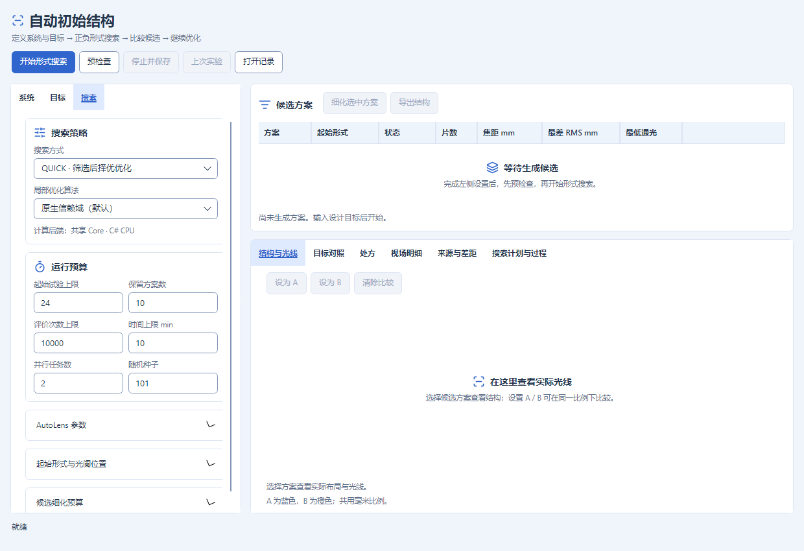
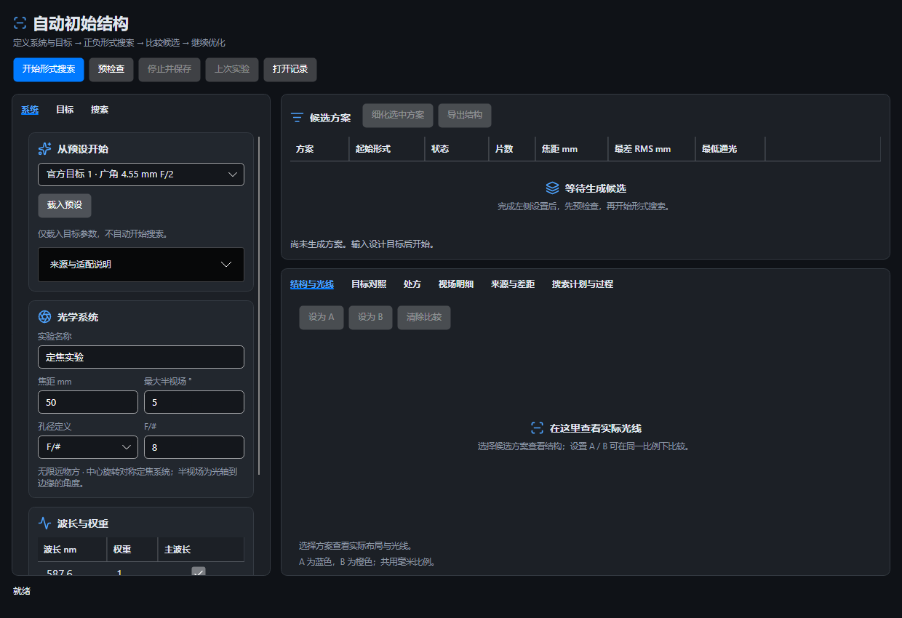

# 自动初始结构：界面整理

日期：2026-10-22。仅整理内置模块的表现层，不改变光学计算、默认规格、预算含义、验收门槛、记录格式或导出快照。

## 设置与操作

| 设置页 | 常用卡片 | 按需展开 |
| --- | --- | --- |
| 系统 | 从预设开始、光学系统、波长与权重 | 预设来源与适配说明 |
| 目标 | 结构规模、像质与验收 | 几何与后焦、玻璃与目录、口径与光阑 |
| 搜索 | 搜索策略、运行预算 | AutoLens 参数、起始形式与光阑位置、候选细化预算 |

所有参数仍使用原输入控件与标识；折叠不会清除值、禁用参数或改变搜索规格。AutoLens 高级设置由原来的混合约束区移到搜索页。固定后焦数值只在启用该选项时可编辑，并有不可用原因。

顶部放置开始搜索、预检查、停止保存和记录操作；候选列表旁放置细化、导出。结构光线、目标对照、处方、视场、来源差距与搜索过程仍由同一组六个详情页签展示。空白区增加真实空状态引导，生成结果后自动移除，不绘制示意镜头冒充候选。

## 主题、语言与小窗口

卡片、边框、文字和图标复用现有主题语义资源。中文、英文、日文切换会重新测量并排列页签；相关模块标题、按钮、分组及静态参数说明补齐翻译。用户实验名称、玻璃编号和数值保持原值。宽窗口左右排列，窄于 820 DIP 时上下排列，设置和结果均可滚动，页签可换行而非缩小字号。

## 本轮验证

- 默认 App Debug、Release 构建均成功，零警告、零错误，实际默认输出已更新。
- Release `FlatStartDesktopTests` 最终单次 **18/18**。包含新分组的全部高级输入可达性、折叠不改变值、固定后焦可用性、空状态转换、三语页签完整宽度与主题资源守卫，以及既有生成、预检查、参数无效编辑、停止/恢复、比较、记录读取、过期回调与同快照导出检查。真实生成和导出覆盖 1240、600、480 DIP；新分组逐项可达性覆盖 1240、480 DIP。
- 主程序 `UserGuidePanelTests` / `UiLocalizationTests` 定向 **4/4**。与上述 18 项为不同用例，不叠加此前重复运行的集合。
- 无头窗口渲染并检查浅色/暗色、中英日、目标/搜索页、窄窗口与真实结果截图。发现并修复语言变更后 WrapPanel 仍沿用原页签排列而裁切长标题的问题；加入实际字体测量断言，不靠缩短标题掩盖。
- 原始本地证据位于 `artifacts/initial-structure-ui-20261022/`：`build-debug.log`、`build-release.log`、`tests/desktop-final.trx`、`tests/guide-localization.trx` 及 `ui/`。上方文档图片为最终截图副本。使用独立无头窗口，未控制用户桌面。

未运行全仓库测试、外部光学数值重认证、跨平台验证或安装升级试验；界面测试通过不表示 AutoLens 目标设计达标。本轮未打包、上传、提交或推送，未改变前轮预设数值验证的冻结记录。
