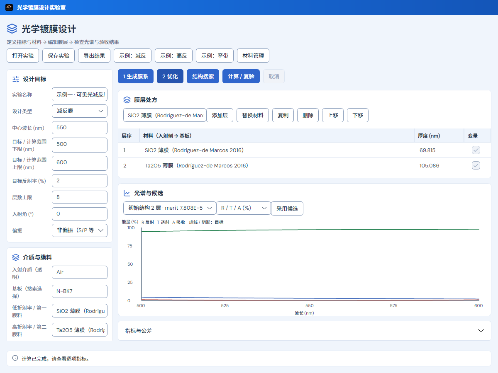
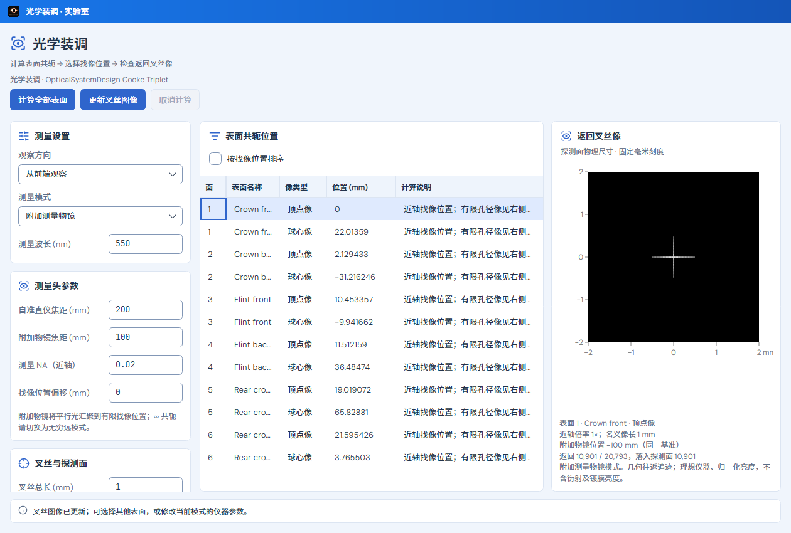
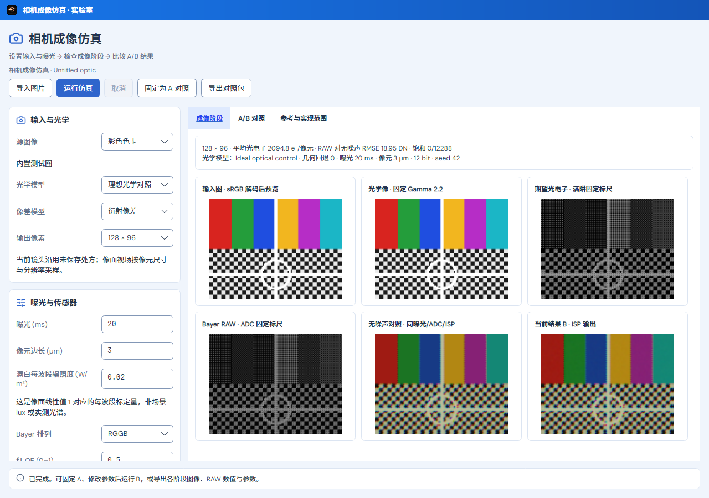

# 镀膜、装调与相机实验室界面改版

日期：2026-10-24。本次仅整理现有三个实验室的展示层，AutoLens 保持原样。工作区已有相机功能及其他光学、报告、分析界面改动，均保留，不能将整棵工作区差异算成本次改版。

## 已实现

三个窗口采用一致的标题、简短操作顺序、来源、命令、参数卡和底部状态；使用现有主题语义色、圆角、图标和字体设置。执行主动作保持强调色，其他命令和禁用原因保留。参数区域不横向滚动，隐藏纵向轨道但保留滚轮、键盘和焦点访问；按钮随宽度换行，长文字保持可读字号。

- **光学镀膜设计**：设计目标和材料分组；膜层处方、光谱独立成卡；膜层工具自动换行，逐项验收移至可展开的“指标与公差”。材料管理将材料信息、n/k 数据及操作分区。侧栏仍为 256 DIP，限制 240–280。
- **光学装调**：测量设置、测量头和叉丝/探测面分组；坐标及限制说明可展开；共轭表和返回叉丝像在宽窗口并排，窄窗口上下滚动。探测面毫米标尺保持原行为。
- **相机成像仿真**：输入/光学、传感器及 ISP 参数分卡；保留阶段、A/B、范围三个页签。六个阶段图在宽结果区为三列，随宽度降为二列或一列；空图提供提示，实际指标计算后显示。

共享组件 `LaboratoryPresentation` 仅在上述窗口及镀膜材料窗口内应用，没有全局改写 AutoLens 样式。原输入与默认值、计算服务、采样、容差、保存、取消和过期结果保护不变。本次没有编辑相机 Actions、服务或物理模型。

## 实际渲染

图片来自 Avalonia Headless + Skia 的实际窗口与既有计算流程，未制作静态效果稿。普通尺寸显示真实结果；窄窗、大字号和暗色图在原始证据中。

光学镀膜设计，1200×900：

光学装调，1260×850：

相机成像仿真，1280×900：

## 定向验证

只运行相关检查，没有执行全套测试。既有相机/装调窗口检查 8/8，镀膜 DesktopTests 18/18，新增布局检查 9/9，合计 **35 个不同用例**，无失败、无跳过。最终布局调整后只补验镀膜三个尺寸及相机/装调三个流程，均包含在原集合中，不重复累计。

新增检查覆盖三窗口的明暗主题、中英日、常用尺寸及 18 DIP 大字号窄窗；检查顶部命令边界、参数实际可访问、实时切换主题/语言后输入值及工程修订不变。既有流程覆盖真实生成/编辑、A/B、叉丝计算、取消、修订失效、材料快照、文件和关闭保护。没有扩大为全套光学数值或 Zemax 一致性认证。

默认 App Debug/Release 构建均零警告、零错误，严格文档链接检查及本次差异格式检查通过。一次镀膜复验曾因共享工作区的多边形导入文件临时编译错误未进入测试；该文件更新后，同一过滤器通过，原日志保留，不计为测试通过或测试失败。没有修改该导入文件来完成本次工作。

目检普通结果、暗色、日文大字号窄窗及材料窗口。无头绘图与自动化流程不代替原生 Windows/macOS 手动验收。仅更新本地源码和默认构建输出，未提交推送、发布、打包或替换已安装程序。

原始日志、TRX、截图和本次源文件见[证据归档](../validation/rechecks/2026-10-24/laboratory-presentation-evidence.zip)，文件身份和范围见[机器账目](validation/LABORATORY_PRESENTATION_2026-10-24.json)。使用方法同步至[用户指南](USER_GUIDE.md)、[界面规范](UI_DESIGN_SPEC.md)、[装调指南](OPTICAL_ASSEMBLY_LAB.md)、[相机指南](CAMERA_IMAGING_LAB.md)与[镀膜指南](../labs/CoatingDesign/README.md)。
