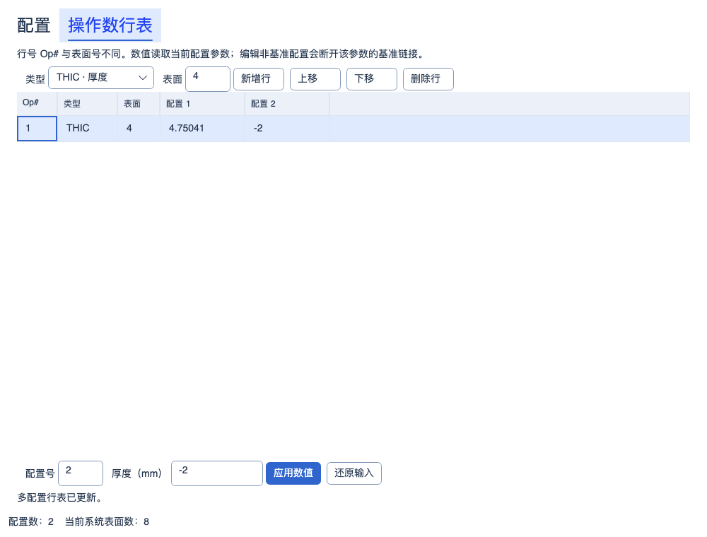
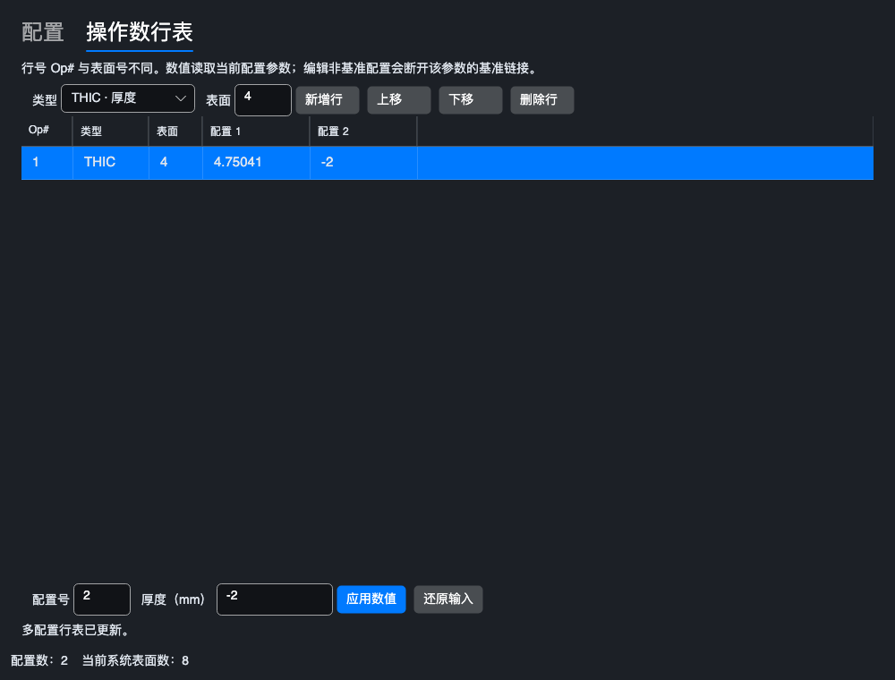
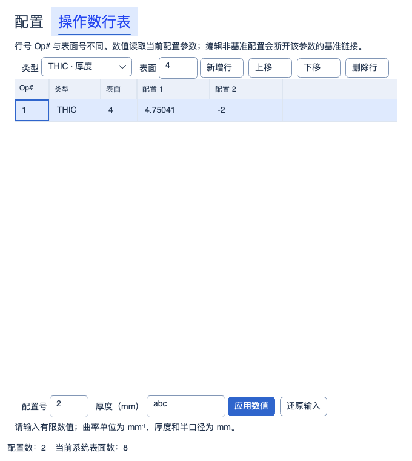

# 多配置行表与 MCOV / MCOG / MCOL

> 历史阶段报告：保留当时的实现、命令、测试与失败结果，不代表当前产品验收。最新状态见 [当前状态](CURRENT_STATUS.md)，可执行构建入口见 [构建与发布](BUILD_AND_RELEASE.md)；旧独立实验室架构和命令已被统一内置模块取代。

2026-10-03。本批新增三项受限执行，340/383 个已核实官方代码连接计算，43 项兼容保留（36 已知功能、2 定义待核实、5 Unused），另 4 项本程序扩展。未完成模式仍属于总任务。

## 定义和实现

按 [Ansys 2026 R1 多配置编辑器说明](https://ansyshelp.ansys.com/public/Views/Secured/Zemax/v261/en/OpticStudio_User_Guide/OpticStudio_Help/topics/Multi_Configuration_Operands.html)核对四类绑定，按[官方多配置优化操作数定义](https://ansyshelp.ansys.com/public/Views/Secured/Zemax/v26102/en/OpticStudio_User_Guide/OpticStudio_Help/topics/Multi_Configuration_Zoom_Data.html)核对行号和配置号。手册核对不等于原生数值或文件列验证。

| MFE 操作数 | 本地六槽 | 返回值 |
| --- | --- | --- |
| MCOV | Int1=Op#，Int2=Cfg#，其余未用 | 指定行在指定配置的实际数值 |
| MCOG | 同上 | min(实际值, Target)，下限满足时贡献为零 |
| MCOL | 同上 | max(实际值, Target)，上限满足时贡献为零 |

Op#/Cfg# 都从 1 开始。Op# 是下表的行序，不是表面号；Cfg# 不依赖最近 CONF。必须使用带行表的有序评价上下文；无行表、无效行号/配置号、非有限参数均明确失败，不使用零值替代。

| 行类型 | 参数 | 单位 |
| --- | --- | --- |
| THIC | 正表面号的有符号厚度 | mm |
| CRVT | 正表面号的曲率，平面为 0 | mm⁻¹ |
| CONN | 正表面号的圆锥系数 | 无量纲 |
| SDIA | 正表面号的半口径，编辑时设为固定值 | mm |

行表只保存有序的类型和表面绑定，数值由对应配置的 Core 表面持有。相同绑定不允许重复，最多 4096 行。不支持物面；读取值需有限。基准配置修改传播到未断开的链接，非基准配置显式编辑断开该参数链接；已有表面拾取目标拒绝直接编辑，源参数编辑后重算拾取。

## 编辑和引用维护

多配置面板保留配置页，增加“操作数行表”页，显示 Op#、类型、表面及各配置列。可新增、上移、下移、删除；选中行后按配置号编辑数值。配置页显示编号也使用一基，应用服务内部仍为零基。

非法文字保留在输入栏，底部显示原因；工作区修订变化后拒绝旧草稿提交；切换单元格后不能把旧草稿误写到新单元格。还原输入重新读取当前数值。应用数值使用 accent，其他操作保持中性，输入单位随绑定类型显示。

行序变化会按绑定身份重映射全部配置内本地 MCO 评价行（包含禁用行）。正在被引用的行不能删除；无效本地引用需先修正。原生兼容 MCO 行保持原始参数，不能当作本地引用重排。表面插入/删除会同步剩余绑定编号；正在被绑定的表面必须先移除绑定，防止删面后引用漂移。所有应用写入先在候选文档验证，再一次性提交/撤销。

## 优化和保存

候选配置集合带相同行表，MCO 从候选的实际值求约束；当前配置的厚度和曲率变量可经过已有生产 DLS 优化。既有基准链接、断开链接及表面拾取规则保留。本批未增加其他配置独立变量的联合搜索，也未增加 MCE 单元格变量或跨配置拾取解。

STAROPT 工程负载升级为 v5，新增 OperandRows（Kind、SurfaceNumber）；容器 v2 和顺序快照 schema 6 不变。v1–4 缺失行表时读取为空，旧版本标记却携带非空新行表会拒绝。半口径断开链接校验补全。非法类型、重复绑定、不存在或非有限引用均拒绝；保存/重开/撤销保留行序、配置值和重映射后的评价参数。

任何非空行表都要求 STAROPT 保存，即使当前没有评价行；单镜头 JSON/文本不能保存项目行表。原生 MCO 导入禁用只读，快照不能自动升级；本地 MCO 文本列未核实，文本导出明确拒绝。既有 ZMX 配置属性解析不被猜测拼成 MCE 行表。

## 验证与未完成范围

默认 Debug/Release 合并回归各 **3183/3183**，包含前批 3135 与新增 48 项，零失败、零跳过、零编译警告/错误。本批新增 48 项（Core/应用 45、界面 3）；另 17 项既有架构检查构成 65/65 定向复验。包含三种返回/约束方向、曲率零点、配置与行号独立、重排/删面保护、负厚度与链接、拾取拒绝、三项生产 DLS、六槽编辑/保存撤销、旧版本读取、恶意新旧格式混用、原生保留和有损导出保护。

实际 Avalonia/Skia 生成 Light/Dark 1000 DIP 和 Light 680 DIP，各含有效值及非法输入，共六图，已逐张检查。UI 渲染是视觉证据，不是 Zemax 数值比较。已提交 29 个基线文件保持原始范围，本批没有新增 MCO 原生值捕获。

尚缺：更多数值/字符串 MCE 行类型、MCE 单元格变量与配置拾取解、独立配置变量联合搜索、原生行顺序/列映射及数值优化对照。前批 CONF 的高级状态组合限制继续有效。注册为受限执行不代表完整兼容。

[机器验证记录](../artifacts/validation/mce-row-operands-20261003/verification.json) · [过滤器](../artifacts/validation/mce-row-operands-20261003/test-filter.txt) · [操作数审计](../artifacts/validation/mce-row-operands-20261003/operand-audit.csv) · [剩余分类](../artifacts/validation/mce-row-operands-20261003/remaining-by-category.csv)

## 代码入口

[Core 行绑定](../src/OpticalSystemDesign.Core/Multiconfig/MultiConfigurationOperand.cs)、[表结构与引用](../src/OpticalSystemDesign.Core/Multiconfig/MultiConfiguration.Operands.cs)、[MCO 求值](../src/OpticalSystemDesign.Core/Optimization/MeritFunction.MultiConfiguration.cs)、[行表界面](../src/OpticalSystemDesign.App/Panels/MultiConfigurationPanel.Operands.cs)、[Core/应用回归](../tests/OpticalSystemDesign.Tests/MultiConfigurationTableTests.cs)、[界面回归](../tests/OpticalSystemDesign.Tests/MultiConfigurationPanelTests.cs)。
