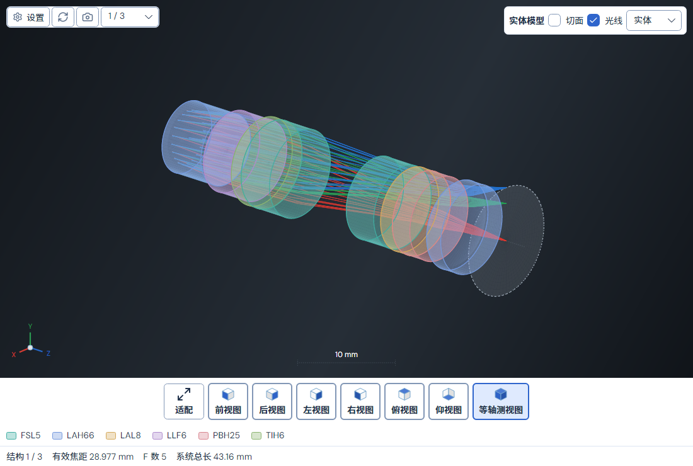

# 实体模型：像面参考与方向控件

日期：2026-10-24。本轮按用户截图移除实体模型右下角重复的方形方向小控件，并恢复像面的可见虚拟参考显示。

## 当前行为

实体模型只保留左下带 X/Y/Z 标签的方向轴，继续跟随真实相机旋转、预设与重置；底部带文字的视角按钮保持。独立“三维布局”的方向图形和绘制不变。

像面几何原已存在于共享 Core 场景中，但实体模型会跳过所有未选中的参考面。现在 Core 的三维表面发布显式 `IsImageSurface` 标记，Application 原样映射到场景 DTO；显示范围包含像面时，实体模型对该标记绘制半透明中性色和虚线边界，不从名称、Z 顺序或当前裁剪范围的末面推断像面。

参考使用实际像面的口径、局部矢高和全局坐标变换，支持偏心、倾斜及曲面像面。它在玻璃与真实光线之前绘制，未选中、隐藏光线、实体、透明、线框和剖切均保留；镜片剖切不裁掉像面参考。它不成为镜片、不进入玻璃图例，也不增加处方表面或修改追迹。

## 定向验收

- 三维查看器相关 **30 个不同用例最终通过**：首轮 29/30，新夹具直接 JSON 序列化无穷远物距而失败；按快照语义允许命名浮点值后，仅复验该项 **1/1**，没有重跑其余 29 项。
- 其中新增的八个 Skia 像素用例实际检查三种显示模式、隐藏光线、剖切下完整像面，以及浅/深色主题下右下控件消失、左下轴保留。独立三维布局在有/无像面标记时像素一致。另一个几何用例核对真实倾斜/非旋转曲面、标签无关、裁剪不误标末面及源快照不变。
- PNG 导出相关 **17/17**，验证当前视口、光线、实体/剖切、材质图例、元数据、保存取消和文件切换保护。与前组无重复，共 **47 个不同用例最终通过**。
- 随后共享 Core 有并行更新，对本次新增几何与像素用例补验 **9/9**；属于前述 47 项，不重复累计。没有为并行改动扩大为全测试。
- 默认 App Debug/Release 构建均零警告、零错误。首轮默认 Debug 被开发版进程占用而失败，已核对进程路径并正常关闭，随后更新默认输出；未强杀或绕到替代输出目录。
- 严格文档检查通过，失效链接和未闭合 Markdown 代码块均为零。

最后构建期间，并行场曲文件短暂缺少类型命名空间，出现一次额外 Debug 编译失败；该文件随后由并行工作补齐，再次默认构建通过，本轮没有修改该文件。原始失败日志保留。

检查使用真实 Zoom 数据和 Avalonia Headless + Skia。已目检完整中文实体模型、无光线像面、深色剖切及导出图；无头检查不等于原生桌面交互验收。本轮仅新增显示角色元数据和绘制，不修改光学公式、采样或数值容差，没有重跑全测试、Zemax 对照或打包发布。

工作区原有及并行的图例、布局菜单、波前热力图等改动保留；本文通过数仅覆盖查看器范围。操作规则已同步到[用户指南](USER_GUIDE.md#多重结构切换)、[UI 规范](UI_DESIGN_SPEC.md)及[当前状态](CURRENT_STATUS.md)。构建、TRX、失败日志、源文件及截图见[机器账目](validation/SOLID_MODEL_IMAGE_SURFACE_2026-10-24.json)和[证据归档](../validation/rechecks/2026-10-24/solid-image-surface-evidence.zip)。当前仅更新本地源码与默认二进制，已安装版和公开安装包未被替换。
