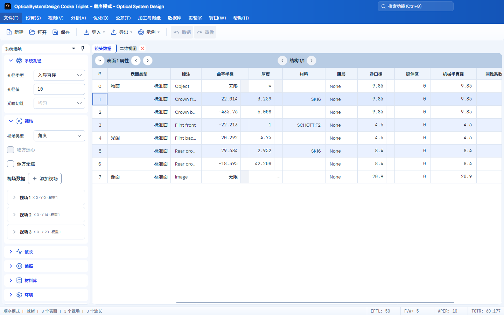

# 用户指南

启动时若保存的工作模式为空、无法识别或超出支持范围，程序回到顺序模式；合法的非序列模式选择仍会保留。可在设置中重新选择工作模式，这不会改变工程处方。

布局恢复失败时保留原布局、页面和描述信息；布局槽位只接受 1–9，不再将其他编号映射到边界槽位。恢复副本扫描检查全部合法会话，并仅保留最新 100 个候选，避免目录顺序截断漏掉新副本。多配置状态文字与界面统一从 1 编号；内存中的配置集合和导入构造均遵守原生工程的 4096 配置保存上限。

主窗口顶部的功能搜索支持 Ctrl+Q 聚焦，以及粘贴命令名称、类别或标识。若剪贴板暂时无法读取，本次粘贴会取消，保留已有查询和选择，状态栏提示重试；也可继续手动输入。此保护已在本地实现，已安装版本是否包含修复见[当前状态](CURRENT_STATUS.md)。

**数据库 → 设计报告 → 一键导出 Markdown** 按保存的配置导出当前工程的镜头结构、二维/三维布局、分析结果与 PNG 截图；默认选择点列图、光线扇形图、傅里叶 MTF 和场曲/畸变。**报告导出设置**可选择全部分析、编辑分析参数及逐一导出所有配置。导出显示进度并支持取消，默认写入源文件目录，文件名含时间戳；分享时同时携带同名 `_assets` 图片目录。详见[Markdown 报告导出](MARKDOWN_REPORT_EXPORT.md)。

主程序现提供类似专业光学软件手册的内置用户指南。入口位于顺序模式和非序列模式的 **帮助 → 用户指南**。指南作为普通文档页打开，可停靠、浮动、关闭并随显式保存的工作区布局恢复。

**实验室 → 成像系统 → 相机成像仿真**提供当前镜头/理想光学、Bayer 传感器和基础 ISP 的实验链。可导入图片、完整传感器 JSON、绝对 QE、光源 W/m²/nm 及场景反射率 CSV。默认保留 650/550/450 nm 三波段模型；固定 A 后选择“连续光谱积分”，设置范围/最大区间并运行 B，按波长计算共享光学、光源 × 反射率 × QE 的光电子积分。连续模式使用单一材质反射谱，图片转为灰度空间图样，不从 RGB 反演光谱。曲线页显示实际单位，导出保留 A/B 各自图像、RAW、来源、参数和积分节点。具体格式、人工像面标定及范围见[实验室说明](CAMERA_IMAGING_LAB.md)，[示例](../samples/camera-imaging/README.md)随程序附在 `Examples/CameraImaging/`。

软件内版本号、构建编号与更新集中在“帮助 → 关于”。“包含测试版”默认勾选，点击“检查更新”会显示滚动进度及可见结果；取消勾选只检查正式版，改变范围后需重新检查。可信签名、架构匹配的新版本可“下载更新”；同版本测试包也可按已签名的更高云端构建编号更新，同一构建不重复提示，旧版本和旧构建不回退。下载显示进度并可取消，完整文件验证后另行点击“保存并重启更新”；取消保存或退出保护不安装，不强制关闭窗口。开发/便携版和无可信签名的包仍需走发布页手动安装。此前只认识稳定版的客户端需先手动安装一次支持测试 OTA 的引导包；不会自动检查或后台安装。完整边界及实际交付状态见[构建与发布](BUILD_AND_RELEASE.md#软件版本与-github-分发)。

使用包含新维护策略的安装包再次安装时，已有安装显示“更新”或“修复”，沿用并锁定原安装目录和快捷方式位置。同版本相同载荷可修复，不同载荷或新版本显示更新，降级会被拒绝；无需先卸载，工程和设置保留。记录冲突或安装范围不一致时会停止并说明原因，不会自行另装到新目录。若旧版在线更新报旧程序占用，请关闭错误提示、正常退出全部软件窗口，再手动安装包含[OTA 交接修复](OTA_HANDOFF_REPAIR_2026-10-24.md)的新完整包。旧下载包不会自动获得修复，原始维护范围见[安装维护说明](WINDOWS_INSTALLATION_POLICY_2026-10-22.md)。

新的 Windows 安装包文件名以 `-Setup-xxxxxxxx.exe` 结尾，末尾八位是实际源码提交短码。尚未支持该规则的旧客户端需要先从发布页手动覆盖更新一次；新程序同时支持旧名称和带短码名称，在线更新仍校验完整签名、哈希及构建编号。

## 字体与显示

在“设置 → 格式与字体”选择“产品默认（推荐）”，界面会使用内嵌的 DM Sans 和思源黑体 SC，数值输入、镜头数值及数值报告使用 JetBrains Mono。可以改选系统或内嵌字体；已有自选字体继续生效，恢复默认会重新启用产品方案。默认字号为 13 DIP，像素主题沿用其像素字体。完整分工与资源来源见[字体说明](TYPOGRAPHY.md)。

## 实验室窗口

镀膜设计、光学装调和相机成像采用统一的标题、分组参数卡和结果区，常用操作位于顶部，当前状态位于底部。左侧参数可用滚轮、键盘或切换焦点访问，窄窗口的按钮会换行，结果区可滚动。镀膜的逐项验收需展开“指标与公差”；装调的共轭表与叉丝像随窗口宽度并排或上下排列；相机各阶段按可用宽度排列为三、二或一列。AutoLens 界面保持原样。[查看三个页面截图及验证范围](LABORATORY_PRESENTATION_2026-10-24.md)。

## 镜头示例

AutoLens 预设位于 **实验室 → AI 初始结构 → 系统 → 从预设开始**。默认条目为原版脚本的 5 mm F/1.8、全视场 90° 手机配置，另保留五项 README 目标适配。载入只填入参数，不自动运行或视为成功处方。来源与限制见 [AutoLens 原生预设](AUTOLENS_OFFICIAL_EXAMPLES.md)。

顺序模式从 **文件 → 示例 → 分类 → 镜头名称** 打开，也可在命令搜索中输入镜头名称。示例已替换为 Zemax Sequential 原目录的全部 **14 类、95 个 ZMX 镜头**，随软件构建和发布提供，不依赖本机安装 Zemax。原先生成的 Cooke/Tessar 示例入口已删除。

保留原目录、源文件及多配置，打开时沿用未保存修改保护和统一导入器；编辑后保存为自己的 `.staropt` 工程。示例收录不等于全部面型与分析已支持或精度认证，未支持项仍给出明确提示。ZOS 配对文件不重复列入，采用 ZMX 处方；详情见[示例来源](../src/OpticalSystemDesign.App/Assets/SequentialExamples/README.md)和[逐镜头对比](../validation/zemax/2026-r1/sequential-corpus-2026-10-19/BY_LENS.md)。

Objectives 中的 MIL 双胶合镜头现可直接导入；内置 `517642`、`648338` 两种材料的独立色散数据，支持 350–1050 nm，保存工程时保留数据与来源。其他未收录的 MIL 编号仍需明确材料定义。材料范围见[材料资源说明](../src/OpticalSystemDesign.Core/Materials/Data/README.md)。

## 自动初始结构

新实验采用原版 e58 手机流程规则的纯 C# 策略：20000 mm 有限物距、独立前置光阑、随机弱曲率起点、固定输入光线、直接 Adam 和目录精修。默认计划为 2001 + 3001 次更新；资源不足保存进度，不缩短课程。新入口不使用二元形式筛选、原生信赖域、启发式或 target polish。旧 v1 和混合记录仍可查看及导出，不能当作新策略恢复或细化。光学计算均使用共享 Core；[逐项对齐及保留差异](AUTOLENS_UPSTREAM_ALIGNMENT_2026-10-24.md)有详细说明。

在 **搜索 → 计算设备** 中选择“自动（优先 GPU）”“GPU”或“CPU”。CUDA 正式追迹与求导使用共享 Core 双精度；有限物距方向瞄准使用 Core CPU 并单独计数。自动模式记录不可用原因后回退，显式 GPU 不可用时阻止开始。载入预设保留设备，打开记录恢复所存模式；改设备会新建实验。独立验收保留原采样与门槛，不能从训练损失推断达标。范围见 [AutoLens GPU](AUTOLENS_GPU.md)。

设置区按“系统 / 目标 / 搜索”分组。系统页管理目标和 RGB 波长；目标页管理初始化总长/后焦、允许玻璃及独立验收门槛；搜索页管理种子、资源和完整阶段计划，面型可到 r¹⁸。随机初始化、周期修形和前置光阑由原版规则固定，旧起始形式及移动光阑控制不再显示。收起设置不会重置参数。

上方保留开始、预检查、停止保存及记录操作；候选旁边提供细化和导出，下方页签查看实际光线、目标差距、处方、视场及搜索过程。窄窗口自动上下排列，设置和结果均可滚动访问。界面跟随主题和中英日语言；用户填写的实验名、数值与处方不作为界面文字翻译。计算逻辑、验收门槛与文件格式未因排版调整而改变。

新版分组及截图说明见[界面整理记录](INITIAL_STRUCTURE_UI_2026-10-22.md)。

## 镜头数据表

镜头数据表的列标题统一加粗并水平、垂直居中，便于与数据行区分；不改变字号、列宽、数据单元格的数字对齐和原有字重，也不影响其他表格。

“表面类型”列默认宽度为 180 DIP：物面、光阑、像面角色标识靠左，标准面、偶次非球面等实际面型名称靠右。普通行不重复显示“普通面”，也不为该角色保留空白列。较长面型名称可按需拖宽列边界；窄列会省略显示，悬停可查看全名。

## 多重结构切换

二维图、三维布局和实体模型顶部的设置、刷新按钮旁均提供结构下拉框，按 `1 / N、2 / N…` 列出单个结构，不提供“全部”；只有一个结构时隐藏。打开时跟随活动结构，手动选中后只固定当前视图显示的结构，各视图可独立选择，不改变镜头数据页的活动结构或工程。镜片、自动口径、光线和底部参数均来自所选结构。重置视图设置或换文件后恢复跟随；删除所选结构时自动回到当前结构。窄窗口把右侧显示工具移到下一行，避免遮挡。非序列视图不显示多重结构选择。

三维布局用于线框与光路检查，显示镜片外缘、面截线和三维光线；着色、透明和剖切位于单独的“实体模型”页面，可切换实体、透明、线框。两者使用同一份实际三维几何：各面在自己的局部坐标中采样后转换到全局，保留偏心、倾斜及非旋转对称面；镜片不会再因二维截面旋转而丢失 X 偏心。剖切封口按真实网格交线生成。此处尚未增加 Zemax 的完整光线模式、三维多结构叠加/偏移、光瞳显示和三轴数值旋转设置。

“实体模型”现试用玻璃材质配色：同一玻璃型号使用相同颜色，底部图例标出颜色对应的材料名。切换实体、透明、线框或剖切时保持对应关系；Air 和空材料不列出。图例随窗口宽度换行，条目很多时可纵向滚动。这些颜色用于识别玻璃，不表示实际透射光谱，也不改变光线颜色或计算结果。“三维布局”和二维图沿用原有显示。

实体模型默认使用较细的 0.7 DIP 光线，并对每个所选视场/波长组采样 21 条光线；实际可见数量还受渐晕过滤和光瞳设置影响。设置中的“光线数”仍可调整，线宽“细／标准／粗”分别为 0.7／1.0／1.5 DIP，重置恢复这套默认值。二维图和三维布局继续使用原有的默认 7 条采样和线宽。

三维布局与实体模型均只保留左下角方向示意，标出红色 X、绿色 Y 和蓝色 Z 正轴，右下角不显示重复的小坐标框。拖动、方向键旋转或切换前/后/左/右/上/下及等轴测视图时，示意轴与镜头视角同步旋转，朝向视线的轴会相应缩短。平移、缩放和 Y 拉伸不改变方向示意，`Home` 恢复默认视角。

实体模型用半透明填充和清晰虚线轮廓显示实际像面，作为虚拟参考面；不需要先选中像面，关闭光线后仍可看到。切换实体、透明、线框或剖切均保留完整像面参考。位置、口径、倾斜与曲面形状来自当前结构的真实像面，不增加镜片或改动工程处方。

三维布局与实体模型共用画布内下方的圆角悬浮视角工具条，同时显示立方体图标和“前视图、后视图、左视图、右视图、俯视图、仰视图、等轴测视图”文字；小立方体用加深的强调色标明对应视面，当前匹配的视图保持高亮。自由旋转后取消高亮，`Home` 恢复等轴测高亮。“适配”只调整取景，不改变所选方向。按钮可用 Tab 和空格键操作，窄窗口自动换行，并为坐标示意与比例尺留出间距。实体模型的材质图例仍位于视口下方。

二维图、三维布局和实体模型均在设置、刷新旁提供相机图标，悬停提示“导出图片（PNG）”。点击后选择保存位置，文件名默认包含工程、视图类型及多结构编号。图片保留点击时的当前视角、平移/缩放、光线、实体/透明/剖切效果、坐标示意、比例尺和已显示的底部参数；实体模型的材质图例完整展开，底部参数按需换行。设置面板、操作按钮、视角按钮和键盘焦点框不进入图片。隐藏底部框架时沿用该显示设置；正在查看过期非序列光线时保留其警告文字。

图片像素尺寸跟随当前视口及屏幕像素比例。视图尚未生成、正在更新或已过期时，导出按钮会说明原因；锁定的过期视图需先解锁并刷新。画面在打开保存对话框前固定，选择路径期间切换工程不会更换此次导出的内容。成功和失败都有可见提示；取消保存不修改已有文件。

镜头数据表上方的工具栏在浅色主题中使用蓝灰底色；结构切换固定在整条工具栏的正中央，表面属性保留在左侧；窗口较窄、两组控件可能重叠时，结构切换移到下一行并继续居中，不缩小字体。结构导航按“〈 结构 1/3 〉”排列，当前序号/总数以粗体显示，位于左右按钮中间。通过顶部“设置 → 系统 → 多重结构”打开同一份多配置编辑器；导入的 Zoom 等多结构镜头可直接切换，单结构显示“结构 1/1”。单结构或到达首尾时，相应按钮不可用并说明原因。

切换使用原有活动配置服务，镜头数值、系统孔径及工作区视图同步刷新。切换前提交有效的单元格输入；无效输入保留并阻止切换，可修正或按 Esc 还原后重试。异步排队的切换不会跨越文件打开/重置或页面关闭。当前序号、按钮及说明支持中英日即时切换。普通启动仍只打开基础页面；编辑器按需通过按钮打开，不新增自动恢复文档。

编辑器默认显示类似 Zemax 排列的矩阵：操作数为行、结构为列，列标题加粗，活动结构带 `*`。上方的结构左右按钮或双击列标题用于激活结构；单击数值选择要编辑的单元格，双击或展开“操作数属性”后修改数值、变量和拾取。选择其他结构的单元格不等于激活该结构；未应用或无效输入会阻止导航，应先应用或还原。原来的配置概览与厚度编辑仍可通过底部标签进入。

`APER` 行显示各结构真实的系统孔径，当前只读，修改应在激活相应结构后通过系统选项进行。它用 `—` 表示非操作数行，不占用 `Op#`，因此不会让原有拾取、变量和评价函数的行引用错位。`THIC` 等可编辑行保留原来的 `Op#` 和表面号。此界面借鉴不代表实现了 Zemax 全部多重结构操作数。

“结构矩阵点列图”默认选择“所有”，一次计算工程中的全部结构，按视场为行、结构为列显示，各格叠加该结构所选波长；同单位图格使用统一坐标范围，便于比较。内置 Zoom lens 的三个结构、三个视场显示为九格，不能把波长数当作结构数；也可选择当前或指定结构，仅显示对应列。分析不会激活其他结构或改动处方；修改非活动结构后重新同步，该列也会更新。选择全部视场时，某结构缺少的视场保留空格并提供原因；明确选择的视场或波长在某结构不存在时给出该结构的错误，避免代用其他编号。其他分析也可在各自设置中选择当前或指定结构，可叠加比较的分析另提供“所有”。

导入模型没有登记操作数行时，矩阵仍会直接显示有限的厚度差异，例如 Zoom 镜头的表面 8 和 15。此类 `THIC` 行同样以 `—` 表示没有本地 `Op#`，可直接编辑厚度，不会自动创建或重排操作数。需要变量或拾取时，先新增对应类型和表面号的行；登记后的同参数差异不会重复显示。

修改基础结构厚度时，保持关联的结构与拾取结果一起更新，当前激活结构的处方、计算和保存结果使用同一组数值；已有独立厚度保留。由表面拾取控制的厚度不能直接覆盖，应修改源表面，或先在表面属性中移除拾取。撤销、重做及 STAROPT 保存保留这些依赖关系。

## 图文说明

指南按“操作教程 / 计算原理 / 功能参考”筛选，也可搜索全部语言的标题、正文和命令标识。左侧 248 DIP 目录保留分组和选中状态，长章节名换行；正文最大宽度 720 DIP，以标题、摘要、分隔线和小节组织阅读，不随窗口缩小字号。宽度达到 1120 DIP 时，右侧提供固定的“本章内容”文字目录；较窄时收进正文顶部的折叠目录。窄于 760 DIP 时先显示正文，点击“目录”切换导航。章节底部提供上一章、下一章。

9 组逐步教程将操作步骤与当前软件截图放在一起：建立系统、二维/实体模型、成像分析、优化、公差/制图、非序列、镜头库/初始结构、相机、镀膜/装调。18 种实际界面分别捕获中英日三语，共 54 张。点击截图打开大图，可选“适应窗口”或“100%”查看细节。截图保持捕获时的浅色主题，不作为实时工程结果。

流程示意移到章节末尾，默认折叠，按需展开。图形、图题和阅读界面继续适配主题与语言。截图来自真实产品控件的离屏渲染，未拼造功能或数值；相机示例采用明确标注的理想光学对照。来源和重新捕获方法见[截图说明](assets/user-guide/README.md)。

## 软件如何计算

“计算原理”包含 27 章、39 组矢量排版公式。除快照、材料、追迹、近轴、像差、衍射、优化、公差和非序列外，补充面型/GRIN、光瞳瞄准、Seidel、Zernike、干涉、傅科/角谱、照度、线/边缘扩散、部分相干、扫描、导数、膜系、AutoLens 和装调。当前分析目录 76 个条目全部关联对应计算章节；图片查看、清空和数据库筛选另说明是否产生新计算。

公式使用分式、积分、矩阵及上下标排版，界面与 PDF 共用离线矢量轮廓，不以普通代码字符串或截图代替。阅读页的公式居中，保留原字号；长公式在自身区域横向滚动，不撑宽整章。截图保留轻边框与下方图注。正文可选择；详细变量、单位、归一化和适用范围见[计算指南](COMPUTATION_GUIDE.md)与[数学公式附录](COMPUTATION_FORMULAS.md)。

右上角 **⋯（更多操作）** 中可选当前章节、全部计算原理、完整指南，按点击时的语言导出正文、公式和相关截图。纸面固定浅色，嵌入字体；公式保留矢量。生成可取消，失败和取消保留原文件。分析目录对应关系和 PDF 验证不扩大光学精度认证范围。

先统一处方、结构、波长、视场、孔径、采样和参考，再比较数值。RMS 点列、RMS 波前、几何能量和衍射能量各有定义；显示配色和视图采样不改变光学计算。完整计算索引与源代码依据见[计算指南](COMPUTATION_GUIDE.md)。

## 内容范围

指南不是单页快速提示，而是带搜索和分级目录的完整功能手册。当前包含：

- 推荐工作流、主界面、顺序模式与非序列模式；
- 工程的新建、打开、保存、恢复、导入和导出；
- 系统孔径、视场、波长、环境、偏振、镜头数据、表面属性和多配置；
- 非序列对象、光源、探测器、追迹控制、光线数据库和路径分析；
- 报告、光线、像差、波前、PSF、MTF、RMS、圈入能量和扩展图像分析；
- 优化变量、评价函数、DLS、随机扰动、向导、滑块和可视化优化；
- 公差数据、Monte Carlo 结果、报告、直方图、良率、可加工性和光学制图；
- 材料库、镜头库、库存镜头、初始结构、镀膜设计和光学装调；
- 页面停靠、布局槽位、页面锁定、命令面板和常用快捷键；
- 当前版本实际注册的全部普通命令和全部顺序/非序列分析命令。

## 页面拖动与停靠预览

拖动文档页签；平铺或层叠时，拖动页面标题左侧的名称。进入另一个文档区域后会出现十字方向提示：

- 指向上、下、左、右按钮，半透明灰框预览分割后的区域与尺寸；松开鼠标完成停靠。
- 有效的中央按钮用于合并为标签页；不可用方向不会显示可选提示。
- 按 Esc 取消拖动，原布局和页面内容不变。移动页面保留当前控件、数据和设置。
- 两个分栏合并后回收空区域，恢复完整宽度；反向合并也不会留下空白分栏。
- 默认系统选项固定在左侧并使用工作区完整高度。文档只能在右侧文档区域内分割或合并，不再出现覆盖整个工作区的外沿落点，避免上下分栏挤占侧栏；灰框预览也限于目标文档组。侧栏仍保持 240–280 DIP 宽度规则，原有固定/浮动操作保留。

需要复用布局时，使用“保存默认布局”或布局槽位，之后显式加载。普通启动仍只打开基础页面，不自动恢复分析页。内置指南“窗口、布局与快捷键”包含对应的中、英、日说明。上述行为使用现有 Dock 框架的拖放验证与布局模型，没有另建一套窗口系统。

旧的显式保存布局会补全停靠分组，不会擅自改变保存的位置。若旧布局中侧栏已被上下分栏挤占，可使用“重置为系统初始布局”回到左侧完整高度的默认排列。

## 分栏中的分析图表

赛德尔柱形图的“最大像差范围（毫米，0=自动）”默认设为 0：自动使用全部表面及“总和”七类系数的最大绝对值，并留 10% 边距，正负范围对称。输入正数仍使用手动固定范围，已有保存设置保持原值；网格间隔、配色、图例和布局不变。

### 干涉条纹

“干涉图”显示由真实波前差计算的干涉条纹。默认用当前结构与零 OPD 参考光束比较，可切换两束光的结构；“条纹数/波长”控制波前倍率，X/Y 倾斜表示穿过整个瞳直径增加的条纹数。提高“瞳面采样”可更细致地显示条纹。灰度、伪彩色和等高线共用归一化强度 0～1；灰度中数值 1 为黑色，因此零相位呈暗中心。

可选择波长、视场、分析面、出瞳形状及子孔径 Sx/Sy/Sr；“考虑光程差”加入两光束到实际像面的主光线总光程差。“参考光束到顶点”要求倍率为 1，适用于小主光线偏角。“等高线格式”留空使用默认级别，输入 `0.2` 表示间隔，输入 `0.2 0.5 0.8` 表示指定强度级别。“数据”页分别保留瞳坐标、OPD 差、条纹相位和强度。

该模型假定两束光等强且瞳面完全重合。开启 Ray Aiming 时，暂不支持光阑之前的中间分析面，界面会给出明确原因；请改用像面或受支持的分析面。完整设置和验证范围见[干涉条纹说明](INTERFEROGRAM_2026-10-26.md)。

### Zernike 系数

在“分析 → 波前”中使用 `Zernike Fringe系数`、`Zernike Standard系数` 或 `Zernike Annular系数`，查看对应基底的系数表和拟合统计；另保留“Zernike系数 vs. 视场”曲线分析。系数编号、归一化和统计定义沿用各自基底，不互相替换。

通用“Zernike 系数”重复入口已从功能搜索和报告导出选项中移除。旧报告设置中残留的 `Zernike` / `Zernike 系数` 项会在导出时跳过，不会重新生成原先标题为 `Zernike Fringe Fit` 的拟合波前热图，也不会自动换成另一种系数定义。查看波前分布请使用已有“波前图”；本次不增加重建图或系数柱形图。

### 分析窗口的结构选择

所有顺序分析共用“结构”设置：只有一个结构时整项隐藏，多结构时显示“当前的”和“1 / N、2 / N…”；可叠加比较的分析还显示“所有”。“当前的”随镜头数据的活动结构变化；指定编号只改变此分析窗口的计算对象，不激活其他结构。设置、预设和页面副本保存稳定的结构编号，切换界面语言或增加结构后仍指向同一编号。切换文件后刷新选项；原编号已不存在时回到当前结构。

点列图、光线像差、光程差、MTF、RMS、场曲、色差及能量等支持各结构的独立结果叠加，图例标明结构和原系列，曲线/散点可分别开关；图例过长自动换行。结构矩阵的“所有”按视场行、结构列显示，选择单个结构则只显示该列并保留真实编号。无法共用坐标量/单位或绘图布局时明确报错，可改选单个结构或使用结构矩阵。多结构结果的 CSV 增加独立 `configuration` 列；PNG 保留当前结果的结构标识。

Huygens PSF/MTF 等相干合成分析目前提供当前或指定结构；其“所有”涉及电场相干求和，尚未接入，不能用普通强度或曲线叠加代替。波前、图像模拟及纯报告等也使用当前或指定结构。实现范围和 Zemax 文档依据见[结构选择说明](ANALYSIS_CONFIGURATION_SELECTION_2026-10-22.md)。

分析绘图页随停靠区域重新布局，保留可读字号。普通视场卡片和完整扇形图对可换行；矩阵保留行列对应关系，必要时滚动。底部说明至少 132 DIP 高，并随文字增长；窄窗口将摘要与文档信息上下排列。调整窗口不改变数据、单位、图例选择和手动缩放。

带勾选框的波长、视场和结构系列图例统一放在绘图页右上侧，纵向排列；单图、点列图、矩阵图及像差扇形图的位置一致。可读绘图页的上、右边距均为 12 DIP，长标签在条目内换行。取消勾选仅隐藏对应系列，再次勾选恢复；图例占用独立区域，不遮挡曲线，并在图片导出中保留。

全部取消图例勾选时，曲线或散点全部隐藏，图框、坐标、刻度、网格及零线仍保留，当前平移和缩放不变；矩阵中的单元格也保持图框。重新勾选即可恢复对应结果，不需要重新计算。此时仍可导出 PNG，导出图同样保留空图框和说明。

MTF 图右侧每条曲线均有勾选框，可分别显示或隐藏各视场/频率的子午（Tangential）、弧矢（Sagittal）曲线；开启衍射极限参考线后也可单独勾选。傅里叶、惠更斯、几何、采样 MTF，以及离焦 MTF 和 MTF 随视场变化图均适用。取消显示不会重新计算，也不删除“数据”“文本”页中的结果；PNG 保留当前选择。

顶部“MTF 曲线”下拉菜单用两条横向分隔线区分傅里叶（FFT）、惠更斯和几何三组；每组依次为普通 MTF、离焦 MTF 和 MTF 随视场变化。

相对照度图的横轴贴合实际扫描视场，两端不再额外留白；例如最大视场为 14° 的正方向扫描显示为 0°～14°。选择负方向或高度视场时沿用对应的实际范围和单位，照度曲线数值不变。

波前图可在“设置 → 显示为”中选择“二维热力图”，用平面颜色查看光瞳上的波前分布，右侧色标以波为单位。“表面”和“等高线”继续可选，默认保持“表面”；切换方式保留当前波长、视场和出瞳设置。相机按钮可导出包含热力图、色标与底部说明的 PNG。

光线像差、瞳孔像差及光程差的成对子图会先为坐标轴、标注和曲线保留可用空间，再参与整页适配，避免分栏后坐标框被挤成几像素。同一视场的两图靠近排列，保留图框尺寸和坐标标题所需的间距；视场配对与最后一行居中保持。

这种适配只调整布局，不修改坐标单位、计算数据或分析参数，也不重置当前手动平移/缩放。滚轮、键盘和可选图例仍可操作。“数据”和“文本”页维持正常字号及原生滚动。分栏特别小时，可扩大页面或滚动查看细节。

有绘图结果的分析页在顶部工具栏提供相机图标，悬停提示“导出图片（PNG）”。点击后选择保存位置，按当前页面尺寸和屏幕像素比例保存整张绘图页：保留当前平移、缩放、三维旋转，以及坐标、图例、色标和底部说明；工具栏、设置浮层及结果页签不进入图片。窄窗口也保存整页适配后的图面。基面数据保存场景及其数据表。纯文字报告、无结果和不可用结果不提供图片导出；切换到“数据”或“文本”页时隐藏图标，计算期间暂不可用并提供原因提示。取消保存不改动已有文件。

## 完整性约定

FFT PSF 的原生兼容标量显示保留发射加权和真实通光，关闭偏振时不计入表面/材料衰减；它是相对于理想峰值的 PSF 表示，不能作为绝对透过率。FFT 截面在右端显示边界保持最后一个独立结点值，避免周期回绕造成边界假峰。具体原生对照和仍未关闭的低采样能量差异见[当前状态](CURRENT_STATUS.md)。

概念章节解释正确工作流和结果边界；“完整命令参考”直接读取主窗口实际注册的命令，“完整分析参考”直接读取分析目录。这样当前版本中的每个命令都有可搜索条目，未来新增命令若进入注册表也会自动进入指南，不依赖手工维护一份容易遗漏的平行清单。

用户指南、操作数帮助和控件上下文提示职责不同：

- **用户指南**覆盖产品工作流、功能入口、数据边界及全部命令；
- **操作数帮助**逐项解释评价函数操作数、参数、计算路径与兼容状态；
- **工具提示和禁用原因**说明当前页面、当前工程状态下的即时操作条件。

指南描述当前程序中实际可见和注册的能力，不把计划功能、兼容保留数据或外部软件行为写成已经实现。具体算法限制、采样定义、单位和验证范围仍以对应分析页、专题文档及[当前状态](CURRENT_STATUS.md)为准。

## 语言与搜索

指南内容随主界面在简体中文、English、日本語之间即时切换。搜索同时匹配章节标题、正文、命令名称、分析名称、关键词和命令标识；切换语言后保留搜索条件和当前可匹配章节。翻译只影响显示，不修改工程或命令标识。

主界面命令面板也支持三语名称和分类搜索，例如 `快速聚焦`、`Quick Focus`、`クイックフォーカス` 指向同一命令；命令标识始终有效，不要求先切换界面语言。系统侧栏的视场/波长删除按钮、瞳孔偏振说明、材料目录和环境提示随语言同步更新。用户输入的标签、处方数据和材料原名保持原样，不作自动翻译。

新打开的分析页使用分析目录中的显示名称生成标题，而不是直接显示内部英文标识。例如“扩展图像分析”在中文页签和独立浮动窗口中保持中文，英文、日本語标题随界面语言切换。分析标识、设置、实例和计算分派不受标题翻译影响。

显式载入旧布局时，报告页签中保存的内置英文标题也会恢复为中文规范源文字，包含报告副本；自定义标题保持原文。

## 验证

`UserGuidePanelTests` 覆盖搜索与分类、三语切换、前后章导航、空结果、流程图折叠、54 个截图资源解码、宽/窄/深色布局、截图放大、工作区文档类型以及实际传入命令的逐项覆盖。`UserGuideCaptureTests` 仅在明确设置截图目录时运行批量真实捕获，使用临时设置和工作区；早期捕获遗漏隔离的影响及恢复限制见[更新记录](USER_GUIDE_UPDATE_2026-10-27.md)。相关本地化和停靠专项测试继续守卫各自行为。最新定向验证与证据见[当前状态](CURRENT_STATUS.md)，局部检查不代表全界面逐项认证。

`UserGuideMathematicsTests` 核对76个分析条目关联、全部公式定义和轮廓、三种PDF范围、后台导出及取消保留原文件。公式、导航和导出的实际验收范围见[公式与PDF记录](USER_GUIDE_MATH_PDF_2026-10-27.md)。
