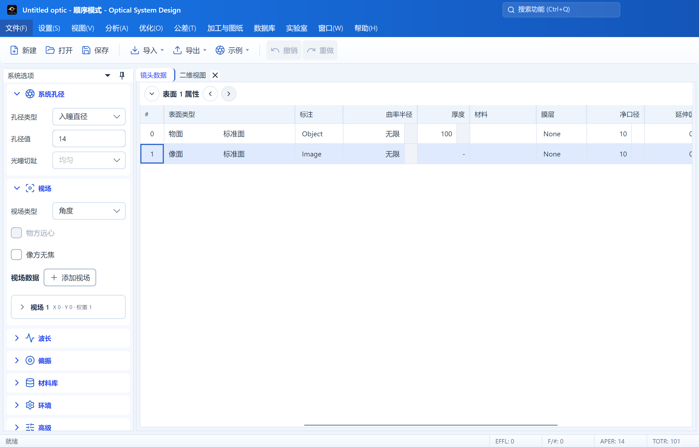
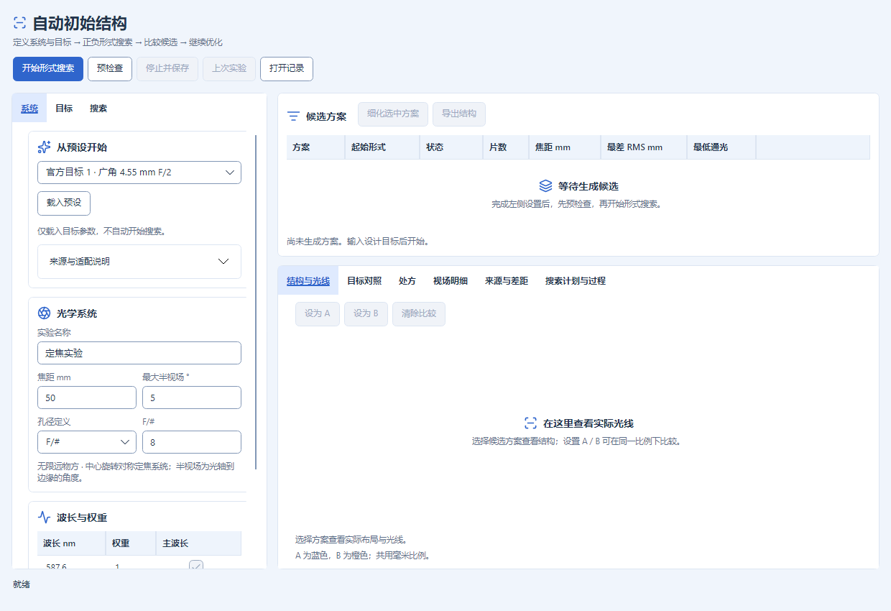

# 用户指南

主程序现提供类似专业光学软件手册的内置用户指南。入口位于顺序模式和非序列模式的 **帮助 → 用户指南**。指南作为普通文档页打开，可停靠、浮动、关闭并随显式保存的工作区布局恢复。

软件内版本号、构建编号与更新集中在“帮助 → 关于”。“包含测试版”默认勾选，点击“检查更新”会显示滚动进度及可见结果；取消勾选只检查正式版，改变范围后需重新检查。可信签名、架构匹配的新版本可“下载更新”；同版本测试包也可按已签名的更高云端构建编号更新，同一构建不重复提示，旧版本和旧构建不回退。下载显示进度并可取消，完整文件验证后另行点击“保存并重启更新”；取消保存或退出保护不安装，不强制关闭窗口。开发/便携版和无可信签名的包仍需走发布页手动安装。此前只认识稳定版的客户端需先手动安装一次支持测试 OTA 的引导包；不会自动检查或后台安装。完整边界及实际交付状态见[构建与发布](BUILD_AND_RELEASE.md#软件版本与-github-分发)。

使用包含新维护策略的安装包再次安装时，已有安装显示“更新”或“修复”，沿用并锁定原安装目录和快捷方式位置。同版本相同载荷可修复，不同载荷或新版本显示更新，降级会被拒绝；无需先卸载，工程和设置保留。记录冲突或安装范围不一致时会停止并说明原因，不会自行另装到新目录。若旧版在线更新报旧程序占用，请关闭错误提示、正常退出全部软件窗口，再手动安装包含[OTA 交接修复](OTA_HANDOFF_REPAIR_2026-10-24.md)的新完整包。旧下载包不会自动获得修复，原始维护范围见[安装维护说明](WINDOWS_INSTALLATION_POLICY_2026-10-22.md)。

## 字体与显示

在“设置 → 格式与字体”选择“产品默认（推荐）”，界面会使用内嵌的 DM Sans 和思源黑体 SC，数值输入、镜头数值及数值报告使用 JetBrains Mono。可以改选系统或内嵌字体；已有自选字体继续生效，恢复默认会重新启用产品方案。默认字号为 13 DIP，像素主题沿用其像素字体。完整分工与资源来源见[字体说明](TYPOGRAPHY.md)。

## 镜头示例

AutoLens 的官方设计目标另位于 **实验室 → AI 初始结构 → 系统 → 从预设开始**。选择后点“载入预设”，再预检查、开始搜索。“来源与适配说明”可展开查看原始来源、补充参数和限制。五个条目覆盖广角、全画幅、20 随机种子协议及两种极端规格适配；不是现成成功处方。使用方式及真实验收边界见 [AutoLens 原生预设](AUTOLENS_OFFICIAL_EXAMPLES.md)。

顺序模式从 **文件 → 示例 → 分类 → 镜头名称** 打开，也可在命令搜索中输入镜头名称。示例已替换为 Zemax Sequential 原目录的全部 **14 类、95 个 ZMX 镜头**，随软件构建和发布提供，不依赖本机安装 Zemax。原先生成的 Cooke/Tessar 示例入口已删除。

保留原目录、源文件及多配置，打开时沿用未保存修改保护和统一导入器；编辑后保存为自己的 `.staropt` 工程。示例收录不等于全部面型与分析已支持或精度认证，未支持项仍给出明确提示。ZOS 配对文件不重复列入，采用 ZMX 处方；详情见[示例来源](../src/OpticalSystemDesign.App/Assets/SequentialExamples/README.md)和[逐镜头对比](../validation/zemax/2026-r1/sequential-corpus-2026-10-19/BY_LENS.md)。

Objectives 中的 MIL 双胶合镜头现可直接导入；内置 `517642`、`648338` 两种材料的独立色散数据，支持 350–1050 nm，保存工程时保留数据与来源。其他未收录的 MIL 编号仍需明确材料定义。材料范围见[材料资源说明](../src/OpticalSystemDesign.Core/Materials/Data/README.md)。

## 自动初始结构

“AI 初始结构”统一使用 AutoLens 的 C# 自动求导实现，不再提供原生信赖域、旧启发式和原生目标精修选项。新建实验、载入预设后搜索、继续运行和候选细化均只使用 AutoLens，原生目标精修预算固定为零；实体光阑与光线瞄准固定启用。旧算法及包含原生精修的混合算法记录保留原始身份，可以查看、比较和导出，不能继续运行或细化。载入旧记录后开始新的搜索会新建 AutoLens 实验，不改写旧记录。

在 **搜索 → 计算设备** 中选择“自动（优先 GPU）”“GPU”或“CPU”。新建窗口默认自动，检测到可用 NVIDIA CUDA 显卡后使用 GPU 批量瞄准、正式追迹和求导；无可用设备或超出 GPU 有限数值/显存范围时，自动模式使用同一 AutoLens 的 CPU 路径并记录原因。显式 GPU 模式不可用时阻止开始，不冒充 GPU 运行。界面显示检测到的显卡，候选详情和运行记录保存实际计算设备。载入目标预设保留设备选择；打开记录恢复原设备模式，手动改设备会清除旧显示结果并新建实验。适用面型的正式光线、瞄准和密集物理验收使用共享 Core 的 CUDA 函数，保持原来的积分光瞳、边界检查、视场、波长、裁光与验收门槛。多视场合批并复用有界显存缓冲；候选详情区分 GPU 瞄准/追迹光线和少数复杂延拓分支的 CPU 恢复次数。质心/RMS 汇总、制造约束、材料选择与流程控制仍由 CPU 处理。范围和测量见 [AutoLens GPU](AUTOLENS_GPU.md)。

设置区按“系统 / 目标 / 搜索”分组。系统页管理预设、焦距、孔径、视场和波长；目标页管理片数、总长、像质与通光门槛，几何后焦、玻璃目录、口径光阑按需展开；搜索页显示固定的 AutoLens 算法并管理预算，AutoLens、起始形式及追加细化预算各自折叠收纳。收起设置不禁用其中参数，也不恢复默认值。

上方保留开始、预检查、停止保存及记录操作；候选旁边提供细化和导出，下方页签查看实际光线、目标差距、处方、视场及搜索过程。窄窗口自动上下排列，设置和结果均可滚动访问。界面跟随主题和中英日语言；用户填写的实验名、数值与处方不作为界面文字翻译。计算逻辑、验收门槛与文件格式未因排版调整而改变。

新版分组及截图说明见[界面整理记录](INITIAL_STRUCTURE_UI_2026-10-22.md)。

## 镜头数据表

镜头数据表的列标题统一加粗并水平、垂直居中，便于与数据行区分；不改变字号、列宽、数据单元格的数字对齐和原有字重，也不影响其他表格。

“表面类型”列默认宽度为 180 DIP：物面、光阑、像面角色标识靠左，标准面、偶次非球面等实际面型名称靠右。普通行不重复显示“普通面”，也不为该角色保留空白列。较长面型名称可按需拖宽列边界；窄列会省略显示，悬停可查看全名。

## 多重结构切换

二维图、三维布局和实体模型顶部的设置、刷新按钮旁均提供结构下拉框，按 `1 / N、2 / N…` 列出单个结构，不提供“全部”；只有一个结构时隐藏。打开时跟随活动结构，手动选中后只固定当前视图显示的结构，各视图可独立选择，不改变镜头数据页的活动结构或工程。镜片、自动口径、光线和底部参数均来自所选结构。重置视图设置或换文件后恢复跟随；删除所选结构时自动回到当前结构。窄窗口把右侧显示工具移到下一行，避免遮挡。非序列视图不显示多重结构选择。

三维布局用于线框与光路检查，显示镜片外缘、面截线和三维光线；着色、透明和剖切位于单独的“实体模型”页面，可切换实体、透明、线框。两者使用同一份实际三维几何：各面在自己的局部坐标中采样后转换到全局，保留偏心、倾斜及非旋转对称面；镜片不会再因二维截面旋转而丢失 X 偏心。剖切封口按真实网格交线生成。此处尚未增加 Zemax 的完整光线模式、三维多结构叠加/偏移、光瞳显示和三轴数值旋转设置。

“实体模型”现试用玻璃材质配色：同一玻璃型号使用相同颜色，底部图例标出颜色对应的材料名。切换实体、透明、线框或剖切时保持对应关系；Air 和空材料不列出。图例随窗口宽度换行，条目很多时可纵向滚动。这些颜色用于识别玻璃，不表示实际透射光谱，也不改变光线颜色或计算结果。“三维布局”和二维图沿用原有显示。

实体模型默认使用较细的 0.7 DIP 光线，并对每个所选视场/波长组采样 21 条光线；实际可见数量还受渐晕过滤和光瞳设置影响。设置中的“光线数”仍可调整，线宽“细／标准／粗”分别为 0.7／1.0／1.5 DIP，重置恢复这套默认值。二维图和三维布局继续使用原有的默认 7 条采样和线宽。

实体模型左下角的方向示意标出红色 X、绿色 Y 和蓝色 Z 正轴。拖动、方向键旋转或切换前/后/左/右/上/下及等轴测视图时，示意轴与镜头视角同步旋转，朝向视线的轴会相应缩短；右下角的微型示意同步变化。平移、缩放和 Y 拉伸不改变方向示意，`Home` 恢复默认视角。三维布局的原有方向示意维持不变。

实体模型底部的视角按钮同时显示立方体图标和“前视图、后视图、左视图、右视图、俯视图、仰视图、等轴测视图”文字；小立方体用加深的强调色标明对应视面，当前匹配的视图保持高亮。自由旋转后取消高亮，`Home` 恢复等轴测高亮。“适配”只调整取景，不改变所选方向。按钮可用 Tab 和空格键操作，窄窗口自动换行，位置在模型视口与材质图例之间，不遮挡坐标轴。三维布局继续使用原有图标工具栏。

二维图、三维布局和实体模型均在设置、刷新旁提供相机图标，悬停提示“导出图片（PNG）”。点击后选择保存位置，文件名默认包含工程、视图类型及多结构编号。图片保留点击时的当前视角、平移/缩放、光线、实体/透明/剖切效果、坐标示意、比例尺和已显示的底部参数；实体模型的材质图例完整展开，底部参数按需换行。设置面板、操作按钮、视角按钮和键盘焦点框不进入图片。隐藏底部框架时沿用该显示设置；正在查看过期非序列光线时保留其警告文字。

图片像素尺寸跟随当前视口及屏幕像素比例。视图尚未生成、正在更新或已过期时，导出按钮会说明原因；锁定的过期视图需先解锁并刷新。画面在打开保存对话框前固定，选择路径期间切换工程不会更换此次导出的内容。成功和失败都有可见提示；取消保存不修改已有文件。

镜头数据表上方的工具栏在浅色主题中使用蓝灰底色；结构切换固定在整条工具栏的正中央，表面属性保留在左侧；窗口较窄、两组控件可能重叠时，结构切换移到下一行并继续居中，不缩小字体。结构导航按“〈 结构 1/3 〉”排列，当前序号/总数以粗体显示，位于左右按钮中间。通过顶部“设置 → 系统 → 多重结构”打开同一份多配置编辑器；导入的 Zoom 等多结构镜头可直接切换，单结构显示“结构 1/1”。单结构或到达首尾时，相应按钮不可用并说明原因。

切换使用原有活动配置服务，镜头数值、系统孔径及工作区视图同步刷新。切换前提交有效的单元格输入；无效输入保留并阻止切换，可修正或按 Esc 还原后重试。异步排队的切换不会跨越文件打开/重置或页面关闭。当前序号、按钮及说明支持中英日即时切换。普通启动仍只打开基础页面；编辑器按需通过按钮打开，不新增自动恢复文档。

编辑器默认显示类似 Zemax 排列的矩阵：操作数为行、结构为列，列标题加粗，活动结构带 `*`。上方的结构左右按钮或双击列标题用于激活结构；单击数值选择要编辑的单元格，双击或展开“操作数属性”后修改数值、变量和拾取。选择其他结构的单元格不等于激活该结构；未应用或无效输入会阻止导航，应先应用或还原。原来的配置概览与厚度编辑仍可通过底部标签进入。

`APER` 行显示各结构真实的系统孔径，当前只读，修改应在激活相应结构后通过系统选项进行。它用 `—` 表示非操作数行，不占用 `Op#`，因此不会让原有拾取、变量和评价函数的行引用错位。`THIC` 等可编辑行保留原来的 `Op#` 和表面号。此界面借鉴不代表实现了 Zemax 全部多重结构操作数。

“结构矩阵点列图”默认选择“所有”，一次计算工程中的全部结构，按视场为行、结构为列显示，各格叠加该结构所选波长；同单位图格使用统一坐标范围，便于比较。内置 Zoom lens 的三个结构、三个视场显示为九格，不能把波长数当作结构数；也可选择当前或指定结构，仅显示对应列。分析不会激活其他结构或改动处方；修改非活动结构后重新同步，该列也会更新。选择全部视场时，某结构缺少的视场保留空格并提供原因；明确选择的视场或波长在某结构不存在时给出该结构的错误，避免代用其他编号。其他分析也可在各自设置中选择当前或指定结构，可叠加比较的分析另提供“所有”。

导入模型没有登记操作数行时，矩阵仍会直接显示有限的厚度差异，例如 Zoom 镜头的表面 8 和 15。此类 `THIC` 行同样以 `—` 表示没有本地 `Op#`，可直接编辑厚度，不会自动创建或重排操作数。需要变量或拾取时，先新增对应类型和表面号的行；登记后的同参数差异不会重复显示。

修改基础结构厚度时，保持关联的结构与拾取结果一起更新，当前激活结构的处方、计算和保存结果使用同一组数值；已有独立厚度保留。由表面拾取控制的厚度不能直接覆盖，应修改源表面，或先在表面属性中移除拾取。撤销、重做及 STAROPT 保存保留这些依赖关系。

## 图文说明

每个指南章节都带有与正文对应的说明图，而不是重复使用装饰图片：

- “界面与工作模式”在中文界面中使用项目实际工作台截图，并标注功能区、系统属性、文档编辑区和状态栏；英文、日本語显示相同区域关系的本地化矢量图，避免截图中的中文与所选语言冲突。
- 推荐工作流、工程文件、顺序光路、非序列路径、分析数据流、优化闭环、公差分布、数据库/内置模块、工作区布局和帮助体系分别使用独立示意图。
- 自动生成的“完整命令参考”和“完整分析参考”也包含分类、搜索、参数与结果流向图。
- 所有示意图使用主题资源和矢量控件绘制，可随窗口缩放并适配浅色、深色及其他主题；图题、节点和标注随简体中文、English、日本語即时切换。

## 内容范围

指南不是单页快速提示，而是带搜索和分级目录的完整功能手册。当前包含：

- 推荐工作流、主界面、顺序模式与非序列模式；
- 工程的新建、打开、保存、恢复、导入和导出；
- 系统孔径、视场、波长、环境、偏振、镜头数据、表面属性和多配置；
- 非序列对象、光源、探测器、追迹控制、光线数据库和路径分析；
- 报告、光线、像差、波前、PSF、MTF、RMS、圈入能量和扩展图像分析；
- 优化变量、评价函数、DLS、随机扰动、向导、滑块和可视化优化；
- 公差数据、Monte Carlo 结果、报告、直方图、良率、可加工性和光学制图；
- 材料库、镜头库、库存镜头、初始结构、镀膜设计和光学装调；
- 页面停靠、布局槽位、页面锁定、命令面板和常用快捷键；
- 当前版本实际注册的全部普通命令和全部顺序/非序列分析命令。

## 页面拖动与停靠预览

拖动文档页签；平铺或层叠时，拖动页面标题左侧的名称。进入另一个文档区域后会出现十字方向提示：

- 指向上、下、左、右按钮，半透明灰框预览分割后的区域与尺寸；松开鼠标完成停靠。
- 有效的中央按钮用于合并为标签页；不可用方向不会显示可选提示。
- 按 Esc 取消拖动，原布局和页面内容不变。移动页面保留当前控件、数据和设置。
- 两个分栏合并后回收空区域，恢复完整宽度；反向合并也不会留下空白分栏。
- 默认系统选项固定在左侧并使用工作区完整高度。文档只能在右侧文档区域内分割或合并，不再出现覆盖整个工作区的外沿落点，避免上下分栏挤占侧栏；灰框预览也限于目标文档组。侧栏仍保持 240–280 DIP 宽度规则，原有固定/浮动操作保留。

需要复用布局时，使用“保存默认布局”或布局槽位，之后显式加载。普通启动仍只打开基础页面，不自动恢复分析页。内置指南“窗口、布局与快捷键”包含对应的中、英、日说明。上述行为使用现有 Dock 框架的拖放验证与布局模型，没有另建一套窗口系统。

旧的显式保存布局会补全停靠分组，不会擅自改变保存的位置。若旧布局中侧栏已被上下分栏挤占，可使用“重置为系统初始布局”回到左侧完整高度的默认排列。

## 分栏中的分析图表

### 分析窗口的结构选择

所有顺序分析共用“结构”设置：只有一个结构时整项隐藏，多结构时显示“当前的”和“1 / N、2 / N…”；可叠加比较的分析还显示“所有”。“当前的”随镜头数据的活动结构变化；指定编号只改变此分析窗口的计算对象，不激活其他结构。设置、预设和页面副本保存稳定的结构编号，切换界面语言或增加结构后仍指向同一编号。切换文件后刷新选项；原编号已不存在时回到当前结构。

点列图、光线像差、光程差、MTF、RMS、场曲、色差及能量等支持各结构的独立结果叠加，图例标明结构和原系列，曲线/散点可分别开关；图例过长自动换行。结构矩阵的“所有”按视场行、结构列显示，选择单个结构则只显示该列并保留真实编号。无法共用坐标量/单位或绘图布局时明确报错，可改选单个结构或使用结构矩阵。多结构结果的 CSV 增加独立 `configuration` 列；PNG 保留当前结果的结构标识。

Huygens PSF/MTF 等相干合成分析目前提供当前或指定结构；其“所有”涉及电场相干求和，尚未接入，不能用普通强度或曲线叠加代替。波前、图像模拟及纯报告等也使用当前或指定结构。实现范围和 Zemax 文档依据见[结构选择说明](ANALYSIS_CONFIGURATION_SELECTION_2026-10-22.md)。

分析绘图页会随停靠区域的宽度、高度重新布局。空间不足时，曲线/图面、坐标刻度、图例和底部分析说明统一等比缩小，避免固定画布挤进说明区；区域扩大后恢复正常显示比例，不额外放大字体。普通曲线、多子图、波前/PSF 等共用此适配，基点图及其数据表也按整页适配。

带勾选框的波长、视场和结构系列图例统一放在绘图页右上侧，纵向排列；单图、点列图、矩阵图及像差扇形图的位置一致。未缩放页面的上、右边距均为 12 DIP，长标签在条目内换行。取消勾选仅隐藏对应系列，再次勾选恢复；图例占用独立区域，不遮挡曲线，并随整页缩放和图片导出保留。

光线像差、瞳孔像差及光程差的成对子图会先为坐标轴、标注和曲线保留可用空间，再参与整页适配，避免分栏后坐标框被挤成几像素。同一视场的两图靠近排列，保留图框尺寸和坐标标题所需的间距；视场配对与最后一行居中保持。

这种自动适配只改变页面显示比例，不修改坐标单位、计算数据或分析参数，也不重置当前手动平移/缩放。滚轮、键盘和可选图例仍可操作。“数据”和“文本”页维持正常字号及原生滚动，不把整份表格或报告缩成小字。分栏特别小时，可扩大页面查看细节。

有绘图结果的分析页在顶部工具栏提供相机图标，悬停提示“导出图片（PNG）”。点击后选择保存位置，按当前页面尺寸和屏幕像素比例保存整张绘图页：保留当前平移、缩放、三维旋转，以及坐标、图例、色标和底部说明；工具栏、设置浮层及结果页签不进入图片。窄窗口也保存整页适配后的图面。基面数据保存场景及其数据表。纯文字报告、无结果和不可用结果不提供图片导出；切换到“数据”或“文本”页时隐藏图标，计算期间暂不可用并提供原因提示。取消保存不改动已有文件。

## 完整性约定

FFT PSF 的原生兼容标量显示保留发射加权和真实通光，关闭偏振时不计入表面/材料衰减；它是相对于理想峰值的 PSF 表示，不能作为绝对透过率。FFT 截面在右端显示边界保持最后一个独立结点值，避免周期回绕造成边界假峰。具体原生对照和仍未关闭的低采样能量差异见[当前状态](CURRENT_STATUS.md)。

概念章节解释正确工作流和结果边界；“完整命令参考”直接读取主窗口实际注册的命令，“完整分析参考”直接读取分析目录。这样当前版本中的每个命令都有可搜索条目，未来新增命令若进入注册表也会自动进入指南，不依赖手工维护一份容易遗漏的平行清单。

用户指南、操作数帮助和控件上下文提示职责不同：

- **用户指南**覆盖产品工作流、功能入口、数据边界及全部命令；
- **操作数帮助**逐项解释评价函数操作数、参数、计算路径与兼容状态；
- **工具提示和禁用原因**说明当前页面、当前工程状态下的即时操作条件。

指南描述当前程序中实际可见和注册的能力，不把计划功能、兼容保留数据或外部软件行为写成已经实现。具体算法限制、采样定义、单位和验证范围仍以对应分析页、专题文档及[当前状态](CURRENT_STATUS.md)为准。

## 语言与搜索

指南内容随主界面在简体中文、English、日本語之间即时切换。搜索同时匹配章节标题、正文、命令名称、分析名称、关键词和命令标识；切换语言后保留搜索条件和当前可匹配章节。翻译只影响显示，不修改工程或命令标识。

主界面命令面板也支持三语名称和分类搜索，例如 `快速聚焦`、`Quick Focus`、`クイックフォーカス` 指向同一命令；命令标识始终有效，不要求先切换界面语言。系统侧栏的视场/波长删除按钮、瞳孔偏振说明、材料目录和环境提示随语言同步更新。用户输入的标签、处方数据和材料原名保持原样，不作自动翻译。

新打开的分析页使用分析目录中的显示名称生成标题，而不是直接显示内部英文标识。例如“扩展图像分析”在中文页签和独立浮动窗口中保持中文，英文、日本語标题随界面语言切换。分析标识、设置、实例和计算分派不受标题翻译影响。

显式载入旧布局时，报告页签中保存的内置英文标题也会恢复为中文规范源文字，包含报告副本；自定义标题保持原文。

## 验证

`UserGuidePanelTests` 覆盖搜索、三语切换、每章配图、矢量图元素、真实截图资源加载、工作区文档类型以及实际传入命令集合的逐项覆盖；`UiLocalizationTests` 同时验证语言切换不会修改用户输入或规范数据。新增 `LocalizedCommandSearchTests` 和真实侧栏控件的 `SystemPropertiesLocalizationTests` 分别守卫三语检索及本次漏译。`WorkspaceDockGuidanceTests` 以控件内的指针输入检查四向拖放、灰框尺寸、取消、双向合并、连续分割、三语提示和布局槽位恢复，并检查侧栏完整高度、文档/工具停靠隔离及旧布局的分组补全；普通测试使用空绘图，显式设置截图目录时在独立进程使用真实 Skia 后台渲染，不操作桌面。最新验证范围见[当前状态](CURRENT_STATUS.md)；局部检查不代表全界面逐项认证。
