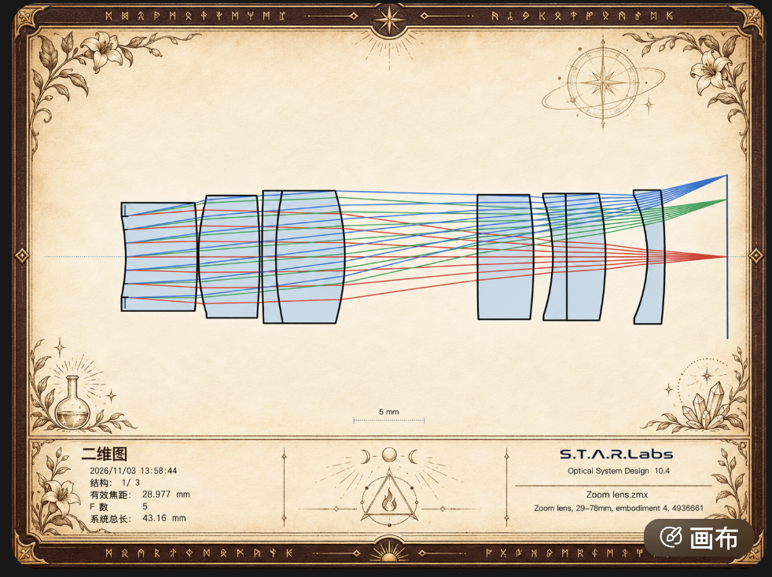
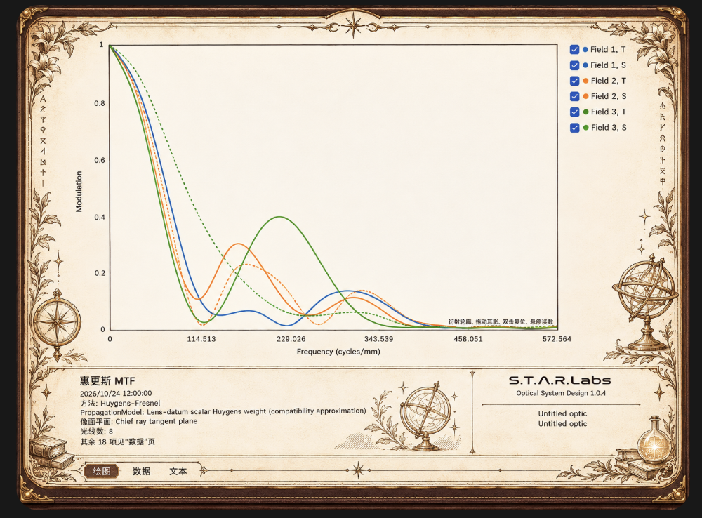

# 异世界主题参考原稿

按用户要求保存历次参考，原 PNG 字节不作修改。来源、尺寸、SHA-256 与复制结果见 [manifest.json](manifest.json)。2026-11-04 采用下表第四张为统一棕金母版，前三张保留当时的风格/位置要求。当前产品效果见[实际离屏截图与验证](../../../../../validation/rechecks/2026-11-04/isekai-unified-book/README.md)，运行装饰见[主题素材说明](../../../../../src/OpticalSystemDesign.App/Assets/Themes/Isekai/README.md)。

| 原稿 | 来源 | 采用的视觉要求 |
| --- | --- | --- |
| [01-approved-parchment-concept.png](01-approved-parchment-concept.png) | 会话中确认的生成概念稿 | 暖羊皮纸、钢笔纹样、皮革与旧金质感 |
| [02-layout-inner-flowers.png](02-layout-inner-flowers.png) | 用户上传的二维图参考 | 花叶在图纸内部向内舒展；外侧为窄皮革边 |
| [03-analysis-gold-frame.png](03-analysis-gold-frame.png) | 用户上传的分析页参考 | 圆角旧金包角、双细框、顶部星芒及侧边纸内装饰 |
| [04-approved-gold-master-20261104.png](04-approved-gold-master-20261104.png) | 用户指定的星象黄铜效果图原版 | 全分析共用暖象牙纸/棕皮/旧金，只换小配饰；页签在连续书封内 |

第二、三张对花饰位置与边框的修订保留；第四张统一当前配色、内置页签和小配饰原则，取代颜色差异过大的多套提案。这些原稿不嵌入应用，不用其中的镜头、曲线、读数、品牌或控件替代产品绘制，也不作为光学精度证据。

