<a id="page-01"></a>

# DOUBLE GAUSS 光学设计分析报告

OPTICAL DESIGN &amp; ANALYSIS

Double Gauss 28 degree field

| 有效焦距 EFL / mm | F 数 | 系统总长 / mm | 入瞳直径 / mm |
| --- | --- | --- | --- |
| 99.5007 | 2.9853 | 132.9884 | 33.33 |

计算快照　2026-11-02 16:15　·　1 个配置　·　69 个分析项目<br>完成：69 项；未完成或不适用：0 项。

视场坐标：(0, 0) / (0, 10) / (0, 14)<br>波长：486.1 / 587.6 / 656.3 nm


<a id="page-02"></a>

## 目录

- [01　二维布局](#section-001)
- [02　三维布局](#section-002)
- [03　单光线追迹](#section-003)
- [04　系统数据摘要](#section-004)
- [05　赛德尔系数](#section-005)
- [06　赛德尔图](#section-006)
- [07　标准点列图](#section-007)
- [08　全视场点列图](#section-008)
- [09　矩阵点列图](#section-009)
- [10　结构矩阵点列图](#section-010)
- [11　光线像差图](#section-011)
- [12　光迹图](#section-012)
- [13　网格畸变](#section-013)
- [14　场曲/畸变](#section-014)
- [15　场曲](#section-015)
- [16　色焦移](#section-016)
- [17　垂轴色差](#section-017)
- [18　轴向像差](#section-018)
- [19　全视场像差](#section-019)
- [20　几何](#section-020)
- [21　衍射](#section-021)
- [22　几何线/边缘扩散](#section-022)
- [23　扩展光源](#section-023)

<a id="page-03"></a>

## 目录 · 续

- [24　瞳孔像差](#section-024)
- [25　RMS vs. 视场](#section-025)
- [26　RMS vs. 波长](#section-026)
- [27　RMS vs. 离焦](#section-027)
- [28　二维视场RMS图](#section-028)
- [29　RMS 波前-视场](#section-029)
- [30　Zernike系数 vs. 视场](#section-030)
- [31　离焦点列图](#section-031)
- [32　傅里叶离焦 MTF](#section-032)
- [33　惠更斯离焦 MTF](#section-033)
- [34　几何离焦 MTF](#section-034)
- [35　傅里叶 MTF VS 视场](#section-035)
- [36　惠更斯 MTF VS 视场](#section-036)
- [37　几何 MTF VS 视场](#section-037)
- [38　入射角 vs. 像高](#section-038)
- [39　入射角-像高（扫描瞳孔）](#section-039)
- [40　入射角-像高（扫描视场）](#section-040)
- [41　基面数据](#section-041)
- [42　渐晕图](#section-042)
- [43　相对照度](#section-043)
- [44　非相干照度](#section-044)
- [45　辐射强度](#section-045)
- [46　Y-Ybar](#section-046)

<a id="page-04"></a>

## 目录 · 续

- [47　FFT PSF](#section-047)
- [48　FFT PSF截面图](#section-048)
- [49　FFT 线/边缘扩散](#section-049)
- [50　惠更斯PSF](#section-050)
- [51　惠更斯PSF截面图](#section-051)
- [52　傅里叶 MTF](#section-052)
- [53　惠更斯 MTF](#section-053)
- [54　几何 MTF](#section-054)
- [55　采样 MTF](#section-055)
- [56　对比度损失图](#section-056)
- [57　光程差图](#section-057)
- [58　傅科分析](#section-058)
- [59　波前图](#section-059)
- [60　干涉图](#section-060)
- [61　波前](#section-061)
- [62　质心参考球波前](#section-062)
- [63　最佳拟合球波前](#section-063)
- [64　Zernike Fringe系数](#section-064)
- [65　Zernike Standard系数](#section-065)
- [66　Zernike Annular系数](#section-066)
- [67　Jones 瞳](#section-067)
- [68　系统数据报告](#section-068)
- [69　分类数据报告](#section-069)

<a id="page-05"></a>

## 配置 1 · 系统概要

| 系统参数 | 值 |
| --- | --- |
| 源文件 | Double Gauss 28 degree field.zmx |
| EFL / mm | 99.5007 |
| F/# | 2.9853 |
| TTL / mm | 132.9884 |
| 入瞳直径 / mm | 33.33 |
| 视场坐标 | (0, 0) / (0, 10) / (0, 14) |
| 波长 | 486.1 / 587.6 / 656.3 nm |
| 计算时间 | 2026-11-02 16:15:15 +08:00 |

所有图表与数值来自导出开始时的同一工程快照。各分析采用所选设置，参数及原始输出保存在计算记录中。


<a id="page-06"></a>

<a id="section-001"></a>

## 二维布局

配置 1　·　

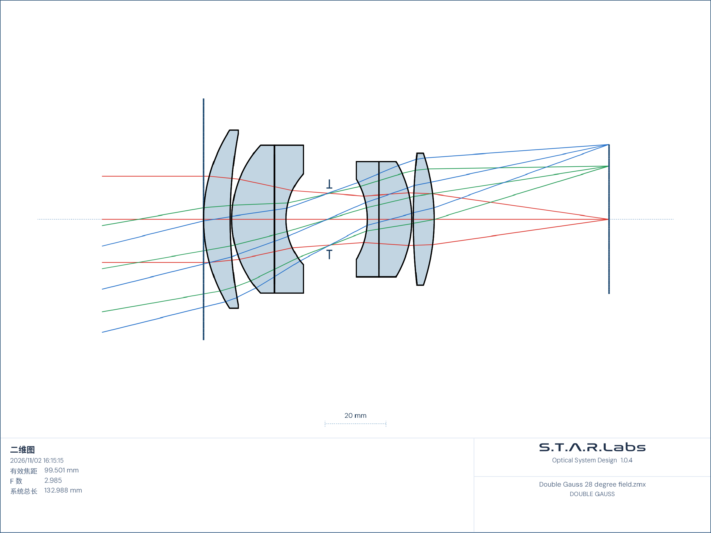

*图 1　二维布局*


<a id="page-07"></a>

<a id="section-002"></a>

## 三维布局

配置 1　·　

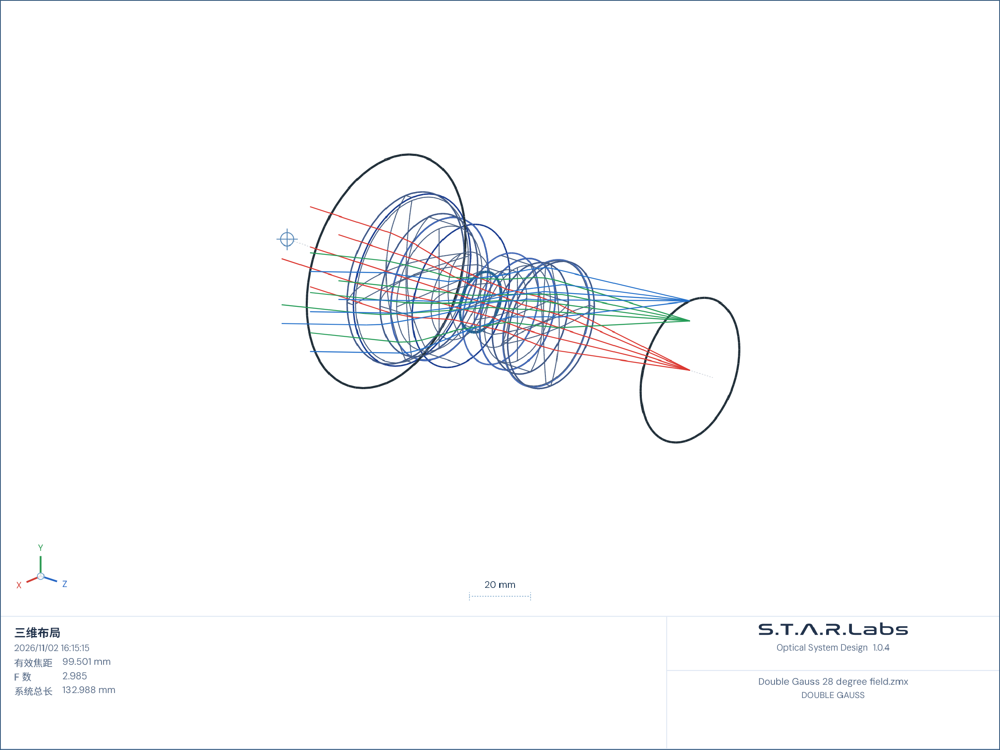

*图 2　三维布局*


<a id="page-08"></a>

<a id="section-003"></a>

## 单光线追迹

配置 1　·　视场序号：1 · 波长序号：1

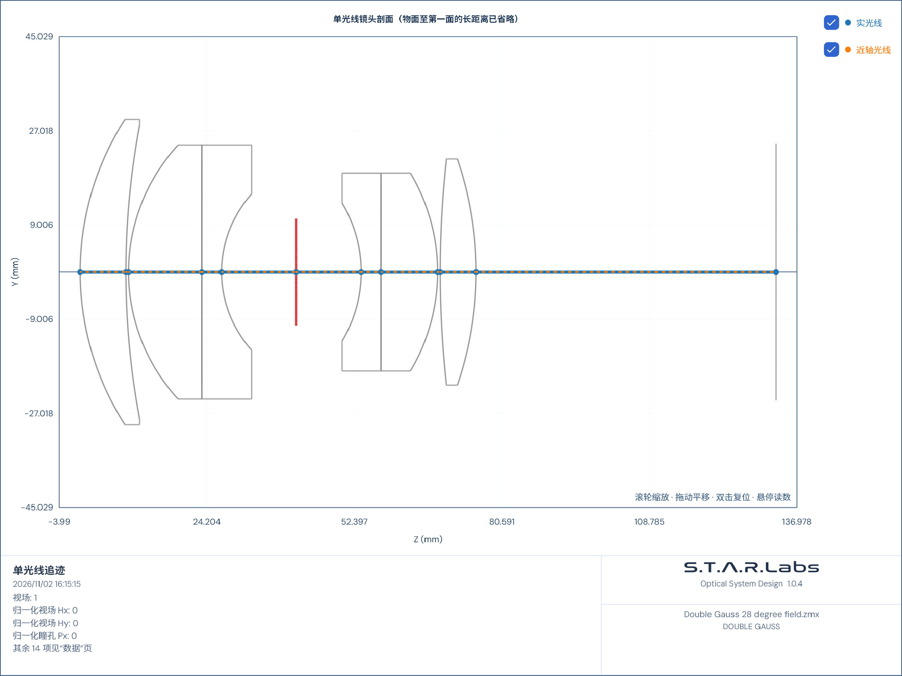

*图 3　单光线追迹*

| 分析波长 (µm) | 视场 | 归一化视场 Hx |
| --- | --- | --- |
| 0.486 | 1 | 0 |


<a id="page-09"></a>

<a id="section-004"></a>

## 系统数据摘要

配置 1　·　

| 项目 | 数值 |
| --- | --- |
| 有效焦距 | 99.501 |
| F 数 | 2.985 |
| OpticalPowerInverseMillimeters | 0.01 |
| EffectiveFocalLengthStatus | Finite |
| CardinalParametersApplicable | True |
| ImageSpaceAfocal | False |
| 系统总长 | 132.988 |


<a id="page-10"></a>

<a id="section-005"></a>

## 赛德尔系数

配置 1　·　波长序号：2

| 表面 | SPHA S1 | COMA S2 | ASTI S3 | FCUR S4 | DIST S5 | CLA (CL) | CTR (CT) |
| --- | --- | --- | --- | --- | --- | --- | --- |
| 1 | 0.114175 | -0.008176 | 0.000586 | 0.120467 | -0.008669 | -0.034222 | 0.002451 |
| 2 | 0.000396 | -0.005093 | 0.065502 | -0.042772 | -0.292349 | -0.002298 | 0.029553 |
| 3 | 0.037615 | 0.002873 | 0.000219 | 0.183865 | 0.014061 | -0.030572 | -0.002335 |
| 4 | 0.006027 | -0.008824 | 0.012918 | 0.000000 | -0.018911 | 0.017026 | -0.024926 |
| 5 | -0.126410 | -0.045356 | -0.016274 | -0.291746 | -0.110518 | 0.046478 | 0.016677 |
| 光阑 | 0.000000 | 0.000000 | 0.000000 | 0.000000 | 0.000000 | 0.000000 | 0.000000 |
| 7 | -0.227787 | 0.112367 | -0.055431 | -0.252955 | 0.152127 | 0.038302 | -0.018894 |
| 8 | 0.000130 | 0.000581 | 0.002588 | 0.000000 | 0.011535 | 0.003927 | 0.017502 |
| 9 | 0.093297 | -0.028806 | 0.008894 | 0.178746 | -0.057936 | -0.020104 | 0.006207 |
| 10 | -0.000002 | -0.000264 | -0.030245 | 0.033653 | 0.389861 | -0.000233 | -0.026621 |
| 11 | 0.128073 | -0.023063 | 0.004153 | 0.098441 | -0.018475 | -0.019011 | 0.003423 |
| 像面 | 0.000000 | 0.000000 | 0.000000 | 0.000000 | 0.000000 | 0.000000 | 0.000000 |
| 累计 | 0.025514 | -0.003761 | -0.007089 | 0.027699 | 0.060727 | -0.000706 | 0.003038 |


<a id="page-11"></a>

<a id="section-006"></a>

## 赛德尔图

配置 1　·　波长序号：2

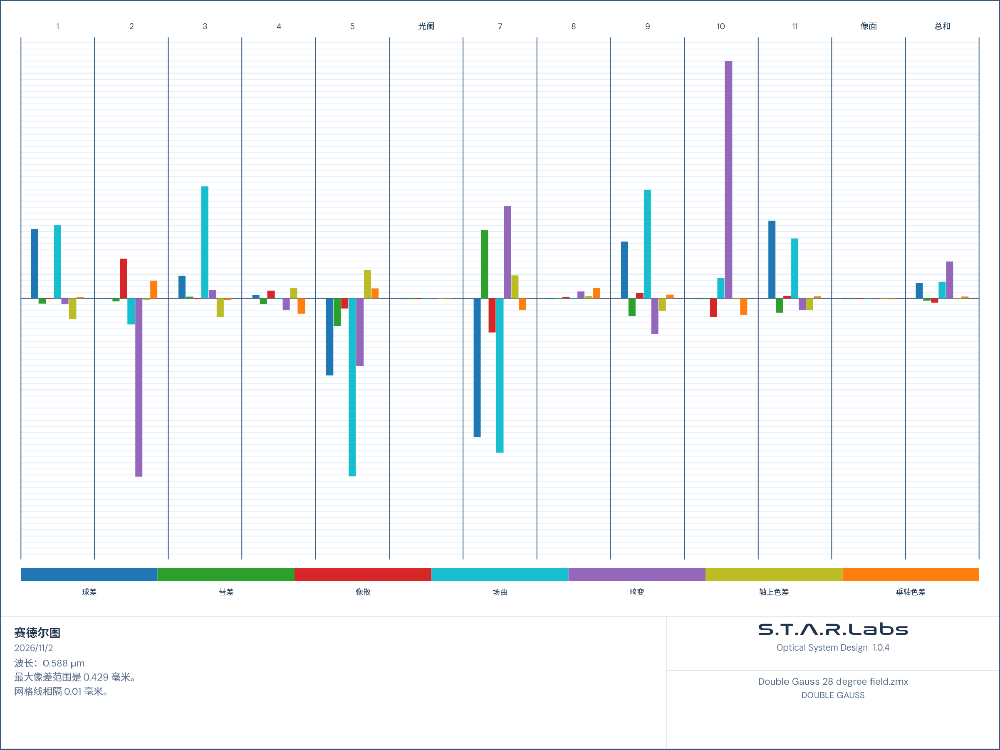

*图 4　赛德尔图*

| 分析波长 (µm) | 表面数 | 最大像差范围 |
| --- | --- | --- |
| 0.588 | 12 | 0.429 |


<a id="page-12"></a>

<a id="section-007"></a>

## 标准点列图

配置 1　·　参照：主光线 · 波长：全部 · 视场：全部 · 表面：像面

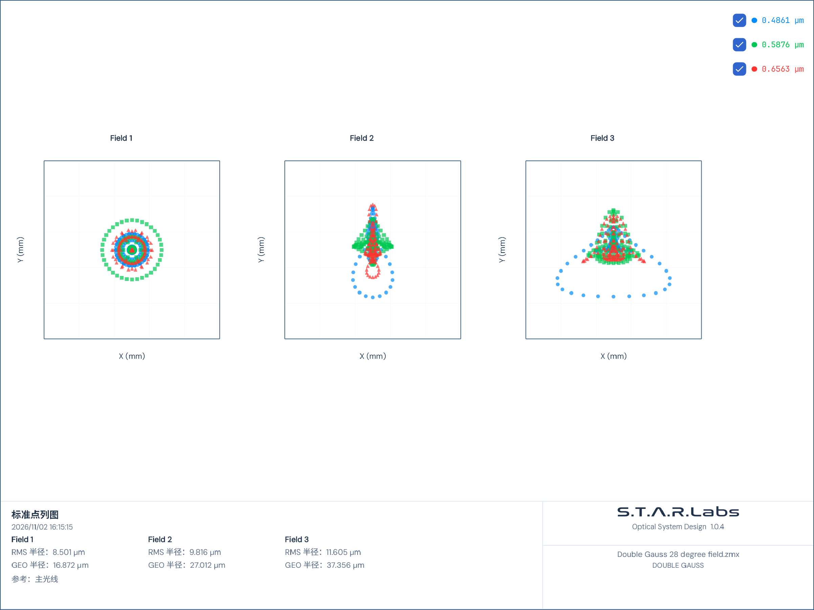

*图 5　标准点列图*

| 最大几何点半径 (mm) | 光线数 | 渐晕光线数 |
| --- | --- | --- |
| 0.037 | 1143 | 0 |


<a id="page-13"></a>

<a id="section-008"></a>

## 全视场点列图

配置 1　·　参照：主光线 · 波长：全部 · 视场：全部 · 表面：像面

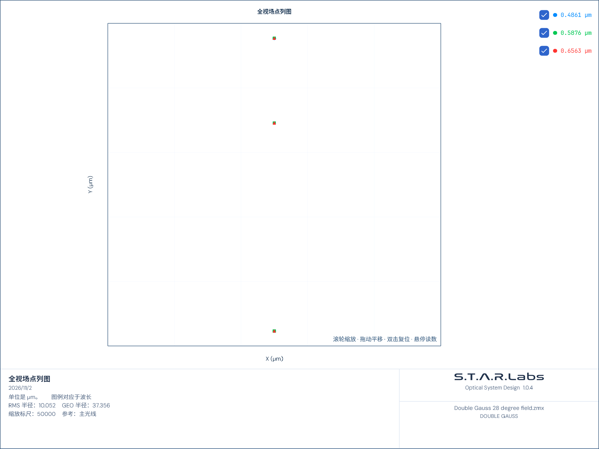

*图 6　全视场点列图*

| RMS 半径 (µm) | 最大几何点半径 (mm) | 光线数 |
| --- | --- | --- |
| 10.052 | 0.037 | 1143 |


<a id="page-14"></a>

<a id="section-009"></a>

## 矩阵点列图

配置 1　·　参照：主光线 · 波长：全部 · 视场：全部 · 表面：像面

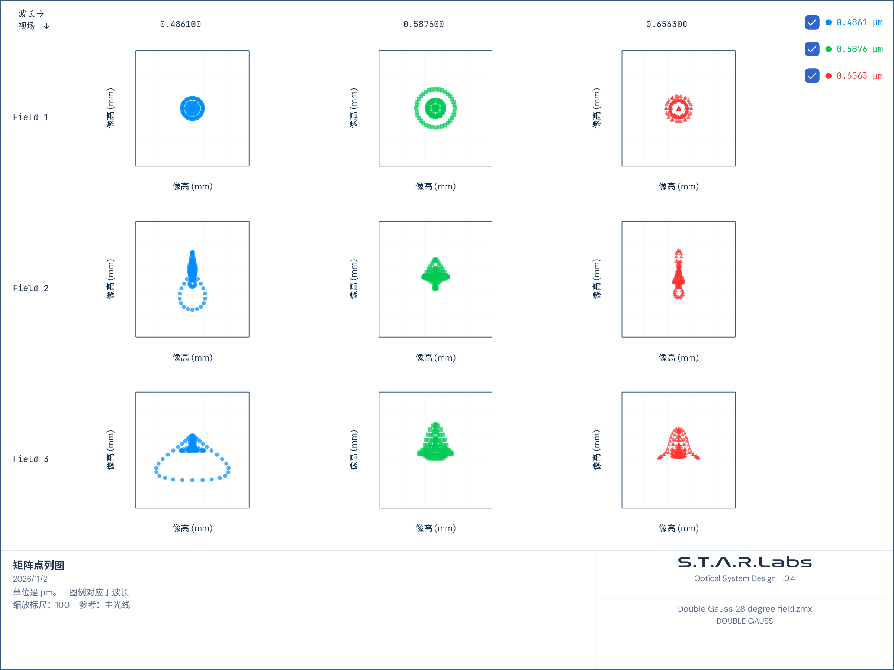

*图 7　矩阵点列图*

| 最大几何点半径 (mm) | 光线数 | 渐晕光线数 |
| --- | --- | --- |
| 0.037 | 1143 | 0 |


<a id="page-15"></a>

<a id="section-010"></a>

## 结构矩阵点列图

配置 1　·　参照：主光线 · 波长：全部 · 视场：全部 · 表面：像面

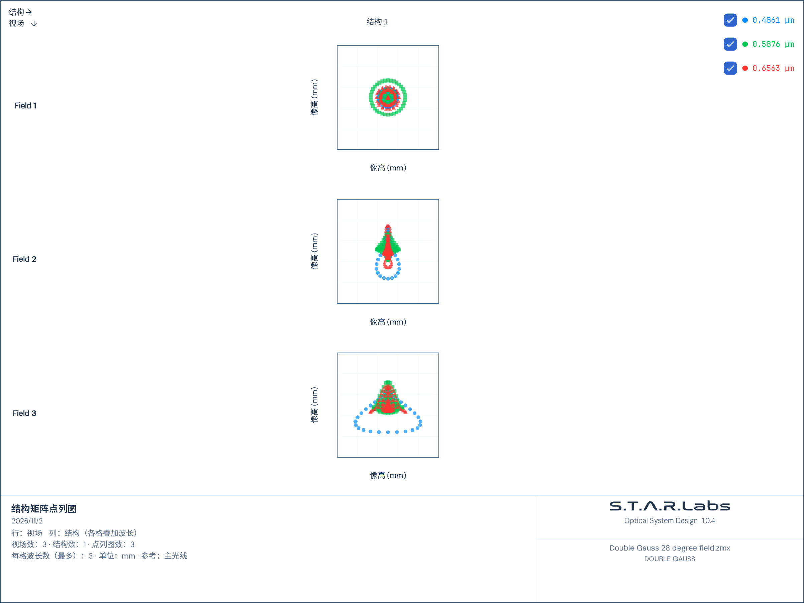

*图 8　结构矩阵点列图*

| 最大几何点半径 (mm) | 光线数 | 渐晕光线数 |
| --- | --- | --- |
| 0.037 | 1143 | 0 |


<a id="page-16"></a>

<a id="section-011"></a>

## 光线像差图

配置 1　·　波长：全部 · 视场：全部 · 表面：像面

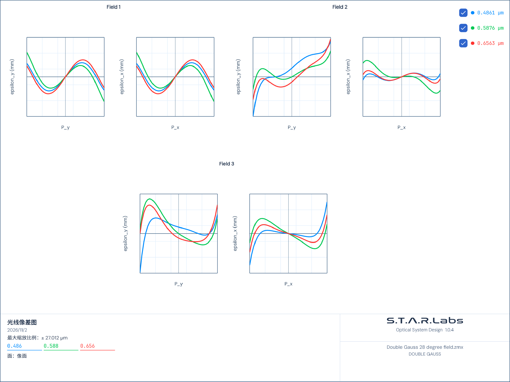

*图 9　光线像差图*

| 最大光线像差 (mm) | 采样点数 | 原点每侧光线数 |
| --- | --- | --- |
| 0.026 | 41 | 20 |


<a id="page-17"></a>

<a id="section-012"></a>

## 光迹图

配置 1　·　表面序号：-1 · 波长序号：全部 · 视场序号：全部

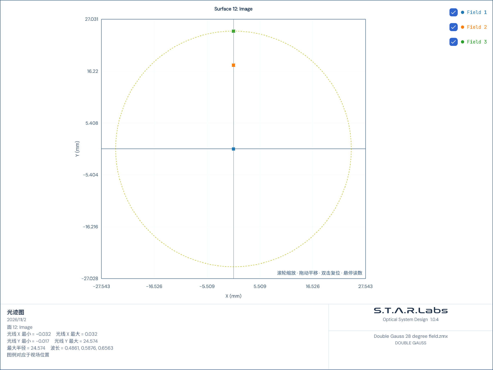

*图 10　光迹图*

| 表面标注 | 光线密度 | 删除渐晕光线 |
| --- | --- | --- |
| Image | 10 | False |


<a id="page-18"></a>

<a id="section-013"></a>

## 网格畸变

配置 1　·　波长序号：1 · 参考视场：1 · 视场宽度：0

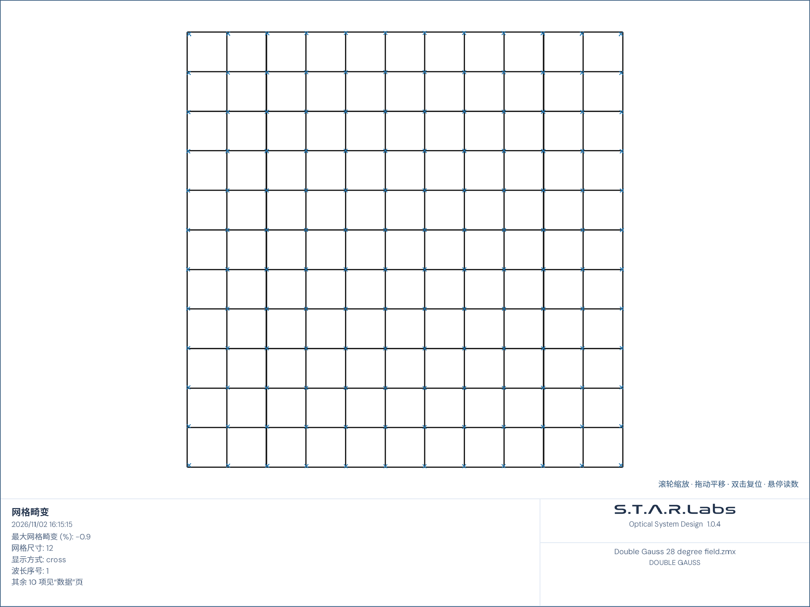

*图 11　网格畸变*

| 分析波长 (µm) | 最大网格畸变 (%) | 网格尺寸 |
| --- | --- | --- |
| 0.486 | -0.9 | 12 |


<a id="page-19"></a>

<a id="section-014"></a>

## 场曲/畸变

配置 1　·　波长：全部 · 参考视场：1

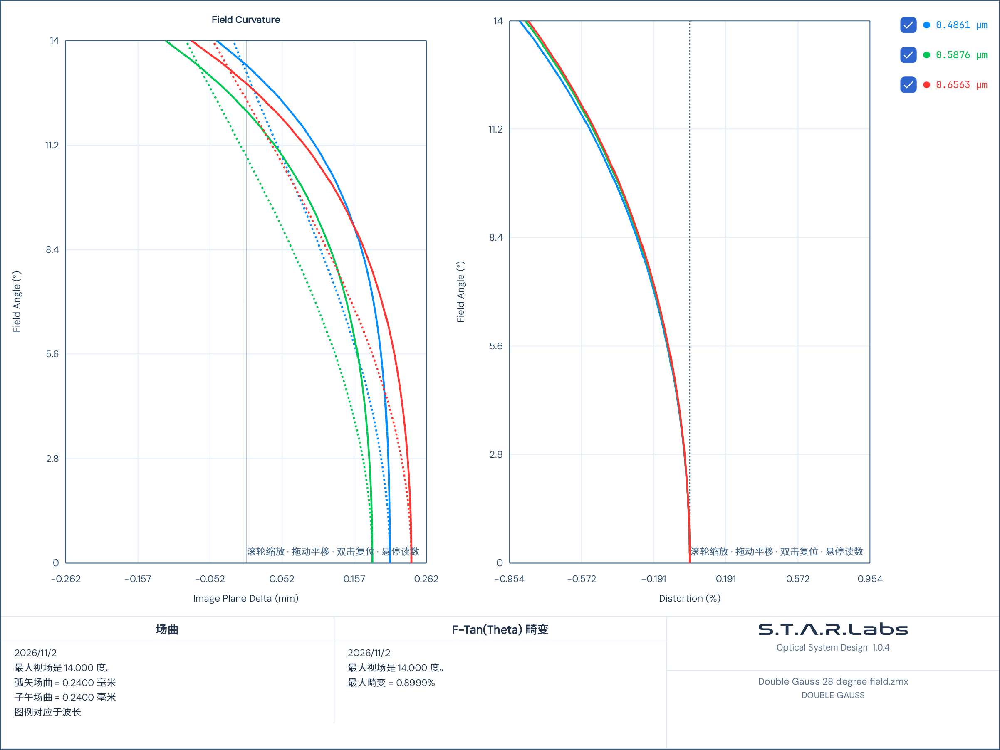

*图 12　场曲/畸变*

| 场曲.最大子午场曲 (mm) | 场曲.最大弧矢场曲 (mm) | 畸变.最大绝对畸变 (%) |
| --- | --- | --- |
| 0.24 | 0.24 | 0.9 |


<a id="page-20"></a>

<a id="section-015"></a>

## 场曲

配置 1　·　波长：全部

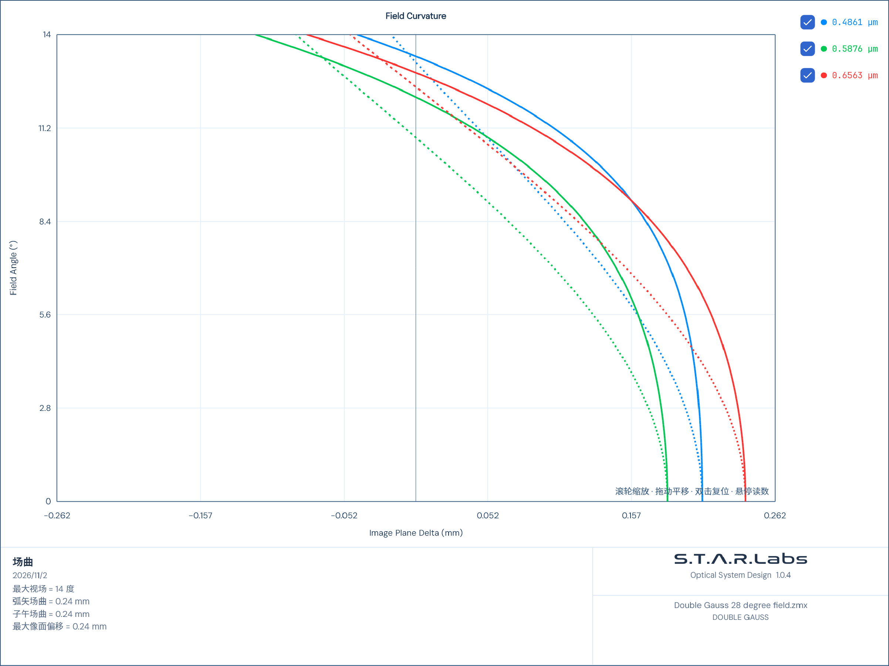

*图 13　场曲*

| 最大子午场曲 (mm) | 最大弧矢场曲 (mm) | 最大视场角 (deg) |
| --- | --- | --- |
| 0.24 | 0.24 | 14 |


<a id="page-21"></a>

<a id="section-016"></a>

## 色焦移

配置 1　·　

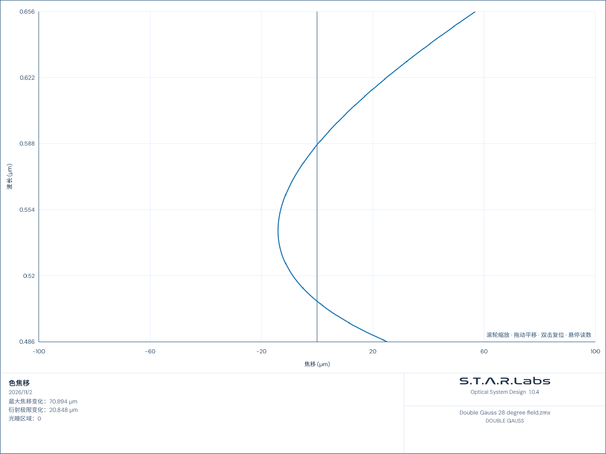

*图 14　色焦移*

| 最大焦移变化 | 衍射极限变化 | 光瞳区域 |
| --- | --- | --- |
| 70.894 | 20.848 | 0 |


<a id="page-22"></a>

<a id="section-017"></a>

## 垂轴色差

配置 1　·　所有波长：否

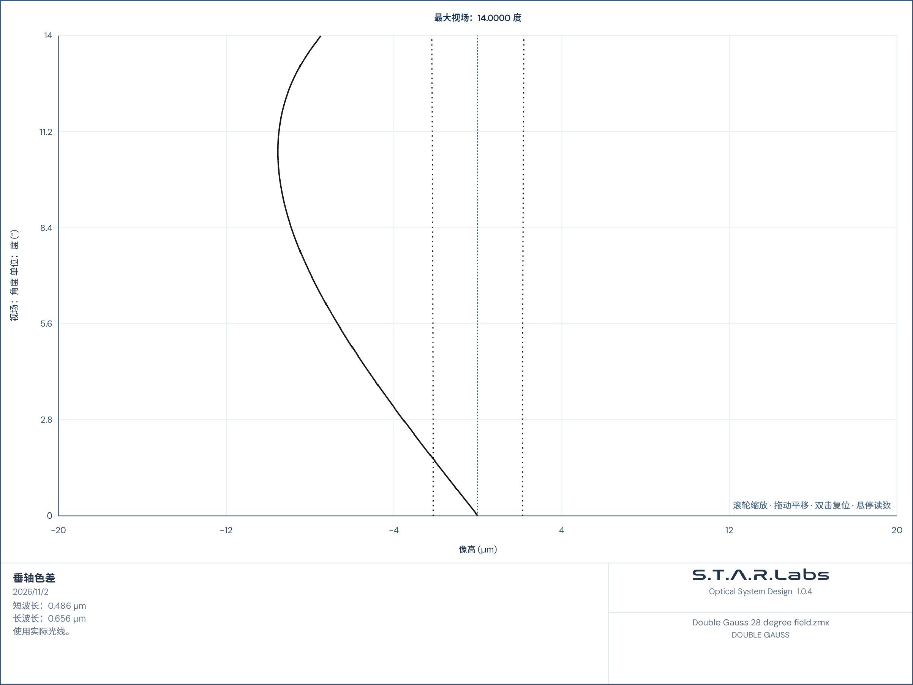

*图 15　垂轴色差*

| 短波长 | 长波长 | 使用实际光线 |
| --- | --- | --- |
| 0.486 | 0.656 | True |


<a id="page-23"></a>

<a id="section-018"></a>

## 轴向像差

配置 1　·　波长：全部

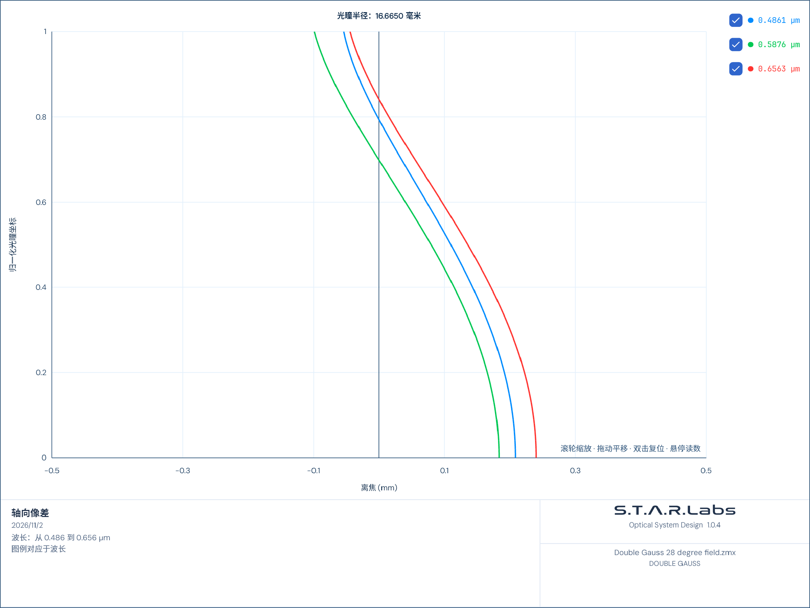

*图 16　轴向像差*

| 光瞳半径 | 短波长 | 长波长 |
| --- | --- | --- |
| 16.665 | 0.486 | 0.656 |


<a id="page-24"></a>

<a id="section-019"></a>

## 全视场像差

配置 1　·　视场形状：椭圆 · X 视场宽度：14 · Y 视场宽度：14 · 视场序号：1 - On axis · 波长序号：2

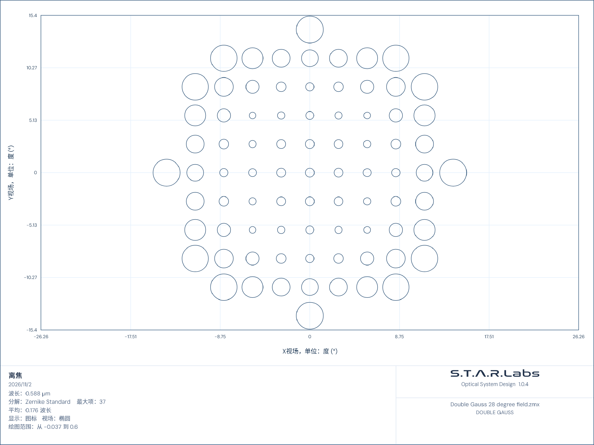

*图 17　全视场像差*

| 分析波长 (µm) | 视场形状 | X 视场宽度 |
| --- | --- | --- |
| 0.588 | 椭圆 | 14 |


<a id="page-25"></a>

<a id="section-020"></a>

## 几何

配置 1　·　波长：全部 · 参照：centroid

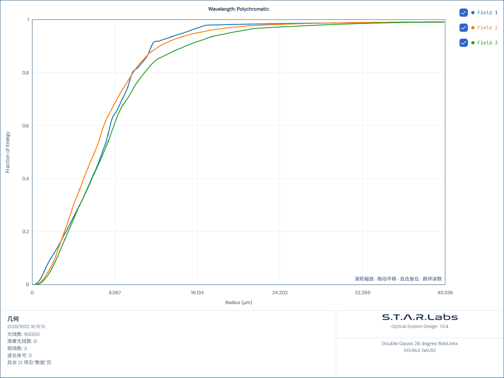

*图 18　几何*

| 分析波长 (µm) | 最大几何点半径 (mm) | 光线数 |
| --- | --- | --- |
| 0.588 | 0.038 | 90000 |


<a id="page-26"></a>

<a id="section-021"></a>

## 衍射

配置 1　·　瞳面采样：64 x 64 · 像面采样：128 x 128 · 波长：全部 · 视场：全部 · 参照：centroid

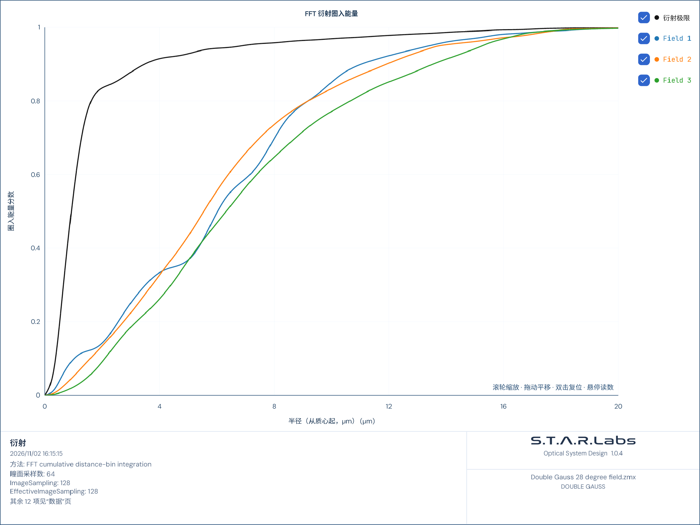

*图 19　衍射*

| 方法 | 瞳面采样数 | 视场数 |
| --- | --- | --- |
| FFT cumulative distance-bin integration | 64 | 3 |


<a id="page-27"></a>

<a id="section-022"></a>

## 几何线/边缘扩散

配置 1　·　瞳面采样：32 x 32 · 波长：全部 · 视场序号：1

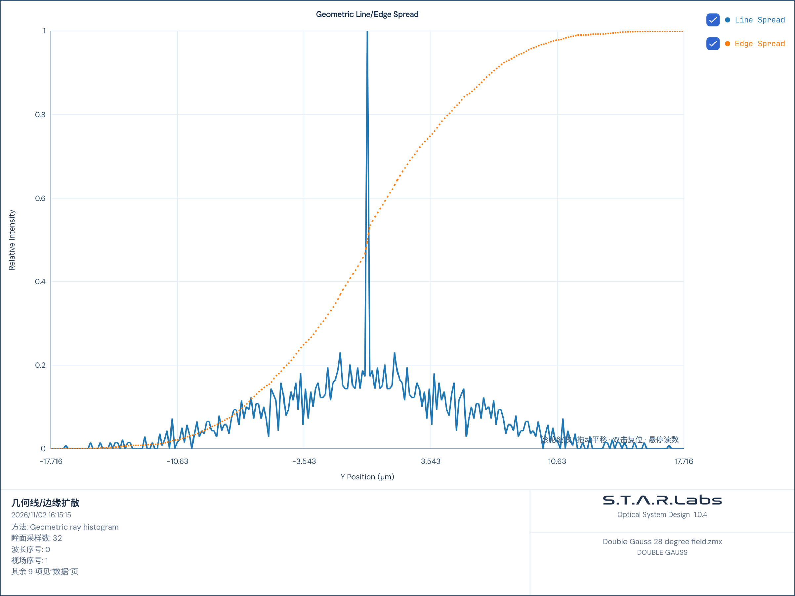

*图 20　几何线/边缘扩散*

| 方法 | 瞳面采样数 | 光线数 |
| --- | --- | --- |
| Geometric ray histogram | 32 | 2391 |


<a id="page-28"></a>

<a id="section-023"></a>

## 扩展光源

配置 1　·　视场尺寸：0 · 光源采样：5 · 波长：全部 · 视场序号：1 · 参照：centroid

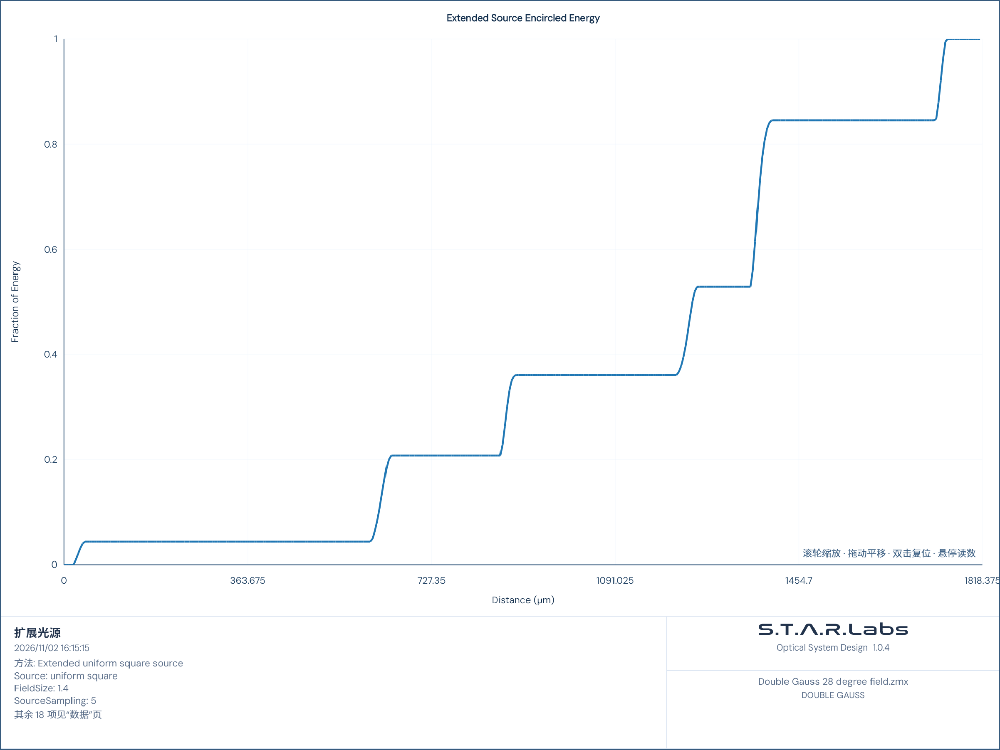

*图 21　扩展光源*

| 方法 | 光线数 | 渐晕光线数 |
| --- | --- | --- |
| Extended uniform square source | 4950 | 0 |


<a id="page-29"></a>

<a id="section-024"></a>

## 瞳孔像差

配置 1　·　

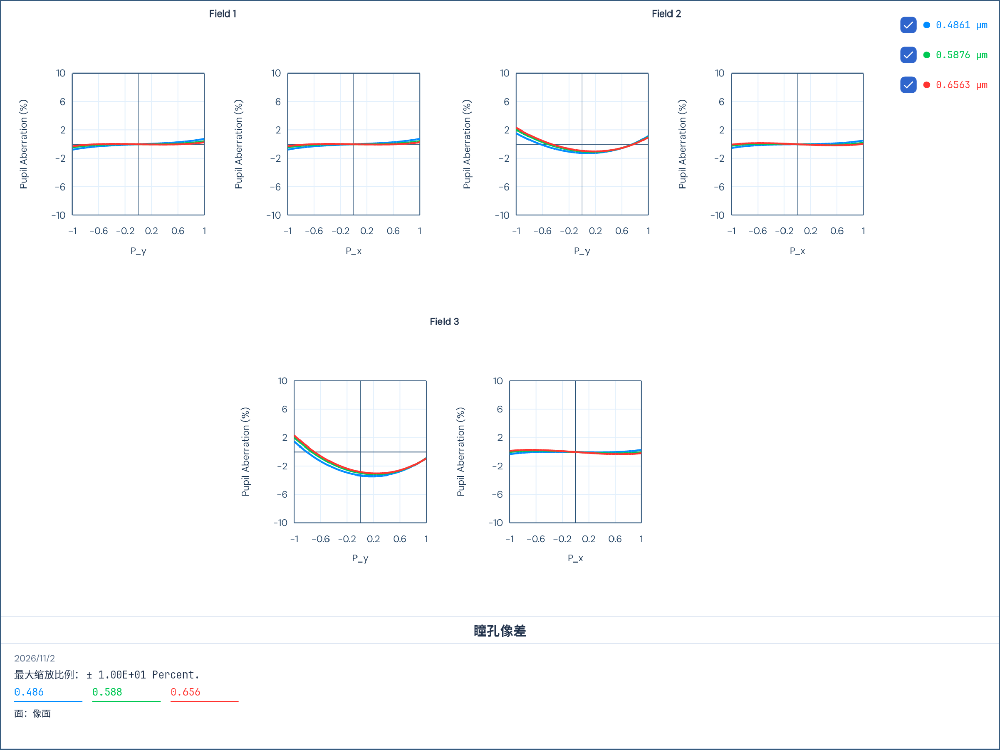

*图 22　瞳孔像差*

| 原点每侧光线数 | 采样点数 | 视场数 |
| --- | --- | --- |
| 20 | 41 | 3 |


<a id="page-30"></a>

<a id="section-025"></a>

## RMS vs. 视场

配置 1　·　视场间隔数：15 · GQ 角向点数：6 · 波长：全部 · 参照：chief

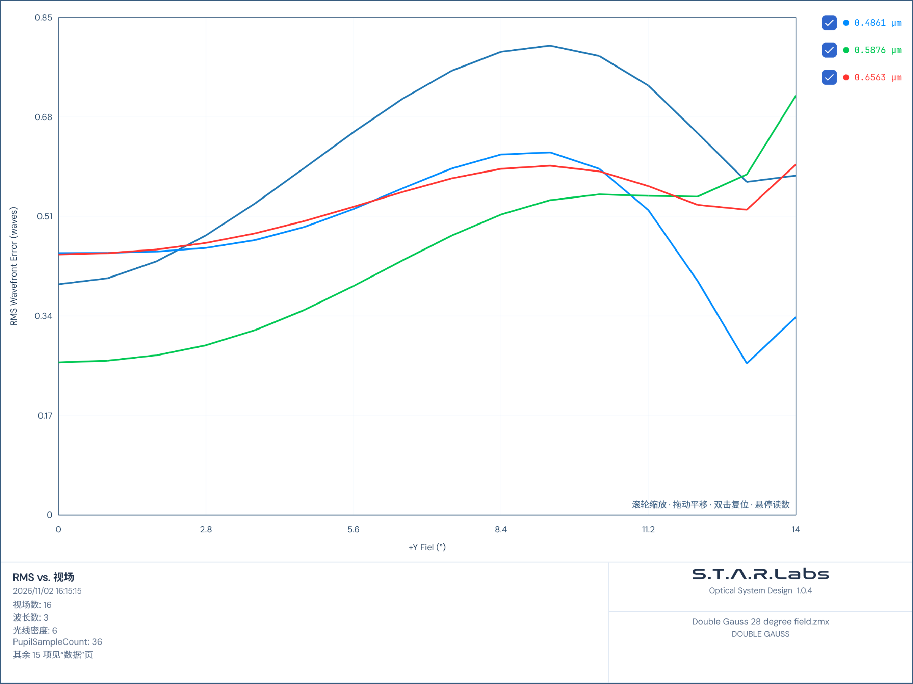

*图 23　RMS vs. 视场*

| 最大 RMS 波前误差 (波) | 视场数 | 波长数 |
| --- | --- | --- |
| 0.802 | 16 | 3 |


<a id="page-31"></a>

<a id="section-026"></a>

## RMS vs. 波长

配置 1　·　波长密度：21 · GQ 角向点数：6 · 视场：全部 · 参照：centroid

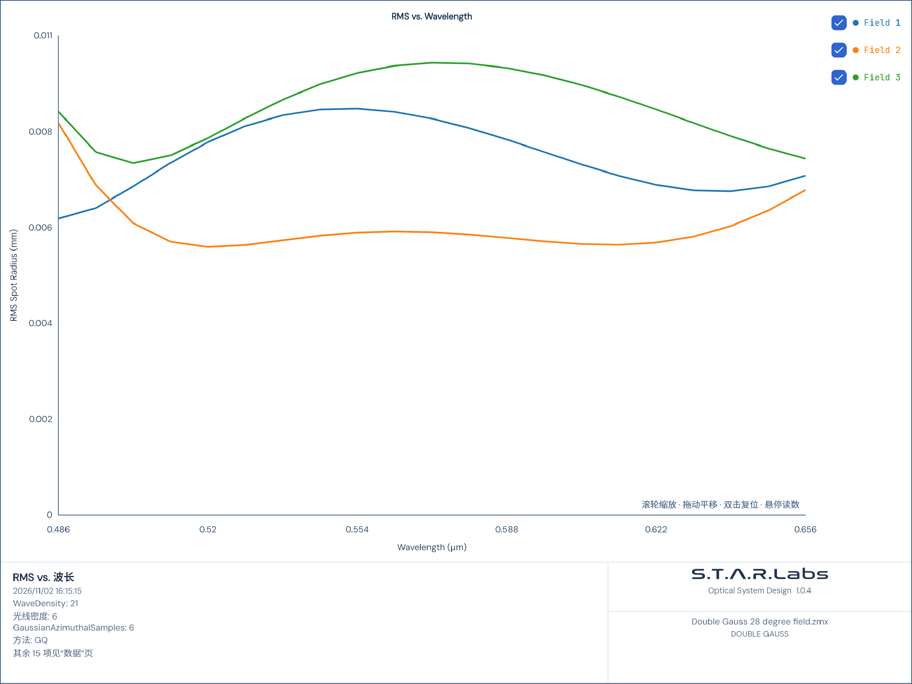

*图 24　RMS vs. 波长*

| 光线密度 | 方法 | 数据 |
| --- | --- | --- |
| 6 | GQ | spot |


<a id="page-32"></a>

<a id="section-027"></a>

## RMS vs. 离焦

配置 1　·　GQ 角向点数：6 · 波长：全部 · 参照：chief

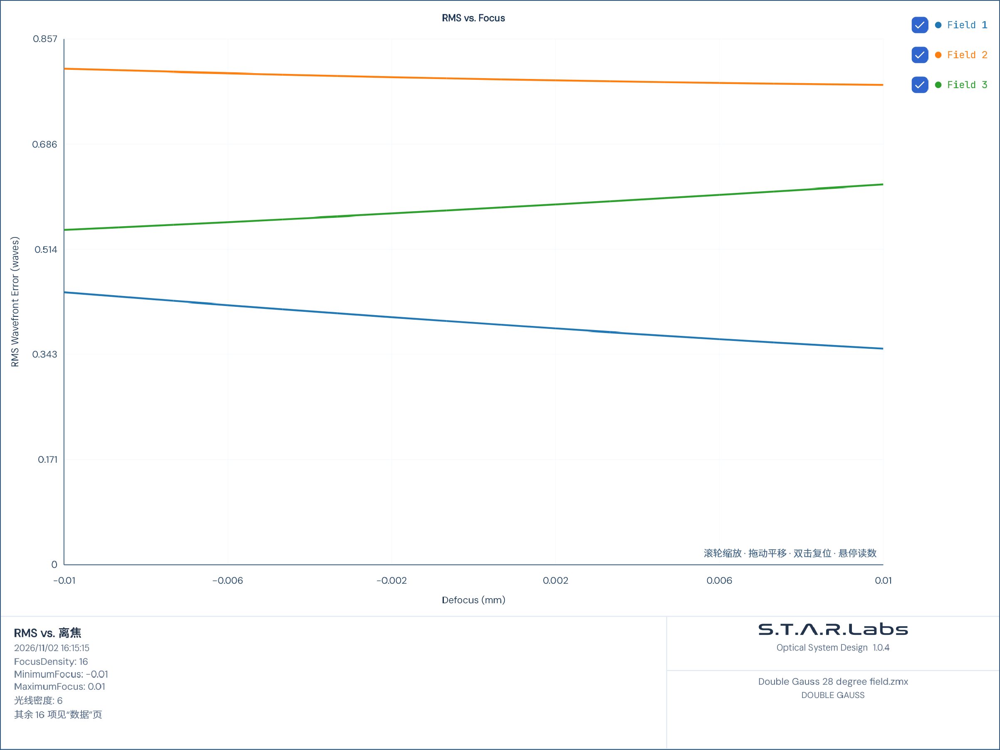

*图 25　RMS vs. 离焦*

| 光线密度 | 方法 | 数据 |
| --- | --- | --- |
| 6 | GQ | wavefront |


<a id="page-33"></a>

<a id="section-028"></a>

## 二维视场RMS图

配置 1　·　X视场采样：11 · Y视场采样：11 · X视场大小：0 · Y视场大小：0 · GQ 角向点数：6

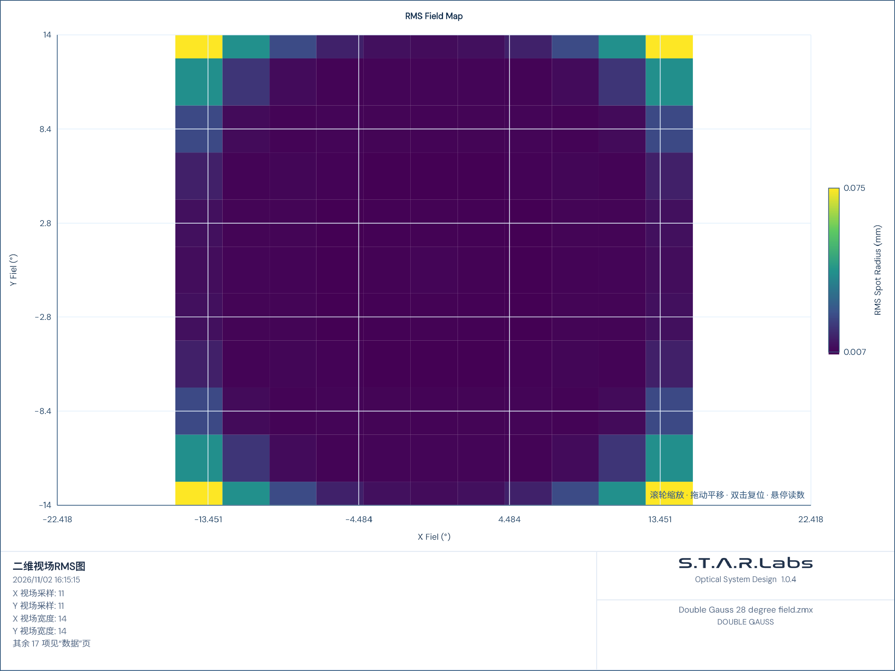

*图 26　二维视场RMS图*

| X 视场采样 | Y 视场采样 | X 视场宽度 |
| --- | --- | --- |
| 11 | 11 | 14 |


<a id="page-34"></a>

<a id="section-029"></a>

## RMS 波前-视场

配置 1　·　视场密度：15 · GQ 角向点数：6 · 参照：chief · 波长：全部


*图 27　RMS 波前-视场*

| 最大 RMS 波前误差 (波) | 视场数 | 波长数 |
| --- | --- | --- |
| 0.802 | 16 | 3 |


<a id="page-35"></a>

<a id="section-030"></a>

## Zernike系数 vs. 视场

配置 1　·　视场密度：20 · 波长序号：2

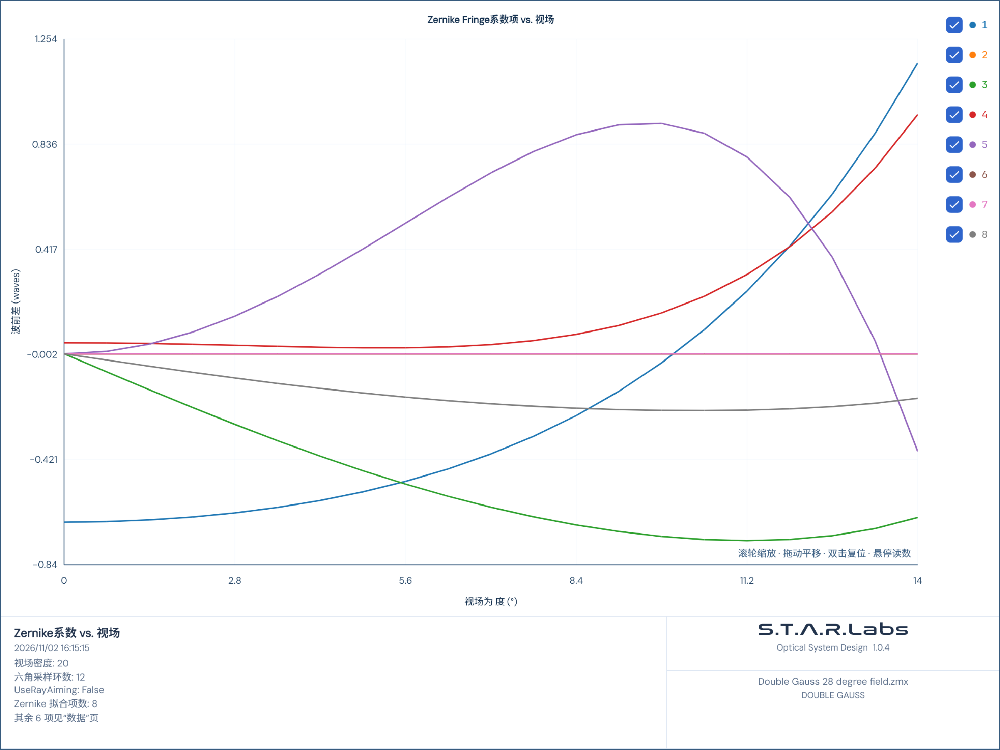

*图 28　Zernike系数 vs. 视场*

| 分析波长 (µm) | 视场密度 | 六角采样环数 |
| --- | --- | --- |
| 0.588 | 20 | 12 |


<a id="page-36"></a>

<a id="section-031"></a>

## 离焦点列图

配置 1　·　参照：主光线 · 波长：全部 · 视场：全部 · 表面：像面

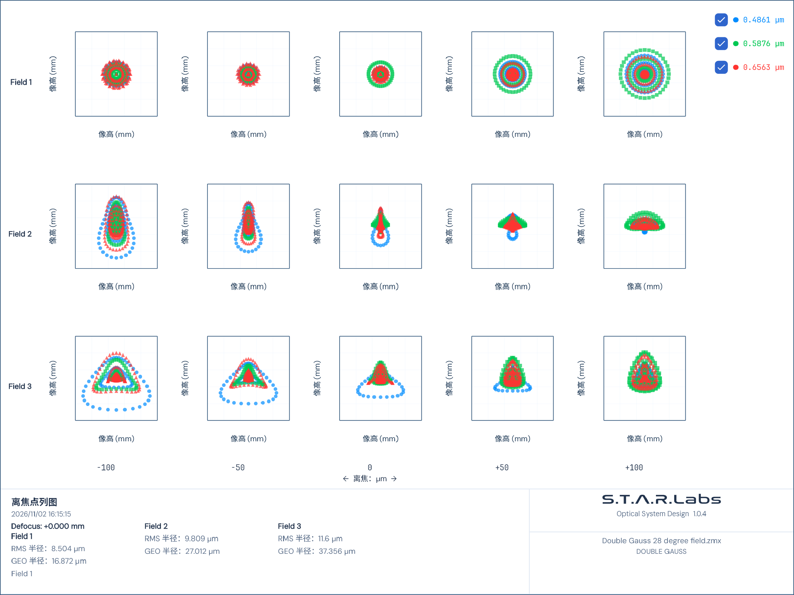

*图 29　离焦点列图*

| -2 步 RMS | -1 步 RMS | 名义焦点 RMS |
| --- | --- | --- |
| 0.017 | 0.013 | 0.01 |


<a id="page-37"></a>

<a id="section-032"></a>

## 傅里叶离焦 MTF

配置 1　·　采样：64 · 波长：全部 · 视场：全部

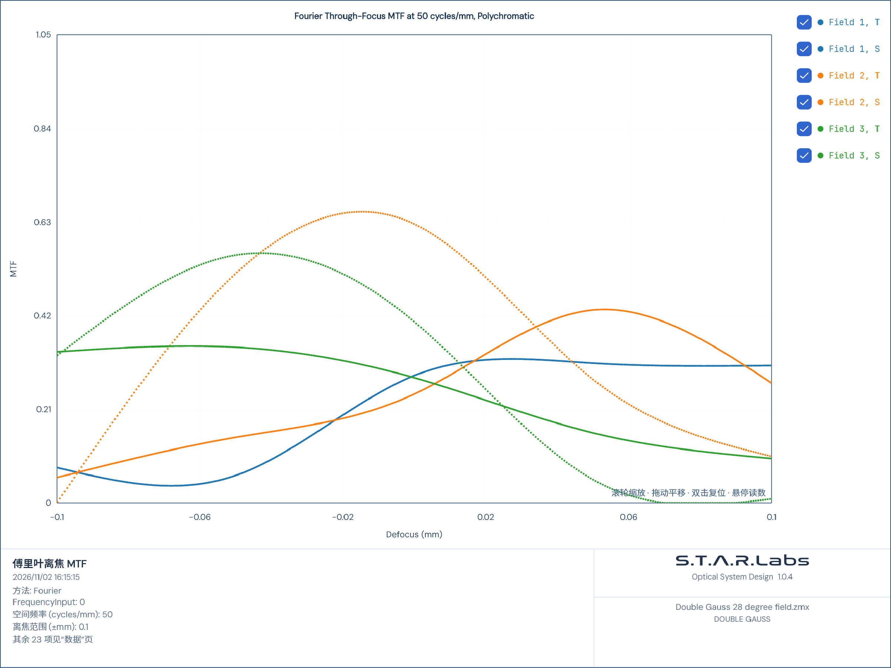

*图 30　傅里叶离焦 MTF*

| 方法 | 空间频率 (cycles/mm) | 离焦范围 (±mm) |
| --- | --- | --- |
| Fourier | 50 | 0.1 |


<a id="page-38"></a>

<a id="section-033"></a>

## 惠更斯离焦 MTF

配置 1　·　瞳面采样：64 · 图像采样：32 · 波长：全部 · 视场：全部

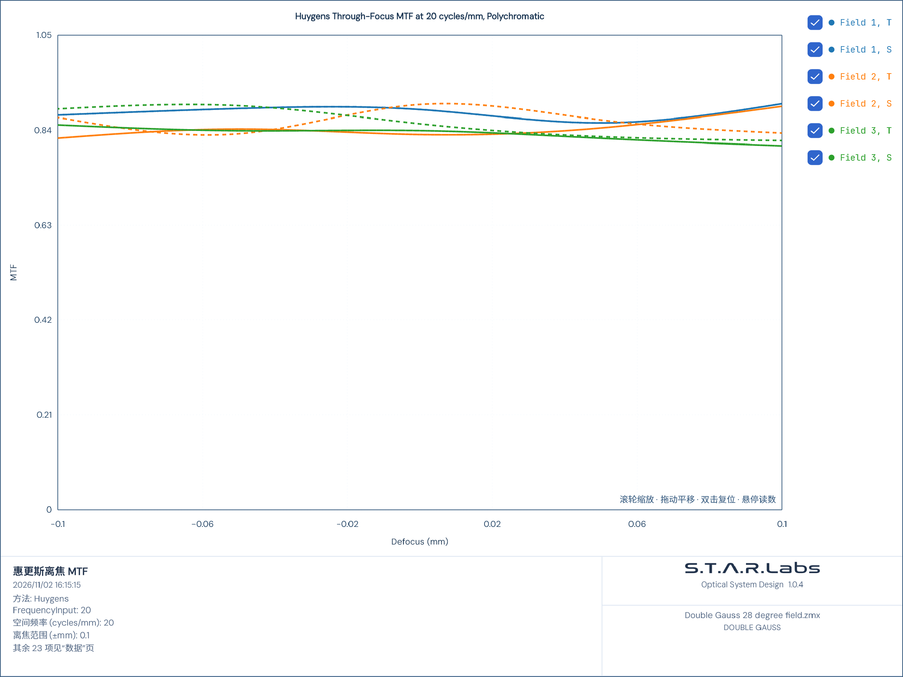

*图 31　惠更斯离焦 MTF*

| 方法 | 空间频率 (cycles/mm) | 离焦范围 (±mm) |
| --- | --- | --- |
| Huygens | 20 | 0.1 |


<a id="page-39"></a>

<a id="section-034"></a>

## 几何离焦 MTF

配置 1　·　采样：64 · 波长：全部 · 视场：全部

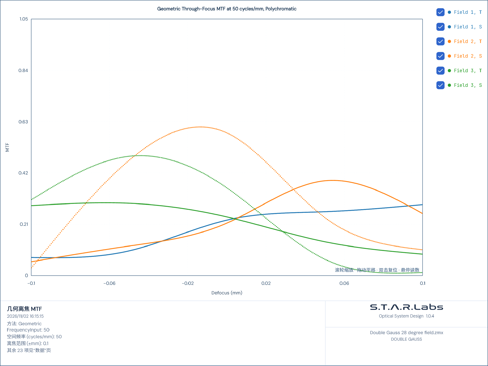

*图 32　几何离焦 MTF*

| 方法 | 空间频率 (cycles/mm) | 离焦范围 (±mm) |
| --- | --- | --- |
| Geometric | 50 | 0.1 |


<a id="page-40"></a>

<a id="section-035"></a>

## 傅里叶 MTF VS 视场

配置 1　·　瞳面/光线采样数：32 · 波长：全部

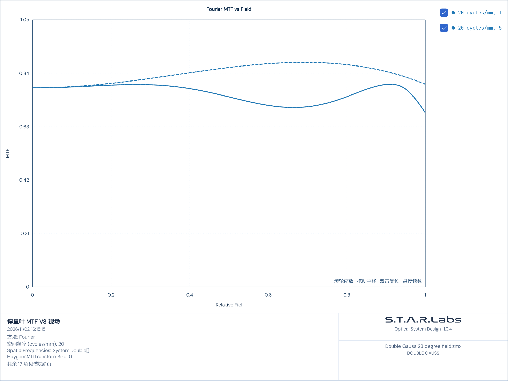

*图 33　傅里叶 MTF VS 视场*

| 方法 | 空间频率 (cycles/mm) | 视场密度 |
| --- | --- | --- |
| Fourier | 20 | 21 |


<a id="page-41"></a>

<a id="section-036"></a>

## 惠更斯 MTF VS 视场

配置 1　·　瞳面采样：64 · 波长：全部 · 视场密度：10

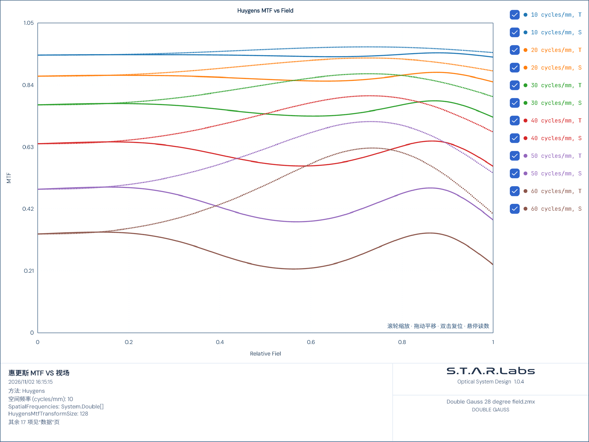

*图 34　惠更斯 MTF VS 视场*

| 方法 | 空间频率 (cycles/mm) | 视场密度 |
| --- | --- | --- |
| Huygens | 10 | 10 |


<a id="page-42"></a>

<a id="section-037"></a>

## 几何 MTF VS 视场

配置 1　·　瞳面/光线采样数：32 · 波长：全部

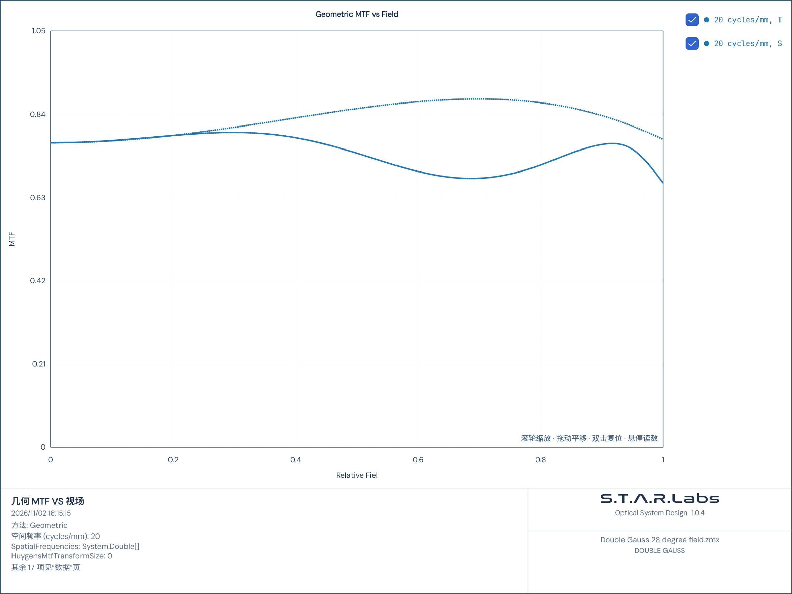

*图 35　几何 MTF VS 视场*

| 方法 | 空间频率 (cycles/mm) | 视场密度 |
| --- | --- | --- |
| Geometric | 20 | 21 |


<a id="page-43"></a>

<a id="section-038"></a>

## 入射角 vs. 像高

配置 1　·　视场密度：20 · 波长序号：2

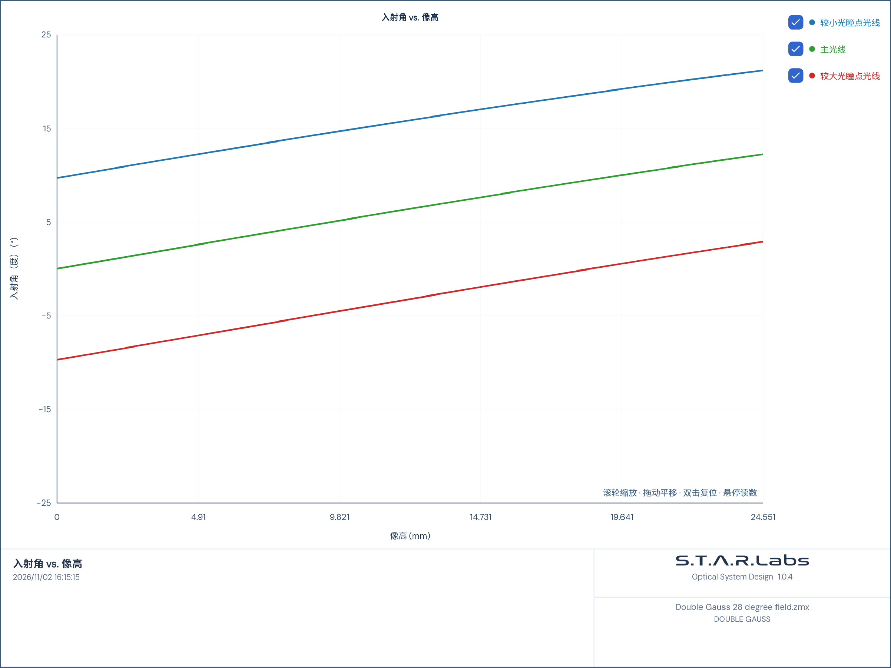

*图 36　入射角 vs. 像高*

| 分析波长 (µm) | 视场密度 | 光线数 |
| --- | --- | --- |
| 0.588 | 20 | 3 |


<a id="page-44"></a>

<a id="section-039"></a>

## 入射角-像高（扫描瞳孔）

配置 1　·　测量表面序号：-1

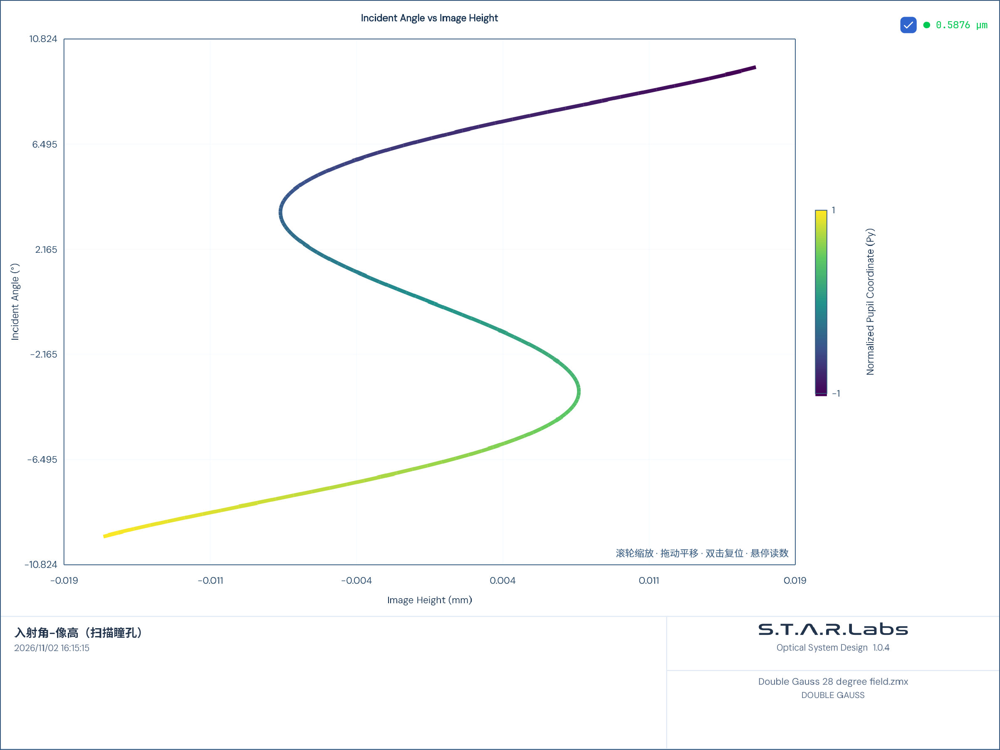

*图 37　入射角-像高（扫描瞳孔）*

| 分析波长 (µm) | 扫描模式 | 测量轴 |
| --- | --- | --- |
| 0.588 | ThroughPupil | Y |


<a id="page-45"></a>

<a id="section-040"></a>

## 入射角-像高（扫描视场）

配置 1　·　测量表面序号：-1

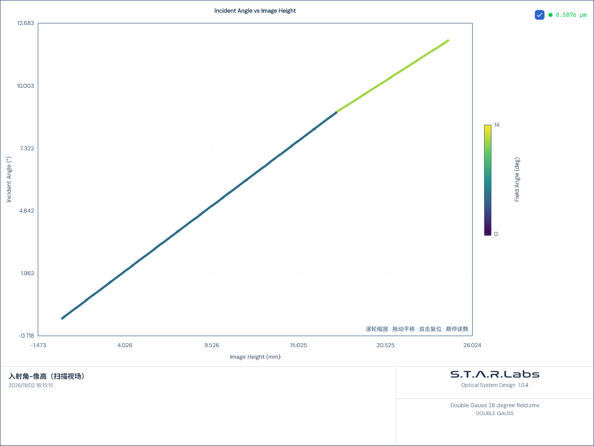

*图 38　入射角-像高（扫描视场）*

| 分析波长 (µm) | 扫描模式 | 测量轴 |
| --- | --- | --- |
| 0.588 | ThroughField | Y |


<a id="page-46"></a>

<a id="section-041"></a>

## 基面数据

配置 1　·　参考面：12

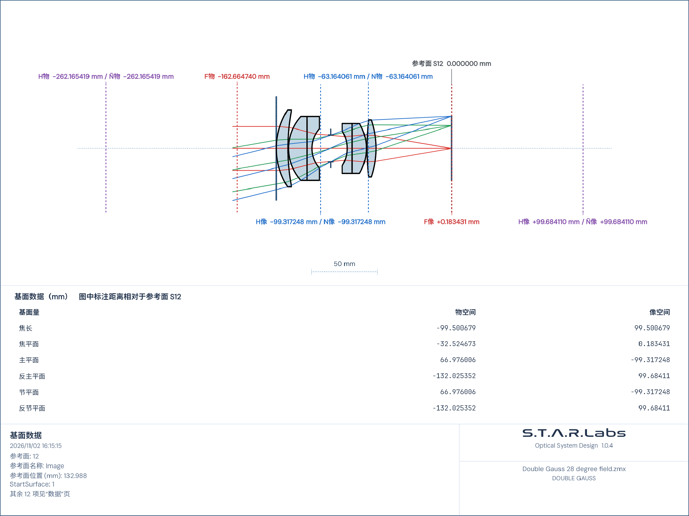

*图 39　基面数据*

| 分析波长 (µm) | 参考面 | 参考面名称 |
| --- | --- | --- |
| 0.588 | 12 | Image |


<a id="page-47"></a>

<a id="section-042"></a>

## 渐晕图

配置 1　·　

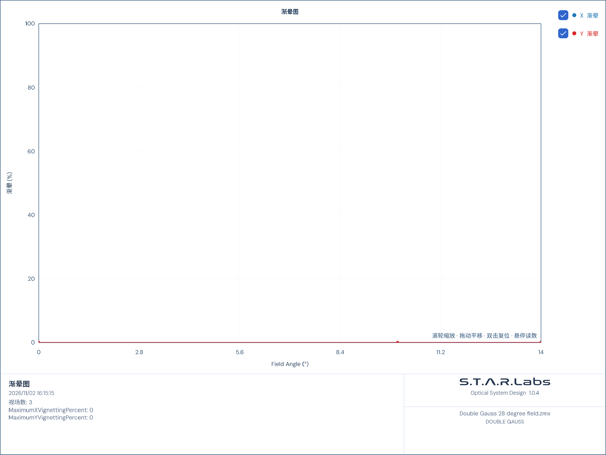

*图 40　渐晕图*

| 视场数 |
| --- |
| 3 |


<a id="page-48"></a>

<a id="section-043"></a>

## 相对照度

配置 1　·　视场密度：21 · 波长序号：全部

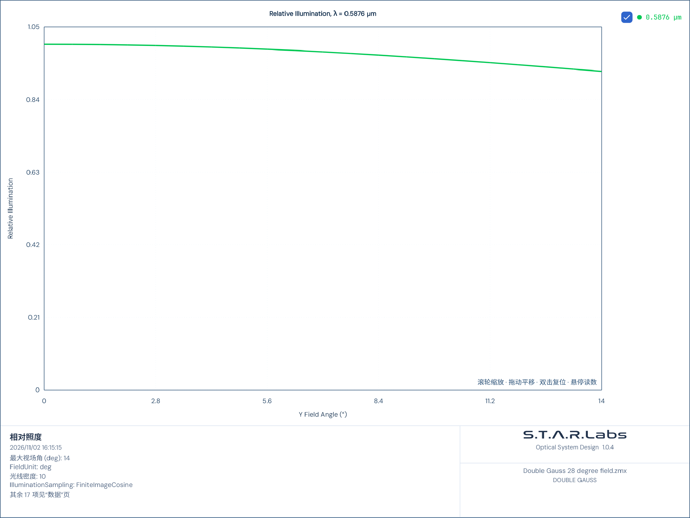

*图 41　相对照度*

| 分析波长 (µm) | 最大视场角 (deg) | 光线密度 |
| --- | --- | --- |
| 0.588 | 14 | 10 |


<a id="page-49"></a>

<a id="section-044"></a>

## 非相干照度

配置 1　·　探测器表面序号：-1 · 无物理孔径时按表面半口径采样：是

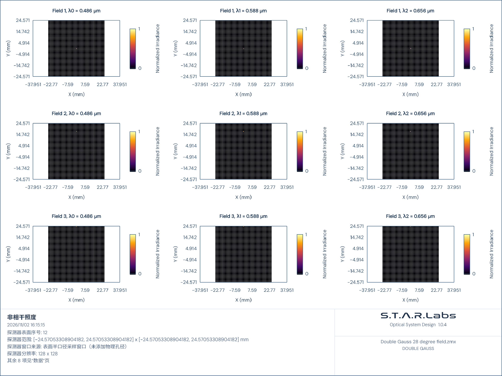

*图 42　非相干照度*

| 探测器范围 | 探测器窗口来源 | 探测器分辨率 |
| --- | --- | --- |
| &#91;-24.5705, 24.5705&#93; x &#91;-24.5705, 24.5705&#93; mm | 表面半口径采样窗口（未添加物理孔径） | 128 x 128 |


<a id="page-50"></a>

<a id="section-045"></a>

## 辐射强度

配置 1　·　参考表面序号：-1

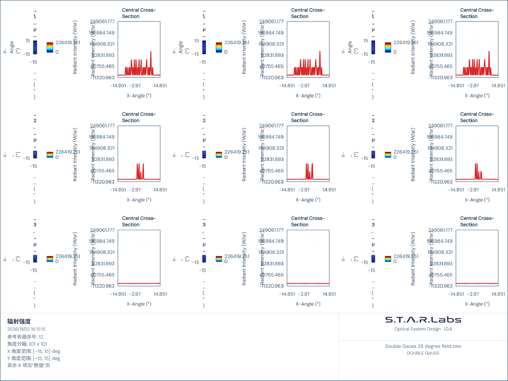

*图 43　辐射强度*

| 角度分箱 | X 角度范围 | Y 角度范围 |
| --- | --- | --- |
| 101 x 101 | &#91;-15, 15&#93; deg | &#91;-15, 15&#93; deg |


<a id="page-51"></a>

<a id="section-046"></a>

## Y-Ybar

配置 1　·　

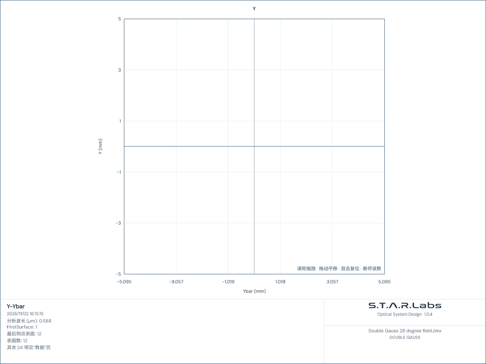

*图 44　Y-Ybar*

| 分析波长 (µm) | 最后到达表面 | 表面数 |
| --- | --- | --- |
| 0.588 | 12 | 12 |


<a id="page-52"></a>

<a id="section-047"></a>

## FFT PSF

配置 1　·　采样：64 x 64 · 波长：全部 · 视场序号：1 - 轴上视场 · 表面：像面

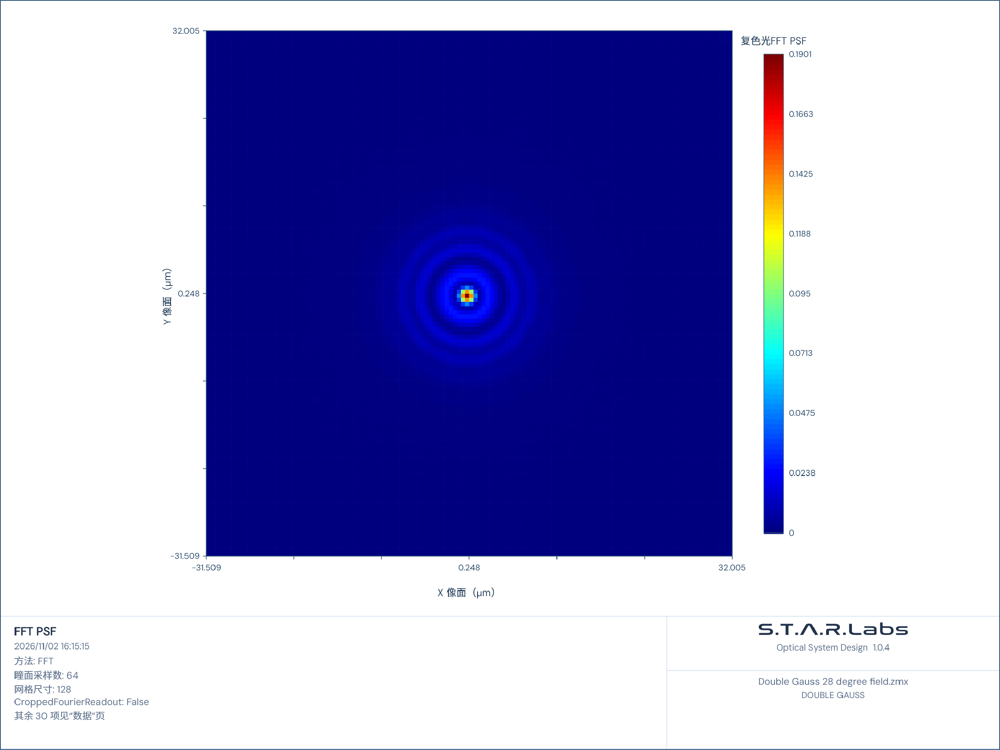

*图 45　FFT PSF*

| 方法 | 瞳面采样数 | 网格尺寸 |
| --- | --- | --- |
| FFT | 64 | 128 |


<a id="page-53"></a>

<a id="section-048"></a>

## FFT PSF截面图

配置 1　·　采样：64 x 64 · 波长：全部 · 视场序号：1 - 轴上视场

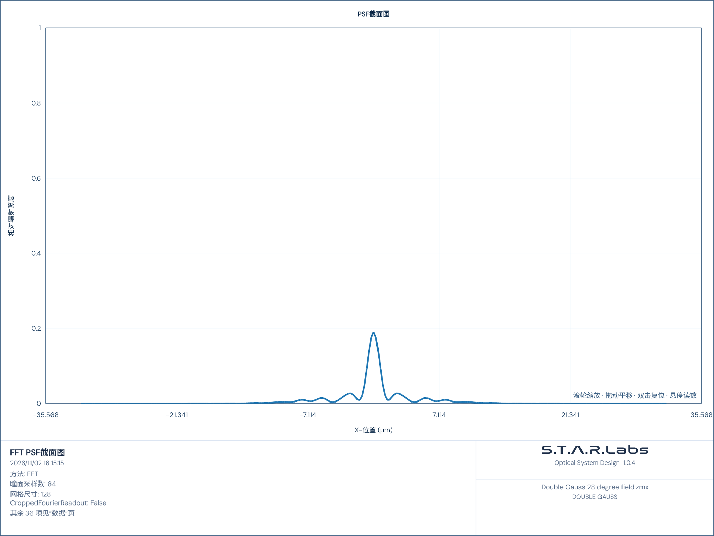

*图 46　FFT PSF截面图*

| 方法 | 瞳面采样数 | 网格尺寸 |
| --- | --- | --- |
| FFT | 64 | 128 |


<a id="page-54"></a>

<a id="section-049"></a>

## FFT 线/边缘扩散

配置 1　·　采样：64 x 64 · 波长：全部 · 视场序号：1 - 轴上视场

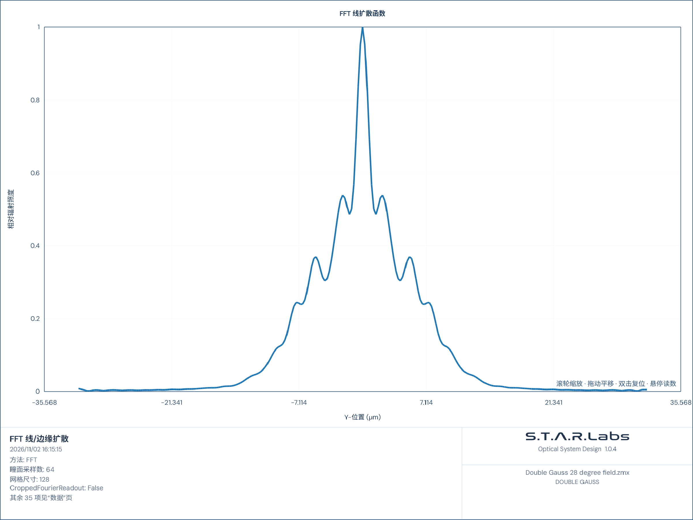

*图 47　FFT 线/边缘扩散*

| 方法 | 瞳面采样数 | 网格尺寸 |
| --- | --- | --- |
| FFT | 64 | 128 |


<a id="page-55"></a>

<a id="section-050"></a>

## 惠更斯PSF

配置 1　·　光瞳采样：32 x 32 · 像面采样：32 x 32 · 波长：全部 · 视场序号：1 - 轴上视场

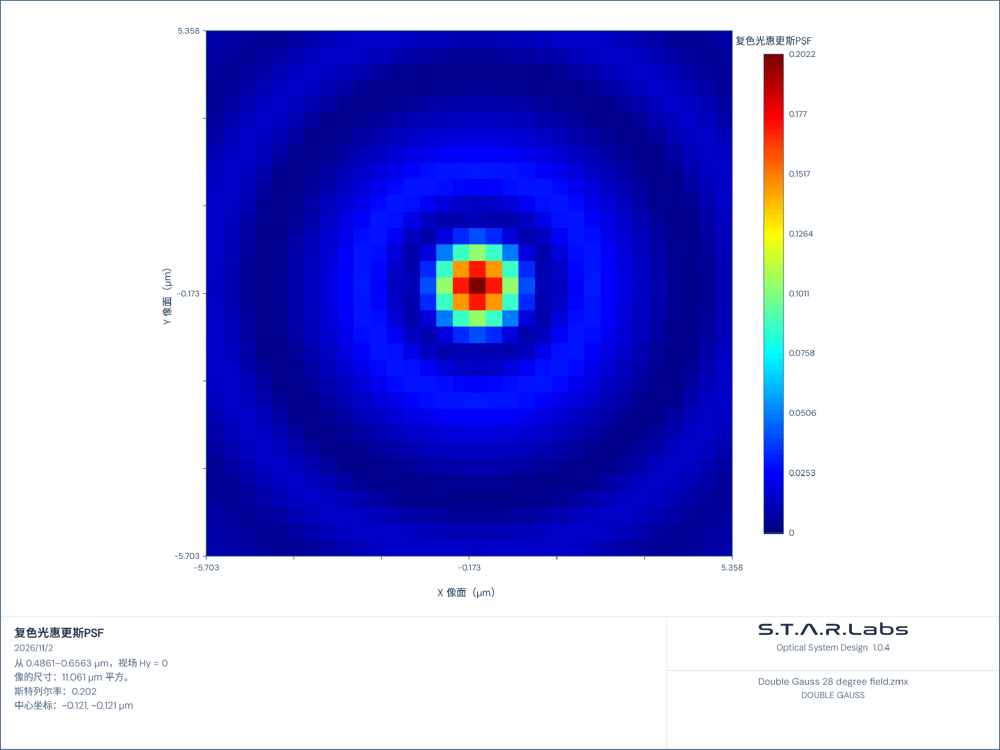

*图 48　惠更斯PSF*

| 方法 | 采用有限单元传播 | 像面平面 |
| --- | --- | --- |
| Huygens-Fresnel | True | Chief ray tangent plane |


<a id="page-56"></a>

<a id="section-051"></a>

## 惠更斯PSF截面图

配置 1　·　光瞳采样：32 · 像面采样：32 · 波长：全部 · 视场序号：1

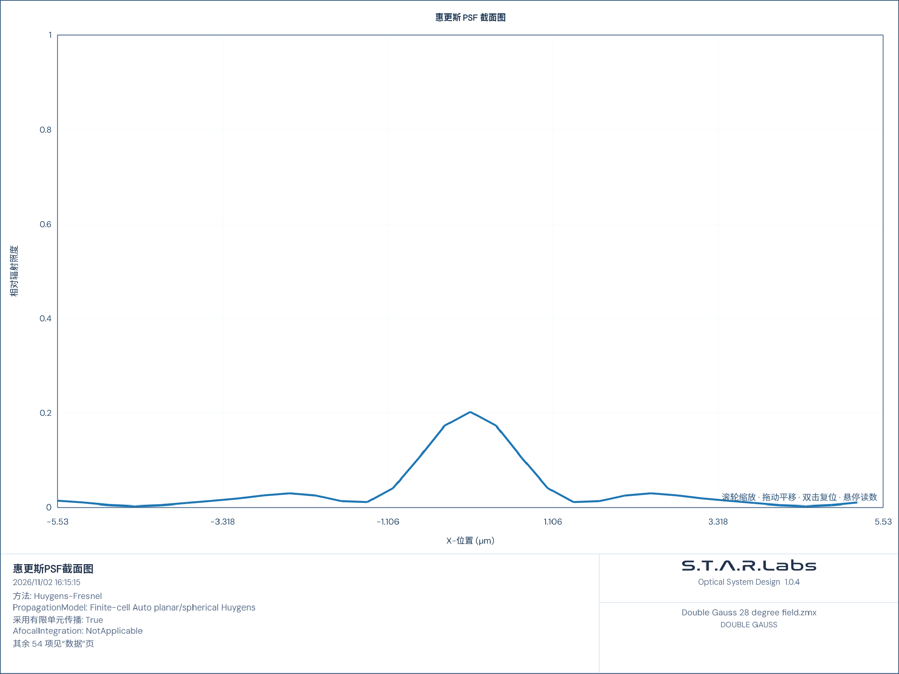

*图 49　惠更斯PSF截面图*

| 方法 | 采用有限单元传播 | 像面平面 |
| --- | --- | --- |
| Huygens-Fresnel | True | Chief ray tangent plane |


<a id="page-57"></a>

<a id="section-052"></a>

## 傅里叶 MTF

配置 1　·　采样：64 · 波长：全部 · 视场：全部 · 表面：像面

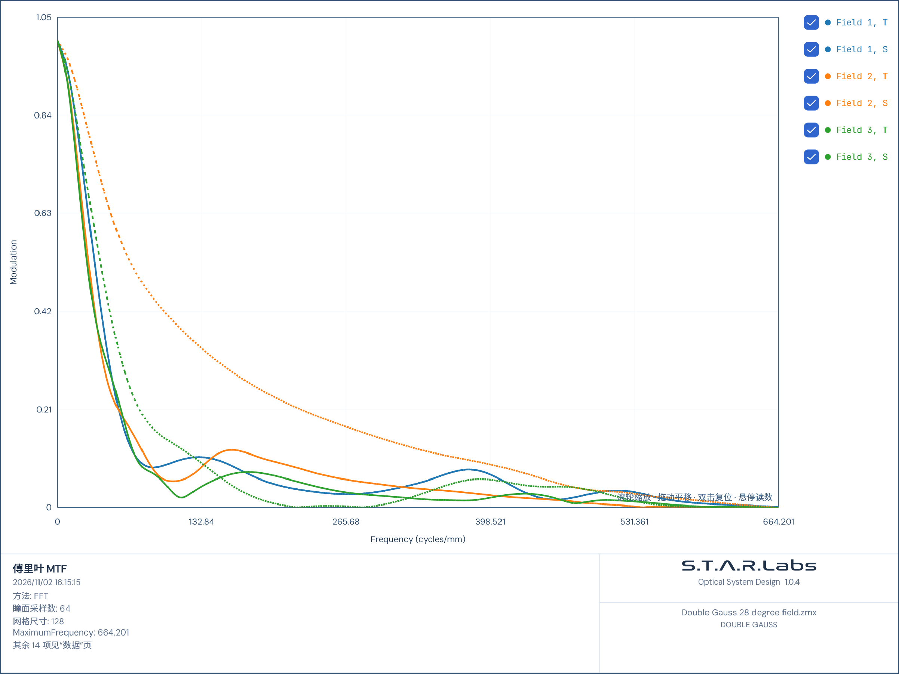

*图 50　傅里叶 MTF*

| 截止频率 (cycles/mm) | 方法 | 瞳面采样数 |
| --- | --- | --- |
| 664.201 | FFT | 64 |


<a id="page-58"></a>

<a id="section-053"></a>

## 惠更斯 MTF

配置 1　·　瞳面采样：32 · 图像采样：32 · 波长：全部 · 视场：全部

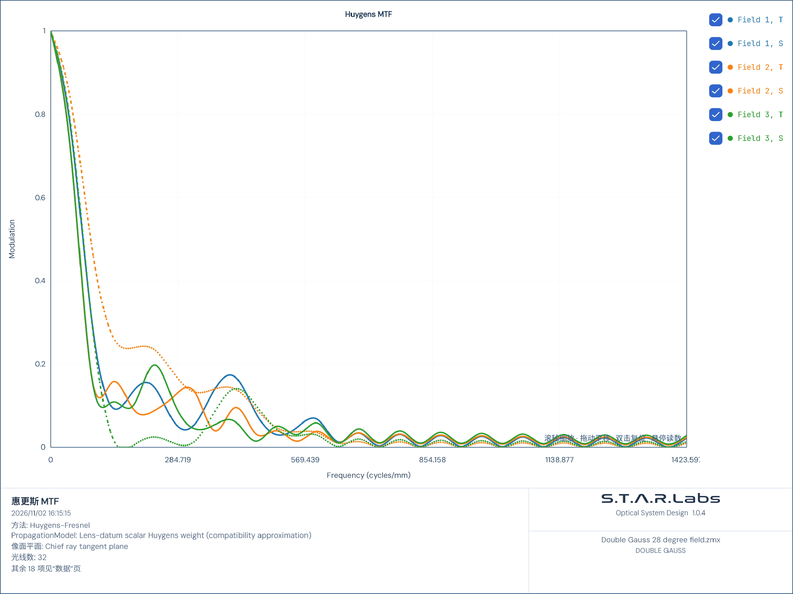

*图 51　惠更斯 MTF*

| 截止频率 (cycles/mm) | 方法 | 像面平面 |
| --- | --- | --- |
| 1423.597 | Huygens-Fresnel | Chief ray tangent plane |


<a id="page-59"></a>

<a id="section-054"></a>

## 几何 MTF

配置 1　·　波长：全部 · 视场：全部


*图 52　几何 MTF*

| 截止频率 (cycles/mm) | 方法 | 光线数 |
| --- | --- | --- |
| 570.069 | Geometric | 32 |


<a id="page-60"></a>

<a id="section-055"></a>

## 采样 MTF

配置 1　·　瞳面采样数：32


*图 53　采样 MTF*

| 截止频率 (cycles/mm) | 分析波长 (µm) | 方法 |
| --- | --- | --- |
| 570.069 | 0.588 | Sampled |


<a id="page-61"></a>

<a id="section-056"></a>

## 对比度损失图

配置 1　·　采样：13 · 波长序号：2 · 视场序号：1


*图 54　对比度损失图*

| 截止频率 (cycles/mm) | 分析波长 (µm) | 方法 |
| --- | --- | --- |
| 571.416 | 0.588 | Moore-Elliott |


<a id="page-62"></a>

<a id="section-057"></a>

## 光程差图

配置 1　·　波长：全部 · 视场：全部 · 表面：像面


*图 55　光程差图*

| 原点每侧光线数 | 采样点数 | 视场数 |
| --- | --- | --- |
| 20 | 41 | 3 |


<a id="page-63"></a>

<a id="section-058"></a>

## 傅科分析

配置 1　·　采样：32 x 32 · 波长序号：2 · 视场序号：1 - 轴上视场


*图 56　傅科分析*

| 分析波长 (µm) | 采样 | 显示为 |
| --- | --- | --- |
| 0.588 | 32 x 32 | 灰度 |


<a id="page-64"></a>

<a id="section-059"></a>

## 波前图

配置 1　·　采样：64 x 64 · 参考主光线：否 · 波长序号：2 · 视场序号：1 - 轴上视场 · 表面：像面


*图 57　波前图*

| RMS 光程差 | PV 光程差 | RMS 波数 |
| --- | --- | --- |
| 1.523E-4 | 5.849E-4 | 0.259 |


<a id="page-65"></a>

<a id="section-060"></a>

## 干涉图

配置 1　·　瞳面采样：64 x 64 · 分析面：-1 - 像面 · 波长序号：2 · 视场序号：1


*图 58　干涉图*

| 分析波长 (µm) | 波峰到波谷 | RMS 波数 |
| --- | --- | --- |
| 0.588 | 0.995 | 0.756 |


<a id="page-66"></a>

<a id="section-061"></a>

## 波前

配置 1　·　采样：64 x 64 · 参考主光线：否 · 波长序号：2 · 视场序号：1 - 轴上视场 · 表面：像面


*图 59　波前*

| RMS 光程差 | PV 光程差 | RMS 波数 |
| --- | --- | --- |
| 1.523E-4 | 5.849E-4 | 0.259 |


<a id="page-67"></a>

<a id="section-062"></a>

## 质心参考球波前

配置 1　·　波长：全部 · 视场序号：1


*图 60　质心参考球波前*

| RMS 光程差 | PV 光程差 | RMS 波数 |
| --- | --- | --- |
| 1.745E-4 | 5.737E-4 | 0.297 |


<a id="page-68"></a>

<a id="section-063"></a>

## 最佳拟合球波前

配置 1　·　波长：全部 · 视场序号：1


*图 61　最佳拟合球波前*

| RMS 光程差 | PV 光程差 | RMS 波数 |
| --- | --- | --- |
| 1.713E-4 | 6.319E-4 | 0.292 |


<a id="page-69"></a>

<a id="section-064"></a>

## Zernike Fringe系数

配置 1　·　瞳面采样：32 x 32 · 波长序号：2 · 视场序号：1 - 轴上视场

| 序号 | n | m | 公式 | 系数 / 波 |
| --- | --- | --- | --- | --- |
| Z1 | 0 | 0 | 1 | -0.70742960502 |
| Z2 | 1 | 1 | ρ · cos(θ) | 8.21999518097E-18 |
| Z3 | 1 | -1 | ρ · sin(θ) | 3.45081404507E-17 |
| Z4 | 2 | 0 | (2ρ² − 1) | -0.064640816514 |
| Z5 | 2 | 2 | ρ² · cos(2θ) | -5.26254517067E-16 |
| Z6 | 2 | -2 | ρ² · sin(2θ) | 2.28771320284E-17 |
| Z7 | 3 | 1 | (3ρ³ − 2ρ) · cos(θ) | 4.86987486463E-18 |
| Z8 | 3 | -1 | (3ρ³ − 2ρ) · sin(θ) | -4.66762567957E-17 |
| Z9 | 4 | 0 | (6ρ⁴ − 6ρ² + 1) | 0.573407215189 |
| Z10 | 3 | 3 | ρ³ · cos(3θ) | -6.67761877501E-17 |
| Z11 | 3 | -3 | ρ³ · sin(3θ) | 2.02455888935E-16 |
| Z12 | 4 | 2 | (4ρ⁴ − 3ρ²) · cos(2θ) | 2.81819757386E-16 |
| Z13 | 4 | -2 | (4ρ⁴ − 3ρ²) · sin(2θ) | 2.23465963812E-18 |
| Z14 | 5 | 1 | (10ρ⁵ − 12ρ³ + 3ρ) · cos(θ) | 1.06629483012E-17 |
| Z15 | 5 | -1 | (10ρ⁵ − 12ρ³ + 3ρ) · sin(θ) | 1.71809681853E-17 |
| Z16 | 6 | 0 | (20ρ⁶ − 30ρ⁴ + 12ρ² − 1) | -0.0714993544882 |
| Z17 | 4 | 4 | ρ⁴ · cos(4θ) | 3.38640426444E-10 |
| Z18 | 4 | -4 | ρ⁴ · sin(4θ) | 2.35076280374E-17 |
| Z19 | 5 | 3 | (5ρ⁵ − 4ρ³) · cos(3θ) | 9.90552873804E-17 |
| Z20 | 5 | -3 | (5ρ⁵ − 4ρ³) · sin(3θ) | -2.45515517106E-17 |
| Z21 | 6 | 2 | (15ρ⁶ − 20ρ⁴ + 6ρ²) · cos(2θ) | -3.17445703181E-16 |
| Z22 | 6 | -2 | (15ρ⁶ − 20ρ⁴ + 6ρ²) · sin(2θ) | -7.44077173067E-18 |
| Z23 | 7 | 1 | (35ρ⁷ − 60ρ⁵ + 30ρ³ − 4ρ) · cos(θ) | -2.81731238577E-17 |
| Z24 | 7 | -1 | (35ρ⁷ − 60ρ⁵ + 30ρ³ − 4ρ) · sin(θ) | -2.60905295624E-17 |
| Z25 | 8 | 0 | (70ρ⁸ − 140ρ⁶ + 90ρ⁴ − 20ρ² + 1) | -0.0021701472557 |
| Z26 | 5 | 5 | ρ⁵ · cos(5θ) | 4.13269272258E-17 |
| Z27 | 5 | -5 | ρ⁵ · sin(5θ) | -1.22196208156E-17 |
| Z28 | 6 | 4 | (6ρ⁶ − 5ρ⁴) · cos(4θ) | 3.61088529668E-10 |
| Z29 | 6 | -4 | (6ρ⁶ − 5ρ⁴) · sin(4θ) | -1.08860880682E-17 |
| Z30 | 7 | 3 | (21ρ⁷ − 30ρ⁵ + 10ρ³) · cos(3θ) | -5.19375979048E-17 |
| Z31 | 7 | -3 | (21ρ⁷ − 30ρ⁵ + 10ρ³) · sin(3θ) | -4.27954480593E-17 |
| Z32 | 8 | 2 | (56ρ⁸ − 105ρ⁶ + 60ρ⁴ − 10ρ²) · cos(2θ) | 1.76297822029E-17 |
| Z33 | 8 | -2 | (56ρ⁸ − 105ρ⁶ + 60ρ⁴ − 10ρ²) · sin(2θ) | 1.24224083727E-17 |
| Z34 | 9 | 1 | (126ρ⁹ − 280ρ⁷ + 210ρ⁵ − 60ρ³ + 5ρ) · cos(θ) | -6.68623401898E-18 |
| Z35 | 9 | -1 | (126ρ⁹ − 280ρ⁷ + 210ρ⁵ − 60ρ³ + 5ρ) · sin(θ) | 9.74824503126E-17 |
| Z36 | 10 | 0 | (252ρ¹⁰ − 630ρ⁸ + 560ρ⁶ − 210ρ⁴ + 30ρ² − 1) | -5.35087607171E-05 |
| Z37 | 12 | 0 | (924ρ¹² − 2772ρ¹⁰ + 3150ρ⁸ − 1680ρ⁶ + 420ρ⁴ − 42ρ² + 1) | -1.16882910616E-06 |

W(ρ, θ) = Σ c_j Z_j(ρ, θ)。ρ 为归一化瞳孔半径，θ 为方位角，系数单位为波。0 ≤ ρ ≤ 1；Fringe 基底不加 Standard 归一化因子。


<a id="page-72"></a>

<a id="section-065"></a>

## Zernike Standard系数

配置 1　·　瞳面采样：32 x 32 · 波长序号：2 · 视场序号：1 - 轴上视场

| 序号 | n | m | 公式 | 系数 / 波 |
| --- | --- | --- | --- | --- |
| Z1 | 0 | 0 | 1 | -0.707429916712 |
| Z2 | 1 | 1 | 2 · ρ · cos(θ) | 4.37143441696E-18 |
| Z3 | 1 | -1 | 2 · ρ · sin(θ) | 2.04681557529E-17 |
| Z4 | 2 | 0 | √3 · (2ρ² − 1) | -0.0373209649717 |
| Z5 | 2 | -2 | √6 · ρ² · sin(2θ) | -4.12048417714E-18 |
| Z6 | 2 | 2 | √6 · ρ² · cos(2θ) | -1.46684147783E-16 |
| Z7 | 3 | -1 | √8 · (3ρ³ − 2ρ) · sin(θ) | -3.40384802614E-17 |
| Z8 | 3 | 1 | √8 · (3ρ³ − 2ρ) · cos(θ) | 5.48038133504E-18 |
| Z9 | 3 | -3 | √8 · ρ³ · sin(3θ) | 1.13904864969E-17 |
| Z10 | 3 | 3 | √8 · ρ³ · cos(3θ) | -2.34976741711E-17 |
| Z11 | 4 | 0 | √5 · (6ρ⁴ − 6ρ² + 1) | 0.256434686786 |
| Z12 | 4 | 2 | √10 · (4ρ⁴ − 3ρ²) · cos(2θ) | 4.19154509263E-17 |
| Z13 | 4 | -2 | √10 · (4ρ⁴ − 3ρ²) · sin(2θ) | -5.26001698611E-18 |
| Z14 | 4 | 4 | √10 · ρ⁴ · cos(4θ) | 1.27060218509E-06 |
| Z15 | 4 | -4 | √10 · ρ⁴ · sin(4θ) | 8.31001562458E-20 |
| Z16 | 5 | 1 | √12 · (10ρ⁵ − 12ρ³ + 3ρ) · cos(θ) | -5.2142184478E-18 |
| Z17 | 5 | -1 | √12 · (10ρ⁵ − 12ρ³ + 3ρ) · sin(θ) | -4.86943141912E-18 |
| Z18 | 5 | 3 | √12 · (5ρ⁵ − 4ρ³) · cos(3θ) | 3.30039302783E-17 |
| Z19 | 5 | -3 | √12 · (5ρ⁵ − 4ρ³) · sin(3θ) | -2.04601322623E-17 |
| Z20 | 5 | 5 | √12 · ρ⁵ · cos(5θ) | 7.66716443237E-19 |
| Z21 | 5 | -5 | √12 · ρ⁵ · sin(5θ) | -7.03892547587E-18 |
| Z22 | 6 | 0 | √7 · (20ρ⁶ − 30ρ⁴ + 12ρ² − 1) | -0.0270252981481 |
| Z23 | 6 | -2 | √14 · (15ρ⁶ − 20ρ⁴ + 6ρ²) · sin(2θ) | 5.28423433341E-18 |
| Z24 | 6 | 2 | √14 · (15ρ⁶ − 20ρ⁴ + 6ρ²) · cos(2θ) | 4.43338437157E-17 |
| Z25 | 6 | -4 | √14 · (6ρ⁶ − 5ρ⁴) · sin(4θ) | 1.73204975923E-18 |
| Z26 | 6 | 4 | √14 · (6ρ⁶ − 5ρ⁴) · cos(4θ) | 1.27276334102E-06 |
| Z27 | 6 | -6 | √14 · ρ⁶ · sin(6θ) | 2.7894605404E-18 |
| Z28 | 6 | 6 | √14 · ρ⁶ · cos(6θ) | 1.91824562527E-17 |
| Z29 | 7 | -1 | 4 · (35ρ⁷ − 60ρ⁵ + 30ρ³ − 4ρ) · sin(θ) | 1.81475505274E-17 |
| Z30 | 7 | 1 | 4 · (35ρ⁷ − 60ρ⁵ + 30ρ³ − 4ρ) · cos(θ) | -7.20939646508E-18 |
| Z31 | 7 | -3 | 4 · (21ρ⁷ − 30ρ⁵ + 10ρ³) · sin(3θ) | 6.78236865054E-19 |
| Z32 | 7 | 3 | 4 · (21ρ⁷ − 30ρ⁵ + 10ρ³) · cos(3θ) | -2.15745087955E-17 |
| Z33 | 7 | -5 | 4 · (7ρ⁷ − 6ρ⁵) · sin(5θ) | -1.96386192424E-17 |
| Z34 | 7 | 5 | 4 · (7ρ⁷ − 6ρ⁵) · cos(5θ) | 2.94266520115E-18 |
| Z35 | 7 | -7 | 4 · ρ⁷ · sin(7θ) | 1.6092861367E-17 |
| Z36 | 7 | 7 | 4 · ρ⁷ · cos(7θ) | 1.45362241597E-17 |
| Z37 | 8 | 0 | 3 · (70ρ⁸ − 140ρ⁶ + 90ρ⁴ − 20ρ² + 1) | -0.000724746016258 |

W(ρ, θ) = Σ c_j Z_j(ρ, θ)。ρ 为归一化瞳孔半径，θ 为方位角，系数单位为波。0 ≤ ρ ≤ 1；Standard 基底采用单位 RMS 归一化。


<a id="page-75"></a>

<a id="section-066"></a>

## Zernike Annular系数

配置 1　·　瞳面采样：32 x 32 · 波长序号：2 · 视场序号：1 - 轴上视场

| 序号 | n | m | 公式 | 系数 / 波 |
| --- | --- | --- | --- | --- |
| Z1 | 0 | 0 | 1 | -0.796465872937 |
| Z2 | 1 | 1 | ρ · 1.788854382 · cos(θ) | -1.28035245407E-17 |
| Z3 | 1 | -1 | ρ · 1.788854382 · sin(θ) | -6.49232331006E-19 |
| Z4 | 2 | 0 | 1.73205080757u | 0.164147721825 |
| Z5 | 2 | -2 | ρ² · 2.1380899353 · sin(2θ) | 2.12852257397E-19 |
| Z6 | 2 | 2 | ρ² · 2.1380899353 · cos(2θ) | -1.96837146521E-16 |
| Z7 | 3 | -1 | ρ · (3.30289129538u − 0.660578259076) · sin(θ) | -2.16762905194E-17 |
| Z8 | 3 | 1 | ρ · (3.30289129538u − 0.660578259076) · cos(θ) | 1.00844852952E-17 |
| Z9 | 3 | -3 | ρ³ · 2.45428796431 · sin(3θ) | -2.95530457415E-17 |
| Z10 | 3 | 3 | ρ³ · 2.45428796431 · cos(3θ) | -5.35436909024E-18 |
| Z11 | 4 | 0 | (3.35410196625u² − 1.11803398875) | 0.121766937423 |
| Z12 | 4 | 2 | ρ² · (4.41661988455u − 1.57736424448) · cos(2θ) | -1.21464439001E-16 |
| Z13 | 4 | -2 | ρ² · (4.41661988455u − 1.57736424448) · sin(2θ) | -3.90894092356E-19 |
| Z14 | 4 | 4 | ρ⁴ · 2.739950981 · cos(4θ) | 2.2125061286E-07 |
| Z15 | 4 | -4 | ρ⁴ · 2.739950981 · sin(4θ) | -1.01700657445E-18 |
| Z16 | 5 | 1 | ρ · (6.35674156037u² − 1.15577119279u − 1.8877596149) · cos(θ) | 4.73937914045E-18 |
| Z17 | 5 | -1 | ρ · (6.35674156037u² − 1.15577119279u − 1.8877596149) · sin(θ) | 3.34268977896E-19 |
| Z18 | 5 | 3 | ρ³ · (5.78082782564u − 2.73399151283) · cos(3θ) | 1.42595609308E-17 |
| Z19 | 5 | -3 | ρ³ · (5.78082782564u − 2.73399151283) · sin(3θ) | 1.15696475116E-17 |
| Z20 | 5 | 5 | ρ⁵ · 3.00036627801 · cos(5θ) | 2.02652189186E-17 |
| Z21 | 5 | -5 | ρ⁵ · 3.00036627801 · sin(5θ) | -8.91985682178E-19 |
| Z22 | 6 | 0 | (6.61437827766u³ − 3.9686269666u) | -0.0120102658675 |
| Z23 | 6 | -2 | ρ² · (8.54139294604u² − 3.09919918216u − 1.9843139297) · sin(2θ) | 4.68527395443E-18 |
| Z24 | 6 | 2 | ρ² · (8.54139294604u² − 3.09919918216u − 1.9843139297) · cos(2θ) | 2.44752602041E-17 |
| Z25 | 6 | -4 | ρ⁴ · (7.36224705685u − 4.10213179121) · sin(4θ) | -7.27140529064E-18 |
| Z26 | 6 | 4 | ρ⁴ · (7.36224705685u − 4.10213179121) · cos(4θ) | 2.63772877606E-07 |
| Z27 | 6 | -6 | ρ⁶ · 3.24046924199 · sin(6θ) | 7.64419269674E-18 |
| Z28 | 6 | 6 | ρ⁶ · 3.24046924199 · cos(6θ) | 8.01972040249E-17 |
| Z29 | 7 | -1 | ρ · (12.4993492803u³ − 2.16461034184u² − 7.10604405148u + 0.642823677273) · sin(θ) | 8.2745455164E-18 |
| Z30 | 7 | 1 | ρ · (12.4993492803u³ − 2.16461034184u² − 7.10604405148u + 0.642823677273) · cos(θ) | -1.2051334379E-18 |
| Z31 | 7 | -3 | ρ³ · (11.4639047986u² − 6.12880205761u − 1.73195555338) · sin(3θ) | 2.91272039809E-17 |
| Z32 | 7 | 3 | ρ³ · (11.4639047986u² − 6.12880205761u − 1.73195555338) · cos(3θ) | -9.81993568436E-18 |
| Z33 | 7 | -5 | ρ⁵ · (9.12346367206u − 5.65167781004) · sin(5θ) | 1.4592863409E-17 |
| Z34 | 7 | 5 | ρ⁵ · (9.12346367206u − 5.65167781004) · cos(5θ) | 1.49564393614E-17 |
| Z35 | 7 | -7 | ρ⁷ · 3.46412804444 · sin(7θ) | -7.18835802928E-18 |
| Z36 | 7 | 7 | ρ⁷ · 3.46412804444 · cos(7θ) | -2.23498875012E-18 |
| Z37 | 8 | 0 | (13.125u⁴ − 11.25u² + 1.125) | -0.000242380469251 |

W(ρ, θ) = Σ c_j Z_j(ρ, θ)。ρ 为归一化瞳孔半径，θ 为方位角，系数单位为波。ε = 0.5；u = (2ρ² − 1 − ε²) / (1 − ε²)，ε ≤ ρ ≤ 1。公式采用本次环形瞳孔的实际归一化。


<a id="page-78"></a>

<a id="section-067"></a>

## Jones 瞳

配置 1　·　


*图 62　Jones 瞳*

| 分析波长 (µm) | 视场 | 网格尺寸 |
| --- | --- | --- |
| 0.588 | (0, 0) | 65 |


<a id="page-79"></a>

<a id="section-068"></a>

## 系统数据报告

配置 1　·　

| 分类 | 项目 | 值 |
| --- | --- | --- |
| 系统 | 名称 | DOUBLE GAUSS |
| 系统 | 表面数 | 13 |
| 系统 | 视场数 | 3 |
| 系统 | 波长数 | 3 |
| 系统 | 总长 (mm) | 132.988419 |
| 孔径 | 孔径类型 | EntrancePupilDiameter |
| 孔径 | 孔径值 | 33.33 |
| 孔径 | 光阑面 | 6 |
| 孔径 | 物方远心 | 否 |
| 视场 | 视场定义 | Angle |
| 视场 | 像方无焦 | 否 |
| 视场 | 光线瞄准 | 关闭 |
| 波长 | 主波长 (μm) | 0.5876 |
| 近轴 | 有效焦距 (mm) | 99.500679 |
| 近轴 | F 数 | 2.985319 |
| 近轴 | 入瞳直径 (mm) | 33.33 |
| 近轴 | 出瞳直径 (mm) | 36.258439 |


<a id="page-80"></a>

<a id="section-069"></a>

## 分类数据报告

配置 1　·　

| 分类 | 项目 | 数量 | 表面序号 |
| --- | --- | --- | --- |
| 表面角色 | 像面 | 1 | 12 |
| 表面角色 | 光阑面 | 1 | 6 |
| 表面角色 | 平面折射面 | 2 | 4, 8 |
| 表面角色 | 曲面折射面 | 8 | 1, 2, 3, 5, 7, 9, 10, 11 |
| 表面角色 | 物面 | 1 | 0 |
| 材料 | Air | 7 | 0, 2, 5, 6, 9, 11, 12 |
| 材料 | F5 | 2 | 4, 7 |
| 材料 | SK16 | 3 | 3, 8, 10 |
| 材料 | SK2 | 1 | 1 |
| 表面类型 | Plane | 5 | 0, 4, 6, 8, 12 |
| 表面类型 | Standard | 8 | 1, 2, 3, 5, 7, 9, 10, 11 |


## 附录 完整参数与计算记录

<details>
<summary>展开完整参数与计算记录</summary>

### 单光线追迹 计算记录

| 参数 | 值 |
| --- | --- |
| FieldNumber | 1 |
| Hx | 0 |
| Hy | 0 |
| WavelengthNumber | 1 |
| Px | 0 |
| Py | 0 |
| GlobalCoordinates | false |
| Type | 方向余弦 |
| UseRayAiming | true |
| ShowRaySegments | false |

计算来源：Application.WorkbenchRuntime.BuildAnalysisView/v1；请求指纹：04EC1DA316C96E5BF2A3D9822E7A4CCEAD03A5DE91F15BCA85AE6457DF5A5259

| 项目 | 值 |
| --- | --- |
| 视场 | 1 |
| 归一化视场 Hx | 0 |
| 归一化视场 Hy | 0 |
| 归一化瞳孔 Px | 0 |
| 归一化瞳孔 Py | 0 |
| 波长序号 | 1 |
| 分析波长 (µm) | 0.486 |
| 坐标系 | Local |
| 追迹类型 | Direction Cosines |
| 光线瞄准 | Paraxial |
| 最后到达表面 | 12 |
| RealRayData | System.Double&#91;&#93;&#91;&#93; |
| CompoundPortOpticalPathLengths | System.Double&#91;&#93;&#91;&#93; |
| PathLengthConvention | Geometric segment lengths; compound-port optical lengths are published separately for mixed-mode report interoperability. |
| 渐晕表面 | 0 |
| 显示光线段 | False |
| LayoutAvailable | True |
| LayoutUnavailableReason |  |

| 表面 | X-坐标 | Y-坐标 | Z-坐标 | X-余弦 | Y-余弦 | Z-余弦 | X-法线 | Y-法线 | Z-法线 | 角 | 路径长度 | 注释 |
| --- | --- | --- | --- | --- | --- | --- | --- | --- | --- | --- | --- | --- |
| OBJ | 0 | 0 | -33.33 | 0 | 0 | 1 | - | - | - | - | - |  |
| 1 | 0 | 0 | 0 | 0 | 0 | 1 | 0 | 0 | -1 | 0 | 0 |  |
| 2 | 0 | 0 | 0 | 0 | 0 | 1 | 0 | 0 | -1 | 0 | 8.746658 |  |
| 3 | 0 | 0 | 0 | 0 | 0 | 1 | 0 | 0 | -1 | 0 | 0.5 |  |
| 4 | 0 | 0 | 0 | 0 | 0 | 1 | 0 | 0 | -1 | 0 | 14 |  |
| 5 | 0 | 0 | 0 | 0 | 0 | 1 | 0 | 0 | -1 | 0 | 3.776966 |  |
| 6 | 0 | 0 | 0 | 0 | 0 | 1 | 0 | 0 | -1 | 0 | 14.253059 |  |
| 7 | 0 | 0 | 0 | 0 | 0 | 1 | 0 | 0 | -1 | 0 | 12.428129 |  |
| 8 | 0 | 0 | 0 | 0 | 0 | 1 | 0 | 0 | -1 | 0 | 3.776966 |  |
| 9 | 0 | 0 | 0 | 0 | 0 | 1 | 0 | 0 | -1 | 0 | 10.833929 |  |
| 10 | 0 | 0 | 0 | 0 | 0 | 1 | 0 | 0 | -1 | 0 | 0.5 |  |
| 11 | 0 | 0 | 0 | 0 | 0 | 1 | 0 | 0 | -1 | 0 | 6.858175 |  |
| 12 | 0 | 0 | 0 | 0 | 0 | 1 | 0 | 0 | -1 | 0 | 57.314538 |  |
| OBJ | 0 | 0 | 0 | 0 | 0 | 1 |  |  |  |  |  |  |
| 1 | 0 | 0 | 0 | 0 | 0 | 1 |  |  |  |  |  |  |
| 2 | 0 | 0 | 0 | 0 | 0 | 1 |  |  |  |  |  |  |
| 3 | 0 | 0 | 0 | 0 | 0 | 1 |  |  |  |  |  |  |
| 4 | 0 | 0 | 0 | 0 | 0 | 1 |  |  |  |  |  |  |
| 5 | 0 | 0 | 0 | 0 | 0 | 1 |  |  |  |  |  |  |
| 6 | 0 | 0 | 0 | 0 | 0 | 1 |  |  |  |  |  |  |
| 7 | 0 | 0 | 0 | 0 | 0 | 1 |  |  |  |  |  |  |
| 8 | 0 | 0 | 0 | 0 | 0 | 1 |  |  |  |  |  |  |
| 9 | 0 | 0 | 0 | 0 | 0 | 1 |  |  |  |  |  |  |
| 10 | 0 | 0 | 0 | 0 | 0 | 1 |  |  |  |  |  |  |
| 11 | 0 | 0 | 0 | 0 | 0 | 1 |  |  |  |  |  |  |
| 12 | 0 | 0 | 0 | 0 | 0 | 1 |  |  |  |  |  |  |

```text
归一化X视场坐标(Hx) ：      0.0000000000
归一化Y视场坐标(Hy) ：      0.0000000000
归一化X光瞳坐标(Px) ：      0.0000000000
归一化Y光瞳坐标(Py) ：      0.0000000000

实际光线追迹数据：

表面	X-坐标	Y-坐标	Z-坐标	X-余弦	Y-余弦	Z-余弦	X-法线	Y-法线	Z-法线	角	路径长度	注释
OBJ	0.0000000000E+00	0.0000000000E+00	-3.3330000000E+01	0.0000000000	0.0000000000	1.0000000000	-	-	-	-	-	
1	0.0000000000E+00	0.0000000000E+00	0.0000000000E+00	0.0000000000	0.0000000000	1.0000000000	0.0000000000	0.0000000000	-1.0000000000	0.0000000000	0.0000000000	
2	0.0000000000E+00	0.0000000000E+00	-8.8817841970E-15	0.0000000000	0.0000000000	1.0000000000	0.0000000000	0.0000000000	-1.0000000000	0.0000000000	8.7466578500	
3	0.0000000000E+00	0.0000000000E+00	0.0000000000E+00	0.0000000000	0.0000000000	1.0000000000	0.0000000000	0.0000000000	-1.0000000000	0.0000000000	0.5000000000	
4	0.0000000000E+00	0.0000000000E+00	0.0000000000E+00	0.0000000000	0.0000000000	1.0000000000	0.0000000000	0.0000000000	-1.0000000000	0.0000000000	14.0000000000	
5	0.0000000000E+00	0.0000000000E+00	0.0000000000E+00	0.0000000000	0.0000000000	1.0000000000	0.0000000000	0.0000000000	-1.0000000000	0.0000000000	3.7769658900	
6	0.0000000000E+00	0.0000000000E+00	0.0000000000E+00	0.0000000000	0.0000000000	1.0000000000	0.0000000000	0.0000000000	-1.0000000000	0.0000000000	14.2530593000	
7	0.0000000000E+00	0.0000000000E+00	0.0000000000E+00	0.0000000000	0.0000000000	1.0000000000	0.0000000000	0.0000000000	-1.0000000000	0.0000000000	12.4281291000	
8	0.0000000000E+00	0.0000000000E+00	0.0000000000E+00	0.0000000000	0.0000000000	1.0000000000	0.0000000000	0.0000000000	-1.0000000000	0.0000000000	3.7769658900	
9	0.0000000000E+00	0.0000000000E+00	0.0000000000E+00	0.0000000000	0.0000000000	1.0000000000	0.0000000000	0.0000000000	-1.0000000000	0.0000000000	10.8339285000	
10	0.0000000000E+00	0.0000000000E+00	0.0000000000E+00	0.0000000000	0.0000000000	1.0000000000	0.0000000000	0.0000000000	-1.0000000000	0.0000000000	0.5000000000	
11	0.0000000000E+00	0.0000000000E+00	0.0000000000E+00	0.0000000000	0.0000000000	1.0000000000	0.0000000000	0.0000000000	-1.0000000000	0.0000000000	6.8581749100	
12	0.0000000000E+00	0.0000000000E+00	0.0000000000E+00	0.0000000000	0.0000000000	1.0000000000	0.0000000000	0.0000000000	-1.0000000000	0.0000000000	57.3145379050	

近轴光线追迹数据：

表面	X-坐标	Y-坐标	Z-坐标	X-余弦	Y-余弦	Z-余弦	X-法线	Y-法线	Z-法线	角	路径长度	注释
OBJ	0.0000000000E+00	0.0000000000E+00	0.0000000000E+00	0.0000000000	0.0000000000	1.0000000000						
1	0.0000000000E+00	0.0000000000E+00	0.0000000000E+00	0.0000000000	0.0000000000	1.0000000000						
2	0.0000000000E+00	0.0000000000E+00	0.0000000000E+00	0.0000000000	0.0000000000	1.0000000000						
3	0.0000000000E+00	0.0000000000E+00	0.0000000000E+00	0.0000000000	0.0000000000	1.0000000000						
4	0.0000000000E+00	0.0000000000E+00	0.0000000000E+00	0.0000000000	0.0000000000	1.0000000000						
5	0.0000000000E+00	0.0000000000E+00	0.0000000000E+00	0.0000000000	0.0000000000	1.0000000000						
6	0.0000000000E+00	0.0000000000E+00	0.0000000000E+00	0.0000000000	0.0000000000	1.0000000000						
7	0.0000000000E+00	0.0000000000E+00	0.0000000000E+00	0.0000000000	0.0000000000	1.0000000000						
8	0.0000000000E+00	0.0000000000E+00	0.0000000000E+00	0.0000000000	0.0000000000	1.0000000000						
9	0.0000000000E+00	0.0000000000E+00	0.0000000000E+00	0.0000000000	0.0000000000	1.0000000000						
10	0.0000000000E+00	0.0000000000E+00	0.0000000000E+00	0.0000000000	0.0000000000	1.0000000000						
11	0.0000000000E+00	0.0000000000E+00	0.0000000000E+00	0.0000000000	0.0000000000	1.0000000000						
12	0.0000000000E+00	0.0000000000E+00	0.0000000000E+00	0.0000000000	0.0000000000	1.0000000000						
```

### 系统数据摘要 计算记录

| 参数 | 值 |
| --- | --- |

计算来源：Application.WorkbenchRuntime.BuildAnalysisView/v1；请求指纹：7151D6B80E43035EA7AAA396F6B4BC06B76D69CC60291D8FE5CA402AEBC81D9C

| 项目 | 值 |
| --- | --- |
| 有效焦距 | 99.501 |
| F 数 | 2.985 |
| OpticalPowerInverseMillimeters | 0.01 |
| EffectiveFocalLengthStatus | Finite |
| CardinalParametersApplicable | True |
| ImageSpaceAfocal | False |
| 系统总长 | 132.988 |

| 项目 | 数值 |
| --- | --- |
| 有效焦距 | 99.501 |
| F 数 | 2.985 |
| OpticalPowerInverseMillimeters | 0.01 |
| EffectiveFocalLengthStatus | Finite |
| CardinalParametersApplicable | True |
| ImageSpaceAfocal | False |
| 系统总长 | 132.988 |

```text
分析：系统数据摘要
有效焦距：99.501
F 数：2.985
OpticalPowerInverseMillimeters：0.01
EffectiveFocalLengthStatus：Finite
CardinalParametersApplicable：True
ImageSpaceAfocal：False
系统总长：132.988
```

### 赛德尔系数 计算记录

| 参数 | 值 |
| --- | --- |
| WavelengthNumber | 2 |

计算来源：Application.WorkbenchRuntime.BuildAnalysisView/v1；请求指纹：724762E0E7A3A70D130159258D5C23C3ED13E4EE8F1F835ED7CDF5EF5139A44D

| 项目 | 值 |
| --- | --- |
| 分析波长 (µm) | 0.588 |
| ChiefRaySlopeObjectSpace | 0.249 |
| ChiefRaySlopeImageSpace | 0.229 |
| MarginalRaySlopeObjectSpace | 0 |
| MarginalRaySlopeImageSpace | -0.167 |
| PetzvalRadius | -623.29 |
| OpticalInvariant | 4.155 |
| ImageSpaceRefractiveIndex | 1 |
| 表面数 | 12 |
| SeidelCoefficientsMillimeters | System.Double&#91;&#93;&#91;&#93; |
| WaveAberrationCoefficients | System.Double&#91;&#93;&#91;&#93; |
| TransverseAberrationCoefficientsMillimeters | System.Double&#91;&#93;&#91;&#93; |
| LongitudinalAberrationCoefficientsMillimeters | System.Double&#91;&#93;&#91;&#93; |

| 表面 | SPHA S1 | COMA S2 | ASTI S3 | FCUR S4 | DIST S5 | CLA (CL) | CTR (CT) |
| --- | --- | --- | --- | --- | --- | --- | --- |
| 1 | 0.114175 | -0.008176 | 0.000586 | 0.120467 | -0.008669 | -0.034222 | 0.002451 |
| 2 | 0.000396 | -0.005093 | 0.065502 | -0.042772 | -0.292349 | -0.002298 | 0.029553 |
| 3 | 0.037615 | 0.002873 | 0.000219 | 0.183865 | 0.014061 | -0.030572 | -0.002335 |
| 4 | 0.006027 | -0.008824 | 0.012918 | 0.000000 | -0.018911 | 0.017026 | -0.024926 |
| 5 | -0.126410 | -0.045356 | -0.016274 | -0.291746 | -0.110518 | 0.046478 | 0.016677 |
| 光阑 | 0.000000 | 0.000000 | 0.000000 | 0.000000 | 0.000000 | 0.000000 | 0.000000 |
| 7 | -0.227787 | 0.112367 | -0.055431 | -0.252955 | 0.152127 | 0.038302 | -0.018894 |
| 8 | 0.000130 | 0.000581 | 0.002588 | 0.000000 | 0.011535 | 0.003927 | 0.017502 |
| 9 | 0.093297 | -0.028806 | 0.008894 | 0.178746 | -0.057936 | -0.020104 | 0.006207 |
| 10 | -0.000002 | -0.000264 | -0.030245 | 0.033653 | 0.389861 | -0.000233 | -0.026621 |
| 11 | 0.128073 | -0.023063 | 0.004153 | 0.098441 | -0.018475 | -0.019011 | 0.003423 |
| 像面 | 0.000000 | 0.000000 | 0.000000 | 0.000000 | 0.000000 | 0.000000 | 0.000000 |
| 累计 | 0.025514 | -0.003761 | -0.007089 | 0.027699 | 0.060727 | -0.000706 | 0.003038 |

```text
波长                    :       0.5876 µm
主光线斜率，物空间      :       0.2493
主光线斜率，像空间      :       0.2292
边缘光线斜率，物空间    :       0.0000
边缘光线斜率，像空间    :      -0.1675
佩兹伐半径              :    -623.2905
光学不变量              :       4.1551

赛德尔像差系数：

表面      SPHA S1       COMA S2       ASTI S3       FCUR S4       DIST S5       CLA (CL)      CTR (CT)      
1       0.114175      -0.008176     0.000586      0.120467      -0.008669     -0.034222     0.002451      
2       0.000396      -0.005093     0.065502      -0.042772     -0.292349     -0.002298     0.029553      
3       0.037615      0.002873      0.000219      0.183865      0.014061      -0.030572     -0.002335     
4       0.006027      -0.008824     0.012918      0.000000      -0.018911     0.017026      -0.024926     
5       -0.126410     -0.045356     -0.016274     -0.291746     -0.110518     0.046478      0.016677      
光阑      0.000000      0.000000      0.000000      0.000000      0.000000      0.000000      0.000000      
7       -0.227787     0.112367      -0.055431     -0.252955     0.152127      0.038302      -0.018894     
8       0.000130      0.000581      0.002588      0.000000      0.011535      0.003927      0.017502      
9       0.093297      -0.028806     0.008894      0.178746      -0.057936     -0.020104     0.006207      
10      -0.000002     -0.000264     -0.030245     0.033653      0.389861      -0.000233     -0.026621     
11      0.128073      -0.023063     0.004153      0.098441      -0.018475     -0.019011     0.003423      
像面      0.000000      0.000000      0.000000      0.000000      0.000000      0.000000      0.000000      
累计      0.025514      -0.003761     -0.007089     0.027699      0.060727      -0.000706     0.003038      

赛德尔像差系数（波长）：

表面      W040          W131          W222          W220P         W311          W020          W111          
1       24.288415     -6.957359     0.498230      51.254016     -7.376475     -29.120000    4.170677      
2       0.084231      -4.333486     55.736947     -18.197852    -248.765515   -1.955190     50.294990     
3       8.001724      2.444808      0.186744      78.227152     11.964837     -26.014187    -3.974125     
4       1.282189      -7.508364     10.992049     0.000000      -16.092073    14.487712     -42.419262    
5       -26.891256    -38.594487    -13.847758    -124.126173   -94.041899    39.549358     28.380735     
光阑      0.000000      0.000000      0.000000      0.000000      0.000000      0.000000      0.000000      
7       -48.457040    95.615506     -47.167166    -107.622229   129.447755    32.591819     -32.155114    
8       0.027719      0.494159      2.202392      0.000000      9.815724      3.341623      29.786205     
9       19.847124     -24.511996    7.568325      76.049166     -49.298685    -17.107262    10.564078     
10      -0.000492     -0.224984     -25.736060    14.318059     331.740106    -0.198025     -45.304611    
11      27.244997     -19.624497    3.533868      41.882614     -15.720326    -16.176585    5.825975      
像面      0.000000      0.000000      0.000000      0.000000      0.000000      0.000000      0.000000      
累计      5.427611      -3.200700     -6.032430     11.784753     51.673450     -0.600738     5.169548      

横向像差系数：

表面      TSPH          TSCO          TTCO          TAST          TPFC          TSFC          TTFC          TDIS          TAXC          TLAC          
1       0.340849      -0.024409     -0.073226     0.003496      0.359634      0.361382      0.364878      -0.025879     0.204326      -0.014632     
2       0.001182      -0.015203     -0.045610     0.391089      -0.127689     0.067856      0.458945      -0.872756     0.013719      -0.176452     
3       0.112291      0.008577      0.025732      0.001310      0.548896      0.549551      0.550861      0.041977      0.182534      0.013943      
4       0.017993      -0.026342     -0.079026     0.077128      0.000000      0.038564      0.115692      -0.056457     -0.101656     0.148821      
5       -0.377375     -0.135403     -0.406209     -0.097165     -0.870955     -0.919538     -1.016704     -0.329932     -0.277506     -0.099569     
光阑      0.000000      0.000000      0.000000      0.000000      0.000000      0.000000      0.000000      0.000000      0.000000      0.000000      
7       -0.680016     0.335452      1.006357      -0.330958     -0.755152     -0.920631     -1.251589     0.454148      -0.228687     0.112811      
8       0.000389      0.001734      0.005201      0.015454      0.000000      0.007727      0.023180      0.034437      -0.023447     -0.104500     
9       0.278522      -0.085997     -0.257990     0.053105      0.533614      0.560166      0.613271      -0.172957     0.120036      -0.037062     
10      -0.000007     -0.000789     -0.002368     -0.180582     0.100465      0.010174      -0.170408     1.163859      0.001389      0.158944      
11      0.382340      -0.068850     -0.206549     0.024796      0.293877      0.306276      0.331072      -0.055152     0.113506      -0.020440     
像面      0.000000      0.000000      0.000000      0.000000      0.000000      0.000000      0.000000      0.000000      0.000000      0.000000      
累计      0.076168      -0.011229     -0.033687     -0.042328     0.082690      0.061526      0.019198      0.181288      0.004215      -0.018137     

轴向像差系数：

表面      LSPH          LSCO          LTCO          LAST          LPFC          LSFC          LTFC          LDIS          LAXC          LLAC          
1       2.035084      -0.145736     -0.437209     0.020873      2.147243      2.157679      2.178552      -0.154516     -1.219957     0.087363      
2       0.007058      -0.090774     -0.272321     2.335051      -0.762383     0.405142      2.740194      -5.210908     -0.081911     1.053533      
3       0.670451      0.051212      0.153635      0.007823      3.277259      3.281171      3.288994      0.250628      -1.089842     -0.083246     
4       0.107432      -0.157278     -0.471835     0.460502      0.000000      0.230251      0.690754      -0.337082     0.606950      -0.888559     
5       -2.253172     -0.808441     -2.425324     -0.580140     -5.200159     -5.490229     -6.070369     -1.969902     1.656886      0.594493      
光阑      0.000000      0.000000      0.000000      0.000000      0.000000      0.000000      0.000000      0.000000      0.000000      0.000000      
7       -4.060132     2.002864      6.008593      -1.976028     -4.508740     -5.496754     -7.472782     2.711551      1.365406      -0.673555     
8       0.002323      0.010351      0.031054      0.092267      0.000000      0.046134      0.138401      0.205611      0.139994      0.623934      
9       1.662956      -0.513454     -1.540363     0.317068      3.186014      3.344548      3.661617      -1.032663     -0.716694     0.221286      
10      -0.000041     -0.004713     -0.014138     -1.078190     0.599843      0.060748      -1.017442     6.948983      -0.008296     -0.948999     
11      2.282811      -0.411076     -1.233227     0.148048      1.754636      1.828660      1.976708      -0.329295     -0.677704     0.122037      
像面      0.000000      0.000000      0.000000      0.000000      0.000000      0.000000      0.000000      0.000000      0.000000      0.000000      
累计      0.454770      -0.067045     -0.201136     -0.252723     0.493712      0.367350      0.114627      1.082407      -0.025167     0.108287      

波前像差系数汇总（波长）：

表面      W040          W131          W222          W220P         W311          W020          W111          
累计      5.427611      -3.200700     -6.032430     11.784753     51.673450     -0.600738     5.169548      

场曲波前系数汇总（波长）：

表面      W220S         W220M         W220T         
累计      8.768538      5.752323      2.736108
```

### 赛德尔图 计算记录

| 参数 | 值 |
| --- | --- |
| WavelengthNumber | 2 |
| MaximumAberration | 0 |
| GridInterval | 0.01 |

计算来源：Application.WorkbenchRuntime.BuildAnalysisView/v1；请求指纹：6523342B8EFD0C9D367F7B5199F437BB6659CAAEE654E77D8E4C3395C9701CE2

| 项目 | 值 |
| --- | --- |
| 分析波长 (µm) | 0.588 |
| ChiefRaySlopeObjectSpace | 0.249 |
| ChiefRaySlopeImageSpace | 0.229 |
| MarginalRaySlopeObjectSpace | 0 |
| MarginalRaySlopeImageSpace | -0.167 |
| PetzvalRadius | -623.29 |
| OpticalInvariant | 4.155 |
| ImageSpaceRefractiveIndex | 1 |
| 表面数 | 12 |
| SeidelCoefficientsMillimeters | System.Double&#91;&#93;&#91;&#93; |
| WaveAberrationCoefficients | System.Double&#91;&#93;&#91;&#93; |
| TransverseAberrationCoefficientsMillimeters | System.Double&#91;&#93;&#91;&#93; |
| LongitudinalAberrationCoefficientsMillimeters | System.Double&#91;&#93;&#91;&#93; |
| 最大像差范围 | 0.429 |
| 网格线间隔 | 0.01 |

| 表面 | SPHA S1 | COMA S2 | ASTI S3 | FCUR S4 | DIST S5 | CLA (CL) | CTR (CT) |
| --- | --- | --- | --- | --- | --- | --- | --- |
| 1 | 0.114175 | -0.008176 | 0.000586 | 0.120467 | -0.008669 | -0.034222 | 0.002451 |
| 2 | 0.000396 | -0.005093 | 0.065502 | -0.042772 | -0.292349 | -0.002298 | 0.029553 |
| 3 | 0.037615 | 0.002873 | 0.000219 | 0.183865 | 0.014061 | -0.030572 | -0.002335 |
| 4 | 0.006027 | -0.008824 | 0.012918 | 0.000000 | -0.018911 | 0.017026 | -0.024926 |
| 5 | -0.126410 | -0.045356 | -0.016274 | -0.291746 | -0.110518 | 0.046478 | 0.016677 |
| 光阑 | 0.000000 | 0.000000 | 0.000000 | 0.000000 | 0.000000 | 0.000000 | 0.000000 |
| 7 | -0.227787 | 0.112367 | -0.055431 | -0.252955 | 0.152127 | 0.038302 | -0.018894 |
| 8 | 0.000130 | 0.000581 | 0.002588 | 0.000000 | 0.011535 | 0.003927 | 0.017502 |
| 9 | 0.093297 | -0.028806 | 0.008894 | 0.178746 | -0.057936 | -0.020104 | 0.006207 |
| 10 | -0.000002 | -0.000264 | -0.030245 | 0.033653 | 0.389861 | -0.000233 | -0.026621 |
| 11 | 0.128073 | -0.023063 | 0.004153 | 0.098441 | -0.018475 | -0.019011 | 0.003423 |
| 像面 | 0.000000 | 0.000000 | 0.000000 | 0.000000 | 0.000000 | 0.000000 | 0.000000 |
| 总和 | 0.025514 | -0.003761 | -0.007089 | 0.027699 | 0.060727 | -0.000706 | 0.003038 |

```text
波长                    :       0.5876 µm
主光线斜率，物空间      :       0.2493
主光线斜率，像空间      :       0.2292
边缘光线斜率，物空间    :       0.0000
边缘光线斜率，像空间    :      -0.1675
佩兹伐半径              :    -623.2905
光学不变量              :       4.1551

赛德尔像差系数：

表面      SPHA S1       COMA S2       ASTI S3       FCUR S4       DIST S5       CLA (CL)      CTR (CT)      
1       0.114175      -0.008176     0.000586      0.120467      -0.008669     -0.034222     0.002451      
2       0.000396      -0.005093     0.065502      -0.042772     -0.292349     -0.002298     0.029553      
3       0.037615      0.002873      0.000219      0.183865      0.014061      -0.030572     -0.002335     
4       0.006027      -0.008824     0.012918      0.000000      -0.018911     0.017026      -0.024926     
5       -0.126410     -0.045356     -0.016274     -0.291746     -0.110518     0.046478      0.016677      
光阑      0.000000      0.000000      0.000000      0.000000      0.000000      0.000000      0.000000      
7       -0.227787     0.112367      -0.055431     -0.252955     0.152127      0.038302      -0.018894     
8       0.000130      0.000581      0.002588      0.000000      0.011535      0.003927      0.017502      
9       0.093297      -0.028806     0.008894      0.178746      -0.057936     -0.020104     0.006207      
10      -0.000002     -0.000264     -0.030245     0.033653      0.389861      -0.000233     -0.026621     
11      0.128073      -0.023063     0.004153      0.098441      -0.018475     -0.019011     0.003423      
像面      0.000000      0.000000      0.000000      0.000000      0.000000      0.000000      0.000000      
累计      0.025514      -0.003761     -0.007089     0.027699      0.060727      -0.000706     0.003038      

赛德尔像差系数（波长）：

表面      W040          W131          W222          W220P         W311          W020          W111          
1       24.288415     -6.957359     0.498230      51.254016     -7.376475     -29.120000    4.170677      
2       0.084231      -4.333486     55.736947     -18.197852    -248.765515   -1.955190     50.294990     
3       8.001724      2.444808      0.186744      78.227152     11.964837     -26.014187    -3.974125     
4       1.282189      -7.508364     10.992049     0.000000      -16.092073    14.487712     -42.419262    
5       -26.891256    -38.594487    -13.847758    -124.126173   -94.041899    39.549358     28.380735     
光阑      0.000000      0.000000      0.000000      0.000000      0.000000      0.000000      0.000000      
7       -48.457040    95.615506     -47.167166    -107.622229   129.447755    32.591819     -32.155114    
8       0.027719      0.494159      2.202392      0.000000      9.815724      3.341623      29.786205     
9       19.847124     -24.511996    7.568325      76.049166     -49.298685    -17.107262    10.564078     
10      -0.000492     -0.224984     -25.736060    14.318059     331.740106    -0.198025     -45.304611    
11      27.244997     -19.624497    3.533868      41.882614     -15.720326    -16.176585    5.825975      
像面      0.000000      0.000000      0.000000      0.000000      0.000000      0.000000      0.000000      
累计      5.427611      -3.200700     -6.032430     11.784753     51.673450     -0.600738     5.169548      

横向像差系数：

表面      TSPH          TSCO          TTCO          TAST          TPFC          TSFC          TTFC          TDIS          TAXC          TLAC          
1       0.340849      -0.024409     -0.073226     0.003496      0.359634      0.361382      0.364878      -0.025879     0.204326      -0.014632     
2       0.001182      -0.015203     -0.045610     0.391089      -0.127689     0.067856      0.458945      -0.872756     0.013719      -0.176452     
3       0.112291      0.008577      0.025732      0.001310      0.548896      0.549551      0.550861      0.041977      0.182534      0.013943      
4       0.017993      -0.026342     -0.079026     0.077128      0.000000      0.038564      0.115692      -0.056457     -0.101656     0.148821      
5       -0.377375     -0.135403     -0.406209     -0.097165     -0.870955     -0.919538     -1.016704     -0.329932     -0.277506     -0.099569     
光阑      0.000000      0.000000      0.000000      0.000000      0.000000      0.000000      0.000000      0.000000      0.000000      0.000000      
7       -0.680016     0.335452      1.006357      -0.330958     -0.755152     -0.920631     -1.251589     0.454148      -0.228687     0.112811      
8       0.000389      0.001734      0.005201      0.015454      0.000000      0.007727      0.023180      0.034437      -0.023447     -0.104500     
9       0.278522      -0.085997     -0.257990     0.053105      0.533614      0.560166      0.613271      -0.172957     0.120036      -0.037062     
10      -0.000007     -0.000789     -0.002368     -0.180582     0.100465      0.010174      -0.170408     1.163859      0.001389      0.158944      
11      0.382340      -0.068850     -0.206549     0.024796      0.293877      0.306276      0.331072      -0.055152     0.113506      -0.020440     
像面      0.000000      0.000000      0.000000      0.000000      0.000000      0.000000      0.000000      0.000000      0.000000      0.000000      
累计      0.076168      -0.011229     -0.033687     -0.042328     0.082690      0.061526      0.019198      0.181288      0.004215      -0.018137     

轴向像差系数：

表面      LSPH          LSCO          LTCO          LAST          LPFC          LSFC          LTFC          LDIS          LAXC          LLAC          
1       2.035084      -0.145736     -0.437209     0.020873      2.147243      2.157679      2.178552      -0.154516     -1.219957     0.087363      
2       0.007058      -0.090774     -0.272321     2.335051      -0.762383     0.405142      2.740194      -5.210908     -0.081911     1.053533      
3       0.670451      0.051212      0.153635      0.007823      3.277259      3.281171      3.288994      0.250628      -1.089842     -0.083246     
4       0.107432      -0.157278     -0.471835     0.460502      0.000000      0.230251      0.690754      -0.337082     0.606950      -0.888559     
5       -2.253172     -0.808441     -2.425324     -0.580140     -5.200159     -5.490229     -6.070369     -1.969902     1.656886      0.594493      
光阑      0.000000      0.000000      0.000000      0.000000      0.000000      0.000000      0.000000      0.000000      0.000000      0.000000      
7       -4.060132     2.002864      6.008593      -1.976028     -4.508740     -5.496754     -7.472782     2.711551      1.365406      -0.673555     
8       0.002323      0.010351      0.031054      0.092267      0.000000      0.046134      0.138401      0.205611      0.139994      0.623934      
9       1.662956      -0.513454     -1.540363     0.317068      3.186014      3.344548      3.661617      -1.032663     -0.716694     0.221286      
10      -0.000041     -0.004713     -0.014138     -1.078190     0.599843      0.060748      -1.017442     6.948983      -0.008296     -0.948999     
11      2.282811      -0.411076     -1.233227     0.148048      1.754636      1.828660      1.976708      -0.329295     -0.677704     0.122037      
像面      0.000000      0.000000      0.000000      0.000000      0.000000      0.000000      0.000000      0.000000      0.000000      0.000000      
累计      0.454770      -0.067045     -0.201136     -0.252723     0.493712      0.367350      0.114627      1.082407      -0.025167     0.108287      

波前像差系数汇总（波长）：

表面      W040          W131          W222          W220P         W311          W020          W111          
累计      5.427611      -3.200700     -6.032430     11.784753     51.673450     -0.600738     5.169548      

场曲波前系数汇总（波长）：

表面      W220S         W220M         W220T         
累计      8.768538      5.752323      2.736108
```

### 标准点列图 计算记录

| 参数 | 值 |
| --- | --- |
| RayDensity | 6 |
| Pattern | 六边 |
| ColorRaysBy | 波长 |
| Reference | 主光线 |
| UsePolarization | false |
| DirectionCosines | false |
| ShowAiryDisk | false |
| WavelengthNumber | 所有 |
| FieldNumber | 所有 |
| SurfaceNumber | 像面 |
| DisplayScale | 比例尺 |
| PlotScaleMicrometers | 0 |
| ScatterRays | false |
| UseSymbols | true |

计算来源：Application.WorkbenchRuntime.BuildAnalysisView/v1；请求指纹：71AF5CC0E81E6E4B90E6D4399D838263D102BFFBD31C4E92503E2FBC582F0CD4

| 项目 | 值 |
| --- | --- |
| 光线数 | 1143 |
| 渐晕光线数 | 0 |
| 视场数 | 3 |
| 波长数 | 3 |
| 六角采样环数 | 6 |
| 光线密度 | 6 |
| 瞳孔采样分布 | hexapolar |
| 样式 | hexapolar |
| 波长序号 | 0 |
| 视场序号 | 0 |
| 表面序号 | -1 |
| 颜色显示 | 波长 |
| 参考 | 主光线 |
| 使用偏振 | False |
| 方向余弦 | False |
| ImageSpaceAfocal | False |
| ImageCoordinateUnit | mm |
| 显示艾里斑 | False |
| 艾里斑半径 (mm) | 0 |
| 显示缩放 | 比例尺 |
| 图形缩放 (µm) | 0 |
| PlotScaleMilliradians | 0 |
| 散射光线 | False |
| 使用标注 | True |
| 忽略垂轴色差 | False |
| 最大几何点半径 (mm) | 0.037 |

```text
分析：标准点列图
光线数：1143
渐晕光线数：0
视场数：3
波长数：3
六角采样环数：6
光线密度：6
瞳孔采样分布：hexapolar
样式：hexapolar
波长序号：0
视场序号：0
表面序号：-1
颜色显示：波长
参考：主光线
使用偏振：False
方向余弦：False
ImageSpaceAfocal：False
ImageCoordinateUnit：mm
显示艾里斑：False
艾里斑半径 (mm)：0
显示缩放：比例尺
图形缩放 (µm)：0
PlotScaleMilliradians：0
散射光线：False
使用标注：True
忽略垂轴色差：False
最大几何点半径 (mm)：0.037
```

### 全视场点列图 计算记录

| 参数 | 值 |
| --- | --- |
| RayDensity | 6 |
| Pattern | 六边 |
| ColorRaysBy | 波长 |
| Reference | 主光线 |
| Magnification | 1 |
| UsePolarization | false |
| ShowAiryDisk | false |
| WavelengthNumber | 所有 |
| FieldNumber | 所有 |
| SurfaceNumber | 像面 |
| DisplayScale | 比例尺 |
| PlotScaleMicrometers | 0 |
| ScatterRays | false |
| UseSymbols | true |

计算来源：Application.WorkbenchRuntime.BuildAnalysisView/v1；请求指纹：E6D9429A27FE43E525E09DFC4A40E94B1C079721BFA742622848D9C2623F0714

| 项目 | 值 |
| --- | --- |
| Variant | Full Field Spot Diagram |
| 光线数 | 1143 |
| 渐晕光线数 | 0 |
| 视场数 | 3 |
| 波长数 | 3 |
| 光线密度 | 6 |
| 样式 | hexapolar |
| 颜色显示 | 波长 |
| 参考 | 主光线 |
| 放大 | 1 |
| 使用偏振 | False |
| 显示艾里斑 | False |
| 波长序号 | 0 |
| 视场序号 | 0 |
| 表面序号 | -1 |
| 显示缩放 | 比例尺 |
| 图形缩放 (µm) | 0 |
| PlotScaleMilliradians | 0 |
| 缩放标尺 (µm) | 50000 |
| ScaleBarMilliradians | 0 |
| 散射光线 | False |
| 使用标注 | True |
| ImageSpaceAfocal | False |
| ImageCoordinateUnit | µm |
| RmsRadius | 10.052 |
| RmsRadiusUnit | µm |
| RMS 半径 (µm) | 10.052 |
| RmsRadiusMilliradians | 0 |
| GeometricRadius | 37.356 |
| GeometricRadiusUnit | µm |
| GEO 半径 (µm) | 37.356 |
| GeometricRadiusMilliradians | 0 |
| 最大几何点半径 (mm) | 0.037 |

```text
分析：全视场点列图
Variant：Full Field Spot Diagram
光线数：1143
渐晕光线数：0
视场数：3
波长数：3
光线密度：6
样式：hexapolar
颜色显示：波长
参考：主光线
放大：1
使用偏振：False
显示艾里斑：False
波长序号：0
视场序号：0
表面序号：-1
显示缩放：比例尺
图形缩放 (µm)：0
PlotScaleMilliradians：0
缩放标尺 (µm)：50000
ScaleBarMilliradians：0
散射光线：False
使用标注：True
ImageSpaceAfocal：False
ImageCoordinateUnit：µm
RmsRadius：10.052
RmsRadiusUnit：µm
RMS 半径 (µm)：10.052
RmsRadiusMilliradians：0
GeometricRadius：37.356
GeometricRadiusUnit：µm
GEO 半径 (µm)：37.356
GeometricRadiusMilliradians：0
最大几何点半径 (mm)：0.037
```

### 矩阵点列图 计算记录

| 参数 | 值 |
| --- | --- |
| RayDensity | 6 |
| Pattern | 六边 |
| ColorRaysBy | 波长 |
| Reference | 主光线 |
| UsePolarization | false |
| DirectionCosines | false |
| ShowAiryDisk | false |
| WavelengthNumber | 所有 |
| FieldNumber | 所有 |
| SurfaceNumber | 像面 |
| DisplayScale | 比例尺 |
| PlotScaleMicrometers | 0 |
| ScatterRays | false |
| UseSymbols | true |
| IgnoreLateralColor | false |

计算来源：Application.WorkbenchRuntime.BuildAnalysisView/v1；请求指纹：7844485A68B7B56D7AF4B8B32082D9032EC1D1F7324BE54C228BB8349A53642D

| 项目 | 值 |
| --- | --- |
| 光线数 | 1143 |
| 渐晕光线数 | 0 |
| 视场数 | 3 |
| 波长数 | 3 |
| 六角采样环数 | 6 |
| 光线密度 | 6 |
| 瞳孔采样分布 | hexapolar |
| 样式 | hexapolar |
| 波长序号 | 0 |
| 视场序号 | 0 |
| 表面序号 | -1 |
| 颜色显示 | 波长 |
| 参考 | 主光线 |
| 使用偏振 | False |
| 方向余弦 | False |
| ImageSpaceAfocal | False |
| ImageCoordinateUnit | mm |
| 显示艾里斑 | False |
| 艾里斑半径 (mm) | 0 |
| 显示缩放 | 比例尺 |
| 图形缩放 (µm) | 0 |
| PlotScaleMilliradians | 0 |
| 散射光线 | False |
| 使用标注 | True |
| 忽略垂轴色差 | False |
| 最大几何点半径 (mm) | 0.037 |
| Variant | Matrix Spot Diagram |
| 缩放标尺 (µm) | 100 |
| ScaleBarMilliradians | 0 |

```text
分析：矩阵点列图
光线数：1143
渐晕光线数：0
视场数：3
波长数：3
六角采样环数：6
光线密度：6
瞳孔采样分布：hexapolar
样式：hexapolar
波长序号：0
视场序号：0
表面序号：-1
颜色显示：波长
参考：主光线
使用偏振：False
方向余弦：False
ImageSpaceAfocal：False
ImageCoordinateUnit：mm
显示艾里斑：False
艾里斑半径 (mm)：0
显示缩放：比例尺
图形缩放 (µm)：0
PlotScaleMilliradians：0
散射光线：False
使用标注：True
忽略垂轴色差：False
最大几何点半径 (mm)：0.037
Variant：Matrix Spot Diagram
缩放标尺 (µm)：100
ScaleBarMilliradians：0
```

### 结构矩阵点列图 计算记录

| 参数 | 值 |
| --- | --- |
| RayDensity | 6 |
| Pattern | 六边 |
| ColorRaysBy | 波长 |
| Reference | 主光线 |
| UsePolarization | false |
| DirectionCosines | false |
| ShowAiryDisk | false |
| WavelengthNumber | 所有 |
| FieldNumber | 所有 |
| SurfaceNumber | 像面 |
| DisplayScale | 比例尺 |
| PlotScaleMicrometers | 0 |
| ScatterRays | false |
| UseSymbols | true |

计算来源：Application.WorkbenchRuntime.BuildAnalysisView/v1；请求指纹：763AAC950610B7B3A48171B0F37BB218E090412652739B48E378AF9DA639B701

| 项目 | 值 |
| --- | --- |
| 光线数 | 1143 |
| 渐晕光线数 | 0 |
| 视场数 | 3 |
| 波长数 | 3 |
| 六角采样环数 | 6 |
| 光线密度 | 6 |
| 瞳孔采样分布 | hexapolar |
| 样式 | hexapolar |
| 波长序号 | 0 |
| 视场序号 | 0 |
| 表面序号 | -1 |
| 颜色显示 | 波长 |
| 参考 | 主光线 |
| 使用偏振 | False |
| 方向余弦 | False |
| ImageSpaceAfocal | False |
| ImageCoordinateUnit | mm |
| 显示艾里斑 | False |
| 艾里斑半径 (mm) | 0 |
| 显示缩放 | 比例尺 |
| 图形缩放 (µm) | 0 |
| PlotScaleMilliradians | 0 |
| 散射光线 | False |
| 使用标注 | True |
| 忽略垂轴色差 | False |
| 最大几何点半径 (mm) | 0.037 |
| Variant | Configuration Matrix Spot Diagram |
| 结构数 | 1 |

```text
分析：结构矩阵点列图
光线数：1143
渐晕光线数：0
视场数：3
波长数：3
六角采样环数：6
光线密度：6
瞳孔采样分布：hexapolar
样式：hexapolar
波长序号：0
视场序号：0
表面序号：-1
颜色显示：波长
参考：主光线
使用偏振：False
方向余弦：False
ImageSpaceAfocal：False
ImageCoordinateUnit：mm
显示艾里斑：False
艾里斑半径 (mm)：0
显示缩放：比例尺
图形缩放 (µm)：0
PlotScaleMilliradians：0
散射光线：False
使用标注：True
忽略垂轴色差：False
最大几何点半径 (mm)：0.037
Variant：Configuration Matrix Spot Diagram
结构数：1
```

### 光线像差图 计算记录

| 参数 | 值 |
| --- | --- |
| PlotScaleMicrometers | 0 |
| NumberOfRays | 20 |
| UseDashes | false |
| VignettedPupil | true |
| CheckApertures | true |
| WavelengthNumber | 所有 |
| FieldNumber | 所有 |
| TangentialAberration | Y Aberration |
| SagittalAberration | X Aberration |
| SurfaceNumber | 像面 |

计算来源：Application.WorkbenchRuntime.BuildAnalysisView/v1；请求指纹：C0FD9293CEABC274C0CAE2AA949D2AF1D0E8D5852D1E3E8A4D9B568EF629B72F

| 项目 | 值 |
| --- | --- |
| 采样点数 | 41 |
| 原点每侧光线数 | 20 |
| 视场数 | 3 |
| 波长数 | 3 |
| 视场序号 | 0 |
| 波长序号 | 0 |
| 子午分量 | Y Aberration |
| 弧矢分量 | X Aberration |
| 表面序号 | 12 |
| 表面标注 | Image |
| 图形缩放 (µm) | 0 |
| PlotScaleMilliradians | 0 |
| ImageSpaceAfocal | False |
| RayAberrationUnit | mm |
| 使用虚线 | False |
| 渐晕光瞳 | True |
| 检查孔径 | True |
| 最小光线像差 (mm) | -0.027 |
| 最大光线像差 (mm) | 0.026 |

```text
分析：光线像差图
采样点数：41
原点每侧光线数：20
视场数：3
波长数：3
视场序号：0
波长序号：0
子午分量：Y Aberration
弧矢分量：X Aberration
表面序号：12
表面标注：Image
图形缩放 (µm)：0
PlotScaleMilliradians：0
ImageSpaceAfocal：False
RayAberrationUnit：mm
使用虚线：False
渐晕光瞳：True
检查孔径：True
最小光线像差 (mm)：-0.027
最大光线像差 (mm)：0.026
```

### 光迹图 计算记录

| 参数 | 值 |
| --- | --- |
| RayDensity | 10 |
| SurfaceNumber | -1 |
| WavelengthNumber | 0 |
| FieldNumber | 0 |
| DeleteVignetted | false |
| UseSymbols | true |
| ColorRaysBy | 视场 |

计算来源：Application.WorkbenchRuntime.BuildAnalysisView/v1；请求指纹：4F060A9DC20F2DCE7ED916D681A77F78A73A06C3DC56FFDAADE64B22F773EC97

| 项目 | 值 |
| --- | --- |
| 表面序号 | 12 |
| 表面标注 | Image |
| 光线密度 | 10 |
| 视场序号 | 0 |
| 波长序号 | 0 |
| 删除渐晕光线 | False |
| 使用标注 | True |
| 颜色显示 | field |
| 发射光线数 | 2853 |
| 绘制光线数 | 2853 |
| 绘制比例 (%) | 100 |
| X 缩放 (mm) | 54.056 |
| Y 缩放 (mm) | 54.059 |
| 孔径 (mm) | 49.141 |
| 光线 X 最小 (mm) | -0.032 |
| 光线 X 最大 (mm) | 0.032 |
| 光线 Y 最小 (mm) | -0.017 |
| 光线 Y 最大 (mm) | 24.574 |
| 最大半径 (mm) | 24.574 |
| 波长 (µm) | 0.4861, 0.5876, 0.6563 |

```text
分析：光迹图
表面序号：12
表面标注：Image
光线密度：10
视场序号：0
波长序号：0
删除渐晕光线：False
使用标注：True
颜色显示：field
发射光线数：2853
绘制光线数：2853
绘制比例 (%)：100
X 缩放 (mm)：54.056
Y 缩放 (mm)：54.059
孔径 (mm)：49.141
光线 X 最小 (mm)：-0.032
光线 X 最大 (mm)：0.032
光线 Y 最小 (mm)：-0.017
光线 Y 最大 (mm)：24.574
最大半径 (mm)：24.574
波长 (µm)：0.4861, 0.5876, 0.6563
```

### 网格畸变 计算记录

| 参数 | 值 |
| --- | --- |
| DisplayMode | 截面 |
| NumPoints | 12 |
| Scale | 1 |
| SymmetricMagnification | false |
| WavelengthNumber | 1 |
| ReferenceFieldNumber | 1 |
| HeightWidthAspect | 1 |
| FieldWidth | 0 |

计算来源：Application.WorkbenchRuntime.BuildAnalysisView/v1；请求指纹：D161404B7D24B7A1771BE353E4B544B72557D2D25D9B89BD433A2B2CE5009612

| 项目 | 值 |
| --- | --- |
| 最大网格畸变 (%) | -0.9 |
| 网格尺寸 | 12 |
| 显示方式 | cross |
| 波长序号 | 1 |
| 分析波长 (µm) | 0.486 |
| 参考视场 | 1 |
| 畸变显示缩放 | 1 |
| H/W 纵横比 | 1 |
| 对称放大 | False |
| 视场宽度 | 0 |
| 参考映射 A | 99.38 |
| 参考映射 B | 0 |
| 参考映射 C | 0 |
| 参考映射 D | 99.38 |

```text
分析：网格畸变
最大网格畸变 (%)：-0.9
网格尺寸：12
显示方式：cross
波长序号：1
分析波长 (µm)：0.486
参考视场：1
畸变显示缩放：1
H/W 纵横比：1
对称放大：False
视场宽度：0
参考映射 A：99.38
参考映射 B：0
参考映射 C：0
参考映射 D：99.38
```

### 场曲/畸变 计算记录

| 参数 | 值 |
| --- | --- |
| MaximumCurvature | 0 |
| MaximumDistortion | 0 |
| WavelengthNumber | 0 |
| DistortionType | F-Tan(Theta) |
| DisplayMode | 百分比 |
| ScanDirection | +y |
| ReferenceFieldNumber | 1 |
| ParabasalDelta | 0.001 |
| ChiefRayParabasal | true |
| IgnoreVignettingFactors | true |

计算来源：Application.WorkbenchRuntime.BuildAnalysisView/v1；请求指纹：72382CBED7E09CAE09246849CDD2940B3AE43C0FD7408D32C5DD38DF956EDC53

| 项目 | 值 |
| --- | --- |
| 场曲.最大视场角 (deg) | 14 |
| 场曲.采样点数 | 128 |
| 场曲.近轴光线间隔 | 0.001 |
| 场曲.ParabasalRayPair | ChiefAndPositive |
| 场曲.最大场曲缩放 | 0 |
| 场曲.波长数 | 3 |
| 场曲.波长序号 | 0 |
| 场曲.扫描方向 | +y |
| 场曲.忽略渐晕因数 | True |
| 场曲.VignettingFactorsApplied | False |
| 场曲.Applicability | Strictly valid for rotationally symmetric systems with plane object and image surfaces; generalized otherwise. |
| 场曲.最大子午场曲 (mm) | 0.24 |
| 场曲.最大弧矢场曲 (mm) | 0.24 |
| 场曲.最大像面偏移 (mm) | 0.24 |
| 畸变.最大视场角 (deg) | 14 |
| 畸变.畸变模型 | f-tan |
| 畸变.显示方式 | percent |
| 畸变.扫描方向 | +y |
| 畸变.参考视场 | 1 |
| 畸变.波长序号 | 0 |
| 畸变.忽略渐晕因数 | True |
| 畸变.VignettingFactorsApplied | False |
| 畸变.Applicability | Strictly valid for rotationally symmetric systems with plane object and image surfaces; generalized otherwise. |
| 畸变.采样点数 | 128 |
| 畸变.波长数 | 3 |
| 畸变.最大绝对畸变 (%) | 0.9 |

```text
分析：场曲/畸变
场曲.最大视场角 (deg)：14
场曲.采样点数：128
场曲.近轴光线间隔：0.001
场曲.ParabasalRayPair：ChiefAndPositive
场曲.最大场曲缩放：0
场曲.波长数：3
场曲.波长序号：0
场曲.扫描方向：+y
场曲.忽略渐晕因数：True
场曲.VignettingFactorsApplied：False
场曲.Applicability：Strictly valid for rotationally symmetric systems with plane object and image surfaces; generalized otherwise.
场曲.最大子午场曲 (mm)：0.24
场曲.最大弧矢场曲 (mm)：0.24
场曲.最大像面偏移 (mm)：0.24
畸变.最大视场角 (deg)：14
畸变.畸变模型：f-tan
畸变.显示方式：percent
畸变.扫描方向：+y
畸变.参考视场：1
畸变.波长序号：0
畸变.忽略渐晕因数：True
畸变.VignettingFactorsApplied：False
畸变.Applicability：Strictly valid for rotationally symmetric systems with plane object and image surfaces; generalized otherwise.
畸变.采样点数：128
畸变.波长数：3
畸变.最大绝对畸变 (%)：0.9
```

### 场曲 计算记录

| 参数 | 值 |
| --- | --- |
| MaximumCurvature | 0 |
| WavelengthNumber | 0 |
| ScanDirection | +y |
| ParabasalDelta | 0.001 |
| ChiefRayParabasal | true |
| IgnoreVignettingFactors | true |

计算来源：Application.WorkbenchRuntime.BuildAnalysisView/v1；请求指纹：E4EF2C30722A136F40E894F631D9E840C950C128AE66EC5249D9F716C6A1C418

| 项目 | 值 |
| --- | --- |
| 最大视场角 (deg) | 14 |
| 采样点数 | 128 |
| 近轴光线间隔 | 0.001 |
| ParabasalRayPair | ChiefAndPositive |
| 最大场曲缩放 | 0 |
| 波长数 | 3 |
| 波长序号 | 0 |
| 扫描方向 | +y |
| 忽略渐晕因数 | True |
| VignettingFactorsApplied | False |
| Applicability | Strictly valid for rotationally symmetric systems with plane object and image surfaces; generalized otherwise. |
| 最大子午场曲 (mm) | 0.24 |
| 最大弧矢场曲 (mm) | 0.24 |
| 最大像面偏移 (mm) | 0.24 |

```text
分析：场曲
最大视场角 (deg)：14
采样点数：128
近轴光线间隔：0.001
ParabasalRayPair：ChiefAndPositive
最大场曲缩放：0
波长数：3
波长序号：0
扫描方向：+y
忽略渐晕因数：True
VignettingFactorsApplied：False
Applicability：Strictly valid for rotationally symmetric systems with plane object and image surfaces; generalized otherwise.
最大子午场曲 (mm)：0.24
最大弧矢场曲 (mm)：0.24
最大像面偏移 (mm)：0.24
```

### 色焦移 计算记录

| 参数 | 值 |
| --- | --- |
| MaximumShift | 0 |
| PupilZone | 0 |

计算来源：Application.WorkbenchRuntime.BuildAnalysisView/v1；请求指纹：0A49F4DC435014D371820E28620A30DCB05D651615985FA17ABF4CFD4A4CACD0

| 项目 | 值 |
| --- | --- |
| 最大焦移变化 | 70.894 |
| 衍射极限变化 | 20.848 |
| 光瞳区域 | 0 |
| 参考 | PrimaryParaxialFocus |
| PrimaryParaxialFocusMicrometers | 183.431 |
| 最大漂移 | 0 |
| MinimumWavelengthMicrometers | 0.486 |
| MaximumWavelengthMicrometers | 0.656 |
| 采样点数 | 101 |

```text
分析：色焦移
最大焦移变化：70.894
衍射极限变化：20.848
光瞳区域：0
参考：PrimaryParaxialFocus
PrimaryParaxialFocusMicrometers：183.431
最大漂移：0
MinimumWavelengthMicrometers：0.486
MaximumWavelengthMicrometers：0.656
采样点数：101
```

### 垂轴色差 计算记录

| 参数 | 值 |
| --- | --- |
| GraphScale | 0 |
| AllWavelengths | false |
| UseRealRays | true |
| ShowAiryDisk | true |

计算来源：Application.WorkbenchRuntime.BuildAnalysisView/v1；请求指纹：DDC84B20D652229309055066D2F94419F0FFF821FB65A9C7C3E645F93C0FEEC3

| 项目 | 值 |
| --- | --- |
| 短波长 | 0.486 |
| 长波长 | 0.656 |
| 使用实际光线 | True |
| 所有波长 | False |
| 显示艾里斑 | True |
| 艾里斑半径 | 2.135 |
| 图形缩放 | 0 |
| 最大视场角 (deg) | 14 |

```text
分析：垂轴色差
短波长：0.486
长波长：0.656
使用实际光线：True
所有波长：False
显示艾里斑：True
艾里斑半径：2.135
图形缩放：0
最大视场角 (deg)：14
```

### 轴向像差 计算记录

| 参数 | 值 |
| --- | --- |
| GraphScale | 0 |
| WavelengthNumber | 所有 |
| UseDashes | false |

计算来源：Application.WorkbenchRuntime.BuildAnalysisView/v1；请求指纹：661093BB485C51E3D7A18859FF08924456C1D78DCA535DABE55EEC511CE2D0AC

| 项目 | 值 |
| --- | --- |
| 光瞳半径 | 16.665 |
| 短波长 | 0.486 |
| 长波长 | 0.656 |
| 波长数 | 3 |
| 图形缩放 | 0 |
| 使用虚线 | False |

```text
分析：轴向像差
光瞳半径：16.665
短波长：0.486
长波长：0.656
波长数：3
图形缩放：0
使用虚线：False
```

### 全视场像差 计算记录

| 参数 | 值 |
| --- | --- |
| FieldShape | 椭圆 |
| XFieldWidth | 14 |
| YFieldWidth | 14 |
| MaximumTerm | 37 |
| Aberration | 离焦 |
| FieldNumber | 1 - On axis |
| WavelengthNumber | 2 |
| XFieldSamples | 11 |
| YFieldSamples | 11 |
| PupilSampling | 32 x 32 |
| DisplayAs | 图标 |
| DisplayMode | 绝对值 |

计算来源：Application.WorkbenchRuntime.BuildAnalysisView/v1；请求指纹：B5C11B1E776FCA80399D2912E75C1A21F7BF6B8194F4B3F8D3BFD2F2446D45A9

| 项目 | 值 |
| --- | --- |
| 分析波长 (µm) | 0.588 |
| 视场形状 | 椭圆 |
| X 视场宽度 | 14 |
| Y 视场宽度 | 14 |
| 分解 | Zernike Standard |
| 最大项 | 37 |
| 像差 | 离焦 |
| 视场序号 | 1 |
| 视场中心 X | 0 |
| 视场中心 Y | 0 |
| X 视场采样 | 11 |
| Y 视场采样 | 11 |
| 瞳面采样数 | 32 |
| 显示为 | 图标 |
| 显示方式 | 绝对值 |
| 视场归一化 | Radial |
| 平均 | 0.176 |
| 绘图范围最小值 | -0.037 |
| 绘图范围最大值 | 0.6 |
| 有效视场采样数 | 81 |
| 失败视场采样数 | 0 |
| 归一化边界外采样数 | 0 |

```text
分析：全视场像差
分析波长 (µm)：0.588
视场形状：椭圆
X 视场宽度：14
Y 视场宽度：14
分解：Zernike Standard
最大项：37
像差：离焦
视场序号：1
视场中心 X：0
视场中心 Y：0
X 视场采样：11
Y 视场采样：11
瞳面采样数：32
显示为：图标
显示方式：绝对值
视场归一化：Radial
平均：0.176
绘图范围最小值：-0.037
绘图范围最大值：0.6
有效视场采样数：81
失败视场采样数：0
归一化边界外采样数：0
```

### 几何 计算记录

| 参数 | 值 |
| --- | --- |
| NumRays | 10000 |
| NumPoints | 256 |
| Distribution | sobol |
| WavelengthNumber | 0 |
| Reference | centroid |
| MaximumDistanceMicrometers | 0 |
| MultiplyByDiffractionLimit | true |

计算来源：Application.WorkbenchRuntime.BuildAnalysisView/v1；请求指纹：A8924C87F691C42DDA68CEFC1EAAC17AC8C69E7A23A268D2C17ECDE049643CA4

| 项目 | 值 |
| --- | --- |
| 光线数 | 90000 |
| 渐晕光线数 | 0 |
| 视场数 | 3 |
| 波长序号 | 0 |
| 波长数 | 3 |
| 分析波长 (µm) | 0.588 |
| 光线数 | 10000 |
| 瞳孔采样分布 | sobol |
| 参考 | centroid |
| ReferenceConvention | PhysicalCoordinates |
| EffectiveAngularReference | NotApplicable |
| ZeroRadiusPlotConvention | ClosedCumulative |
| MaximumAngularReferenceShiftMilliradians | 0 |
| MultiplyByDiffractionLimit | True |
| 曲线采样点数 | 396 |
| ZemaxCompatibleOutput | True |
| PupilGridConvention | sobol |
| MaximumDistanceMicrometers | 40.336 |
| MaximumDistanceMilliradians | 0 |
| RadiusUnit | mm |
| 最大几何点半径 (mm) | 0.038 |
| 总权重 | 90000 |
| 50% 半径 | 0.006 |
| 80% 半径 | 0.01 |
| 95% 半径 | 0.015 |

```text
分析：几何
光线数：90000
渐晕光线数：0
视场数：3
波长序号：0
波长数：3
分析波长 (µm)：0.588
光线数：10000
瞳孔采样分布：sobol
参考：centroid
ReferenceConvention：PhysicalCoordinates
EffectiveAngularReference：NotApplicable
ZeroRadiusPlotConvention：ClosedCumulative
MaximumAngularReferenceShiftMilliradians：0
MultiplyByDiffractionLimit：True
曲线采样点数：396
ZemaxCompatibleOutput：True
PupilGridConvention：sobol
MaximumDistanceMicrometers：40.336
MaximumDistanceMilliradians：0
RadiusUnit：mm
最大几何点半径 (mm)：0.038
总权重：90000
50% 半径：0.006
80% 半径：0.01
95% 半径：0.015
```

### 衍射 计算记录

| 参数 | 值 |
| --- | --- |
| PupilSampling | 64 x 64 |
| ImageSampling | 128 x 128 |
| NumPoints | 401 |
| WavelengthNumber | 0 |
| FieldNumber | 0 |
| Type | encircled |
| Reference | centroid |
| MaximumDistanceMicrometers | 0 |

计算来源：Application.WorkbenchRuntime.BuildAnalysisView/v1；请求指纹：82694D84810319375C870F47BF003166B04C45350E43DBD62ED469FF46BF3927

| 项目 | 值 |
| --- | --- |
| 方法 | FFT cumulative distance-bin integration |
| 瞳面采样数 | 64 |
| ImageSampling | 128 |
| EffectiveImageSampling | 128 |
| BoundedFourierSampling | System.Int32&#91;&#93; |
| BoundedImagePitch | System.Double&#91;&#93; |
| DistanceBinWidth | System.Double&#91;&#93; |
| CumulativeKnotCount | 64 |
| 波长序号 | 0 |
| 视场序号 | 0 |
| 视场数 | 3 |
| 参考 | centroid |
| Type | encircled |
| MaximumDistanceMicrometers | 20 |
| MaximumDistanceMilliradians | 0 |
| DiffractionLimit | True |

```text
分析：衍射
方法：FFT cumulative distance-bin integration
瞳面采样数：64
ImageSampling：128
EffectiveImageSampling：128
BoundedFourierSampling：System.Int32[]
BoundedImagePitch：System.Double[]
DistanceBinWidth：System.Double[]
CumulativeKnotCount：64
波长序号：0
视场序号：0
视场数：3
参考：centroid
Type：encircled
MaximumDistanceMicrometers：20
MaximumDistanceMilliradians：0
DiffractionLimit：True
```

### 几何线/边缘扩散 计算记录

| 参数 | 值 |
| --- | --- |
| PupilSampling | 32 x 32 |
| NumPoints | 257 |
| WavelengthNumber | 0 |
| FieldNumber | 1 |
| Orientation | X |
| Display | line and edge |
| MaximumRadiusMicrometers | 0 |

计算来源：Application.WorkbenchRuntime.BuildAnalysisView/v1；请求指纹：35F94350A0B2D7F25CFE1833ECBD3F7ED4B70AA56152F6AE806E4D98EF6027DA

| 项目 | 值 |
| --- | --- |
| 方法 | Geometric ray histogram |
| 瞳面采样数 | 32 |
| 波长序号 | 0 |
| 视场序号 | 1 |
| Orientation | X |
| Display | line and edge |
| MaximumRadiusMicrometers | 17.716 |
| HistogramBinWidthMicrometers | 0.138 |
| DisplayCoordinateStepMicrometers | 0.138 |
| PupilGridConvention | N intervals, N+1 axis nodes, inclusive disk boundary |
| EdgeIntegration | Cumulative histogram through the center of each bin |
| 光线数 | 2391 |
| 渐晕光线数 | 0 |

```text
分析：几何线/边缘扩散
方法：Geometric ray histogram
瞳面采样数：32
波长序号：0
视场序号：1
Orientation：X
Display：line and edge
MaximumRadiusMicrometers：17.716
HistogramBinWidthMicrometers：0.138
DisplayCoordinateStepMicrometers：0.138
PupilGridConvention：N intervals, N+1 axis nodes, inclusive disk boundary
EdgeIntegration：Cumulative histogram through the center of each bin
光线数：2391
渐晕光线数：0
```

### 扩展光源 计算记录

| 参数 | 值 |
| --- | --- |
| SourceFile |  |
| FieldSize | 0 |
| SourceSampling | 5 |
| NumRays | 5000 |
| NumPoints | 256 |
| WavelengthNumber | 0 |
| FieldNumber | 1 |
| Type | encircled |
| Reference | centroid |
| MaximumDistanceMicrometers | 0 |

计算来源：Application.WorkbenchRuntime.BuildAnalysisView/v1；请求指纹：8E44A42748562FFFCAC7481AC4F99D52BF45183C0F958A552DA6FAD05E8A4914

| 项目 | 值 |
| --- | --- |
| 方法 | Extended uniform square source |
| Source | uniform square |
| FieldSize | 1.4 |
| SourceSampling | 5 |
| ActiveSourcePointCount | 25 |
| ActiveSourcePixelCount | 25 |
| RequestedRayCount | 5000 |
| 光线数 | 4950 |
| 渐晕光线数 | 0 |
| 波长序号 | 0 |
| 视场序号 | 1 |
| 参考 | centroid |
| ReferenceXMicrometers | -0.054 |
| ReferenceYMicrometers | 0.195 |
| Type | encircled |
| MaximumDistanceMicrometers | 1818.375 |
| 总权重 | 4950 |
| 采样点数 | 4950 |
| ZemaxCompatibleOutput | True |
| CumulativeKnotCount | 100 |
| 曲线采样点数 | 396 |
| CumulativeKnotEvaluationOffsetMicrometers | -18.367 |

```text
分析：扩展光源
方法：Extended uniform square source
Source：uniform square
FieldSize：1.4
SourceSampling：5
ActiveSourcePointCount：25
ActiveSourcePixelCount：25
RequestedRayCount：5000
光线数：4950
渐晕光线数：0
波长序号：0
视场序号：1
参考：centroid
ReferenceXMicrometers：-0.054
ReferenceYMicrometers：0.195
Type：encircled
MaximumDistanceMicrometers：1818.375
总权重：4950
采样点数：4950
ZemaxCompatibleOutput：True
CumulativeKnotCount：100
曲线采样点数：396
CumulativeKnotEvaluationOffsetMicrometers：-18.367
```

### 瞳孔像差 计算记录

| 参数 | 值 |
| --- | --- |
| NumberOfRays | 20 |

计算来源：Application.WorkbenchRuntime.BuildAnalysisView/v1；请求指纹：E5DD75BBE5557F725527489D63E6399A0F5522FF12B250F22BD6A4E634452218

| 项目 | 值 |
| --- | --- |
| 原点每侧光线数 | 20 |
| 采样点数 | 41 |
| 视场数 | 3 |
| 波长数 | 3 |
| 近轴停光面半径 (mm) | 9.997 |
| 最小光瞳像差 (%) | -3.435 |
| 最大光瞳像差 (%) | 2.323 |

```text
分析：瞳孔像差
原点每侧光线数：20
采样点数：41
视场数：3
波长数：3
近轴停光面半径 (mm)：9.997
最小光瞳像差 (%)：-3.435
最大光瞳像差 (%)：2.323
```

### RMS vs. 视场 计算记录

| 参数 | 值 |
| --- | --- |
| FieldDensity | 15 |
| ScanDirection | +y |
| NumRings | 6 |
| Method | GQ |
| GaussianAzimuthalSamples | 6 |
| Data | wavefront |
| Distribution | hexapolar |
| WavelengthNumber | 0 |
| Reference | chief |
| ShowDiffractionLimit | false |
| UsePolarization | false |
| RemoveVignetting | true |

计算来源：Application.WorkbenchRuntime.BuildAnalysisView/v1；请求指纹：A0DB34899F6EF4898920150E8459887E98B005747A4A96764630FBBAD4C57D18

| 项目 | 值 |
| --- | --- |
| 视场数 | 16 |
| 波长数 | 3 |
| 光线密度 | 6 |
| PupilSampleCount | 36 |
| PupilWeighting | geometric |
| 使用偏振 | False |
| GaussianAzimuthalSamples | 6 |
| 视场密度 | 15 |
| 方法 | GQ |
| 参考 | chief |
| 波长序号 | 0 |
| ScanType | +y |
| 移除渐晕因子 | True |
| 最大 RMS 波前误差 (波) | 0.802 |
| 数据 | wavefront |
| 瞳孔采样分布 | gaussian |
| 显示衍射极限 | False |
| DiffractionLimitValue | 0.072 |
| DiffractionLimitUnit | waves |

```text
分析：RMS vs. 视场
视场数：16
波长数：3
光线密度：6
PupilSampleCount：36
PupilWeighting：geometric
使用偏振：False
GaussianAzimuthalSamples：6
视场密度：15
方法：GQ
参考：chief
波长序号：0
ScanType：+y
移除渐晕因子：True
最大 RMS 波前误差 (波)：0.802
数据：wavefront
瞳孔采样分布：gaussian
显示衍射极限：False
DiffractionLimitValue：0.072
DiffractionLimitUnit：waves
```

### RMS vs. 波长 计算记录

| 参数 | 值 |
| --- | --- |
| WaveDensity | 21 |
| NumRings | 6 |
| Method | GQ |
| GaussianAzimuthalSamples | 6 |
| Data | spot |
| Distribution | hexapolar |
| FieldNumber | 0 |
| Reference | centroid |
| ShowDiffractionLimit | false |
| UsePolarization | false |
| RemoveVignetting | true |

计算来源：Application.WorkbenchRuntime.BuildAnalysisView/v1；请求指纹：0D17612FF2F259F391DCEAB770D2DE17768785CF1E872F17468B732DBCA733EF

| 项目 | 值 |
| --- | --- |
| WaveDensity | 21 |
| 光线密度 | 6 |
| GaussianAzimuthalSamples | 6 |
| 方法 | GQ |
| 数据 | spot |
| 瞳孔采样分布 | gaussian |
| 视场序号 | 0 |
| 参考 | centroid |
| 显示衍射极限 | False |
| ImageSpaceAfocal | False |
| MetricUnit | mm |
| 衍射极限 (mm) | 0.002 |
| DiffractionLimitMilliradians | 0 |
| DiffractionLimitValue | 0.002 |
| DiffractionLimitUnit | mm |
| 使用偏振 | False |
| 移除渐晕 | True |
| MinimumWavelengthMicrometers | 0.486 |
| MaximumWavelengthMicrometers | 0.656 |

```text
分析：RMS vs. 波长
WaveDensity：21
光线密度：6
GaussianAzimuthalSamples：6
方法：GQ
数据：spot
瞳孔采样分布：gaussian
视场序号：0
参考：centroid
显示衍射极限：False
ImageSpaceAfocal：False
MetricUnit：mm
衍射极限 (mm)：0.002
DiffractionLimitMilliradians：0
DiffractionLimitValue：0.002
DiffractionLimitUnit：mm
使用偏振：False
移除渐晕：True
MinimumWavelengthMicrometers：0.486
MaximumWavelengthMicrometers：0.656
```

### RMS vs. 离焦 计算记录

| 参数 | 值 |
| --- | --- |
| FocusDensity | 16 |
| MinimumFocus | -0.01 |
| MaximumFocus | 0.01 |
| NumRings | 6 |
| Method | GQ |
| GaussianAzimuthalSamples | 6 |
| Data | wavefront |
| Distribution | hexapolar |
| WavelengthNumber | 0 |
| Reference | chief |
| ShowDiffractionLimit | false |
| UsePolarization | false |
| RemoveVignetting | true |

计算来源：Application.WorkbenchRuntime.BuildAnalysisView/v1；请求指纹：89160FE6D7F60071A06A0B8D88785C957CEF2A81A62FB4CC6CC638E3A92ACE1D

| 项目 | 值 |
| --- | --- |
| FocusDensity | 16 |
| MinimumFocus | -0.01 |
| MaximumFocus | 0.01 |
| 光线密度 | 6 |
| GaussianAzimuthalSamples | 6 |
| 方法 | GQ |
| 数据 | wavefront |
| 瞳孔采样分布 | gaussian |
| 波长序号 | 0 |
| 参考 | chief |
| 显示衍射极限 | False |
| ImageSpaceAfocal | False |
| DefocusUnit | mm |
| MetricUnit | waves |
| 衍射极限 (mm) | 0 |
| DiffractionLimitMilliradians | 0 |
| DiffractionLimitValue | 0.072 |
| DiffractionLimitUnit | waves |
| 使用偏振 | False |
| 移除渐晕 | True |

```text
分析：RMS vs. 离焦
FocusDensity：16
MinimumFocus：-0.01
MaximumFocus：0.01
光线密度：6
GaussianAzimuthalSamples：6
方法：GQ
数据：wavefront
瞳孔采样分布：gaussian
波长序号：0
参考：chief
显示衍射极限：False
ImageSpaceAfocal：False
DefocusUnit：mm
MetricUnit：waves
衍射极限 (mm)：0
DiffractionLimitMilliradians：0
DiffractionLimitValue：0.072
DiffractionLimitUnit：waves
使用偏振：False
移除渐晕：True
```

### 二维视场RMS图 计算记录

| 参数 | 值 |
| --- | --- |
| XFieldSamples | 11 |
| YFieldSamples | 11 |
| XFieldWidth | 0 |
| YFieldWidth | 0 |
| NumRings | 6 |
| Method | GQ |
| GaussianAzimuthalSamples | 6 |
| Data | spot |
| Distribution | hexapolar |
| WavelengthNumber | 0 |
| Reference | centroid |
| UsePolarization | false |
| RemoveVignetting | true |

计算来源：Application.WorkbenchRuntime.BuildAnalysisView/v1；请求指纹：C565032D52CEFBB57BBBCCCA28A7DE540AA0D82F02E29DD2834B2E440AB62678

| 项目 | 值 |
| --- | --- |
| X 视场采样 | 11 |
| Y 视场采样 | 11 |
| X 视场宽度 | 14 |
| Y 视场宽度 | 14 |
| 光线密度 | 6 |
| GaussianAzimuthalSamples | 6 |
| 方法 | GQ |
| 数据 | spot |
| 瞳孔采样分布 | gaussian |
| 波长序号 | 0 |
| 参考 | centroid |
| ImageSpaceAfocal | False |
| MetricUnit | mm |
| 衍射极限 (mm) | 0.002 |
| DiffractionLimitMilliradians | 0 |
| 使用偏振 | False |
| 移除渐晕 | True |
| MinimumMetricValue | 0.007 |
| MaximumMetricValue | 0.075 |
| MinimumRmsSpotRadius | 0.007 |
| MaximumRmsSpotRadius | 0.075 |

```text
分析：二维视场RMS图
X 视场采样：11
Y 视场采样：11
X 视场宽度：14
Y 视场宽度：14
光线密度：6
GaussianAzimuthalSamples：6
方法：GQ
数据：spot
瞳孔采样分布：gaussian
波长序号：0
参考：centroid
ImageSpaceAfocal：False
MetricUnit：mm
衍射极限 (mm)：0.002
DiffractionLimitMilliradians：0
使用偏振：False
移除渐晕：True
MinimumMetricValue：0.007
MaximumMetricValue：0.075
MinimumRmsSpotRadius：0.007
MaximumRmsSpotRadius：0.075
```

### RMS 波前-视场 计算记录

| 参数 | 值 |
| --- | --- |
| RayDensity | 6 |
| FieldDensity | 15 |
| Method | GQ |
| GaussianAzimuthalSamples | 6 |
| Reference | chief |
| WavelengthNumber | 0 |
| ScanType | +y |
| RemoveVignettingFactors | true |
| UsePolarization | false |

计算来源：Application.WorkbenchRuntime.BuildAnalysisView/v1；请求指纹：5EA290AB53A8A5158CC1C8D43E0FDCF194249FA7AC9EEDAE9E507F03D94C00D9

| 项目 | 值 |
| --- | --- |
| 视场数 | 16 |
| 波长数 | 3 |
| 光线密度 | 6 |
| PupilSampleCount | 36 |
| PupilWeighting | geometric |
| 使用偏振 | False |
| GaussianAzimuthalSamples | 6 |
| 视场密度 | 15 |
| 方法 | GQ |
| 参考 | chief |
| 波长序号 | 0 |
| ScanType | +y |
| 移除渐晕因子 | True |
| 最大 RMS 波前误差 (波) | 0.802 |

```text
分析：RMS 波前-视场
视场数：16
波长数：3
光线密度：6
PupilSampleCount：36
PupilWeighting：geometric
使用偏振：False
GaussianAzimuthalSamples：6
视场密度：15
方法：GQ
参考：chief
波长序号：0
ScanType：+y
移除渐晕因子：True
最大 RMS 波前误差 (波)：0.802
```

### Zernike系数 vs. 视场 计算记录

| 参数 | 值 |
| --- | --- |
| FieldDensity | 20 |
| NumRings | 12 |
| ZernikeTerms | 8 |
| WavelengthNumber | 2 |

计算来源：Application.WorkbenchRuntime.BuildAnalysisView/v1；请求指纹：60B1FE24C433F46724BD5896F43DA84E98C43E487A641E0856CE27644353A585

| 项目 | 值 |
| --- | --- |
| 视场密度 | 20 |
| 六角采样环数 | 12 |
| UseRayAiming | False |
| Zernike 拟合项数 | 8 |
| 请求 Zernike 拟合项数 | 8 |
| 实际 Zernike 输出项数 | 8 |
| 波长序号 | 2 |
| 分析波长 (µm) | 0.588 |
| MaximumField | 14 |
| PolynomialType | Fringe |

```text
分析：Zernike系数 vs. 视场
视场密度：20
六角采样环数：12
UseRayAiming：False
Zernike 拟合项数：8
请求 Zernike 拟合项数：8
实际 Zernike 输出项数：8
波长序号：2
分析波长 (µm)：0.588
MaximumField：14
PolynomialType：Fringe
```

### 离焦点列图 计算记录

| 参数 | 值 |
| --- | --- |
| RayDensity | 6 |
| Pattern | 六边 |
| ColorRaysBy | 波长 |
| Reference | 主光线 |
| DefocusStepMicrometers | 50 |
| UsePolarization | false |
| ShowAiryDisk | false |
| WavelengthNumber | 所有 |
| FieldNumber | 所有 |
| SurfaceNumber | 像面 |
| DisplayScale | 比例尺 |
| PlotScaleMicrometers | 0 |
| ScatterRays | false |
| UseSymbols | true |

计算来源：Application.WorkbenchRuntime.BuildAnalysisView/v1；请求指纹：A6EE69CCE28704DB99313557633A168F5A4AAED6AB3E143FF0FA04C73B3EF1DB

| 项目 | 值 |
| --- | --- |
| 离焦步长 | 0.05 |
| FocusStepDiopters | 0 |
| 离焦范围 (µm) | 50 |
| DefocusStepDiopters | 0 |
| DefocusUnit | mm |
| 焦面数量 | 5 |
| 六角采样环数 | 6 |
| 光线密度 | 6 |
| 瞳孔采样分布 | hexapolar |
| 样式 | hexapolar |
| 波长序号 | 0 |
| 视场序号 | 0 |
| 表面序号 | -1 |
| 颜色显示 | 波长 |
| 参考 | 主光线 |
| 使用偏振 | False |
| 显示艾里斑 | False |
| 艾里斑半径 (mm) | 0 |
| ImageSpaceAfocal | False |
| ImageCoordinateUnit | mm |
| 显示缩放 | 比例尺 |
| 图形缩放 (µm) | 0 |
| PlotScaleMilliradians | 0 |
| 缩放标尺 (µm) | 114.971 |
| ScaleBarMilliradians | 0 |
| 散射光线 | False |
| 使用标注 | True |
| -2 步 RMS | 0.017 |
| -1 步 RMS | 0.013 |
| 名义焦点 RMS | 0.01 |
| +1 步 RMS | 0.011 |
| +2 步 RMS | 0.015 |
| 最佳焦移 | 0 |
| 最佳 RMS 点半径 | 0.01 |
| 最佳 80% 半径 | 0.011 |

```text
分析：离焦点列图
离焦步长：0.05
FocusStepDiopters：0
离焦范围 (µm)：50
DefocusStepDiopters：0
DefocusUnit：mm
焦面数量：5
六角采样环数：6
光线密度：6
瞳孔采样分布：hexapolar
样式：hexapolar
波长序号：0
视场序号：0
表面序号：-1
颜色显示：波长
参考：主光线
使用偏振：False
显示艾里斑：False
艾里斑半径 (mm)：0
ImageSpaceAfocal：False
ImageCoordinateUnit：mm
显示缩放：比例尺
图形缩放 (µm)：0
PlotScaleMilliradians：0
缩放标尺 (µm)：114.971
ScaleBarMilliradians：0
散射光线：False
使用标注：True
-2 步 RMS：0.017
-1 步 RMS：0.013
名义焦点 RMS：0.01
+1 步 RMS：0.011
+2 步 RMS：0.015
最佳焦移：0
最佳 RMS 点半径：0.01
最佳 80% 半径：0.011
```

### 傅里叶离焦 MTF 计算记录

| 参数 | 值 |
| --- | --- |
| Sampling | 64 |
| DeltaFocus | 0.1 |
| Frequency | 0 |
| NumberOfSteps | 5 |
| WavelengthNumber | 0 |
| FieldNumber | 0 |
| Type | 调制 |
| UsePolarization | false |
| UseDashes | false |

计算来源：Application.WorkbenchRuntime.BuildAnalysisView/v1；请求指纹：614CD6335C349EB73FE5A4F5956A70CD9EB94800F18542A050F7BEC2B8DBB7A9

| 项目 | 值 |
| --- | --- |
| 方法 | Fourier |
| FrequencyInput | 0 |
| 空间频率 (cycles/mm) | 50 |
| 离焦范围 (±mm) | 0.1 |
| DefocusUnit | mm |
| FrequencyUnit | cycles/mm |
| ImageSpaceAfocal | False |
| 步长数 | 5 |
| NumberOfSteps | 5 |
| 波长序号 | 0 |
| 视场序号 | 0 |
| Type | Modulation |
| 使用偏振 | False |
| UseRayAiming | False |
| 使用虚线 | False |
| ZemaxCompatible | True |
| 瞳面采样数 | 64 |
| ImageSampling | 128 |
| HuygensMtfTransformSize | 0 |
| HuygensFrequencySampling | NotApplicable |
| 像面采样间距 (µm) | 5 |
| ImageDeltaMilliradians | 0 |
| ResolvedImageDeltaMicrometers | System.Double&#91;&#93; |
| ResolvedImageDeltaMilliradians | System.Double&#91;&#93; |
| 波长 (µm) | System.Double&#91;&#93; |
| 切向 MTF 原始数据 | System.Double&#91;&#93;&#91;&#93; |
| 弧矢 MTF 原始数据 | System.Double&#91;&#93;&#91;&#93; |

```text
分析：傅里叶离焦 MTF
方法：Fourier
FrequencyInput：0
空间频率 (cycles/mm)：50
离焦范围 (±mm)：0.1
DefocusUnit：mm
FrequencyUnit：cycles/mm
ImageSpaceAfocal：False
步长数：5
NumberOfSteps：5
波长序号：0
视场序号：0
Type：Modulation
使用偏振：False
UseRayAiming：False
使用虚线：False
ZemaxCompatible：True
瞳面采样数：64
ImageSampling：128
HuygensMtfTransformSize：0
HuygensFrequencySampling：NotApplicable
像面采样间距 (µm)：5
ImageDeltaMilliradians：0
ResolvedImageDeltaMicrometers：System.Double[]
ResolvedImageDeltaMilliradians：System.Double[]
波长 (µm)：System.Double[]
切向 MTF 原始数据：System.Double[][]
弧矢 MTF 原始数据：System.Double[][]
```

### 惠更斯离焦 MTF 计算记录

| 参数 | 值 |
| --- | --- |
| PupilSampling | 64 |
| ImageSampling | 32 |
| ImageDeltaMicrometers | 0 |
| DeltaFocus | 0.1 |
| SpatialFrequency | 20 |
| Steps | 5 |
| WavelengthNumber | 0 |
| FieldNumber | 0 |

计算来源：Application.WorkbenchRuntime.BuildAnalysisView/v1；请求指纹：6673461E912DA826BA0EDE6746A73F676B1A32978D6C40F3327D14A1B181A0DB

| 项目 | 值 |
| --- | --- |
| 方法 | Huygens |
| FrequencyInput | 20 |
| 空间频率 (cycles/mm) | 20 |
| 离焦范围 (±mm) | 0.1 |
| DefocusUnit | mm |
| FrequencyUnit | cycles/mm |
| ImageSpaceAfocal | False |
| 步长数 | 5 |
| NumberOfSteps | 5 |
| 波长序号 | 0 |
| 视场序号 | 0 |
| Type | Modulation |
| 使用偏振 | False |
| UseRayAiming | False |
| 使用虚线 | False |
| ZemaxCompatible | True |
| 瞳面采样数 | 64 |
| ImageSampling | 32 |
| HuygensMtfTransformSize | 32 |
| HuygensFrequencySampling | NaturalCubicEndpointSpan |
| 像面采样间距 (µm) | 0 |
| ImageDeltaMilliradians | 0 |
| ResolvedImageDeltaMicrometers | System.Double&#91;&#93; |
| ResolvedImageDeltaMilliradians | System.Double&#91;&#93; |
| 波长 (µm) | System.Double&#91;&#93; |
| 切向 MTF 原始数据 | System.Double&#91;&#93;&#91;&#93; |
| 弧矢 MTF 原始数据 | System.Double&#91;&#93;&#91;&#93; |

```text
分析：惠更斯离焦 MTF
方法：Huygens
FrequencyInput：20
空间频率 (cycles/mm)：20
离焦范围 (±mm)：0.1
DefocusUnit：mm
FrequencyUnit：cycles/mm
ImageSpaceAfocal：False
步长数：5
NumberOfSteps：5
波长序号：0
视场序号：0
Type：Modulation
使用偏振：False
UseRayAiming：False
使用虚线：False
ZemaxCompatible：True
瞳面采样数：64
ImageSampling：32
HuygensMtfTransformSize：32
HuygensFrequencySampling：NaturalCubicEndpointSpan
像面采样间距 (µm)：0
ImageDeltaMilliradians：0
ResolvedImageDeltaMicrometers：System.Double[]
ResolvedImageDeltaMilliradians：System.Double[]
波长 (µm)：System.Double[]
切向 MTF 原始数据：System.Double[][]
弧矢 MTF 原始数据：System.Double[][]
```

### 几何离焦 MTF 计算记录

| 参数 | 值 |
| --- | --- |
| Sampling | 64 |
| DeltaFocus | 0.1 |
| SpatialFrequency | 50 |
| Steps | 5 |
| WavelengthNumber | 0 |
| FieldNumber | 0 |
| Distribution | uniform |
| ScaleByDiffractionLimit | true |

计算来源：Application.WorkbenchRuntime.BuildAnalysisView/v1；请求指纹：DA8FD7E58B119E745B04338170240996F55333B33ED87F4C8CC07719A41A9171

| 项目 | 值 |
| --- | --- |
| 方法 | Geometric |
| FrequencyInput | 50 |
| 空间频率 (cycles/mm) | 50 |
| 离焦范围 (±mm) | 0.1 |
| DefocusUnit | mm |
| FrequencyUnit | cycles/mm |
| ImageSpaceAfocal | False |
| 步长数 | 5 |
| NumberOfSteps | 5 |
| 波长序号 | 0 |
| 视场序号 | 0 |
| Type | Modulation |
| 使用偏振 | False |
| UseRayAiming | False |
| 使用虚线 | False |
| ZemaxCompatible | True |
| 瞳面采样数 | 64 |
| ImageSampling | 128 |
| HuygensMtfTransformSize | 0 |
| HuygensFrequencySampling | NotApplicable |
| 像面采样间距 (µm) | 5 |
| ImageDeltaMilliradians | 0 |
| ResolvedImageDeltaMicrometers | System.Double&#91;&#93; |
| ResolvedImageDeltaMilliradians | System.Double&#91;&#93; |
| 波长 (µm) | System.Double&#91;&#93; |
| 切向 MTF 原始数据 | System.Double&#91;&#93;&#91;&#93; |
| 弧矢 MTF 原始数据 | System.Double&#91;&#93;&#91;&#93; |

```text
分析：几何离焦 MTF
方法：Geometric
FrequencyInput：50
空间频率 (cycles/mm)：50
离焦范围 (±mm)：0.1
DefocusUnit：mm
FrequencyUnit：cycles/mm
ImageSpaceAfocal：False
步长数：5
NumberOfSteps：5
波长序号：0
视场序号：0
Type：Modulation
使用偏振：False
UseRayAiming：False
使用虚线：False
ZemaxCompatible：True
瞳面采样数：64
ImageSampling：128
HuygensMtfTransformSize：0
HuygensFrequencySampling：NotApplicable
像面采样间距 (µm)：5
ImageDeltaMilliradians：0
ResolvedImageDeltaMicrometers：System.Double[]
ResolvedImageDeltaMilliradians：System.Double[]
波长 (µm)：System.Double[]
切向 MTF 原始数据：System.Double[][]
弧矢 MTF 原始数据：System.Double[][]
```

### 傅里叶 MTF VS 视场 计算记录

| 参数 | 值 |
| --- | --- |
| SpatialFrequency | 20 |
| PupilSampling | 32 |
| ImageSize | 64 |
| PixelPitchMillimeters | 0.005 |
| WavelengthNumber | 0 |
| Distribution | uniform |
| ScaleByDiffractionLimit | true |

计算来源：Application.WorkbenchRuntime.BuildAnalysisView/v1；请求指纹：630B4E5FD61DA2374279579D663421F13CF6AAA98F65616ADCC3050335CECFF0

| 项目 | 值 |
| --- | --- |
| 方法 | Fourier |
| 空间频率 (cycles/mm) | 20 |
| SpatialFrequencies | System.Double&#91;&#93; |
| HuygensMtfTransformSize | 0 |
| HuygensFrequencySampling | NotApplicable |
| FrequencyUnit | cycles/mm |
| ImageSpaceAfocal | False |
| FieldPointCount | 21 |
| 视场密度 | 21 |
| 曲线采样点数 | 300 |
| MaximumField | 14 |
| FieldUnit |  |
| ScanType | +y |
| 移除渐晕因子 | True |
| VignettingFactorsApplied | False |
| 波长序号 | 0 |
| 波长 (µm) | System.Double&#91;&#93; |
| Tangential | System.Double&#91;&#93; |
| Sagittal | System.Double&#91;&#93; |
| TangentialByFrequency | System.Double&#91;&#93;&#91;&#93; |
| SagittalByFrequency | System.Double&#91;&#93;&#91;&#93; |

```text
分析：傅里叶 MTF VS 视场
方法：Fourier
空间频率 (cycles/mm)：20
SpatialFrequencies：System.Double[]
HuygensMtfTransformSize：0
HuygensFrequencySampling：NotApplicable
FrequencyUnit：cycles/mm
ImageSpaceAfocal：False
FieldPointCount：21
视场密度：21
曲线采样点数：300
MaximumField：14
FieldUnit：
ScanType：+y
移除渐晕因子：True
VignettingFactorsApplied：False
波长序号：0
波长 (µm)：System.Double[]
Tangential：System.Double[]
Sagittal：System.Double[]
TangentialByFrequency：System.Double[][]
SagittalByFrequency：System.Double[][]
```

### 惠更斯 MTF VS 视场 计算记录

| 参数 | 值 |
| --- | --- |
| Sampling | 64 |
| Frequency1 | 10 |
| Frequency2 | 20 |
| Frequency3 | 30 |
| Frequency4 | 40 |
| Frequency5 | 50 |
| Frequency6 | 60 |
| WavelengthNumber | 0 |
| UsePolarization | false |
| UseDashes | false |
| RemoveVignettingFactors | true |
| FieldDensity | 10 |
| ScanType | +y |

计算来源：Application.WorkbenchRuntime.BuildAnalysisView/v1；请求指纹：BC1725FA86D8B891EC637E80A5D540A6C48074DD638C423DD385C01BD9761DBF

| 项目 | 值 |
| --- | --- |
| 方法 | Huygens |
| 空间频率 (cycles/mm) | 10 |
| SpatialFrequencies | System.Double&#91;&#93; |
| HuygensMtfTransformSize | 128 |
| HuygensFrequencySampling | NaturalCubicEndpointSpan |
| FrequencyUnit | cycles/mm |
| ImageSpaceAfocal | False |
| FieldPointCount | 10 |
| 视场密度 | 10 |
| 曲线采样点数 | 300 |
| MaximumField | 14 |
| FieldUnit |  |
| ScanType | +y |
| 移除渐晕因子 | True |
| VignettingFactorsApplied | False |
| 波长序号 | 0 |
| 波长 (µm) | System.Double&#91;&#93; |
| Tangential | System.Double&#91;&#93; |
| Sagittal | System.Double&#91;&#93; |
| TangentialByFrequency | System.Double&#91;&#93;&#91;&#93; |
| SagittalByFrequency | System.Double&#91;&#93;&#91;&#93; |

```text
分析：惠更斯 MTF VS 视场
方法：Huygens
空间频率 (cycles/mm)：10
SpatialFrequencies：System.Double[]
HuygensMtfTransformSize：128
HuygensFrequencySampling：NaturalCubicEndpointSpan
FrequencyUnit：cycles/mm
ImageSpaceAfocal：False
FieldPointCount：10
视场密度：10
曲线采样点数：300
MaximumField：14
FieldUnit：
ScanType：+y
移除渐晕因子：True
VignettingFactorsApplied：False
波长序号：0
波长 (µm)：System.Double[]
Tangential：System.Double[]
Sagittal：System.Double[]
TangentialByFrequency：System.Double[][]
SagittalByFrequency：System.Double[][]
```

### 几何 MTF VS 视场 计算记录

| 参数 | 值 |
| --- | --- |
| SpatialFrequency | 20 |
| PupilSampling | 32 |
| ImageSize | 64 |
| PixelPitchMillimeters | 0.005 |
| WavelengthNumber | 0 |
| Distribution | uniform |
| ScaleByDiffractionLimit | true |

计算来源：Application.WorkbenchRuntime.BuildAnalysisView/v1；请求指纹：3DC9AC99D00D1FCFCB3CDE0E2698B636DA369100950E025F1766B56E6EBDBAE8

| 项目 | 值 |
| --- | --- |
| 方法 | Geometric |
| 空间频率 (cycles/mm) | 20 |
| SpatialFrequencies | System.Double&#91;&#93; |
| HuygensMtfTransformSize | 0 |
| HuygensFrequencySampling | NotApplicable |
| FrequencyUnit | cycles/mm |
| ImageSpaceAfocal | False |
| FieldPointCount | 21 |
| 视场密度 | 21 |
| 曲线采样点数 | 300 |
| MaximumField | 14 |
| FieldUnit |  |
| ScanType | +y |
| 移除渐晕因子 | True |
| VignettingFactorsApplied | False |
| 波长序号 | 0 |
| 波长 (µm) | System.Double&#91;&#93; |
| Tangential | System.Double&#91;&#93; |
| Sagittal | System.Double&#91;&#93; |
| TangentialByFrequency | System.Double&#91;&#93;&#91;&#93; |
| SagittalByFrequency | System.Double&#91;&#93;&#91;&#93; |

```text
分析：几何 MTF VS 视场
方法：Geometric
空间频率 (cycles/mm)：20
SpatialFrequencies：System.Double[]
HuygensMtfTransformSize：0
HuygensFrequencySampling：NotApplicable
FrequencyUnit：cycles/mm
ImageSpaceAfocal：False
FieldPointCount：21
视场密度：21
曲线采样点数：300
MaximumField：14
FieldUnit：
ScanType：+y
移除渐晕因子：True
VignettingFactorsApplied：False
波长序号：0
波长 (µm)：System.Double[]
Tangential：System.Double[]
Sagittal：System.Double[]
TangentialByFrequency：System.Double[][]
SagittalByFrequency：System.Double[][]
```

### 入射角 vs. 像高 计算记录

| 参数 | 值 |
| --- | --- |
| FieldDensity | 20 |
| WavelengthNumber | 2 |

计算来源：Application.WorkbenchRuntime.BuildAnalysisView/v1；请求指纹：0BD4A875E98DCB841CD99D2084138E3815A9043F614820F2664A2CF56C25EC9D

| 项目 | 值 |
| --- | --- |
| 视场密度 | 20 |
| 波长序号 | 2 |
| 分析波长 (µm) | 0.588 |
| 测量表面序号 | 12 |
| AimAtStop | True |
| 光线数 | 3 |
| PointCountPerRay | 21 |

```text
分析：入射角 vs. 像高
视场密度：20
波长序号：2
分析波长 (µm)：0.588
测量表面序号：12
AimAtStop：True
光线数：3
PointCountPerRay：21
```

### 入射角-像高（扫描瞳孔） 计算记录

| 参数 | 值 |
| --- | --- |
| SurfaceIndex | -1 |
| Axis | Y |
| NumPoints | 128 |

计算来源：Application.WorkbenchRuntime.BuildAnalysisView/v1；请求指纹：2B90A53BDE8A86BF31D7763FD871EA59738680DBAD92F28EF70B59138D9E29F9

| 项目 | 值 |
| --- | --- |
| 扫描模式 | ThroughPupil |
| 测量表面序号 | 12 |
| 测量轴 | Y |
| 分析波长 (µm) | 0.588 |
| 采样点数 | 128 |
| 固定坐标 | Field 1 |

```text
分析：入射角-像高（扫描瞳孔）
扫描模式：ThroughPupil
测量表面序号：12
测量轴：Y
分析波长 (µm)：0.588
采样点数：128
固定坐标：Field 1
```

### 入射角-像高（扫描视场） 计算记录

| 参数 | 值 |
| --- | --- |
| SurfaceIndex | -1 |
| Axis | Y |

计算来源：Application.WorkbenchRuntime.BuildAnalysisView/v1；请求指纹：3604EC4010292EF00A599AB45C1067E36F3F19F4EA6E781A04B99258D46E01BB

| 项目 | 值 |
| --- | --- |
| 扫描模式 | ThroughField |
| 测量表面序号 | 12 |
| 测量轴 | Y |
| 分析波长 (µm) | 0.588 |
| 采样点数 | 3 |
| 固定坐标 | Px=0 Py=0 |

```text
分析：入射角-像高（扫描视场）
扫描模式：ThroughField
测量表面序号：12
测量轴：Y
分析波长 (µm)：0.588
采样点数：3
固定坐标：Px=0 Py=0
```

### 基面数据 计算记录

| 参数 | 值 |
| --- | --- |
| ReferenceSurfaceNumber | 12 |

计算来源：Application.WorkbenchRuntime.BuildAnalysisView/v1；请求指纹：FFCA18772CE2D0E10C0E54D58208A812C6A7D92EA40FD7ED8FFD3562E63AA522

| 项目 | 值 |
| --- | --- |
| 参考面 | 12 |
| 参考面名称 | Image |
| 参考面位置 (mm) | 132.988 |
| StartSurface | 1 |
| EndSurface | 12 |
| 分析波长 (µm) | 0.588 |
| Direction | Y-Z |
| LensUnit | 毫米 |
| 有效焦距 | 99.501 |
| F 数 | 2.985 |
| EntrancePupilDiameter | 33.33 |
| EntrancePupilLocation | 58.94 |
| ExitPupilDiameter | 36.258 |
| ExitPupilLocation | -108.06 |
| 系统总长 | 132.988 |
| CardinalPositionsMillimeters | System.Double&#91;&#93;&#91;&#93; |

| 基面量 | 物空间 | 像空间 |
| --- | --- | --- |
| 焦长 | -99.500679 | 99.500679 |
| 焦平面 | -32.524673 | 0.183431 |
| 主平面 | 66.976006 | -99.317248 |
| 反主平面 | -132.025352 | 99.68411 |
| 节平面 | 66.976006 | -99.317248 |
| 反节平面 | -132.025352 | 99.68411 |

```text
基面数据概要

起始面：1
终止面：12
波长：0.587600
方向：Y-Z
透镜单位：毫米

物空间位置相对于起始面测量。
像空间位置相对于终止面测量。
物空间和像空间折射率均已考虑。

基面量	物空间	像空间
焦长	-99.500679	99.500679
焦平面	-32.524673	0.183431
主平面	66.976006	-99.317248
反主平面	-132.025352	99.68411
节平面	66.976006	-99.317248
反节平面	-132.025352	99.68411
```

### 渐晕图 计算记录

| 参数 | 值 |
| --- | --- |

计算来源：Application.WorkbenchRuntime.BuildAnalysisView/v1；请求指纹：95A720E12D41B8CD5804A30CBC0F00BA43E46D4D3482A560E6FDC2906E2D1351

| 项目 | 值 |
| --- | --- |
| 视场数 | 3 |
| MaximumXVignettingPercent | 0 |
| MaximumYVignettingPercent | 0 |

```text
分析：渐晕图
视场数：3
MaximumXVignettingPercent：0
MaximumYVignettingPercent：0
```

### 相对照度 计算记录

| 参数 | 值 |
| --- | --- |
| RayDensity | 10 |
| FieldDensity | 21 |
| WavelengthNumber | 0 |
| ScanDirection | +y |
| RemoveVignettingFactors | true |
| UsePolarization | false |

计算来源：Application.WorkbenchRuntime.BuildAnalysisView/v1；请求指纹：23DCEC3B9052ADA589B21B19E1D89602DC8234D03DD67D54223393F9C5975B96

| 项目 | 值 |
| --- | --- |
| 最大视场角 (deg) | 14 |
| FieldUnit | deg |
| 光线密度 | 10 |
| IlluminationSampling | FiniteImageCosine |
| EffectiveRayDensity | 10 |
| 视场密度 | 21 |
| 波长序号 | 2 |
| 分析波长 (µm) | 0.588 |
| 扫描方向 | +y |
| 移除渐晕因子 | True |
| 使用偏振 | False |
| 计入标量透射损耗 | False |
| 偏振模型 | Geometric transmission; apodization and physical apertures retained |
| RawProjectedCosineArea | System.Double&#91;&#93; |
| 相对照度 | System.Double&#91;&#93; |
| 有效 F/# | System.Double&#91;&#93; |
| 有效光线数 | System.Int32&#91;&#93; |
| SampledPupilNodeCounts | System.Int32&#91;&#93; |
| 方向余弦折叠单元数 | System.Int32&#91;&#93; |
| 最大投影方向余弦面积 | 0.08 |
| PupilIntegration | Finite image-point-referenced cosine grid with pupil-edge quadrature weights |

```text
分析：相对照度
最大视场角 (deg)：14
FieldUnit：deg
光线密度：10
IlluminationSampling：FiniteImageCosine
EffectiveRayDensity：10
视场密度：21
波长序号：2
分析波长 (µm)：0.588
扫描方向：+y
移除渐晕因子：True
使用偏振：False
计入标量透射损耗：False
偏振模型：Geometric transmission; apodization and physical apertures retained
RawProjectedCosineArea：System.Double[]
相对照度：System.Double[]
有效 F/#：System.Double[]
有效光线数：System.Int32[]
SampledPupilNodeCounts：System.Int32[]
方向余弦折叠单元数：System.Int32[]
最大投影方向余弦面积：0.08
PupilIntegration：Finite image-point-referenced cosine grid with pupil-edge quadrature weights
```

### 非相干照度 计算记录

| 参数 | 值 |
| --- | --- |
| NumRays | 5 |
| ResolutionX | 128 |
| ResolutionY | 128 |
| DetectorSurfaceIndex | -1 |
| UseSurfaceSamplingWindow | true |
| Distribution | random |
| Normalized | true |

计算来源：Application.WorkbenchRuntime.BuildAnalysisView/v1；请求指纹：C1CEE685CEDBCE0EC742B8E56DC8D3DD7B7D9294DD48D145890B0D3D9542F484

| 项目 | 值 |
| --- | --- |
| 探测器表面序号 | 12 |
| 探测器范围 | &#91;-24.57053308904182, 24.57053308904182&#93; x &#91;-24.57053308904182, 24.57053308904182&#93; mm |
| 探测器窗口来源 | 表面半口径采样窗口（未添加物理孔径） |
| 探测器分辨率 | 128 x 128 |
| 光线数 | 5 |
| 瞳孔采样分布 | random |
| 归一化显示 | True |
| 功率参考 | Incident surface power before detector interaction |
| 有效光线数 | 45 |
| 峰值照度 (W/mm²) | 33.209 |
| 视场数 | 3 |
| 波长数 | 3 |

```text
分析：非相干照度
探测器表面序号：12
探测器范围：[-24.57053308904182, 24.57053308904182] x [-24.57053308904182, 24.57053308904182] mm
探测器窗口来源：表面半口径采样窗口（未添加物理孔径）
探测器分辨率：128 x 128
光线数：5
瞳孔采样分布：random
归一化显示：True
功率参考：Incident surface power before detector interaction
有效光线数：45
峰值照度 (W/mm²)：33.209
视场数：3
波长数：3
```

### 辐射强度 计算记录

| 参数 | 值 |
| --- | --- |
| AngularBinsX | 101 |
| AngularBinsY | 101 |
| NumRays | 2048 |
| ReferenceSurfaceIndex | -1 |
| Distribution | random |
| UseAbsoluteUnits | true |

计算来源：Application.WorkbenchRuntime.BuildAnalysisView/v1；请求指纹：76EFEB17C6CA3C0B2124FE493BF595694F3F941F553214B9FAEBE77EE8ADB19F

| 项目 | 值 |
| --- | --- |
| 参考表面序号 | 12 |
| 角度分箱 | 101 x 101 |
| X 角度范围 | &#91;-15, 15&#93; deg |
| Y 角度范围 | &#91;-15, 15&#93; deg |
| 使用绝对单位 | True |
| 归一化显示 | False |
| 角功率归一化方式 | Exact projected-angle solid angle |
| 光线数 | 2048 |
| 瞳孔采样分布 | random |
| 有效光线数 | 15874 |
| 峰值辐射强度 (W/sr) | 226419.251 |
| 视场数 | 3 |
| 波长数 | 3 |

```text
分析：辐射强度
参考表面序号：12
角度分箱：101 x 101
X 角度范围：[-15, 15] deg
Y 角度范围：[-15, 15] deg
使用绝对单位：True
归一化显示：False
角功率归一化方式：Exact projected-angle solid angle
光线数：2048
瞳孔采样分布：random
有效光线数：15874
峰值辐射强度 (W/sr)：226419.251
视场数：3
波长数：3
```

### Y-Ybar 计算记录

| 参数 | 值 |
| --- | --- |

计算来源：Application.WorkbenchRuntime.BuildAnalysisView/v1；请求指纹：C11A481260E789312BCFBE094C8551CB0BC120A24EC7BF625B3E2BD8DC007BF9

| 项目 | 值 |
| --- | --- |
| 分析波长 (µm) | 0.588 |
| FirstSurface | 1 |
| 最后到达表面 | 12 |
| 表面数 | 12 |
| 表面 1 Marginal | 16.665 |
| 表面 1 Chief | -14.695 |
| 表面 2 Marginal | 15.648 |
| 表面 2 Chief | -12.442 |
| 表面 3 Marginal | 15.586 |
| 表面 3 Chief | -12.259 |
| 表面 4 Marginal | 12.185 |
| 表面 4 Chief | -7.281 |
| 表面 5 Marginal | 11.258 |
| 表面 5 Chief | -5.924 |
| 表面 6 Marginal | 9.997 |
| 表面 6 Chief | -2.665E-15 |
| 表面 7 Marginal | 8.897 |
| 表面 7 Chief | 5.166 |
| 表面 8 Marginal | 9.18 |
| 表面 8 Chief | 6.431 |
| 表面 9 Marginal | 9.986 |
| 表面 9 Chief | 10.021 |
| 表面 10 Marginal | 9.962 |
| 表面 10 Chief | 10.205 |
| 表面 11 Marginal | 9.63 |
| 表面 11 Chief | 11.63 |
| 表面 12 Marginal | 0.031 |
| 表面 12 Chief | 24.766 |

```text
分析：Y-Ybar
分析波长 (µm)：0.588
FirstSurface：1
最后到达表面：12
表面数：12
表面 1 Marginal：16.665
表面 1 Chief：-14.695
表面 2 Marginal：15.648
表面 2 Chief：-12.442
表面 3 Marginal：15.586
表面 3 Chief：-12.259
表面 4 Marginal：12.185
表面 4 Chief：-7.281
表面 5 Marginal：11.258
表面 5 Chief：-5.924
表面 6 Marginal：9.997
表面 6 Chief：-2.665E-15
表面 7 Marginal：8.897
表面 7 Chief：5.166
表面 8 Marginal：9.18
表面 8 Chief：6.431
表面 9 Marginal：9.986
表面 9 Chief：10.021
表面 10 Marginal：9.962
表面 10 Chief：10.205
表面 11 Marginal：9.63
表面 11 Chief：11.63
表面 12 Marginal：0.031
表面 12 Chief：24.766
```

### FFT PSF 计算记录

| 参数 | 值 |
| --- | --- |
| Sampling | 64 x 64 |
| Display | 128 x 128 |
| Rotation | 0 |
| ImageDeltaMicrometers | 0 |
| UsePolarization | false |
| WavelengthNumber | 所有 |
| FieldNumber | 1 - 轴上视场 |
| Type | 线性 |
| DisplayAs | 伪彩色 |
| SurfaceNumber | 像面 |
| Normalized | false |

计算来源：Application.WorkbenchRuntime.BuildAnalysisView/v1；请求指纹：AEAEE7519F87A132486CC992F86604F28DCFBCE4960C9F9CEAA21C7292463F94

| 项目 | 值 |
| --- | --- |
| 方法 | FFT |
| 瞳面采样数 | 64 |
| 网格尺寸 | 128 |
| CroppedFourierReadout | False |
| DisplaySize | 128 |
| RequestedDisplaySize | 128 |
| RequestedImageDelta | 0 |
| PupilGridStretch | System.Double&#91;&#93; |
| PupilGridStretchX | System.Double&#91;&#93; |
| PupilGridStretchY | System.Double&#91;&#93; |
| UseRayAiming | System.Boolean&#91;&#93; |
| StopAimingFallbackUsed | False |
| 像面采样间距 (µm) | 0.496 |
| ImageDeltaMilliradians | 0 |
| ImageSpaceAfocal | False |
| ImageCoordinateUnit | µm |
| 工作 F/# | 2.979 |
| 斯特列尔比 | 0.19 |
| 峰值斯特列尔比 | 0.19 |
| DisplayedWindowPeakRatio | 0.19 |
| 波长序号 | 0 |
| 波长范围 | 0.4861–0.6563 µm |
| 视场序号 | 1 |
| 归一化视场 Hx | 0 |
| 归一化视场 Hy | 0 |
| 表面序号 | -1 |
| 旋转 | 0 |
| Type | 线性 |
| 显示为 | 伪彩色 |
| 使用偏振 | False |
| 偏振模型 | Scalar |
| PolarizationLimit |  |
| 归一化显示 | False |
| UnaberratedPeakRatio | 1 |

```text
分析：FFT PSF
方法：FFT
瞳面采样数：64
网格尺寸：128
CroppedFourierReadout：False
DisplaySize：128
RequestedDisplaySize：128
RequestedImageDelta：0
PupilGridStretch：System.Double[]
PupilGridStretchX：System.Double[]
PupilGridStretchY：System.Double[]
UseRayAiming：System.Boolean[]
StopAimingFallbackUsed：False
像面采样间距 (µm)：0.496
ImageDeltaMilliradians：0
ImageSpaceAfocal：False
ImageCoordinateUnit：µm
工作 F/#：2.979
斯特列尔比：0.19
峰值斯特列尔比：0.19
DisplayedWindowPeakRatio：0.19
波长序号：0
波长范围：0.4861–0.6563 µm
视场序号：1
归一化视场 Hx：0
归一化视场 Hy：0
表面序号：-1
旋转：0
Type：线性
显示为：伪彩色
使用偏振：False
偏振模型：Scalar
PolarizationLimit：
归一化显示：False
UnaberratedPeakRatio：1
```

### FFT PSF截面图 计算记录

| 参数 | 值 |
| --- | --- |
| Sampling | 64 x 64 |
| Row | 中心 |
| GraphScaleMicrometers | 0 |
| UsePolarization | false |
| WavelengthNumber | 所有 |
| FieldNumber | 1 - 轴上视场 |
| Type | X-线性 |
| Normalized | false |

计算来源：Application.WorkbenchRuntime.BuildAnalysisView/v1；请求指纹：67188CAC667B89CE0EA9031B162593DA1C5655017D2CB7C8EE91F9B493989599

| 项目 | 值 |
| --- | --- |
| 方法 | FFT |
| 瞳面采样数 | 64 |
| 网格尺寸 | 128 |
| CroppedFourierReadout | False |
| DisplaySize | 128 |
| RequestedDisplaySize | 128 |
| RequestedImageDelta | 0 |
| PupilGridStretch | System.Double&#91;&#93; |
| PupilGridStretchX | System.Double&#91;&#93; |
| PupilGridStretchY | System.Double&#91;&#93; |
| UseRayAiming | System.Boolean&#91;&#93; |
| StopAimingFallbackUsed | False |
| 像面采样间距 (µm) | 0.496 |
| ImageDeltaMilliradians | 0 |
| ImageSpaceAfocal | False |
| ImageCoordinateUnit | µm |
| 工作 F/# | 2.979 |
| 斯特列尔比 | 0.19 |
| 峰值斯特列尔比 | 0.19 |
| DisplayedWindowPeakRatio | 0.19 |
| 波长序号 | 0 |
| 波长范围 | 0.4861–0.6563 µm |
| 视场序号 | 1 |
| 归一化视场 Hx | 0 |
| 归一化视场 Hy | 0 |
| 表面序号 | -1 |
| 旋转 | 0 |
| Type | X-线性 |
| 显示为 | 截面 |
| 使用偏振 | False |
| 偏振模型 | Scalar |
| PolarizationLimit |  |
| 归一化显示 | False |
| UnaberratedPeakRatio | 1 |
| Display | Cross Section |
| 行 | 中心 |
| ProfileIdealPeak | 1 |
| 图形缩放 | 0 |
| GraphScaleMilliradians | 0 |
| 类型 | X-线性 |

```text
分析：FFT PSF截面图
方法：FFT
瞳面采样数：64
网格尺寸：128
CroppedFourierReadout：False
DisplaySize：128
RequestedDisplaySize：128
RequestedImageDelta：0
PupilGridStretch：System.Double[]
PupilGridStretchX：System.Double[]
PupilGridStretchY：System.Double[]
UseRayAiming：System.Boolean[]
StopAimingFallbackUsed：False
像面采样间距 (µm)：0.496
ImageDeltaMilliradians：0
ImageSpaceAfocal：False
ImageCoordinateUnit：µm
工作 F/#：2.979
斯特列尔比：0.19
峰值斯特列尔比：0.19
DisplayedWindowPeakRatio：0.19
波长序号：0
波长范围：0.4861–0.6563 µm
视场序号：1
归一化视场 Hx：0
归一化视场 Hy：0
表面序号：-1
旋转：0
Type：X-线性
显示为：截面
使用偏振：False
偏振模型：Scalar
PolarizationLimit：
归一化显示：False
UnaberratedPeakRatio：1
Display：Cross Section
行：中心
ProfileIdealPeak：1
图形缩放：0
GraphScaleMilliradians：0
类型：X-线性
```

### FFT 线/边缘扩散 计算记录

| 参数 | 值 |
| --- | --- |
| Sampling | 64 x 64 |
| Spread | 线 |
| GraphScaleMicrometers | 0 |
| UsePolarization | false |
| WavelengthNumber | 所有 |
| FieldNumber | 1 - 轴上视场 |
| Type | X-线性 |
| UseCoherentPsf | false |

计算来源：Application.WorkbenchRuntime.BuildAnalysisView/v1；请求指纹：26230C08BC32EA222E2CC014DB8A142D9AD11D5267F502C921CBFDC2D9D09586

| 项目 | 值 |
| --- | --- |
| 方法 | FFT |
| 瞳面采样数 | 64 |
| 网格尺寸 | 128 |
| CroppedFourierReadout | False |
| DisplaySize | 128 |
| RequestedDisplaySize | 128 |
| RequestedImageDelta | 0 |
| PupilGridStretch | System.Double&#91;&#93; |
| PupilGridStretchX | System.Double&#91;&#93; |
| PupilGridStretchY | System.Double&#91;&#93; |
| UseRayAiming | System.Boolean&#91;&#93; |
| StopAimingFallbackUsed | False |
| 像面采样间距 (µm) | 0.496 |
| ImageDeltaMilliradians | 0 |
| ImageSpaceAfocal | False |
| ImageCoordinateUnit | µm |
| 工作 F/# | 2.979 |
| 斯特列尔比 | 0.19 |
| 峰值斯特列尔比 | 0.19 |
| DisplayedWindowPeakRatio | 0.19 |
| 波长序号 | 0 |
| 波长范围 | 0.4861–0.6563 µm |
| 视场序号 | 1 |
| 归一化视场 Hx | 0 |
| 归一化视场 Hy | 0 |
| 表面序号 | -1 |
| 旋转 | 0 |
| Type | 线性 |
| 显示为 | 截面 |
| 使用偏振 | False |
| 偏振模型 | Scalar |
| PolarizationLimit |  |
| 归一化显示 | False |
| UnaberratedPeakRatio | 1 |
| Display | 线扩散函数 |
| 扩散 | 线 |
| 图形缩放 | 0 |
| 类型 | X-线性 |
| 使用相干 PSF | False |

```text
分析：FFT 线/边缘扩散
方法：FFT
瞳面采样数：64
网格尺寸：128
CroppedFourierReadout：False
DisplaySize：128
RequestedDisplaySize：128
RequestedImageDelta：0
PupilGridStretch：System.Double[]
PupilGridStretchX：System.Double[]
PupilGridStretchY：System.Double[]
UseRayAiming：System.Boolean[]
StopAimingFallbackUsed：False
像面采样间距 (µm)：0.496
ImageDeltaMilliradians：0
ImageSpaceAfocal：False
ImageCoordinateUnit：µm
工作 F/#：2.979
斯特列尔比：0.19
峰值斯特列尔比：0.19
DisplayedWindowPeakRatio：0.19
波长序号：0
波长范围：0.4861–0.6563 µm
视场序号：1
归一化视场 Hx：0
归一化视场 Hy：0
表面序号：-1
旋转：0
Type：线性
显示为：截面
使用偏振：False
偏振模型：Scalar
PolarizationLimit：
归一化显示：False
UnaberratedPeakRatio：1
Display：线扩散函数
扩散：线
图形缩放：0
类型：X-线性
使用相干 PSF：False
```

### 惠更斯PSF 计算记录

| 参数 | 值 |
| --- | --- |
| AfocalIntegration | 原生有限单元 |
| PupilSampling | 32 x 32 |
| ImageSampling | 32 x 32 |
| ImageDeltaMicrometers | 0 |
| Rotation | 0 |
| UsePolarization | false |
| UseCentroid | false |
| WavelengthNumber | 所有 |
| FieldNumber | 1 - 轴上视场 |
| Type | 线性 |
| DisplayAs | 伪彩色 |
| Normalized | false |

计算来源：Application.WorkbenchRuntime.BuildAnalysisView/v1；请求指纹：69D0BBDD9DB340AEC861CC3B20D39A7B3B4878EC5D80D385BED782CAA4309AB9

| 项目 | 值 |
| --- | --- |
| 方法 | Huygens-Fresnel |
| PropagationModel | Finite-cell Auto planar/spherical Huygens |
| 采用有限单元传播 | True |
| AfocalIntegration | NotApplicable |
| PupilQuadratureNodeCount | 0 |
| GeometricChiefReferenceUsed | False |
| SamplingStatus | NotAssessed |
| SamplingChecks | OpticalSystemDesign.Core.Analysis.HuygensSamplingDiagnostics&#91;&#93; |
| 像面平面 | Chief ray tangent plane |
| 瞳面采样数 | 32 |
| 图像尺寸 | 32 |
| 网格尺寸 | 32 |
| 像面采样间距 (µm) | 0.346 |
| 像素间距 (µm) | 0.346 |
| 像的尺寸 (µm) | 11.061 |
| ImageDeltaMilliradians | 0 |
| PixelPitchMilliradians | 0 |
| ImageExtentMilliradians | 0 |
| ImageSpaceAfocal | False |
| ImageCoordinateUnit | µm |
| 工作 F/# | 2.979 |
| SpectralWeighting | Configured flux weights times squared shortest/selected wavelength ratio |
| ReferenceWavelengthNanometers | 587.6 |
| 斯特列尔比 | 0.202 |
| 峰值斯特列尔比 | 0.202 |
| 波长序号 | 0 |
| 波长范围 | 0.4861–0.6563 µm |
| 视场序号 | 1 |
| 归一化视场 Hx | 0 |
| 归一化视场 Hy | 0 |
| 旋转 | 0 |
| Type | 线性 |
| 显示为 | 伪彩色 |
| 使用偏振 | False |
| 偏振模型 | Scalar |
| 偏振计算方式 | None |
| PolarizationLimit |  |
| 归一化显示 | False |
| 使用质心 | False |
| CenterReference | Chief ray |
| GeometricCenterOffsetXMicrometers | 0 |
| GeometricCenterOffsetYMicrometers | 0 |
| GeometricCenterOffsetXMilliradians | 0 |
| GeometricCenterOffsetYMilliradians | 0 |
| PsfCentroidOffsetXMicrometers | -0.121 |
| PsfCentroidOffsetYMicrometers | -0.121 |
| PsfCentroidOffsetXMilliradians | 0 |
| PsfCentroidOffsetYMilliradians | 0 |
| 质心 X (µm) | -0.121 |
| 质心 Y (µm) | -0.121 |
| CentroidXMilliradians | 0 |
| CentroidYMilliradians | 0 |

```text
分析：惠更斯PSF
方法：Huygens-Fresnel
PropagationModel：Finite-cell Auto planar/spherical Huygens
采用有限单元传播：True
AfocalIntegration：NotApplicable
PupilQuadratureNodeCount：0
GeometricChiefReferenceUsed：False
SamplingStatus：NotAssessed
SamplingChecks：OpticalSystemDesign.Core.Analysis.HuygensSamplingDiagnostics[]
像面平面：Chief ray tangent plane
瞳面采样数：32
图像尺寸：32
网格尺寸：32
像面采样间距 (µm)：0.346
像素间距 (µm)：0.346
像的尺寸 (µm)：11.061
ImageDeltaMilliradians：0
PixelPitchMilliradians：0
ImageExtentMilliradians：0
ImageSpaceAfocal：False
ImageCoordinateUnit：µm
工作 F/#：2.979
SpectralWeighting：Configured flux weights times squared shortest/selected wavelength ratio
ReferenceWavelengthNanometers：587.6
斯特列尔比：0.202
峰值斯特列尔比：0.202
波长序号：0
波长范围：0.4861–0.6563 µm
视场序号：1
归一化视场 Hx：0
归一化视场 Hy：0
旋转：0
Type：线性
显示为：伪彩色
使用偏振：False
偏振模型：Scalar
偏振计算方式：None
PolarizationLimit：
归一化显示：False
使用质心：False
CenterReference：Chief ray
GeometricCenterOffsetXMicrometers：0
GeometricCenterOffsetYMicrometers：0
GeometricCenterOffsetXMilliradians：0
GeometricCenterOffsetYMilliradians：0
PsfCentroidOffsetXMicrometers：-0.121
PsfCentroidOffsetYMicrometers：-0.121
PsfCentroidOffsetXMilliradians：0
PsfCentroidOffsetYMilliradians：0
质心 X (µm)：-0.121
质心 Y (µm)：-0.121
CentroidXMilliradians：0
CentroidYMilliradians：0
```

### 惠更斯PSF截面图 计算记录

| 参数 | 值 |
| --- | --- |
| AfocalIntegration | 原生有限单元 |
| PupilSampling | 32 |
| ImageSampling | 32 |
| ImageDeltaMicrometers | 0 |
| WavelengthNumber | 0 |
| FieldNumber | 1 |
| ProfileType | X |
| UsePolarization | false |
| UseCentroid | false |

计算来源：Application.WorkbenchRuntime.BuildAnalysisView/v1；请求指纹：F3151C32B588E2737C1A41F17F6CF01E88F1ED0FC36CA5FA749D67AA6AD50530

| 项目 | 值 |
| --- | --- |
| 方法 | Huygens-Fresnel |
| PropagationModel | Finite-cell Auto planar/spherical Huygens |
| 采用有限单元传播 | True |
| AfocalIntegration | NotApplicable |
| PupilQuadratureNodeCount | 0 |
| GeometricChiefReferenceUsed | False |
| SamplingStatus | NotAssessed |
| SamplingChecks | OpticalSystemDesign.Core.Analysis.HuygensSamplingDiagnostics&#91;&#93; |
| 像面平面 | Chief ray tangent plane |
| 瞳面采样数 | 32 |
| 图像尺寸 | 32 |
| 网格尺寸 | 32 |
| 像面采样间距 (µm) | 0.346 |
| 像素间距 (µm) | 0.346 |
| 像的尺寸 (µm) | 11.061 |
| ImageDeltaMilliradians | 0 |
| PixelPitchMilliradians | 0 |
| ImageExtentMilliradians | 0 |
| ImageSpaceAfocal | False |
| ImageCoordinateUnit | µm |
| 工作 F/# | 2.979 |
| SpectralWeighting | Configured flux weights times squared shortest/selected wavelength ratio |
| ReferenceWavelengthNanometers | 587.6 |
| 斯特列尔比 | 0.202 |
| 峰值斯特列尔比 | 0.202 |
| 波长序号 | 0 |
| 波长范围 | 0.4861–0.6563 µm |
| 视场序号 | 1 |
| 归一化视场 Hx | 0 |
| 归一化视场 Hy | 0 |
| 旋转 | 0 |
| Type | 线性 |
| 显示为 | 截面 |
| 使用偏振 | False |
| 偏振模型 | Scalar |
| 偏振计算方式 | None |
| PolarizationLimit |  |
| 归一化显示 | False |
| 使用质心 | False |
| CenterReference | Chief ray |
| GeometricCenterOffsetXMicrometers | 0 |
| GeometricCenterOffsetYMicrometers | 0 |
| GeometricCenterOffsetXMilliradians | 0 |
| GeometricCenterOffsetYMilliradians | 0 |
| PsfCentroidOffsetXMicrometers | -0.121 |
| PsfCentroidOffsetYMicrometers | -0.121 |
| PsfCentroidOffsetXMilliradians | 0 |
| PsfCentroidOffsetYMilliradians | 0 |
| 质心 X (µm) | -0.121 |
| 质心 Y (µm) | -0.121 |
| CentroidXMilliradians | 0 |
| CentroidYMilliradians | 0 |
| Display | Cross Section |
| 行 | 中心 |
| ProfileIdealPeak | 1 |
| 图形缩放 | 5.53 |
| GraphScaleMilliradians | 0 |
| 类型 | X |

```text
分析：惠更斯PSF截面图
方法：Huygens-Fresnel
PropagationModel：Finite-cell Auto planar/spherical Huygens
采用有限单元传播：True
AfocalIntegration：NotApplicable
PupilQuadratureNodeCount：0
GeometricChiefReferenceUsed：False
SamplingStatus：NotAssessed
SamplingChecks：OpticalSystemDesign.Core.Analysis.HuygensSamplingDiagnostics[]
像面平面：Chief ray tangent plane
瞳面采样数：32
图像尺寸：32
网格尺寸：32
像面采样间距 (µm)：0.346
像素间距 (µm)：0.346
像的尺寸 (µm)：11.061
ImageDeltaMilliradians：0
PixelPitchMilliradians：0
ImageExtentMilliradians：0
ImageSpaceAfocal：False
ImageCoordinateUnit：µm
工作 F/#：2.979
SpectralWeighting：Configured flux weights times squared shortest/selected wavelength ratio
ReferenceWavelengthNanometers：587.6
斯特列尔比：0.202
峰值斯特列尔比：0.202
波长序号：0
波长范围：0.4861–0.6563 µm
视场序号：1
归一化视场 Hx：0
归一化视场 Hy：0
旋转：0
Type：线性
显示为：截面
使用偏振：False
偏振模型：Scalar
偏振计算方式：None
PolarizationLimit：
归一化显示：False
使用质心：False
CenterReference：Chief ray
GeometricCenterOffsetXMicrometers：0
GeometricCenterOffsetYMicrometers：0
GeometricCenterOffsetXMilliradians：0
GeometricCenterOffsetYMilliradians：0
PsfCentroidOffsetXMicrometers：-0.121
PsfCentroidOffsetYMicrometers：-0.121
PsfCentroidOffsetXMilliradians：0
PsfCentroidOffsetYMilliradians：0
质心 X (µm)：-0.121
质心 Y (µm)：-0.121
CentroidXMilliradians：0
CentroidYMilliradians：0
Display：Cross Section
行：中心
ProfileIdealPeak：1
图形缩放：5.53
GraphScaleMilliradians：0
类型：X
```

### 傅里叶 MTF 计算记录

| 参数 | 值 |
| --- | --- |
| Sampling | 64 |
| MaximumFrequency | 0 |
| WavelengthNumber | 0 |
| FieldNumber | 0 |
| SurfaceNumber | 0 |
| Type | 调制 |
| ShowDiffractionLimit | false |
| UsePolarization | false |
| UseDashes | false |

计算来源：Application.WorkbenchRuntime.BuildAnalysisView/v1；请求指纹：69BBAA54A5943B0616F242824C9D19BFFFC9880646A59EE93FCCECF97275AD0E

| 项目 | 值 |
| --- | --- |
| 方法 | FFT |
| 瞳面采样数 | 64 |
| 网格尺寸 | 128 |
| MaximumFrequency | 664.201 |
| 截止频率 (cycles/mm) | 664.201 |
| FrequencyUnit | cycles/mm |
| ImageSpaceAfocal | False |
| 波长序号 | 0 |
| 波长 (µm) | System.Double&#91;&#93; |
| 视场序号 | 0 |
| 视场数 | 3 |
| 表面序号 | 0 |
| Type | Modulation |
| 显示衍射极限 | False |
| 使用偏振 | False |
| 使用虚线 | False |
| ZemaxCompatible | True |
| 曲线采样点数 | 300 |

```text
分析：傅里叶 MTF
方法：FFT
瞳面采样数：64
网格尺寸：128
MaximumFrequency：664.201
截止频率 (cycles/mm)：664.201
FrequencyUnit：cycles/mm
ImageSpaceAfocal：False
波长序号：0
波长 (µm)：System.Double[]
视场序号：0
视场数：3
表面序号：0
Type：Modulation
显示衍射极限：False
使用偏振：False
使用虚线：False
ZemaxCompatible：True
曲线采样点数：300
```

### 惠更斯 MTF 计算记录

| 参数 | 值 |
| --- | --- |
| AfocalIntegration | 原生有限单元 |
| PupilSampling | 32 |
| ImageSampling | 32 |
| ImageDeltaMicrometers | 0 |
| MaximumFrequency | 0 |
| WavelengthNumber | 0 |
| FieldNumber | 0 |

计算来源：Application.WorkbenchRuntime.BuildAnalysisView/v1；请求指纹：417E3971DA15E3DCD975B6AD89DA1648F9E821313349657294DD0527F25F1AEB

| 项目 | 值 |
| --- | --- |
| 方法 | Huygens-Fresnel |
| PropagationModel | Lens-datum scalar Huygens weight (compatibility approximation) |
| 像面平面 | Chief ray tangent plane |
| 光线数 | 32 |
| 图像尺寸 | 32 |
| 像素间距 (mm) | 3.456E-4 |
| MtfTransformSize | 64 |
| FrequencySampling | NaturalCubicEndpointSpan |
| AfocalIntegration | NotApplicable |
| SamplingStatus | NotAssessed |
| SamplingChecks | OpticalSystemDesign.Core.Analysis.HuygensSamplingDiagnostics&#91;&#93; |
| 像面采样间距 (µm) | 0.346 |
| ImageDeltaMilliradians | 0 |
| MaximumFrequency | 1423.597 |
| 截止频率 (cycles/mm) | 1423.597 |
| FrequencyUnit | cycles/mm |
| ImageSpaceAfocal | False |
| 波长序号 | 0 |
| 波长 (µm) | System.Double&#91;&#93; |
| 视场序号 | 0 |
| 视场数 | 3 |
| ZemaxCompatible | True |

```text
分析：惠更斯 MTF
方法：Huygens-Fresnel
PropagationModel：Lens-datum scalar Huygens weight (compatibility approximation)
像面平面：Chief ray tangent plane
光线数：32
图像尺寸：32
像素间距 (mm)：3.456E-4
MtfTransformSize：64
FrequencySampling：NaturalCubicEndpointSpan
AfocalIntegration：NotApplicable
SamplingStatus：NotAssessed
SamplingChecks：OpticalSystemDesign.Core.Analysis.HuygensSamplingDiagnostics[]
像面采样间距 (µm)：0.346
ImageDeltaMilliradians：0
MaximumFrequency：1423.597
截止频率 (cycles/mm)：1423.597
FrequencyUnit：cycles/mm
ImageSpaceAfocal：False
波长序号：0
波长 (µm)：System.Double[]
视场序号：0
视场数：3
ZemaxCompatible：True
```

### 几何 MTF 计算记录

| 参数 | 值 |
| --- | --- |
| NumRays | 32 |
| PlotPointCount | 128 |
| Distribution | uniform |
| MaximumFrequency | 0 |
| WavelengthNumber | 0 |
| FieldNumber | 0 |
| ScaleByDiffractionLimit | true |

计算来源：Application.WorkbenchRuntime.BuildAnalysisView/v1；请求指纹：AB31A5169D1CFE4EE390B1586C928C27E3AC58DFFDC97FF6D117052B62778193

| 项目 | 值 |
| --- | --- |
| 方法 | Geometric |
| RayWeighting | Image-plane intensity |
| 光线数 | 32 |
| 瞳孔采样分布 | uniform |
| 曲线采样点数 | 128 |
| 乘以衍射极限包络 | True |
| MaximumFrequency | 570.069 |
| 截止频率 (cycles/mm) | 570.069 |
| FrequencyUnit | cycles/mm |
| ImageSpaceAfocal | False |
| F 数 | 2.985 |
| 波长序号 | 0 |
| 波长 (µm) | System.Double&#91;&#93; |
| 视场序号 | 0 |
| 视场数 | 3 |

```text
分析：几何 MTF
方法：Geometric
RayWeighting：Image-plane intensity
光线数：32
瞳孔采样分布：uniform
曲线采样点数：128
乘以衍射极限包络：True
MaximumFrequency：570.069
截止频率 (cycles/mm)：570.069
FrequencyUnit：cycles/mm
ImageSpaceAfocal：False
F 数：2.985
波长序号：0
波长 (µm)：System.Double[]
视场序号：0
视场数：3
```

### 采样 MTF 计算记录

| 参数 | 值 |
| --- | --- |
| PupilSampling | 32 |
| ZernikeTerms | 37 |
| PlotPointCount | 128 |
| MaximumFrequency | 0 |

计算来源：Application.WorkbenchRuntime.BuildAnalysisView/v1；请求指纹：CFB157656B73DCA64B996A6F47BA85DAF6402AA217807356C535EF6680237D1F

| 项目 | 值 |
| --- | --- |
| 方法 | Sampled |
| 瞳面采样数 | 32 |
| Zernike 拟合项数 | 37 |
| 曲线采样点数 | 128 |
| 截止频率 (cycles/mm) | 570.069 |
| DiffractionCutoffFrequency | 570.069 |
| FrequencyUnit | cycles/mm |
| ImageSpaceAfocal | False |
| F 数 | 2.985 |
| 分析波长 (µm) | 0.588 |
| 视场数 | 3 |

```text
分析：采样 MTF
方法：Sampled
瞳面采样数：32
Zernike 拟合项数：37
曲线采样点数：128
截止频率 (cycles/mm)：570.069
DiffractionCutoffFrequency：570.069
FrequencyUnit：cycles/mm
ImageSpaceAfocal：False
F 数：2.985
分析波长 (µm)：0.588
视场数：3
```

### 对比度损失图 计算记录

| 参数 | 值 |
| --- | --- |
| Sampling | 13 |
| Frequency | 100 |
| Normalize | false |
| WavelengthNumber | 2 |
| FieldNumber | 1 |
| ShowOPD | false |

计算来源：Application.WorkbenchRuntime.BuildAnalysisView/v1；请求指纹：A3384172298D1A07FE2018489B247F442C8B65F3A4F9ECCEF72E932F4A3C3FB5

| 项目 | 值 |
| --- | --- |
| 方法 | Moore-Elliott |
| 采样 | 13 |
| 频率 (cycles/mm) | 100 |
| 请求频率 (cycles/mm) | 100 |
| FrequencyUnit | cycles/mm |
| 截止频率 (cycles/mm) | 571.416 |
| 瞳孔分离量 | 0.35 |
| 归一化 | False |
| 波长序号 | 2 |
| 分析波长 (µm) | 0.588 |
| 视场序号 | 1 |
| 归一化视场 Hx | 0 |
| 归一化视场 Hy | 0 |
| 显示 OPD | False |
| PhaseIndicatorDefinition | Mean OPD of the two shifted pupil rays, modulo one wave |
| 最大对比度损失 | 1 |
| 有效采样数 | 174 |

```text
分析：对比度损失图
方法：Moore-Elliott
采样：13
频率 (cycles/mm)：100
请求频率 (cycles/mm)：100
FrequencyUnit：cycles/mm
截止频率 (cycles/mm)：571.416
瞳孔分离量：0.35
归一化：False
波长序号：2
分析波长 (µm)：0.588
视场序号：1
归一化视场 Hx：0
归一化视场 Hy：0
显示 OPD：False
PhaseIndicatorDefinition：Mean OPD of the two shifted pupil rays, modulo one wave
最大对比度损失：1
有效采样数：174
```

### 光程差图 计算记录

| 参数 | 值 |
| --- | --- |
| GraphScale | 0 |
| NumberOfRays | 20 |
| UseDashes | false |
| VignettedPupil | true |
| CheckApertures | true |
| WavelengthNumber | 所有 |
| FieldNumber | 所有 |
| SurfaceNumber | 像面 |

计算来源：Application.WorkbenchRuntime.BuildAnalysisView/v1；请求指纹：A006F45486BC5DCC1A023765F57D05E00DF912B211FE0C6B06DBD3F904EDE296

| 项目 | 值 |
| --- | --- |
| GraphScaleWaves | 5 |
| 原点每侧光线数 | 20 |
| 采样点数 | 41 |
| 视场数 | 3 |
| 波长数 | 3 |
| 波长序号 | 0 |
| 视场序号 | 0 |
| 表面序号 | 12 |
| ImageSpaceAfocal | False |
| ReferenceGeometry | reference sphere |
| 使用虚线 | False |
| 渐晕光瞳 | True |
| UseRayAiming | False |
| 检查孔径 | True |
| MinimumOpticalPathDifferenceWaves | -4.775 |
| MaximumOpticalPathDifferenceWaves | 3.556 |

```text
分析：光程差图
GraphScaleWaves：5
原点每侧光线数：20
采样点数：41
视场数：3
波长数：3
波长序号：0
视场序号：0
表面序号：12
ImageSpaceAfocal：False
ReferenceGeometry：reference sphere
使用虚线：False
渐晕光瞳：True
UseRayAiming：False
检查孔径：True
MinimumOpticalPathDifferenceWaves：-4.775
MaximumOpticalPathDifferenceWaves：3.556
```

### 傅科分析 计算记录

| 参数 | 值 |
| --- | --- |
| FoucaultPropagation | 焦面 FFT 再成像 |
| KnifeDistanceMillimeters | 0 |
| ObservationDistanceMillimeters | 0 |
| ObservationHalfWidthMillimeters | 0 |
| Sampling | 32 x 32 |
| Type | 线性 |
| DisplayAs | 灰度 |
| KnifeEdge | 水平线上 |
| DataSource | 计算的 |
| WavelengthNumber | 2 |
| FieldNumber | 1 - 轴上视场 |
| YPositionMicrometers | 0 |
| UsePolarization | false |

计算来源：Application.WorkbenchRuntime.BuildAnalysisView/v1；请求指纹：9714F0CD9B198E276928B5C009556170575C290CE4220F39699CD4CD9634D5A4

| 项目 | 值 |
| --- | --- |
| 采样 | 32 x 32 |
| Type | 线性 |
| 显示为 | 灰度 |
| 刀口 | 水平线上 |
| 刀口轴 | Y |
| 数据 | 计算的 |
| 分析波长 (µm) | 0.588 |
| 波长序号 | 2 |
| 视场序号 | 1 |
| 归一化视场 Hx | 0 |
| 归一化视场 Hy | 0 |
| 刀口位置 (µm) | 0 |
| 使用偏振 | False |
| UseRayAiming | False |
| ComputationModel | FFT complex-field knife filtering and inverse-FFT ideal pupil reimaging |
| 传播模式 | FocalFourierReimage |
| 参考面至刀口 (mm) | 0 |
| 刀口至观察面 (mm) | 0 |
| 观察窗口半宽 (mm) | 0 |
| 横向场投影差范数积分 | 0 |
| 空间场重建边界 | Focal Fourier plane |
| 空间功率定义 | Discrete pupil power sums |
| 偏振模型 | Scalar ray amplitude |
| Normalization | Unit incident ray power; no shadowgram peak normalization |
| FieldConvention | Conjugated positive-time pupil; -2pi OPD; negative-exponent focal FFT |
| 傅里叶网格尺寸 | 128 |
| ImageSpacingXMicrometers | 0.438 |
| ImageSpacingYMicrometers | 0.438 |
| 入射光瞳功率和 | 800.99 |
| 完整近场功率和 | 392.129 |
| 显示窗口功率和 | 383.959 |
| 刀口透过功率比例 | 0.49 |
| CoherentChannels | 1 |
| IlluminatedSamples | 812 |
| 渐晕光线数 | 0 |
| 最小响应 | 0.002 |
| 最大响应 | 1.916 |

```text
分析：傅科分析
采样：32 x 32
Type：线性
显示为：灰度
刀口：水平线上
刀口轴：Y
数据：计算的
分析波长 (µm)：0.588
波长序号：2
视场序号：1
归一化视场 Hx：0
归一化视场 Hy：0
刀口位置 (µm)：0
使用偏振：False
UseRayAiming：False
ComputationModel：FFT complex-field knife filtering and inverse-FFT ideal pupil reimaging
传播模式：FocalFourierReimage
参考面至刀口 (mm)：0
刀口至观察面 (mm)：0
观察窗口半宽 (mm)：0
横向场投影差范数积分：0
空间场重建边界：Focal Fourier plane
空间功率定义：Discrete pupil power sums
偏振模型：Scalar ray amplitude
Normalization：Unit incident ray power; no shadowgram peak normalization
FieldConvention：Conjugated positive-time pupil; -2pi OPD; negative-exponent focal FFT
傅里叶网格尺寸：128
ImageSpacingXMicrometers：0.438
ImageSpacingYMicrometers：0.438
入射光瞳功率和：800.99
完整近场功率和：392.129
显示窗口功率和：383.959
刀口透过功率比例：0.49
CoherentChannels：1
IlluminatedSamples：812
渐晕光线数：0
最小响应：0.002
最大响应：1.916
```

### 波前图 计算记录

| 参数 | 值 |
| --- | --- |
| Sampling | 64 x 64 |
| Rotation | 0 |
| DisplayScale | 1 |
| Apodization | 无 |
| ReferenceChiefRay | false |
| UseExitPupilShape | true |
| ExitPupilGeometry | F 数近似 |
| WavelengthNumber | 2 |
| FieldNumber | 1 - 轴上视场 |
| SurfaceNumber | 像面 |
| DisplayAs | 表面 |
| RemoveTilt | false |
| PupilSx | 0 |
| PupilSy | 0 |
| PupilSr | 1 |

计算来源：Application.WorkbenchRuntime.BuildAnalysisView/v1；请求指纹：D763405C2B8B86B9CB5A856C673797B27F2CF98E0C98BF1C2B356FE27EA1025A

| 项目 | 值 |
| --- | --- |
| 光线数 | 3001 |
| 渐晕光线数 | 0 |
| 参考光程 | 87.792 |
| 平均光程差 | -4.172E-4 |
| RMS 光程差 | 1.523E-4 |
| PV 光程差 | 5.849E-4 |
| RMS 波数 | 0.259 |
| 波峰到波谷 | 0.995 |
| 参考球半径 (mm) | 108.06 |
| ReferenceGeometry | reference sphere |
| ImageSpaceAfocal | False |
| 出瞳直径 (mm) | 36.258 |
| 归一化视场 Hx | 0 |
| 归一化视场 Hy | 0 |
| 分析波长 (µm) | 0.588 |
| 参考 | reference_sphere |
| 采样 | 64 x 64 |
| 旋转 | 0 |
| 显示缩放 | 1 |
| 偏振 | 无 |
| 参考主光线 | False |
| 使用出瞳形状 | True |
| 出瞳几何模式 | WorkingFNumber |
| 出瞳显示参考半径 (mm) | 0 |
| 光阑像最大交会残差 (mm) | 0 |
| 出瞳 X 显示比例 | 1 |
| 出瞳 Y 显示比例 | 1 |
| ProjectedExitPupilGrid | True |
| 出瞳显示模型 | X/Y working-F-number projection; fixed output grid traced through the inverse pupil projection |
| ExitPupilWorkingFNumberX | 2.978 |
| ExitPupilWorkingFNumberY | 2.978 |
| UseRayAiming | False |
| 波长序号 | 2 |
| 视场序号 | 1 |
| 表面序号 | 12 |
| 表面标注 | Image |
| 显示为 | 表面 |
| 除去倾斜 | False |
| Sx | 0 |
| Sy | 0 |
| Sr | 1 |

```text
分析：波前图
光线数：3001
渐晕光线数：0
参考光程：87.792
平均光程差：-4.172E-4
RMS 光程差：1.523E-4
PV 光程差：5.849E-4
RMS 波数：0.259
波峰到波谷：0.995
参考球半径 (mm)：108.06
ReferenceGeometry：reference sphere
ImageSpaceAfocal：False
出瞳直径 (mm)：36.258
归一化视场 Hx：0
归一化视场 Hy：0
分析波长 (µm)：0.588
参考：reference_sphere
采样：64 x 64
旋转：0
显示缩放：1
偏振：无
参考主光线：False
使用出瞳形状：True
出瞳几何模式：WorkingFNumber
出瞳显示参考半径 (mm)：0
光阑像最大交会残差 (mm)：0
出瞳 X 显示比例：1
出瞳 Y 显示比例：1
ProjectedExitPupilGrid：True
出瞳显示模型：X/Y working-F-number projection; fixed output grid traced through the inverse pupil projection
ExitPupilWorkingFNumberX：2.978
ExitPupilWorkingFNumberY：2.978
UseRayAiming：False
波长序号：2
视场序号：1
表面序号：12
表面标注：Image
显示为：表面
除去倾斜：False
Sx：0
Sy：0
Sr：1
```

### 干涉图 计算记录

| 参数 | 值 |
| --- | --- |
| Sampling | 64 x 64 |
| SurfaceNumber | -1 - 像面 |
| ScaleFactor | 1 |
| ShowAs | 灰度 |
| WavelengthNumber | 2 |
| FieldNumber | 1 |
| XTilt | 0 |
| YTilt | 0 |
| Beam1 | -1 - 当前结构 |
| Beam2 | 0 - 参考光束 |
| RefBeamToVertex | false |
| UseExitPupilShape | true |
| ConsiderPathLengthDifference | false |
| ContourFormat |  |
| PupilSx | 0 |
| PupilSy | 0 |
| PupilSr | 1 |

计算来源：Application.WorkbenchRuntime.BuildAnalysisView/v1；请求指纹：CC68B20667522B1CCB11650E355B6064EA51EDDBFBD204CD73D1CC2CE6AF36E6

| 项目 | 值 |
| --- | --- |
| 采样 | 64 x 64 |
| 条纹数/波长 | 1 |
| X 倾斜（条纹） | 0 |
| Y 倾斜（条纹） | 0 |
| 光束 1 | -1 |
| 光束 2 | 0 |
| 参考光束到顶点 | False |
| 使用出瞳形状 | True |
| 考虑光程差 | False |
| 主光线光程差（毫米） | Not evaluated |
| 显示为 | 灰度 |
| 等高线格式 |  |
| Sx | 0 |
| Sy | 0 |
| Sr | 1 |
| 分析波长 (µm) | 0.588 |
| 归一化视场 Hx | 0 |
| 归一化视场 Hy | 0 |
| FieldX | 0 |
| FieldY | 0 |
| 表面序号 | 12 |
| 波峰到波谷 | 0.995 |
| RMS 波数 | 0.756 |
| 出瞳直径 (mm) | 36.258 |
| UseRayAiming | False |
| 有效采样数 | 3001 |
| 干涉模型 | Equal-intensity beams; coincident normalized pupils; center phase zero unless chief path difference included |

| Pupil X | Pupil Y | OPD difference (waves) | Phase (fringes) | Normalized intensity |
| --- | --- | --- | --- | --- |
| 0 | -1 | -0.27238740174684045 | -0.27238740174684045 | 0.4298996104681432 |
| -0.22580645161290322 | -0.967741935483871 | -0.3022843211896323 | -0.3022843211896323 | 0.33868248317273847 |
| -0.1935483870967742 | -0.967741935483871 | -0.3342657777770916 | -0.3342657777770916 | 0.24746740436862147 |
| -0.16129032258064516 | -0.967741935483871 | -0.3609777476916582 | -0.3609777476916582 | 0.17892726030456652 |
| -0.12903225806451613 | -0.967741935483871 | -0.3825831984806627 | -0.3825831984806627 | 0.13000859390747355 |
| -0.0967741935483871 | -0.967741935483871 | -0.399226096743582 | -0.399226096743582 | 0.09692535509636835 |
| -0.06451612903225806 | -0.967741935483871 | -0.4110249942141587 | -0.4110249942141587 | 0.07611938057610423 |
| -0.03225806451612903 | -0.967741935483871 | -0.4180680785085919 | -0.4180680785085919 | 0.06480278044100085 |
| 0 | -0.967741935483871 | -0.4204096610177552 | -0.4204096610177552 | 0.061228100903504 |
| 0.03225806451612903 | -0.967741935483871 | -0.4180680785085919 | -0.4180680785085919 | 0.06480278044100085 |
| 0.06451612903225806 | -0.967741935483871 | -0.4110249942141587 | -0.4110249942141587 | 0.07611938057610423 |
| 0.0967741935483871 | -0.967741935483871 | -0.399226096743582 | -0.399226096743582 | 0.09692535509636835 |
| 0.12903225806451613 | -0.967741935483871 | -0.3825831984806627 | -0.3825831984806627 | 0.13000859390747355 |
| 0.16129032258064516 | -0.967741935483871 | -0.3609777476916582 | -0.3609777476916582 | 0.17892726030456652 |
| 0.1935483870967742 | -0.967741935483871 | -0.3342657777770916 | -0.3342657777770916 | 0.24746740436862147 |
| 0.22580645161290322 | -0.967741935483871 | -0.3022843211896323 | -0.3022843211896323 | 0.33868248317273847 |
| -0.3225806451612903 | -0.9354838709677419 | -0.32201687598558937 | -0.32201687598558937 | 0.28139443371023487 |
| -0.2903225806451613 | -0.9354838709677419 | -0.3682050377235108 | -0.3682050377235108 | 0.16185881089050647 |
| -0.25806451612903225 | -0.9354838709677419 | -0.40867122599381545 | -0.40867122599381545 | 0.08008751567044209 |
| -0.22580645161290322 | -0.9354838709677419 | -0.4436544216156022 | -0.4436544216156022 | 0.031008344618582317 |
| -0.1935483870967742 | -0.9354838709677419 | -0.47339377982710557 | -0.47339377982710557 | 0.00697034792690393 |
| -0.16129032258064516 | -0.9354838709677419 | -0.49811782188591164 | -0.49811782188591164 | 3.496359831411944E-05 |
| -0.12903225806451613 | -0.9354838709677419 | -0.5180352021247702 | -0.5180352021247702 | 0.003206837762798953 |
| -0.0967741935483871 | -0.9354838709677419 | -0.5333269913559091 | -0.5333269913559091 | 0.010922057607635538 |
| -0.06451612903225806 | -0.9354838709677419 | -0.5441404289076902 | -0.5441404289076902 | 0.01910676975338732 |
| -0.03225806451612903 | -0.9354838709677419 | -0.5505841027118917 | -0.5505841027118917 | 0.025041993178382793 |
| 0 | -0.9354838709677419 | -0.5527245278155201 | -0.5527245278155201 | 0.027186274466780735 |
| 0.03225806451612903 | -0.9354838709677419 | -0.5505841027118917 | -0.5505841027118917 | 0.025041993178382793 |
| 0.06451612903225806 | -0.9354838709677419 | -0.5441404289076902 | -0.5441404289076902 | 0.01910676975338732 |
| 0.0967741935483871 | -0.9354838709677419 | -0.5333269913559091 | -0.5333269913559091 | 0.010922057607635538 |
| 0.12903225806451613 | -0.9354838709677419 | -0.5180352021247702 | -0.5180352021247702 | 0.003206837762798953 |
| 0.16129032258064516 | -0.9354838709677419 | -0.49811782188591164 | -0.49811782188591164 | 3.496359831411944E-05 |
| 0.1935483870967742 | -0.9354838709677419 | -0.47339377982710557 | -0.47339377982710557 | 0.00697034792690393 |
| 0.22580645161290322 | -0.9354838709677419 | -0.4436544216156022 | -0.4436544216156022 | 0.031008344618582317 |
| 0.25806451612903225 | -0.9354838709677419 | -0.40867122599381545 | -0.40867122599381545 | 0.08008751567044209 |
| 0.2903225806451613 | -0.9354838709677419 | -0.3682050377235108 | -0.3682050377235108 | 0.16185881089050647 |
| 0.3225806451612903 | -0.9354838709677419 | -0.32201687598558937 | -0.32201687598558937 | 0.28139443371023487 |
| -0.41935483870967744 | -0.9032258064516129 | -0.2923576657854511 | -0.2923576657854511 | 0.36849483547630113 |
| -0.3870967741935484 | -0.9032258064516129 | -0.35372540715883843 | -0.35372540715883843 | 0.19672024606873056 |
| -0.3548387096774194 | -0.9032258064516129 | -0.4086712260421846 | -0.4086712260421846 | 0.08008751558795152 |
| -0.3225806451612903 | -0.9032258064516129 | -0.4574488337632097 | -0.4574488337632097 | 0.017763731563696594 |
| -0.2903225806451613 | -0.9032258064516129 | -0.5003448864787089 | -0.5003448864787089 | 1.1739562486012822E-06 |
| -0.25806451612903225 | -0.9032258064516129 | -0.537663395557367 | -0.537663395557367 | 0.013935128706384303 |
| -0.22580645161290322 | -0.9032258064516129 | -0.5697119092406528 | -0.5697119092406528 | 0.04720185772854196 |
| -0.1935483870967742 | -0.9032258064516129 | -0.5967893724228197 | -0.5967893724228197 | 0.0896455226676216 |
| -0.16129032258064516 | -0.9032258064516129 | -0.6191755907145132 | -0.6191755907145132 | 0.13374763568390868 |
| -0.12903225806451613 | -0.9032258064516129 | -0.6371222287514643 | -0.6371222287514643 | 0.1743744390614368 |
| -0.0967741935483871 | -0.9032258064516129 | -0.6508452883571649 | -0.6508452883571649 | 0.20825989522795213 |
| -0.06451612903225806 | -0.9032258064516129 | -0.6605190162556159 | -0.6605190162556159 | 0.23346473312297583 |
| -0.03225806451612903 | -0.9032258064516129 | -0.6662712059521163 | -0.6662712059521163 | 0.2489248432674407 |
| 0 | -0.9032258064516129 | -0.6681798616407996 | -0.6681798616407996 | 0.25412818552014327 |
| 0.03225806451612903 | -0.9032258064516129 | -0.6662712059521163 | -0.6662712059521163 | 0.2489248432674407 |
| 0.06451612903225806 | -0.9032258064516129 | -0.6605190162556159 | -0.6605190162556159 | 0.23346473312297583 |
| 0.0967741935483871 | -0.9032258064516129 | -0.6508452883571649 | -0.6508452883571649 | 0.20825989522795213 |
| 0.12903225806451613 | -0.9032258064516129 | -0.6371222287514643 | -0.6371222287514643 | 0.1743744390614368 |
| 0.16129032258064516 | -0.9032258064516129 | -0.6191755907145132 | -0.6191755907145132 | 0.13374763568390868 |
| 0.1935483870967742 | -0.9032258064516129 | -0.5967893724228197 | -0.5967893724228197 | 0.0896455226676216 |
| 0.22580645161290322 | -0.9032258064516129 | -0.5697119092406528 | -0.5697119092406528 | 0.04720185772854196 |
| 0.25806451612903225 | -0.9032258064516129 | -0.537663395557367 | -0.537663395557367 | 0.013935128706384303 |
| 0.2903225806451613 | -0.9032258064516129 | -0.5003448864787089 | -0.5003448864787089 | 1.1739562486012822E-06 |
| 0.3225806451612903 | -0.9032258064516129 | -0.4574488337632097 | -0.4574488337632097 | 0.017763731563696594 |
| 0.3548387096774194 | -0.9032258064516129 | -0.4086712260421846 | -0.4086712260421846 | 0.08008751558795152 |
| 0.3870967741935484 | -0.9032258064516129 | -0.35372540715883843 | -0.35372540715883843 | 0.19672024606873056 |
| 0.41935483870967744 | -0.9032258064516129 | -0.2923576657854511 | -0.2923576657854511 | 0.36849483547630113 |
| -0.4838709677419355 | -0.8709677419354839 | -0.2898698411503982 | -0.2898698411503982 | 0.3760511575045126 |
| -0.45161290322580644 | -0.8709677419354839 | -0.3609777477642119 | -0.3609777477642119 | 0.17892726012983617 |
| -0.41935483870967744 | -0.8709677419354839 | -0.4250835880856877 | -0.4250835880856877 | 0.05437758157760375 |
| -0.3870967741935484 | -0.8709677419354839 | -0.48243192250824296 | -0.48243192250824296 | 0.0030430368055119894 |
| -0.3548387096774194 | -0.8709677419354839 | -0.53332699130754 | -0.53332699130754 | 0.010922057576048083 |
| -0.3225806451612903 | -0.8709677419354839 | -0.5781137460525897 | -0.5781137460525897 | 0.059022702546462524 |
| -0.2903225806451613 | -0.8709677419354839 | -0.6171608138720625 | -0.6171608138720625 | 0.12946814108051596 |
| -0.25806451612903225 | -0.8709677419354839 | -0.6508452883813495 | -0.6508452883813495 | 0.20825989528965583 |
| -0.22580645161290322 | -0.8709677419354839 | -0.6795392454049544 | -0.6795392454049544 | 0.28580150806712157 |
| -0.1935483870967742 | -0.8709677419354839 | -0.7035978984854447 | -0.7035978984854447 | 0.35627998261546606 |
| -0.16129032258064516 | -0.8709677419354839 | -0.7233493176831602 | -0.7233493176831602 | 0.4166651401509639 |
| -0.12903225806451613 | -0.8709677419354839 | -0.7390856462957791 | -0.7390856462957791 | 0.4657384155103422 |
| -0.0967741935483871 | -0.8709677419354839 | -0.75105576047784 | -0.75105576047784 | 0.5033167450360901 |
| -0.06451612903225806 | -0.8709677419354839 | -0.7594593253500251 | -0.7594593253500251 | 0.5296998541143543 |
| -0.03225806451612903 | -0.8709677419354839 | -0.764442209531689 | -0.764442209531689 | 0.5453092978053291 |
| 0 | -0.8709677419354839 | -0.7660932303569252 | -0.7660932303569252 | 0.5504722617980119 |
| 0.03225806451612903 | -0.8709677419354839 | -0.764442209531689 | -0.764442209531689 | 0.5453092978053291 |
| 0.06451612903225806 | -0.8709677419354839 | -0.7594593253500251 | -0.7594593253500251 | 0.5296998541143543 |
| 0.0967741935483871 | -0.8709677419354839 | -0.75105576047784 | -0.75105576047784 | 0.5033167450360901 |
| 0.12903225806451613 | -0.8709677419354839 | -0.7390856462957791 | -0.7390856462957791 | 0.4657384155103422 |
| 0.16129032258064516 | -0.8709677419354839 | -0.7233493176831602 | -0.7233493176831602 | 0.4166651401509639 |
| 0.1935483870967742 | -0.8709677419354839 | -0.7035978984854447 | -0.7035978984854447 | 0.35627998261546606 |
| 0.22580645161290322 | -0.8709677419354839 | -0.6795392454049544 | -0.6795392454049544 | 0.28580150806712157 |
| 0.25806451612903225 | -0.8709677419354839 | -0.6508452883813495 | -0.6508452883813495 | 0.20825989528965583 |
| 0.2903225806451613 | -0.8709677419354839 | -0.6171608138720625 | -0.6171608138720625 | 0.12946814108051596 |
| 0.3225806451612903 | -0.8709677419354839 | -0.5781137460525897 | -0.5781137460525897 | 0.059022702546462524 |
| 0.3548387096774194 | -0.8709677419354839 | -0.53332699130754 | -0.53332699130754 | 0.010922057576048083 |
| 0.3870967741935484 | -0.8709677419354839 | -0.48243192250824296 | -0.48243192250824296 | 0.0030430368055119894 |
| 0.41935483870967744 | -0.8709677419354839 | -0.4250835880856877 | -0.4250835880856877 | 0.05437758157760375 |
| 0.45161290322580644 | -0.8709677419354839 | -0.3609777477642119 | -0.3609777477642119 | 0.17892726012983617 |
| 0.4838709677419355 | -0.8709677419354839 | -0.2898698411503982 | -0.2898698411503982 | 0.3760511575045126 |
| -0.5161290322580645 | -0.8387096774193549 | -0.3440172007908413 | -0.3440172007908413 | 0.22151730974213485 |
| -0.4838709677419355 | -0.8387096774193549 | -0.41806807846022276 | -0.41806807846022276 | 0.06480278051581728 |
| -0.45161290322580644 | -0.8387096774193549 | -0.4846830187059741 | -0.4846830187059741 | 0.002313720419808818 |
| -0.41935483870967744 | -0.8387096774193549 | -0.5441404289076902 | -0.5441404289076902 | 0.01910676975338732 |
| -0.3870967741935484 | -0.8387096774193549 | -0.5967893724228197 | -0.5967893724228197 | 0.0896455226676216 |
| -0.3548387096774194 | -0.8387096774193549 | -0.6430290320152054 | -0.6430290320152054 | 0.18867747427165366 |
| -0.3225806451612903 | -0.8387096774193549 | -0.6832901848354291 | -0.6832901848354291 | 0.2965078502792758 |
| -0.2903225806451613 | -0.8387096774193549 | -0.7180185673045637 | -0.7180185673045637 | 0.4002021662567151 |
| -0.25806451612903225 | -0.8387096774193549 | -0.7476600210949415 | -0.7476600210949415 | 0.4926490043059187 |
| -0.22580645161290322 | -0.8387096774193549 | -0.7726473244612142 | -0.7726473244612142 | 0.5709088017804035 |
| -0.1935483870967742 | -0.8387096774193549 | -0.7933886244691826 | -0.7933886244691826 | 0.6346272056723323 |
| -0.16129032258064516 | -0.8387096774193549 | -0.8102573954404312 | -0.8102573954404312 | 0.6848138819738984 |
| -0.12903225806451613 | -0.8387096774193549 | -0.823583860998914 | -0.823583860998914 | 0.7230222890710818 |
| -0.0967741935483871 | -0.8387096774193549 | -0.8336478244335578 | -0.8336478244335578 | 0.7508551470049116 |
| -0.06451612903225806 | -0.8387096774193549 | -0.840672863409329 | -0.840672863409329 | 0.7696957912245221 |
| -0.03225806451612903 | -0.8387096774193549 | -0.8448218514197566 | -0.8448218514197566 | 0.7805786205518187 |
| 0 | -0.8387096774193549 | -0.8461937781928353 | -0.8461937781928353 | 0.7841356079152777 |
| 0.03225806451612903 | -0.8387096774193549 | -0.8448218514197566 | -0.8448218514197566 | 0.7805786205518187 |
| 0.06451612903225806 | -0.8387096774193549 | -0.840672863409329 | -0.840672863409329 | 0.7696957912245221 |
| 0.0967741935483871 | -0.8387096774193549 | -0.8336478244335578 | -0.8336478244335578 | 0.7508551470049116 |
| 0.12903225806451613 | -0.8387096774193549 | -0.823583860998914 | -0.823583860998914 | 0.7230222890710818 |
| 0.16129032258064516 | -0.8387096774193549 | -0.8102573954404312 | -0.8102573954404312 | 0.6848138819738984 |
| 0.1935483870967742 | -0.8387096774193549 | -0.7933886244691826 | -0.7933886244691826 | 0.6346272056723323 |
| 0.22580645161290322 | -0.8387096774193549 | -0.7726473244612142 | -0.7726473244612142 | 0.5709088017804035 |
| 0.25806451612903225 | -0.8387096774193549 | -0.7476600210949415 | -0.7476600210949415 | 0.4926490043059187 |
| 0.2903225806451613 | -0.8387096774193549 | -0.7180185673045637 | -0.7180185673045637 | 0.4002021662567151 |
| 0.3225806451612903 | -0.8387096774193549 | -0.6832901848354291 | -0.6832901848354291 | 0.2965078502792758 |
| 0.3548387096774194 | -0.8387096774193549 | -0.6430290320152054 | -0.6430290320152054 | 0.18867747427165366 |
| 0.3870967741935484 | -0.8387096774193549 | -0.5967893724228197 | -0.5967893724228197 | 0.0896455226676216 |
| 0.41935483870967744 | -0.8387096774193549 | -0.5441404289076902 | -0.5441404289076902 | 0.01910676975338732 |
| 0.45161290322580644 | -0.8387096774193549 | -0.4846830187059741 | -0.4846830187059741 | 0.002313720419808818 |
| 0.4838709677419355 | -0.8387096774193549 | -0.41806807846022276 | -0.41806807846022276 | 0.06480278051581728 |
| 0.5161290322580645 | -0.8387096774193549 | -0.3440172007908413 | -0.3440172007908413 | 0.22151730974213485 |
| -0.5806451612903226 | -0.8064516129032258 | -0.3022843211896323 | -0.3022843211896323 | 0.33868248317273847 |
| -0.5483870967741935 | -0.8064516129032258 | -0.3873529321273612 | -0.3873529321273612 | 0.12009724224018042 |
| -0.5161290322580645 | -0.8064516129032258 | -0.4643021766409037 | -0.4643021766409037 | 0.012524538175994915 |
| -0.4838709677419355 | -0.8064516129032258 | -0.53332699130754 | -0.53332699130754 | 0.010922057576048083 |
| -0.45161290322580644 | -0.8064516129032258 | -0.5947301070679564 | -0.5947301070679564 | 0.08598372077048572 |
| -0.41935483870967744 | -0.8064516129032258 | -0.6488976305230459 | -0.6488976305230459 | 0.20331266166527356 |
| -0.3870967741935484 | -0.8064516129032258 | -0.6962768739606162 | -0.6962768739606162 | 0.33441071606670075 |
| -0.3548387096774194 | -0.8064516129032258 | -0.7373562818943056 | -0.7373562818943056 | 0.46032035628190365 |
| -0.3225806451612903 | -0.8064516129032258 | -0.7726473244612142 | -0.7726473244612142 | 0.5709088017804035 |
| -0.2903225806451613 | -0.8064516129032258 | -0.8026682367553906 | -0.8026682367553906 | 0.6624586542975792 |
| -0.25806451612903225 | -0.8064516129032258 | -0.8279294993296035 | -0.8279294993296035 | 0.7351565292660255 |
| -0.22580645161290322 | -0.8064516129032258 | -0.8489209651828004 | -0.8489209651828004 | 0.7911434158584345 |
| -0.1935483870967742 | -0.8064516129032258 | -0.8661005522391187 | -0.8661005522391187 | 0.8332415057039744 |
| -0.16129032258064516 | -0.8064516129032258 | -0.8798844272652899 | -0.8798844272652899 | 0.8642356705901257 |
| -0.12903225806451613 | -0.8064516129032258 | -0.8906386194590377 | -0.8906386194590377 | 0.8865323689199642 |
| -0.0967741935483871 | -0.8064516129032258 | -0.8986720126306544 | -0.8986720126306544 | 0.9020422069947818 |
| -0.06451612903225806 | -0.8064516129032258 | -0.904230669132239 | -0.904230669132239 | 0.9121769481076759 |
| -0.03225806451612903 | -0.8064516129032258 | -0.907493451482718 | -0.907493451482718 | 0.9178923854081544 |
| 0 | -0.8064516129032258 | -0.9085689153032811 | -0.9085689153032811 | 0.9197379132005647 |
| 0.03225806451612903 | -0.8064516129032258 | -0.907493451482718 | -0.907493451482718 | 0.9178923854081544 |
| 0.06451612903225806 | -0.8064516129032258 | -0.904230669132239 | -0.904230669132239 | 0.9121769481076759 |
| 0.0967741935483871 | -0.8064516129032258 | -0.8986720126306544 | -0.8986720126306544 | 0.9020422069947818 |
| 0.12903225806451613 | -0.8064516129032258 | -0.8906386194590377 | -0.8906386194590377 | 0.8865323689199642 |
| 0.16129032258064516 | -0.8064516129032258 | -0.8798844272652899 | -0.8798844272652899 | 0.8642356705901257 |
| 0.1935483870967742 | -0.8064516129032258 | -0.8661005522391187 | -0.8661005522391187 | 0.8332415057039744 |
| 0.22580645161290322 | -0.8064516129032258 | -0.8489209651828004 | -0.8489209651828004 | 0.7911434158584345 |
| 0.25806451612903225 | -0.8064516129032258 | -0.8279294993296035 | -0.8279294993296035 | 0.7351565292660255 |
| 0.2903225806451613 | -0.8064516129032258 | -0.8026682367553906 | -0.8026682367553906 | 0.6624586542975792 |
| 0.3225806451612903 | -0.8064516129032258 | -0.7726473244612142 | -0.7726473244612142 | 0.5709088017804035 |
| 0.3548387096774194 | -0.8064516129032258 | -0.7373562818943056 | -0.7373562818943056 | 0.46032035628190365 |
| 0.3870967741935484 | -0.8064516129032258 | -0.6962768739606162 | -0.6962768739606162 | 0.33441071606670075 |
| 0.41935483870967744 | -0.8064516129032258 | -0.6488976305230459 | -0.6488976305230459 | 0.20331266166527356 |
| 0.45161290322580644 | -0.8064516129032258 | -0.5947301070679564 | -0.5947301070679564 | 0.08598372077048572 |
| 0.4838709677419355 | -0.8064516129032258 | -0.53332699130754 | -0.53332699130754 | 0.010922057576048083 |
| 0.5161290322580645 | -0.8064516129032258 | -0.4643021766409037 | -0.4643021766409037 | 0.012524538175994915 |
| 0.5483870967741935 | -0.8064516129032258 | -0.3873529321273612 | -0.3873529321273612 | 0.12009724224018042 |
| 0.5806451612903226 | -0.8064516129032258 | -0.3022843211896323 | -0.3022843211896323 | 0.33868248317273847 |
| -0.6129032258064516 | -0.7741935483870968 | -0.33182125786800376 | -0.33182125786800376 | 0.2541251230981534 |
| -0.5806451612903226 | -0.7741935483870968 | -0.4204096610177552 | -0.4204096610177552 | 0.061228100903504 |
| -0.5483870967741935 | -0.7741935483870968 | -0.5003448864303398 | -0.5003448864303398 | 1.1739559193091331E-06 |
| -0.5161290322580645 | -0.7741935483870968 | -0.5718181600682861 | -0.5718181600682861 | 0.05004795797852629 |
| -0.4838709677419355 | -0.7741935483870968 | -0.6351448562039385 | -0.6351448562039385 | 0.1696855641818487 |
| -0.45161290322580644 | -0.7741935483870968 | -0.6907382530954446 | -0.6907382530954446 | 0.3180961178748213 |
| -0.41935483870967744 | -0.7741935483870968 | -0.7390856462715946 | -0.7390856462715946 | 0.46573841543454286 |
| -0.3870967741935484 | -0.7741935483870968 | -0.7807266593961963 | -0.7807266593961963 | 0.5959321049240548 |
| -0.3548387096774194 | -0.7741935483870968 | -0.8162336067339082 | -0.8162336067339082 | 0.7021246935412896 |
| -0.3225806451612903 | -0.7741935483870968 | -0.8461937781928353 | -0.8461937781928353 | 0.7841356079152777 |
| -0.2903225806451613 | -0.7741935483870968 | -0.8711935306402809 | -0.8711935306402809 | 0.8449972344216754 |
| -0.25806451612903225 | -0.7741935483870968 | -0.8918040816189166 | -0.8918040816189166 | 0.8888445146092208 |
| -0.22580645161290322 | -0.7741935483870968 | -0.9085689153032811 | -0.9085689153032811 | 0.9197379132005647 |
| -0.1935483870967742 | -0.7741935483870968 | -0.9219927175500536 | -0.9219927175500536 | 0.9411348437598726 |
| -0.16129032258064516 | -0.7741935483870968 | -0.9325317718657875 | -0.9325317718657875 | 0.9557427042384872 |
| -0.12903225806451613 | -0.7741935483870968 | -0.9405857541377555 | -0.9405857541377555 | 0.9655625160113519 |
| -0.0967741935483871 | -0.7741935483870968 | -0.9464908743971066 | -0.9464908743971066 | 0.9720062746938113 |
| -0.06451612903225806 | -0.7741935483870968 | -0.9505143237750231 | -0.9505143237750231 | 0.9760250826256169 |
| -0.03225806451612903 | -0.7741935483870968 | -0.952849990592681 | -0.952849990592681 | 0.9782186571559586 |
| 0 | -0.7741935483870968 | -0.9536154184257403 | -0.9536154184257403 | 0.9789151357603971 |
| 0.03225806451612903 | -0.7741935483870968 | -0.952849990592681 | -0.952849990592681 | 0.9782186571559586 |
| 0.06451612903225806 | -0.7741935483870968 | -0.9505143237750231 | -0.9505143237750231 | 0.9760250826256169 |
| 0.0967741935483871 | -0.7741935483870968 | -0.9464908743971066 | -0.9464908743971066 | 0.9720062746938113 |
| 0.12903225806451613 | -0.7741935483870968 | -0.9405857541377555 | -0.9405857541377555 | 0.9655625160113519 |
| 0.16129032258064516 | -0.7741935483870968 | -0.9325317718657875 | -0.9325317718657875 | 0.9557427042384872 |
| 0.1935483870967742 | -0.7741935483870968 | -0.9219927175500536 | -0.9219927175500536 | 0.9411348437598726 |
| 0.22580645161290322 | -0.7741935483870968 | -0.9085689153032811 | -0.9085689153032811 | 0.9197379132005647 |
| 0.25806451612903225 | -0.7741935483870968 | -0.8918040816189166 | -0.8918040816189166 | 0.8888445146092208 |
| 0.2903225806451613 | -0.7741935483870968 | -0.8711935306402809 | -0.8711935306402809 | 0.8449972344216754 |
| 0.3225806451612903 | -0.7741935483870968 | -0.8461937781928353 | -0.8461937781928353 | 0.7841356079152777 |
| 0.3548387096774194 | -0.7741935483870968 | -0.8162336067339082 | -0.8162336067339082 | 0.7021246935412896 |
| 0.3870967741935484 | -0.7741935483870968 | -0.7807266593961963 | -0.7807266593961963 | 0.5959321049240548 |
| 0.41935483870967744 | -0.7741935483870968 | -0.7390856462715946 | -0.7390856462715946 | 0.46573841543454286 |
| 0.45161290322580644 | -0.7741935483870968 | -0.6907382530954446 | -0.6907382530954446 | 0.3180961178748213 |
| 0.4838709677419355 | -0.7741935483870968 | -0.6351448562039385 | -0.6351448562039385 | 0.1696855641818487 |
| 0.5161290322580645 | -0.7741935483870968 | -0.5718181600682861 | -0.5718181600682861 | 0.05004795797852629 |
| 0.5483870967741935 | -0.7741935483870968 | -0.5003448864303398 | -0.5003448864303398 | 1.1739559193091331E-06 |
| 0.5806451612903226 | -0.7741935483870968 | -0.4204096610177552 | -0.4204096610177552 | 0.061228100903504 |
| 0.6129032258064516 | -0.7741935483870968 | -0.33182125786800376 | -0.33182125786800376 | 0.2541251230981534 |
| -0.6451612903225806 | -0.7419354838709677 | -0.35130244827969564 | -0.35130244827969564 | 0.20280694679896738 |
| -0.6129032258064516 | -0.7419354838709677 | -0.44365442156723306 | -0.44365442156723306 | 0.031008344671262567 |
| -0.5806451612903226 | -0.7419354838709677 | -0.5267950393642852 | -0.5267950393642852 | 0.007069398782021563 |
| -0.5483870967741935 | -0.7419354838709677 | -0.6008959267872094 | -0.6008959267872094 | 0.09715230536415392 |
| -0.5161290322580645 | -0.7419354838709677 | -0.6662712059037472 | -0.6662712059037472 | 0.24892484313603208 |
| -0.4838709677419355 | -0.7419354838709677 | -0.7233493176831602 | -0.7233493176831602 | 0.4166651401509639 |
| -0.45161290322580644 | -0.7419354838709677 | -0.7726473244612142 | -0.7726473244612142 | 0.5709088017804035 |
| -0.41935483870967744 | -0.7419354838709677 | -0.8147475228057295 | -0.8147475228057295 | 0.6978457506912994 |
| -0.3870967741935484 | -0.7419354838709677 | -0.8502762042140015 | -0.8502762042140015 | 0.7945941843671904 |
| -0.3548387096774194 | -0.7419354838709677 | -0.8798844272652899 | -0.8798844272652899 | 0.8642356705901257 |
| -0.3225806451612903 | -0.7419354838709677 | -0.904230669132239 | -0.904230669132239 | 0.9121769481076759 |
| -0.2903225806451613 | -0.7419354838709677 | -0.923965247451365 | -0.923965247451365 | 0.9440180376491039 |
| -0.25806451612903225 | -0.7419354838709677 | -0.9397164082929166 | -0.9397164082929166 | 0.9645595320334291 |
| -0.22580645161290322 | -0.7419354838709677 | -0.9520779921015283 | -0.9520779921015283 | 0.9775049959995958 |
| -0.1935483870967742 | -0.7419354838709677 | -0.9615985979195001 | -0.9615985979195001 | 0.9855160865324641 |
| -0.16129032258064516 | -0.7419354838709677 | -0.9687721777405787 | -0.9687721777405787 | 0.9904062280517456 |
| -0.12903225806451613 | -0.7419354838709677 | -0.9740300006295475 | -0.9740300006295475 | 0.9933582918524576 |
| -0.0967741935483871 | -0.7419354838709677 | -0.9777339356023629 | -0.9777339356023629 | 0.9951148466813803 |
| -0.06451612903225806 | -0.7419354838709677 | -0.9801710136525071 | -0.9801710136525071 | 0.9961244002129341 |
| -0.03225806451612903 | -0.7419354838709677 | -0.981549231510023 | -0.981549231510023 | 0.9966438434375897 |
| 0 | -0.7419354838709677 | -0.9819945735049056 | -0.9819945735049056 | 0.9968037310139649 |
| 0.03225806451612903 | -0.7419354838709677 | -0.981549231510023 | -0.981549231510023 | 0.9966438434375897 |
| 0.06451612903225806 | -0.7419354838709677 | -0.9801710136525071 | -0.9801710136525071 | 0.9961244002129341 |
| 0.0967741935483871 | -0.7419354838709677 | -0.9777339356023629 | -0.9777339356023629 | 0.9951148466813803 |
| 0.12903225806451613 | -0.7419354838709677 | -0.9740300006295475 | -0.9740300006295475 | 0.9933582918524576 |
| 0.16129032258064516 | -0.7419354838709677 | -0.9687721777405787 | -0.9687721777405787 | 0.9904062280517456 |
| 0.1935483870967742 | -0.7419354838709677 | -0.9615985979195001 | -0.9615985979195001 | 0.9855160865324641 |
| 0.22580645161290322 | -0.7419354838709677 | -0.9520779921015283 | -0.9520779921015283 | 0.9775049959995958 |
| 0.25806451612903225 | -0.7419354838709677 | -0.9397164082929166 | -0.9397164082929166 | 0.9645595320334291 |
| 0.2903225806451613 | -0.7419354838709677 | -0.923965247451365 | -0.923965247451365 | 0.9440180376491039 |
| 0.3225806451612903 | -0.7419354838709677 | -0.904230669132239 | -0.904230669132239 | 0.9121769481076759 |
| 0.3548387096774194 | -0.7419354838709677 | -0.8798844272652899 | -0.8798844272652899 | 0.8642356705901257 |
| 0.3870967741935484 | -0.7419354838709677 | -0.8502762042140015 | -0.8502762042140015 | 0.7945941843671904 |
| 0.41935483870967744 | -0.7419354838709677 | -0.8147475228057295 | -0.8147475228057295 | 0.6978457506912994 |
| 0.45161290322580644 | -0.7419354838709677 | -0.7726473244612142 | -0.7726473244612142 | 0.5709088017804035 |
| 0.4838709677419355 | -0.7419354838709677 | -0.7233493176831602 | -0.7233493176831602 | 0.4166651401509639 |
| 0.5161290322580645 | -0.7419354838709677 | -0.6662712059037472 | -0.6662712059037472 | 0.24892484313603208 |
| 0.5483870967741935 | -0.7419354838709677 | -0.6008959267872094 | -0.6008959267872094 | 0.09715230536415392 |
| 0.5806451612903226 | -0.7419354838709677 | -0.5267950393642852 | -0.5267950393642852 | 0.007069398782021563 |
| 0.6129032258064516 | -0.7419354838709677 | -0.44365442156723306 | -0.44365442156723306 | 0.031008344671262567 |
| 0.6451612903225806 | -0.7419354838709677 | -0.35130244827969564 | -0.35130244827969564 | 0.20280694679896738 |
| -0.6774193548387096 | -0.7096774193548387 | -0.3609777476916582 | -0.3609777476916582 | 0.17892726030456652 |
| -0.6451612903225806 | -0.7096774193548387 | -0.4574488337632097 | -0.4574488337632097 | 0.017763731563696594 |
| -0.6129032258064516 | -0.7096774193548387 | -0.5441404288835056 | -0.5441404288835056 | 0.019106769732584405 |
| -0.5806451612903226 | -0.7096774193548387 | -0.6211862560587409 | -0.6211862560587409 | 0.1380769114407724 |
| -0.5483870967741935 | -0.7096774193548387 | -0.6888829898564393 | -0.6888829898564393 | 0.3126795205185019 |
| -0.5161290322580645 | -0.7096774193548387 | -0.7476600210465723 | -0.7476600210465723 | 0.4926490041539788 |
| -0.4838709677419355 | -0.7096774193548387 | -0.7980518421489698 | -0.7980518421489698 | 0.648676298748577 |
| -0.45161290322580644 | -0.7096774193548387 | -0.840672863409329 | -0.840672863409329 | 0.7696957912245221 |
| -0.41935483870967744 | -0.7096774193548387 | -0.8761944925479336 | -0.8761944925479336 | 0.8561969034791187 |
| -0.3870967741935484 | -0.7096774193548387 | -0.9053243180582923 | -0.9053243180582923 | 0.9141121209738482 |
| -0.3548387096774194 | -0.7096774193548387 | -0.9287872636209777 | -0.9287872636209777 | 0.9507782213470197 |
| -0.3225806451612903 | -0.7096774193548387 | -0.9473085844386806 | -0.9473085844386806 | 0.9728475496868461 |
| -0.2903225806451613 | -0.7096774193548387 | -0.9615985979195001 | -0.9615985979195001 | 0.9855160865324641 |
| -0.25806451612903225 | -0.7096774193548387 | -0.9723390477862528 | -0.9723390477862528 | 0.9924674759091816 |
| -0.22580645161290322 | -0.7096774193548387 | -0.980171013604138 | -0.980171013604138 | 0.996124400194051 |
| -0.1935483870967742 | -0.7096774193548387 | -0.9856842900532348 | -0.9856842900532348 | 0.997978691069406 |
| -0.16129032258064516 | -0.7096774193548387 | -0.9894081664393694 | -0.9894081664393694 | 0.9988931679015607 |
| -0.12903225806451613 | -0.7096774193548387 | -0.9918035498998221 | -0.9918035498998221 | 0.9993370888034128 |
| -0.0967741935483871 | -0.7096774193548387 | -0.9932563812986119 | -0.9932563812986119 | 0.999551233136267 |
| -0.06451612903225806 | -0.7096774193548387 | -0.9940723039793661 | -0.9940723039793661 | 0.9996532460715155 |
| -0.03225806451612903 | -0.7096774193548387 | -0.9944725507434694 | -0.9944725507434694 | 0.9996984872923429 |
| 0 | -0.7096774193548387 | -0.9945910237080599 | -0.9945910237080599 | 0.9997112725340975 |
| 0.03225806451612903 | -0.7096774193548387 | -0.9944725507434694 | -0.9944725507434694 | 0.9996984872923429 |
| 0.06451612903225806 | -0.7096774193548387 | -0.9940723039793661 | -0.9940723039793661 | 0.9996532460715155 |
| 0.0967741935483871 | -0.7096774193548387 | -0.9932563812986119 | -0.9932563812986119 | 0.999551233136267 |
| 0.12903225806451613 | -0.7096774193548387 | -0.9918035498998221 | -0.9918035498998221 | 0.9993370888034128 |
| 0.16129032258064516 | -0.7096774193548387 | -0.9894081664393694 | -0.9894081664393694 | 0.9988931679015607 |
| 0.1935483870967742 | -0.7096774193548387 | -0.9856842900532348 | -0.9856842900532348 | 0.997978691069406 |
| 0.22580645161290322 | -0.7096774193548387 | -0.980171013604138 | -0.980171013604138 | 0.996124400194051 |
| 0.25806451612903225 | -0.7096774193548387 | -0.9723390477862528 | -0.9723390477862528 | 0.9924674759091816 |
| 0.2903225806451613 | -0.7096774193548387 | -0.9615985979195001 | -0.9615985979195001 | 0.9855160865324641 |
| 0.3225806451612903 | -0.7096774193548387 | -0.9473085844386806 | -0.9473085844386806 | 0.9728475496868461 |
| 0.3548387096774194 | -0.7096774193548387 | -0.9287872636209777 | -0.9287872636209777 | 0.9507782213470197 |
| 0.3870967741935484 | -0.7096774193548387 | -0.9053243180582923 | -0.9053243180582923 | 0.9141121209738482 |
| 0.41935483870967744 | -0.7096774193548387 | -0.8761944925479336 | -0.8761944925479336 | 0.8561969034791187 |
| 0.45161290322580644 | -0.7096774193548387 | -0.840672863409329 | -0.840672863409329 | 0.7696957912245221 |
| 0.4838709677419355 | -0.7096774193548387 | -0.7980518421489698 | -0.7980518421489698 | 0.648676298748577 |
| 0.5161290322580645 | -0.7096774193548387 | -0.7476600210465723 | -0.7476600210465723 | 0.4926490041539788 |
| 0.5483870967741935 | -0.7096774193548387 | -0.6888829898564393 | -0.6888829898564393 | 0.3126795205185019 |
| 0.5806451612903226 | -0.7096774193548387 | -0.6211862560587409 | -0.6211862560587409 | 0.1380769114407724 |
| 0.6129032258064516 | -0.7096774193548387 | -0.5441404288835056 | -0.5441404288835056 | 0.019106769732584405 |
| 0.6451612903225806 | -0.7096774193548387 | -0.4574488337632097 | -0.4574488337632097 | 0.017763731563696594 |
| 0.6774193548387096 | -0.7096774193548387 | -0.3609777476916582 | -0.3609777476916582 | 0.17892726030456652 |
| -0.7096774193548387 | -0.6774193548387096 | -0.3609777476916582 | -0.3609777476916582 | 0.17892726030456652 |
| -0.6774193548387096 | -0.6774193548387096 | -0.4620210089347699 | -0.4620210089347699 | 0.01416852848319955 |
| -0.6451612903225806 | -0.6774193548387096 | -0.5527245277913354 | -0.5527245277913354 | 0.027186274442068614 |
| -0.6129032258064516 | -0.6774193548387096 | -0.6331632831347789 | -0.6331632831347789 | 0.1650378787543939 |
| -0.5806451612903226 | -0.6774193548387096 | -0.7035978984854447 | -0.7035978984854447 | 0.35627998261546606 |
| -0.5483870967741935 | -0.6774193548387096 | -0.764442209531689 | -0.764442209531689 | 0.5453092978053291 |
| -0.5161290322580645 | -0.6774193548387096 | -0.8162336067339082 | -0.8162336067339082 | 0.7021246935412896 |
| -0.4838709677419355 | -0.6774193548387096 | -0.8596059490630107 | -0.8596059490630107 | 0.8177571640233415 |
| -0.45161290322580644 | -0.6774193548387096 | -0.8952648609350152 | -0.8952648609350152 | 0.8955869497448253 |
| -0.41935483870967744 | -0.6774193548387096 | -0.923965247451365 | -0.923965247451365 | 0.9440180376491039 |
| -0.3870967741935484 | -0.6774193548387096 | -0.9464908743971066 | -0.9464908743971066 | 0.9720062746938113 |
| -0.3548387096774194 | -0.6774193548387096 | -0.9636358799817851 | -0.9636358799817851 | 0.9870056143193853 |
| -0.3225806451612903 | -0.6774193548387096 | -0.9761880944738616 | -0.9761880944738616 | 0.9944142978658224 |
| -0.2903225806451613 | -0.6774193548387096 | -0.9849140593575827 | -0.9849140593575827 | 0.9977555013817142 |
| -0.25806451612903225 | -0.6774193548387096 | -0.9905456498786296 | -0.9905456498786296 | 0.9991180674044253 |
| -0.22580645161290322 | -0.6774193548387096 | -0.9937682132852839 | -0.9937682132852839 | 0.999616761245431 |
| -0.1935483870967742 | -0.6774193548387096 | -0.9952101484217378 | -0.9952101484217378 | 0.9997735819332833 |
| -0.16129032258064516 | -0.6774193548387096 | -0.9954338598999433 | -0.9954338598999433 | 0.9997942364609903 |
| -0.12903225806451613 | -0.6774193548387096 | -0.9949280292907164 | -0.9949280292907164 | 0.9997461270300104 |
| -0.0967741935483871 | -0.6774193548387096 | -0.9941011559565233 | -0.9941011559565233 | 0.9996566129939248 |
| -0.06451612903225806 | -0.6774193548387096 | -0.993276325251311 | -0.993276325251311 | 0.9995538832330174 |
| -0.03225806451612903 | -0.6774193548387096 | -0.99268717368738 | -0.99268717368738 | 0.999472291786009 |
| 0 | -0.6774193548387096 | -0.9924750239583878 | -0.9924750239583878 | 0.9994412351447468 |
| 0.03225806451612903 | -0.6774193548387096 | -0.99268717368738 | -0.99268717368738 | 0.999472291786009 |
| 0.06451612903225806 | -0.6774193548387096 | -0.993276325251311 | -0.993276325251311 | 0.9995538832330174 |
| 0.0967741935483871 | -0.6774193548387096 | -0.9941011559565233 | -0.9941011559565233 | 0.9996566129939248 |
| 0.12903225806451613 | -0.6774193548387096 | -0.9949280292907164 | -0.9949280292907164 | 0.9997461270300104 |
| 0.16129032258064516 | -0.6774193548387096 | -0.9954338598999433 | -0.9954338598999433 | 0.9997942364609903 |
| 0.1935483870967742 | -0.6774193548387096 | -0.9952101484217378 | -0.9952101484217378 | 0.9997735819332833 |
| 0.22580645161290322 | -0.6774193548387096 | -0.9937682132852839 | -0.9937682132852839 | 0.999616761245431 |
| 0.25806451612903225 | -0.6774193548387096 | -0.9905456498786296 | -0.9905456498786296 | 0.9991180674044253 |
| 0.2903225806451613 | -0.6774193548387096 | -0.9849140593575827 | -0.9849140593575827 | 0.9977555013817142 |
| 0.3225806451612903 | -0.6774193548387096 | -0.9761880944738616 | -0.9761880944738616 | 0.9944142978658224 |
| 0.3548387096774194 | -0.6774193548387096 | -0.9636358799817851 | -0.9636358799817851 | 0.9870056143193853 |
| 0.3870967741935484 | -0.6774193548387096 | -0.9464908743971066 | -0.9464908743971066 | 0.9720062746938113 |
| 0.41935483870967744 | -0.6774193548387096 | -0.923965247451365 | -0.923965247451365 | 0.9440180376491039 |
| 0.45161290322580644 | -0.6774193548387096 | -0.8952648609350152 | -0.8952648609350152 | 0.8955869497448253 |
| 0.4838709677419355 | -0.6774193548387096 | -0.8596059490630107 | -0.8596059490630107 | 0.8177571640233415 |
| 0.5161290322580645 | -0.6774193548387096 | -0.8162336067339082 | -0.8162336067339082 | 0.7021246935412896 |
| 0.5483870967741935 | -0.6774193548387096 | -0.764442209531689 | -0.764442209531689 | 0.5453092978053291 |
| 0.5806451612903226 | -0.6774193548387096 | -0.7035978984854447 | -0.7035978984854447 | 0.35627998261546606 |
| 0.6129032258064516 | -0.6774193548387096 | -0.6331632831347789 | -0.6331632831347789 | 0.1650378787543939 |
| 0.6451612903225806 | -0.6774193548387096 | -0.5527245277913354 | -0.5527245277913354 | 0.027186274442068614 |
| 0.6774193548387096 | -0.6774193548387096 | -0.4620210089347699 | -0.4620210089347699 | 0.01416852848319955 |
| 0.7096774193548387 | -0.6774193548387096 | -0.3609777476916582 | -0.3609777476916582 | 0.17892726030456652 |
| -0.7419354838709677 | -0.6451612903225806 | -0.35130244827969564 | -0.35130244827969564 | 0.20280694679896738 |
| -0.7096774193548387 | -0.6451612903225806 | -0.4574488337632097 | -0.4574488337632097 | 0.017763731563696594 |
| -0.6774193548387096 | -0.6451612903225806 | -0.5527245277913354 | -0.5527245277913354 | 0.027186274442068614 |
| -0.6451612903225806 | -0.6451612903225806 | -0.6371222287514643 | -0.6371222287514643 | 0.1743744390614368 |
| -0.6129032258064516 | -0.6451612903225806 | -0.7108453628280481 | -0.7108453628280481 | 0.37822914763717563 |
| -0.5806451612903226 | -0.6451612903225806 | -0.7742732969137258 | -0.7742732969137258 | 0.5759615275064784 |
| -0.5483870967741935 | -0.6451612903225806 | -0.8279294992812344 | -0.8279294992812344 | 0.7351565291319244 |
| -0.5161290322580645 | -0.6451612903225806 | -0.8724524236558298 | -0.8724524236558298 | 0.8478490476497418 |
| -0.4838709677419355 | -0.6451612903225806 | -0.9085689153032811 | -0.9085689153032811 | 0.9197379132005647 |
| -0.45161290322580644 | -0.6451612903225806 | -0.9370699576524082 | -0.9370699576524082 | 0.9614210684158285 |
| -0.41935483870967744 | -0.6451612903225806 | -0.9587885952389164 | -0.9587885952389164 | 0.9833311120170133 |
| -0.3870967741935484 | -0.6451612903225806 | -0.9745798842595925 | -0.9745798842595925 | 0.9936359827320498 |
| -0.3548387096774194 | -0.6451612903225806 | -0.985302738253776 | -0.985302738253776 | 0.9978695862690096 |
| -0.3225806451612903 | -0.6451612903225806 | -0.9918035498998221 | -0.9918035498998221 | 0.9993370888034128 |
| -0.2903225806451613 | -0.6451612903225806 | -0.9949014799992468 | -0.9949014799992468 | 0.9997434624995465 |
| -0.25806451612903225 | -0.6451612903225806 | -0.9953753222792353 | -0.9953753222792353 | 0.9997889272666802 |
| -0.22580645161290322 | -0.6451612903225806 | -0.9939518544338617 | -0.9939518544338617 | 0.9996390126772116 |
| -0.1935483870967742 | -0.6451612903225806 | -0.9912956058250019 | -0.9912956058250019 | 0.9992524012113666 |
| -0.16129032258064516 | -0.6451612903225806 | -0.9879999747549385 | -0.9879999747549385 | 0.9985794441561544 |
| -0.12903225806451613 | -0.6451612903225806 | -0.9845796378481131 | -0.9845796378481131 | 0.997654966120848 |
| -0.0967741935483871 | -0.6451612903225806 | -0.9814642074777337 | -0.9814642074777337 | 0.9966128758291812 |
| -0.06451612903225806 | -0.6451612903225806 | -0.9789930940919624 | -0.9789930940919624 | 0.9956509607070234 |
| -0.03225806451612903 | -0.6451612903225806 | -0.9774115435475513 | -0.9774115435475513 | 0.9949725967787276 |
| 0 | -0.6451612903225806 | -0.9768678236459855 | -0.9768678236459855 | 0.9947280890265495 |
| 0.03225806451612903 | -0.6451612903225806 | -0.9774115435475513 | -0.9774115435475513 | 0.9949725967787276 |
| 0.06451612903225806 | -0.6451612903225806 | -0.9789930940919624 | -0.9789930940919624 | 0.9956509607070234 |
| 0.0967741935483871 | -0.6451612903225806 | -0.9814642074777337 | -0.9814642074777337 | 0.9966128758291812 |
| 0.12903225806451613 | -0.6451612903225806 | -0.9845796378481131 | -0.9845796378481131 | 0.997654966120848 |
| 0.16129032258064516 | -0.6451612903225806 | -0.9879999747549385 | -0.9879999747549385 | 0.9985794441561544 |
| 0.1935483870967742 | -0.6451612903225806 | -0.9912956058250019 | -0.9912956058250019 | 0.9992524012113666 |
| 0.22580645161290322 | -0.6451612903225806 | -0.9939518544338617 | -0.9939518544338617 | 0.9996390126772116 |
| 0.25806451612903225 | -0.6451612903225806 | -0.9953753222792353 | -0.9953753222792353 | 0.9997889272666802 |
| 0.2903225806451613 | -0.6451612903225806 | -0.9949014799992468 | -0.9949014799992468 | 0.9997434624995465 |
| 0.3225806451612903 | -0.6451612903225806 | -0.9918035498998221 | -0.9918035498998221 | 0.9993370888034128 |
| 0.3548387096774194 | -0.6451612903225806 | -0.985302738253776 | -0.985302738253776 | 0.9978695862690096 |
| 0.3870967741935484 | -0.6451612903225806 | -0.9745798842595925 | -0.9745798842595925 | 0.9936359827320498 |
| 0.41935483870967744 | -0.6451612903225806 | -0.9587885952389164 | -0.9587885952389164 | 0.9833311120170133 |
| 0.45161290322580644 | -0.6451612903225806 | -0.9370699576524082 | -0.9370699576524082 | 0.9614210684158285 |
| 0.4838709677419355 | -0.6451612903225806 | -0.9085689153032811 | -0.9085689153032811 | 0.9197379132005647 |
| 0.5161290322580645 | -0.6451612903225806 | -0.8724524236558298 | -0.8724524236558298 | 0.8478490476497418 |
| 0.5483870967741935 | -0.6451612903225806 | -0.8279294992812344 | -0.8279294992812344 | 0.7351565291319244 |
| 0.5806451612903226 | -0.6451612903225806 | -0.7742732969137258 | -0.7742732969137258 | 0.5759615275064784 |
| 0.6129032258064516 | -0.6451612903225806 | -0.7108453628280481 | -0.7108453628280481 | 0.37822914763717563 |
| 0.6451612903225806 | -0.6451612903225806 | -0.6371222287514643 | -0.6371222287514643 | 0.1743744390614368 |
| 0.6774193548387096 | -0.6451612903225806 | -0.5527245277913354 | -0.5527245277913354 | 0.027186274442068614 |
| 0.7096774193548387 | -0.6451612903225806 | -0.4574488337632097 | -0.4574488337632097 | 0.017763731563696594 |
| 0.7419354838709677 | -0.6451612903225806 | -0.35130244827969564 | -0.35130244827969564 | 0.20280694679896738 |
| -0.7741935483870968 | -0.6129032258064516 | -0.33182125786800376 | -0.33182125786800376 | 0.2541251230981534 |
| -0.7419354838709677 | -0.6129032258064516 | -0.44365442156723306 | -0.44365442156723306 | 0.031008344671262567 |
| -0.7096774193548387 | -0.6129032258064516 | -0.5441404288835056 | -0.5441404288835056 | 0.019106769732584405 |
| -0.6774193548387096 | -0.6129032258064516 | -0.6331632831347789 | -0.6331632831347789 | 0.1650378787543939 |
| -0.6451612903225806 | -0.6129032258064516 | -0.7108453628280481 | -0.7108453628280481 | 0.37822914763717563 |
| -0.6129032258064516 | -0.6129032258064516 | -0.7775101049851274 | -0.7775101049851274 | 0.5859958229978907 |
| -0.5806451612903226 | -0.6129032258064516 | -0.8336478244335578 | -0.8336478244335578 | 0.7508551470049116 |
| -0.5483870967741935 | -0.6129032258064516 | -0.8798844272652899 | -0.8798844272652899 | 0.8642356705901257 |
| -0.5161290322580645 | -0.6129032258064516 | -0.9169527995202064 | -0.9169527995202064 | 0.9334614582986693 |
| -0.4838709677419355 | -0.6129032258064516 | -0.9456666745222797 | -0.9456666745222797 | 0.9711457145471809 |
| -0.45161290322580644 | -0.6129032258064516 | -0.9668967978710276 | -0.9668967978710276 | 0.9892236047214668 |
| -0.41935483870967744 | -0.6129032258064516 | -0.981549231510023 | -0.981549231510023 | 0.9966438434375897 |
| -0.3870967741935484 | -0.6129032258064516 | -0.9905456498302605 | -0.9905456498302605 | 0.999118067395404 |
| -0.3548387096774194 | -0.6129032258064516 | -0.9948054980823312 | -0.9948054980823312 | 0.9997337135826914 |
| -0.3225806451612903 | -0.6129032258064516 | -0.9952298944720814 | -0.9952298944720814 | 0.9997754447521895 |
| -0.2903225806451613 | -0.6129032258064516 | -0.99268717368738 | -0.99268717368738 | 0.999472291786009 |
| -0.25806451612903225 | -0.6129032258064516 | -0.9879999747549385 | -0.9879999747549385 | 0.9985794441561544 |
| -0.22580645161290322 | -0.6129032258064516 | -0.9819337935148336 | -0.9819337935148336 | 0.9967821388464604 |
| -0.1935483870967742 | -0.6129032258064516 | -0.9751869247163716 | -0.9751869247163716 | 0.9939356944509055 |
| -0.16129032258064516 | -0.6129032258064516 | -0.9683817310005155 | -0.9683817310005155 | 0.9901656176082572 |
| -0.12903225806451613 | -0.6129032258064516 | -0.9620571832169117 | -0.9620571832169117 | 0.9858583212864349 |
| -0.0967741935483871 | -0.6129032258064516 | -0.9566626245044623 | -0.9566626245044623 | 0.9815778682772076 |
| -0.06451612903225806 | -0.6129032258064516 | -0.9525527223664599 | -0.9525527223664599 | 0.9779451837227319 |
| -0.03225806451612903 | -0.6129032258064516 | -0.9499835721248449 | -0.9499835721248449 | 0.9755123073425367 |
| 0 | -0.6129032258064516 | -0.9491099322124462 | -0.9491099322124462 | 0.9746567437301594 |
| 0.03225806451612903 | -0.6129032258064516 | -0.9499835721248449 | -0.9499835721248449 | 0.9755123073425367 |
| 0.06451612903225806 | -0.6129032258064516 | -0.9525527223664599 | -0.9525527223664599 | 0.9779451837227319 |
| 0.0967741935483871 | -0.6129032258064516 | -0.9566626245044623 | -0.9566626245044623 | 0.9815778682772076 |
| 0.12903225806451613 | -0.6129032258064516 | -0.9620571832169117 | -0.9620571832169117 | 0.9858583212864349 |
| 0.16129032258064516 | -0.6129032258064516 | -0.9683817310005155 | -0.9683817310005155 | 0.9901656176082572 |
| 0.1935483870967742 | -0.6129032258064516 | -0.9751869247163716 | -0.9751869247163716 | 0.9939356944509055 |
| 0.22580645161290322 | -0.6129032258064516 | -0.9819337935148336 | -0.9819337935148336 | 0.9967821388464604 |
| 0.25806451612903225 | -0.6129032258064516 | -0.9879999747549385 | -0.9879999747549385 | 0.9985794441561544 |
| 0.2903225806451613 | -0.6129032258064516 | -0.99268717368738 | -0.99268717368738 | 0.999472291786009 |
| 0.3225806451612903 | -0.6129032258064516 | -0.9952298944720814 | -0.9952298944720814 | 0.9997754447521895 |
| 0.3548387096774194 | -0.6129032258064516 | -0.9948054980823312 | -0.9948054980823312 | 0.9997337135826914 |
| 0.3870967741935484 | -0.6129032258064516 | -0.9905456498302605 | -0.9905456498302605 | 0.999118067395404 |
| 0.41935483870967744 | -0.6129032258064516 | -0.981549231510023 | -0.981549231510023 | 0.9966438434375897 |
| 0.45161290322580644 | -0.6129032258064516 | -0.9668967978710276 | -0.9668967978710276 | 0.9892236047214668 |
| 0.4838709677419355 | -0.6129032258064516 | -0.9456666745222797 | -0.9456666745222797 | 0.9711457145471809 |
| 0.5161290322580645 | -0.6129032258064516 | -0.9169527995202064 | -0.9169527995202064 | 0.9334614582986693 |
| 0.5483870967741935 | -0.6129032258064516 | -0.8798844272652899 | -0.8798844272652899 | 0.8642356705901257 |
| 0.5806451612903226 | -0.6129032258064516 | -0.8336478244335578 | -0.8336478244335578 | 0.7508551470049116 |
| 0.6129032258064516 | -0.6129032258064516 | -0.7775101049851274 | -0.7775101049851274 | 0.5859958229978907 |
| 0.6451612903225806 | -0.6129032258064516 | -0.7108453628280481 | -0.7108453628280481 | 0.37822914763717563 |
| 0.6774193548387096 | -0.6129032258064516 | -0.6331632831347789 | -0.6331632831347789 | 0.1650378787543939 |
| 0.7096774193548387 | -0.6129032258064516 | -0.5441404288835056 | -0.5441404288835056 | 0.019106769732584405 |
| 0.7419354838709677 | -0.6129032258064516 | -0.44365442156723306 | -0.44365442156723306 | 0.031008344671262567 |
| 0.7741935483870968 | -0.6129032258064516 | -0.33182125786800376 | -0.33182125786800376 | 0.2541251230981534 |
| -0.8064516129032258 | -0.5806451612903226 | -0.3022843211896323 | -0.3022843211896323 | 0.33868248317273847 |
| -0.7741935483870968 | -0.5806451612903226 | -0.4204096610177552 | -0.4204096610177552 | 0.061228100903504 |
| -0.7419354838709677 | -0.5806451612903226 | -0.5267950393642852 | -0.5267950393642852 | 0.007069398782021563 |
| -0.7096774193548387 | -0.5806451612903226 | -0.6211862560587409 | -0.6211862560587409 | 0.1380769114407724 |
| -0.6774193548387096 | -0.5806451612903226 | -0.7035978984854447 | -0.7035978984854447 | 0.35627998261546606 |
| -0.6451612903225806 | -0.5806451612903226 | -0.7742732969137258 | -0.7742732969137258 | 0.5759615275064784 |
| -0.6129032258064516 | -0.5806451612903226 | -0.8336478244335578 | -0.8336478244335578 | 0.7508551470049116 |
| -0.5806451612903226 | -0.5806451612903226 | -0.8823152815366617 | -0.8823152815366617 | 0.8694247424945476 |
| -0.5483870967741935 | -0.5806451612903226 | -0.9209971242470725 | -0.9209971242470725 | 0.939653852475997 |
| -0.5161290322580645 | -0.5806451612903226 | -0.9505143237750231 | -0.9505143237750231 | 0.9760250826256169 |
| -0.4838709677419355 | -0.5806451612903226 | -0.9717616627181246 | -0.9717616627181246 | 0.9921505652979843 |
| -0.45161290322580644 | -0.5806451612903226 | -0.9856842900532348 | -0.9856842900532348 | 0.997978691069406 |
| -0.41935483870967744 | -0.5806451612903226 | -0.9932563812986119 | -0.9932563812986119 | 0.999551233136267 |
| -0.3870967741935484 | -0.5806451612903226 | -0.9954617554498175 | -0.9954617554498175 | 0.999796742720584 |
| -0.3548387096774194 | -0.5806451612903226 | -0.9932763253480493 | -0.9932763253480493 | 0.9995538832458527 |
| -0.3225806451612903 | -0.5806451612903226 | -0.9876522616463488 | -0.9876522616463488 | 0.9984959691963088 |
| -0.2903225806451613 | -0.5806451612903226 | -0.9795037723294256 | -0.9795037723294256 | 0.9958595521859166 |
| -0.25806451612903225 | -0.5806451612903226 | -0.9696943999846906 | -0.9696943999846906 | 0.9909628207441028 |
| -0.22580645161290322 | -0.5806451612903226 | -0.9590257604979839 | -0.9590257604979839 | 0.9835213558855714 |
| -0.1935483870967742 | -0.5806451612903226 | -0.9482276487338882 | -0.9482276487338882 | 0.973778200314867 |
| -0.16129032258064516 | -0.5806451612903226 | -0.9379494492881182 | -0.9379494492881182 | 0.962478267465954 |
| -0.12903225806451613 | -0.5806451612903226 | -0.9287527967600263 | -0.9287527967600263 | 0.9507313618265627 |
| -0.0967741935483871 | -0.5806451612903226 | -0.9211054427868995 | -0.9211054427868995 | 0.9398158164450131 |
| -0.06451612903225806 | -0.5806451612903226 | -0.9153762880249218 | -0.9153762880249218 | 0.9309715701861411 |
| -0.03225806451612903 | -0.5806451612903226 | -0.9118315498134693 | -0.9118315498134693 | 0.9252190792288584 |
| 0 | -0.5806451612903226 | -0.9106320420878894 | -0.9106320420878894 | 0.9232245787893598 |
| 0.03225806451612903 | -0.5806451612903226 | -0.9118315498134693 | -0.9118315498134693 | 0.9252190792288584 |
| 0.06451612903225806 | -0.5806451612903226 | -0.9153762880249218 | -0.9153762880249218 | 0.9309715701861411 |
| 0.0967741935483871 | -0.5806451612903226 | -0.9211054427868995 | -0.9211054427868995 | 0.9398158164450131 |
| 0.12903225806451613 | -0.5806451612903226 | -0.9287527967600263 | -0.9287527967600263 | 0.9507313618265627 |
| 0.16129032258064516 | -0.5806451612903226 | -0.9379494492881182 | -0.9379494492881182 | 0.962478267465954 |
| 0.1935483870967742 | -0.5806451612903226 | -0.9482276487338882 | -0.9482276487338882 | 0.973778200314867 |
| 0.22580645161290322 | -0.5806451612903226 | -0.9590257604979839 | -0.9590257604979839 | 0.9835213558855714 |
| 0.25806451612903225 | -0.5806451612903226 | -0.9696943999846906 | -0.9696943999846906 | 0.9909628207441028 |
| 0.2903225806451613 | -0.5806451612903226 | -0.9795037723294256 | -0.9795037723294256 | 0.9958595521859166 |
| 0.3225806451612903 | -0.5806451612903226 | -0.9876522616463488 | -0.9876522616463488 | 0.9984959691963088 |
| 0.3548387096774194 | -0.5806451612903226 | -0.9932763253480493 | -0.9932763253480493 | 0.9995538832458527 |
| 0.3870967741935484 | -0.5806451612903226 | -0.9954617554498175 | -0.9954617554498175 | 0.999796742720584 |
| 0.41935483870967744 | -0.5806451612903226 | -0.9932563812986119 | -0.9932563812986119 | 0.999551233136267 |
| 0.45161290322580644 | -0.5806451612903226 | -0.9856842900532348 | -0.9856842900532348 | 0.997978691069406 |
| 0.4838709677419355 | -0.5806451612903226 | -0.9717616627181246 | -0.9717616627181246 | 0.9921505652979843 |
| 0.5161290322580645 | -0.5806451612903226 | -0.9505143237750231 | -0.9505143237750231 | 0.9760250826256169 |
| 0.5483870967741935 | -0.5806451612903226 | -0.9209971242470725 | -0.9209971242470725 | 0.939653852475997 |
| 0.5806451612903226 | -0.5806451612903226 | -0.8823152815366617 | -0.8823152815366617 | 0.8694247424945476 |
| 0.6129032258064516 | -0.5806451612903226 | -0.8336478244335578 | -0.8336478244335578 | 0.7508551470049116 |
| 0.6451612903225806 | -0.5806451612903226 | -0.7742732969137258 | -0.7742732969137258 | 0.5759615275064784 |
| 0.6774193548387096 | -0.5806451612903226 | -0.7035978984854447 | -0.7035978984854447 | 0.35627998261546606 |
| 0.7096774193548387 | -0.5806451612903226 | -0.6211862560587409 | -0.6211862560587409 | 0.1380769114407724 |
| 0.7419354838709677 | -0.5806451612903226 | -0.5267950393642852 | -0.5267950393642852 | 0.007069398782021563 |
| 0.7741935483870968 | -0.5806451612903226 | -0.4204096610177552 | -0.4204096610177552 | 0.061228100903504 |
| 0.8064516129032258 | -0.5806451612903226 | -0.3022843211896323 | -0.3022843211896323 | 0.33868248317273847 |
| -0.8064516129032258 | -0.5483870967741935 | -0.3873529321273612 | -0.3873529321273612 | 0.12009724224018042 |
| -0.7741935483870968 | -0.5483870967741935 | -0.5003448864303398 | -0.5003448864303398 | 1.1739559193091331E-06 |
| -0.7419354838709677 | -0.5483870967741935 | -0.6008959267872094 | -0.6008959267872094 | 0.09715230536415392 |
| -0.7096774193548387 | -0.5483870967741935 | -0.6888829898564393 | -0.6888829898564393 | 0.3126795205185019 |
| -0.6774193548387096 | -0.5483870967741935 | -0.764442209531689 | -0.764442209531689 | 0.5453092978053291 |
| -0.6451612903225806 | -0.5483870967741935 | -0.8279294992812344 | -0.8279294992812344 | 0.7351565291319244 |
| -0.6129032258064516 | -0.5483870967741935 | -0.8798844272652899 | -0.8798844272652899 | 0.8642356705901257 |
| -0.5806451612903226 | -0.5483870967741935 | -0.9209971242470725 | -0.9209971242470725 | 0.939653852475997 |
| -0.5483870967741935 | -0.5483870967741935 | -0.9520779921015283 | -0.9520779921015283 | 0.9775049959995958 |
| -0.5161290322580645 | -0.5483870967741935 | -0.9740300006295475 | -0.9740300006295475 | 0.9933582918524576 |
| -0.4838709677419355 | -0.5483870967741935 | -0.9878233820790504 | -0.9878233820790504 | 0.9985373471932091 |
| -0.45161290322580644 | -0.5483870967741935 | -0.9944725507434694 | -0.9944725507434694 | 0.9996984872923429 |
| -0.41935483870967744 | -0.5483870967741935 | -0.9950150915503947 | -0.9950150915503947 | 0.999754767167447 |
| -0.3870967741935484 | -0.5483870967741935 | -0.9904926784098027 | -0.9904926784098027 | 0.9991081599633531 |
| -0.3548387096774194 | -0.5483870967741935 | -0.9819337935148336 | -0.9819337935148336 | 0.9967821388464604 |
| -0.3225806451612903 | -0.5483870967741935 | -0.9703381371199921 | -0.9703381371199921 | 0.9913415698715358 |
| -0.2903225806451613 | -0.5483870967741935 | -0.9566626245044623 | -0.9566626245044623 | 0.9815778682772076 |
| -0.25806451612903225 | -0.5483870967741935 | -0.9418088799362665 | -0.9418088799362665 | 0.9669501371337542 |
| -0.22580645161290322 | -0.5483870967741935 | -0.926612147707258 | -0.926612147707258 | 0.9477796983488931 |
| -0.1935483870967742 | -0.5483870967741935 | -0.9118315498134693 | -0.9118315498134693 | 0.9252190792288584 |
| -0.16129032258064516 | -0.5483870967741935 | -0.8981416285617915 | -0.8981416285617915 | 0.9010493651076639 |
| -0.12903225806451613 | -0.5483870967741935 | -0.8861251201713857 | -0.8861251201713857 | 0.8773836623065395 |
| -0.0967741935483871 | -0.5483870967741935 | -0.8762669145558145 | -0.8762669145558145 | 0.8563565358791333 |
| -0.06451612903225806 | -0.5483870967741935 | -0.8689491641867605 | -0.8689491641867605 | 0.8398595671692939 |
| -0.03225806451612903 | -0.5483870967741935 | -0.8644475106477548 | -0.8644475106477548 | 0.8293519778318078 |
| 0 | -0.5483870967741935 | -0.8629284055881754 | -0.8629284055881754 | 0.8257462585557767 |
| 0.03225806451612903 | -0.5483870967741935 | -0.8644475106477548 | -0.8644475106477548 | 0.8293519778318078 |
| 0.06451612903225806 | -0.5483870967741935 | -0.8689491641867605 | -0.8689491641867605 | 0.8398595671692939 |
| 0.0967741935483871 | -0.5483870967741935 | -0.8762669145558145 | -0.8762669145558145 | 0.8563565358791333 |
| 0.12903225806451613 | -0.5483870967741935 | -0.8861251201713857 | -0.8861251201713857 | 0.8773836623065395 |
| 0.16129032258064516 | -0.5483870967741935 | -0.8981416285617915 | -0.8981416285617915 | 0.9010493651076639 |
| 0.1935483870967742 | -0.5483870967741935 | -0.9118315498134693 | -0.9118315498134693 | 0.9252190792288584 |
| 0.22580645161290322 | -0.5483870967741935 | -0.926612147707258 | -0.926612147707258 | 0.9477796983488931 |
| 0.25806451612903225 | -0.5483870967741935 | -0.9418088799362665 | -0.9418088799362665 | 0.9669501371337542 |
| 0.2903225806451613 | -0.5483870967741935 | -0.9566626245044623 | -0.9566626245044623 | 0.9815778682772076 |
| 0.3225806451612903 | -0.5483870967741935 | -0.9703381371199921 | -0.9703381371199921 | 0.9913415698715358 |
| 0.3548387096774194 | -0.5483870967741935 | -0.9819337935148336 | -0.9819337935148336 | 0.9967821388464604 |
| 0.3870967741935484 | -0.5483870967741935 | -0.9904926784098027 | -0.9904926784098027 | 0.9991081599633531 |
| 0.41935483870967744 | -0.5483870967741935 | -0.9950150915503947 | -0.9950150915503947 | 0.999754767167447 |
| 0.45161290322580644 | -0.5483870967741935 | -0.9944725507434694 | -0.9944725507434694 | 0.9996984872923429 |
| 0.4838709677419355 | -0.5483870967741935 | -0.9878233820790504 | -0.9878233820790504 | 0.9985373471932091 |
| 0.5161290322580645 | -0.5483870967741935 | -0.9740300006295475 | -0.9740300006295475 | 0.9933582918524576 |
| 0.5483870967741935 | -0.5483870967741935 | -0.9520779921015283 | -0.9520779921015283 | 0.9775049959995958 |
| 0.5806451612903226 | -0.5483870967741935 | -0.9209971242470725 | -0.9209971242470725 | 0.939653852475997 |
| 0.6129032258064516 | -0.5483870967741935 | -0.8798844272652899 | -0.8798844272652899 | 0.8642356705901257 |
| 0.6451612903225806 | -0.5483870967741935 | -0.8279294992812344 | -0.8279294992812344 | 0.7351565291319244 |
| 0.6774193548387096 | -0.5483870967741935 | -0.764442209531689 | -0.764442209531689 | 0.5453092978053291 |
| 0.7096774193548387 | -0.5483870967741935 | -0.6888829898564393 | -0.6888829898564393 | 0.3126795205185019 |
| 0.7419354838709677 | -0.5483870967741935 | -0.6008959267872094 | -0.6008959267872094 | 0.09715230536415392 |
| 0.7741935483870968 | -0.5483870967741935 | -0.5003448864303398 | -0.5003448864303398 | 1.1739559193091331E-06 |
| 0.8064516129032258 | -0.5483870967741935 | -0.3873529321273612 | -0.3873529321273612 | 0.12009724224018042 |
| -0.8387096774193549 | -0.5161290322580645 | -0.3440172007908413 | -0.3440172007908413 | 0.22151730974213485 |
| -0.8064516129032258 | -0.5161290322580645 | -0.4643021766409037 | -0.4643021766409037 | 0.012524538175994915 |
| -0.7741935483870968 | -0.5161290322580645 | -0.5718181600682861 | -0.5718181600682861 | 0.05004795797852629 |
| -0.7419354838709677 | -0.5161290322580645 | -0.6662712059037472 | -0.6662712059037472 | 0.24892484313603208 |
| -0.7096774193548387 | -0.5161290322580645 | -0.7476600210465723 | -0.7476600210465723 | 0.4926490041539788 |
| -0.6774193548387096 | -0.5161290322580645 | -0.8162336067339082 | -0.8162336067339082 | 0.7021246935412896 |
| -0.6451612903225806 | -0.5161290322580645 | -0.8724524236558298 | -0.8724524236558298 | 0.8478490476497418 |
| -0.6129032258064516 | -0.5161290322580645 | -0.9169527995202064 | -0.9169527995202064 | 0.9334614582986693 |
| -0.5806451612903226 | -0.5161290322580645 | -0.9505143237750231 | -0.9505143237750231 | 0.9760250826256169 |
| -0.5483870967741935 | -0.5161290322580645 | -0.9740300006295475 | -0.9740300006295475 | 0.9933582918524576 |
| -0.5161290322580645 | -0.5161290322580645 | -0.9884789513954533 | -0.9884789513954533 | 0.9986905343593504 |
| -0.4838709677419355 | -0.5161290322580645 | -0.9949014799992468 | -0.9949014799992468 | 0.9997434624995465 |
| -0.45161290322580644 | -0.5161290322580645 | -0.9943763289397807 | -0.9943763289397807 | 0.999687899561353 |
| -0.41935483870967744 | -0.5161290322580645 | -0.9879999747549385 | -0.9879999747549385 | 0.9985794441561544 |
| -0.3870967741935484 | -0.5161290322580645 | -0.9768678236459855 | -0.9768678236459855 | 0.9947280890265495 |
| -0.3548387096774194 | -0.5161290322580645 | -0.9620571832169117 | -0.9620571832169117 | 0.9858583212864349 |
| -0.3225806451612903 | -0.5161290322580645 | -0.9446118976044785 | -0.9446118976044785 | 0.9700259767064978 |
| -0.2903225806451613 | -0.5161290322580645 | -0.9255285483900316 | -0.9255285483900316 | 0.9462546478645826 |
| -0.25806451612903225 | -0.5161290322580645 | -0.9057441298028459 | -0.9057441298028459 | 0.9148497742366428 |
| -0.22580645161290322 | -0.5161290322580645 | -0.8861251201713857 | -0.8861251201713857 | 0.8773836623065395 |
| -0.1935483870967742 | -0.5161290322580645 | -0.8674578809624788 | -0.8674578809624788 | 0.8364083763506592 |
| -0.16129032258064516 | -0.5161290322580645 | -0.850440321834486 | -0.850440321834486 | 0.7950106227492835 |
| -0.12903225806451613 | -0.5161290322580645 | -0.8356747779179738 | -0.8356747779179738 | 0.7563430823681951 |
| -0.0967741935483871 | -0.5161290322580645 | -0.8236620579199044 | -0.8236620579199044 | 0.7232421330539743 |
| -0.06451612903225806 | -0.5161290322580645 | -0.8147966230984288 | -0.8147966230984288 | 0.697987404791663 |
| -0.03225806451612903 | -0.5161290322580645 | -0.8093628682560886 | -0.8093628682560886 | 0.6821997580176548 |
| 0 | -0.5161290322580645 | -0.8075324818002673 | -0.8075324818002673 | 0.6768328752062036 |
| 0.03225806451612903 | -0.5161290322580645 | -0.8093628682560886 | -0.8093628682560886 | 0.6821997580176548 |
| 0.06451612903225806 | -0.5161290322580645 | -0.8147966230984288 | -0.8147966230984288 | 0.697987404791663 |
| 0.0967741935483871 | -0.5161290322580645 | -0.8236620579199044 | -0.8236620579199044 | 0.7232421330539743 |
| 0.12903225806451613 | -0.5161290322580645 | -0.8356747779179738 | -0.8356747779179738 | 0.7563430823681951 |
| 0.16129032258064516 | -0.5161290322580645 | -0.850440321834486 | -0.850440321834486 | 0.7950106227492835 |
| 0.1935483870967742 | -0.5161290322580645 | -0.8674578809624788 | -0.8674578809624788 | 0.8364083763506592 |
| 0.22580645161290322 | -0.5161290322580645 | -0.8861251201713857 | -0.8861251201713857 | 0.8773836623065395 |
| 0.25806451612903225 | -0.5161290322580645 | -0.9057441298028459 | -0.9057441298028459 | 0.9148497742366428 |
| 0.2903225806451613 | -0.5161290322580645 | -0.9255285483900316 | -0.9255285483900316 | 0.9462546478645826 |
| 0.3225806451612903 | -0.5161290322580645 | -0.9446118976044785 | -0.9446118976044785 | 0.9700259767064978 |
| 0.3548387096774194 | -0.5161290322580645 | -0.9620571832169117 | -0.9620571832169117 | 0.9858583212864349 |
| 0.3870967741935484 | -0.5161290322580645 | -0.9768678236459855 | -0.9768678236459855 | 0.9947280890265495 |
| 0.41935483870967744 | -0.5161290322580645 | -0.9879999747549385 | -0.9879999747549385 | 0.9985794441561544 |
| 0.45161290322580644 | -0.5161290322580645 | -0.9943763289397807 | -0.9943763289397807 | 0.999687899561353 |
| 0.4838709677419355 | -0.5161290322580645 | -0.9949014799992468 | -0.9949014799992468 | 0.9997434624995465 |
| 0.5161290322580645 | -0.5161290322580645 | -0.9884789513954533 | -0.9884789513954533 | 0.9986905343593504 |
| 0.5483870967741935 | -0.5161290322580645 | -0.9740300006295475 | -0.9740300006295475 | 0.9933582918524576 |
| 0.5806451612903226 | -0.5161290322580645 | -0.9505143237750231 | -0.9505143237750231 | 0.9760250826256169 |
| 0.6129032258064516 | -0.5161290322580645 | -0.9169527995202064 | -0.9169527995202064 | 0.9334614582986693 |
| 0.6451612903225806 | -0.5161290322580645 | -0.8724524236558298 | -0.8724524236558298 | 0.8478490476497418 |
| 0.6774193548387096 | -0.5161290322580645 | -0.8162336067339082 | -0.8162336067339082 | 0.7021246935412896 |
| 0.7096774193548387 | -0.5161290322580645 | -0.7476600210465723 | -0.7476600210465723 | 0.4926490041539788 |
| 0.7419354838709677 | -0.5161290322580645 | -0.6662712059037472 | -0.6662712059037472 | 0.24892484313603208 |
| 0.7741935483870968 | -0.5161290322580645 | -0.5718181600682861 | -0.5718181600682861 | 0.05004795797852629 |
| 0.8064516129032258 | -0.5161290322580645 | -0.4643021766409037 | -0.4643021766409037 | 0.012524538175994915 |
| 0.8387096774193549 | -0.5161290322580645 | -0.3440172007908413 | -0.3440172007908413 | 0.22151730974213485 |
| -0.8709677419354839 | -0.4838709677419355 | -0.2898698411503982 | -0.2898698411503982 | 0.3760511575045126 |
| -0.8387096774193549 | -0.4838709677419355 | -0.41806807846022276 | -0.41806807846022276 | 0.06480278051581728 |
| -0.8064516129032258 | -0.4838709677419355 | -0.53332699130754 | -0.53332699130754 | 0.010922057576048083 |
| -0.7741935483870968 | -0.4838709677419355 | -0.6351448562039385 | -0.6351448562039385 | 0.1696855641818487 |
| -0.7419354838709677 | -0.4838709677419355 | -0.7233493176831602 | -0.7233493176831602 | 0.4166651401509639 |
| -0.7096774193548387 | -0.4838709677419355 | -0.7980518421489698 | -0.7980518421489698 | 0.648676298748577 |
| -0.6774193548387096 | -0.4838709677419355 | -0.8596059490630107 | -0.8596059490630107 | 0.8177571640233415 |
| -0.6451612903225806 | -0.4838709677419355 | -0.9085689153032811 | -0.9085689153032811 | 0.9197379132005647 |
| -0.6129032258064516 | -0.4838709677419355 | -0.9456666745222797 | -0.9456666745222797 | 0.9711457145471809 |
| -0.5806451612903226 | -0.4838709677419355 | -0.9717616627181246 | -0.9717616627181246 | 0.9921505652979843 |
| -0.5483870967741935 | -0.4838709677419355 | -0.9878233820790504 | -0.9878233820790504 | 0.9985373471932091 |
| -0.5161290322580645 | -0.4838709677419355 | -0.9949014799992468 | -0.9949014799992468 | 0.9997434624995465 |
| -0.4838709677419355 | -0.4838709677419355 | -0.9941011559565233 | -0.9941011559565233 | 0.9996566129939248 |
| -0.45161290322580644 | -0.4838709677419355 | -0.9865607299586823 | -0.9865607299586823 | 0.9982184704311243 |
| -0.41935483870967744 | -0.4838709677419355 | -0.9734312215984999 | -0.9734312215984999 | 0.9930492108527001 |
| -0.3870967741935484 | -0.4838709677419355 | -0.9558578027842642 | -0.9558578027842642 | 0.9808917091711176 |
| -0.3548387096774194 | -0.4838709677419355 | -0.934963002062152 | -0.934963002062152 | 0.9588311389713196 |
| -0.3225806451612903 | -0.4838709677419355 | -0.9118315498134693 | -0.9118315498134693 | 0.9252190792288584 |
| -0.2903225806451613 | -0.4838709677419355 | -0.8874967662099483 | -0.8874967662099483 | 0.8801963848157546 |
| -0.25806451612903225 | -0.4838709677419355 | -0.8629284055881754 | -0.8629284055881754 | 0.8257462585557767 |
| -0.22580645161290322 | -0.4838709677419355 | -0.8390218760555409 | -0.8390218760555409 | 0.7653138468691707 |
| -0.1935483870967742 | -0.4838709677419355 | -0.816588769029367 | -0.816588769029367 | 0.703144731926917 |
| -0.16129032258064516 | -0.4838709677419355 | -0.7963486368692602 | -0.7963486368692602 | 0.6435591334571718 |
| -0.12903225806451613 | -0.4838709677419355 | -0.7789219687341016 | -0.7789219687341016 | 0.5903617867650375 |
| -0.0967741935483871 | -0.4838709677419355 | -0.7648243175279427 | -0.7648243175279427 | 0.5465046547928725 |
| -0.06451612903225806 | -0.4838709677419355 | -0.7544615456484028 | -0.7544615456484028 | 0.514014523351236 |
| -0.03225806451612903 | -0.4838709677419355 | -0.7481261554131368 | -0.7481261554131368 | 0.4941132796173109 |
| 0 | -0.4838709677419355 | -0.7459946857599128 | -0.7459946857599128 | 0.4874182623802375 |
| 0.03225806451612903 | -0.4838709677419355 | -0.7481261554131368 | -0.7481261554131368 | 0.4941132796173109 |
| 0.06451612903225806 | -0.4838709677419355 | -0.7544615456484028 | -0.7544615456484028 | 0.514014523351236 |
| 0.0967741935483871 | -0.4838709677419355 | -0.7648243175279427 | -0.7648243175279427 | 0.5465046547928725 |
| 0.12903225806451613 | -0.4838709677419355 | -0.7789219687341016 | -0.7789219687341016 | 0.5903617867650375 |
| 0.16129032258064516 | -0.4838709677419355 | -0.7963486368692602 | -0.7963486368692602 | 0.6435591334571718 |
| 0.1935483870967742 | -0.4838709677419355 | -0.816588769029367 | -0.816588769029367 | 0.703144731926917 |
| 0.22580645161290322 | -0.4838709677419355 | -0.8390218760555409 | -0.8390218760555409 | 0.7653138468691707 |
| 0.25806451612903225 | -0.4838709677419355 | -0.8629284055881754 | -0.8629284055881754 | 0.8257462585557767 |
| 0.2903225806451613 | -0.4838709677419355 | -0.8874967662099483 | -0.8874967662099483 | 0.8801963848157546 |
| 0.3225806451612903 | -0.4838709677419355 | -0.9118315498134693 | -0.9118315498134693 | 0.9252190792288584 |
| 0.3548387096774194 | -0.4838709677419355 | -0.934963002062152 | -0.934963002062152 | 0.9588311389713196 |
| 0.3870967741935484 | -0.4838709677419355 | -0.9558578027842642 | -0.9558578027842642 | 0.9808917091711176 |
| 0.41935483870967744 | -0.4838709677419355 | -0.9734312215984999 | -0.9734312215984999 | 0.9930492108527001 |
| 0.45161290322580644 | -0.4838709677419355 | -0.9865607299586823 | -0.9865607299586823 | 0.9982184704311243 |
| 0.4838709677419355 | -0.4838709677419355 | -0.9941011559565233 | -0.9941011559565233 | 0.9996566129939248 |
| 0.5161290322580645 | -0.4838709677419355 | -0.9949014799992468 | -0.9949014799992468 | 0.9997434624995465 |
| 0.5483870967741935 | -0.4838709677419355 | -0.9878233820790504 | -0.9878233820790504 | 0.9985373471932091 |
| 0.5806451612903226 | -0.4838709677419355 | -0.9717616627181246 | -0.9717616627181246 | 0.9921505652979843 |
| 0.6129032258064516 | -0.4838709677419355 | -0.9456666745222797 | -0.9456666745222797 | 0.9711457145471809 |
| 0.6451612903225806 | -0.4838709677419355 | -0.9085689153032811 | -0.9085689153032811 | 0.9197379132005647 |
| 0.6774193548387096 | -0.4838709677419355 | -0.8596059490630107 | -0.8596059490630107 | 0.8177571640233415 |
| 0.7096774193548387 | -0.4838709677419355 | -0.7980518421489698 | -0.7980518421489698 | 0.648676298748577 |
| 0.7419354838709677 | -0.4838709677419355 | -0.7233493176831602 | -0.7233493176831602 | 0.4166651401509639 |
| 0.7741935483870968 | -0.4838709677419355 | -0.6351448562039385 | -0.6351448562039385 | 0.1696855641818487 |
| 0.8064516129032258 | -0.4838709677419355 | -0.53332699130754 | -0.53332699130754 | 0.010922057576048083 |
| 0.8387096774193549 | -0.4838709677419355 | -0.41806807846022276 | -0.41806807846022276 | 0.06480278051581728 |
| 0.8709677419354839 | -0.4838709677419355 | -0.2898698411503982 | -0.2898698411503982 | 0.3760511575045126 |
| -0.8709677419354839 | -0.45161290322580644 | -0.3609777477642119 | -0.3609777477642119 | 0.17892726012983617 |
| -0.8387096774193549 | -0.45161290322580644 | -0.4846830187059741 | -0.4846830187059741 | 0.002313720419808818 |
| -0.8064516129032258 | -0.45161290322580644 | -0.5947301070679564 | -0.5947301070679564 | 0.08598372077048572 |
| -0.7741935483870968 | -0.45161290322580644 | -0.6907382530954446 | -0.6907382530954446 | 0.3180961178748213 |
| -0.7419354838709677 | -0.45161290322580644 | -0.7726473244612142 | -0.7726473244612142 | 0.5709088017804035 |
| -0.7096774193548387 | -0.45161290322580644 | -0.840672863409329 | -0.840672863409329 | 0.7696957912245221 |
| -0.6774193548387096 | -0.45161290322580644 | -0.8952648609350152 | -0.8952648609350152 | 0.8955869497448253 |
| -0.6451612903225806 | -0.45161290322580644 | -0.9370699576524082 | -0.9370699576524082 | 0.9614210684158285 |
| -0.6129032258064516 | -0.45161290322580644 | -0.9668967978710276 | -0.9668967978710276 | 0.9892236047214668 |
| -0.5806451612903226 | -0.45161290322580644 | -0.9856842900532348 | -0.9856842900532348 | 0.997978691069406 |
| -0.5483870967741935 | -0.45161290322580644 | -0.9944725507434694 | -0.9944725507434694 | 0.9996984872923429 |
| -0.5161290322580645 | -0.45161290322580644 | -0.9943763289397807 | -0.9943763289397807 | 0.999687899561353 |
| -0.4838709677419355 | -0.45161290322580644 | -0.9865607299586823 | -0.9865607299586823 | 0.9982184704311243 |
| -0.45161290322580644 | -0.45161290322580644 | -0.9722190711216917 | -0.9722190711216917 | 0.9924021573839252 |
| -0.41935483870967744 | -0.45161290322580644 | -0.9525527223664599 | -0.9525527223664599 | 0.9779451837227319 |
| -0.3870967741935484 | -0.45161290322580644 | -0.9287527967600263 | -0.9287527967600263 | 0.9507313618265627 |
| -0.3548387096774194 | -0.45161290322580644 | -0.9019835683467836 | -0.9019835683467836 | 0.9081398079787164 |
| -0.3225806451612903 | -0.45161290322580644 | -0.8733675119347888 | -0.8733675119347888 | 0.8499083788671302 |
| -0.2903225806451613 | -0.45161290322580644 | -0.8439718643335196 | -0.8439718643335196 | 0.7783643868550469 |
| -0.25806451612903225 | -0.45161290322580644 | -0.8147966230984288 | -0.8147966230984288 | 0.697987404791663 |
| -0.22580645161290322 | -0.45161290322580644 | -0.7867639034327111 | -0.7867639034327111 | 0.6144728209655778 |
| -0.1935483870967742 | -0.45161290322580644 | -0.7607085887218461 | -0.7607085887218461 | 0.5336166456952474 |
| -0.16129032258064516 | -0.45161290322580644 | -0.7373702126433037 | -0.7373702126433037 | 0.4603639831419943 |
| -0.12903225806451613 | -0.45161290322580644 | -0.7173860233455929 | -0.7173860233455929 | 0.39825574978270445 |
| -0.0967741935483871 | -0.45161290322580644 | -0.7012851859951296 | -0.7012851859951296 | 0.34933641859646425 |
| -0.06451612903225806 | -0.45161290322580644 | -0.6894840881879755 | -0.6894840881879755 | 0.31443172578106926 |
| -0.03225806451612903 | -0.45161290322580644 | -0.6822827177296975 | -0.6822827177296975 | 0.29362087747619436 |
| 0 | -0.45161290322580644 | -0.6798620910897897 | -0.6798620910897897 | 0.2867184145937782 |
| 0.03225806451612903 | -0.45161290322580644 | -0.6822827177296975 | -0.6822827177296975 | 0.29362087747619436 |
| 0.06451612903225806 | -0.45161290322580644 | -0.6894840881879755 | -0.6894840881879755 | 0.31443172578106926 |
| 0.0967741935483871 | -0.45161290322580644 | -0.7012851859951296 | -0.7012851859951296 | 0.34933641859646425 |
| 0.12903225806451613 | -0.45161290322580644 | -0.7173860233455929 | -0.7173860233455929 | 0.39825574978270445 |
| 0.16129032258064516 | -0.45161290322580644 | -0.7373702126433037 | -0.7373702126433037 | 0.4603639831419943 |
| 0.1935483870967742 | -0.45161290322580644 | -0.7607085887218461 | -0.7607085887218461 | 0.5336166456952474 |
| 0.22580645161290322 | -0.45161290322580644 | -0.7867639034327111 | -0.7867639034327111 | 0.6144728209655778 |
| 0.25806451612903225 | -0.45161290322580644 | -0.8147966230984288 | -0.8147966230984288 | 0.697987404791663 |
| 0.2903225806451613 | -0.45161290322580644 | -0.8439718643335196 | -0.8439718643335196 | 0.7783643868550469 |
| 0.3225806451612903 | -0.45161290322580644 | -0.8733675119347888 | -0.8733675119347888 | 0.8499083788671302 |
| 0.3548387096774194 | -0.45161290322580644 | -0.9019835683467836 | -0.9019835683467836 | 0.9081398079787164 |
| 0.3870967741935484 | -0.45161290322580644 | -0.9287527967600263 | -0.9287527967600263 | 0.9507313618265627 |
| 0.41935483870967744 | -0.45161290322580644 | -0.9525527223664599 | -0.9525527223664599 | 0.9779451837227319 |
| 0.45161290322580644 | -0.45161290322580644 | -0.9722190711216917 | -0.9722190711216917 | 0.9924021573839252 |
| 0.4838709677419355 | -0.45161290322580644 | -0.9865607299586823 | -0.9865607299586823 | 0.9982184704311243 |
| 0.5161290322580645 | -0.45161290322580644 | -0.9943763289397807 | -0.9943763289397807 | 0.999687899561353 |
| 0.5483870967741935 | -0.45161290322580644 | -0.9944725507434694 | -0.9944725507434694 | 0.9996984872923429 |
| 0.5806451612903226 | -0.45161290322580644 | -0.9856842900532348 | -0.9856842900532348 | 0.997978691069406 |
| 0.6129032258064516 | -0.45161290322580644 | -0.9668967978710276 | -0.9668967978710276 | 0.9892236047214668 |
| 0.6451612903225806 | -0.45161290322580644 | -0.9370699576524082 | -0.9370699576524082 | 0.9614210684158285 |
| 0.6774193548387096 | -0.45161290322580644 | -0.8952648609350152 | -0.8952648609350152 | 0.8955869497448253 |
| 0.7096774193548387 | -0.45161290322580644 | -0.840672863409329 | -0.840672863409329 | 0.7696957912245221 |
| 0.7419354838709677 | -0.45161290322580644 | -0.7726473244612142 | -0.7726473244612142 | 0.5709088017804035 |
| 0.7741935483870968 | -0.45161290322580644 | -0.6907382530954446 | -0.6907382530954446 | 0.3180961178748213 |
| 0.8064516129032258 | -0.45161290322580644 | -0.5947301070679564 | -0.5947301070679564 | 0.08598372077048572 |
| 0.8387096774193549 | -0.45161290322580644 | -0.4846830187059741 | -0.4846830187059741 | 0.002313720419808818 |
| 0.8709677419354839 | -0.45161290322580644 | -0.3609777477642119 | -0.3609777477642119 | 0.17892726012983617 |
| -0.9032258064516129 | -0.41935483870967744 | -0.2923576657854511 | -0.2923576657854511 | 0.36849483547630113 |
| -0.8709677419354839 | -0.41935483870967744 | -0.4250835880856877 | -0.4250835880856877 | 0.05437758157760375 |
| -0.8387096774193549 | -0.41935483870967744 | -0.5441404289076902 | -0.5441404289076902 | 0.01910676975338732 |
| -0.8064516129032258 | -0.41935483870967744 | -0.6488976305230459 | -0.6488976305230459 | 0.20331266166527356 |
| -0.7741935483870968 | -0.41935483870967744 | -0.7390856462715946 | -0.7390856462715946 | 0.46573841543454286 |
| -0.7419354838709677 | -0.41935483870967744 | -0.8147475228057295 | -0.8147475228057295 | 0.6978457506912994 |
| -0.7096774193548387 | -0.41935483870967744 | -0.8761944925479336 | -0.8761944925479336 | 0.8561969034791187 |
| -0.6774193548387096 | -0.41935483870967744 | -0.923965247451365 | -0.923965247451365 | 0.9440180376491039 |
| -0.6451612903225806 | -0.41935483870967744 | -0.9587885952389164 | -0.9587885952389164 | 0.9833311120170133 |
| -0.6129032258064516 | -0.41935483870967744 | -0.981549231510023 | -0.981549231510023 | 0.9966438434375897 |
| -0.5806451612903226 | -0.41935483870967744 | -0.9932563812986119 | -0.9932563812986119 | 0.999551233136267 |
| -0.5483870967741935 | -0.41935483870967744 | -0.9950150915503947 | -0.9950150915503947 | 0.999754767167447 |
| -0.5161290322580645 | -0.41935483870967744 | -0.9879999747549385 | -0.9879999747549385 | 0.9985794441561544 |
| -0.4838709677419355 | -0.41935483870967744 | -0.9734312215984999 | -0.9734312215984999 | 0.9930492108527001 |
| -0.45161290322580644 | -0.41935483870967744 | -0.9525527223664599 | -0.9525527223664599 | 0.9779451837227319 |
| -0.41935483870967744 | -0.41935483870967744 | -0.926612147707258 | -0.926612147707258 | 0.9477796983488931 |
| -0.3870967741935484 | -0.41935483870967744 | -0.8968428560328909 | -0.8968428560328909 | 0.8985993697148625 |
| -0.3548387096774194 | -0.41935483870967744 | -0.8644475106477548 | -0.8644475106477548 | 0.8293519778318078 |
| -0.3225806451612903 | -0.41935483870967744 | -0.8305832954535347 | -0.8305832954535347 | 0.7424810273264919 |
| -0.2903225806451613 | -0.41935483870967744 | -0.7963486368692602 | -0.7963486368692602 | 0.6435591334571718 |
| -0.25806451612903225 | -0.41935483870967744 | -0.7627713440556075 | -0.7627713440556075 | 0.5400793151031072 |
| -0.22580645161290322 | -0.41935483870967744 | -0.7307980927131181 | -0.7307980927131181 | 0.4398216722293209 |
| -0.1935483870967742 | -0.41935483870967744 | -0.7012851859951296 | -0.7012851859951296 | 0.34933641859646425 |
| -0.16129032258064516 | -0.41935483870967744 | -0.6749905322190954 | -0.6749905322190954 | 0.2729782485131893 |
| -0.12903225806451613 | -0.41935483870967744 | -0.6525667918052406 | -0.6525667918052406 | 0.21266907380959044 |
| -0.0967741935483871 | -0.41935483870967744 | -0.6345556484592458 | -0.6345556484592458 | 0.16829822371824155 |
| -0.06451612903225806 | -0.41935483870967744 | -0.62138316866069 | -0.62138316866069 | 0.13850401168866416 |
| -0.03225806451612903 | -0.41935483870967744 | -0.6133562240150766 | -0.6133562240150766 | 0.12154946565377672 |
| 0 | -0.41935483870967744 | -0.6106599492618029 | -0.6106599492618029 | 0.11606825280201721 |
| 0.03225806451612903 | -0.41935483870967744 | -0.6133562240150766 | -0.6133562240150766 | 0.12154946565377672 |
| 0.06451612903225806 | -0.41935483870967744 | -0.62138316866069 | -0.62138316866069 | 0.13850401168866416 |
| 0.0967741935483871 | -0.41935483870967744 | -0.6345556484592458 | -0.6345556484592458 | 0.16829822371824155 |
| 0.12903225806451613 | -0.41935483870967744 | -0.6525667918052406 | -0.6525667918052406 | 0.21266907380959044 |
| 0.16129032258064516 | -0.41935483870967744 | -0.6749905322190954 | -0.6749905322190954 | 0.2729782485131893 |
| 0.1935483870967742 | -0.41935483870967744 | -0.7012851859951296 | -0.7012851859951296 | 0.34933641859646425 |
| 0.22580645161290322 | -0.41935483870967744 | -0.7307980927131181 | -0.7307980927131181 | 0.4398216722293209 |
| 0.25806451612903225 | -0.41935483870967744 | -0.7627713440556075 | -0.7627713440556075 | 0.5400793151031072 |
| 0.2903225806451613 | -0.41935483870967744 | -0.7963486368692602 | -0.7963486368692602 | 0.6435591334571718 |
| 0.3225806451612903 | -0.41935483870967744 | -0.8305832954535347 | -0.8305832954535347 | 0.7424810273264919 |
| 0.3548387096774194 | -0.41935483870967744 | -0.8644475106477548 | -0.8644475106477548 | 0.8293519778318078 |
| 0.3870967741935484 | -0.41935483870967744 | -0.8968428560328909 | -0.8968428560328909 | 0.8985993697148625 |
| 0.41935483870967744 | -0.41935483870967744 | -0.926612147707258 | -0.926612147707258 | 0.9477796983488931 |
| 0.45161290322580644 | -0.41935483870967744 | -0.9525527223664599 | -0.9525527223664599 | 0.9779451837227319 |
| 0.4838709677419355 | -0.41935483870967744 | -0.9734312215984999 | -0.9734312215984999 | 0.9930492108527001 |
| 0.5161290322580645 | -0.41935483870967744 | -0.9879999747549385 | -0.9879999747549385 | 0.9985794441561544 |
| 0.5483870967741935 | -0.41935483870967744 | -0.9950150915503947 | -0.9950150915503947 | 0.999754767167447 |
| 0.5806451612903226 | -0.41935483870967744 | -0.9932563812986119 | -0.9932563812986119 | 0.999551233136267 |
| 0.6129032258064516 | -0.41935483870967744 | -0.981549231510023 | -0.981549231510023 | 0.9966438434375897 |
| 0.6451612903225806 | -0.41935483870967744 | -0.9587885952389164 | -0.9587885952389164 | 0.9833311120170133 |
| 0.6774193548387096 | -0.41935483870967744 | -0.923965247451365 | -0.923965247451365 | 0.9440180376491039 |
| 0.7096774193548387 | -0.41935483870967744 | -0.8761944925479336 | -0.8761944925479336 | 0.8561969034791187 |
| 0.7419354838709677 | -0.41935483870967744 | -0.8147475228057295 | -0.8147475228057295 | 0.6978457506912994 |
| 0.7741935483870968 | -0.41935483870967744 | -0.7390856462715946 | -0.7390856462715946 | 0.46573841543454286 |
| 0.8064516129032258 | -0.41935483870967744 | -0.6488976305230459 | -0.6488976305230459 | 0.20331266166527356 |
| 0.8387096774193549 | -0.41935483870967744 | -0.5441404289076902 | -0.5441404289076902 | 0.01910676975338732 |
| 0.8709677419354839 | -0.41935483870967744 | -0.4250835880856877 | -0.4250835880856877 | 0.05437758157760375 |
| 0.9032258064516129 | -0.41935483870967744 | -0.2923576657854511 | -0.2923576657854511 | 0.36849483547630113 |
| -0.9032258064516129 | -0.3870967741935484 | -0.35372540715883843 | -0.35372540715883843 | 0.19672024606873056 |
| -0.8709677419354839 | -0.3870967741935484 | -0.48243192250824296 | -0.48243192250824296 | 0.0030430368055119894 |
| -0.8387096774193549 | -0.3870967741935484 | -0.5967893724228197 | -0.5967893724228197 | 0.0896455226676216 |
| -0.8064516129032258 | -0.3870967741935484 | -0.6962768739606162 | -0.6962768739606162 | 0.33441071606670075 |
| -0.7741935483870968 | -0.3870967741935484 | -0.7807266593961963 | -0.7807266593961963 | 0.5959321049240548 |
| -0.7419354838709677 | -0.3870967741935484 | -0.8502762042140015 | -0.8502762042140015 | 0.7945941843671904 |
| -0.7096774193548387 | -0.3870967741935484 | -0.9053243180582923 | -0.9053243180582923 | 0.9141121209738482 |
| -0.6774193548387096 | -0.3870967741935484 | -0.9464908743971066 | -0.9464908743971066 | 0.9720062746938113 |
| -0.6451612903225806 | -0.3870967741935484 | -0.9745798842595925 | -0.9745798842595925 | 0.9936359827320498 |
| -0.6129032258064516 | -0.3870967741935484 | -0.9905456498302605 | -0.9905456498302605 | 0.999118067395404 |
| -0.5806451612903226 | -0.3870967741935484 | -0.9954617554498175 | -0.9954617554498175 | 0.999796742720584 |
| -0.5483870967741935 | -0.3870967741935484 | -0.9904926784098027 | -0.9904926784098027 | 0.9991081599633531 |
| -0.5161290322580645 | -0.3870967741935484 | -0.9768678236459855 | -0.9768678236459855 | 0.9947280890265495 |
| -0.4838709677419355 | -0.3870967741935484 | -0.9558578027842642 | -0.9558578027842642 | 0.9808917091711176 |
| -0.45161290322580644 | -0.3870967741935484 | -0.9287527967600263 | -0.9287527967600263 | 0.9507313618265627 |
| -0.41935483870967744 | -0.3870967741935484 | -0.8968428560328909 | -0.8968428560328909 | 0.8985993697148625 |
| -0.3870967741935484 | -0.3870967741935484 | -0.8614000089126358 | -0.8614000089126358 | 0.8220885363061975 |
| -0.3548387096774194 | -0.3870967741935484 | -0.8236620579199044 | -0.8236620579199044 | 0.7232421330539743 |
| -0.3225806451612903 | -0.3870967741935484 | -0.7848179581565295 | -0.7848179581565295 | 0.6085134213891222 |
| -0.2903225806451613 | -0.3870967741935484 | -0.7459946857599128 | -0.7459946857599128 | 0.4874182623802375 |
| -0.25806451612903225 | -0.3870967741935484 | -0.708245508046849 | -0.708245508046849 | 0.37032398733927896 |
| -0.22580645161290322 | -0.3870967741935484 | -0.6725395829865547 | -0.6725395829865547 | 0.2661449995596915 |
| -0.1935483870967742 | -0.3870967741935484 | -0.6397528204070206 | -0.6397528204070206 | 0.18069005724031167 |
| -0.16129032258064516 | -0.3870967741935484 | -0.6106599492618029 | -0.6106599492618029 | 0.11606825280201721 |
| -0.12903225806451613 | -0.3870967741935484 | -0.5859277377270093 | -0.5859277377270093 | 0.0711199287458304 |
| -0.0967741935483871 | -0.3870967741935484 | -0.566109328690763 | -0.566109328690763 | 0.04251790639593006 |
| -0.06451612903225806 | -0.3870967741935484 | -0.5516396492311544 | -0.5516396492311544 | 0.026088729266182886 |
| -0.03225806451612903 | -0.3870967741935484 | -0.5428318720021679 | -0.5428318720021679 | 0.017997454867913654 |
| 0 | -0.3870967741935484 | -0.5398749014892318 | -0.5398749014892318 | 0.015610831793920976 |
| 0.03225806451612903 | -0.3870967741935484 | -0.5428318720021679 | -0.5428318720021679 | 0.017997454867913654 |
| 0.06451612903225806 | -0.3870967741935484 | -0.5516396492311544 | -0.5516396492311544 | 0.026088729266182886 |
| 0.0967741935483871 | -0.3870967741935484 | -0.566109328690763 | -0.566109328690763 | 0.04251790639593006 |
| 0.12903225806451613 | -0.3870967741935484 | -0.5859277377270093 | -0.5859277377270093 | 0.0711199287458304 |
| 0.16129032258064516 | -0.3870967741935484 | -0.6106599492618029 | -0.6106599492618029 | 0.11606825280201721 |
| 0.1935483870967742 | -0.3870967741935484 | -0.6397528204070206 | -0.6397528204070206 | 0.18069005724031167 |
| 0.22580645161290322 | -0.3870967741935484 | -0.6725395829865547 | -0.6725395829865547 | 0.2661449995596915 |
| 0.25806451612903225 | -0.3870967741935484 | -0.708245508046849 | -0.708245508046849 | 0.37032398733927896 |
| 0.2903225806451613 | -0.3870967741935484 | -0.7459946857599128 | -0.7459946857599128 | 0.4874182623802375 |
| 0.3225806451612903 | -0.3870967741935484 | -0.7848179581565295 | -0.7848179581565295 | 0.6085134213891222 |
| 0.3548387096774194 | -0.3870967741935484 | -0.8236620579199044 | -0.8236620579199044 | 0.7232421330539743 |
| 0.3870967741935484 | -0.3870967741935484 | -0.8614000089126358 | -0.8614000089126358 | 0.8220885363061975 |
| 0.41935483870967744 | -0.3870967741935484 | -0.8968428560328909 | -0.8968428560328909 | 0.8985993697148625 |
| 0.45161290322580644 | -0.3870967741935484 | -0.9287527967600263 | -0.9287527967600263 | 0.9507313618265627 |
| 0.4838709677419355 | -0.3870967741935484 | -0.9558578027842642 | -0.9558578027842642 | 0.9808917091711176 |
| 0.5161290322580645 | -0.3870967741935484 | -0.9768678236459855 | -0.9768678236459855 | 0.9947280890265495 |
| 0.5483870967741935 | -0.3870967741935484 | -0.9904926784098027 | -0.9904926784098027 | 0.9991081599633531 |
| 0.5806451612903226 | -0.3870967741935484 | -0.9954617554498175 | -0.9954617554498175 | 0.999796742720584 |
| 0.6129032258064516 | -0.3870967741935484 | -0.9905456498302605 | -0.9905456498302605 | 0.999118067395404 |
| 0.6451612903225806 | -0.3870967741935484 | -0.9745798842595925 | -0.9745798842595925 | 0.9936359827320498 |
| 0.6774193548387096 | -0.3870967741935484 | -0.9464908743971066 | -0.9464908743971066 | 0.9720062746938113 |
| 0.7096774193548387 | -0.3870967741935484 | -0.9053243180582923 | -0.9053243180582923 | 0.9141121209738482 |
| 0.7419354838709677 | -0.3870967741935484 | -0.8502762042140015 | -0.8502762042140015 | 0.7945941843671904 |
| 0.7741935483870968 | -0.3870967741935484 | -0.7807266593961963 | -0.7807266593961963 | 0.5959321049240548 |
| 0.8064516129032258 | -0.3870967741935484 | -0.6962768739606162 | -0.6962768739606162 | 0.33441071606670075 |
| 0.8387096774193549 | -0.3870967741935484 | -0.5967893724228197 | -0.5967893724228197 | 0.0896455226676216 |
| 0.8709677419354839 | -0.3870967741935484 | -0.48243192250824296 | -0.48243192250824296 | 0.0030430368055119894 |
| 0.9032258064516129 | -0.3870967741935484 | -0.35372540715883843 | -0.35372540715883843 | 0.19672024606873056 |
| -0.9032258064516129 | -0.3548387096774194 | -0.4086712260421846 | -0.4086712260421846 | 0.08008751558795152 |
| -0.8709677419354839 | -0.3548387096774194 | -0.53332699130754 | -0.53332699130754 | 0.010922057576048083 |
| -0.8387096774193549 | -0.3548387096774194 | -0.6430290320152054 | -0.6430290320152054 | 0.18867747427165366 |
| -0.8064516129032258 | -0.3548387096774194 | -0.7373562818943056 | -0.7373562818943056 | 0.46032035628190365 |
| -0.7741935483870968 | -0.3548387096774194 | -0.8162336067339082 | -0.8162336067339082 | 0.7021246935412896 |
| -0.7419354838709677 | -0.3548387096774194 | -0.8798844272652899 | -0.8798844272652899 | 0.8642356705901257 |
| -0.7096774193548387 | -0.3548387096774194 | -0.9287872636209777 | -0.9287872636209777 | 0.9507782213470197 |
| -0.6774193548387096 | -0.3548387096774194 | -0.9636358799817851 | -0.9636358799817851 | 0.9870056143193853 |
| -0.6451612903225806 | -0.3548387096774194 | -0.985302738253776 | -0.985302738253776 | 0.9978695862690096 |
| -0.6129032258064516 | -0.3548387096774194 | -0.9948054980823312 | -0.9948054980823312 | 0.9997337135826914 |
| -0.5806451612903226 | -0.3548387096774194 | -0.9932763253480493 | -0.9932763253480493 | 0.9995538832458527 |
| -0.5483870967741935 | -0.3548387096774194 | -0.9819337935148336 | -0.9819337935148336 | 0.9967821388464604 |
| -0.5161290322580645 | -0.3548387096774194 | -0.9620571832169117 | -0.9620571832169117 | 0.9858583212864349 |
| -0.4838709677419355 | -0.3548387096774194 | -0.934963002062152 | -0.934963002062152 | 0.9588311389713196 |
| -0.45161290322580644 | -0.3548387096774194 | -0.9019835683467836 | -0.9019835683467836 | 0.9081398079787164 |
| -0.41935483870967744 | -0.3548387096774194 | -0.8644475106477548 | -0.8644475106477548 | 0.8293519778318078 |
| -0.3870967741935484 | -0.3548387096774194 | -0.8236620579199044 | -0.8236620579199044 | 0.7232421330539743 |
| -0.3548387096774194 | -0.3548387096774194 | -0.7808969994653018 | -0.7808969994653018 | 0.5964572468969314 |
| -0.3225806451612903 | -0.3548387096774194 | -0.7373702126433037 | -0.7373702126433037 | 0.4603639831419943 |
| -0.2903225806451613 | -0.3548387096774194 | -0.6942346626471632 | -0.6942346626471632 | 0.32837077363333517 |
| -0.25806451612903225 | -0.3548387096774194 | -0.6525667918052406 | -0.6525667918052406 | 0.21266907380959044 |
| -0.22580645161290322 | -0.3548387096774194 | -0.6133562240150766 | -0.6133562240150766 | 0.12154946565377672 |
| -0.1935483870967742 | -0.3548387096774194 | -0.5774967180445965 | -0.5774967180445965 | 0.05811236042791057 |
| -0.16129032258064516 | -0.3548387096774194 | -0.5457783146563587 | -0.5457783146563587 | 0.020541070219069146 |
| -0.12903225806451613 | -0.3548387096774194 | -0.5188806255338348 | -0.5188806255338348 | 0.003514172837590146 |
| -0.0967741935483871 | -0.3548387096774194 | -0.4973672247823417 | -0.4973672247823417 | 6.840965565885204E-05 |
| -0.06451612903225806 | -0.3548387096774194 | -0.48168110580875606 | -0.48168110580875606 | 0.003308405476035614 |
| -0.03225806451612903 | -0.3548387096774194 | -0.4721411775090409 | -0.4721411775090409 | 0.007640399804561271 |
| 0 | -0.3548387096774194 | -0.4689397757241192 | -0.4689397757241192 | 0.009491395984225548 |
| 0.03225806451612903 | -0.3548387096774194 | -0.4721411775090409 | -0.4721411775090409 | 0.007640399804561271 |
| 0.06451612903225806 | -0.3548387096774194 | -0.48168110580875606 | -0.48168110580875606 | 0.003308405476035614 |
| 0.0967741935483871 | -0.3548387096774194 | -0.4973672247823417 | -0.4973672247823417 | 6.840965565885204E-05 |
| 0.12903225806451613 | -0.3548387096774194 | -0.5188806255338348 | -0.5188806255338348 | 0.003514172837590146 |
| 0.16129032258064516 | -0.3548387096774194 | -0.5457783146563587 | -0.5457783146563587 | 0.020541070219069146 |
| 0.1935483870967742 | -0.3548387096774194 | -0.5774967180445965 | -0.5774967180445965 | 0.05811236042791057 |
| 0.22580645161290322 | -0.3548387096774194 | -0.6133562240150766 | -0.6133562240150766 | 0.12154946565377672 |
| 0.25806451612903225 | -0.3548387096774194 | -0.6525667918052406 | -0.6525667918052406 | 0.21266907380959044 |
| 0.2903225806451613 | -0.3548387096774194 | -0.6942346626471632 | -0.6942346626471632 | 0.32837077363333517 |
| 0.3225806451612903 | -0.3548387096774194 | -0.7373702126433037 | -0.7373702126433037 | 0.4603639831419943 |
| 0.3548387096774194 | -0.3548387096774194 | -0.7808969994653018 | -0.7808969994653018 | 0.5964572468969314 |
| 0.3870967741935484 | -0.3548387096774194 | -0.8236620579199044 | -0.8236620579199044 | 0.7232421330539743 |
| 0.41935483870967744 | -0.3548387096774194 | -0.8644475106477548 | -0.8644475106477548 | 0.8293519778318078 |
| 0.45161290322580644 | -0.3548387096774194 | -0.9019835683467836 | -0.9019835683467836 | 0.9081398079787164 |
| 0.4838709677419355 | -0.3548387096774194 | -0.934963002062152 | -0.934963002062152 | 0.9588311389713196 |
| 0.5161290322580645 | -0.3548387096774194 | -0.9620571832169117 | -0.9620571832169117 | 0.9858583212864349 |
| 0.5483870967741935 | -0.3548387096774194 | -0.9819337935148336 | -0.9819337935148336 | 0.9967821388464604 |
| 0.5806451612903226 | -0.3548387096774194 | -0.9932763253480493 | -0.9932763253480493 | 0.9995538832458527 |
| 0.6129032258064516 | -0.3548387096774194 | -0.9948054980823312 | -0.9948054980823312 | 0.9997337135826914 |
| 0.6451612903225806 | -0.3548387096774194 | -0.985302738253776 | -0.985302738253776 | 0.9978695862690096 |
| 0.6774193548387096 | -0.3548387096774194 | -0.9636358799817851 | -0.9636358799817851 | 0.9870056143193853 |
| 0.7096774193548387 | -0.3548387096774194 | -0.9287872636209777 | -0.9287872636209777 | 0.9507782213470197 |
| 0.7419354838709677 | -0.3548387096774194 | -0.8798844272652899 | -0.8798844272652899 | 0.8642356705901257 |
| 0.7741935483870968 | -0.3548387096774194 | -0.8162336067339082 | -0.8162336067339082 | 0.7021246935412896 |
| 0.8064516129032258 | -0.3548387096774194 | -0.7373562818943056 | -0.7373562818943056 | 0.46032035628190365 |
| 0.8387096774193549 | -0.3548387096774194 | -0.6430290320152054 | -0.6430290320152054 | 0.18867747427165366 |
| 0.8709677419354839 | -0.3548387096774194 | -0.53332699130754 | -0.53332699130754 | 0.010922057576048083 |
| 0.9032258064516129 | -0.3548387096774194 | -0.4086712260421846 | -0.4086712260421846 | 0.08008751558795152 |
| -0.9354838709677419 | -0.3225806451612903 | -0.32201687598558937 | -0.32201687598558937 | 0.28139443371023487 |
| -0.9032258064516129 | -0.3225806451612903 | -0.4574488337632097 | -0.4574488337632097 | 0.017763731563696594 |
| -0.8709677419354839 | -0.3225806451612903 | -0.5781137460525897 | -0.5781137460525897 | 0.059022702546462524 |
| -0.8387096774193549 | -0.3225806451612903 | -0.6832901848354291 | -0.6832901848354291 | 0.2965078502792758 |
| -0.8064516129032258 | -0.3225806451612903 | -0.7726473244612142 | -0.7726473244612142 | 0.5709088017804035 |
| -0.7741935483870968 | -0.3225806451612903 | -0.8461937781928353 | -0.8461937781928353 | 0.7841356079152777 |
| -0.7419354838709677 | -0.3225806451612903 | -0.904230669132239 | -0.904230669132239 | 0.9121769481076759 |
| -0.7096774193548387 | -0.3225806451612903 | -0.9473085844386806 | -0.9473085844386806 | 0.9728475496868461 |
| -0.6774193548387096 | -0.3225806451612903 | -0.9761880944738616 | -0.9761880944738616 | 0.9944142978658224 |
| -0.6451612903225806 | -0.3225806451612903 | -0.9918035498998221 | -0.9918035498998221 | 0.9993370888034128 |
| -0.6129032258064516 | -0.3225806451612903 | -0.9952298944720814 | -0.9952298944720814 | 0.9997754447521895 |
| -0.5806451612903226 | -0.3225806451612903 | -0.9876522616463488 | -0.9876522616463488 | 0.9984959691963088 |
| -0.5483870967741935 | -0.3225806451612903 | -0.9703381371199921 | -0.9703381371199921 | 0.9913415698715358 |
| -0.5161290322580645 | -0.3225806451612903 | -0.9446118976044785 | -0.9446118976044785 | 0.9700259767064978 |
| -0.4838709677419355 | -0.3225806451612903 | -0.9118315498134693 | -0.9118315498134693 | 0.9252190792288584 |
| -0.45161290322580644 | -0.3225806451612903 | -0.8733675119347888 | -0.8733675119347888 | 0.8499083788671302 |
| -0.41935483870967744 | -0.3225806451612903 | -0.8305832954535347 | -0.8305832954535347 | 0.7424810273264919 |
| -0.3870967741935484 | -0.3225806451612903 | -0.7848179581565295 | -0.7848179581565295 | 0.6085134213891222 |
| -0.3548387096774194 | -0.3225806451612903 | -0.7373702126433037 | -0.7373702126433037 | 0.4603639831419943 |
| -0.3225806451612903 | -0.3225806451612903 | -0.6894840881879755 | -0.6894840881879755 | 0.31443172578106926 |
| -0.2903225806451613 | -0.3225806451612903 | -0.6423360502053076 | -0.6423360502053076 | 0.18697686657994989 |
| -0.25806451612903225 | -0.3225806451612903 | -0.5970234967621287 | -0.5970234967621287 | 0.09006620517337821 |
| -0.22580645161290322 | -0.3225806451612903 | -0.5545545579358524 | -0.5545545579358524 | 0.029087429675698384 |
| -0.1935483870967742 | -0.3225806451612903 | -0.5158391320445794 | -0.5158391320445794 | 0.0024740246762293694 |
| -0.16129032258064516 | -0.3225806451612903 | -0.48168110580875606 | -0.48168110580875606 | 0.003308405476035614 |
| -0.12903225806451613 | -0.3225806451612903 | -0.4527717046095284 | -0.4527717046095284 | 0.02185320064937074 |
| -0.0967741935483871 | -0.3225806451612903 | -0.4296839349465692 | -0.4296839349465692 | 0.04801014214548971 |
| -0.06451612903225806 | -0.3225806451612903 | -0.41286808441469997 | -0.41286808441469997 | 0.07307685616593029 |
| -0.03225806451612903 | -0.3225806451612903 | -0.4026482485574552 | -0.4026482485574552 | 0.09065751781251813 |
| 0 | -0.3225806451612903 | -0.3992198666284516 | -0.3992198666284516 | 0.09693693668262521 |
| 0.03225806451612903 | -0.3225806451612903 | -0.4026482485574552 | -0.4026482485574552 | 0.09065751781251813 |
| 0.06451612903225806 | -0.3225806451612903 | -0.41286808441469997 | -0.41286808441469997 | 0.07307685616593029 |
| 0.0967741935483871 | -0.3225806451612903 | -0.4296839349465692 | -0.4296839349465692 | 0.04801014214548971 |
| 0.12903225806451613 | -0.3225806451612903 | -0.4527717046095284 | -0.4527717046095284 | 0.02185320064937074 |
| 0.16129032258064516 | -0.3225806451612903 | -0.48168110580875606 | -0.48168110580875606 | 0.003308405476035614 |
| 0.1935483870967742 | -0.3225806451612903 | -0.5158391320445794 | -0.5158391320445794 | 0.0024740246762293694 |
| 0.22580645161290322 | -0.3225806451612903 | -0.5545545579358524 | -0.5545545579358524 | 0.029087429675698384 |
| 0.25806451612903225 | -0.3225806451612903 | -0.5970234967621287 | -0.5970234967621287 | 0.09006620517337821 |
| 0.2903225806451613 | -0.3225806451612903 | -0.6423360502053076 | -0.6423360502053076 | 0.18697686657994989 |
| 0.3225806451612903 | -0.3225806451612903 | -0.6894840881879755 | -0.6894840881879755 | 0.31443172578106926 |
| 0.3548387096774194 | -0.3225806451612903 | -0.7373702126433037 | -0.7373702126433037 | 0.4603639831419943 |
| 0.3870967741935484 | -0.3225806451612903 | -0.7848179581565295 | -0.7848179581565295 | 0.6085134213891222 |
| 0.41935483870967744 | -0.3225806451612903 | -0.8305832954535347 | -0.8305832954535347 | 0.7424810273264919 |
| 0.45161290322580644 | -0.3225806451612903 | -0.8733675119347888 | -0.8733675119347888 | 0.8499083788671302 |
| 0.4838709677419355 | -0.3225806451612903 | -0.9118315498134693 | -0.9118315498134693 | 0.9252190792288584 |
| 0.5161290322580645 | -0.3225806451612903 | -0.9446118976044785 | -0.9446118976044785 | 0.9700259767064978 |
| 0.5483870967741935 | -0.3225806451612903 | -0.9703381371199921 | -0.9703381371199921 | 0.9913415698715358 |
| 0.5806451612903226 | -0.3225806451612903 | -0.9876522616463488 | -0.9876522616463488 | 0.9984959691963088 |
| 0.6129032258064516 | -0.3225806451612903 | -0.9952298944720814 | -0.9952298944720814 | 0.9997754447521895 |
| 0.6451612903225806 | -0.3225806451612903 | -0.9918035498998221 | -0.9918035498998221 | 0.9993370888034128 |
| 0.6774193548387096 | -0.3225806451612903 | -0.9761880944738616 | -0.9761880944738616 | 0.9944142978658224 |
| 0.7096774193548387 | -0.3225806451612903 | -0.9473085844386806 | -0.9473085844386806 | 0.9728475496868461 |
| 0.7419354838709677 | -0.3225806451612903 | -0.904230669132239 | -0.904230669132239 | 0.9121769481076759 |
| 0.7741935483870968 | -0.3225806451612903 | -0.8461937781928353 | -0.8461937781928353 | 0.7841356079152777 |
| 0.8064516129032258 | -0.3225806451612903 | -0.7726473244612142 | -0.7726473244612142 | 0.5709088017804035 |
| 0.8387096774193549 | -0.3225806451612903 | -0.6832901848354291 | -0.6832901848354291 | 0.2965078502792758 |
| 0.8709677419354839 | -0.3225806451612903 | -0.5781137460525897 | -0.5781137460525897 | 0.059022702546462524 |
| 0.9032258064516129 | -0.3225806451612903 | -0.4574488337632097 | -0.4574488337632097 | 0.017763731563696594 |
| 0.9354838709677419 | -0.3225806451612903 | -0.32201687598558937 | -0.32201687598558937 | 0.28139443371023487 |
| -0.9354838709677419 | -0.2903225806451613 | -0.3682050377235108 | -0.3682050377235108 | 0.16185881089050647 |
| -0.9032258064516129 | -0.2903225806451613 | -0.5003448864787089 | -0.5003448864787089 | 1.1739562486012822E-06 |
| -0.8709677419354839 | -0.2903225806451613 | -0.6171608138720625 | -0.6171608138720625 | 0.12946814108051596 |
| -0.8387096774193549 | -0.2903225806451613 | -0.7180185673045637 | -0.7180185673045637 | 0.4002021662567151 |
| -0.8064516129032258 | -0.2903225806451613 | -0.8026682367553906 | -0.8026682367553906 | 0.6624586542975792 |
| -0.7741935483870968 | -0.2903225806451613 | -0.8711935306402809 | -0.8711935306402809 | 0.8449972344216754 |
| -0.7419354838709677 | -0.2903225806451613 | -0.923965247451365 | -0.923965247451365 | 0.9440180376491039 |
| -0.7096774193548387 | -0.2903225806451613 | -0.9615985979195001 | -0.9615985979195001 | 0.9855160865324641 |
| -0.6774193548387096 | -0.2903225806451613 | -0.9849140593575827 | -0.9849140593575827 | 0.9977555013817142 |
| -0.6451612903225806 | -0.2903225806451613 | -0.9949014799992468 | -0.9949014799992468 | 0.9997434624995465 |
| -0.6129032258064516 | -0.2903225806451613 | -0.99268717368738 | -0.99268717368738 | 0.999472291786009 |
| -0.5806451612903226 | -0.2903225806451613 | -0.9795037723294256 | -0.9795037723294256 | 0.9958595521859166 |
| -0.5483870967741935 | -0.2903225806451613 | -0.9566626245044623 | -0.9566626245044623 | 0.9815778682772076 |
| -0.5161290322580645 | -0.2903225806451613 | -0.9255285483900316 | -0.9255285483900316 | 0.9462546478645826 |
| -0.4838709677419355 | -0.2903225806451613 | -0.8874967662099483 | -0.8874967662099483 | 0.8801963848157546 |
| -0.45161290322580644 | -0.2903225806451613 | -0.8439718643335196 | -0.8439718643335196 | 0.7783643868550469 |
| -0.41935483870967744 | -0.2903225806451613 | -0.7963486368692602 | -0.7963486368692602 | 0.6435591334571718 |
| -0.3870967741935484 | -0.2903225806451613 | -0.7459946857599128 | -0.7459946857599128 | 0.4874182623802375 |
| -0.3548387096774194 | -0.2903225806451613 | -0.6942346626471632 | -0.6942346626471632 | 0.32837077363333517 |
| -0.3225806451612903 | -0.2903225806451613 | -0.6423360502053076 | -0.6423360502053076 | 0.18697686657994989 |
| -0.2903225806451613 | -0.2903225806451613 | -0.5914963894705022 | -0.5914963894705022 | 0.08037360600834237 |
| -0.25806451612903225 | -0.2903225806451613 | -0.5428318720021679 | -0.5428318720021679 | 0.017997454867913654 |
| -0.22580645161290322 | -0.2903225806451613 | -0.4973672247823417 | -0.4973672247823417 | 6.840965565885204E-05 |
| -0.1935483870967742 | -0.2903225806451613 | -0.45602682124866206 | -0.45602682124866206 | 0.01896317171492745 |
| -0.16129032258064516 | -0.2903225806451613 | -0.41962696510982045 | -0.41962696510982045 | 0.06241244151868186 |
| -0.12903225806451613 | -0.2903225806451613 | -0.3888692972925541 | -0.3888692972925541 | 0.11701734415813247 |
| -0.0967741935483871 | -0.2903225806451613 | -0.3643352841083143 | -0.3643352841083143 | 0.1709133785311559 |
| -0.06451612903225806 | -0.2903225806451613 | -0.3464817545708683 | -0.3464817545708683 | 0.21512042939886517 |
| -0.03225806451612903 | -0.2903225806451613 | -0.335637456295535 | -0.335637456295535 | 0.24375759215408044 |
| 0 | -0.2903225806451613 | -0.3320006115755947 | -0.3320006115755947 | 0.25363465732500745 |
| 0.03225806451612903 | -0.2903225806451613 | -0.335637456295535 | -0.335637456295535 | 0.24375759215408044 |
| 0.06451612903225806 | -0.2903225806451613 | -0.3464817545708683 | -0.3464817545708683 | 0.21512042939886517 |
| 0.0967741935483871 | -0.2903225806451613 | -0.3643352841083143 | -0.3643352841083143 | 0.1709133785311559 |
| 0.12903225806451613 | -0.2903225806451613 | -0.3888692972925541 | -0.3888692972925541 | 0.11701734415813247 |
| 0.16129032258064516 | -0.2903225806451613 | -0.41962696510982045 | -0.41962696510982045 | 0.06241244151868186 |
| 0.1935483870967742 | -0.2903225806451613 | -0.45602682124866206 | -0.45602682124866206 | 0.01896317171492745 |
| 0.22580645161290322 | -0.2903225806451613 | -0.4973672247823417 | -0.4973672247823417 | 6.840965565885204E-05 |
| 0.25806451612903225 | -0.2903225806451613 | -0.5428318720021679 | -0.5428318720021679 | 0.017997454867913654 |
| 0.2903225806451613 | -0.2903225806451613 | -0.5914963894705022 | -0.5914963894705022 | 0.08037360600834237 |
| 0.3225806451612903 | -0.2903225806451613 | -0.6423360502053076 | -0.6423360502053076 | 0.18697686657994989 |
| 0.3548387096774194 | -0.2903225806451613 | -0.6942346626471632 | -0.6942346626471632 | 0.32837077363333517 |
| 0.3870967741935484 | -0.2903225806451613 | -0.7459946857599128 | -0.7459946857599128 | 0.4874182623802375 |
| 0.41935483870967744 | -0.2903225806451613 | -0.7963486368692602 | -0.7963486368692602 | 0.6435591334571718 |
| 0.45161290322580644 | -0.2903225806451613 | -0.8439718643335196 | -0.8439718643335196 | 0.7783643868550469 |
| 0.4838709677419355 | -0.2903225806451613 | -0.8874967662099483 | -0.8874967662099483 | 0.8801963848157546 |
| 0.5161290322580645 | -0.2903225806451613 | -0.9255285483900316 | -0.9255285483900316 | 0.9462546478645826 |
| 0.5483870967741935 | -0.2903225806451613 | -0.9566626245044623 | -0.9566626245044623 | 0.9815778682772076 |
| 0.5806451612903226 | -0.2903225806451613 | -0.9795037723294256 | -0.9795037723294256 | 0.9958595521859166 |
| 0.6129032258064516 | -0.2903225806451613 | -0.99268717368738 | -0.99268717368738 | 0.999472291786009 |
| 0.6451612903225806 | -0.2903225806451613 | -0.9949014799992468 | -0.9949014799992468 | 0.9997434624995465 |
| 0.6774193548387096 | -0.2903225806451613 | -0.9849140593575827 | -0.9849140593575827 | 0.9977555013817142 |
| 0.7096774193548387 | -0.2903225806451613 | -0.9615985979195001 | -0.9615985979195001 | 0.9855160865324641 |
| 0.7419354838709677 | -0.2903225806451613 | -0.923965247451365 | -0.923965247451365 | 0.9440180376491039 |
| 0.7741935483870968 | -0.2903225806451613 | -0.8711935306402809 | -0.8711935306402809 | 0.8449972344216754 |
| 0.8064516129032258 | -0.2903225806451613 | -0.8026682367553906 | -0.8026682367553906 | 0.6624586542975792 |
| 0.8387096774193549 | -0.2903225806451613 | -0.7180185673045637 | -0.7180185673045637 | 0.4002021662567151 |
| 0.8709677419354839 | -0.2903225806451613 | -0.6171608138720625 | -0.6171608138720625 | 0.12946814108051596 |
| 0.9032258064516129 | -0.2903225806451613 | -0.5003448864787089 | -0.5003448864787089 | 1.1739562486012822E-06 |
| 0.9354838709677419 | -0.2903225806451613 | -0.3682050377235108 | -0.3682050377235108 | 0.16185881089050647 |
| -0.9354838709677419 | -0.25806451612903225 | -0.40867122599381545 | -0.40867122599381545 | 0.08008751567044209 |
| -0.9032258064516129 | -0.25806451612903225 | -0.537663395557367 | -0.537663395557367 | 0.013935128706384303 |
| -0.8709677419354839 | -0.25806451612903225 | -0.6508452883813495 | -0.6508452883813495 | 0.20825989528965583 |
| -0.8387096774193549 | -0.25806451612903225 | -0.7476600210949415 | -0.7476600210949415 | 0.4926490043059187 |
| -0.8064516129032258 | -0.25806451612903225 | -0.8279294993296035 | -0.8279294993296035 | 0.7351565292660255 |
| -0.7741935483870968 | -0.25806451612903225 | -0.8918040816189166 | -0.8918040816189166 | 0.8888445146092208 |
| -0.7419354838709677 | -0.25806451612903225 | -0.9397164082929166 | -0.9397164082929166 | 0.9645595320334291 |
| -0.7096774193548387 | -0.25806451612903225 | -0.9723390477862528 | -0.9723390477862528 | 0.9924674759091816 |
| -0.6774193548387096 | -0.25806451612903225 | -0.9905456498786296 | -0.9905456498786296 | 0.9991180674044253 |
| -0.6451612903225806 | -0.25806451612903225 | -0.9953753222792353 | -0.9953753222792353 | 0.9997889272666802 |
| -0.6129032258064516 | -0.25806451612903225 | -0.9879999747549385 | -0.9879999747549385 | 0.9985794441561544 |
| -0.5806451612903226 | -0.25806451612903225 | -0.9696943999846906 | -0.9696943999846906 | 0.9909628207441028 |
| -0.5483870967741935 | -0.25806451612903225 | -0.9418088799362665 | -0.9418088799362665 | 0.9669501371337542 |
| -0.5161290322580645 | -0.25806451612903225 | -0.9057441298028459 | -0.9057441298028459 | 0.9148497742366428 |
| -0.4838709677419355 | -0.25806451612903225 | -0.8629284055881754 | -0.8629284055881754 | 0.8257462585557767 |
| -0.45161290322580644 | -0.25806451612903225 | -0.8147966230984288 | -0.8147966230984288 | 0.697987404791663 |
| -0.41935483870967744 | -0.25806451612903225 | -0.7627713440556075 | -0.7627713440556075 | 0.5400793151031072 |
| -0.3870967741935484 | -0.25806451612903225 | -0.708245508046849 | -0.708245508046849 | 0.37032398733927896 |
| -0.3548387096774194 | -0.25806451612903225 | -0.6525667918052406 | -0.6525667918052406 | 0.21266907380959044 |
| -0.3225806451612903 | -0.25806451612903225 | -0.5970234967621287 | -0.5970234967621287 | 0.09006620517337821 |
| -0.2903225806451613 | -0.25806451612903225 | -0.5428318720021679 | -0.5428318720021679 | 0.017997454867913654 |
| -0.25806451612903225 | -0.25806451612903225 | -0.49112479191718805 | -0.49112479191718805 | 0.0007772205718884484 |
| -0.22580645161290322 | -0.25806451612903225 | -0.44294171600516735 | -0.44294171600516735 | 0.031789272460407136 |
| -0.1935483870967742 | -0.25806451612903225 | -0.3992198666284516 | -0.3992198666284516 | 0.09693693668262521 |
| -0.16129032258064516 | -0.25806451612903225 | -0.3607865704126737 | -0.3607865704126737 | 0.17938790232720658 |
| -0.12903225806451613 | -0.25806451612903225 | -0.32835271404658173 | -0.32835271404658173 | 0.2636709600054378 |
| -0.0967741935483871 | -0.25806451612903225 | -0.3025072731029737 | -0.3025072731029737 | 0.3380196738456499 |
| -0.06451612903225806 | -0.25806451612903225 | -0.28371288365002323 | -0.28371288365002323 | 0.39487811545543794 |
| -0.03225806451612903 | -0.25806451612903225 | -0.2723024226978556 | -0.2723024226978556 | 0.4301639531709053 |
| 0 | -0.25806451612903225 | -0.26847658284870973 | -0.26847658284870973 | 0.44208439893190005 |
| 0.03225806451612903 | -0.25806451612903225 | -0.2723024226978556 | -0.2723024226978556 | 0.4301639531709053 |
| 0.06451612903225806 | -0.25806451612903225 | -0.28371288365002323 | -0.28371288365002323 | 0.39487811545543794 |
| 0.0967741935483871 | -0.25806451612903225 | -0.3025072731029737 | -0.3025072731029737 | 0.3380196738456499 |
| 0.12903225806451613 | -0.25806451612903225 | -0.32835271404658173 | -0.32835271404658173 | 0.2636709600054378 |
| 0.16129032258064516 | -0.25806451612903225 | -0.3607865704126737 | -0.3607865704126737 | 0.17938790232720658 |
| 0.1935483870967742 | -0.25806451612903225 | -0.3992198666284516 | -0.3992198666284516 | 0.09693693668262521 |
| 0.22580645161290322 | -0.25806451612903225 | -0.44294171600516735 | -0.44294171600516735 | 0.031789272460407136 |
| 0.25806451612903225 | -0.25806451612903225 | -0.49112479191718805 | -0.49112479191718805 | 0.0007772205718884484 |
| 0.2903225806451613 | -0.25806451612903225 | -0.5428318720021679 | -0.5428318720021679 | 0.017997454867913654 |
| 0.3225806451612903 | -0.25806451612903225 | -0.5970234967621287 | -0.5970234967621287 | 0.09006620517337821 |
| 0.3548387096774194 | -0.25806451612903225 | -0.6525667918052406 | -0.6525667918052406 | 0.21266907380959044 |
| 0.3870967741935484 | -0.25806451612903225 | -0.708245508046849 | -0.708245508046849 | 0.37032398733927896 |
| 0.41935483870967744 | -0.25806451612903225 | -0.7627713440556075 | -0.7627713440556075 | 0.5400793151031072 |
| 0.45161290322580644 | -0.25806451612903225 | -0.8147966230984288 | -0.8147966230984288 | 0.697987404791663 |
| 0.4838709677419355 | -0.25806451612903225 | -0.8629284055881754 | -0.8629284055881754 | 0.8257462585557767 |
| 0.5161290322580645 | -0.25806451612903225 | -0.9057441298028459 | -0.9057441298028459 | 0.9148497742366428 |
| 0.5483870967741935 | -0.25806451612903225 | -0.9418088799362665 | -0.9418088799362665 | 0.9669501371337542 |
| 0.5806451612903226 | -0.25806451612903225 | -0.9696943999846906 | -0.9696943999846906 | 0.9909628207441028 |
| 0.6129032258064516 | -0.25806451612903225 | -0.9879999747549385 | -0.9879999747549385 | 0.9985794441561544 |
| 0.6451612903225806 | -0.25806451612903225 | -0.9953753222792353 | -0.9953753222792353 | 0.9997889272666802 |
| 0.6774193548387096 | -0.25806451612903225 | -0.9905456498786296 | -0.9905456498786296 | 0.9991180674044253 |
| 0.7096774193548387 | -0.25806451612903225 | -0.9723390477862528 | -0.9723390477862528 | 0.9924674759091816 |
| 0.7419354838709677 | -0.25806451612903225 | -0.9397164082929166 | -0.9397164082929166 | 0.9645595320334291 |
| 0.7741935483870968 | -0.25806451612903225 | -0.8918040816189166 | -0.8918040816189166 | 0.8888445146092208 |
| 0.8064516129032258 | -0.25806451612903225 | -0.8279294993296035 | -0.8279294993296035 | 0.7351565292660255 |
| 0.8387096774193549 | -0.25806451612903225 | -0.7476600210949415 | -0.7476600210949415 | 0.4926490043059187 |
| 0.8709677419354839 | -0.25806451612903225 | -0.6508452883813495 | -0.6508452883813495 | 0.20825989528965583 |
| 0.9032258064516129 | -0.25806451612903225 | -0.537663395557367 | -0.537663395557367 | 0.013935128706384303 |
| 0.9354838709677419 | -0.25806451612903225 | -0.40867122599381545 | -0.40867122599381545 | 0.08008751567044209 |
| -0.967741935483871 | -0.22580645161290322 | -0.3022843211896323 | -0.3022843211896323 | 0.33868248317273847 |
| -0.9354838709677419 | -0.22580645161290322 | -0.4436544216156022 | -0.4436544216156022 | 0.031008344618582317 |
| -0.9032258064516129 | -0.22580645161290322 | -0.5697119092406528 | -0.5697119092406528 | 0.04720185772854196 |
| -0.8709677419354839 | -0.22580645161290322 | -0.6795392454049544 | -0.6795392454049544 | 0.28580150806712157 |
| -0.8387096774193549 | -0.22580645161290322 | -0.7726473244612142 | -0.7726473244612142 | 0.5709088017804035 |
| -0.8064516129032258 | -0.22580645161290322 | -0.8489209651828004 | -0.8489209651828004 | 0.7911434158584345 |
| -0.7741935483870968 | -0.22580645161290322 | -0.9085689153032811 | -0.9085689153032811 | 0.9197379132005647 |
| -0.7419354838709677 | -0.22580645161290322 | -0.9520779921015283 | -0.9520779921015283 | 0.9775049959995958 |
| -0.7096774193548387 | -0.22580645161290322 | -0.980171013604138 | -0.980171013604138 | 0.996124400194051 |
| -0.6774193548387096 | -0.22580645161290322 | -0.9937682132852839 | -0.9937682132852839 | 0.999616761245431 |
| -0.6451612903225806 | -0.22580645161290322 | -0.9939518544338617 | -0.9939518544338617 | 0.9996390126772116 |
| -0.6129032258064516 | -0.22580645161290322 | -0.9819337935148336 | -0.9819337935148336 | 0.9967821388464604 |
| -0.5806451612903226 | -0.22580645161290322 | -0.9590257604979839 | -0.9590257604979839 | 0.9835213558855714 |
| -0.5483870967741935 | -0.22580645161290322 | -0.926612147707258 | -0.926612147707258 | 0.9477796983488931 |
| -0.5161290322580645 | -0.22580645161290322 | -0.8861251201713857 | -0.8861251201713857 | 0.8773836623065395 |
| -0.4838709677419355 | -0.22580645161290322 | -0.8390218760555409 | -0.8390218760555409 | 0.7653138468691707 |
| -0.45161290322580644 | -0.22580645161290322 | -0.7867639034327111 | -0.7867639034327111 | 0.6144728209655778 |
| -0.41935483870967744 | -0.22580645161290322 | -0.7307980927131181 | -0.7307980927131181 | 0.4398216722293209 |
| -0.3870967741935484 | -0.22580645161290322 | -0.6725395829865547 | -0.6725395829865547 | 0.2661449995596915 |
| -0.3548387096774194 | -0.22580645161290322 | -0.6133562240150766 | -0.6133562240150766 | 0.12154946565377672 |
| -0.3225806451612903 | -0.22580645161290322 | -0.5545545579358524 | -0.5545545579358524 | 0.029087429675698384 |
| -0.2903225806451613 | -0.22580645161290322 | -0.4973672247823417 | -0.4973672247823417 | 6.840965565885204E-05 |
| -0.25806451612903225 | -0.22580645161290322 | -0.44294171600516735 | -0.44294171600516735 | 0.031789272460407136 |
| -0.22580645161290322 | -0.22580645161290322 | -0.39233039923084795 | -0.39233039923084795 | 0.11011815744966219 |
| -0.1935483870967742 | -0.22580645161290322 | -0.34648175461923747 | -0.34648175461923747 | 0.21512042927398578 |
| -0.16129032258064516 | -0.22580645161290322 | -0.3062327667114616 | -0.3062327667114616 | 0.32699226612895627 |
| -0.12903225806451613 | -0.22580645161290322 | -0.2723024226978556 | -0.2723024226978556 | 0.4301639531709053 |
| -0.0967741935483871 | -0.22580645161290322 | -0.24528627836221734 | -0.24528627836221734 | 0.5148064284018843 |
| -0.06451612903225806 | -0.22580645161290322 | -0.22565205702169952 | -0.22565205702169952 | 0.5761933045837458 |
| -0.03225806451612903 | -0.22580645161290322 | -0.2137362540612203 | -0.2137362540612203 | 0.6129427018536164 |
| 0 | -0.22580645161290322 | -0.20974172686827453 | -0.20974172686827453 | 0.6251306772086447 |
| 0.03225806451612903 | -0.22580645161290322 | -0.2137362540612203 | -0.2137362540612203 | 0.6129427018536164 |
| 0.06451612903225806 | -0.22580645161290322 | -0.22565205702169952 | -0.22565205702169952 | 0.5761933045837458 |
| 0.0967741935483871 | -0.22580645161290322 | -0.24528627836221734 | -0.24528627836221734 | 0.5148064284018843 |
| 0.12903225806451613 | -0.22580645161290322 | -0.2723024226978556 | -0.2723024226978556 | 0.4301639531709053 |
| 0.16129032258064516 | -0.22580645161290322 | -0.3062327667114616 | -0.3062327667114616 | 0.32699226612895627 |
| 0.1935483870967742 | -0.22580645161290322 | -0.34648175461923747 | -0.34648175461923747 | 0.21512042927398578 |
| 0.22580645161290322 | -0.22580645161290322 | -0.39233039923084795 | -0.39233039923084795 | 0.11011815744966219 |
| 0.25806451612903225 | -0.22580645161290322 | -0.44294171600516735 | -0.44294171600516735 | 0.031789272460407136 |
| 0.2903225806451613 | -0.22580645161290322 | -0.4973672247823417 | -0.4973672247823417 | 6.840965565885204E-05 |
| 0.3225806451612903 | -0.22580645161290322 | -0.5545545579358524 | -0.5545545579358524 | 0.029087429675698384 |
| 0.3548387096774194 | -0.22580645161290322 | -0.6133562240150766 | -0.6133562240150766 | 0.12154946565377672 |
| 0.3870967741935484 | -0.22580645161290322 | -0.6725395829865547 | -0.6725395829865547 | 0.2661449995596915 |
| 0.41935483870967744 | -0.22580645161290322 | -0.7307980927131181 | -0.7307980927131181 | 0.4398216722293209 |
| 0.45161290322580644 | -0.22580645161290322 | -0.7867639034327111 | -0.7867639034327111 | 0.6144728209655778 |
| 0.4838709677419355 | -0.22580645161290322 | -0.8390218760555409 | -0.8390218760555409 | 0.7653138468691707 |
| 0.5161290322580645 | -0.22580645161290322 | -0.8861251201713857 | -0.8861251201713857 | 0.8773836623065395 |
| 0.5483870967741935 | -0.22580645161290322 | -0.926612147707258 | -0.926612147707258 | 0.9477796983488931 |
| 0.5806451612903226 | -0.22580645161290322 | -0.9590257604979839 | -0.9590257604979839 | 0.9835213558855714 |
| 0.6129032258064516 | -0.22580645161290322 | -0.9819337935148336 | -0.9819337935148336 | 0.9967821388464604 |
| 0.6451612903225806 | -0.22580645161290322 | -0.9939518544338617 | -0.9939518544338617 | 0.9996390126772116 |
| 0.6774193548387096 | -0.22580645161290322 | -0.9937682132852839 | -0.9937682132852839 | 0.999616761245431 |
| 0.7096774193548387 | -0.22580645161290322 | -0.980171013604138 | -0.980171013604138 | 0.996124400194051 |
| 0.7419354838709677 | -0.22580645161290322 | -0.9520779921015283 | -0.9520779921015283 | 0.9775049959995958 |
| 0.7741935483870968 | -0.22580645161290322 | -0.9085689153032811 | -0.9085689153032811 | 0.9197379132005647 |
| 0.8064516129032258 | -0.22580645161290322 | -0.8489209651828004 | -0.8489209651828004 | 0.7911434158584345 |
| 0.8387096774193549 | -0.22580645161290322 | -0.7726473244612142 | -0.7726473244612142 | 0.5709088017804035 |
| 0.8709677419354839 | -0.22580645161290322 | -0.6795392454049544 | -0.6795392454049544 | 0.28580150806712157 |
| 0.9032258064516129 | -0.22580645161290322 | -0.5697119092406528 | -0.5697119092406528 | 0.04720185772854196 |
| 0.9354838709677419 | -0.22580645161290322 | -0.4436544216156022 | -0.4436544216156022 | 0.031008344618582317 |
| 0.967741935483871 | -0.22580645161290322 | -0.3022843211896323 | -0.3022843211896323 | 0.33868248317273847 |
| -0.967741935483871 | -0.1935483870967742 | -0.3342657777770916 | -0.3342657777770916 | 0.24746740436862147 |
| -0.9354838709677419 | -0.1935483870967742 | -0.47339377982710557 | -0.47339377982710557 | 0.00697034792690393 |
| -0.9032258064516129 | -0.1935483870967742 | -0.5967893724228197 | -0.5967893724228197 | 0.0896455226676216 |
| -0.8709677419354839 | -0.1935483870967742 | -0.7035978984854447 | -0.7035978984854447 | 0.35627998261546606 |
| -0.8387096774193549 | -0.1935483870967742 | -0.7933886244691826 | -0.7933886244691826 | 0.6346272056723323 |
| -0.8064516129032258 | -0.1935483870967742 | -0.8661005522391187 | -0.8661005522391187 | 0.8332415057039744 |
| -0.7741935483870968 | -0.1935483870967742 | -0.9219927175500536 | -0.9219927175500536 | 0.9411348437598726 |
| -0.7419354838709677 | -0.1935483870967742 | -0.9615985979195001 | -0.9615985979195001 | 0.9855160865324641 |
| -0.7096774193548387 | -0.1935483870967742 | -0.9856842900532348 | -0.9856842900532348 | 0.997978691069406 |
| -0.6774193548387096 | -0.1935483870967742 | -0.9952101484217378 | -0.9952101484217378 | 0.9997735819332833 |
| -0.6451612903225806 | -0.1935483870967742 | -0.9912956058250019 | -0.9912956058250019 | 0.9992524012113666 |
| -0.6129032258064516 | -0.1935483870967742 | -0.9751869247163716 | -0.9751869247163716 | 0.9939356944509055 |
| -0.5806451612903226 | -0.1935483870967742 | -0.9482276487338882 | -0.9482276487338882 | 0.973778200314867 |
| -0.5483870967741935 | -0.1935483870967742 | -0.9118315498134693 | -0.9118315498134693 | 0.9252190792288584 |
| -0.5161290322580645 | -0.1935483870967742 | -0.8674578809624788 | -0.8674578809624788 | 0.8364083763506592 |
| -0.4838709677419355 | -0.1935483870967742 | -0.816588769029367 | -0.816588769029367 | 0.703144731926917 |
| -0.45161290322580644 | -0.1935483870967742 | -0.7607085887218461 | -0.7607085887218461 | 0.5336166456952474 |
| -0.41935483870967744 | -0.1935483870967742 | -0.7012851859951296 | -0.7012851859951296 | 0.34933641859646425 |
| -0.3870967741935484 | -0.1935483870967742 | -0.6397528204070206 | -0.6397528204070206 | 0.18069005724031167 |
| -0.3548387096774194 | -0.1935483870967742 | -0.5774967180445965 | -0.5774967180445965 | 0.05811236042791057 |
| -0.3225806451612903 | -0.1935483870967742 | -0.5158391320445794 | -0.5158391320445794 | 0.0024740246762293694 |
| -0.2903225806451613 | -0.1935483870967742 | -0.45602682124866206 | -0.45602682124866206 | 0.01896317171492745 |
| -0.25806451612903225 | -0.1935483870967742 | -0.3992198666284516 | -0.3992198666284516 | 0.09693693668262521 |
| -0.22580645161290322 | -0.1935483870967742 | -0.34648175461923747 | -0.34648175461923747 | 0.21512042927398578 |
| -0.1935483870967742 | -0.1935483870967742 | -0.29877066233026617 | -0.29877066233026617 | 0.3491691300853871 |
| -0.16129032258064516 | -0.1935483870967742 | -0.256931892852355 | -0.256931892852355 | 0.4782297008440966 |
| -0.12903225806451613 | -0.1935483870967742 | -0.2216914112537622 | -0.2216914112537622 | 0.5884658602694737 |
| -0.0967741935483871 | -0.1935483870967742 | -0.19365044056167902 | -0.19365044056167902 | 0.673351937642312 |
| -0.06451612903225806 | -0.1935483870967742 | -0.17328108657961447 | -0.17328108657961447 | 0.7317934647742618 |
| -0.03225806451612903 | -0.1935483870967742 | -0.16092296135832596 | -0.16092296135832596 | 0.7654607195011771 |
| 0 | -0.1935483870967742 | -0.15678078638377618 | -0.15678078638377618 | 0.7763970865388614 |
| 0.03225806451612903 | -0.1935483870967742 | -0.16092296135832596 | -0.16092296135832596 | 0.7654607195011771 |
| 0.06451612903225806 | -0.1935483870967742 | -0.17328108657961447 | -0.17328108657961447 | 0.7317934647742618 |
| 0.0967741935483871 | -0.1935483870967742 | -0.19365044056167902 | -0.19365044056167902 | 0.673351937642312 |
| 0.12903225806451613 | -0.1935483870967742 | -0.2216914112537622 | -0.2216914112537622 | 0.5884658602694737 |
| 0.16129032258064516 | -0.1935483870967742 | -0.256931892852355 | -0.256931892852355 | 0.4782297008440966 |
| 0.1935483870967742 | -0.1935483870967742 | -0.29877066233026617 | -0.29877066233026617 | 0.3491691300853871 |
| 0.22580645161290322 | -0.1935483870967742 | -0.34648175461923747 | -0.34648175461923747 | 0.21512042927398578 |
| 0.25806451612903225 | -0.1935483870967742 | -0.3992198666284516 | -0.3992198666284516 | 0.09693693668262521 |
| 0.2903225806451613 | -0.1935483870967742 | -0.45602682124866206 | -0.45602682124866206 | 0.01896317171492745 |
| 0.3225806451612903 | -0.1935483870967742 | -0.5158391320445794 | -0.5158391320445794 | 0.0024740246762293694 |
| 0.3548387096774194 | -0.1935483870967742 | -0.5774967180445965 | -0.5774967180445965 | 0.05811236042791057 |
| 0.3870967741935484 | -0.1935483870967742 | -0.6397528204070206 | -0.6397528204070206 | 0.18069005724031167 |
| 0.41935483870967744 | -0.1935483870967742 | -0.7012851859951296 | -0.7012851859951296 | 0.34933641859646425 |
| 0.45161290322580644 | -0.1935483870967742 | -0.7607085887218461 | -0.7607085887218461 | 0.5336166456952474 |
| 0.4838709677419355 | -0.1935483870967742 | -0.816588769029367 | -0.816588769029367 | 0.703144731926917 |
| 0.5161290322580645 | -0.1935483870967742 | -0.8674578809624788 | -0.8674578809624788 | 0.8364083763506592 |
| 0.5483870967741935 | -0.1935483870967742 | -0.9118315498134693 | -0.9118315498134693 | 0.9252190792288584 |
| 0.5806451612903226 | -0.1935483870967742 | -0.9482276487338882 | -0.9482276487338882 | 0.973778200314867 |
| 0.6129032258064516 | -0.1935483870967742 | -0.9751869247163716 | -0.9751869247163716 | 0.9939356944509055 |
| 0.6451612903225806 | -0.1935483870967742 | -0.9912956058250019 | -0.9912956058250019 | 0.9992524012113666 |
| 0.6774193548387096 | -0.1935483870967742 | -0.9952101484217378 | -0.9952101484217378 | 0.9997735819332833 |
| 0.7096774193548387 | -0.1935483870967742 | -0.9856842900532348 | -0.9856842900532348 | 0.997978691069406 |
| 0.7419354838709677 | -0.1935483870967742 | -0.9615985979195001 | -0.9615985979195001 | 0.9855160865324641 |
| 0.7741935483870968 | -0.1935483870967742 | -0.9219927175500536 | -0.9219927175500536 | 0.9411348437598726 |
| 0.8064516129032258 | -0.1935483870967742 | -0.8661005522391187 | -0.8661005522391187 | 0.8332415057039744 |
| 0.8387096774193549 | -0.1935483870967742 | -0.7933886244691826 | -0.7933886244691826 | 0.6346272056723323 |
| 0.8709677419354839 | -0.1935483870967742 | -0.7035978984854447 | -0.7035978984854447 | 0.35627998261546606 |
| 0.9032258064516129 | -0.1935483870967742 | -0.5967893724228197 | -0.5967893724228197 | 0.0896455226676216 |
| 0.9354838709677419 | -0.1935483870967742 | -0.47339377982710557 | -0.47339377982710557 | 0.00697034792690393 |
| 0.967741935483871 | -0.1935483870967742 | -0.3342657777770916 | -0.3342657777770916 | 0.24746740436862147 |
| -0.967741935483871 | -0.16129032258064516 | -0.3609777476916582 | -0.3609777476916582 | 0.17892726030456652 |
| -0.9354838709677419 | -0.16129032258064516 | -0.49811782188591164 | -0.49811782188591164 | 3.496359831411944E-05 |
| -0.9032258064516129 | -0.16129032258064516 | -0.6191755907145132 | -0.6191755907145132 | 0.13374763568390868 |
| -0.8709677419354839 | -0.16129032258064516 | -0.7233493176831602 | -0.7233493176831602 | 0.4166651401509639 |
| -0.8387096774193549 | -0.16129032258064516 | -0.8102573954404312 | -0.8102573954404312 | 0.6848138819738984 |
| -0.8064516129032258 | -0.16129032258064516 | -0.8798844272652899 | -0.8798844272652899 | 0.8642356705901257 |
| -0.7741935483870968 | -0.16129032258064516 | -0.9325317718657875 | -0.9325317718657875 | 0.9557427042384872 |
| -0.7419354838709677 | -0.16129032258064516 | -0.9687721777405787 | -0.9687721777405787 | 0.9904062280517456 |
| -0.7096774193548387 | -0.16129032258064516 | -0.9894081664393694 | -0.9894081664393694 | 0.9988931679015607 |
| -0.6774193548387096 | -0.16129032258064516 | -0.9954338598999433 | -0.9954338598999433 | 0.9997942364609903 |
| -0.6451612903225806 | -0.16129032258064516 | -0.9879999747549385 | -0.9879999747549385 | 0.9985794441561544 |
| -0.6129032258064516 | -0.16129032258064516 | -0.9683817310005155 | -0.9683817310005155 | 0.9901656176082572 |
| -0.5806451612903226 | -0.16129032258064516 | -0.9379494492881182 | -0.9379494492881182 | 0.962478267465954 |
| -0.5483870967741935 | -0.16129032258064516 | -0.8981416285617915 | -0.8981416285617915 | 0.9010493651076639 |
| -0.5161290322580645 | -0.16129032258064516 | -0.850440321834486 | -0.850440321834486 | 0.7950106227492835 |
| -0.4838709677419355 | -0.16129032258064516 | -0.7963486368692602 | -0.7963486368692602 | 0.6435591334571718 |
| -0.45161290322580644 | -0.16129032258064516 | -0.7373702126433037 | -0.7373702126433037 | 0.4603639831419943 |
| -0.41935483870967744 | -0.16129032258064516 | -0.6749905322190954 | -0.6749905322190954 | 0.2729782485131893 |
| -0.3870967741935484 | -0.16129032258064516 | -0.6106599492618029 | -0.6106599492618029 | 0.11606825280201721 |
| -0.3548387096774194 | -0.16129032258064516 | -0.5457783146563587 | -0.5457783146563587 | 0.020541070219069146 |
| -0.3225806451612903 | -0.16129032258064516 | -0.48168110580875606 | -0.48168110580875606 | 0.003308405476035614 |
| -0.2903225806451613 | -0.16129032258064516 | -0.41962696510982045 | -0.41962696510982045 | 0.06241244151868186 |
| -0.25806451612903225 | -0.16129032258064516 | -0.3607865704126737 | -0.3607865704126737 | 0.17938790232720658 |
| -0.22580645161290322 | -0.16129032258064516 | -0.3062327667114616 | -0.3062327667114616 | 0.32699226612895627 |
| -0.1935483870967742 | -0.16129032258064516 | -0.256931892852355 | -0.256931892852355 | 0.4782297008440966 |
| -0.16129032258064516 | -0.16129032258064516 | -0.2137362540612203 | -0.2137362540612203 | 0.6129427018536164 |
| -0.12903225806451613 | -0.16129032258064516 | -0.17737768831531237 | -0.17737768831531237 | 0.7203145901668069 |
| -0.0967741935483871 | -0.16129032258064516 | -0.14846218938730338 | -0.14846218938730338 | 0.7977873486754523 |
| -0.06451612903225806 | -0.16129032258064516 | -0.12746555134890916 | -0.12746555134890916 | 0.8480341083789362 |
| -0.03225806451612903 | -0.16129032258064516 | -0.11473000957563494 | -0.11473000957563494 | 0.8756159195644087 |
| 0 | -0.16129032258064516 | -0.1104618550354509 | -0.1104618550354509 | 0.8843301235778798 |
| 0.03225806451612903 | -0.16129032258064516 | -0.11473000957563494 | -0.11473000957563494 | 0.8756159195644087 |
| 0.06451612903225806 | -0.16129032258064516 | -0.12746555134890916 | -0.12746555134890916 | 0.8480341083789362 |
| 0.0967741935483871 | -0.16129032258064516 | -0.14846218938730338 | -0.14846218938730338 | 0.7977873486754523 |
| 0.12903225806451613 | -0.16129032258064516 | -0.17737768831531237 | -0.17737768831531237 | 0.7203145901668069 |
| 0.16129032258064516 | -0.16129032258064516 | -0.2137362540612203 | -0.2137362540612203 | 0.6129427018536164 |
| 0.1935483870967742 | -0.16129032258064516 | -0.256931892852355 | -0.256931892852355 | 0.4782297008440966 |
| 0.22580645161290322 | -0.16129032258064516 | -0.3062327667114616 | -0.3062327667114616 | 0.32699226612895627 |
| 0.25806451612903225 | -0.16129032258064516 | -0.3607865704126737 | -0.3607865704126737 | 0.17938790232720658 |
| 0.2903225806451613 | -0.16129032258064516 | -0.41962696510982045 | -0.41962696510982045 | 0.06241244151868186 |
| 0.3225806451612903 | -0.16129032258064516 | -0.48168110580875606 | -0.48168110580875606 | 0.003308405476035614 |
| 0.3548387096774194 | -0.16129032258064516 | -0.5457783146563587 | -0.5457783146563587 | 0.020541070219069146 |
| 0.3870967741935484 | -0.16129032258064516 | -0.6106599492618029 | -0.6106599492618029 | 0.11606825280201721 |
| 0.41935483870967744 | -0.16129032258064516 | -0.6749905322190954 | -0.6749905322190954 | 0.2729782485131893 |
| 0.45161290322580644 | -0.16129032258064516 | -0.7373702126433037 | -0.7373702126433037 | 0.4603639831419943 |
| 0.4838709677419355 | -0.16129032258064516 | -0.7963486368692602 | -0.7963486368692602 | 0.6435591334571718 |
| 0.5161290322580645 | -0.16129032258064516 | -0.850440321834486 | -0.850440321834486 | 0.7950106227492835 |
| 0.5483870967741935 | -0.16129032258064516 | -0.8981416285617915 | -0.8981416285617915 | 0.9010493651076639 |
| 0.5806451612903226 | -0.16129032258064516 | -0.9379494492881182 | -0.9379494492881182 | 0.962478267465954 |
| 0.6129032258064516 | -0.16129032258064516 | -0.9683817310005155 | -0.9683817310005155 | 0.9901656176082572 |
| 0.6451612903225806 | -0.16129032258064516 | -0.9879999747549385 | -0.9879999747549385 | 0.9985794441561544 |
| 0.6774193548387096 | -0.16129032258064516 | -0.9954338598999433 | -0.9954338598999433 | 0.9997942364609903 |
| 0.7096774193548387 | -0.16129032258064516 | -0.9894081664393694 | -0.9894081664393694 | 0.9988931679015607 |
| 0.7419354838709677 | -0.16129032258064516 | -0.9687721777405787 | -0.9687721777405787 | 0.9904062280517456 |
| 0.7741935483870968 | -0.16129032258064516 | -0.9325317718657875 | -0.9325317718657875 | 0.9557427042384872 |
| 0.8064516129032258 | -0.16129032258064516 | -0.8798844272652899 | -0.8798844272652899 | 0.8642356705901257 |
| 0.8387096774193549 | -0.16129032258064516 | -0.8102573954404312 | -0.8102573954404312 | 0.6848138819738984 |
| 0.8709677419354839 | -0.16129032258064516 | -0.7233493176831602 | -0.7233493176831602 | 0.4166651401509639 |
| 0.9032258064516129 | -0.16129032258064516 | -0.6191755907145132 | -0.6191755907145132 | 0.13374763568390868 |
| 0.9354838709677419 | -0.16129032258064516 | -0.49811782188591164 | -0.49811782188591164 | 3.496359831411944E-05 |
| 0.967741935483871 | -0.16129032258064516 | -0.3609777476916582 | -0.3609777476916582 | 0.17892726030456652 |
| -0.967741935483871 | -0.12903225806451613 | -0.3825831984806627 | -0.3825831984806627 | 0.13000859390747355 |
| -0.9354838709677419 | -0.12903225806451613 | -0.5180352021247702 | -0.5180352021247702 | 0.003206837762798953 |
| -0.9032258064516129 | -0.12903225806451613 | -0.6371222287514643 | -0.6371222287514643 | 0.1743744390614368 |
| -0.8709677419354839 | -0.12903225806451613 | -0.7390856462957791 | -0.7390856462957791 | 0.4657384155103422 |
| -0.8387096774193549 | -0.12903225806451613 | -0.823583860998914 | -0.823583860998914 | 0.7230222890710818 |
| -0.8064516129032258 | -0.12903225806451613 | -0.8906386194590377 | -0.8906386194590377 | 0.8865323689199642 |
| -0.7741935483870968 | -0.12903225806451613 | -0.9405857541377555 | -0.9405857541377555 | 0.9655625160113519 |
| -0.7419354838709677 | -0.12903225806451613 | -0.9740300006295475 | -0.9740300006295475 | 0.9933582918524576 |
| -0.7096774193548387 | -0.12903225806451613 | -0.9918035498998221 | -0.9918035498998221 | 0.9993370888034128 |
| -0.6774193548387096 | -0.12903225806451613 | -0.9949280292907164 | -0.9949280292907164 | 0.9997461270300104 |
| -0.6451612903225806 | -0.12903225806451613 | -0.9845796378481131 | -0.9845796378481131 | 0.997654966120848 |
| -0.6129032258064516 | -0.12903225806451613 | -0.9620571832169117 | -0.9620571832169117 | 0.9858583212864349 |
| -0.5806451612903226 | -0.12903225806451613 | -0.9287527967600263 | -0.9287527967600263 | 0.9507313618265627 |
| -0.5483870967741935 | -0.12903225806451613 | -0.8861251201713857 | -0.8861251201713857 | 0.8773836623065395 |
| -0.5161290322580645 | -0.12903225806451613 | -0.8356747779179738 | -0.8356747779179738 | 0.7563430823681951 |
| -0.4838709677419355 | -0.12903225806451613 | -0.7789219687341016 | -0.7789219687341016 | 0.5903617867650375 |
| -0.45161290322580644 | -0.12903225806451613 | -0.7173860233455929 | -0.7173860233455929 | 0.39825574978270445 |
| -0.41935483870967744 | -0.12903225806451613 | -0.6525667918052406 | -0.6525667918052406 | 0.21266907380959044 |
| -0.3870967741935484 | -0.12903225806451613 | -0.5859277377270093 | -0.5859277377270093 | 0.0711199287458304 |
| -0.3548387096774194 | -0.12903225806451613 | -0.5188806255338348 | -0.5188806255338348 | 0.003514172837590146 |
| -0.3225806451612903 | -0.12903225806451613 | -0.4527717046095284 | -0.4527717046095284 | 0.02185320064937074 |
| -0.2903225806451613 | -0.12903225806451613 | -0.3888692972925541 | -0.3888692972925541 | 0.11701734415813247 |
| -0.25806451612903225 | -0.12903225806451613 | -0.32835271404658173 | -0.32835271404658173 | 0.2636709600054378 |
| -0.22580645161290322 | -0.12903225806451613 | -0.2723024226978556 | -0.2723024226978556 | 0.4301639531709053 |
| -0.1935483870967742 | -0.12903225806451613 | -0.2216914112537622 | -0.2216914112537622 | 0.5884658602694737 |
| -0.16129032258064516 | -0.12903225806451613 | -0.17737768831531237 | -0.17737768831531237 | 0.7203145901668069 |
| -0.12903225806451613 | -0.12903225806451613 | -0.14009787643881727 | -0.14009787643881727 | 0.8184750111217736 |
| -0.0967741935483871 | -0.12903225806451613 | -0.1104618550354509 | -0.1104618550354509 | 0.8843301235778798 |
| -0.06451612903225806 | -0.12903225806451613 | -0.08894842311004403 | -0.08894842311004403 | 0.9239249064110245 |
| -0.03225806451612903 | -0.12903225806451613 | -0.07590195284180765 | -0.07590195284180765 | 0.9442097018659437 |
| 0 | -0.12903225806451613 | -0.07153001376449862 | -0.07153001376449862 | 0.9503460678303087 |
| 0.03225806451612903 | -0.12903225806451613 | -0.07590195284180765 | -0.07590195284180765 | 0.9442097018659437 |
| 0.06451612903225806 | -0.12903225806451613 | -0.08894842311004403 | -0.08894842311004403 | 0.9239249064110245 |
| 0.0967741935483871 | -0.12903225806451613 | -0.1104618550354509 | -0.1104618550354509 | 0.8843301235778798 |
| 0.12903225806451613 | -0.12903225806451613 | -0.14009787643881727 | -0.14009787643881727 | 0.8184750111217736 |
| 0.16129032258064516 | -0.12903225806451613 | -0.17737768831531237 | -0.17737768831531237 | 0.7203145901668069 |
| 0.1935483870967742 | -0.12903225806451613 | -0.2216914112537622 | -0.2216914112537622 | 0.5884658602694737 |
| 0.22580645161290322 | -0.12903225806451613 | -0.2723024226978556 | -0.2723024226978556 | 0.4301639531709053 |
| 0.25806451612903225 | -0.12903225806451613 | -0.32835271404658173 | -0.32835271404658173 | 0.2636709600054378 |
| 0.2903225806451613 | -0.12903225806451613 | -0.3888692972925541 | -0.3888692972925541 | 0.11701734415813247 |
| 0.3225806451612903 | -0.12903225806451613 | -0.4527717046095284 | -0.4527717046095284 | 0.02185320064937074 |
| 0.3548387096774194 | -0.12903225806451613 | -0.5188806255338348 | -0.5188806255338348 | 0.003514172837590146 |
| 0.3870967741935484 | -0.12903225806451613 | -0.5859277377270093 | -0.5859277377270093 | 0.0711199287458304 |
| 0.41935483870967744 | -0.12903225806451613 | -0.6525667918052406 | -0.6525667918052406 | 0.21266907380959044 |
| 0.45161290322580644 | -0.12903225806451613 | -0.7173860233455929 | -0.7173860233455929 | 0.39825574978270445 |
| 0.4838709677419355 | -0.12903225806451613 | -0.7789219687341016 | -0.7789219687341016 | 0.5903617867650375 |
| 0.5161290322580645 | -0.12903225806451613 | -0.8356747779179738 | -0.8356747779179738 | 0.7563430823681951 |
| 0.5483870967741935 | -0.12903225806451613 | -0.8861251201713857 | -0.8861251201713857 | 0.8773836623065395 |
| 0.5806451612903226 | -0.12903225806451613 | -0.9287527967600263 | -0.9287527967600263 | 0.9507313618265627 |
| 0.6129032258064516 | -0.12903225806451613 | -0.9620571832169117 | -0.9620571832169117 | 0.9858583212864349 |
| 0.6451612903225806 | -0.12903225806451613 | -0.9845796378481131 | -0.9845796378481131 | 0.997654966120848 |
| 0.6774193548387096 | -0.12903225806451613 | -0.9949280292907164 | -0.9949280292907164 | 0.9997461270300104 |
| 0.7096774193548387 | -0.12903225806451613 | -0.9918035498998221 | -0.9918035498998221 | 0.9993370888034128 |
| 0.7419354838709677 | -0.12903225806451613 | -0.9740300006295475 | -0.9740300006295475 | 0.9933582918524576 |
| 0.7741935483870968 | -0.12903225806451613 | -0.9405857541377555 | -0.9405857541377555 | 0.9655625160113519 |
| 0.8064516129032258 | -0.12903225806451613 | -0.8906386194590377 | -0.8906386194590377 | 0.8865323689199642 |
| 0.8387096774193549 | -0.12903225806451613 | -0.823583860998914 | -0.823583860998914 | 0.7230222890710818 |
| 0.8709677419354839 | -0.12903225806451613 | -0.7390856462957791 | -0.7390856462957791 | 0.4657384155103422 |
| 0.9032258064516129 | -0.12903225806451613 | -0.6371222287514643 | -0.6371222287514643 | 0.1743744390614368 |
| 0.9354838709677419 | -0.12903225806451613 | -0.5180352021247702 | -0.5180352021247702 | 0.003206837762798953 |
| 0.967741935483871 | -0.12903225806451613 | -0.3825831984806627 | -0.3825831984806627 | 0.13000859390747355 |
| -0.967741935483871 | -0.0967741935483871 | -0.399226096743582 | -0.399226096743582 | 0.09692535509636835 |
| -0.9354838709677419 | -0.0967741935483871 | -0.5333269913559091 | -0.5333269913559091 | 0.010922057607635538 |
| -0.9032258064516129 | -0.0967741935483871 | -0.6508452883571649 | -0.6508452883571649 | 0.20825989522795213 |
| -0.8709677419354839 | -0.0967741935483871 | -0.75105576047784 | -0.75105576047784 | 0.5033167450360901 |
| -0.8387096774193549 | -0.0967741935483871 | -0.8336478244335578 | -0.8336478244335578 | 0.7508551470049116 |
| -0.8064516129032258 | -0.0967741935483871 | -0.8986720126306544 | -0.8986720126306544 | 0.9020422069947818 |
| -0.7741935483870968 | -0.0967741935483871 | -0.9464908743971066 | -0.9464908743971066 | 0.9720062746938113 |
| -0.7419354838709677 | -0.0967741935483871 | -0.9777339356023629 | -0.9777339356023629 | 0.9951148466813803 |
| -0.7096774193548387 | -0.0967741935483871 | -0.9932563812986119 | -0.9932563812986119 | 0.999551233136267 |
| -0.6774193548387096 | -0.0967741935483871 | -0.9941011559565233 | -0.9941011559565233 | 0.9996566129939248 |
| -0.6451612903225806 | -0.0967741935483871 | -0.9814642074777337 | -0.9814642074777337 | 0.9966128758291812 |
| -0.6129032258064516 | -0.0967741935483871 | -0.9566626245044623 | -0.9566626245044623 | 0.9815778682772076 |
| -0.5806451612903226 | -0.0967741935483871 | -0.9211054427868995 | -0.9211054427868995 | 0.9398158164450131 |
| -0.5483870967741935 | -0.0967741935483871 | -0.8762669145558145 | -0.8762669145558145 | 0.8563565358791333 |
| -0.5161290322580645 | -0.0967741935483871 | -0.8236620579199044 | -0.8236620579199044 | 0.7232421330539743 |
| -0.4838709677419355 | -0.0967741935483871 | -0.7648243175279427 | -0.7648243175279427 | 0.5465046547928725 |
| -0.45161290322580644 | -0.0967741935483871 | -0.7012851859951296 | -0.7012851859951296 | 0.34933641859646425 |
| -0.41935483870967744 | -0.0967741935483871 | -0.6345556484592458 | -0.6345556484592458 | 0.16829822371824155 |
| -0.3870967741935484 | -0.0967741935483871 | -0.566109328690763 | -0.566109328690763 | 0.04251790639593006 |
| -0.3548387096774194 | -0.0967741935483871 | -0.4973672247823417 | -0.4973672247823417 | 6.840965565885204E-05 |
| -0.3225806451612903 | -0.0967741935483871 | -0.4296839349465692 | -0.4296839349465692 | 0.04801014214548971 |
| -0.2903225806451613 | -0.0967741935483871 | -0.3643352841083143 | -0.3643352841083143 | 0.1709133785311559 |
| -0.25806451612903225 | -0.0967741935483871 | -0.3025072731029737 | -0.3025072731029737 | 0.3380196738456499 |
| -0.22580645161290322 | -0.0967741935483871 | -0.24528627836221734 | -0.24528627836221734 | 0.5148064284018843 |
| -0.1935483870967742 | -0.0967741935483871 | -0.19365044056167902 | -0.19365044056167902 | 0.673351937642312 |
| -0.16129032258064516 | -0.0967741935483871 | -0.14846218938730338 | -0.14846218938730338 | 0.7977873486754523 |
| -0.12903225806451613 | -0.0967741935483871 | -0.1104618550354509 | -0.1104618550354509 | 0.8843301235778798 |
| -0.0967741935483871 | -0.0967741935483871 | -0.08026232888812107 | -0.08026232888812107 | 0.9377557171221002 |
| -0.06451612903225806 | -0.0967741935483871 | -0.05834473897283151 | -0.05834473897283151 | 0.9667773710550189 |
| -0.03225806451612903 | -0.0967741935483871 | -0.045055113362277736 | -0.045055113362277736 | 0.980098508489165 |
| 0 | -0.0967741935483871 | -0.040602012456330515 | -0.040602012456330515 | 0.9838177754437201 |
| 0.03225806451612903 | -0.0967741935483871 | -0.045055113362277736 | -0.045055113362277736 | 0.980098508489165 |
| 0.06451612903225806 | -0.0967741935483871 | -0.05834473897283151 | -0.05834473897283151 | 0.9667773710550189 |
| 0.0967741935483871 | -0.0967741935483871 | -0.08026232888812107 | -0.08026232888812107 | 0.9377557171221002 |
| 0.12903225806451613 | -0.0967741935483871 | -0.1104618550354509 | -0.1104618550354509 | 0.8843301235778798 |
| 0.16129032258064516 | -0.0967741935483871 | -0.14846218938730338 | -0.14846218938730338 | 0.7977873486754523 |
| 0.1935483870967742 | -0.0967741935483871 | -0.19365044056167902 | -0.19365044056167902 | 0.673351937642312 |
| 0.22580645161290322 | -0.0967741935483871 | -0.24528627836221734 | -0.24528627836221734 | 0.5148064284018843 |
| 0.25806451612903225 | -0.0967741935483871 | -0.3025072731029737 | -0.3025072731029737 | 0.3380196738456499 |
| 0.2903225806451613 | -0.0967741935483871 | -0.3643352841083143 | -0.3643352841083143 | 0.1709133785311559 |
| 0.3225806451612903 | -0.0967741935483871 | -0.4296839349465692 | -0.4296839349465692 | 0.04801014214548971 |
| 0.3548387096774194 | -0.0967741935483871 | -0.4973672247823417 | -0.4973672247823417 | 6.840965565885204E-05 |
| 0.3870967741935484 | -0.0967741935483871 | -0.566109328690763 | -0.566109328690763 | 0.04251790639593006 |
| 0.41935483870967744 | -0.0967741935483871 | -0.6345556484592458 | -0.6345556484592458 | 0.16829822371824155 |
| 0.45161290322580644 | -0.0967741935483871 | -0.7012851859951296 | -0.7012851859951296 | 0.34933641859646425 |
| 0.4838709677419355 | -0.0967741935483871 | -0.7648243175279427 | -0.7648243175279427 | 0.5465046547928725 |
| 0.5161290322580645 | -0.0967741935483871 | -0.8236620579199044 | -0.8236620579199044 | 0.7232421330539743 |
| 0.5483870967741935 | -0.0967741935483871 | -0.8762669145558145 | -0.8762669145558145 | 0.8563565358791333 |
| 0.5806451612903226 | -0.0967741935483871 | -0.9211054427868995 | -0.9211054427868995 | 0.9398158164450131 |
| 0.6129032258064516 | -0.0967741935483871 | -0.9566626245044623 | -0.9566626245044623 | 0.9815778682772076 |
| 0.6451612903225806 | -0.0967741935483871 | -0.9814642074777337 | -0.9814642074777337 | 0.9966128758291812 |
| 0.6774193548387096 | -0.0967741935483871 | -0.9941011559565233 | -0.9941011559565233 | 0.9996566129939248 |
| 0.7096774193548387 | -0.0967741935483871 | -0.9932563812986119 | -0.9932563812986119 | 0.999551233136267 |
| 0.7419354838709677 | -0.0967741935483871 | -0.9777339356023629 | -0.9777339356023629 | 0.9951148466813803 |
| 0.7741935483870968 | -0.0967741935483871 | -0.9464908743971066 | -0.9464908743971066 | 0.9720062746938113 |
| 0.8064516129032258 | -0.0967741935483871 | -0.8986720126306544 | -0.8986720126306544 | 0.9020422069947818 |
| 0.8387096774193549 | -0.0967741935483871 | -0.8336478244335578 | -0.8336478244335578 | 0.7508551470049116 |
| 0.8709677419354839 | -0.0967741935483871 | -0.75105576047784 | -0.75105576047784 | 0.5033167450360901 |
| 0.9032258064516129 | -0.0967741935483871 | -0.6508452883571649 | -0.6508452883571649 | 0.20825989522795213 |
| 0.9354838709677419 | -0.0967741935483871 | -0.5333269913559091 | -0.5333269913559091 | 0.010922057607635538 |
| 0.967741935483871 | -0.0967741935483871 | -0.399226096743582 | -0.399226096743582 | 0.09692535509636835 |
| -0.967741935483871 | -0.06451612903225806 | -0.4110249942141587 | -0.4110249942141587 | 0.07611938057610423 |
| -0.9354838709677419 | -0.06451612903225806 | -0.5441404289076902 | -0.5441404289076902 | 0.01910676975338732 |
| -0.9032258064516129 | -0.06451612903225806 | -0.6605190162556159 | -0.6605190162556159 | 0.23346473312297583 |
| -0.8709677419354839 | -0.06451612903225806 | -0.7594593253500251 | -0.7594593253500251 | 0.5296998541143543 |
| -0.8387096774193549 | -0.06451612903225806 | -0.840672863409329 | -0.840672863409329 | 0.7696957912245221 |
| -0.8064516129032258 | -0.06451612903225806 | -0.904230669132239 | -0.904230669132239 | 0.9121769481076759 |
| -0.7741935483870968 | -0.06451612903225806 | -0.9505143237750231 | -0.9505143237750231 | 0.9760250826256169 |
| -0.7419354838709677 | -0.06451612903225806 | -0.9801710136525071 | -0.9801710136525071 | 0.9961244002129341 |
| -0.7096774193548387 | -0.06451612903225806 | -0.9940723039793661 | -0.9940723039793661 | 0.9996532460715155 |
| -0.6774193548387096 | -0.06451612903225806 | -0.993276325251311 | -0.993276325251311 | 0.9995538832330174 |
| -0.6451612903225806 | -0.06451612903225806 | -0.9789930940919624 | -0.9789930940919624 | 0.9956509607070234 |
| -0.6129032258064516 | -0.06451612903225806 | -0.9525527223664599 | -0.9525527223664599 | 0.9779451837227319 |
| -0.5806451612903226 | -0.06451612903225806 | -0.9153762880249218 | -0.9153762880249218 | 0.9309715701861411 |
| -0.5483870967741935 | -0.06451612903225806 | -0.8689491641867605 | -0.8689491641867605 | 0.8398595671692939 |
| -0.5161290322580645 | -0.06451612903225806 | -0.8147966230984288 | -0.8147966230984288 | 0.697987404791663 |
| -0.4838709677419355 | -0.06451612903225806 | -0.7544615456484028 | -0.7544615456484028 | 0.514014523351236 |
| -0.45161290322580644 | -0.06451612903225806 | -0.6894840881879755 | -0.6894840881879755 | 0.31443172578106926 |
| -0.41935483870967744 | -0.06451612903225806 | -0.62138316866069 | -0.62138316866069 | 0.13850401168866416 |
| -0.3870967741935484 | -0.06451612903225806 | -0.5516396492311544 | -0.5516396492311544 | 0.026088729266182886 |
| -0.3548387096774194 | -0.06451612903225806 | -0.48168110580875606 | -0.48168110580875606 | 0.003308405476035614 |
| -0.3225806451612903 | -0.06451612903225806 | -0.41286808441469997 | -0.41286808441469997 | 0.07307685616593029 |
| -0.2903225806451613 | -0.06451612903225806 | -0.3464817545708683 | -0.3464817545708683 | 0.21512042939886517 |
| -0.25806451612903225 | -0.06451612903225806 | -0.28371288365002323 | -0.28371288365002323 | 0.39487811545543794 |
| -0.22580645161290322 | -0.06451612903225806 | -0.22565205702169952 | -0.22565205702169952 | 0.5761933045837458 |
| -0.1935483870967742 | -0.06451612903225806 | -0.17328108657961447 | -0.17328108657961447 | 0.7317934647742618 |
| -0.16129032258064516 | -0.06451612903225806 | -0.12746555134890916 | -0.12746555134890916 | 0.8480341083789362 |
| -0.12903225806451613 | -0.06451612903225806 | -0.08894842311004403 | -0.08894842311004403 | 0.9239249064110245 |
| -0.0967741935483871 | -0.06451612903225806 | -0.05834473897283151 | -0.05834473897283151 | 0.9667773710550189 |
| -0.06451612903225806 | -0.06451612903225806 | -0.03613728576042244 | -0.03613728576042244 | 0.9871665280596766 |
| -0.03225806451612903 | -0.06451612903225806 | -0.02267327170427403 | -0.02267327170427403 | 0.9949348360529945 |
| 0 | -0.06451612903225806 | -0.01816196298263208 | -0.01816196298263208 | 0.9967479742449705 |
| 0.03225806451612903 | -0.06451612903225806 | -0.02267327170427403 | -0.02267327170427403 | 0.9949348360529945 |
| 0.06451612903225806 | -0.06451612903225806 | -0.03613728576042244 | -0.03613728576042244 | 0.9871665280596766 |
| 0.0967741935483871 | -0.06451612903225806 | -0.05834473897283151 | -0.05834473897283151 | 0.9667773710550189 |
| 0.12903225806451613 | -0.06451612903225806 | -0.08894842311004403 | -0.08894842311004403 | 0.9239249064110245 |
| 0.16129032258064516 | -0.06451612903225806 | -0.12746555134890916 | -0.12746555134890916 | 0.8480341083789362 |
| 0.1935483870967742 | -0.06451612903225806 | -0.17328108657961447 | -0.17328108657961447 | 0.7317934647742618 |
| 0.22580645161290322 | -0.06451612903225806 | -0.22565205702169952 | -0.22565205702169952 | 0.5761933045837458 |
| 0.25806451612903225 | -0.06451612903225806 | -0.28371288365002323 | -0.28371288365002323 | 0.39487811545543794 |
| 0.2903225806451613 | -0.06451612903225806 | -0.3464817545708683 | -0.3464817545708683 | 0.21512042939886517 |
| 0.3225806451612903 | -0.06451612903225806 | -0.41286808441469997 | -0.41286808441469997 | 0.07307685616593029 |
| 0.3548387096774194 | -0.06451612903225806 | -0.48168110580875606 | -0.48168110580875606 | 0.003308405476035614 |
| 0.3870967741935484 | -0.06451612903225806 | -0.5516396492311544 | -0.5516396492311544 | 0.026088729266182886 |
| 0.41935483870967744 | -0.06451612903225806 | -0.62138316866069 | -0.62138316866069 | 0.13850401168866416 |
| 0.45161290322580644 | -0.06451612903225806 | -0.6894840881879755 | -0.6894840881879755 | 0.31443172578106926 |
| 0.4838709677419355 | -0.06451612903225806 | -0.7544615456484028 | -0.7544615456484028 | 0.514014523351236 |
| 0.5161290322580645 | -0.06451612903225806 | -0.8147966230984288 | -0.8147966230984288 | 0.697987404791663 |
| 0.5483870967741935 | -0.06451612903225806 | -0.8689491641867605 | -0.8689491641867605 | 0.8398595671692939 |
| 0.5806451612903226 | -0.06451612903225806 | -0.9153762880249218 | -0.9153762880249218 | 0.9309715701861411 |
| 0.6129032258064516 | -0.06451612903225806 | -0.9525527223664599 | -0.9525527223664599 | 0.9779451837227319 |
| 0.6451612903225806 | -0.06451612903225806 | -0.9789930940919624 | -0.9789930940919624 | 0.9956509607070234 |
| 0.6774193548387096 | -0.06451612903225806 | -0.993276325251311 | -0.993276325251311 | 0.9995538832330174 |
| 0.7096774193548387 | -0.06451612903225806 | -0.9940723039793661 | -0.9940723039793661 | 0.9996532460715155 |
| 0.7419354838709677 | -0.06451612903225806 | -0.9801710136525071 | -0.9801710136525071 | 0.9961244002129341 |
| 0.7741935483870968 | -0.06451612903225806 | -0.9505143237750231 | -0.9505143237750231 | 0.9760250826256169 |
| 0.8064516129032258 | -0.06451612903225806 | -0.904230669132239 | -0.904230669132239 | 0.9121769481076759 |
| 0.8387096774193549 | -0.06451612903225806 | -0.840672863409329 | -0.840672863409329 | 0.7696957912245221 |
| 0.8709677419354839 | -0.06451612903225806 | -0.7594593253500251 | -0.7594593253500251 | 0.5296998541143543 |
| 0.9032258064516129 | -0.06451612903225806 | -0.6605190162556159 | -0.6605190162556159 | 0.23346473312297583 |
| 0.9354838709677419 | -0.06451612903225806 | -0.5441404289076902 | -0.5441404289076902 | 0.01910676975338732 |
| 0.967741935483871 | -0.06451612903225806 | -0.4110249942141587 | -0.4110249942141587 | 0.07611938057610423 |
| -0.967741935483871 | -0.03225806451612903 | -0.4180680785085919 | -0.4180680785085919 | 0.06480278044100085 |
| -0.9354838709677419 | -0.03225806451612903 | -0.5505841027118917 | -0.5505841027118917 | 0.025041993178382793 |
| -0.9032258064516129 | -0.03225806451612903 | -0.6662712059521163 | -0.6662712059521163 | 0.2489248432674407 |
| -0.8709677419354839 | -0.03225806451612903 | -0.764442209531689 | -0.764442209531689 | 0.5453092978053291 |
| -0.8387096774193549 | -0.03225806451612903 | -0.8448218514197566 | -0.8448218514197566 | 0.7805786205518187 |
| -0.8064516129032258 | -0.03225806451612903 | -0.907493451482718 | -0.907493451482718 | 0.9178923854081544 |
| -0.7741935483870968 | -0.03225806451612903 | -0.952849990592681 | -0.952849990592681 | 0.9782186571559586 |
| -0.7419354838709677 | -0.03225806451612903 | -0.981549231510023 | -0.981549231510023 | 0.9966438434375897 |
| -0.7096774193548387 | -0.03225806451612903 | -0.9944725507434694 | -0.9944725507434694 | 0.9996984872923429 |
| -0.6774193548387096 | -0.03225806451612903 | -0.99268717368738 | -0.99268717368738 | 0.999472291786009 |
| -0.6451612903225806 | -0.03225806451612903 | -0.9774115435475513 | -0.9774115435475513 | 0.9949725967787276 |
| -0.6129032258064516 | -0.03225806451612903 | -0.9499835721248449 | -0.9499835721248449 | 0.9755123073425367 |
| -0.5806451612903226 | -0.03225806451612903 | -0.9118315498134693 | -0.9118315498134693 | 0.9252190792288584 |
| -0.5483870967741935 | -0.03225806451612903 | -0.8644475106477548 | -0.8644475106477548 | 0.8293519778318078 |
| -0.5161290322580645 | -0.03225806451612903 | -0.8093628682560886 | -0.8093628682560886 | 0.6821997580176548 |
| -0.4838709677419355 | -0.03225806451612903 | -0.7481261554131368 | -0.7481261554131368 | 0.4941132796173109 |
| -0.45161290322580644 | -0.03225806451612903 | -0.6822827177296975 | -0.6822827177296975 | 0.29362087747619436 |
| -0.41935483870967744 | -0.03225806451612903 | -0.6133562240150766 | -0.6133562240150766 | 0.12154946565377672 |
| -0.3870967741935484 | -0.03225806451612903 | -0.5428318720021679 | -0.5428318720021679 | 0.017997454867913654 |
| -0.3548387096774194 | -0.03225806451612903 | -0.4721411775090409 | -0.4721411775090409 | 0.007640399804561271 |
| -0.3225806451612903 | -0.03225806451612903 | -0.4026482485574552 | -0.4026482485574552 | 0.09065751781251813 |
| -0.2903225806451613 | -0.03225806451612903 | -0.335637456295535 | -0.335637456295535 | 0.24375759215408044 |
| -0.25806451612903225 | -0.03225806451612903 | -0.2723024226978556 | -0.2723024226978556 | 0.4301639531709053 |
| -0.22580645161290322 | -0.03225806451612903 | -0.2137362540612203 | -0.2137362540612203 | 0.6129427018536164 |
| -0.1935483870967742 | -0.03225806451612903 | -0.16092296135832596 | -0.16092296135832596 | 0.7654607195011771 |
| -0.16129032258064516 | -0.03225806451612903 | -0.11473000957563494 | -0.11473000957563494 | 0.8756159195644087 |
| -0.12903225806451613 | -0.03225806451612903 | -0.07590195284180765 | -0.07590195284180765 | 0.9442097018659437 |
| -0.0967741935483871 | -0.03225806451612903 | -0.045055113362277736 | -0.045055113362277736 | 0.980098508489165 |
| -0.06451612903225806 | -0.03225806451612903 | -0.02267327170427403 | -0.02267327170427403 | 0.9949348360529945 |
| -0.03225806451612903 | -0.03225806451612903 | -0.00910434286919624 | -0.00910434286919624 | 0.9991821408395449 |
| 0 | -0.03225806451612903 | -0.004558015588138316 | -0.004558015588138316 | 0.9997949679877849 |
| 0.03225806451612903 | -0.03225806451612903 | -0.00910434286919624 | -0.00910434286919624 | 0.9991821408395449 |
| 0.06451612903225806 | -0.03225806451612903 | -0.02267327170427403 | -0.02267327170427403 | 0.9949348360529945 |
| 0.0967741935483871 | -0.03225806451612903 | -0.045055113362277736 | -0.045055113362277736 | 0.980098508489165 |
| 0.12903225806451613 | -0.03225806451612903 | -0.07590195284180765 | -0.07590195284180765 | 0.9442097018659437 |
| 0.16129032258064516 | -0.03225806451612903 | -0.11473000957563494 | -0.11473000957563494 | 0.8756159195644087 |
| 0.1935483870967742 | -0.03225806451612903 | -0.16092296135832596 | -0.16092296135832596 | 0.7654607195011771 |
| 0.22580645161290322 | -0.03225806451612903 | -0.2137362540612203 | -0.2137362540612203 | 0.6129427018536164 |
| 0.25806451612903225 | -0.03225806451612903 | -0.2723024226978556 | -0.2723024226978556 | 0.4301639531709053 |
| 0.2903225806451613 | -0.03225806451612903 | -0.335637456295535 | -0.335637456295535 | 0.24375759215408044 |
| 0.3225806451612903 | -0.03225806451612903 | -0.4026482485574552 | -0.4026482485574552 | 0.09065751781251813 |
| 0.3548387096774194 | -0.03225806451612903 | -0.4721411775090409 | -0.4721411775090409 | 0.007640399804561271 |
| 0.3870967741935484 | -0.03225806451612903 | -0.5428318720021679 | -0.5428318720021679 | 0.017997454867913654 |
| 0.41935483870967744 | -0.03225806451612903 | -0.6133562240150766 | -0.6133562240150766 | 0.12154946565377672 |
| 0.45161290322580644 | -0.03225806451612903 | -0.6822827177296975 | -0.6822827177296975 | 0.29362087747619436 |
| 0.4838709677419355 | -0.03225806451612903 | -0.7481261554131368 | -0.7481261554131368 | 0.4941132796173109 |
| 0.5161290322580645 | -0.03225806451612903 | -0.8093628682560886 | -0.8093628682560886 | 0.6821997580176548 |
| 0.5483870967741935 | -0.03225806451612903 | -0.8644475106477548 | -0.8644475106477548 | 0.8293519778318078 |
| 0.5806451612903226 | -0.03225806451612903 | -0.9118315498134693 | -0.9118315498134693 | 0.9252190792288584 |
| 0.6129032258064516 | -0.03225806451612903 | -0.9499835721248449 | -0.9499835721248449 | 0.9755123073425367 |
| 0.6451612903225806 | -0.03225806451612903 | -0.9774115435475513 | -0.9774115435475513 | 0.9949725967787276 |
| 0.6774193548387096 | -0.03225806451612903 | -0.99268717368738 | -0.99268717368738 | 0.999472291786009 |
| 0.7096774193548387 | -0.03225806451612903 | -0.9944725507434694 | -0.9944725507434694 | 0.9996984872923429 |
| 0.7419354838709677 | -0.03225806451612903 | -0.981549231510023 | -0.981549231510023 | 0.9966438434375897 |
| 0.7741935483870968 | -0.03225806451612903 | -0.952849990592681 | -0.952849990592681 | 0.9782186571559586 |
| 0.8064516129032258 | -0.03225806451612903 | -0.907493451482718 | -0.907493451482718 | 0.9178923854081544 |
| 0.8387096774193549 | -0.03225806451612903 | -0.8448218514197566 | -0.8448218514197566 | 0.7805786205518187 |
| 0.8709677419354839 | -0.03225806451612903 | -0.764442209531689 | -0.764442209531689 | 0.5453092978053291 |
| 0.9032258064516129 | -0.03225806451612903 | -0.6662712059521163 | -0.6662712059521163 | 0.2489248432674407 |
| 0.9354838709677419 | -0.03225806451612903 | -0.5505841027118917 | -0.5505841027118917 | 0.025041993178382793 |
| 0.967741935483871 | -0.03225806451612903 | -0.4180680785085919 | -0.4180680785085919 | 0.06480278044100085 |
| -1 | 0 | -0.27238740174684045 | -0.27238740174684045 | 0.4298996104681432 |
| -0.967741935483871 | 0 | -0.4204096610177552 | -0.4204096610177552 | 0.061228100903504 |
| -0.9354838709677419 | 0 | -0.5527245278155201 | -0.5527245278155201 | 0.027186274466780735 |
| -0.9032258064516129 | 0 | -0.6681798616407996 | -0.6681798616407996 | 0.25412818552014327 |
| -0.8709677419354839 | 0 | -0.7660932303569252 | -0.7660932303569252 | 0.5504722617980119 |
| -0.8387096774193549 | 0 | -0.8461937781928353 | -0.8461937781928353 | 0.7841356079152777 |
| -0.8064516129032258 | 0 | -0.9085689153032811 | -0.9085689153032811 | 0.9197379132005647 |
| -0.7741935483870968 | 0 | -0.9536154184257403 | -0.9536154184257403 | 0.9789151357603971 |
| -0.7419354838709677 | 0 | -0.9819945735049056 | -0.9819945735049056 | 0.9968037310139649 |
| -0.7096774193548387 | 0 | -0.9945910237080599 | -0.9945910237080599 | 0.9997112725340975 |
| -0.6774193548387096 | 0 | -0.9924750239583878 | -0.9924750239583878 | 0.9994412351447468 |
| -0.6451612903225806 | 0 | -0.9768678236459855 | -0.9768678236459855 | 0.9947280890265495 |
| -0.6129032258064516 | 0 | -0.9491099322124462 | -0.9491099322124462 | 0.9746567437301594 |
| -0.5806451612903226 | 0 | -0.9106320420878894 | -0.9106320420878894 | 0.9232245787893598 |
| -0.5483870967741935 | 0 | -0.8629284055881754 | -0.8629284055881754 | 0.8257462585557767 |
| -0.5161290322580645 | 0 | -0.8075324818002673 | -0.8075324818002673 | 0.6768328752062036 |
| -0.4838709677419355 | 0 | -0.7459946857599128 | -0.7459946857599128 | 0.4874182623802375 |
| -0.45161290322580644 | 0 | -0.6798620910897897 | -0.6798620910897897 | 0.2867184145937782 |
| -0.41935483870967744 | 0 | -0.6106599492618029 | -0.6106599492618029 | 0.11606825280201721 |
| -0.3870967741935484 | 0 | -0.5398749014892318 | -0.5398749014892318 | 0.015610831793920976 |
| -0.3548387096774194 | 0 | -0.4689397757241192 | -0.4689397757241192 | 0.009491395984225548 |
| -0.3225806451612903 | 0 | -0.3992198666284516 | -0.3992198666284516 | 0.09693693668262521 |
| -0.2903225806451613 | 0 | -0.3320006115755947 | -0.3320006115755947 | 0.25363465732500745 |
| -0.25806451612903225 | 0 | -0.26847658284870973 | -0.26847658284870973 | 0.44208439893190005 |
| -0.22580645161290322 | 0 | -0.20974172686827453 | -0.20974172686827453 | 0.6251306772086447 |
| -0.1935483870967742 | 0 | -0.15678078638377618 | -0.15678078638377618 | 0.7763970865388614 |
| -0.16129032258064516 | 0 | -0.1104618550354509 | -0.1104618550354509 | 0.8843301235778798 |
| -0.12903225806451613 | 0 | -0.07153001376449862 | -0.07153001376449862 | 0.9503460678303087 |
| -0.0967741935483871 | 0 | -0.040602012456330515 | -0.040602012456330515 | 0.9838177754437201 |
| -0.06451612903225806 | 0 | -0.01816196298263208 | -0.01816196298263208 | 0.9967479742449705 |
| -0.03225806451612903 | 0 | -0.004558015588138316 | -0.004558015588138316 | 0.9997949679877849 |
| 0 | 0 | 0 | 0 | 1 |
| 0.03225806451612903 | 0 | -0.004558015588138316 | -0.004558015588138316 | 0.9997949679877849 |
| 0.06451612903225806 | 0 | -0.01816196298263208 | -0.01816196298263208 | 0.9967479742449705 |
| 0.0967741935483871 | 0 | -0.040602012456330515 | -0.040602012456330515 | 0.9838177754437201 |
| 0.12903225806451613 | 0 | -0.07153001376449862 | -0.07153001376449862 | 0.9503460678303087 |
| 0.16129032258064516 | 0 | -0.1104618550354509 | -0.1104618550354509 | 0.8843301235778798 |
| 0.1935483870967742 | 0 | -0.15678078638377618 | -0.15678078638377618 | 0.7763970865388614 |
| 0.22580645161290322 | 0 | -0.20974172686827453 | -0.20974172686827453 | 0.6251306772086447 |
| 0.25806451612903225 | 0 | -0.26847658284870973 | -0.26847658284870973 | 0.44208439893190005 |
| 0.2903225806451613 | 0 | -0.3320006115755947 | -0.3320006115755947 | 0.25363465732500745 |
| 0.3225806451612903 | 0 | -0.3992198666284516 | -0.3992198666284516 | 0.09693693668262521 |
| 0.3548387096774194 | 0 | -0.4689397757241192 | -0.4689397757241192 | 0.009491395984225548 |
| 0.3870967741935484 | 0 | -0.5398749014892318 | -0.5398749014892318 | 0.015610831793920976 |
| 0.41935483870967744 | 0 | -0.6106599492618029 | -0.6106599492618029 | 0.11606825280201721 |
| 0.45161290322580644 | 0 | -0.6798620910897897 | -0.6798620910897897 | 0.2867184145937782 |
| 0.4838709677419355 | 0 | -0.7459946857599128 | -0.7459946857599128 | 0.4874182623802375 |
| 0.5161290322580645 | 0 | -0.8075324818002673 | -0.8075324818002673 | 0.6768328752062036 |
| 0.5483870967741935 | 0 | -0.8629284055881754 | -0.8629284055881754 | 0.8257462585557767 |
| 0.5806451612903226 | 0 | -0.9106320420878894 | -0.9106320420878894 | 0.9232245787893598 |
| 0.6129032258064516 | 0 | -0.9491099322124462 | -0.9491099322124462 | 0.9746567437301594 |
| 0.6451612903225806 | 0 | -0.9768678236459855 | -0.9768678236459855 | 0.9947280890265495 |
| 0.6774193548387096 | 0 | -0.9924750239583878 | -0.9924750239583878 | 0.9994412351447468 |
| 0.7096774193548387 | 0 | -0.9945910237080599 | -0.9945910237080599 | 0.9997112725340975 |
| 0.7419354838709677 | 0 | -0.9819945735049056 | -0.9819945735049056 | 0.9968037310139649 |
| 0.7741935483870968 | 0 | -0.9536154184257403 | -0.9536154184257403 | 0.9789151357603971 |
| 0.8064516129032258 | 0 | -0.9085689153032811 | -0.9085689153032811 | 0.9197379132005647 |
| 0.8387096774193549 | 0 | -0.8461937781928353 | -0.8461937781928353 | 0.7841356079152777 |
| 0.8709677419354839 | 0 | -0.7660932303569252 | -0.7660932303569252 | 0.5504722617980119 |
| 0.9032258064516129 | 0 | -0.6681798616407996 | -0.6681798616407996 | 0.25412818552014327 |
| 0.9354838709677419 | 0 | -0.5527245278155201 | -0.5527245278155201 | 0.027186274466780735 |
| 0.967741935483871 | 0 | -0.4204096610177552 | -0.4204096610177552 | 0.061228100903504 |
| 1 | 0 | -0.27238740174684045 | -0.27238740174684045 | 0.4298996104681432 |
| -0.967741935483871 | 0.03225806451612903 | -0.4180680785085919 | -0.4180680785085919 | 0.06480278044100085 |
| -0.9354838709677419 | 0.03225806451612903 | -0.5505841027118917 | -0.5505841027118917 | 0.025041993178382793 |
| -0.9032258064516129 | 0.03225806451612903 | -0.6662712059521163 | -0.6662712059521163 | 0.2489248432674407 |
| -0.8709677419354839 | 0.03225806451612903 | -0.764442209531689 | -0.764442209531689 | 0.5453092978053291 |
| -0.8387096774193549 | 0.03225806451612903 | -0.8448218514197566 | -0.8448218514197566 | 0.7805786205518187 |
| -0.8064516129032258 | 0.03225806451612903 | -0.907493451482718 | -0.907493451482718 | 0.9178923854081544 |
| -0.7741935483870968 | 0.03225806451612903 | -0.952849990592681 | -0.952849990592681 | 0.9782186571559586 |
| -0.7419354838709677 | 0.03225806451612903 | -0.981549231510023 | -0.981549231510023 | 0.9966438434375897 |
| -0.7096774193548387 | 0.03225806451612903 | -0.9944725507434694 | -0.9944725507434694 | 0.9996984872923429 |
| -0.6774193548387096 | 0.03225806451612903 | -0.99268717368738 | -0.99268717368738 | 0.999472291786009 |
| -0.6451612903225806 | 0.03225806451612903 | -0.9774115435475513 | -0.9774115435475513 | 0.9949725967787276 |
| -0.6129032258064516 | 0.03225806451612903 | -0.9499835721248449 | -0.9499835721248449 | 0.9755123073425367 |
| -0.5806451612903226 | 0.03225806451612903 | -0.9118315498134693 | -0.9118315498134693 | 0.9252190792288584 |
| -0.5483870967741935 | 0.03225806451612903 | -0.8644475106477548 | -0.8644475106477548 | 0.8293519778318078 |
| -0.5161290322580645 | 0.03225806451612903 | -0.8093628682560886 | -0.8093628682560886 | 0.6821997580176548 |
| -0.4838709677419355 | 0.03225806451612903 | -0.7481261554131368 | -0.7481261554131368 | 0.4941132796173109 |
| -0.45161290322580644 | 0.03225806451612903 | -0.6822827177296975 | -0.6822827177296975 | 0.29362087747619436 |
| -0.41935483870967744 | 0.03225806451612903 | -0.6133562240150766 | -0.6133562240150766 | 0.12154946565377672 |
| -0.3870967741935484 | 0.03225806451612903 | -0.5428318720021679 | -0.5428318720021679 | 0.017997454867913654 |
| -0.3548387096774194 | 0.03225806451612903 | -0.4721411775090409 | -0.4721411775090409 | 0.007640399804561271 |
| -0.3225806451612903 | 0.03225806451612903 | -0.4026482485574552 | -0.4026482485574552 | 0.09065751781251813 |
| -0.2903225806451613 | 0.03225806451612903 | -0.335637456295535 | -0.335637456295535 | 0.24375759215408044 |
| -0.25806451612903225 | 0.03225806451612903 | -0.2723024226978556 | -0.2723024226978556 | 0.4301639531709053 |
| -0.22580645161290322 | 0.03225806451612903 | -0.2137362540612203 | -0.2137362540612203 | 0.6129427018536164 |
| -0.1935483870967742 | 0.03225806451612903 | -0.16092296135832596 | -0.16092296135832596 | 0.7654607195011771 |
| -0.16129032258064516 | 0.03225806451612903 | -0.11473000957563494 | -0.11473000957563494 | 0.8756159195644087 |
| -0.12903225806451613 | 0.03225806451612903 | -0.07590195284180765 | -0.07590195284180765 | 0.9442097018659437 |
| -0.0967741935483871 | 0.03225806451612903 | -0.045055113362277736 | -0.045055113362277736 | 0.980098508489165 |
| -0.06451612903225806 | 0.03225806451612903 | -0.02267327170427403 | -0.02267327170427403 | 0.9949348360529945 |
| -0.03225806451612903 | 0.03225806451612903 | -0.00910434286919624 | -0.00910434286919624 | 0.9991821408395449 |
| 0 | 0.03225806451612903 | -0.004558015588138316 | -0.004558015588138316 | 0.9997949679877849 |
| 0.03225806451612903 | 0.03225806451612903 | -0.00910434286919624 | -0.00910434286919624 | 0.9991821408395449 |
| 0.06451612903225806 | 0.03225806451612903 | -0.02267327170427403 | -0.02267327170427403 | 0.9949348360529945 |
| 0.0967741935483871 | 0.03225806451612903 | -0.045055113362277736 | -0.045055113362277736 | 0.980098508489165 |
| 0.12903225806451613 | 0.03225806451612903 | -0.07590195284180765 | -0.07590195284180765 | 0.9442097018659437 |
| 0.16129032258064516 | 0.03225806451612903 | -0.11473000957563494 | -0.11473000957563494 | 0.8756159195644087 |
| 0.1935483870967742 | 0.03225806451612903 | -0.16092296135832596 | -0.16092296135832596 | 0.7654607195011771 |
| 0.22580645161290322 | 0.03225806451612903 | -0.2137362540612203 | -0.2137362540612203 | 0.6129427018536164 |
| 0.25806451612903225 | 0.03225806451612903 | -0.2723024226978556 | -0.2723024226978556 | 0.4301639531709053 |
| 0.2903225806451613 | 0.03225806451612903 | -0.335637456295535 | -0.335637456295535 | 0.24375759215408044 |
| 0.3225806451612903 | 0.03225806451612903 | -0.4026482485574552 | -0.4026482485574552 | 0.09065751781251813 |
| 0.3548387096774194 | 0.03225806451612903 | -0.4721411775090409 | -0.4721411775090409 | 0.007640399804561271 |
| 0.3870967741935484 | 0.03225806451612903 | -0.5428318720021679 | -0.5428318720021679 | 0.017997454867913654 |
| 0.41935483870967744 | 0.03225806451612903 | -0.6133562240150766 | -0.6133562240150766 | 0.12154946565377672 |
| 0.45161290322580644 | 0.03225806451612903 | -0.6822827177296975 | -0.6822827177296975 | 0.29362087747619436 |
| 0.4838709677419355 | 0.03225806451612903 | -0.7481261554131368 | -0.7481261554131368 | 0.4941132796173109 |
| 0.5161290322580645 | 0.03225806451612903 | -0.8093628682560886 | -0.8093628682560886 | 0.6821997580176548 |
| 0.5483870967741935 | 0.03225806451612903 | -0.8644475106477548 | -0.8644475106477548 | 0.8293519778318078 |
| 0.5806451612903226 | 0.03225806451612903 | -0.9118315498134693 | -0.9118315498134693 | 0.9252190792288584 |
| 0.6129032258064516 | 0.03225806451612903 | -0.9499835721248449 | -0.9499835721248449 | 0.9755123073425367 |
| 0.6451612903225806 | 0.03225806451612903 | -0.9774115435475513 | -0.9774115435475513 | 0.9949725967787276 |
| 0.6774193548387096 | 0.03225806451612903 | -0.99268717368738 | -0.99268717368738 | 0.999472291786009 |
| 0.7096774193548387 | 0.03225806451612903 | -0.9944725507434694 | -0.9944725507434694 | 0.9996984872923429 |
| 0.7419354838709677 | 0.03225806451612903 | -0.981549231510023 | -0.981549231510023 | 0.9966438434375897 |
| 0.7741935483870968 | 0.03225806451612903 | -0.952849990592681 | -0.952849990592681 | 0.9782186571559586 |
| 0.8064516129032258 | 0.03225806451612903 | -0.907493451482718 | -0.907493451482718 | 0.9178923854081544 |
| 0.8387096774193549 | 0.03225806451612903 | -0.8448218514197566 | -0.8448218514197566 | 0.7805786205518187 |
| 0.8709677419354839 | 0.03225806451612903 | -0.764442209531689 | -0.764442209531689 | 0.5453092978053291 |
| 0.9032258064516129 | 0.03225806451612903 | -0.6662712059521163 | -0.6662712059521163 | 0.2489248432674407 |
| 0.9354838709677419 | 0.03225806451612903 | -0.5505841027118917 | -0.5505841027118917 | 0.025041993178382793 |
| 0.967741935483871 | 0.03225806451612903 | -0.4180680785085919 | -0.4180680785085919 | 0.06480278044100085 |
| -0.967741935483871 | 0.06451612903225806 | -0.4110249942141587 | -0.4110249942141587 | 0.07611938057610423 |
| -0.9354838709677419 | 0.06451612903225806 | -0.5441404289076902 | -0.5441404289076902 | 0.01910676975338732 |
| -0.9032258064516129 | 0.06451612903225806 | -0.6605190162556159 | -0.6605190162556159 | 0.23346473312297583 |
| -0.8709677419354839 | 0.06451612903225806 | -0.7594593253500251 | -0.7594593253500251 | 0.5296998541143543 |
| -0.8387096774193549 | 0.06451612903225806 | -0.840672863409329 | -0.840672863409329 | 0.7696957912245221 |
| -0.8064516129032258 | 0.06451612903225806 | -0.904230669132239 | -0.904230669132239 | 0.9121769481076759 |
| -0.7741935483870968 | 0.06451612903225806 | -0.9505143237750231 | -0.9505143237750231 | 0.9760250826256169 |
| -0.7419354838709677 | 0.06451612903225806 | -0.9801710136525071 | -0.9801710136525071 | 0.9961244002129341 |
| -0.7096774193548387 | 0.06451612903225806 | -0.9940723039793661 | -0.9940723039793661 | 0.9996532460715155 |
| -0.6774193548387096 | 0.06451612903225806 | -0.993276325251311 | -0.993276325251311 | 0.9995538832330174 |
| -0.6451612903225806 | 0.06451612903225806 | -0.9789930940919624 | -0.9789930940919624 | 0.9956509607070234 |
| -0.6129032258064516 | 0.06451612903225806 | -0.9525527223664599 | -0.9525527223664599 | 0.9779451837227319 |
| -0.5806451612903226 | 0.06451612903225806 | -0.9153762880249218 | -0.9153762880249218 | 0.9309715701861411 |
| -0.5483870967741935 | 0.06451612903225806 | -0.8689491641867605 | -0.8689491641867605 | 0.8398595671692939 |
| -0.5161290322580645 | 0.06451612903225806 | -0.8147966230984288 | -0.8147966230984288 | 0.697987404791663 |
| -0.4838709677419355 | 0.06451612903225806 | -0.7544615456484028 | -0.7544615456484028 | 0.514014523351236 |
| -0.45161290322580644 | 0.06451612903225806 | -0.6894840881879755 | -0.6894840881879755 | 0.31443172578106926 |
| -0.41935483870967744 | 0.06451612903225806 | -0.62138316866069 | -0.62138316866069 | 0.13850401168866416 |
| -0.3870967741935484 | 0.06451612903225806 | -0.5516396492311544 | -0.5516396492311544 | 0.026088729266182886 |
| -0.3548387096774194 | 0.06451612903225806 | -0.48168110580875606 | -0.48168110580875606 | 0.003308405476035614 |
| -0.3225806451612903 | 0.06451612903225806 | -0.41286808441469997 | -0.41286808441469997 | 0.07307685616593029 |
| -0.2903225806451613 | 0.06451612903225806 | -0.3464817545708683 | -0.3464817545708683 | 0.21512042939886517 |
| -0.25806451612903225 | 0.06451612903225806 | -0.28371288365002323 | -0.28371288365002323 | 0.39487811545543794 |
| -0.22580645161290322 | 0.06451612903225806 | -0.22565205702169952 | -0.22565205702169952 | 0.5761933045837458 |
| -0.1935483870967742 | 0.06451612903225806 | -0.17328108657961447 | -0.17328108657961447 | 0.7317934647742618 |
| -0.16129032258064516 | 0.06451612903225806 | -0.12746555134890916 | -0.12746555134890916 | 0.8480341083789362 |
| -0.12903225806451613 | 0.06451612903225806 | -0.08894842311004403 | -0.08894842311004403 | 0.9239249064110245 |
| -0.0967741935483871 | 0.06451612903225806 | -0.05834473897283151 | -0.05834473897283151 | 0.9667773710550189 |
| -0.06451612903225806 | 0.06451612903225806 | -0.03613728576042244 | -0.03613728576042244 | 0.9871665280596766 |
| -0.03225806451612903 | 0.06451612903225806 | -0.02267327170427403 | -0.02267327170427403 | 0.9949348360529945 |
| 0 | 0.06451612903225806 | -0.01816196298263208 | -0.01816196298263208 | 0.9967479742449705 |
| 0.03225806451612903 | 0.06451612903225806 | -0.02267327170427403 | -0.02267327170427403 | 0.9949348360529945 |
| 0.06451612903225806 | 0.06451612903225806 | -0.03613728576042244 | -0.03613728576042244 | 0.9871665280596766 |
| 0.0967741935483871 | 0.06451612903225806 | -0.05834473897283151 | -0.05834473897283151 | 0.9667773710550189 |
| 0.12903225806451613 | 0.06451612903225806 | -0.08894842311004403 | -0.08894842311004403 | 0.9239249064110245 |
| 0.16129032258064516 | 0.06451612903225806 | -0.12746555134890916 | -0.12746555134890916 | 0.8480341083789362 |
| 0.1935483870967742 | 0.06451612903225806 | -0.17328108657961447 | -0.17328108657961447 | 0.7317934647742618 |
| 0.22580645161290322 | 0.06451612903225806 | -0.22565205702169952 | -0.22565205702169952 | 0.5761933045837458 |
| 0.25806451612903225 | 0.06451612903225806 | -0.28371288365002323 | -0.28371288365002323 | 0.39487811545543794 |
| 0.2903225806451613 | 0.06451612903225806 | -0.3464817545708683 | -0.3464817545708683 | 0.21512042939886517 |
| 0.3225806451612903 | 0.06451612903225806 | -0.41286808441469997 | -0.41286808441469997 | 0.07307685616593029 |
| 0.3548387096774194 | 0.06451612903225806 | -0.48168110580875606 | -0.48168110580875606 | 0.003308405476035614 |
| 0.3870967741935484 | 0.06451612903225806 | -0.5516396492311544 | -0.5516396492311544 | 0.026088729266182886 |
| 0.41935483870967744 | 0.06451612903225806 | -0.62138316866069 | -0.62138316866069 | 0.13850401168866416 |
| 0.45161290322580644 | 0.06451612903225806 | -0.6894840881879755 | -0.6894840881879755 | 0.31443172578106926 |
| 0.4838709677419355 | 0.06451612903225806 | -0.7544615456484028 | -0.7544615456484028 | 0.514014523351236 |
| 0.5161290322580645 | 0.06451612903225806 | -0.8147966230984288 | -0.8147966230984288 | 0.697987404791663 |
| 0.5483870967741935 | 0.06451612903225806 | -0.8689491641867605 | -0.8689491641867605 | 0.8398595671692939 |
| 0.5806451612903226 | 0.06451612903225806 | -0.9153762880249218 | -0.9153762880249218 | 0.9309715701861411 |
| 0.6129032258064516 | 0.06451612903225806 | -0.9525527223664599 | -0.9525527223664599 | 0.9779451837227319 |
| 0.6451612903225806 | 0.06451612903225806 | -0.9789930940919624 | -0.9789930940919624 | 0.9956509607070234 |
| 0.6774193548387096 | 0.06451612903225806 | -0.993276325251311 | -0.993276325251311 | 0.9995538832330174 |
| 0.7096774193548387 | 0.06451612903225806 | -0.9940723039793661 | -0.9940723039793661 | 0.9996532460715155 |
| 0.7419354838709677 | 0.06451612903225806 | -0.9801710136525071 | -0.9801710136525071 | 0.9961244002129341 |
| 0.7741935483870968 | 0.06451612903225806 | -0.9505143237750231 | -0.9505143237750231 | 0.9760250826256169 |
| 0.8064516129032258 | 0.06451612903225806 | -0.904230669132239 | -0.904230669132239 | 0.9121769481076759 |
| 0.8387096774193549 | 0.06451612903225806 | -0.840672863409329 | -0.840672863409329 | 0.7696957912245221 |
| 0.8709677419354839 | 0.06451612903225806 | -0.7594593253500251 | -0.7594593253500251 | 0.5296998541143543 |
| 0.9032258064516129 | 0.06451612903225806 | -0.6605190162556159 | -0.6605190162556159 | 0.23346473312297583 |
| 0.9354838709677419 | 0.06451612903225806 | -0.5441404289076902 | -0.5441404289076902 | 0.01910676975338732 |
| 0.967741935483871 | 0.06451612903225806 | -0.4110249942141587 | -0.4110249942141587 | 0.07611938057610423 |
| -0.967741935483871 | 0.0967741935483871 | -0.399226096743582 | -0.399226096743582 | 0.09692535509636835 |
| -0.9354838709677419 | 0.0967741935483871 | -0.5333269913559091 | -0.5333269913559091 | 0.010922057607635538 |
| -0.9032258064516129 | 0.0967741935483871 | -0.6508452883571649 | -0.6508452883571649 | 0.20825989522795213 |
| -0.8709677419354839 | 0.0967741935483871 | -0.75105576047784 | -0.75105576047784 | 0.5033167450360901 |
| -0.8387096774193549 | 0.0967741935483871 | -0.8336478244335578 | -0.8336478244335578 | 0.7508551470049116 |
| -0.8064516129032258 | 0.0967741935483871 | -0.8986720126306544 | -0.8986720126306544 | 0.9020422069947818 |
| -0.7741935483870968 | 0.0967741935483871 | -0.9464908743971066 | -0.9464908743971066 | 0.9720062746938113 |
| -0.7419354838709677 | 0.0967741935483871 | -0.9777339356023629 | -0.9777339356023629 | 0.9951148466813803 |
| -0.7096774193548387 | 0.0967741935483871 | -0.9932563812986119 | -0.9932563812986119 | 0.999551233136267 |
| -0.6774193548387096 | 0.0967741935483871 | -0.9941011559565233 | -0.9941011559565233 | 0.9996566129939248 |
| -0.6451612903225806 | 0.0967741935483871 | -0.9814642074777337 | -0.9814642074777337 | 0.9966128758291812 |
| -0.6129032258064516 | 0.0967741935483871 | -0.9566626245044623 | -0.9566626245044623 | 0.9815778682772076 |
| -0.5806451612903226 | 0.0967741935483871 | -0.9211054427868995 | -0.9211054427868995 | 0.9398158164450131 |
| -0.5483870967741935 | 0.0967741935483871 | -0.8762669145558145 | -0.8762669145558145 | 0.8563565358791333 |
| -0.5161290322580645 | 0.0967741935483871 | -0.8236620579199044 | -0.8236620579199044 | 0.7232421330539743 |
| -0.4838709677419355 | 0.0967741935483871 | -0.7648243175279427 | -0.7648243175279427 | 0.5465046547928725 |
| -0.45161290322580644 | 0.0967741935483871 | -0.7012851859951296 | -0.7012851859951296 | 0.34933641859646425 |
| -0.41935483870967744 | 0.0967741935483871 | -0.6345556484592458 | -0.6345556484592458 | 0.16829822371824155 |
| -0.3870967741935484 | 0.0967741935483871 | -0.566109328690763 | -0.566109328690763 | 0.04251790639593006 |
| -0.3548387096774194 | 0.0967741935483871 | -0.4973672247823417 | -0.4973672247823417 | 6.840965565885204E-05 |
| -0.3225806451612903 | 0.0967741935483871 | -0.4296839349465692 | -0.4296839349465692 | 0.04801014214548971 |
| -0.2903225806451613 | 0.0967741935483871 | -0.3643352841083143 | -0.3643352841083143 | 0.1709133785311559 |
| -0.25806451612903225 | 0.0967741935483871 | -0.3025072731029737 | -0.3025072731029737 | 0.3380196738456499 |
| -0.22580645161290322 | 0.0967741935483871 | -0.24528627836221734 | -0.24528627836221734 | 0.5148064284018843 |
| -0.1935483870967742 | 0.0967741935483871 | -0.19365044056167902 | -0.19365044056167902 | 0.673351937642312 |
| -0.16129032258064516 | 0.0967741935483871 | -0.14846218938730338 | -0.14846218938730338 | 0.7977873486754523 |
| -0.12903225806451613 | 0.0967741935483871 | -0.1104618550354509 | -0.1104618550354509 | 0.8843301235778798 |
| -0.0967741935483871 | 0.0967741935483871 | -0.08026232888812107 | -0.08026232888812107 | 0.9377557171221002 |
| -0.06451612903225806 | 0.0967741935483871 | -0.05834473897283151 | -0.05834473897283151 | 0.9667773710550189 |
| -0.03225806451612903 | 0.0967741935483871 | -0.045055113362277736 | -0.045055113362277736 | 0.980098508489165 |
| 0 | 0.0967741935483871 | -0.040602012456330515 | -0.040602012456330515 | 0.9838177754437201 |
| 0.03225806451612903 | 0.0967741935483871 | -0.045055113362277736 | -0.045055113362277736 | 0.980098508489165 |
| 0.06451612903225806 | 0.0967741935483871 | -0.05834473897283151 | -0.05834473897283151 | 0.9667773710550189 |
| 0.0967741935483871 | 0.0967741935483871 | -0.08026232888812107 | -0.08026232888812107 | 0.9377557171221002 |
| 0.12903225806451613 | 0.0967741935483871 | -0.1104618550354509 | -0.1104618550354509 | 0.8843301235778798 |
| 0.16129032258064516 | 0.0967741935483871 | -0.14846218938730338 | -0.14846218938730338 | 0.7977873486754523 |
| 0.1935483870967742 | 0.0967741935483871 | -0.19365044056167902 | -0.19365044056167902 | 0.673351937642312 |
| 0.22580645161290322 | 0.0967741935483871 | -0.24528627836221734 | -0.24528627836221734 | 0.5148064284018843 |
| 0.25806451612903225 | 0.0967741935483871 | -0.3025072731029737 | -0.3025072731029737 | 0.3380196738456499 |
| 0.2903225806451613 | 0.0967741935483871 | -0.3643352841083143 | -0.3643352841083143 | 0.1709133785311559 |
| 0.3225806451612903 | 0.0967741935483871 | -0.4296839349465692 | -0.4296839349465692 | 0.04801014214548971 |
| 0.3548387096774194 | 0.0967741935483871 | -0.4973672247823417 | -0.4973672247823417 | 6.840965565885204E-05 |
| 0.3870967741935484 | 0.0967741935483871 | -0.566109328690763 | -0.566109328690763 | 0.04251790639593006 |
| 0.41935483870967744 | 0.0967741935483871 | -0.6345556484592458 | -0.6345556484592458 | 0.16829822371824155 |
| 0.45161290322580644 | 0.0967741935483871 | -0.7012851859951296 | -0.7012851859951296 | 0.34933641859646425 |
| 0.4838709677419355 | 0.0967741935483871 | -0.7648243175279427 | -0.7648243175279427 | 0.5465046547928725 |
| 0.5161290322580645 | 0.0967741935483871 | -0.8236620579199044 | -0.8236620579199044 | 0.7232421330539743 |
| 0.5483870967741935 | 0.0967741935483871 | -0.8762669145558145 | -0.8762669145558145 | 0.8563565358791333 |
| 0.5806451612903226 | 0.0967741935483871 | -0.9211054427868995 | -0.9211054427868995 | 0.9398158164450131 |
| 0.6129032258064516 | 0.0967741935483871 | -0.9566626245044623 | -0.9566626245044623 | 0.9815778682772076 |
| 0.6451612903225806 | 0.0967741935483871 | -0.9814642074777337 | -0.9814642074777337 | 0.9966128758291812 |
| 0.6774193548387096 | 0.0967741935483871 | -0.9941011559565233 | -0.9941011559565233 | 0.9996566129939248 |
| 0.7096774193548387 | 0.0967741935483871 | -0.9932563812986119 | -0.9932563812986119 | 0.999551233136267 |
| 0.7419354838709677 | 0.0967741935483871 | -0.9777339356023629 | -0.9777339356023629 | 0.9951148466813803 |
| 0.7741935483870968 | 0.0967741935483871 | -0.9464908743971066 | -0.9464908743971066 | 0.9720062746938113 |
| 0.8064516129032258 | 0.0967741935483871 | -0.8986720126306544 | -0.8986720126306544 | 0.9020422069947818 |
| 0.8387096774193549 | 0.0967741935483871 | -0.8336478244335578 | -0.8336478244335578 | 0.7508551470049116 |
| 0.8709677419354839 | 0.0967741935483871 | -0.75105576047784 | -0.75105576047784 | 0.5033167450360901 |
| 0.9032258064516129 | 0.0967741935483871 | -0.6508452883571649 | -0.6508452883571649 | 0.20825989522795213 |
| 0.9354838709677419 | 0.0967741935483871 | -0.5333269913559091 | -0.5333269913559091 | 0.010922057607635538 |
| 0.967741935483871 | 0.0967741935483871 | -0.399226096743582 | -0.399226096743582 | 0.09692535509636835 |
| -0.967741935483871 | 0.12903225806451613 | -0.3825831984806627 | -0.3825831984806627 | 0.13000859390747355 |
| -0.9354838709677419 | 0.12903225806451613 | -0.5180352021247702 | -0.5180352021247702 | 0.003206837762798953 |
| -0.9032258064516129 | 0.12903225806451613 | -0.6371222287514643 | -0.6371222287514643 | 0.1743744390614368 |
| -0.8709677419354839 | 0.12903225806451613 | -0.7390856462957791 | -0.7390856462957791 | 0.4657384155103422 |
| -0.8387096774193549 | 0.12903225806451613 | -0.823583860998914 | -0.823583860998914 | 0.7230222890710818 |
| -0.8064516129032258 | 0.12903225806451613 | -0.8906386194590377 | -0.8906386194590377 | 0.8865323689199642 |
| -0.7741935483870968 | 0.12903225806451613 | -0.9405857541377555 | -0.9405857541377555 | 0.9655625160113519 |
| -0.7419354838709677 | 0.12903225806451613 | -0.9740300006295475 | -0.9740300006295475 | 0.9933582918524576 |
| -0.7096774193548387 | 0.12903225806451613 | -0.9918035498998221 | -0.9918035498998221 | 0.9993370888034128 |
| -0.6774193548387096 | 0.12903225806451613 | -0.9949280292907164 | -0.9949280292907164 | 0.9997461270300104 |
| -0.6451612903225806 | 0.12903225806451613 | -0.9845796378481131 | -0.9845796378481131 | 0.997654966120848 |
| -0.6129032258064516 | 0.12903225806451613 | -0.9620571832169117 | -0.9620571832169117 | 0.9858583212864349 |
| -0.5806451612903226 | 0.12903225806451613 | -0.9287527967600263 | -0.9287527967600263 | 0.9507313618265627 |
| -0.5483870967741935 | 0.12903225806451613 | -0.8861251201713857 | -0.8861251201713857 | 0.8773836623065395 |
| -0.5161290322580645 | 0.12903225806451613 | -0.8356747779179738 | -0.8356747779179738 | 0.7563430823681951 |
| -0.4838709677419355 | 0.12903225806451613 | -0.7789219687341016 | -0.7789219687341016 | 0.5903617867650375 |
| -0.45161290322580644 | 0.12903225806451613 | -0.7173860233455929 | -0.7173860233455929 | 0.39825574978270445 |
| -0.41935483870967744 | 0.12903225806451613 | -0.6525667918052406 | -0.6525667918052406 | 0.21266907380959044 |
| -0.3870967741935484 | 0.12903225806451613 | -0.5859277377270093 | -0.5859277377270093 | 0.0711199287458304 |
| -0.3548387096774194 | 0.12903225806451613 | -0.5188806255338348 | -0.5188806255338348 | 0.003514172837590146 |
| -0.3225806451612903 | 0.12903225806451613 | -0.4527717046095284 | -0.4527717046095284 | 0.02185320064937074 |
| -0.2903225806451613 | 0.12903225806451613 | -0.3888692972925541 | -0.3888692972925541 | 0.11701734415813247 |
| -0.25806451612903225 | 0.12903225806451613 | -0.32835271404658173 | -0.32835271404658173 | 0.2636709600054378 |
| -0.22580645161290322 | 0.12903225806451613 | -0.2723024226978556 | -0.2723024226978556 | 0.4301639531709053 |
| -0.1935483870967742 | 0.12903225806451613 | -0.2216914112537622 | -0.2216914112537622 | 0.5884658602694737 |
| -0.16129032258064516 | 0.12903225806451613 | -0.17737768831531237 | -0.17737768831531237 | 0.7203145901668069 |
| -0.12903225806451613 | 0.12903225806451613 | -0.14009787643881727 | -0.14009787643881727 | 0.8184750111217736 |
| -0.0967741935483871 | 0.12903225806451613 | -0.1104618550354509 | -0.1104618550354509 | 0.8843301235778798 |
| -0.06451612903225806 | 0.12903225806451613 | -0.08894842311004403 | -0.08894842311004403 | 0.9239249064110245 |
| -0.03225806451612903 | 0.12903225806451613 | -0.07590195284180765 | -0.07590195284180765 | 0.9442097018659437 |
| 0 | 0.12903225806451613 | -0.07153001376449862 | -0.07153001376449862 | 0.9503460678303087 |
| 0.03225806451612903 | 0.12903225806451613 | -0.07590195284180765 | -0.07590195284180765 | 0.9442097018659437 |
| 0.06451612903225806 | 0.12903225806451613 | -0.08894842311004403 | -0.08894842311004403 | 0.9239249064110245 |
| 0.0967741935483871 | 0.12903225806451613 | -0.1104618550354509 | -0.1104618550354509 | 0.8843301235778798 |
| 0.12903225806451613 | 0.12903225806451613 | -0.14009787643881727 | -0.14009787643881727 | 0.8184750111217736 |
| 0.16129032258064516 | 0.12903225806451613 | -0.17737768831531237 | -0.17737768831531237 | 0.7203145901668069 |
| 0.1935483870967742 | 0.12903225806451613 | -0.2216914112537622 | -0.2216914112537622 | 0.5884658602694737 |
| 0.22580645161290322 | 0.12903225806451613 | -0.2723024226978556 | -0.2723024226978556 | 0.4301639531709053 |
| 0.25806451612903225 | 0.12903225806451613 | -0.32835271404658173 | -0.32835271404658173 | 0.2636709600054378 |
| 0.2903225806451613 | 0.12903225806451613 | -0.3888692972925541 | -0.3888692972925541 | 0.11701734415813247 |
| 0.3225806451612903 | 0.12903225806451613 | -0.4527717046095284 | -0.4527717046095284 | 0.02185320064937074 |
| 0.3548387096774194 | 0.12903225806451613 | -0.5188806255338348 | -0.5188806255338348 | 0.003514172837590146 |
| 0.3870967741935484 | 0.12903225806451613 | -0.5859277377270093 | -0.5859277377270093 | 0.0711199287458304 |
| 0.41935483870967744 | 0.12903225806451613 | -0.6525667918052406 | -0.6525667918052406 | 0.21266907380959044 |
| 0.45161290322580644 | 0.12903225806451613 | -0.7173860233455929 | -0.7173860233455929 | 0.39825574978270445 |
| 0.4838709677419355 | 0.12903225806451613 | -0.7789219687341016 | -0.7789219687341016 | 0.5903617867650375 |
| 0.5161290322580645 | 0.12903225806451613 | -0.8356747779179738 | -0.8356747779179738 | 0.7563430823681951 |
| 0.5483870967741935 | 0.12903225806451613 | -0.8861251201713857 | -0.8861251201713857 | 0.8773836623065395 |
| 0.5806451612903226 | 0.12903225806451613 | -0.9287527967600263 | -0.9287527967600263 | 0.9507313618265627 |
| 0.6129032258064516 | 0.12903225806451613 | -0.9620571832169117 | -0.9620571832169117 | 0.9858583212864349 |
| 0.6451612903225806 | 0.12903225806451613 | -0.9845796378481131 | -0.9845796378481131 | 0.997654966120848 |
| 0.6774193548387096 | 0.12903225806451613 | -0.9949280292907164 | -0.9949280292907164 | 0.9997461270300104 |
| 0.7096774193548387 | 0.12903225806451613 | -0.9918035498998221 | -0.9918035498998221 | 0.9993370888034128 |
| 0.7419354838709677 | 0.12903225806451613 | -0.9740300006295475 | -0.9740300006295475 | 0.9933582918524576 |
| 0.7741935483870968 | 0.12903225806451613 | -0.9405857541377555 | -0.9405857541377555 | 0.9655625160113519 |
| 0.8064516129032258 | 0.12903225806451613 | -0.8906386194590377 | -0.8906386194590377 | 0.8865323689199642 |
| 0.8387096774193549 | 0.12903225806451613 | -0.823583860998914 | -0.823583860998914 | 0.7230222890710818 |
| 0.8709677419354839 | 0.12903225806451613 | -0.7390856462957791 | -0.7390856462957791 | 0.4657384155103422 |
| 0.9032258064516129 | 0.12903225806451613 | -0.6371222287514643 | -0.6371222287514643 | 0.1743744390614368 |
| 0.9354838709677419 | 0.12903225806451613 | -0.5180352021247702 | -0.5180352021247702 | 0.003206837762798953 |
| 0.967741935483871 | 0.12903225806451613 | -0.3825831984806627 | -0.3825831984806627 | 0.13000859390747355 |
| -0.967741935483871 | 0.16129032258064516 | -0.3609777476916582 | -0.3609777476916582 | 0.17892726030456652 |
| -0.9354838709677419 | 0.16129032258064516 | -0.49811782188591164 | -0.49811782188591164 | 3.496359831411944E-05 |
| -0.9032258064516129 | 0.16129032258064516 | -0.6191755907145132 | -0.6191755907145132 | 0.13374763568390868 |
| -0.8709677419354839 | 0.16129032258064516 | -0.7233493176831602 | -0.7233493176831602 | 0.4166651401509639 |
| -0.8387096774193549 | 0.16129032258064516 | -0.8102573954404312 | -0.8102573954404312 | 0.6848138819738984 |
| -0.8064516129032258 | 0.16129032258064516 | -0.8798844272652899 | -0.8798844272652899 | 0.8642356705901257 |
| -0.7741935483870968 | 0.16129032258064516 | -0.9325317718657875 | -0.9325317718657875 | 0.9557427042384872 |
| -0.7419354838709677 | 0.16129032258064516 | -0.9687721777405787 | -0.9687721777405787 | 0.9904062280517456 |
| -0.7096774193548387 | 0.16129032258064516 | -0.9894081664393694 | -0.9894081664393694 | 0.9988931679015607 |
| -0.6774193548387096 | 0.16129032258064516 | -0.9954338598999433 | -0.9954338598999433 | 0.9997942364609903 |
| -0.6451612903225806 | 0.16129032258064516 | -0.9879999747549385 | -0.9879999747549385 | 0.9985794441561544 |
| -0.6129032258064516 | 0.16129032258064516 | -0.9683817310005155 | -0.9683817310005155 | 0.9901656176082572 |
| -0.5806451612903226 | 0.16129032258064516 | -0.9379494492881182 | -0.9379494492881182 | 0.962478267465954 |
| -0.5483870967741935 | 0.16129032258064516 | -0.8981416285617915 | -0.8981416285617915 | 0.9010493651076639 |
| -0.5161290322580645 | 0.16129032258064516 | -0.850440321834486 | -0.850440321834486 | 0.7950106227492835 |
| -0.4838709677419355 | 0.16129032258064516 | -0.7963486368692602 | -0.7963486368692602 | 0.6435591334571718 |
| -0.45161290322580644 | 0.16129032258064516 | -0.7373702126433037 | -0.7373702126433037 | 0.4603639831419943 |
| -0.41935483870967744 | 0.16129032258064516 | -0.6749905322190954 | -0.6749905322190954 | 0.2729782485131893 |
| -0.3870967741935484 | 0.16129032258064516 | -0.6106599492618029 | -0.6106599492618029 | 0.11606825280201721 |
| -0.3548387096774194 | 0.16129032258064516 | -0.5457783146563587 | -0.5457783146563587 | 0.020541070219069146 |
| -0.3225806451612903 | 0.16129032258064516 | -0.48168110580875606 | -0.48168110580875606 | 0.003308405476035614 |
| -0.2903225806451613 | 0.16129032258064516 | -0.41962696510982045 | -0.41962696510982045 | 0.06241244151868186 |
| -0.25806451612903225 | 0.16129032258064516 | -0.3607865704126737 | -0.3607865704126737 | 0.17938790232720658 |
| -0.22580645161290322 | 0.16129032258064516 | -0.3062327667114616 | -0.3062327667114616 | 0.32699226612895627 |
| -0.1935483870967742 | 0.16129032258064516 | -0.256931892852355 | -0.256931892852355 | 0.4782297008440966 |
| -0.16129032258064516 | 0.16129032258064516 | -0.2137362540612203 | -0.2137362540612203 | 0.6129427018536164 |
| -0.12903225806451613 | 0.16129032258064516 | -0.17737768831531237 | -0.17737768831531237 | 0.7203145901668069 |
| -0.0967741935483871 | 0.16129032258064516 | -0.14846218938730338 | -0.14846218938730338 | 0.7977873486754523 |
| -0.06451612903225806 | 0.16129032258064516 | -0.12746555134890916 | -0.12746555134890916 | 0.8480341083789362 |
| -0.03225806451612903 | 0.16129032258064516 | -0.11473000957563494 | -0.11473000957563494 | 0.8756159195644087 |
| 0 | 0.16129032258064516 | -0.1104618550354509 | -0.1104618550354509 | 0.8843301235778798 |
| 0.03225806451612903 | 0.16129032258064516 | -0.11473000957563494 | -0.11473000957563494 | 0.8756159195644087 |
| 0.06451612903225806 | 0.16129032258064516 | -0.12746555134890916 | -0.12746555134890916 | 0.8480341083789362 |
| 0.0967741935483871 | 0.16129032258064516 | -0.14846218938730338 | -0.14846218938730338 | 0.7977873486754523 |
| 0.12903225806451613 | 0.16129032258064516 | -0.17737768831531237 | -0.17737768831531237 | 0.7203145901668069 |
| 0.16129032258064516 | 0.16129032258064516 | -0.2137362540612203 | -0.2137362540612203 | 0.6129427018536164 |
| 0.1935483870967742 | 0.16129032258064516 | -0.256931892852355 | -0.256931892852355 | 0.4782297008440966 |
| 0.22580645161290322 | 0.16129032258064516 | -0.3062327667114616 | -0.3062327667114616 | 0.32699226612895627 |
| 0.25806451612903225 | 0.16129032258064516 | -0.3607865704126737 | -0.3607865704126737 | 0.17938790232720658 |
| 0.2903225806451613 | 0.16129032258064516 | -0.41962696510982045 | -0.41962696510982045 | 0.06241244151868186 |
| 0.3225806451612903 | 0.16129032258064516 | -0.48168110580875606 | -0.48168110580875606 | 0.003308405476035614 |
| 0.3548387096774194 | 0.16129032258064516 | -0.5457783146563587 | -0.5457783146563587 | 0.020541070219069146 |
| 0.3870967741935484 | 0.16129032258064516 | -0.6106599492618029 | -0.6106599492618029 | 0.11606825280201721 |
| 0.41935483870967744 | 0.16129032258064516 | -0.6749905322190954 | -0.6749905322190954 | 0.2729782485131893 |
| 0.45161290322580644 | 0.16129032258064516 | -0.7373702126433037 | -0.7373702126433037 | 0.4603639831419943 |
| 0.4838709677419355 | 0.16129032258064516 | -0.7963486368692602 | -0.7963486368692602 | 0.6435591334571718 |
| 0.5161290322580645 | 0.16129032258064516 | -0.850440321834486 | -0.850440321834486 | 0.7950106227492835 |
| 0.5483870967741935 | 0.16129032258064516 | -0.8981416285617915 | -0.8981416285617915 | 0.9010493651076639 |
| 0.5806451612903226 | 0.16129032258064516 | -0.9379494492881182 | -0.9379494492881182 | 0.962478267465954 |
| 0.6129032258064516 | 0.16129032258064516 | -0.9683817310005155 | -0.9683817310005155 | 0.9901656176082572 |
| 0.6451612903225806 | 0.16129032258064516 | -0.9879999747549385 | -0.9879999747549385 | 0.9985794441561544 |
| 0.6774193548387096 | 0.16129032258064516 | -0.9954338598999433 | -0.9954338598999433 | 0.9997942364609903 |
| 0.7096774193548387 | 0.16129032258064516 | -0.9894081664393694 | -0.9894081664393694 | 0.9988931679015607 |
| 0.7419354838709677 | 0.16129032258064516 | -0.9687721777405787 | -0.9687721777405787 | 0.9904062280517456 |
| 0.7741935483870968 | 0.16129032258064516 | -0.9325317718657875 | -0.9325317718657875 | 0.9557427042384872 |
| 0.8064516129032258 | 0.16129032258064516 | -0.8798844272652899 | -0.8798844272652899 | 0.8642356705901257 |
| 0.8387096774193549 | 0.16129032258064516 | -0.8102573954404312 | -0.8102573954404312 | 0.6848138819738984 |
| 0.8709677419354839 | 0.16129032258064516 | -0.7233493176831602 | -0.7233493176831602 | 0.4166651401509639 |
| 0.9032258064516129 | 0.16129032258064516 | -0.6191755907145132 | -0.6191755907145132 | 0.13374763568390868 |
| 0.9354838709677419 | 0.16129032258064516 | -0.49811782188591164 | -0.49811782188591164 | 3.496359831411944E-05 |
| 0.967741935483871 | 0.16129032258064516 | -0.3609777476916582 | -0.3609777476916582 | 0.17892726030456652 |
| -0.967741935483871 | 0.1935483870967742 | -0.3342657777770916 | -0.3342657777770916 | 0.24746740436862147 |
| -0.9354838709677419 | 0.1935483870967742 | -0.47339377982710557 | -0.47339377982710557 | 0.00697034792690393 |
| -0.9032258064516129 | 0.1935483870967742 | -0.5967893724228197 | -0.5967893724228197 | 0.0896455226676216 |
| -0.8709677419354839 | 0.1935483870967742 | -0.7035978984854447 | -0.7035978984854447 | 0.35627998261546606 |
| -0.8387096774193549 | 0.1935483870967742 | -0.7933886244691826 | -0.7933886244691826 | 0.6346272056723323 |
| -0.8064516129032258 | 0.1935483870967742 | -0.8661005522391187 | -0.8661005522391187 | 0.8332415057039744 |
| -0.7741935483870968 | 0.1935483870967742 | -0.9219927175500536 | -0.9219927175500536 | 0.9411348437598726 |
| -0.7419354838709677 | 0.1935483870967742 | -0.9615985979195001 | -0.9615985979195001 | 0.9855160865324641 |
| -0.7096774193548387 | 0.1935483870967742 | -0.9856842900532348 | -0.9856842900532348 | 0.997978691069406 |
| -0.6774193548387096 | 0.1935483870967742 | -0.9952101484217378 | -0.9952101484217378 | 0.9997735819332833 |
| -0.6451612903225806 | 0.1935483870967742 | -0.9912956058250019 | -0.9912956058250019 | 0.9992524012113666 |
| -0.6129032258064516 | 0.1935483870967742 | -0.9751869247163716 | -0.9751869247163716 | 0.9939356944509055 |
| -0.5806451612903226 | 0.1935483870967742 | -0.9482276487338882 | -0.9482276487338882 | 0.973778200314867 |
| -0.5483870967741935 | 0.1935483870967742 | -0.9118315498134693 | -0.9118315498134693 | 0.9252190792288584 |
| -0.5161290322580645 | 0.1935483870967742 | -0.8674578809624788 | -0.8674578809624788 | 0.8364083763506592 |
| -0.4838709677419355 | 0.1935483870967742 | -0.816588769029367 | -0.816588769029367 | 0.703144731926917 |
| -0.45161290322580644 | 0.1935483870967742 | -0.7607085887218461 | -0.7607085887218461 | 0.5336166456952474 |
| -0.41935483870967744 | 0.1935483870967742 | -0.7012851859951296 | -0.7012851859951296 | 0.34933641859646425 |
| -0.3870967741935484 | 0.1935483870967742 | -0.6397528204070206 | -0.6397528204070206 | 0.18069005724031167 |
| -0.3548387096774194 | 0.1935483870967742 | -0.5774967180445965 | -0.5774967180445965 | 0.05811236042791057 |
| -0.3225806451612903 | 0.1935483870967742 | -0.5158391320445794 | -0.5158391320445794 | 0.0024740246762293694 |
| -0.2903225806451613 | 0.1935483870967742 | -0.45602682124866206 | -0.45602682124866206 | 0.01896317171492745 |
| -0.25806451612903225 | 0.1935483870967742 | -0.3992198666284516 | -0.3992198666284516 | 0.09693693668262521 |
| -0.22580645161290322 | 0.1935483870967742 | -0.34648175461923747 | -0.34648175461923747 | 0.21512042927398578 |
| -0.1935483870967742 | 0.1935483870967742 | -0.29877066233026617 | -0.29877066233026617 | 0.3491691300853871 |
| -0.16129032258064516 | 0.1935483870967742 | -0.256931892852355 | -0.256931892852355 | 0.4782297008440966 |
| -0.12903225806451613 | 0.1935483870967742 | -0.2216914112537622 | -0.2216914112537622 | 0.5884658602694737 |
| -0.0967741935483871 | 0.1935483870967742 | -0.19365044056167902 | -0.19365044056167902 | 0.673351937642312 |
| -0.06451612903225806 | 0.1935483870967742 | -0.17328108657961447 | -0.17328108657961447 | 0.7317934647742618 |
| -0.03225806451612903 | 0.1935483870967742 | -0.16092296135832596 | -0.16092296135832596 | 0.7654607195011771 |
| 0 | 0.1935483870967742 | -0.15678078638377618 | -0.15678078638377618 | 0.7763970865388614 |
| 0.03225806451612903 | 0.1935483870967742 | -0.16092296135832596 | -0.16092296135832596 | 0.7654607195011771 |
| 0.06451612903225806 | 0.1935483870967742 | -0.17328108657961447 | -0.17328108657961447 | 0.7317934647742618 |
| 0.0967741935483871 | 0.1935483870967742 | -0.19365044056167902 | -0.19365044056167902 | 0.673351937642312 |
| 0.12903225806451613 | 0.1935483870967742 | -0.2216914112537622 | -0.2216914112537622 | 0.5884658602694737 |
| 0.16129032258064516 | 0.1935483870967742 | -0.256931892852355 | -0.256931892852355 | 0.4782297008440966 |
| 0.1935483870967742 | 0.1935483870967742 | -0.29877066233026617 | -0.29877066233026617 | 0.3491691300853871 |
| 0.22580645161290322 | 0.1935483870967742 | -0.34648175461923747 | -0.34648175461923747 | 0.21512042927398578 |
| 0.25806451612903225 | 0.1935483870967742 | -0.3992198666284516 | -0.3992198666284516 | 0.09693693668262521 |
| 0.2903225806451613 | 0.1935483870967742 | -0.45602682124866206 | -0.45602682124866206 | 0.01896317171492745 |
| 0.3225806451612903 | 0.1935483870967742 | -0.5158391320445794 | -0.5158391320445794 | 0.0024740246762293694 |
| 0.3548387096774194 | 0.1935483870967742 | -0.5774967180445965 | -0.5774967180445965 | 0.05811236042791057 |
| 0.3870967741935484 | 0.1935483870967742 | -0.6397528204070206 | -0.6397528204070206 | 0.18069005724031167 |
| 0.41935483870967744 | 0.1935483870967742 | -0.7012851859951296 | -0.7012851859951296 | 0.34933641859646425 |
| 0.45161290322580644 | 0.1935483870967742 | -0.7607085887218461 | -0.7607085887218461 | 0.5336166456952474 |
| 0.4838709677419355 | 0.1935483870967742 | -0.816588769029367 | -0.816588769029367 | 0.703144731926917 |
| 0.5161290322580645 | 0.1935483870967742 | -0.8674578809624788 | -0.8674578809624788 | 0.8364083763506592 |
| 0.5483870967741935 | 0.1935483870967742 | -0.9118315498134693 | -0.9118315498134693 | 0.9252190792288584 |
| 0.5806451612903226 | 0.1935483870967742 | -0.9482276487338882 | -0.9482276487338882 | 0.973778200314867 |
| 0.6129032258064516 | 0.1935483870967742 | -0.9751869247163716 | -0.9751869247163716 | 0.9939356944509055 |
| 0.6451612903225806 | 0.1935483870967742 | -0.9912956058250019 | -0.9912956058250019 | 0.9992524012113666 |
| 0.6774193548387096 | 0.1935483870967742 | -0.9952101484217378 | -0.9952101484217378 | 0.9997735819332833 |
| 0.7096774193548387 | 0.1935483870967742 | -0.9856842900532348 | -0.9856842900532348 | 0.997978691069406 |
| 0.7419354838709677 | 0.1935483870967742 | -0.9615985979195001 | -0.9615985979195001 | 0.9855160865324641 |
| 0.7741935483870968 | 0.1935483870967742 | -0.9219927175500536 | -0.9219927175500536 | 0.9411348437598726 |
| 0.8064516129032258 | 0.1935483870967742 | -0.8661005522391187 | -0.8661005522391187 | 0.8332415057039744 |
| 0.8387096774193549 | 0.1935483870967742 | -0.7933886244691826 | -0.7933886244691826 | 0.6346272056723323 |
| 0.8709677419354839 | 0.1935483870967742 | -0.7035978984854447 | -0.7035978984854447 | 0.35627998261546606 |
| 0.9032258064516129 | 0.1935483870967742 | -0.5967893724228197 | -0.5967893724228197 | 0.0896455226676216 |
| 0.9354838709677419 | 0.1935483870967742 | -0.47339377982710557 | -0.47339377982710557 | 0.00697034792690393 |
| 0.967741935483871 | 0.1935483870967742 | -0.3342657777770916 | -0.3342657777770916 | 0.24746740436862147 |
| -0.967741935483871 | 0.22580645161290322 | -0.3022843211896323 | -0.3022843211896323 | 0.33868248317273847 |
| -0.9354838709677419 | 0.22580645161290322 | -0.4436544216156022 | -0.4436544216156022 | 0.031008344618582317 |
| -0.9032258064516129 | 0.22580645161290322 | -0.5697119092406528 | -0.5697119092406528 | 0.04720185772854196 |
| -0.8709677419354839 | 0.22580645161290322 | -0.6795392454049544 | -0.6795392454049544 | 0.28580150806712157 |
| -0.8387096774193549 | 0.22580645161290322 | -0.7726473244612142 | -0.7726473244612142 | 0.5709088017804035 |
| -0.8064516129032258 | 0.22580645161290322 | -0.8489209651828004 | -0.8489209651828004 | 0.7911434158584345 |
| -0.7741935483870968 | 0.22580645161290322 | -0.9085689153032811 | -0.9085689153032811 | 0.9197379132005647 |
| -0.7419354838709677 | 0.22580645161290322 | -0.9520779921015283 | -0.9520779921015283 | 0.9775049959995958 |
| -0.7096774193548387 | 0.22580645161290322 | -0.980171013604138 | -0.980171013604138 | 0.996124400194051 |
| -0.6774193548387096 | 0.22580645161290322 | -0.9937682132852839 | -0.9937682132852839 | 0.999616761245431 |
| -0.6451612903225806 | 0.22580645161290322 | -0.9939518544338617 | -0.9939518544338617 | 0.9996390126772116 |
| -0.6129032258064516 | 0.22580645161290322 | -0.9819337935148336 | -0.9819337935148336 | 0.9967821388464604 |
| -0.5806451612903226 | 0.22580645161290322 | -0.9590257604979839 | -0.9590257604979839 | 0.9835213558855714 |
| -0.5483870967741935 | 0.22580645161290322 | -0.926612147707258 | -0.926612147707258 | 0.9477796983488931 |
| -0.5161290322580645 | 0.22580645161290322 | -0.8861251201713857 | -0.8861251201713857 | 0.8773836623065395 |
| -0.4838709677419355 | 0.22580645161290322 | -0.8390218760555409 | -0.8390218760555409 | 0.7653138468691707 |
| -0.45161290322580644 | 0.22580645161290322 | -0.7867639034327111 | -0.7867639034327111 | 0.6144728209655778 |
| -0.41935483870967744 | 0.22580645161290322 | -0.7307980927131181 | -0.7307980927131181 | 0.4398216722293209 |
| -0.3870967741935484 | 0.22580645161290322 | -0.6725395829865547 | -0.6725395829865547 | 0.2661449995596915 |
| -0.3548387096774194 | 0.22580645161290322 | -0.6133562240150766 | -0.6133562240150766 | 0.12154946565377672 |
| -0.3225806451612903 | 0.22580645161290322 | -0.5545545579358524 | -0.5545545579358524 | 0.029087429675698384 |
| -0.2903225806451613 | 0.22580645161290322 | -0.4973672247823417 | -0.4973672247823417 | 6.840965565885204E-05 |
| -0.25806451612903225 | 0.22580645161290322 | -0.44294171600516735 | -0.44294171600516735 | 0.031789272460407136 |
| -0.22580645161290322 | 0.22580645161290322 | -0.39233039923084795 | -0.39233039923084795 | 0.11011815744966219 |
| -0.1935483870967742 | 0.22580645161290322 | -0.34648175461923747 | -0.34648175461923747 | 0.21512042927398578 |
| -0.16129032258064516 | 0.22580645161290322 | -0.3062327667114616 | -0.3062327667114616 | 0.32699226612895627 |
| -0.12903225806451613 | 0.22580645161290322 | -0.2723024226978556 | -0.2723024226978556 | 0.4301639531709053 |
| -0.0967741935483871 | 0.22580645161290322 | -0.24528627836221734 | -0.24528627836221734 | 0.5148064284018843 |
| -0.06451612903225806 | 0.22580645161290322 | -0.22565205702169952 | -0.22565205702169952 | 0.5761933045837458 |
| -0.03225806451612903 | 0.22580645161290322 | -0.2137362540612203 | -0.2137362540612203 | 0.6129427018536164 |
| 0 | 0.22580645161290322 | -0.20974172686827453 | -0.20974172686827453 | 0.6251306772086447 |
| 0.03225806451612903 | 0.22580645161290322 | -0.2137362540612203 | -0.2137362540612203 | 0.6129427018536164 |
| 0.06451612903225806 | 0.22580645161290322 | -0.22565205702169952 | -0.22565205702169952 | 0.5761933045837458 |
| 0.0967741935483871 | 0.22580645161290322 | -0.24528627836221734 | -0.24528627836221734 | 0.5148064284018843 |
| 0.12903225806451613 | 0.22580645161290322 | -0.2723024226978556 | -0.2723024226978556 | 0.4301639531709053 |
| 0.16129032258064516 | 0.22580645161290322 | -0.3062327667114616 | -0.3062327667114616 | 0.32699226612895627 |
| 0.1935483870967742 | 0.22580645161290322 | -0.34648175461923747 | -0.34648175461923747 | 0.21512042927398578 |
| 0.22580645161290322 | 0.22580645161290322 | -0.39233039923084795 | -0.39233039923084795 | 0.11011815744966219 |
| 0.25806451612903225 | 0.22580645161290322 | -0.44294171600516735 | -0.44294171600516735 | 0.031789272460407136 |
| 0.2903225806451613 | 0.22580645161290322 | -0.4973672247823417 | -0.4973672247823417 | 6.840965565885204E-05 |
| 0.3225806451612903 | 0.22580645161290322 | -0.5545545579358524 | -0.5545545579358524 | 0.029087429675698384 |
| 0.3548387096774194 | 0.22580645161290322 | -0.6133562240150766 | -0.6133562240150766 | 0.12154946565377672 |
| 0.3870967741935484 | 0.22580645161290322 | -0.6725395829865547 | -0.6725395829865547 | 0.2661449995596915 |
| 0.41935483870967744 | 0.22580645161290322 | -0.7307980927131181 | -0.7307980927131181 | 0.4398216722293209 |
| 0.45161290322580644 | 0.22580645161290322 | -0.7867639034327111 | -0.7867639034327111 | 0.6144728209655778 |
| 0.4838709677419355 | 0.22580645161290322 | -0.8390218760555409 | -0.8390218760555409 | 0.7653138468691707 |
| 0.5161290322580645 | 0.22580645161290322 | -0.8861251201713857 | -0.8861251201713857 | 0.8773836623065395 |
| 0.5483870967741935 | 0.22580645161290322 | -0.926612147707258 | -0.926612147707258 | 0.9477796983488931 |
| 0.5806451612903226 | 0.22580645161290322 | -0.9590257604979839 | -0.9590257604979839 | 0.9835213558855714 |
| 0.6129032258064516 | 0.22580645161290322 | -0.9819337935148336 | -0.9819337935148336 | 0.9967821388464604 |
| 0.6451612903225806 | 0.22580645161290322 | -0.9939518544338617 | -0.9939518544338617 | 0.9996390126772116 |
| 0.6774193548387096 | 0.22580645161290322 | -0.9937682132852839 | -0.9937682132852839 | 0.999616761245431 |
| 0.7096774193548387 | 0.22580645161290322 | -0.980171013604138 | -0.980171013604138 | 0.996124400194051 |
| 0.7419354838709677 | 0.22580645161290322 | -0.9520779921015283 | -0.9520779921015283 | 0.9775049959995958 |
| 0.7741935483870968 | 0.22580645161290322 | -0.9085689153032811 | -0.9085689153032811 | 0.9197379132005647 |
| 0.8064516129032258 | 0.22580645161290322 | -0.8489209651828004 | -0.8489209651828004 | 0.7911434158584345 |
| 0.8387096774193549 | 0.22580645161290322 | -0.7726473244612142 | -0.7726473244612142 | 0.5709088017804035 |
| 0.8709677419354839 | 0.22580645161290322 | -0.6795392454049544 | -0.6795392454049544 | 0.28580150806712157 |
| 0.9032258064516129 | 0.22580645161290322 | -0.5697119092406528 | -0.5697119092406528 | 0.04720185772854196 |
| 0.9354838709677419 | 0.22580645161290322 | -0.4436544216156022 | -0.4436544216156022 | 0.031008344618582317 |
| 0.967741935483871 | 0.22580645161290322 | -0.3022843211896323 | -0.3022843211896323 | 0.33868248317273847 |
| -0.9354838709677419 | 0.25806451612903225 | -0.40867122599381545 | -0.40867122599381545 | 0.08008751567044209 |
| -0.9032258064516129 | 0.25806451612903225 | -0.537663395557367 | -0.537663395557367 | 0.013935128706384303 |
| -0.8709677419354839 | 0.25806451612903225 | -0.6508452883813495 | -0.6508452883813495 | 0.20825989528965583 |
| -0.8387096774193549 | 0.25806451612903225 | -0.7476600210949415 | -0.7476600210949415 | 0.4926490043059187 |
| -0.8064516129032258 | 0.25806451612903225 | -0.8279294993296035 | -0.8279294993296035 | 0.7351565292660255 |
| -0.7741935483870968 | 0.25806451612903225 | -0.8918040816189166 | -0.8918040816189166 | 0.8888445146092208 |
| -0.7419354838709677 | 0.25806451612903225 | -0.9397164082929166 | -0.9397164082929166 | 0.9645595320334291 |
| -0.7096774193548387 | 0.25806451612903225 | -0.9723390477862528 | -0.9723390477862528 | 0.9924674759091816 |
| -0.6774193548387096 | 0.25806451612903225 | -0.9905456498786296 | -0.9905456498786296 | 0.9991180674044253 |
| -0.6451612903225806 | 0.25806451612903225 | -0.9953753222792353 | -0.9953753222792353 | 0.9997889272666802 |
| -0.6129032258064516 | 0.25806451612903225 | -0.9879999747549385 | -0.9879999747549385 | 0.9985794441561544 |
| -0.5806451612903226 | 0.25806451612903225 | -0.9696943999846906 | -0.9696943999846906 | 0.9909628207441028 |
| -0.5483870967741935 | 0.25806451612903225 | -0.9418088799362665 | -0.9418088799362665 | 0.9669501371337542 |
| -0.5161290322580645 | 0.25806451612903225 | -0.9057441298028459 | -0.9057441298028459 | 0.9148497742366428 |
| -0.4838709677419355 | 0.25806451612903225 | -0.8629284055881754 | -0.8629284055881754 | 0.8257462585557767 |
| -0.45161290322580644 | 0.25806451612903225 | -0.8147966230984288 | -0.8147966230984288 | 0.697987404791663 |
| -0.41935483870967744 | 0.25806451612903225 | -0.7627713440556075 | -0.7627713440556075 | 0.5400793151031072 |
| -0.3870967741935484 | 0.25806451612903225 | -0.708245508046849 | -0.708245508046849 | 0.37032398733927896 |
| -0.3548387096774194 | 0.25806451612903225 | -0.6525667918052406 | -0.6525667918052406 | 0.21266907380959044 |
| -0.3225806451612903 | 0.25806451612903225 | -0.5970234967621287 | -0.5970234967621287 | 0.09006620517337821 |
| -0.2903225806451613 | 0.25806451612903225 | -0.5428318720021679 | -0.5428318720021679 | 0.017997454867913654 |
| -0.25806451612903225 | 0.25806451612903225 | -0.49112479191718805 | -0.49112479191718805 | 0.0007772205718884484 |
| -0.22580645161290322 | 0.25806451612903225 | -0.44294171600516735 | -0.44294171600516735 | 0.031789272460407136 |
| -0.1935483870967742 | 0.25806451612903225 | -0.3992198666284516 | -0.3992198666284516 | 0.09693693668262521 |
| -0.16129032258064516 | 0.25806451612903225 | -0.3607865704126737 | -0.3607865704126737 | 0.17938790232720658 |
| -0.12903225806451613 | 0.25806451612903225 | -0.32835271404658173 | -0.32835271404658173 | 0.2636709600054378 |
| -0.0967741935483871 | 0.25806451612903225 | -0.3025072731029737 | -0.3025072731029737 | 0.3380196738456499 |
| -0.06451612903225806 | 0.25806451612903225 | -0.28371288365002323 | -0.28371288365002323 | 0.39487811545543794 |
| -0.03225806451612903 | 0.25806451612903225 | -0.2723024226978556 | -0.2723024226978556 | 0.4301639531709053 |
| 0 | 0.25806451612903225 | -0.26847658284870973 | -0.26847658284870973 | 0.44208439893190005 |
| 0.03225806451612903 | 0.25806451612903225 | -0.2723024226978556 | -0.2723024226978556 | 0.4301639531709053 |
| 0.06451612903225806 | 0.25806451612903225 | -0.28371288365002323 | -0.28371288365002323 | 0.39487811545543794 |
| 0.0967741935483871 | 0.25806451612903225 | -0.3025072731029737 | -0.3025072731029737 | 0.3380196738456499 |
| 0.12903225806451613 | 0.25806451612903225 | -0.32835271404658173 | -0.32835271404658173 | 0.2636709600054378 |
| 0.16129032258064516 | 0.25806451612903225 | -0.3607865704126737 | -0.3607865704126737 | 0.17938790232720658 |
| 0.1935483870967742 | 0.25806451612903225 | -0.3992198666284516 | -0.3992198666284516 | 0.09693693668262521 |
| 0.22580645161290322 | 0.25806451612903225 | -0.44294171600516735 | -0.44294171600516735 | 0.031789272460407136 |
| 0.25806451612903225 | 0.25806451612903225 | -0.49112479191718805 | -0.49112479191718805 | 0.0007772205718884484 |
| 0.2903225806451613 | 0.25806451612903225 | -0.5428318720021679 | -0.5428318720021679 | 0.017997454867913654 |
| 0.3225806451612903 | 0.25806451612903225 | -0.5970234967621287 | -0.5970234967621287 | 0.09006620517337821 |
| 0.3548387096774194 | 0.25806451612903225 | -0.6525667918052406 | -0.6525667918052406 | 0.21266907380959044 |
| 0.3870967741935484 | 0.25806451612903225 | -0.708245508046849 | -0.708245508046849 | 0.37032398733927896 |
| 0.41935483870967744 | 0.25806451612903225 | -0.7627713440556075 | -0.7627713440556075 | 0.5400793151031072 |
| 0.45161290322580644 | 0.25806451612903225 | -0.8147966230984288 | -0.8147966230984288 | 0.697987404791663 |
| 0.4838709677419355 | 0.25806451612903225 | -0.8629284055881754 | -0.8629284055881754 | 0.8257462585557767 |
| 0.5161290322580645 | 0.25806451612903225 | -0.9057441298028459 | -0.9057441298028459 | 0.9148497742366428 |
| 0.5483870967741935 | 0.25806451612903225 | -0.9418088799362665 | -0.9418088799362665 | 0.9669501371337542 |
| 0.5806451612903226 | 0.25806451612903225 | -0.9696943999846906 | -0.9696943999846906 | 0.9909628207441028 |
| 0.6129032258064516 | 0.25806451612903225 | -0.9879999747549385 | -0.9879999747549385 | 0.9985794441561544 |
| 0.6451612903225806 | 0.25806451612903225 | -0.9953753222792353 | -0.9953753222792353 | 0.9997889272666802 |
| 0.6774193548387096 | 0.25806451612903225 | -0.9905456498786296 | -0.9905456498786296 | 0.9991180674044253 |
| 0.7096774193548387 | 0.25806451612903225 | -0.9723390477862528 | -0.9723390477862528 | 0.9924674759091816 |
| 0.7419354838709677 | 0.25806451612903225 | -0.9397164082929166 | -0.9397164082929166 | 0.9645595320334291 |
| 0.7741935483870968 | 0.25806451612903225 | -0.8918040816189166 | -0.8918040816189166 | 0.8888445146092208 |
| 0.8064516129032258 | 0.25806451612903225 | -0.8279294993296035 | -0.8279294993296035 | 0.7351565292660255 |
| 0.8387096774193549 | 0.25806451612903225 | -0.7476600210949415 | -0.7476600210949415 | 0.4926490043059187 |
| 0.8709677419354839 | 0.25806451612903225 | -0.6508452883813495 | -0.6508452883813495 | 0.20825989528965583 |
| 0.9032258064516129 | 0.25806451612903225 | -0.537663395557367 | -0.537663395557367 | 0.013935128706384303 |
| 0.9354838709677419 | 0.25806451612903225 | -0.40867122599381545 | -0.40867122599381545 | 0.08008751567044209 |
| -0.9354838709677419 | 0.2903225806451613 | -0.3682050377235108 | -0.3682050377235108 | 0.16185881089050647 |
| -0.9032258064516129 | 0.2903225806451613 | -0.5003448864787089 | -0.5003448864787089 | 1.1739562486012822E-06 |
| -0.8709677419354839 | 0.2903225806451613 | -0.6171608138720625 | -0.6171608138720625 | 0.12946814108051596 |
| -0.8387096774193549 | 0.2903225806451613 | -0.7180185673045637 | -0.7180185673045637 | 0.4002021662567151 |
| -0.8064516129032258 | 0.2903225806451613 | -0.8026682367553906 | -0.8026682367553906 | 0.6624586542975792 |
| -0.7741935483870968 | 0.2903225806451613 | -0.8711935306402809 | -0.8711935306402809 | 0.8449972344216754 |
| -0.7419354838709677 | 0.2903225806451613 | -0.923965247451365 | -0.923965247451365 | 0.9440180376491039 |
| -0.7096774193548387 | 0.2903225806451613 | -0.9615985979195001 | -0.9615985979195001 | 0.9855160865324641 |
| -0.6774193548387096 | 0.2903225806451613 | -0.9849140593575827 | -0.9849140593575827 | 0.9977555013817142 |
| -0.6451612903225806 | 0.2903225806451613 | -0.9949014799992468 | -0.9949014799992468 | 0.9997434624995465 |
| -0.6129032258064516 | 0.2903225806451613 | -0.99268717368738 | -0.99268717368738 | 0.999472291786009 |
| -0.5806451612903226 | 0.2903225806451613 | -0.9795037723294256 | -0.9795037723294256 | 0.9958595521859166 |
| -0.5483870967741935 | 0.2903225806451613 | -0.9566626245044623 | -0.9566626245044623 | 0.9815778682772076 |
| -0.5161290322580645 | 0.2903225806451613 | -0.9255285483900316 | -0.9255285483900316 | 0.9462546478645826 |
| -0.4838709677419355 | 0.2903225806451613 | -0.8874967662099483 | -0.8874967662099483 | 0.8801963848157546 |
| -0.45161290322580644 | 0.2903225806451613 | -0.8439718643335196 | -0.8439718643335196 | 0.7783643868550469 |
| -0.41935483870967744 | 0.2903225806451613 | -0.7963486368692602 | -0.7963486368692602 | 0.6435591334571718 |
| -0.3870967741935484 | 0.2903225806451613 | -0.7459946857599128 | -0.7459946857599128 | 0.4874182623802375 |
| -0.3548387096774194 | 0.2903225806451613 | -0.6942346626471632 | -0.6942346626471632 | 0.32837077363333517 |
| -0.3225806451612903 | 0.2903225806451613 | -0.6423360502053076 | -0.6423360502053076 | 0.18697686657994989 |
| -0.2903225806451613 | 0.2903225806451613 | -0.5914963894705022 | -0.5914963894705022 | 0.08037360600834237 |
| -0.25806451612903225 | 0.2903225806451613 | -0.5428318720021679 | -0.5428318720021679 | 0.017997454867913654 |
| -0.22580645161290322 | 0.2903225806451613 | -0.4973672247823417 | -0.4973672247823417 | 6.840965565885204E-05 |
| -0.1935483870967742 | 0.2903225806451613 | -0.45602682124866206 | -0.45602682124866206 | 0.01896317171492745 |
| -0.16129032258064516 | 0.2903225806451613 | -0.41962696510982045 | -0.41962696510982045 | 0.06241244151868186 |
| -0.12903225806451613 | 0.2903225806451613 | -0.3888692972925541 | -0.3888692972925541 | 0.11701734415813247 |
| -0.0967741935483871 | 0.2903225806451613 | -0.3643352841083143 | -0.3643352841083143 | 0.1709133785311559 |
| -0.06451612903225806 | 0.2903225806451613 | -0.3464817545708683 | -0.3464817545708683 | 0.21512042939886517 |
| -0.03225806451612903 | 0.2903225806451613 | -0.335637456295535 | -0.335637456295535 | 0.24375759215408044 |
| 0 | 0.2903225806451613 | -0.3320006115755947 | -0.3320006115755947 | 0.25363465732500745 |
| 0.03225806451612903 | 0.2903225806451613 | -0.335637456295535 | -0.335637456295535 | 0.24375759215408044 |
| 0.06451612903225806 | 0.2903225806451613 | -0.3464817545708683 | -0.3464817545708683 | 0.21512042939886517 |
| 0.0967741935483871 | 0.2903225806451613 | -0.3643352841083143 | -0.3643352841083143 | 0.1709133785311559 |
| 0.12903225806451613 | 0.2903225806451613 | -0.3888692972925541 | -0.3888692972925541 | 0.11701734415813247 |
| 0.16129032258064516 | 0.2903225806451613 | -0.41962696510982045 | -0.41962696510982045 | 0.06241244151868186 |
| 0.1935483870967742 | 0.2903225806451613 | -0.45602682124866206 | -0.45602682124866206 | 0.01896317171492745 |
| 0.22580645161290322 | 0.2903225806451613 | -0.4973672247823417 | -0.4973672247823417 | 6.840965565885204E-05 |
| 0.25806451612903225 | 0.2903225806451613 | -0.5428318720021679 | -0.5428318720021679 | 0.017997454867913654 |
| 0.2903225806451613 | 0.2903225806451613 | -0.5914963894705022 | -0.5914963894705022 | 0.08037360600834237 |
| 0.3225806451612903 | 0.2903225806451613 | -0.6423360502053076 | -0.6423360502053076 | 0.18697686657994989 |
| 0.3548387096774194 | 0.2903225806451613 | -0.6942346626471632 | -0.6942346626471632 | 0.32837077363333517 |
| 0.3870967741935484 | 0.2903225806451613 | -0.7459946857599128 | -0.7459946857599128 | 0.4874182623802375 |
| 0.41935483870967744 | 0.2903225806451613 | -0.7963486368692602 | -0.7963486368692602 | 0.6435591334571718 |
| 0.45161290322580644 | 0.2903225806451613 | -0.8439718643335196 | -0.8439718643335196 | 0.7783643868550469 |
| 0.4838709677419355 | 0.2903225806451613 | -0.8874967662099483 | -0.8874967662099483 | 0.8801963848157546 |
| 0.5161290322580645 | 0.2903225806451613 | -0.9255285483900316 | -0.9255285483900316 | 0.9462546478645826 |
| 0.5483870967741935 | 0.2903225806451613 | -0.9566626245044623 | -0.9566626245044623 | 0.9815778682772076 |
| 0.5806451612903226 | 0.2903225806451613 | -0.9795037723294256 | -0.9795037723294256 | 0.9958595521859166 |
| 0.6129032258064516 | 0.2903225806451613 | -0.99268717368738 | -0.99268717368738 | 0.999472291786009 |
| 0.6451612903225806 | 0.2903225806451613 | -0.9949014799992468 | -0.9949014799992468 | 0.9997434624995465 |
| 0.6774193548387096 | 0.2903225806451613 | -0.9849140593575827 | -0.9849140593575827 | 0.9977555013817142 |
| 0.7096774193548387 | 0.2903225806451613 | -0.9615985979195001 | -0.9615985979195001 | 0.9855160865324641 |
| 0.7419354838709677 | 0.2903225806451613 | -0.923965247451365 | -0.923965247451365 | 0.9440180376491039 |
| 0.7741935483870968 | 0.2903225806451613 | -0.8711935306402809 | -0.8711935306402809 | 0.8449972344216754 |
| 0.8064516129032258 | 0.2903225806451613 | -0.8026682367553906 | -0.8026682367553906 | 0.6624586542975792 |
| 0.8387096774193549 | 0.2903225806451613 | -0.7180185673045637 | -0.7180185673045637 | 0.4002021662567151 |
| 0.8709677419354839 | 0.2903225806451613 | -0.6171608138720625 | -0.6171608138720625 | 0.12946814108051596 |
| 0.9032258064516129 | 0.2903225806451613 | -0.5003448864787089 | -0.5003448864787089 | 1.1739562486012822E-06 |
| 0.9354838709677419 | 0.2903225806451613 | -0.3682050377235108 | -0.3682050377235108 | 0.16185881089050647 |
| -0.9354838709677419 | 0.3225806451612903 | -0.32201687598558937 | -0.32201687598558937 | 0.28139443371023487 |
| -0.9032258064516129 | 0.3225806451612903 | -0.4574488337632097 | -0.4574488337632097 | 0.017763731563696594 |
| -0.8709677419354839 | 0.3225806451612903 | -0.5781137460525897 | -0.5781137460525897 | 0.059022702546462524 |
| -0.8387096774193549 | 0.3225806451612903 | -0.6832901848354291 | -0.6832901848354291 | 0.2965078502792758 |
| -0.8064516129032258 | 0.3225806451612903 | -0.7726473244612142 | -0.7726473244612142 | 0.5709088017804035 |
| -0.7741935483870968 | 0.3225806451612903 | -0.8461937781928353 | -0.8461937781928353 | 0.7841356079152777 |
| -0.7419354838709677 | 0.3225806451612903 | -0.904230669132239 | -0.904230669132239 | 0.9121769481076759 |
| -0.7096774193548387 | 0.3225806451612903 | -0.9473085844386806 | -0.9473085844386806 | 0.9728475496868461 |
| -0.6774193548387096 | 0.3225806451612903 | -0.9761880944738616 | -0.9761880944738616 | 0.9944142978658224 |
| -0.6451612903225806 | 0.3225806451612903 | -0.9918035498998221 | -0.9918035498998221 | 0.9993370888034128 |
| -0.6129032258064516 | 0.3225806451612903 | -0.9952298944720814 | -0.9952298944720814 | 0.9997754447521895 |
| -0.5806451612903226 | 0.3225806451612903 | -0.9876522616463488 | -0.9876522616463488 | 0.9984959691963088 |
| -0.5483870967741935 | 0.3225806451612903 | -0.9703381371199921 | -0.9703381371199921 | 0.9913415698715358 |
| -0.5161290322580645 | 0.3225806451612903 | -0.9446118976044785 | -0.9446118976044785 | 0.9700259767064978 |
| -0.4838709677419355 | 0.3225806451612903 | -0.9118315498134693 | -0.9118315498134693 | 0.9252190792288584 |
| -0.45161290322580644 | 0.3225806451612903 | -0.8733675119347888 | -0.8733675119347888 | 0.8499083788671302 |
| -0.41935483870967744 | 0.3225806451612903 | -0.8305832954535347 | -0.8305832954535347 | 0.7424810273264919 |
| -0.3870967741935484 | 0.3225806451612903 | -0.7848179581565295 | -0.7848179581565295 | 0.6085134213891222 |
| -0.3548387096774194 | 0.3225806451612903 | -0.7373702126433037 | -0.7373702126433037 | 0.4603639831419943 |
| -0.3225806451612903 | 0.3225806451612903 | -0.6894840881879755 | -0.6894840881879755 | 0.31443172578106926 |
| -0.2903225806451613 | 0.3225806451612903 | -0.6423360502053076 | -0.6423360502053076 | 0.18697686657994989 |
| -0.25806451612903225 | 0.3225806451612903 | -0.5970234967621287 | -0.5970234967621287 | 0.09006620517337821 |
| -0.22580645161290322 | 0.3225806451612903 | -0.5545545579358524 | -0.5545545579358524 | 0.029087429675698384 |
| -0.1935483870967742 | 0.3225806451612903 | -0.5158391320445794 | -0.5158391320445794 | 0.0024740246762293694 |
| -0.16129032258064516 | 0.3225806451612903 | -0.48168110580875606 | -0.48168110580875606 | 0.003308405476035614 |
| -0.12903225806451613 | 0.3225806451612903 | -0.4527717046095284 | -0.4527717046095284 | 0.02185320064937074 |
| -0.0967741935483871 | 0.3225806451612903 | -0.4296839349465692 | -0.4296839349465692 | 0.04801014214548971 |
| -0.06451612903225806 | 0.3225806451612903 | -0.41286808441469997 | -0.41286808441469997 | 0.07307685616593029 |
| -0.03225806451612903 | 0.3225806451612903 | -0.4026482485574552 | -0.4026482485574552 | 0.09065751781251813 |
| 0 | 0.3225806451612903 | -0.3992198666284516 | -0.3992198666284516 | 0.09693693668262521 |
| 0.03225806451612903 | 0.3225806451612903 | -0.4026482485574552 | -0.4026482485574552 | 0.09065751781251813 |
| 0.06451612903225806 | 0.3225806451612903 | -0.41286808441469997 | -0.41286808441469997 | 0.07307685616593029 |
| 0.0967741935483871 | 0.3225806451612903 | -0.4296839349465692 | -0.4296839349465692 | 0.04801014214548971 |
| 0.12903225806451613 | 0.3225806451612903 | -0.4527717046095284 | -0.4527717046095284 | 0.02185320064937074 |
| 0.16129032258064516 | 0.3225806451612903 | -0.48168110580875606 | -0.48168110580875606 | 0.003308405476035614 |
| 0.1935483870967742 | 0.3225806451612903 | -0.5158391320445794 | -0.5158391320445794 | 0.0024740246762293694 |
| 0.22580645161290322 | 0.3225806451612903 | -0.5545545579358524 | -0.5545545579358524 | 0.029087429675698384 |
| 0.25806451612903225 | 0.3225806451612903 | -0.5970234967621287 | -0.5970234967621287 | 0.09006620517337821 |
| 0.2903225806451613 | 0.3225806451612903 | -0.6423360502053076 | -0.6423360502053076 | 0.18697686657994989 |
| 0.3225806451612903 | 0.3225806451612903 | -0.6894840881879755 | -0.6894840881879755 | 0.31443172578106926 |
| 0.3548387096774194 | 0.3225806451612903 | -0.7373702126433037 | -0.7373702126433037 | 0.4603639831419943 |
| 0.3870967741935484 | 0.3225806451612903 | -0.7848179581565295 | -0.7848179581565295 | 0.6085134213891222 |
| 0.41935483870967744 | 0.3225806451612903 | -0.8305832954535347 | -0.8305832954535347 | 0.7424810273264919 |
| 0.45161290322580644 | 0.3225806451612903 | -0.8733675119347888 | -0.8733675119347888 | 0.8499083788671302 |
| 0.4838709677419355 | 0.3225806451612903 | -0.9118315498134693 | -0.9118315498134693 | 0.9252190792288584 |
| 0.5161290322580645 | 0.3225806451612903 | -0.9446118976044785 | -0.9446118976044785 | 0.9700259767064978 |
| 0.5483870967741935 | 0.3225806451612903 | -0.9703381371199921 | -0.9703381371199921 | 0.9913415698715358 |
| 0.5806451612903226 | 0.3225806451612903 | -0.9876522616463488 | -0.9876522616463488 | 0.9984959691963088 |
| 0.6129032258064516 | 0.3225806451612903 | -0.9952298944720814 | -0.9952298944720814 | 0.9997754447521895 |
| 0.6451612903225806 | 0.3225806451612903 | -0.9918035498998221 | -0.9918035498998221 | 0.9993370888034128 |
| 0.6774193548387096 | 0.3225806451612903 | -0.9761880944738616 | -0.9761880944738616 | 0.9944142978658224 |
| 0.7096774193548387 | 0.3225806451612903 | -0.9473085844386806 | -0.9473085844386806 | 0.9728475496868461 |
| 0.7419354838709677 | 0.3225806451612903 | -0.904230669132239 | -0.904230669132239 | 0.9121769481076759 |
| 0.7741935483870968 | 0.3225806451612903 | -0.8461937781928353 | -0.8461937781928353 | 0.7841356079152777 |
| 0.8064516129032258 | 0.3225806451612903 | -0.7726473244612142 | -0.7726473244612142 | 0.5709088017804035 |
| 0.8387096774193549 | 0.3225806451612903 | -0.6832901848354291 | -0.6832901848354291 | 0.2965078502792758 |
| 0.8709677419354839 | 0.3225806451612903 | -0.5781137460525897 | -0.5781137460525897 | 0.059022702546462524 |
| 0.9032258064516129 | 0.3225806451612903 | -0.4574488337632097 | -0.4574488337632097 | 0.017763731563696594 |
| 0.9354838709677419 | 0.3225806451612903 | -0.32201687598558937 | -0.32201687598558937 | 0.28139443371023487 |
| -0.9032258064516129 | 0.3548387096774194 | -0.4086712260421846 | -0.4086712260421846 | 0.08008751558795152 |
| -0.8709677419354839 | 0.3548387096774194 | -0.53332699130754 | -0.53332699130754 | 0.010922057576048083 |
| -0.8387096774193549 | 0.3548387096774194 | -0.6430290320152054 | -0.6430290320152054 | 0.18867747427165366 |
| -0.8064516129032258 | 0.3548387096774194 | -0.7373562818943056 | -0.7373562818943056 | 0.46032035628190365 |
| -0.7741935483870968 | 0.3548387096774194 | -0.8162336067339082 | -0.8162336067339082 | 0.7021246935412896 |
| -0.7419354838709677 | 0.3548387096774194 | -0.8798844272652899 | -0.8798844272652899 | 0.8642356705901257 |
| -0.7096774193548387 | 0.3548387096774194 | -0.9287872636209777 | -0.9287872636209777 | 0.9507782213470197 |
| -0.6774193548387096 | 0.3548387096774194 | -0.9636358799817851 | -0.9636358799817851 | 0.9870056143193853 |
| -0.6451612903225806 | 0.3548387096774194 | -0.985302738253776 | -0.985302738253776 | 0.9978695862690096 |
| -0.6129032258064516 | 0.3548387096774194 | -0.9948054980823312 | -0.9948054980823312 | 0.9997337135826914 |
| -0.5806451612903226 | 0.3548387096774194 | -0.9932763253480493 | -0.9932763253480493 | 0.9995538832458527 |
| -0.5483870967741935 | 0.3548387096774194 | -0.9819337935148336 | -0.9819337935148336 | 0.9967821388464604 |
| -0.5161290322580645 | 0.3548387096774194 | -0.9620571832169117 | -0.9620571832169117 | 0.9858583212864349 |
| -0.4838709677419355 | 0.3548387096774194 | -0.934963002062152 | -0.934963002062152 | 0.9588311389713196 |
| -0.45161290322580644 | 0.3548387096774194 | -0.9019835683467836 | -0.9019835683467836 | 0.9081398079787164 |
| -0.41935483870967744 | 0.3548387096774194 | -0.8644475106477548 | -0.8644475106477548 | 0.8293519778318078 |
| -0.3870967741935484 | 0.3548387096774194 | -0.8236620579199044 | -0.8236620579199044 | 0.7232421330539743 |
| -0.3548387096774194 | 0.3548387096774194 | -0.7808969994653018 | -0.7808969994653018 | 0.5964572468969314 |
| -0.3225806451612903 | 0.3548387096774194 | -0.7373702126433037 | -0.7373702126433037 | 0.4603639831419943 |
| -0.2903225806451613 | 0.3548387096774194 | -0.6942346626471632 | -0.6942346626471632 | 0.32837077363333517 |
| -0.25806451612903225 | 0.3548387096774194 | -0.6525667918052406 | -0.6525667918052406 | 0.21266907380959044 |
| -0.22580645161290322 | 0.3548387096774194 | -0.6133562240150766 | -0.6133562240150766 | 0.12154946565377672 |
| -0.1935483870967742 | 0.3548387096774194 | -0.5774967180445965 | -0.5774967180445965 | 0.05811236042791057 |
| -0.16129032258064516 | 0.3548387096774194 | -0.5457783146563587 | -0.5457783146563587 | 0.020541070219069146 |
| -0.12903225806451613 | 0.3548387096774194 | -0.5188806255338348 | -0.5188806255338348 | 0.003514172837590146 |
| -0.0967741935483871 | 0.3548387096774194 | -0.4973672247823417 | -0.4973672247823417 | 6.840965565885204E-05 |
| -0.06451612903225806 | 0.3548387096774194 | -0.48168110580875606 | -0.48168110580875606 | 0.003308405476035614 |
| -0.03225806451612903 | 0.3548387096774194 | -0.4721411775090409 | -0.4721411775090409 | 0.007640399804561271 |
| 0 | 0.3548387096774194 | -0.4689397757241192 | -0.4689397757241192 | 0.009491395984225548 |
| 0.03225806451612903 | 0.3548387096774194 | -0.4721411775090409 | -0.4721411775090409 | 0.007640399804561271 |
| 0.06451612903225806 | 0.3548387096774194 | -0.48168110580875606 | -0.48168110580875606 | 0.003308405476035614 |
| 0.0967741935483871 | 0.3548387096774194 | -0.4973672247823417 | -0.4973672247823417 | 6.840965565885204E-05 |
| 0.12903225806451613 | 0.3548387096774194 | -0.5188806255338348 | -0.5188806255338348 | 0.003514172837590146 |
| 0.16129032258064516 | 0.3548387096774194 | -0.5457783146563587 | -0.5457783146563587 | 0.020541070219069146 |
| 0.1935483870967742 | 0.3548387096774194 | -0.5774967180445965 | -0.5774967180445965 | 0.05811236042791057 |
| 0.22580645161290322 | 0.3548387096774194 | -0.6133562240150766 | -0.6133562240150766 | 0.12154946565377672 |
| 0.25806451612903225 | 0.3548387096774194 | -0.6525667918052406 | -0.6525667918052406 | 0.21266907380959044 |
| 0.2903225806451613 | 0.3548387096774194 | -0.6942346626471632 | -0.6942346626471632 | 0.32837077363333517 |
| 0.3225806451612903 | 0.3548387096774194 | -0.7373702126433037 | -0.7373702126433037 | 0.4603639831419943 |
| 0.3548387096774194 | 0.3548387096774194 | -0.7808969994653018 | -0.7808969994653018 | 0.5964572468969314 |
| 0.3870967741935484 | 0.3548387096774194 | -0.8236620579199044 | -0.8236620579199044 | 0.7232421330539743 |
| 0.41935483870967744 | 0.3548387096774194 | -0.8644475106477548 | -0.8644475106477548 | 0.8293519778318078 |
| 0.45161290322580644 | 0.3548387096774194 | -0.9019835683467836 | -0.9019835683467836 | 0.9081398079787164 |
| 0.4838709677419355 | 0.3548387096774194 | -0.934963002062152 | -0.934963002062152 | 0.9588311389713196 |
| 0.5161290322580645 | 0.3548387096774194 | -0.9620571832169117 | -0.9620571832169117 | 0.9858583212864349 |
| 0.5483870967741935 | 0.3548387096774194 | -0.9819337935148336 | -0.9819337935148336 | 0.9967821388464604 |
| 0.5806451612903226 | 0.3548387096774194 | -0.9932763253480493 | -0.9932763253480493 | 0.9995538832458527 |
| 0.6129032258064516 | 0.3548387096774194 | -0.9948054980823312 | -0.9948054980823312 | 0.9997337135826914 |
| 0.6451612903225806 | 0.3548387096774194 | -0.985302738253776 | -0.985302738253776 | 0.9978695862690096 |
| 0.6774193548387096 | 0.3548387096774194 | -0.9636358799817851 | -0.9636358799817851 | 0.9870056143193853 |
| 0.7096774193548387 | 0.3548387096774194 | -0.9287872636209777 | -0.9287872636209777 | 0.9507782213470197 |
| 0.7419354838709677 | 0.3548387096774194 | -0.8798844272652899 | -0.8798844272652899 | 0.8642356705901257 |
| 0.7741935483870968 | 0.3548387096774194 | -0.8162336067339082 | -0.8162336067339082 | 0.7021246935412896 |
| 0.8064516129032258 | 0.3548387096774194 | -0.7373562818943056 | -0.7373562818943056 | 0.46032035628190365 |
| 0.8387096774193549 | 0.3548387096774194 | -0.6430290320152054 | -0.6430290320152054 | 0.18867747427165366 |
| 0.8709677419354839 | 0.3548387096774194 | -0.53332699130754 | -0.53332699130754 | 0.010922057576048083 |
| 0.9032258064516129 | 0.3548387096774194 | -0.4086712260421846 | -0.4086712260421846 | 0.08008751558795152 |
| -0.9032258064516129 | 0.3870967741935484 | -0.35372540715883843 | -0.35372540715883843 | 0.19672024606873056 |
| -0.8709677419354839 | 0.3870967741935484 | -0.48243192250824296 | -0.48243192250824296 | 0.0030430368055119894 |
| -0.8387096774193549 | 0.3870967741935484 | -0.5967893724228197 | -0.5967893724228197 | 0.0896455226676216 |
| -0.8064516129032258 | 0.3870967741935484 | -0.6962768739606162 | -0.6962768739606162 | 0.33441071606670075 |
| -0.7741935483870968 | 0.3870967741935484 | -0.7807266593961963 | -0.7807266593961963 | 0.5959321049240548 |
| -0.7419354838709677 | 0.3870967741935484 | -0.8502762042140015 | -0.8502762042140015 | 0.7945941843671904 |
| -0.7096774193548387 | 0.3870967741935484 | -0.9053243180582923 | -0.9053243180582923 | 0.9141121209738482 |
| -0.6774193548387096 | 0.3870967741935484 | -0.9464908743971066 | -0.9464908743971066 | 0.9720062746938113 |
| -0.6451612903225806 | 0.3870967741935484 | -0.9745798842595925 | -0.9745798842595925 | 0.9936359827320498 |
| -0.6129032258064516 | 0.3870967741935484 | -0.9905456498302605 | -0.9905456498302605 | 0.999118067395404 |
| -0.5806451612903226 | 0.3870967741935484 | -0.9954617554498175 | -0.9954617554498175 | 0.999796742720584 |
| -0.5483870967741935 | 0.3870967741935484 | -0.9904926784098027 | -0.9904926784098027 | 0.9991081599633531 |
| -0.5161290322580645 | 0.3870967741935484 | -0.9768678236459855 | -0.9768678236459855 | 0.9947280890265495 |
| -0.4838709677419355 | 0.3870967741935484 | -0.9558578027842642 | -0.9558578027842642 | 0.9808917091711176 |
| -0.45161290322580644 | 0.3870967741935484 | -0.9287527967600263 | -0.9287527967600263 | 0.9507313618265627 |
| -0.41935483870967744 | 0.3870967741935484 | -0.8968428560328909 | -0.8968428560328909 | 0.8985993697148625 |
| -0.3870967741935484 | 0.3870967741935484 | -0.8614000089126358 | -0.8614000089126358 | 0.8220885363061975 |
| -0.3548387096774194 | 0.3870967741935484 | -0.8236620579199044 | -0.8236620579199044 | 0.7232421330539743 |
| -0.3225806451612903 | 0.3870967741935484 | -0.7848179581565295 | -0.7848179581565295 | 0.6085134213891222 |
| -0.2903225806451613 | 0.3870967741935484 | -0.7459946857599128 | -0.7459946857599128 | 0.4874182623802375 |
| -0.25806451612903225 | 0.3870967741935484 | -0.708245508046849 | -0.708245508046849 | 0.37032398733927896 |
| -0.22580645161290322 | 0.3870967741935484 | -0.6725395829865547 | -0.6725395829865547 | 0.2661449995596915 |
| -0.1935483870967742 | 0.3870967741935484 | -0.6397528204070206 | -0.6397528204070206 | 0.18069005724031167 |
| -0.16129032258064516 | 0.3870967741935484 | -0.6106599492618029 | -0.6106599492618029 | 0.11606825280201721 |
| -0.12903225806451613 | 0.3870967741935484 | -0.5859277377270093 | -0.5859277377270093 | 0.0711199287458304 |
| -0.0967741935483871 | 0.3870967741935484 | -0.566109328690763 | -0.566109328690763 | 0.04251790639593006 |
| -0.06451612903225806 | 0.3870967741935484 | -0.5516396492311544 | -0.5516396492311544 | 0.026088729266182886 |
| -0.03225806451612903 | 0.3870967741935484 | -0.5428318720021679 | -0.5428318720021679 | 0.017997454867913654 |
| 0 | 0.3870967741935484 | -0.5398749014892318 | -0.5398749014892318 | 0.015610831793920976 |
| 0.03225806451612903 | 0.3870967741935484 | -0.5428318720021679 | -0.5428318720021679 | 0.017997454867913654 |
| 0.06451612903225806 | 0.3870967741935484 | -0.5516396492311544 | -0.5516396492311544 | 0.026088729266182886 |
| 0.0967741935483871 | 0.3870967741935484 | -0.566109328690763 | -0.566109328690763 | 0.04251790639593006 |
| 0.12903225806451613 | 0.3870967741935484 | -0.5859277377270093 | -0.5859277377270093 | 0.0711199287458304 |
| 0.16129032258064516 | 0.3870967741935484 | -0.6106599492618029 | -0.6106599492618029 | 0.11606825280201721 |
| 0.1935483870967742 | 0.3870967741935484 | -0.6397528204070206 | -0.6397528204070206 | 0.18069005724031167 |
| 0.22580645161290322 | 0.3870967741935484 | -0.6725395829865547 | -0.6725395829865547 | 0.2661449995596915 |
| 0.25806451612903225 | 0.3870967741935484 | -0.708245508046849 | -0.708245508046849 | 0.37032398733927896 |
| 0.2903225806451613 | 0.3870967741935484 | -0.7459946857599128 | -0.7459946857599128 | 0.4874182623802375 |
| 0.3225806451612903 | 0.3870967741935484 | -0.7848179581565295 | -0.7848179581565295 | 0.6085134213891222 |
| 0.3548387096774194 | 0.3870967741935484 | -0.8236620579199044 | -0.8236620579199044 | 0.7232421330539743 |
| 0.3870967741935484 | 0.3870967741935484 | -0.8614000089126358 | -0.8614000089126358 | 0.8220885363061975 |
| 0.41935483870967744 | 0.3870967741935484 | -0.8968428560328909 | -0.8968428560328909 | 0.8985993697148625 |
| 0.45161290322580644 | 0.3870967741935484 | -0.9287527967600263 | -0.9287527967600263 | 0.9507313618265627 |
| 0.4838709677419355 | 0.3870967741935484 | -0.9558578027842642 | -0.9558578027842642 | 0.9808917091711176 |
| 0.5161290322580645 | 0.3870967741935484 | -0.9768678236459855 | -0.9768678236459855 | 0.9947280890265495 |
| 0.5483870967741935 | 0.3870967741935484 | -0.9904926784098027 | -0.9904926784098027 | 0.9991081599633531 |
| 0.5806451612903226 | 0.3870967741935484 | -0.9954617554498175 | -0.9954617554498175 | 0.999796742720584 |
| 0.6129032258064516 | 0.3870967741935484 | -0.9905456498302605 | -0.9905456498302605 | 0.999118067395404 |
| 0.6451612903225806 | 0.3870967741935484 | -0.9745798842595925 | -0.9745798842595925 | 0.9936359827320498 |
| 0.6774193548387096 | 0.3870967741935484 | -0.9464908743971066 | -0.9464908743971066 | 0.9720062746938113 |
| 0.7096774193548387 | 0.3870967741935484 | -0.9053243180582923 | -0.9053243180582923 | 0.9141121209738482 |
| 0.7419354838709677 | 0.3870967741935484 | -0.8502762042140015 | -0.8502762042140015 | 0.7945941843671904 |
| 0.7741935483870968 | 0.3870967741935484 | -0.7807266593961963 | -0.7807266593961963 | 0.5959321049240548 |
| 0.8064516129032258 | 0.3870967741935484 | -0.6962768739606162 | -0.6962768739606162 | 0.33441071606670075 |
| 0.8387096774193549 | 0.3870967741935484 | -0.5967893724228197 | -0.5967893724228197 | 0.0896455226676216 |
| 0.8709677419354839 | 0.3870967741935484 | -0.48243192250824296 | -0.48243192250824296 | 0.0030430368055119894 |
| 0.9032258064516129 | 0.3870967741935484 | -0.35372540715883843 | -0.35372540715883843 | 0.19672024606873056 |
| -0.9032258064516129 | 0.41935483870967744 | -0.2923576657854511 | -0.2923576657854511 | 0.36849483547630113 |
| -0.8709677419354839 | 0.41935483870967744 | -0.4250835880856877 | -0.4250835880856877 | 0.05437758157760375 |
| -0.8387096774193549 | 0.41935483870967744 | -0.5441404289076902 | -0.5441404289076902 | 0.01910676975338732 |
| -0.8064516129032258 | 0.41935483870967744 | -0.6488976305230459 | -0.6488976305230459 | 0.20331266166527356 |
| -0.7741935483870968 | 0.41935483870967744 | -0.7390856462715946 | -0.7390856462715946 | 0.46573841543454286 |
| -0.7419354838709677 | 0.41935483870967744 | -0.8147475228057295 | -0.8147475228057295 | 0.6978457506912994 |
| -0.7096774193548387 | 0.41935483870967744 | -0.8761944925479336 | -0.8761944925479336 | 0.8561969034791187 |
| -0.6774193548387096 | 0.41935483870967744 | -0.923965247451365 | -0.923965247451365 | 0.9440180376491039 |
| -0.6451612903225806 | 0.41935483870967744 | -0.9587885952389164 | -0.9587885952389164 | 0.9833311120170133 |
| -0.6129032258064516 | 0.41935483870967744 | -0.981549231510023 | -0.981549231510023 | 0.9966438434375897 |
| -0.5806451612903226 | 0.41935483870967744 | -0.9932563812986119 | -0.9932563812986119 | 0.999551233136267 |
| -0.5483870967741935 | 0.41935483870967744 | -0.9950150915503947 | -0.9950150915503947 | 0.999754767167447 |
| -0.5161290322580645 | 0.41935483870967744 | -0.9879999747549385 | -0.9879999747549385 | 0.9985794441561544 |
| -0.4838709677419355 | 0.41935483870967744 | -0.9734312215984999 | -0.9734312215984999 | 0.9930492108527001 |
| -0.45161290322580644 | 0.41935483870967744 | -0.9525527223664599 | -0.9525527223664599 | 0.9779451837227319 |
| -0.41935483870967744 | 0.41935483870967744 | -0.926612147707258 | -0.926612147707258 | 0.9477796983488931 |
| -0.3870967741935484 | 0.41935483870967744 | -0.8968428560328909 | -0.8968428560328909 | 0.8985993697148625 |
| -0.3548387096774194 | 0.41935483870967744 | -0.8644475106477548 | -0.8644475106477548 | 0.8293519778318078 |
| -0.3225806451612903 | 0.41935483870967744 | -0.8305832954535347 | -0.8305832954535347 | 0.7424810273264919 |
| -0.2903225806451613 | 0.41935483870967744 | -0.7963486368692602 | -0.7963486368692602 | 0.6435591334571718 |
| -0.25806451612903225 | 0.41935483870967744 | -0.7627713440556075 | -0.7627713440556075 | 0.5400793151031072 |
| -0.22580645161290322 | 0.41935483870967744 | -0.7307980927131181 | -0.7307980927131181 | 0.4398216722293209 |
| -0.1935483870967742 | 0.41935483870967744 | -0.7012851859951296 | -0.7012851859951296 | 0.34933641859646425 |
| -0.16129032258064516 | 0.41935483870967744 | -0.6749905322190954 | -0.6749905322190954 | 0.2729782485131893 |
| -0.12903225806451613 | 0.41935483870967744 | -0.6525667918052406 | -0.6525667918052406 | 0.21266907380959044 |
| -0.0967741935483871 | 0.41935483870967744 | -0.6345556484592458 | -0.6345556484592458 | 0.16829822371824155 |
| -0.06451612903225806 | 0.41935483870967744 | -0.62138316866069 | -0.62138316866069 | 0.13850401168866416 |
| -0.03225806451612903 | 0.41935483870967744 | -0.6133562240150766 | -0.6133562240150766 | 0.12154946565377672 |
| 0 | 0.41935483870967744 | -0.6106599492618029 | -0.6106599492618029 | 0.11606825280201721 |
| 0.03225806451612903 | 0.41935483870967744 | -0.6133562240150766 | -0.6133562240150766 | 0.12154946565377672 |
| 0.06451612903225806 | 0.41935483870967744 | -0.62138316866069 | -0.62138316866069 | 0.13850401168866416 |
| 0.0967741935483871 | 0.41935483870967744 | -0.6345556484592458 | -0.6345556484592458 | 0.16829822371824155 |
| 0.12903225806451613 | 0.41935483870967744 | -0.6525667918052406 | -0.6525667918052406 | 0.21266907380959044 |
| 0.16129032258064516 | 0.41935483870967744 | -0.6749905322190954 | -0.6749905322190954 | 0.2729782485131893 |
| 0.1935483870967742 | 0.41935483870967744 | -0.7012851859951296 | -0.7012851859951296 | 0.34933641859646425 |
| 0.22580645161290322 | 0.41935483870967744 | -0.7307980927131181 | -0.7307980927131181 | 0.4398216722293209 |
| 0.25806451612903225 | 0.41935483870967744 | -0.7627713440556075 | -0.7627713440556075 | 0.5400793151031072 |
| 0.2903225806451613 | 0.41935483870967744 | -0.7963486368692602 | -0.7963486368692602 | 0.6435591334571718 |
| 0.3225806451612903 | 0.41935483870967744 | -0.8305832954535347 | -0.8305832954535347 | 0.7424810273264919 |
| 0.3548387096774194 | 0.41935483870967744 | -0.8644475106477548 | -0.8644475106477548 | 0.8293519778318078 |
| 0.3870967741935484 | 0.41935483870967744 | -0.8968428560328909 | -0.8968428560328909 | 0.8985993697148625 |
| 0.41935483870967744 | 0.41935483870967744 | -0.926612147707258 | -0.926612147707258 | 0.9477796983488931 |
| 0.45161290322580644 | 0.41935483870967744 | -0.9525527223664599 | -0.9525527223664599 | 0.9779451837227319 |
| 0.4838709677419355 | 0.41935483870967744 | -0.9734312215984999 | -0.9734312215984999 | 0.9930492108527001 |
| 0.5161290322580645 | 0.41935483870967744 | -0.9879999747549385 | -0.9879999747549385 | 0.9985794441561544 |
| 0.5483870967741935 | 0.41935483870967744 | -0.9950150915503947 | -0.9950150915503947 | 0.999754767167447 |
| 0.5806451612903226 | 0.41935483870967744 | -0.9932563812986119 | -0.9932563812986119 | 0.999551233136267 |
| 0.6129032258064516 | 0.41935483870967744 | -0.981549231510023 | -0.981549231510023 | 0.9966438434375897 |
| 0.6451612903225806 | 0.41935483870967744 | -0.9587885952389164 | -0.9587885952389164 | 0.9833311120170133 |
| 0.6774193548387096 | 0.41935483870967744 | -0.923965247451365 | -0.923965247451365 | 0.9440180376491039 |
| 0.7096774193548387 | 0.41935483870967744 | -0.8761944925479336 | -0.8761944925479336 | 0.8561969034791187 |
| 0.7419354838709677 | 0.41935483870967744 | -0.8147475228057295 | -0.8147475228057295 | 0.6978457506912994 |
| 0.7741935483870968 | 0.41935483870967744 | -0.7390856462715946 | -0.7390856462715946 | 0.46573841543454286 |
| 0.8064516129032258 | 0.41935483870967744 | -0.6488976305230459 | -0.6488976305230459 | 0.20331266166527356 |
| 0.8387096774193549 | 0.41935483870967744 | -0.5441404289076902 | -0.5441404289076902 | 0.01910676975338732 |
| 0.8709677419354839 | 0.41935483870967744 | -0.4250835880856877 | -0.4250835880856877 | 0.05437758157760375 |
| 0.9032258064516129 | 0.41935483870967744 | -0.2923576657854511 | -0.2923576657854511 | 0.36849483547630113 |
| -0.8709677419354839 | 0.45161290322580644 | -0.3609777477642119 | -0.3609777477642119 | 0.17892726012983617 |
| -0.8387096774193549 | 0.45161290322580644 | -0.4846830187059741 | -0.4846830187059741 | 0.002313720419808818 |
| -0.8064516129032258 | 0.45161290322580644 | -0.5947301070679564 | -0.5947301070679564 | 0.08598372077048572 |
| -0.7741935483870968 | 0.45161290322580644 | -0.6907382530954446 | -0.6907382530954446 | 0.3180961178748213 |
| -0.7419354838709677 | 0.45161290322580644 | -0.7726473244612142 | -0.7726473244612142 | 0.5709088017804035 |
| -0.7096774193548387 | 0.45161290322580644 | -0.840672863409329 | -0.840672863409329 | 0.7696957912245221 |
| -0.6774193548387096 | 0.45161290322580644 | -0.8952648609350152 | -0.8952648609350152 | 0.8955869497448253 |
| -0.6451612903225806 | 0.45161290322580644 | -0.9370699576524082 | -0.9370699576524082 | 0.9614210684158285 |
| -0.6129032258064516 | 0.45161290322580644 | -0.9668967978710276 | -0.9668967978710276 | 0.9892236047214668 |
| -0.5806451612903226 | 0.45161290322580644 | -0.9856842900532348 | -0.9856842900532348 | 0.997978691069406 |
| -0.5483870967741935 | 0.45161290322580644 | -0.9944725507434694 | -0.9944725507434694 | 0.9996984872923429 |
| -0.5161290322580645 | 0.45161290322580644 | -0.9943763289397807 | -0.9943763289397807 | 0.999687899561353 |
| -0.4838709677419355 | 0.45161290322580644 | -0.9865607299586823 | -0.9865607299586823 | 0.9982184704311243 |
| -0.45161290322580644 | 0.45161290322580644 | -0.9722190711216917 | -0.9722190711216917 | 0.9924021573839252 |
| -0.41935483870967744 | 0.45161290322580644 | -0.9525527223664599 | -0.9525527223664599 | 0.9779451837227319 |
| -0.3870967741935484 | 0.45161290322580644 | -0.9287527967600263 | -0.9287527967600263 | 0.9507313618265627 |
| -0.3548387096774194 | 0.45161290322580644 | -0.9019835683467836 | -0.9019835683467836 | 0.9081398079787164 |
| -0.3225806451612903 | 0.45161290322580644 | -0.8733675119347888 | -0.8733675119347888 | 0.8499083788671302 |
| -0.2903225806451613 | 0.45161290322580644 | -0.8439718643335196 | -0.8439718643335196 | 0.7783643868550469 |
| -0.25806451612903225 | 0.45161290322580644 | -0.8147966230984288 | -0.8147966230984288 | 0.697987404791663 |
| -0.22580645161290322 | 0.45161290322580644 | -0.7867639034327111 | -0.7867639034327111 | 0.6144728209655778 |
| -0.1935483870967742 | 0.45161290322580644 | -0.7607085887218461 | -0.7607085887218461 | 0.5336166456952474 |
| -0.16129032258064516 | 0.45161290322580644 | -0.7373702126433037 | -0.7373702126433037 | 0.4603639831419943 |
| -0.12903225806451613 | 0.45161290322580644 | -0.7173860233455929 | -0.7173860233455929 | 0.39825574978270445 |
| -0.0967741935483871 | 0.45161290322580644 | -0.7012851859951296 | -0.7012851859951296 | 0.34933641859646425 |
| -0.06451612903225806 | 0.45161290322580644 | -0.6894840881879755 | -0.6894840881879755 | 0.31443172578106926 |
| -0.03225806451612903 | 0.45161290322580644 | -0.6822827177296975 | -0.6822827177296975 | 0.29362087747619436 |
| 0 | 0.45161290322580644 | -0.6798620910897897 | -0.6798620910897897 | 0.2867184145937782 |
| 0.03225806451612903 | 0.45161290322580644 | -0.6822827177296975 | -0.6822827177296975 | 0.29362087747619436 |
| 0.06451612903225806 | 0.45161290322580644 | -0.6894840881879755 | -0.6894840881879755 | 0.31443172578106926 |
| 0.0967741935483871 | 0.45161290322580644 | -0.7012851859951296 | -0.7012851859951296 | 0.34933641859646425 |
| 0.12903225806451613 | 0.45161290322580644 | -0.7173860233455929 | -0.7173860233455929 | 0.39825574978270445 |
| 0.16129032258064516 | 0.45161290322580644 | -0.7373702126433037 | -0.7373702126433037 | 0.4603639831419943 |
| 0.1935483870967742 | 0.45161290322580644 | -0.7607085887218461 | -0.7607085887218461 | 0.5336166456952474 |
| 0.22580645161290322 | 0.45161290322580644 | -0.7867639034327111 | -0.7867639034327111 | 0.6144728209655778 |
| 0.25806451612903225 | 0.45161290322580644 | -0.8147966230984288 | -0.8147966230984288 | 0.697987404791663 |
| 0.2903225806451613 | 0.45161290322580644 | -0.8439718643335196 | -0.8439718643335196 | 0.7783643868550469 |
| 0.3225806451612903 | 0.45161290322580644 | -0.8733675119347888 | -0.8733675119347888 | 0.8499083788671302 |
| 0.3548387096774194 | 0.45161290322580644 | -0.9019835683467836 | -0.9019835683467836 | 0.9081398079787164 |
| 0.3870967741935484 | 0.45161290322580644 | -0.9287527967600263 | -0.9287527967600263 | 0.9507313618265627 |
| 0.41935483870967744 | 0.45161290322580644 | -0.9525527223664599 | -0.9525527223664599 | 0.9779451837227319 |
| 0.45161290322580644 | 0.45161290322580644 | -0.9722190711216917 | -0.9722190711216917 | 0.9924021573839252 |
| 0.4838709677419355 | 0.45161290322580644 | -0.9865607299586823 | -0.9865607299586823 | 0.9982184704311243 |
| 0.5161290322580645 | 0.45161290322580644 | -0.9943763289397807 | -0.9943763289397807 | 0.999687899561353 |
| 0.5483870967741935 | 0.45161290322580644 | -0.9944725507434694 | -0.9944725507434694 | 0.9996984872923429 |
| 0.5806451612903226 | 0.45161290322580644 | -0.9856842900532348 | -0.9856842900532348 | 0.997978691069406 |
| 0.6129032258064516 | 0.45161290322580644 | -0.9668967978710276 | -0.9668967978710276 | 0.9892236047214668 |
| 0.6451612903225806 | 0.45161290322580644 | -0.9370699576524082 | -0.9370699576524082 | 0.9614210684158285 |
| 0.6774193548387096 | 0.45161290322580644 | -0.8952648609350152 | -0.8952648609350152 | 0.8955869497448253 |
| 0.7096774193548387 | 0.45161290322580644 | -0.840672863409329 | -0.840672863409329 | 0.7696957912245221 |
| 0.7419354838709677 | 0.45161290322580644 | -0.7726473244612142 | -0.7726473244612142 | 0.5709088017804035 |
| 0.7741935483870968 | 0.45161290322580644 | -0.6907382530954446 | -0.6907382530954446 | 0.3180961178748213 |
| 0.8064516129032258 | 0.45161290322580644 | -0.5947301070679564 | -0.5947301070679564 | 0.08598372077048572 |
| 0.8387096774193549 | 0.45161290322580644 | -0.4846830187059741 | -0.4846830187059741 | 0.002313720419808818 |
| 0.8709677419354839 | 0.45161290322580644 | -0.3609777477642119 | -0.3609777477642119 | 0.17892726012983617 |
| -0.8709677419354839 | 0.4838709677419355 | -0.2898698411503982 | -0.2898698411503982 | 0.3760511575045126 |
| -0.8387096774193549 | 0.4838709677419355 | -0.41806807846022276 | -0.41806807846022276 | 0.06480278051581728 |
| -0.8064516129032258 | 0.4838709677419355 | -0.53332699130754 | -0.53332699130754 | 0.010922057576048083 |
| -0.7741935483870968 | 0.4838709677419355 | -0.6351448562039385 | -0.6351448562039385 | 0.1696855641818487 |
| -0.7419354838709677 | 0.4838709677419355 | -0.7233493176831602 | -0.7233493176831602 | 0.4166651401509639 |
| -0.7096774193548387 | 0.4838709677419355 | -0.7980518421489698 | -0.7980518421489698 | 0.648676298748577 |
| -0.6774193548387096 | 0.4838709677419355 | -0.8596059490630107 | -0.8596059490630107 | 0.8177571640233415 |
| -0.6451612903225806 | 0.4838709677419355 | -0.9085689153032811 | -0.9085689153032811 | 0.9197379132005647 |
| -0.6129032258064516 | 0.4838709677419355 | -0.9456666745222797 | -0.9456666745222797 | 0.9711457145471809 |
| -0.5806451612903226 | 0.4838709677419355 | -0.9717616627181246 | -0.9717616627181246 | 0.9921505652979843 |
| -0.5483870967741935 | 0.4838709677419355 | -0.9878233820790504 | -0.9878233820790504 | 0.9985373471932091 |
| -0.5161290322580645 | 0.4838709677419355 | -0.9949014799992468 | -0.9949014799992468 | 0.9997434624995465 |
| -0.4838709677419355 | 0.4838709677419355 | -0.9941011559565233 | -0.9941011559565233 | 0.9996566129939248 |
| -0.45161290322580644 | 0.4838709677419355 | -0.9865607299586823 | -0.9865607299586823 | 0.9982184704311243 |
| -0.41935483870967744 | 0.4838709677419355 | -0.9734312215984999 | -0.9734312215984999 | 0.9930492108527001 |
| -0.3870967741935484 | 0.4838709677419355 | -0.9558578027842642 | -0.9558578027842642 | 0.9808917091711176 |
| -0.3548387096774194 | 0.4838709677419355 | -0.934963002062152 | -0.934963002062152 | 0.9588311389713196 |
| -0.3225806451612903 | 0.4838709677419355 | -0.9118315498134693 | -0.9118315498134693 | 0.9252190792288584 |
| -0.2903225806451613 | 0.4838709677419355 | -0.8874967662099483 | -0.8874967662099483 | 0.8801963848157546 |
| -0.25806451612903225 | 0.4838709677419355 | -0.8629284055881754 | -0.8629284055881754 | 0.8257462585557767 |
| -0.22580645161290322 | 0.4838709677419355 | -0.8390218760555409 | -0.8390218760555409 | 0.7653138468691707 |
| -0.1935483870967742 | 0.4838709677419355 | -0.816588769029367 | -0.816588769029367 | 0.703144731926917 |
| -0.16129032258064516 | 0.4838709677419355 | -0.7963486368692602 | -0.7963486368692602 | 0.6435591334571718 |
| -0.12903225806451613 | 0.4838709677419355 | -0.7789219687341016 | -0.7789219687341016 | 0.5903617867650375 |
| -0.0967741935483871 | 0.4838709677419355 | -0.7648243175279427 | -0.7648243175279427 | 0.5465046547928725 |
| -0.06451612903225806 | 0.4838709677419355 | -0.7544615456484028 | -0.7544615456484028 | 0.514014523351236 |
| -0.03225806451612903 | 0.4838709677419355 | -0.7481261554131368 | -0.7481261554131368 | 0.4941132796173109 |
| 0 | 0.4838709677419355 | -0.7459946857599128 | -0.7459946857599128 | 0.4874182623802375 |
| 0.03225806451612903 | 0.4838709677419355 | -0.7481261554131368 | -0.7481261554131368 | 0.4941132796173109 |
| 0.06451612903225806 | 0.4838709677419355 | -0.7544615456484028 | -0.7544615456484028 | 0.514014523351236 |
| 0.0967741935483871 | 0.4838709677419355 | -0.7648243175279427 | -0.7648243175279427 | 0.5465046547928725 |
| 0.12903225806451613 | 0.4838709677419355 | -0.7789219687341016 | -0.7789219687341016 | 0.5903617867650375 |
| 0.16129032258064516 | 0.4838709677419355 | -0.7963486368692602 | -0.7963486368692602 | 0.6435591334571718 |
| 0.1935483870967742 | 0.4838709677419355 | -0.816588769029367 | -0.816588769029367 | 0.703144731926917 |
| 0.22580645161290322 | 0.4838709677419355 | -0.8390218760555409 | -0.8390218760555409 | 0.7653138468691707 |
| 0.25806451612903225 | 0.4838709677419355 | -0.8629284055881754 | -0.8629284055881754 | 0.8257462585557767 |
| 0.2903225806451613 | 0.4838709677419355 | -0.8874967662099483 | -0.8874967662099483 | 0.8801963848157546 |
| 0.3225806451612903 | 0.4838709677419355 | -0.9118315498134693 | -0.9118315498134693 | 0.9252190792288584 |
| 0.3548387096774194 | 0.4838709677419355 | -0.934963002062152 | -0.934963002062152 | 0.9588311389713196 |
| 0.3870967741935484 | 0.4838709677419355 | -0.9558578027842642 | -0.9558578027842642 | 0.9808917091711176 |
| 0.41935483870967744 | 0.4838709677419355 | -0.9734312215984999 | -0.9734312215984999 | 0.9930492108527001 |
| 0.45161290322580644 | 0.4838709677419355 | -0.9865607299586823 | -0.9865607299586823 | 0.9982184704311243 |
| 0.4838709677419355 | 0.4838709677419355 | -0.9941011559565233 | -0.9941011559565233 | 0.9996566129939248 |
| 0.5161290322580645 | 0.4838709677419355 | -0.9949014799992468 | -0.9949014799992468 | 0.9997434624995465 |
| 0.5483870967741935 | 0.4838709677419355 | -0.9878233820790504 | -0.9878233820790504 | 0.9985373471932091 |
| 0.5806451612903226 | 0.4838709677419355 | -0.9717616627181246 | -0.9717616627181246 | 0.9921505652979843 |
| 0.6129032258064516 | 0.4838709677419355 | -0.9456666745222797 | -0.9456666745222797 | 0.9711457145471809 |
| 0.6451612903225806 | 0.4838709677419355 | -0.9085689153032811 | -0.9085689153032811 | 0.9197379132005647 |
| 0.6774193548387096 | 0.4838709677419355 | -0.8596059490630107 | -0.8596059490630107 | 0.8177571640233415 |
| 0.7096774193548387 | 0.4838709677419355 | -0.7980518421489698 | -0.7980518421489698 | 0.648676298748577 |
| 0.7419354838709677 | 0.4838709677419355 | -0.7233493176831602 | -0.7233493176831602 | 0.4166651401509639 |
| 0.7741935483870968 | 0.4838709677419355 | -0.6351448562039385 | -0.6351448562039385 | 0.1696855641818487 |
| 0.8064516129032258 | 0.4838709677419355 | -0.53332699130754 | -0.53332699130754 | 0.010922057576048083 |
| 0.8387096774193549 | 0.4838709677419355 | -0.41806807846022276 | -0.41806807846022276 | 0.06480278051581728 |
| 0.8709677419354839 | 0.4838709677419355 | -0.2898698411503982 | -0.2898698411503982 | 0.3760511575045126 |
| -0.8387096774193549 | 0.5161290322580645 | -0.3440172007908413 | -0.3440172007908413 | 0.22151730974213485 |
| -0.8064516129032258 | 0.5161290322580645 | -0.4643021766409037 | -0.4643021766409037 | 0.012524538175994915 |
| -0.7741935483870968 | 0.5161290322580645 | -0.5718181600682861 | -0.5718181600682861 | 0.05004795797852629 |
| -0.7419354838709677 | 0.5161290322580645 | -0.6662712059037472 | -0.6662712059037472 | 0.24892484313603208 |
| -0.7096774193548387 | 0.5161290322580645 | -0.7476600210465723 | -0.7476600210465723 | 0.4926490041539788 |
| -0.6774193548387096 | 0.5161290322580645 | -0.8162336067339082 | -0.8162336067339082 | 0.7021246935412896 |
| -0.6451612903225806 | 0.5161290322580645 | -0.8724524236558298 | -0.8724524236558298 | 0.8478490476497418 |
| -0.6129032258064516 | 0.5161290322580645 | -0.9169527995202064 | -0.9169527995202064 | 0.9334614582986693 |
| -0.5806451612903226 | 0.5161290322580645 | -0.9505143237750231 | -0.9505143237750231 | 0.9760250826256169 |
| -0.5483870967741935 | 0.5161290322580645 | -0.9740300006295475 | -0.9740300006295475 | 0.9933582918524576 |
| -0.5161290322580645 | 0.5161290322580645 | -0.9884789513954533 | -0.9884789513954533 | 0.9986905343593504 |
| -0.4838709677419355 | 0.5161290322580645 | -0.9949014799992468 | -0.9949014799992468 | 0.9997434624995465 |
| -0.45161290322580644 | 0.5161290322580645 | -0.9943763289397807 | -0.9943763289397807 | 0.999687899561353 |
| -0.41935483870967744 | 0.5161290322580645 | -0.9879999747549385 | -0.9879999747549385 | 0.9985794441561544 |
| -0.3870967741935484 | 0.5161290322580645 | -0.9768678236459855 | -0.9768678236459855 | 0.9947280890265495 |
| -0.3548387096774194 | 0.5161290322580645 | -0.9620571832169117 | -0.9620571832169117 | 0.9858583212864349 |
| -0.3225806451612903 | 0.5161290322580645 | -0.9446118976044785 | -0.9446118976044785 | 0.9700259767064978 |
| -0.2903225806451613 | 0.5161290322580645 | -0.9255285483900316 | -0.9255285483900316 | 0.9462546478645826 |
| -0.25806451612903225 | 0.5161290322580645 | -0.9057441298028459 | -0.9057441298028459 | 0.9148497742366428 |
| -0.22580645161290322 | 0.5161290322580645 | -0.8861251201713857 | -0.8861251201713857 | 0.8773836623065395 |
| -0.1935483870967742 | 0.5161290322580645 | -0.8674578809624788 | -0.8674578809624788 | 0.8364083763506592 |
| -0.16129032258064516 | 0.5161290322580645 | -0.850440321834486 | -0.850440321834486 | 0.7950106227492835 |
| -0.12903225806451613 | 0.5161290322580645 | -0.8356747779179738 | -0.8356747779179738 | 0.7563430823681951 |
| -0.0967741935483871 | 0.5161290322580645 | -0.8236620579199044 | -0.8236620579199044 | 0.7232421330539743 |
| -0.06451612903225806 | 0.5161290322580645 | -0.8147966230984288 | -0.8147966230984288 | 0.697987404791663 |
| -0.03225806451612903 | 0.5161290322580645 | -0.8093628682560886 | -0.8093628682560886 | 0.6821997580176548 |
| 0 | 0.5161290322580645 | -0.8075324818002673 | -0.8075324818002673 | 0.6768328752062036 |
| 0.03225806451612903 | 0.5161290322580645 | -0.8093628682560886 | -0.8093628682560886 | 0.6821997580176548 |
| 0.06451612903225806 | 0.5161290322580645 | -0.8147966230984288 | -0.8147966230984288 | 0.697987404791663 |
| 0.0967741935483871 | 0.5161290322580645 | -0.8236620579199044 | -0.8236620579199044 | 0.7232421330539743 |
| 0.12903225806451613 | 0.5161290322580645 | -0.8356747779179738 | -0.8356747779179738 | 0.7563430823681951 |
| 0.16129032258064516 | 0.5161290322580645 | -0.850440321834486 | -0.850440321834486 | 0.7950106227492835 |
| 0.1935483870967742 | 0.5161290322580645 | -0.8674578809624788 | -0.8674578809624788 | 0.8364083763506592 |
| 0.22580645161290322 | 0.5161290322580645 | -0.8861251201713857 | -0.8861251201713857 | 0.8773836623065395 |
| 0.25806451612903225 | 0.5161290322580645 | -0.9057441298028459 | -0.9057441298028459 | 0.9148497742366428 |
| 0.2903225806451613 | 0.5161290322580645 | -0.9255285483900316 | -0.9255285483900316 | 0.9462546478645826 |
| 0.3225806451612903 | 0.5161290322580645 | -0.9446118976044785 | -0.9446118976044785 | 0.9700259767064978 |
| 0.3548387096774194 | 0.5161290322580645 | -0.9620571832169117 | -0.9620571832169117 | 0.9858583212864349 |
| 0.3870967741935484 | 0.5161290322580645 | -0.9768678236459855 | -0.9768678236459855 | 0.9947280890265495 |
| 0.41935483870967744 | 0.5161290322580645 | -0.9879999747549385 | -0.9879999747549385 | 0.9985794441561544 |
| 0.45161290322580644 | 0.5161290322580645 | -0.9943763289397807 | -0.9943763289397807 | 0.999687899561353 |
| 0.4838709677419355 | 0.5161290322580645 | -0.9949014799992468 | -0.9949014799992468 | 0.9997434624995465 |
| 0.5161290322580645 | 0.5161290322580645 | -0.9884789513954533 | -0.9884789513954533 | 0.9986905343593504 |
| 0.5483870967741935 | 0.5161290322580645 | -0.9740300006295475 | -0.9740300006295475 | 0.9933582918524576 |
| 0.5806451612903226 | 0.5161290322580645 | -0.9505143237750231 | -0.9505143237750231 | 0.9760250826256169 |
| 0.6129032258064516 | 0.5161290322580645 | -0.9169527995202064 | -0.9169527995202064 | 0.9334614582986693 |
| 0.6451612903225806 | 0.5161290322580645 | -0.8724524236558298 | -0.8724524236558298 | 0.8478490476497418 |
| 0.6774193548387096 | 0.5161290322580645 | -0.8162336067339082 | -0.8162336067339082 | 0.7021246935412896 |
| 0.7096774193548387 | 0.5161290322580645 | -0.7476600210465723 | -0.7476600210465723 | 0.4926490041539788 |
| 0.7419354838709677 | 0.5161290322580645 | -0.6662712059037472 | -0.6662712059037472 | 0.24892484313603208 |
| 0.7741935483870968 | 0.5161290322580645 | -0.5718181600682861 | -0.5718181600682861 | 0.05004795797852629 |
| 0.8064516129032258 | 0.5161290322580645 | -0.4643021766409037 | -0.4643021766409037 | 0.012524538175994915 |
| 0.8387096774193549 | 0.5161290322580645 | -0.3440172007908413 | -0.3440172007908413 | 0.22151730974213485 |
| -0.8064516129032258 | 0.5483870967741935 | -0.3873529321273612 | -0.3873529321273612 | 0.12009724224018042 |
| -0.7741935483870968 | 0.5483870967741935 | -0.5003448864303398 | -0.5003448864303398 | 1.1739559193091331E-06 |
| -0.7419354838709677 | 0.5483870967741935 | -0.6008959267872094 | -0.6008959267872094 | 0.09715230536415392 |
| -0.7096774193548387 | 0.5483870967741935 | -0.6888829898564393 | -0.6888829898564393 | 0.3126795205185019 |
| -0.6774193548387096 | 0.5483870967741935 | -0.764442209531689 | -0.764442209531689 | 0.5453092978053291 |
| -0.6451612903225806 | 0.5483870967741935 | -0.8279294992812344 | -0.8279294992812344 | 0.7351565291319244 |
| -0.6129032258064516 | 0.5483870967741935 | -0.8798844272652899 | -0.8798844272652899 | 0.8642356705901257 |
| -0.5806451612903226 | 0.5483870967741935 | -0.9209971242470725 | -0.9209971242470725 | 0.939653852475997 |
| -0.5483870967741935 | 0.5483870967741935 | -0.9520779921015283 | -0.9520779921015283 | 0.9775049959995958 |
| -0.5161290322580645 | 0.5483870967741935 | -0.9740300006295475 | -0.9740300006295475 | 0.9933582918524576 |
| -0.4838709677419355 | 0.5483870967741935 | -0.9878233820790504 | -0.9878233820790504 | 0.9985373471932091 |
| -0.45161290322580644 | 0.5483870967741935 | -0.9944725507434694 | -0.9944725507434694 | 0.9996984872923429 |
| -0.41935483870967744 | 0.5483870967741935 | -0.9950150915503947 | -0.9950150915503947 | 0.999754767167447 |
| -0.3870967741935484 | 0.5483870967741935 | -0.9904926784098027 | -0.9904926784098027 | 0.9991081599633531 |
| -0.3548387096774194 | 0.5483870967741935 | -0.9819337935148336 | -0.9819337935148336 | 0.9967821388464604 |
| -0.3225806451612903 | 0.5483870967741935 | -0.9703381371199921 | -0.9703381371199921 | 0.9913415698715358 |
| -0.2903225806451613 | 0.5483870967741935 | -0.9566626245044623 | -0.9566626245044623 | 0.9815778682772076 |
| -0.25806451612903225 | 0.5483870967741935 | -0.9418088799362665 | -0.9418088799362665 | 0.9669501371337542 |
| -0.22580645161290322 | 0.5483870967741935 | -0.926612147707258 | -0.926612147707258 | 0.9477796983488931 |
| -0.1935483870967742 | 0.5483870967741935 | -0.9118315498134693 | -0.9118315498134693 | 0.9252190792288584 |
| -0.16129032258064516 | 0.5483870967741935 | -0.8981416285617915 | -0.8981416285617915 | 0.9010493651076639 |
| -0.12903225806451613 | 0.5483870967741935 | -0.8861251201713857 | -0.8861251201713857 | 0.8773836623065395 |
| -0.0967741935483871 | 0.5483870967741935 | -0.8762669145558145 | -0.8762669145558145 | 0.8563565358791333 |
| -0.06451612903225806 | 0.5483870967741935 | -0.8689491641867605 | -0.8689491641867605 | 0.8398595671692939 |
| -0.03225806451612903 | 0.5483870967741935 | -0.8644475106477548 | -0.8644475106477548 | 0.8293519778318078 |
| 0 | 0.5483870967741935 | -0.8629284055881754 | -0.8629284055881754 | 0.8257462585557767 |
| 0.03225806451612903 | 0.5483870967741935 | -0.8644475106477548 | -0.8644475106477548 | 0.8293519778318078 |
| 0.06451612903225806 | 0.5483870967741935 | -0.8689491641867605 | -0.8689491641867605 | 0.8398595671692939 |
| 0.0967741935483871 | 0.5483870967741935 | -0.8762669145558145 | -0.8762669145558145 | 0.8563565358791333 |
| 0.12903225806451613 | 0.5483870967741935 | -0.8861251201713857 | -0.8861251201713857 | 0.8773836623065395 |
| 0.16129032258064516 | 0.5483870967741935 | -0.8981416285617915 | -0.8981416285617915 | 0.9010493651076639 |
| 0.1935483870967742 | 0.5483870967741935 | -0.9118315498134693 | -0.9118315498134693 | 0.9252190792288584 |
| 0.22580645161290322 | 0.5483870967741935 | -0.926612147707258 | -0.926612147707258 | 0.9477796983488931 |
| 0.25806451612903225 | 0.5483870967741935 | -0.9418088799362665 | -0.9418088799362665 | 0.9669501371337542 |
| 0.2903225806451613 | 0.5483870967741935 | -0.9566626245044623 | -0.9566626245044623 | 0.9815778682772076 |
| 0.3225806451612903 | 0.5483870967741935 | -0.9703381371199921 | -0.9703381371199921 | 0.9913415698715358 |
| 0.3548387096774194 | 0.5483870967741935 | -0.9819337935148336 | -0.9819337935148336 | 0.9967821388464604 |
| 0.3870967741935484 | 0.5483870967741935 | -0.9904926784098027 | -0.9904926784098027 | 0.9991081599633531 |
| 0.41935483870967744 | 0.5483870967741935 | -0.9950150915503947 | -0.9950150915503947 | 0.999754767167447 |
| 0.45161290322580644 | 0.5483870967741935 | -0.9944725507434694 | -0.9944725507434694 | 0.9996984872923429 |
| 0.4838709677419355 | 0.5483870967741935 | -0.9878233820790504 | -0.9878233820790504 | 0.9985373471932091 |
| 0.5161290322580645 | 0.5483870967741935 | -0.9740300006295475 | -0.9740300006295475 | 0.9933582918524576 |
| 0.5483870967741935 | 0.5483870967741935 | -0.9520779921015283 | -0.9520779921015283 | 0.9775049959995958 |
| 0.5806451612903226 | 0.5483870967741935 | -0.9209971242470725 | -0.9209971242470725 | 0.939653852475997 |
| 0.6129032258064516 | 0.5483870967741935 | -0.8798844272652899 | -0.8798844272652899 | 0.8642356705901257 |
| 0.6451612903225806 | 0.5483870967741935 | -0.8279294992812344 | -0.8279294992812344 | 0.7351565291319244 |
| 0.6774193548387096 | 0.5483870967741935 | -0.764442209531689 | -0.764442209531689 | 0.5453092978053291 |
| 0.7096774193548387 | 0.5483870967741935 | -0.6888829898564393 | -0.6888829898564393 | 0.3126795205185019 |
| 0.7419354838709677 | 0.5483870967741935 | -0.6008959267872094 | -0.6008959267872094 | 0.09715230536415392 |
| 0.7741935483870968 | 0.5483870967741935 | -0.5003448864303398 | -0.5003448864303398 | 1.1739559193091331E-06 |
| 0.8064516129032258 | 0.5483870967741935 | -0.3873529321273612 | -0.3873529321273612 | 0.12009724224018042 |
| -0.8064516129032258 | 0.5806451612903226 | -0.3022843211896323 | -0.3022843211896323 | 0.33868248317273847 |
| -0.7741935483870968 | 0.5806451612903226 | -0.4204096610177552 | -0.4204096610177552 | 0.061228100903504 |
| -0.7419354838709677 | 0.5806451612903226 | -0.5267950393642852 | -0.5267950393642852 | 0.007069398782021563 |
| -0.7096774193548387 | 0.5806451612903226 | -0.6211862560587409 | -0.6211862560587409 | 0.1380769114407724 |
| -0.6774193548387096 | 0.5806451612903226 | -0.7035978984854447 | -0.7035978984854447 | 0.35627998261546606 |
| -0.6451612903225806 | 0.5806451612903226 | -0.7742732969137258 | -0.7742732969137258 | 0.5759615275064784 |
| -0.6129032258064516 | 0.5806451612903226 | -0.8336478244335578 | -0.8336478244335578 | 0.7508551470049116 |
| -0.5806451612903226 | 0.5806451612903226 | -0.8823152815366617 | -0.8823152815366617 | 0.8694247424945476 |
| -0.5483870967741935 | 0.5806451612903226 | -0.9209971242470725 | -0.9209971242470725 | 0.939653852475997 |
| -0.5161290322580645 | 0.5806451612903226 | -0.9505143237750231 | -0.9505143237750231 | 0.9760250826256169 |
| -0.4838709677419355 | 0.5806451612903226 | -0.9717616627181246 | -0.9717616627181246 | 0.9921505652979843 |
| -0.45161290322580644 | 0.5806451612903226 | -0.9856842900532348 | -0.9856842900532348 | 0.997978691069406 |
| -0.41935483870967744 | 0.5806451612903226 | -0.9932563812986119 | -0.9932563812986119 | 0.999551233136267 |
| -0.3870967741935484 | 0.5806451612903226 | -0.9954617554498175 | -0.9954617554498175 | 0.999796742720584 |
| -0.3548387096774194 | 0.5806451612903226 | -0.9932763253480493 | -0.9932763253480493 | 0.9995538832458527 |
| -0.3225806451612903 | 0.5806451612903226 | -0.9876522616463488 | -0.9876522616463488 | 0.9984959691963088 |
| -0.2903225806451613 | 0.5806451612903226 | -0.9795037723294256 | -0.9795037723294256 | 0.9958595521859166 |
| -0.25806451612903225 | 0.5806451612903226 | -0.9696943999846906 | -0.9696943999846906 | 0.9909628207441028 |
| -0.22580645161290322 | 0.5806451612903226 | -0.9590257604979839 | -0.9590257604979839 | 0.9835213558855714 |
| -0.1935483870967742 | 0.5806451612903226 | -0.9482276487338882 | -0.9482276487338882 | 0.973778200314867 |
| -0.16129032258064516 | 0.5806451612903226 | -0.9379494492881182 | -0.9379494492881182 | 0.962478267465954 |
| -0.12903225806451613 | 0.5806451612903226 | -0.9287527967600263 | -0.9287527967600263 | 0.9507313618265627 |
| -0.0967741935483871 | 0.5806451612903226 | -0.9211054427868995 | -0.9211054427868995 | 0.9398158164450131 |
| -0.06451612903225806 | 0.5806451612903226 | -0.9153762880249218 | -0.9153762880249218 | 0.9309715701861411 |
| -0.03225806451612903 | 0.5806451612903226 | -0.9118315498134693 | -0.9118315498134693 | 0.9252190792288584 |
| 0 | 0.5806451612903226 | -0.9106320420878894 | -0.9106320420878894 | 0.9232245787893598 |
| 0.03225806451612903 | 0.5806451612903226 | -0.9118315498134693 | -0.9118315498134693 | 0.9252190792288584 |
| 0.06451612903225806 | 0.5806451612903226 | -0.9153762880249218 | -0.9153762880249218 | 0.9309715701861411 |
| 0.0967741935483871 | 0.5806451612903226 | -0.9211054427868995 | -0.9211054427868995 | 0.9398158164450131 |
| 0.12903225806451613 | 0.5806451612903226 | -0.9287527967600263 | -0.9287527967600263 | 0.9507313618265627 |
| 0.16129032258064516 | 0.5806451612903226 | -0.9379494492881182 | -0.9379494492881182 | 0.962478267465954 |
| 0.1935483870967742 | 0.5806451612903226 | -0.9482276487338882 | -0.9482276487338882 | 0.973778200314867 |
| 0.22580645161290322 | 0.5806451612903226 | -0.9590257604979839 | -0.9590257604979839 | 0.9835213558855714 |
| 0.25806451612903225 | 0.5806451612903226 | -0.9696943999846906 | -0.9696943999846906 | 0.9909628207441028 |
| 0.2903225806451613 | 0.5806451612903226 | -0.9795037723294256 | -0.9795037723294256 | 0.9958595521859166 |
| 0.3225806451612903 | 0.5806451612903226 | -0.9876522616463488 | -0.9876522616463488 | 0.9984959691963088 |
| 0.3548387096774194 | 0.5806451612903226 | -0.9932763253480493 | -0.9932763253480493 | 0.9995538832458527 |
| 0.3870967741935484 | 0.5806451612903226 | -0.9954617554498175 | -0.9954617554498175 | 0.999796742720584 |
| 0.41935483870967744 | 0.5806451612903226 | -0.9932563812986119 | -0.9932563812986119 | 0.999551233136267 |
| 0.45161290322580644 | 0.5806451612903226 | -0.9856842900532348 | -0.9856842900532348 | 0.997978691069406 |
| 0.4838709677419355 | 0.5806451612903226 | -0.9717616627181246 | -0.9717616627181246 | 0.9921505652979843 |
| 0.5161290322580645 | 0.5806451612903226 | -0.9505143237750231 | -0.9505143237750231 | 0.9760250826256169 |
| 0.5483870967741935 | 0.5806451612903226 | -0.9209971242470725 | -0.9209971242470725 | 0.939653852475997 |
| 0.5806451612903226 | 0.5806451612903226 | -0.8823152815366617 | -0.8823152815366617 | 0.8694247424945476 |
| 0.6129032258064516 | 0.5806451612903226 | -0.8336478244335578 | -0.8336478244335578 | 0.7508551470049116 |
| 0.6451612903225806 | 0.5806451612903226 | -0.7742732969137258 | -0.7742732969137258 | 0.5759615275064784 |
| 0.6774193548387096 | 0.5806451612903226 | -0.7035978984854447 | -0.7035978984854447 | 0.35627998261546606 |
| 0.7096774193548387 | 0.5806451612903226 | -0.6211862560587409 | -0.6211862560587409 | 0.1380769114407724 |
| 0.7419354838709677 | 0.5806451612903226 | -0.5267950393642852 | -0.5267950393642852 | 0.007069398782021563 |
| 0.7741935483870968 | 0.5806451612903226 | -0.4204096610177552 | -0.4204096610177552 | 0.061228100903504 |
| 0.8064516129032258 | 0.5806451612903226 | -0.3022843211896323 | -0.3022843211896323 | 0.33868248317273847 |
| -0.7741935483870968 | 0.6129032258064516 | -0.33182125786800376 | -0.33182125786800376 | 0.2541251230981534 |
| -0.7419354838709677 | 0.6129032258064516 | -0.44365442156723306 | -0.44365442156723306 | 0.031008344671262567 |
| -0.7096774193548387 | 0.6129032258064516 | -0.5441404288835056 | -0.5441404288835056 | 0.019106769732584405 |
| -0.6774193548387096 | 0.6129032258064516 | -0.6331632831347789 | -0.6331632831347789 | 0.1650378787543939 |
| -0.6451612903225806 | 0.6129032258064516 | -0.7108453628280481 | -0.7108453628280481 | 0.37822914763717563 |
| -0.6129032258064516 | 0.6129032258064516 | -0.7775101049851274 | -0.7775101049851274 | 0.5859958229978907 |
| -0.5806451612903226 | 0.6129032258064516 | -0.8336478244335578 | -0.8336478244335578 | 0.7508551470049116 |
| -0.5483870967741935 | 0.6129032258064516 | -0.8798844272652899 | -0.8798844272652899 | 0.8642356705901257 |
| -0.5161290322580645 | 0.6129032258064516 | -0.9169527995202064 | -0.9169527995202064 | 0.9334614582986693 |
| -0.4838709677419355 | 0.6129032258064516 | -0.9456666745222797 | -0.9456666745222797 | 0.9711457145471809 |
| -0.45161290322580644 | 0.6129032258064516 | -0.9668967978710276 | -0.9668967978710276 | 0.9892236047214668 |
| -0.41935483870967744 | 0.6129032258064516 | -0.981549231510023 | -0.981549231510023 | 0.9966438434375897 |
| -0.3870967741935484 | 0.6129032258064516 | -0.9905456498302605 | -0.9905456498302605 | 0.999118067395404 |
| -0.3548387096774194 | 0.6129032258064516 | -0.9948054980823312 | -0.9948054980823312 | 0.9997337135826914 |
| -0.3225806451612903 | 0.6129032258064516 | -0.9952298944720814 | -0.9952298944720814 | 0.9997754447521895 |
| -0.2903225806451613 | 0.6129032258064516 | -0.99268717368738 | -0.99268717368738 | 0.999472291786009 |
| -0.25806451612903225 | 0.6129032258064516 | -0.9879999747549385 | -0.9879999747549385 | 0.9985794441561544 |
| -0.22580645161290322 | 0.6129032258064516 | -0.9819337935148336 | -0.9819337935148336 | 0.9967821388464604 |
| -0.1935483870967742 | 0.6129032258064516 | -0.9751869247163716 | -0.9751869247163716 | 0.9939356944509055 |
| -0.16129032258064516 | 0.6129032258064516 | -0.9683817310005155 | -0.9683817310005155 | 0.9901656176082572 |
| -0.12903225806451613 | 0.6129032258064516 | -0.9620571832169117 | -0.9620571832169117 | 0.9858583212864349 |
| -0.0967741935483871 | 0.6129032258064516 | -0.9566626245044623 | -0.9566626245044623 | 0.9815778682772076 |
| -0.06451612903225806 | 0.6129032258064516 | -0.9525527223664599 | -0.9525527223664599 | 0.9779451837227319 |
| -0.03225806451612903 | 0.6129032258064516 | -0.9499835721248449 | -0.9499835721248449 | 0.9755123073425367 |
| 0 | 0.6129032258064516 | -0.9491099322124462 | -0.9491099322124462 | 0.9746567437301594 |
| 0.03225806451612903 | 0.6129032258064516 | -0.9499835721248449 | -0.9499835721248449 | 0.9755123073425367 |
| 0.06451612903225806 | 0.6129032258064516 | -0.9525527223664599 | -0.9525527223664599 | 0.9779451837227319 |
| 0.0967741935483871 | 0.6129032258064516 | -0.9566626245044623 | -0.9566626245044623 | 0.9815778682772076 |
| 0.12903225806451613 | 0.6129032258064516 | -0.9620571832169117 | -0.9620571832169117 | 0.9858583212864349 |
| 0.16129032258064516 | 0.6129032258064516 | -0.9683817310005155 | -0.9683817310005155 | 0.9901656176082572 |
| 0.1935483870967742 | 0.6129032258064516 | -0.9751869247163716 | -0.9751869247163716 | 0.9939356944509055 |
| 0.22580645161290322 | 0.6129032258064516 | -0.9819337935148336 | -0.9819337935148336 | 0.9967821388464604 |
| 0.25806451612903225 | 0.6129032258064516 | -0.9879999747549385 | -0.9879999747549385 | 0.9985794441561544 |
| 0.2903225806451613 | 0.6129032258064516 | -0.99268717368738 | -0.99268717368738 | 0.999472291786009 |
| 0.3225806451612903 | 0.6129032258064516 | -0.9952298944720814 | -0.9952298944720814 | 0.9997754447521895 |
| 0.3548387096774194 | 0.6129032258064516 | -0.9948054980823312 | -0.9948054980823312 | 0.9997337135826914 |
| 0.3870967741935484 | 0.6129032258064516 | -0.9905456498302605 | -0.9905456498302605 | 0.999118067395404 |
| 0.41935483870967744 | 0.6129032258064516 | -0.981549231510023 | -0.981549231510023 | 0.9966438434375897 |
| 0.45161290322580644 | 0.6129032258064516 | -0.9668967978710276 | -0.9668967978710276 | 0.9892236047214668 |
| 0.4838709677419355 | 0.6129032258064516 | -0.9456666745222797 | -0.9456666745222797 | 0.9711457145471809 |
| 0.5161290322580645 | 0.6129032258064516 | -0.9169527995202064 | -0.9169527995202064 | 0.9334614582986693 |
| 0.5483870967741935 | 0.6129032258064516 | -0.8798844272652899 | -0.8798844272652899 | 0.8642356705901257 |
| 0.5806451612903226 | 0.6129032258064516 | -0.8336478244335578 | -0.8336478244335578 | 0.7508551470049116 |
| 0.6129032258064516 | 0.6129032258064516 | -0.7775101049851274 | -0.7775101049851274 | 0.5859958229978907 |
| 0.6451612903225806 | 0.6129032258064516 | -0.7108453628280481 | -0.7108453628280481 | 0.37822914763717563 |
| 0.6774193548387096 | 0.6129032258064516 | -0.6331632831347789 | -0.6331632831347789 | 0.1650378787543939 |
| 0.7096774193548387 | 0.6129032258064516 | -0.5441404288835056 | -0.5441404288835056 | 0.019106769732584405 |
| 0.7419354838709677 | 0.6129032258064516 | -0.44365442156723306 | -0.44365442156723306 | 0.031008344671262567 |
| 0.7741935483870968 | 0.6129032258064516 | -0.33182125786800376 | -0.33182125786800376 | 0.2541251230981534 |
| -0.7419354838709677 | 0.6451612903225806 | -0.35130244827969564 | -0.35130244827969564 | 0.20280694679896738 |
| -0.7096774193548387 | 0.6451612903225806 | -0.4574488337632097 | -0.4574488337632097 | 0.017763731563696594 |
| -0.6774193548387096 | 0.6451612903225806 | -0.5527245277913354 | -0.5527245277913354 | 0.027186274442068614 |
| -0.6451612903225806 | 0.6451612903225806 | -0.6371222287514643 | -0.6371222287514643 | 0.1743744390614368 |
| -0.6129032258064516 | 0.6451612903225806 | -0.7108453628280481 | -0.7108453628280481 | 0.37822914763717563 |
| -0.5806451612903226 | 0.6451612903225806 | -0.7742732969137258 | -0.7742732969137258 | 0.5759615275064784 |
| -0.5483870967741935 | 0.6451612903225806 | -0.8279294992812344 | -0.8279294992812344 | 0.7351565291319244 |
| -0.5161290322580645 | 0.6451612903225806 | -0.8724524236558298 | -0.8724524236558298 | 0.8478490476497418 |
| -0.4838709677419355 | 0.6451612903225806 | -0.9085689153032811 | -0.9085689153032811 | 0.9197379132005647 |
| -0.45161290322580644 | 0.6451612903225806 | -0.9370699576524082 | -0.9370699576524082 | 0.9614210684158285 |
| -0.41935483870967744 | 0.6451612903225806 | -0.9587885952389164 | -0.9587885952389164 | 0.9833311120170133 |
| -0.3870967741935484 | 0.6451612903225806 | -0.9745798842595925 | -0.9745798842595925 | 0.9936359827320498 |
| -0.3548387096774194 | 0.6451612903225806 | -0.985302738253776 | -0.985302738253776 | 0.9978695862690096 |
| -0.3225806451612903 | 0.6451612903225806 | -0.9918035498998221 | -0.9918035498998221 | 0.9993370888034128 |
| -0.2903225806451613 | 0.6451612903225806 | -0.9949014799992468 | -0.9949014799992468 | 0.9997434624995465 |
| -0.25806451612903225 | 0.6451612903225806 | -0.9953753222792353 | -0.9953753222792353 | 0.9997889272666802 |
| -0.22580645161290322 | 0.6451612903225806 | -0.9939518544338617 | -0.9939518544338617 | 0.9996390126772116 |
| -0.1935483870967742 | 0.6451612903225806 | -0.9912956058250019 | -0.9912956058250019 | 0.9992524012113666 |
| -0.16129032258064516 | 0.6451612903225806 | -0.9879999747549385 | -0.9879999747549385 | 0.9985794441561544 |
| -0.12903225806451613 | 0.6451612903225806 | -0.9845796378481131 | -0.9845796378481131 | 0.997654966120848 |
| -0.0967741935483871 | 0.6451612903225806 | -0.9814642074777337 | -0.9814642074777337 | 0.9966128758291812 |
| -0.06451612903225806 | 0.6451612903225806 | -0.9789930940919624 | -0.9789930940919624 | 0.9956509607070234 |
| -0.03225806451612903 | 0.6451612903225806 | -0.9774115435475513 | -0.9774115435475513 | 0.9949725967787276 |
| 0 | 0.6451612903225806 | -0.9768678236459855 | -0.9768678236459855 | 0.9947280890265495 |
| 0.03225806451612903 | 0.6451612903225806 | -0.9774115435475513 | -0.9774115435475513 | 0.9949725967787276 |
| 0.06451612903225806 | 0.6451612903225806 | -0.9789930940919624 | -0.9789930940919624 | 0.9956509607070234 |
| 0.0967741935483871 | 0.6451612903225806 | -0.9814642074777337 | -0.9814642074777337 | 0.9966128758291812 |
| 0.12903225806451613 | 0.6451612903225806 | -0.9845796378481131 | -0.9845796378481131 | 0.997654966120848 |
| 0.16129032258064516 | 0.6451612903225806 | -0.9879999747549385 | -0.9879999747549385 | 0.9985794441561544 |
| 0.1935483870967742 | 0.6451612903225806 | -0.9912956058250019 | -0.9912956058250019 | 0.9992524012113666 |
| 0.22580645161290322 | 0.6451612903225806 | -0.9939518544338617 | -0.9939518544338617 | 0.9996390126772116 |
| 0.25806451612903225 | 0.6451612903225806 | -0.9953753222792353 | -0.9953753222792353 | 0.9997889272666802 |
| 0.2903225806451613 | 0.6451612903225806 | -0.9949014799992468 | -0.9949014799992468 | 0.9997434624995465 |
| 0.3225806451612903 | 0.6451612903225806 | -0.9918035498998221 | -0.9918035498998221 | 0.9993370888034128 |
| 0.3548387096774194 | 0.6451612903225806 | -0.985302738253776 | -0.985302738253776 | 0.9978695862690096 |
| 0.3870967741935484 | 0.6451612903225806 | -0.9745798842595925 | -0.9745798842595925 | 0.9936359827320498 |
| 0.41935483870967744 | 0.6451612903225806 | -0.9587885952389164 | -0.9587885952389164 | 0.9833311120170133 |
| 0.45161290322580644 | 0.6451612903225806 | -0.9370699576524082 | -0.9370699576524082 | 0.9614210684158285 |
| 0.4838709677419355 | 0.6451612903225806 | -0.9085689153032811 | -0.9085689153032811 | 0.9197379132005647 |
| 0.5161290322580645 | 0.6451612903225806 | -0.8724524236558298 | -0.8724524236558298 | 0.8478490476497418 |
| 0.5483870967741935 | 0.6451612903225806 | -0.8279294992812344 | -0.8279294992812344 | 0.7351565291319244 |
| 0.5806451612903226 | 0.6451612903225806 | -0.7742732969137258 | -0.7742732969137258 | 0.5759615275064784 |
| 0.6129032258064516 | 0.6451612903225806 | -0.7108453628280481 | -0.7108453628280481 | 0.37822914763717563 |
| 0.6451612903225806 | 0.6451612903225806 | -0.6371222287514643 | -0.6371222287514643 | 0.1743744390614368 |
| 0.6774193548387096 | 0.6451612903225806 | -0.5527245277913354 | -0.5527245277913354 | 0.027186274442068614 |
| 0.7096774193548387 | 0.6451612903225806 | -0.4574488337632097 | -0.4574488337632097 | 0.017763731563696594 |
| 0.7419354838709677 | 0.6451612903225806 | -0.35130244827969564 | -0.35130244827969564 | 0.20280694679896738 |
| -0.7096774193548387 | 0.6774193548387096 | -0.3609777476916582 | -0.3609777476916582 | 0.17892726030456652 |
| -0.6774193548387096 | 0.6774193548387096 | -0.4620210089347699 | -0.4620210089347699 | 0.01416852848319955 |
| -0.6451612903225806 | 0.6774193548387096 | -0.5527245277913354 | -0.5527245277913354 | 0.027186274442068614 |
| -0.6129032258064516 | 0.6774193548387096 | -0.6331632831347789 | -0.6331632831347789 | 0.1650378787543939 |
| -0.5806451612903226 | 0.6774193548387096 | -0.7035978984854447 | -0.7035978984854447 | 0.35627998261546606 |
| -0.5483870967741935 | 0.6774193548387096 | -0.764442209531689 | -0.764442209531689 | 0.5453092978053291 |
| -0.5161290322580645 | 0.6774193548387096 | -0.8162336067339082 | -0.8162336067339082 | 0.7021246935412896 |
| -0.4838709677419355 | 0.6774193548387096 | -0.8596059490630107 | -0.8596059490630107 | 0.8177571640233415 |
| -0.45161290322580644 | 0.6774193548387096 | -0.8952648609350152 | -0.8952648609350152 | 0.8955869497448253 |
| -0.41935483870967744 | 0.6774193548387096 | -0.923965247451365 | -0.923965247451365 | 0.9440180376491039 |
| -0.3870967741935484 | 0.6774193548387096 | -0.9464908743971066 | -0.9464908743971066 | 0.9720062746938113 |
| -0.3548387096774194 | 0.6774193548387096 | -0.9636358799817851 | -0.9636358799817851 | 0.9870056143193853 |
| -0.3225806451612903 | 0.6774193548387096 | -0.9761880944738616 | -0.9761880944738616 | 0.9944142978658224 |
| -0.2903225806451613 | 0.6774193548387096 | -0.9849140593575827 | -0.9849140593575827 | 0.9977555013817142 |
| -0.25806451612903225 | 0.6774193548387096 | -0.9905456498786296 | -0.9905456498786296 | 0.9991180674044253 |
| -0.22580645161290322 | 0.6774193548387096 | -0.9937682132852839 | -0.9937682132852839 | 0.999616761245431 |
| -0.1935483870967742 | 0.6774193548387096 | -0.9952101484217378 | -0.9952101484217378 | 0.9997735819332833 |
| -0.16129032258064516 | 0.6774193548387096 | -0.9954338598999433 | -0.9954338598999433 | 0.9997942364609903 |
| -0.12903225806451613 | 0.6774193548387096 | -0.9949280292907164 | -0.9949280292907164 | 0.9997461270300104 |
| -0.0967741935483871 | 0.6774193548387096 | -0.9941011559565233 | -0.9941011559565233 | 0.9996566129939248 |
| -0.06451612903225806 | 0.6774193548387096 | -0.993276325251311 | -0.993276325251311 | 0.9995538832330174 |
| -0.03225806451612903 | 0.6774193548387096 | -0.99268717368738 | -0.99268717368738 | 0.999472291786009 |
| 0 | 0.6774193548387096 | -0.9924750239583878 | -0.9924750239583878 | 0.9994412351447468 |
| 0.03225806451612903 | 0.6774193548387096 | -0.99268717368738 | -0.99268717368738 | 0.999472291786009 |
| 0.06451612903225806 | 0.6774193548387096 | -0.993276325251311 | -0.993276325251311 | 0.9995538832330174 |
| 0.0967741935483871 | 0.6774193548387096 | -0.9941011559565233 | -0.9941011559565233 | 0.9996566129939248 |
| 0.12903225806451613 | 0.6774193548387096 | -0.9949280292907164 | -0.9949280292907164 | 0.9997461270300104 |
| 0.16129032258064516 | 0.6774193548387096 | -0.9954338598999433 | -0.9954338598999433 | 0.9997942364609903 |
| 0.1935483870967742 | 0.6774193548387096 | -0.9952101484217378 | -0.9952101484217378 | 0.9997735819332833 |
| 0.22580645161290322 | 0.6774193548387096 | -0.9937682132852839 | -0.9937682132852839 | 0.999616761245431 |
| 0.25806451612903225 | 0.6774193548387096 | -0.9905456498786296 | -0.9905456498786296 | 0.9991180674044253 |
| 0.2903225806451613 | 0.6774193548387096 | -0.9849140593575827 | -0.9849140593575827 | 0.9977555013817142 |
| 0.3225806451612903 | 0.6774193548387096 | -0.9761880944738616 | -0.9761880944738616 | 0.9944142978658224 |
| 0.3548387096774194 | 0.6774193548387096 | -0.9636358799817851 | -0.9636358799817851 | 0.9870056143193853 |
| 0.3870967741935484 | 0.6774193548387096 | -0.9464908743971066 | -0.9464908743971066 | 0.9720062746938113 |
| 0.41935483870967744 | 0.6774193548387096 | -0.923965247451365 | -0.923965247451365 | 0.9440180376491039 |
| 0.45161290322580644 | 0.6774193548387096 | -0.8952648609350152 | -0.8952648609350152 | 0.8955869497448253 |
| 0.4838709677419355 | 0.6774193548387096 | -0.8596059490630107 | -0.8596059490630107 | 0.8177571640233415 |
| 0.5161290322580645 | 0.6774193548387096 | -0.8162336067339082 | -0.8162336067339082 | 0.7021246935412896 |
| 0.5483870967741935 | 0.6774193548387096 | -0.764442209531689 | -0.764442209531689 | 0.5453092978053291 |
| 0.5806451612903226 | 0.6774193548387096 | -0.7035978984854447 | -0.7035978984854447 | 0.35627998261546606 |
| 0.6129032258064516 | 0.6774193548387096 | -0.6331632831347789 | -0.6331632831347789 | 0.1650378787543939 |
| 0.6451612903225806 | 0.6774193548387096 | -0.5527245277913354 | -0.5527245277913354 | 0.027186274442068614 |
| 0.6774193548387096 | 0.6774193548387096 | -0.4620210089347699 | -0.4620210089347699 | 0.01416852848319955 |
| 0.7096774193548387 | 0.6774193548387096 | -0.3609777476916582 | -0.3609777476916582 | 0.17892726030456652 |
| -0.6774193548387096 | 0.7096774193548387 | -0.3609777476916582 | -0.3609777476916582 | 0.17892726030456652 |
| -0.6451612903225806 | 0.7096774193548387 | -0.4574488337632097 | -0.4574488337632097 | 0.017763731563696594 |
| -0.6129032258064516 | 0.7096774193548387 | -0.5441404288835056 | -0.5441404288835056 | 0.019106769732584405 |
| -0.5806451612903226 | 0.7096774193548387 | -0.6211862560587409 | -0.6211862560587409 | 0.1380769114407724 |
| -0.5483870967741935 | 0.7096774193548387 | -0.6888829898564393 | -0.6888829898564393 | 0.3126795205185019 |
| -0.5161290322580645 | 0.7096774193548387 | -0.7476600210465723 | -0.7476600210465723 | 0.4926490041539788 |
| -0.4838709677419355 | 0.7096774193548387 | -0.7980518421489698 | -0.7980518421489698 | 0.648676298748577 |
| -0.45161290322580644 | 0.7096774193548387 | -0.840672863409329 | -0.840672863409329 | 0.7696957912245221 |
| -0.41935483870967744 | 0.7096774193548387 | -0.8761944925479336 | -0.8761944925479336 | 0.8561969034791187 |
| -0.3870967741935484 | 0.7096774193548387 | -0.9053243180582923 | -0.9053243180582923 | 0.9141121209738482 |
| -0.3548387096774194 | 0.7096774193548387 | -0.9287872636209777 | -0.9287872636209777 | 0.9507782213470197 |
| -0.3225806451612903 | 0.7096774193548387 | -0.9473085844386806 | -0.9473085844386806 | 0.9728475496868461 |
| -0.2903225806451613 | 0.7096774193548387 | -0.9615985979195001 | -0.9615985979195001 | 0.9855160865324641 |
| -0.25806451612903225 | 0.7096774193548387 | -0.9723390477862528 | -0.9723390477862528 | 0.9924674759091816 |
| -0.22580645161290322 | 0.7096774193548387 | -0.980171013604138 | -0.980171013604138 | 0.996124400194051 |
| -0.1935483870967742 | 0.7096774193548387 | -0.9856842900532348 | -0.9856842900532348 | 0.997978691069406 |
| -0.16129032258064516 | 0.7096774193548387 | -0.9894081664393694 | -0.9894081664393694 | 0.9988931679015607 |
| -0.12903225806451613 | 0.7096774193548387 | -0.9918035498998221 | -0.9918035498998221 | 0.9993370888034128 |
| -0.0967741935483871 | 0.7096774193548387 | -0.9932563812986119 | -0.9932563812986119 | 0.999551233136267 |
| -0.06451612903225806 | 0.7096774193548387 | -0.9940723039793661 | -0.9940723039793661 | 0.9996532460715155 |
| -0.03225806451612903 | 0.7096774193548387 | -0.9944725507434694 | -0.9944725507434694 | 0.9996984872923429 |
| 0 | 0.7096774193548387 | -0.9945910237080599 | -0.9945910237080599 | 0.9997112725340975 |
| 0.03225806451612903 | 0.7096774193548387 | -0.9944725507434694 | -0.9944725507434694 | 0.9996984872923429 |
| 0.06451612903225806 | 0.7096774193548387 | -0.9940723039793661 | -0.9940723039793661 | 0.9996532460715155 |
| 0.0967741935483871 | 0.7096774193548387 | -0.9932563812986119 | -0.9932563812986119 | 0.999551233136267 |
| 0.12903225806451613 | 0.7096774193548387 | -0.9918035498998221 | -0.9918035498998221 | 0.9993370888034128 |
| 0.16129032258064516 | 0.7096774193548387 | -0.9894081664393694 | -0.9894081664393694 | 0.9988931679015607 |
| 0.1935483870967742 | 0.7096774193548387 | -0.9856842900532348 | -0.9856842900532348 | 0.997978691069406 |
| 0.22580645161290322 | 0.7096774193548387 | -0.980171013604138 | -0.980171013604138 | 0.996124400194051 |
| 0.25806451612903225 | 0.7096774193548387 | -0.9723390477862528 | -0.9723390477862528 | 0.9924674759091816 |
| 0.2903225806451613 | 0.7096774193548387 | -0.9615985979195001 | -0.9615985979195001 | 0.9855160865324641 |
| 0.3225806451612903 | 0.7096774193548387 | -0.9473085844386806 | -0.9473085844386806 | 0.9728475496868461 |
| 0.3548387096774194 | 0.7096774193548387 | -0.9287872636209777 | -0.9287872636209777 | 0.9507782213470197 |
| 0.3870967741935484 | 0.7096774193548387 | -0.9053243180582923 | -0.9053243180582923 | 0.9141121209738482 |
| 0.41935483870967744 | 0.7096774193548387 | -0.8761944925479336 | -0.8761944925479336 | 0.8561969034791187 |
| 0.45161290322580644 | 0.7096774193548387 | -0.840672863409329 | -0.840672863409329 | 0.7696957912245221 |
| 0.4838709677419355 | 0.7096774193548387 | -0.7980518421489698 | -0.7980518421489698 | 0.648676298748577 |
| 0.5161290322580645 | 0.7096774193548387 | -0.7476600210465723 | -0.7476600210465723 | 0.4926490041539788 |
| 0.5483870967741935 | 0.7096774193548387 | -0.6888829898564393 | -0.6888829898564393 | 0.3126795205185019 |
| 0.5806451612903226 | 0.7096774193548387 | -0.6211862560587409 | -0.6211862560587409 | 0.1380769114407724 |
| 0.6129032258064516 | 0.7096774193548387 | -0.5441404288835056 | -0.5441404288835056 | 0.019106769732584405 |
| 0.6451612903225806 | 0.7096774193548387 | -0.4574488337632097 | -0.4574488337632097 | 0.017763731563696594 |
| 0.6774193548387096 | 0.7096774193548387 | -0.3609777476916582 | -0.3609777476916582 | 0.17892726030456652 |
| -0.6451612903225806 | 0.7419354838709677 | -0.35130244827969564 | -0.35130244827969564 | 0.20280694679896738 |
| -0.6129032258064516 | 0.7419354838709677 | -0.44365442156723306 | -0.44365442156723306 | 0.031008344671262567 |
| -0.5806451612903226 | 0.7419354838709677 | -0.5267950393642852 | -0.5267950393642852 | 0.007069398782021563 |
| -0.5483870967741935 | 0.7419354838709677 | -0.6008959267872094 | -0.6008959267872094 | 0.09715230536415392 |
| -0.5161290322580645 | 0.7419354838709677 | -0.6662712059037472 | -0.6662712059037472 | 0.24892484313603208 |
| -0.4838709677419355 | 0.7419354838709677 | -0.7233493176831602 | -0.7233493176831602 | 0.4166651401509639 |
| -0.45161290322580644 | 0.7419354838709677 | -0.7726473244612142 | -0.7726473244612142 | 0.5709088017804035 |
| -0.41935483870967744 | 0.7419354838709677 | -0.8147475228057295 | -0.8147475228057295 | 0.6978457506912994 |
| -0.3870967741935484 | 0.7419354838709677 | -0.8502762042140015 | -0.8502762042140015 | 0.7945941843671904 |
| -0.3548387096774194 | 0.7419354838709677 | -0.8798844272652899 | -0.8798844272652899 | 0.8642356705901257 |
| -0.3225806451612903 | 0.7419354838709677 | -0.904230669132239 | -0.904230669132239 | 0.9121769481076759 |
| -0.2903225806451613 | 0.7419354838709677 | -0.923965247451365 | -0.923965247451365 | 0.9440180376491039 |
| -0.25806451612903225 | 0.7419354838709677 | -0.9397164082929166 | -0.9397164082929166 | 0.9645595320334291 |
| -0.22580645161290322 | 0.7419354838709677 | -0.9520779921015283 | -0.9520779921015283 | 0.9775049959995958 |
| -0.1935483870967742 | 0.7419354838709677 | -0.9615985979195001 | -0.9615985979195001 | 0.9855160865324641 |
| -0.16129032258064516 | 0.7419354838709677 | -0.9687721777405787 | -0.9687721777405787 | 0.9904062280517456 |
| -0.12903225806451613 | 0.7419354838709677 | -0.9740300006295475 | -0.9740300006295475 | 0.9933582918524576 |
| -0.0967741935483871 | 0.7419354838709677 | -0.9777339356023629 | -0.9777339356023629 | 0.9951148466813803 |
| -0.06451612903225806 | 0.7419354838709677 | -0.9801710136525071 | -0.9801710136525071 | 0.9961244002129341 |
| -0.03225806451612903 | 0.7419354838709677 | -0.981549231510023 | -0.981549231510023 | 0.9966438434375897 |
| 0 | 0.7419354838709677 | -0.9819945735049056 | -0.9819945735049056 | 0.9968037310139649 |
| 0.03225806451612903 | 0.7419354838709677 | -0.981549231510023 | -0.981549231510023 | 0.9966438434375897 |
| 0.06451612903225806 | 0.7419354838709677 | -0.9801710136525071 | -0.9801710136525071 | 0.9961244002129341 |
| 0.0967741935483871 | 0.7419354838709677 | -0.9777339356023629 | -0.9777339356023629 | 0.9951148466813803 |
| 0.12903225806451613 | 0.7419354838709677 | -0.9740300006295475 | -0.9740300006295475 | 0.9933582918524576 |
| 0.16129032258064516 | 0.7419354838709677 | -0.9687721777405787 | -0.9687721777405787 | 0.9904062280517456 |
| 0.1935483870967742 | 0.7419354838709677 | -0.9615985979195001 | -0.9615985979195001 | 0.9855160865324641 |
| 0.22580645161290322 | 0.7419354838709677 | -0.9520779921015283 | -0.9520779921015283 | 0.9775049959995958 |
| 0.25806451612903225 | 0.7419354838709677 | -0.9397164082929166 | -0.9397164082929166 | 0.9645595320334291 |
| 0.2903225806451613 | 0.7419354838709677 | -0.923965247451365 | -0.923965247451365 | 0.9440180376491039 |
| 0.3225806451612903 | 0.7419354838709677 | -0.904230669132239 | -0.904230669132239 | 0.9121769481076759 |
| 0.3548387096774194 | 0.7419354838709677 | -0.8798844272652899 | -0.8798844272652899 | 0.8642356705901257 |
| 0.3870967741935484 | 0.7419354838709677 | -0.8502762042140015 | -0.8502762042140015 | 0.7945941843671904 |
| 0.41935483870967744 | 0.7419354838709677 | -0.8147475228057295 | -0.8147475228057295 | 0.6978457506912994 |
| 0.45161290322580644 | 0.7419354838709677 | -0.7726473244612142 | -0.7726473244612142 | 0.5709088017804035 |
| 0.4838709677419355 | 0.7419354838709677 | -0.7233493176831602 | -0.7233493176831602 | 0.4166651401509639 |
| 0.5161290322580645 | 0.7419354838709677 | -0.6662712059037472 | -0.6662712059037472 | 0.24892484313603208 |
| 0.5483870967741935 | 0.7419354838709677 | -0.6008959267872094 | -0.6008959267872094 | 0.09715230536415392 |
| 0.5806451612903226 | 0.7419354838709677 | -0.5267950393642852 | -0.5267950393642852 | 0.007069398782021563 |
| 0.6129032258064516 | 0.7419354838709677 | -0.44365442156723306 | -0.44365442156723306 | 0.031008344671262567 |
| 0.6451612903225806 | 0.7419354838709677 | -0.35130244827969564 | -0.35130244827969564 | 0.20280694679896738 |
| -0.6129032258064516 | 0.7741935483870968 | -0.33182125786800376 | -0.33182125786800376 | 0.2541251230981534 |
| -0.5806451612903226 | 0.7741935483870968 | -0.4204096610177552 | -0.4204096610177552 | 0.061228100903504 |
| -0.5483870967741935 | 0.7741935483870968 | -0.5003448864303398 | -0.5003448864303398 | 1.1739559193091331E-06 |
| -0.5161290322580645 | 0.7741935483870968 | -0.5718181600682861 | -0.5718181600682861 | 0.05004795797852629 |
| -0.4838709677419355 | 0.7741935483870968 | -0.6351448562039385 | -0.6351448562039385 | 0.1696855641818487 |
| -0.45161290322580644 | 0.7741935483870968 | -0.6907382530954446 | -0.6907382530954446 | 0.3180961178748213 |
| -0.41935483870967744 | 0.7741935483870968 | -0.7390856462715946 | -0.7390856462715946 | 0.46573841543454286 |
| -0.3870967741935484 | 0.7741935483870968 | -0.7807266593961963 | -0.7807266593961963 | 0.5959321049240548 |
| -0.3548387096774194 | 0.7741935483870968 | -0.8162336067339082 | -0.8162336067339082 | 0.7021246935412896 |
| -0.3225806451612903 | 0.7741935483870968 | -0.8461937781928353 | -0.8461937781928353 | 0.7841356079152777 |
| -0.2903225806451613 | 0.7741935483870968 | -0.8711935306402809 | -0.8711935306402809 | 0.8449972344216754 |
| -0.25806451612903225 | 0.7741935483870968 | -0.8918040816189166 | -0.8918040816189166 | 0.8888445146092208 |
| -0.22580645161290322 | 0.7741935483870968 | -0.9085689153032811 | -0.9085689153032811 | 0.9197379132005647 |
| -0.1935483870967742 | 0.7741935483870968 | -0.9219927175500536 | -0.9219927175500536 | 0.9411348437598726 |
| -0.16129032258064516 | 0.7741935483870968 | -0.9325317718657875 | -0.9325317718657875 | 0.9557427042384872 |
| -0.12903225806451613 | 0.7741935483870968 | -0.9405857541377555 | -0.9405857541377555 | 0.9655625160113519 |
| -0.0967741935483871 | 0.7741935483870968 | -0.9464908743971066 | -0.9464908743971066 | 0.9720062746938113 |
| -0.06451612903225806 | 0.7741935483870968 | -0.9505143237750231 | -0.9505143237750231 | 0.9760250826256169 |
| -0.03225806451612903 | 0.7741935483870968 | -0.952849990592681 | -0.952849990592681 | 0.9782186571559586 |
| 0 | 0.7741935483870968 | -0.9536154184257403 | -0.9536154184257403 | 0.9789151357603971 |
| 0.03225806451612903 | 0.7741935483870968 | -0.952849990592681 | -0.952849990592681 | 0.9782186571559586 |
| 0.06451612903225806 | 0.7741935483870968 | -0.9505143237750231 | -0.9505143237750231 | 0.9760250826256169 |
| 0.0967741935483871 | 0.7741935483870968 | -0.9464908743971066 | -0.9464908743971066 | 0.9720062746938113 |
| 0.12903225806451613 | 0.7741935483870968 | -0.9405857541377555 | -0.9405857541377555 | 0.9655625160113519 |
| 0.16129032258064516 | 0.7741935483870968 | -0.9325317718657875 | -0.9325317718657875 | 0.9557427042384872 |
| 0.1935483870967742 | 0.7741935483870968 | -0.9219927175500536 | -0.9219927175500536 | 0.9411348437598726 |
| 0.22580645161290322 | 0.7741935483870968 | -0.9085689153032811 | -0.9085689153032811 | 0.9197379132005647 |
| 0.25806451612903225 | 0.7741935483870968 | -0.8918040816189166 | -0.8918040816189166 | 0.8888445146092208 |
| 0.2903225806451613 | 0.7741935483870968 | -0.8711935306402809 | -0.8711935306402809 | 0.8449972344216754 |
| 0.3225806451612903 | 0.7741935483870968 | -0.8461937781928353 | -0.8461937781928353 | 0.7841356079152777 |
| 0.3548387096774194 | 0.7741935483870968 | -0.8162336067339082 | -0.8162336067339082 | 0.7021246935412896 |
| 0.3870967741935484 | 0.7741935483870968 | -0.7807266593961963 | -0.7807266593961963 | 0.5959321049240548 |
| 0.41935483870967744 | 0.7741935483870968 | -0.7390856462715946 | -0.7390856462715946 | 0.46573841543454286 |
| 0.45161290322580644 | 0.7741935483870968 | -0.6907382530954446 | -0.6907382530954446 | 0.3180961178748213 |
| 0.4838709677419355 | 0.7741935483870968 | -0.6351448562039385 | -0.6351448562039385 | 0.1696855641818487 |
| 0.5161290322580645 | 0.7741935483870968 | -0.5718181600682861 | -0.5718181600682861 | 0.05004795797852629 |
| 0.5483870967741935 | 0.7741935483870968 | -0.5003448864303398 | -0.5003448864303398 | 1.1739559193091331E-06 |
| 0.5806451612903226 | 0.7741935483870968 | -0.4204096610177552 | -0.4204096610177552 | 0.061228100903504 |
| 0.6129032258064516 | 0.7741935483870968 | -0.33182125786800376 | -0.33182125786800376 | 0.2541251230981534 |
| -0.5806451612903226 | 0.8064516129032258 | -0.3022843211896323 | -0.3022843211896323 | 0.33868248317273847 |
| -0.5483870967741935 | 0.8064516129032258 | -0.3873529321273612 | -0.3873529321273612 | 0.12009724224018042 |
| -0.5161290322580645 | 0.8064516129032258 | -0.4643021766409037 | -0.4643021766409037 | 0.012524538175994915 |
| -0.4838709677419355 | 0.8064516129032258 | -0.53332699130754 | -0.53332699130754 | 0.010922057576048083 |
| -0.45161290322580644 | 0.8064516129032258 | -0.5947301070679564 | -0.5947301070679564 | 0.08598372077048572 |
| -0.41935483870967744 | 0.8064516129032258 | -0.6488976305230459 | -0.6488976305230459 | 0.20331266166527356 |
| -0.3870967741935484 | 0.8064516129032258 | -0.6962768739606162 | -0.6962768739606162 | 0.33441071606670075 |
| -0.3548387096774194 | 0.8064516129032258 | -0.7373562818943056 | -0.7373562818943056 | 0.46032035628190365 |
| -0.3225806451612903 | 0.8064516129032258 | -0.7726473244612142 | -0.7726473244612142 | 0.5709088017804035 |
| -0.2903225806451613 | 0.8064516129032258 | -0.8026682367553906 | -0.8026682367553906 | 0.6624586542975792 |
| -0.25806451612903225 | 0.8064516129032258 | -0.8279294993296035 | -0.8279294993296035 | 0.7351565292660255 |
| -0.22580645161290322 | 0.8064516129032258 | -0.8489209651828004 | -0.8489209651828004 | 0.7911434158584345 |
| -0.1935483870967742 | 0.8064516129032258 | -0.8661005522391187 | -0.8661005522391187 | 0.8332415057039744 |
| -0.16129032258064516 | 0.8064516129032258 | -0.8798844272652899 | -0.8798844272652899 | 0.8642356705901257 |
| -0.12903225806451613 | 0.8064516129032258 | -0.8906386194590377 | -0.8906386194590377 | 0.8865323689199642 |
| -0.0967741935483871 | 0.8064516129032258 | -0.8986720126306544 | -0.8986720126306544 | 0.9020422069947818 |
| -0.06451612903225806 | 0.8064516129032258 | -0.904230669132239 | -0.904230669132239 | 0.9121769481076759 |
| -0.03225806451612903 | 0.8064516129032258 | -0.907493451482718 | -0.907493451482718 | 0.9178923854081544 |
| 0 | 0.8064516129032258 | -0.9085689153032811 | -0.9085689153032811 | 0.9197379132005647 |
| 0.03225806451612903 | 0.8064516129032258 | -0.907493451482718 | -0.907493451482718 | 0.9178923854081544 |
| 0.06451612903225806 | 0.8064516129032258 | -0.904230669132239 | -0.904230669132239 | 0.9121769481076759 |
| 0.0967741935483871 | 0.8064516129032258 | -0.8986720126306544 | -0.8986720126306544 | 0.9020422069947818 |
| 0.12903225806451613 | 0.8064516129032258 | -0.8906386194590377 | -0.8906386194590377 | 0.8865323689199642 |
| 0.16129032258064516 | 0.8064516129032258 | -0.8798844272652899 | -0.8798844272652899 | 0.8642356705901257 |
| 0.1935483870967742 | 0.8064516129032258 | -0.8661005522391187 | -0.8661005522391187 | 0.8332415057039744 |
| 0.22580645161290322 | 0.8064516129032258 | -0.8489209651828004 | -0.8489209651828004 | 0.7911434158584345 |
| 0.25806451612903225 | 0.8064516129032258 | -0.8279294993296035 | -0.8279294993296035 | 0.7351565292660255 |
| 0.2903225806451613 | 0.8064516129032258 | -0.8026682367553906 | -0.8026682367553906 | 0.6624586542975792 |
| 0.3225806451612903 | 0.8064516129032258 | -0.7726473244612142 | -0.7726473244612142 | 0.5709088017804035 |
| 0.3548387096774194 | 0.8064516129032258 | -0.7373562818943056 | -0.7373562818943056 | 0.46032035628190365 |
| 0.3870967741935484 | 0.8064516129032258 | -0.6962768739606162 | -0.6962768739606162 | 0.33441071606670075 |
| 0.41935483870967744 | 0.8064516129032258 | -0.6488976305230459 | -0.6488976305230459 | 0.20331266166527356 |
| 0.45161290322580644 | 0.8064516129032258 | -0.5947301070679564 | -0.5947301070679564 | 0.08598372077048572 |
| 0.4838709677419355 | 0.8064516129032258 | -0.53332699130754 | -0.53332699130754 | 0.010922057576048083 |
| 0.5161290322580645 | 0.8064516129032258 | -0.4643021766409037 | -0.4643021766409037 | 0.012524538175994915 |
| 0.5483870967741935 | 0.8064516129032258 | -0.3873529321273612 | -0.3873529321273612 | 0.12009724224018042 |
| 0.5806451612903226 | 0.8064516129032258 | -0.3022843211896323 | -0.3022843211896323 | 0.33868248317273847 |
| -0.5161290322580645 | 0.8387096774193549 | -0.3440172007908413 | -0.3440172007908413 | 0.22151730974213485 |
| -0.4838709677419355 | 0.8387096774193549 | -0.41806807846022276 | -0.41806807846022276 | 0.06480278051581728 |
| -0.45161290322580644 | 0.8387096774193549 | -0.4846830187059741 | -0.4846830187059741 | 0.002313720419808818 |
| -0.41935483870967744 | 0.8387096774193549 | -0.5441404289076902 | -0.5441404289076902 | 0.01910676975338732 |
| -0.3870967741935484 | 0.8387096774193549 | -0.5967893724228197 | -0.5967893724228197 | 0.0896455226676216 |
| -0.3548387096774194 | 0.8387096774193549 | -0.6430290320152054 | -0.6430290320152054 | 0.18867747427165366 |
| -0.3225806451612903 | 0.8387096774193549 | -0.6832901848354291 | -0.6832901848354291 | 0.2965078502792758 |
| -0.2903225806451613 | 0.8387096774193549 | -0.7180185673045637 | -0.7180185673045637 | 0.4002021662567151 |
| -0.25806451612903225 | 0.8387096774193549 | -0.7476600210949415 | -0.7476600210949415 | 0.4926490043059187 |
| -0.22580645161290322 | 0.8387096774193549 | -0.7726473244612142 | -0.7726473244612142 | 0.5709088017804035 |
| -0.1935483870967742 | 0.8387096774193549 | -0.7933886244691826 | -0.7933886244691826 | 0.6346272056723323 |
| -0.16129032258064516 | 0.8387096774193549 | -0.8102573954404312 | -0.8102573954404312 | 0.6848138819738984 |
| -0.12903225806451613 | 0.8387096774193549 | -0.823583860998914 | -0.823583860998914 | 0.7230222890710818 |
| -0.0967741935483871 | 0.8387096774193549 | -0.8336478244335578 | -0.8336478244335578 | 0.7508551470049116 |
| -0.06451612903225806 | 0.8387096774193549 | -0.840672863409329 | -0.840672863409329 | 0.7696957912245221 |
| -0.03225806451612903 | 0.8387096774193549 | -0.8448218514197566 | -0.8448218514197566 | 0.7805786205518187 |
| 0 | 0.8387096774193549 | -0.8461937781928353 | -0.8461937781928353 | 0.7841356079152777 |
| 0.03225806451612903 | 0.8387096774193549 | -0.8448218514197566 | -0.8448218514197566 | 0.7805786205518187 |
| 0.06451612903225806 | 0.8387096774193549 | -0.840672863409329 | -0.840672863409329 | 0.7696957912245221 |
| 0.0967741935483871 | 0.8387096774193549 | -0.8336478244335578 | -0.8336478244335578 | 0.7508551470049116 |
| 0.12903225806451613 | 0.8387096774193549 | -0.823583860998914 | -0.823583860998914 | 0.7230222890710818 |
| 0.16129032258064516 | 0.8387096774193549 | -0.8102573954404312 | -0.8102573954404312 | 0.6848138819738984 |
| 0.1935483870967742 | 0.8387096774193549 | -0.7933886244691826 | -0.7933886244691826 | 0.6346272056723323 |
| 0.22580645161290322 | 0.8387096774193549 | -0.7726473244612142 | -0.7726473244612142 | 0.5709088017804035 |
| 0.25806451612903225 | 0.8387096774193549 | -0.7476600210949415 | -0.7476600210949415 | 0.4926490043059187 |
| 0.2903225806451613 | 0.8387096774193549 | -0.7180185673045637 | -0.7180185673045637 | 0.4002021662567151 |
| 0.3225806451612903 | 0.8387096774193549 | -0.6832901848354291 | -0.6832901848354291 | 0.2965078502792758 |
| 0.3548387096774194 | 0.8387096774193549 | -0.6430290320152054 | -0.6430290320152054 | 0.18867747427165366 |
| 0.3870967741935484 | 0.8387096774193549 | -0.5967893724228197 | -0.5967893724228197 | 0.0896455226676216 |
| 0.41935483870967744 | 0.8387096774193549 | -0.5441404289076902 | -0.5441404289076902 | 0.01910676975338732 |
| 0.45161290322580644 | 0.8387096774193549 | -0.4846830187059741 | -0.4846830187059741 | 0.002313720419808818 |
| 0.4838709677419355 | 0.8387096774193549 | -0.41806807846022276 | -0.41806807846022276 | 0.06480278051581728 |
| 0.5161290322580645 | 0.8387096774193549 | -0.3440172007908413 | -0.3440172007908413 | 0.22151730974213485 |
| -0.4838709677419355 | 0.8709677419354839 | -0.2898698411503982 | -0.2898698411503982 | 0.3760511575045126 |
| -0.45161290322580644 | 0.8709677419354839 | -0.3609777477642119 | -0.3609777477642119 | 0.17892726012983617 |
| -0.41935483870967744 | 0.8709677419354839 | -0.4250835880856877 | -0.4250835880856877 | 0.05437758157760375 |
| -0.3870967741935484 | 0.8709677419354839 | -0.48243192250824296 | -0.48243192250824296 | 0.0030430368055119894 |
| -0.3548387096774194 | 0.8709677419354839 | -0.53332699130754 | -0.53332699130754 | 0.010922057576048083 |
| -0.3225806451612903 | 0.8709677419354839 | -0.5781137460525897 | -0.5781137460525897 | 0.059022702546462524 |
| -0.2903225806451613 | 0.8709677419354839 | -0.6171608138720625 | -0.6171608138720625 | 0.12946814108051596 |
| -0.25806451612903225 | 0.8709677419354839 | -0.6508452883813495 | -0.6508452883813495 | 0.20825989528965583 |
| -0.22580645161290322 | 0.8709677419354839 | -0.6795392454049544 | -0.6795392454049544 | 0.28580150806712157 |
| -0.1935483870967742 | 0.8709677419354839 | -0.7035978984854447 | -0.7035978984854447 | 0.35627998261546606 |
| -0.16129032258064516 | 0.8709677419354839 | -0.7233493176831602 | -0.7233493176831602 | 0.4166651401509639 |
| -0.12903225806451613 | 0.8709677419354839 | -0.7390856462957791 | -0.7390856462957791 | 0.4657384155103422 |
| -0.0967741935483871 | 0.8709677419354839 | -0.75105576047784 | -0.75105576047784 | 0.5033167450360901 |
| -0.06451612903225806 | 0.8709677419354839 | -0.7594593253500251 | -0.7594593253500251 | 0.5296998541143543 |
| -0.03225806451612903 | 0.8709677419354839 | -0.764442209531689 | -0.764442209531689 | 0.5453092978053291 |
| 0 | 0.8709677419354839 | -0.7660932303569252 | -0.7660932303569252 | 0.5504722617980119 |
| 0.03225806451612903 | 0.8709677419354839 | -0.764442209531689 | -0.764442209531689 | 0.5453092978053291 |
| 0.06451612903225806 | 0.8709677419354839 | -0.7594593253500251 | -0.7594593253500251 | 0.5296998541143543 |
| 0.0967741935483871 | 0.8709677419354839 | -0.75105576047784 | -0.75105576047784 | 0.5033167450360901 |
| 0.12903225806451613 | 0.8709677419354839 | -0.7390856462957791 | -0.7390856462957791 | 0.4657384155103422 |
| 0.16129032258064516 | 0.8709677419354839 | -0.7233493176831602 | -0.7233493176831602 | 0.4166651401509639 |
| 0.1935483870967742 | 0.8709677419354839 | -0.7035978984854447 | -0.7035978984854447 | 0.35627998261546606 |
| 0.22580645161290322 | 0.8709677419354839 | -0.6795392454049544 | -0.6795392454049544 | 0.28580150806712157 |
| 0.25806451612903225 | 0.8709677419354839 | -0.6508452883813495 | -0.6508452883813495 | 0.20825989528965583 |
| 0.2903225806451613 | 0.8709677419354839 | -0.6171608138720625 | -0.6171608138720625 | 0.12946814108051596 |
| 0.3225806451612903 | 0.8709677419354839 | -0.5781137460525897 | -0.5781137460525897 | 0.059022702546462524 |
| 0.3548387096774194 | 0.8709677419354839 | -0.53332699130754 | -0.53332699130754 | 0.010922057576048083 |
| 0.3870967741935484 | 0.8709677419354839 | -0.48243192250824296 | -0.48243192250824296 | 0.0030430368055119894 |
| 0.41935483870967744 | 0.8709677419354839 | -0.4250835880856877 | -0.4250835880856877 | 0.05437758157760375 |
| 0.45161290322580644 | 0.8709677419354839 | -0.3609777477642119 | -0.3609777477642119 | 0.17892726012983617 |
| 0.4838709677419355 | 0.8709677419354839 | -0.2898698411503982 | -0.2898698411503982 | 0.3760511575045126 |
| -0.41935483870967744 | 0.9032258064516129 | -0.2923576657854511 | -0.2923576657854511 | 0.36849483547630113 |
| -0.3870967741935484 | 0.9032258064516129 | -0.35372540715883843 | -0.35372540715883843 | 0.19672024606873056 |
| -0.3548387096774194 | 0.9032258064516129 | -0.4086712260421846 | -0.4086712260421846 | 0.08008751558795152 |
| -0.3225806451612903 | 0.9032258064516129 | -0.4574488337632097 | -0.4574488337632097 | 0.017763731563696594 |
| -0.2903225806451613 | 0.9032258064516129 | -0.5003448864787089 | -0.5003448864787089 | 1.1739562486012822E-06 |
| -0.25806451612903225 | 0.9032258064516129 | -0.537663395557367 | -0.537663395557367 | 0.013935128706384303 |
| -0.22580645161290322 | 0.9032258064516129 | -0.5697119092406528 | -0.5697119092406528 | 0.04720185772854196 |
| -0.1935483870967742 | 0.9032258064516129 | -0.5967893724228197 | -0.5967893724228197 | 0.0896455226676216 |
| -0.16129032258064516 | 0.9032258064516129 | -0.6191755907145132 | -0.6191755907145132 | 0.13374763568390868 |
| -0.12903225806451613 | 0.9032258064516129 | -0.6371222287514643 | -0.6371222287514643 | 0.1743744390614368 |
| -0.0967741935483871 | 0.9032258064516129 | -0.6508452883571649 | -0.6508452883571649 | 0.20825989522795213 |
| -0.06451612903225806 | 0.9032258064516129 | -0.6605190162556159 | -0.6605190162556159 | 0.23346473312297583 |
| -0.03225806451612903 | 0.9032258064516129 | -0.6662712059521163 | -0.6662712059521163 | 0.2489248432674407 |
| 0 | 0.9032258064516129 | -0.6681798616407996 | -0.6681798616407996 | 0.25412818552014327 |
| 0.03225806451612903 | 0.9032258064516129 | -0.6662712059521163 | -0.6662712059521163 | 0.2489248432674407 |
| 0.06451612903225806 | 0.9032258064516129 | -0.6605190162556159 | -0.6605190162556159 | 0.23346473312297583 |
| 0.0967741935483871 | 0.9032258064516129 | -0.6508452883571649 | -0.6508452883571649 | 0.20825989522795213 |
| 0.12903225806451613 | 0.9032258064516129 | -0.6371222287514643 | -0.6371222287514643 | 0.1743744390614368 |
| 0.16129032258064516 | 0.9032258064516129 | -0.6191755907145132 | -0.6191755907145132 | 0.13374763568390868 |
| 0.1935483870967742 | 0.9032258064516129 | -0.5967893724228197 | -0.5967893724228197 | 0.0896455226676216 |
| 0.22580645161290322 | 0.9032258064516129 | -0.5697119092406528 | -0.5697119092406528 | 0.04720185772854196 |
| 0.25806451612903225 | 0.9032258064516129 | -0.537663395557367 | -0.537663395557367 | 0.013935128706384303 |
| 0.2903225806451613 | 0.9032258064516129 | -0.5003448864787089 | -0.5003448864787089 | 1.1739562486012822E-06 |
| 0.3225806451612903 | 0.9032258064516129 | -0.4574488337632097 | -0.4574488337632097 | 0.017763731563696594 |
| 0.3548387096774194 | 0.9032258064516129 | -0.4086712260421846 | -0.4086712260421846 | 0.08008751558795152 |
| 0.3870967741935484 | 0.9032258064516129 | -0.35372540715883843 | -0.35372540715883843 | 0.19672024606873056 |
| 0.41935483870967744 | 0.9032258064516129 | -0.2923576657854511 | -0.2923576657854511 | 0.36849483547630113 |
| -0.3225806451612903 | 0.9354838709677419 | -0.32201687598558937 | -0.32201687598558937 | 0.28139443371023487 |
| -0.2903225806451613 | 0.9354838709677419 | -0.3682050377235108 | -0.3682050377235108 | 0.16185881089050647 |
| -0.25806451612903225 | 0.9354838709677419 | -0.40867122599381545 | -0.40867122599381545 | 0.08008751567044209 |
| -0.22580645161290322 | 0.9354838709677419 | -0.4436544216156022 | -0.4436544216156022 | 0.031008344618582317 |
| -0.1935483870967742 | 0.9354838709677419 | -0.47339377982710557 | -0.47339377982710557 | 0.00697034792690393 |
| -0.16129032258064516 | 0.9354838709677419 | -0.49811782188591164 | -0.49811782188591164 | 3.496359831411944E-05 |
| -0.12903225806451613 | 0.9354838709677419 | -0.5180352021247702 | -0.5180352021247702 | 0.003206837762798953 |
| -0.0967741935483871 | 0.9354838709677419 | -0.5333269913559091 | -0.5333269913559091 | 0.010922057607635538 |
| -0.06451612903225806 | 0.9354838709677419 | -0.5441404289076902 | -0.5441404289076902 | 0.01910676975338732 |
| -0.03225806451612903 | 0.9354838709677419 | -0.5505841027118917 | -0.5505841027118917 | 0.025041993178382793 |
| 0 | 0.9354838709677419 | -0.5527245278155201 | -0.5527245278155201 | 0.027186274466780735 |
| 0.03225806451612903 | 0.9354838709677419 | -0.5505841027118917 | -0.5505841027118917 | 0.025041993178382793 |
| 0.06451612903225806 | 0.9354838709677419 | -0.5441404289076902 | -0.5441404289076902 | 0.01910676975338732 |
| 0.0967741935483871 | 0.9354838709677419 | -0.5333269913559091 | -0.5333269913559091 | 0.010922057607635538 |
| 0.12903225806451613 | 0.9354838709677419 | -0.5180352021247702 | -0.5180352021247702 | 0.003206837762798953 |
| 0.16129032258064516 | 0.9354838709677419 | -0.49811782188591164 | -0.49811782188591164 | 3.496359831411944E-05 |
| 0.1935483870967742 | 0.9354838709677419 | -0.47339377982710557 | -0.47339377982710557 | 0.00697034792690393 |
| 0.22580645161290322 | 0.9354838709677419 | -0.4436544216156022 | -0.4436544216156022 | 0.031008344618582317 |
| 0.25806451612903225 | 0.9354838709677419 | -0.40867122599381545 | -0.40867122599381545 | 0.08008751567044209 |
| 0.2903225806451613 | 0.9354838709677419 | -0.3682050377235108 | -0.3682050377235108 | 0.16185881089050647 |
| 0.3225806451612903 | 0.9354838709677419 | -0.32201687598558937 | -0.32201687598558937 | 0.28139443371023487 |
| -0.22580645161290322 | 0.967741935483871 | -0.3022843211896323 | -0.3022843211896323 | 0.33868248317273847 |
| -0.1935483870967742 | 0.967741935483871 | -0.3342657777770916 | -0.3342657777770916 | 0.24746740436862147 |
| -0.16129032258064516 | 0.967741935483871 | -0.3609777476916582 | -0.3609777476916582 | 0.17892726030456652 |
| -0.12903225806451613 | 0.967741935483871 | -0.3825831984806627 | -0.3825831984806627 | 0.13000859390747355 |
| -0.0967741935483871 | 0.967741935483871 | -0.399226096743582 | -0.399226096743582 | 0.09692535509636835 |
| -0.06451612903225806 | 0.967741935483871 | -0.4110249942141587 | -0.4110249942141587 | 0.07611938057610423 |
| -0.03225806451612903 | 0.967741935483871 | -0.4180680785085919 | -0.4180680785085919 | 0.06480278044100085 |
| 0 | 0.967741935483871 | -0.4204096610177552 | -0.4204096610177552 | 0.061228100903504 |
| 0.03225806451612903 | 0.967741935483871 | -0.4180680785085919 | -0.4180680785085919 | 0.06480278044100085 |
| 0.06451612903225806 | 0.967741935483871 | -0.4110249942141587 | -0.4110249942141587 | 0.07611938057610423 |
| 0.0967741935483871 | 0.967741935483871 | -0.399226096743582 | -0.399226096743582 | 0.09692535509636835 |
| 0.12903225806451613 | 0.967741935483871 | -0.3825831984806627 | -0.3825831984806627 | 0.13000859390747355 |
| 0.16129032258064516 | 0.967741935483871 | -0.3609777476916582 | -0.3609777476916582 | 0.17892726030456652 |
| 0.1935483870967742 | 0.967741935483871 | -0.3342657777770916 | -0.3342657777770916 | 0.24746740436862147 |
| 0.22580645161290322 | 0.967741935483871 | -0.3022843212138168 | -0.3022843212138168 | 0.3386824831008235 |
| 0 | 1 | -0.27238740174684045 | -0.27238740174684045 | 0.4298996104681432 |

```text
Interferogram; Scale=1; X-Tilt=0; Y-Tilt=0; Beam1=-1; Beam2=0; equal-intensity, overlapping pupils.
```

### 波前 计算记录

| 参数 | 值 |
| --- | --- |
| Sampling | 64 x 64 |
| Rotation | 0 |
| DisplayScale | 1 |
| Apodization | 无 |
| ReferenceChiefRay | false |
| UseExitPupilShape | true |
| ExitPupilGeometry | F 数近似 |
| WavelengthNumber | 2 |
| FieldNumber | 1 - 轴上视场 |
| SurfaceNumber | 像面 |
| DisplayAs | 表面 |
| RemoveTilt | false |
| PupilSx | 0 |
| PupilSy | 0 |
| PupilSr | 1 |

计算来源：Application.WorkbenchRuntime.BuildAnalysisView/v1；请求指纹：E7721280D477A2B6AC13B9164AEAB61765BA1B2E14C42518B31F947A6F54E67C

| 项目 | 值 |
| --- | --- |
| 光线数 | 3001 |
| 渐晕光线数 | 0 |
| 参考光程 | 87.792 |
| 平均光程差 | -4.172E-4 |
| RMS 光程差 | 1.523E-4 |
| PV 光程差 | 5.849E-4 |
| RMS 波数 | 0.259 |
| 波峰到波谷 | 0.995 |
| 参考球半径 (mm) | 108.06 |
| ReferenceGeometry | reference sphere |
| ImageSpaceAfocal | False |
| 出瞳直径 (mm) | 36.258 |
| 归一化视场 Hx | 0 |
| 归一化视场 Hy | 0 |
| 分析波长 (µm) | 0.588 |
| 参考 | reference_sphere |
| 采样 | 64 x 64 |
| 旋转 | 0 |
| 显示缩放 | 1 |
| 偏振 | 无 |
| 参考主光线 | False |
| 使用出瞳形状 | True |
| 出瞳几何模式 | WorkingFNumber |
| 出瞳显示参考半径 (mm) | 0 |
| 光阑像最大交会残差 (mm) | 0 |
| 出瞳 X 显示比例 | 1 |
| 出瞳 Y 显示比例 | 1 |
| ProjectedExitPupilGrid | True |
| 出瞳显示模型 | X/Y working-F-number projection; fixed output grid traced through the inverse pupil projection |
| ExitPupilWorkingFNumberX | 2.978 |
| ExitPupilWorkingFNumberY | 2.978 |
| UseRayAiming | False |
| 波长序号 | 2 |
| 视场序号 | 1 |
| 表面序号 | 12 |
| 表面标注 | Image |
| 显示为 | 表面 |
| 除去倾斜 | False |
| Sx | 0 |
| Sy | 0 |
| Sr | 1 |

```text
分析：波前
光线数：3001
渐晕光线数：0
参考光程：87.792
平均光程差：-4.172E-4
RMS 光程差：1.523E-4
PV 光程差：5.849E-4
RMS 波数：0.259
波峰到波谷：0.995
参考球半径 (mm)：108.06
ReferenceGeometry：reference sphere
ImageSpaceAfocal：False
出瞳直径 (mm)：36.258
归一化视场 Hx：0
归一化视场 Hy：0
分析波长 (µm)：0.588
参考：reference_sphere
采样：64 x 64
旋转：0
显示缩放：1
偏振：无
参考主光线：False
使用出瞳形状：True
出瞳几何模式：WorkingFNumber
出瞳显示参考半径 (mm)：0
光阑像最大交会残差 (mm)：0
出瞳 X 显示比例：1
出瞳 Y 显示比例：1
ProjectedExitPupilGrid：True
出瞳显示模型：X/Y working-F-number projection; fixed output grid traced through the inverse pupil projection
ExitPupilWorkingFNumberX：2.978
ExitPupilWorkingFNumberY：2.978
UseRayAiming：False
波长序号：2
视场序号：1
表面序号：12
表面标注：Image
显示为：表面
除去倾斜：False
Sx：0
Sy：0
Sr：1
```

### 质心参考球波前 计算记录

| 参数 | 值 |
| --- | --- |
| NumRings | 8 |
| MapSize | 65 |
| RobustTrimStandardDeviations | 3 |
| WavelengthNumber | 0 |
| FieldNumber | 1 |

计算来源：Application.WorkbenchRuntime.BuildAnalysisView/v1；请求指纹：560A445ED8FD9318E175D7FBEA8879CDDDEABD1119016EF665933B9DD2DCA004

| 项目 | 值 |
| --- | --- |
| 光线数 | 217 |
| 渐晕光线数 | 0 |
| 参考光程 | 5.471E-13 |
| 平均光程差 | 2.39E-20 |
| RMS 光程差 | 1.745E-4 |
| PV 光程差 | 5.737E-4 |
| RMS 波数 | 0.297 |
| 参考球中心 | (3.3255528387389483E-16, 1.0232470273042917E-18, 132.98841934500058) |
| 参考球半径 (mm) | 195.852 |
| 归一化视场 Hx | 0 |
| 归一化视场 Hy | 0 |
| 分析波长 (µm) | 0.588 |
| 波长序号 | 2 |
| 视场序号 | 1 |
| 参考 | centroid_sphere |
| UseRayAiming | False |

```text
分析：质心参考球波前
光线数：217
渐晕光线数：0
参考光程：5.471E-13
平均光程差：2.39E-20
RMS 光程差：1.745E-4
PV 光程差：5.737E-4
RMS 波数：0.297
参考球中心：(3.3255528387389483E-16, 1.0232470273042917E-18, 132.98841934500058)
参考球半径 (mm)：195.852
归一化视场 Hx：0
归一化视场 Hy：0
分析波长 (µm)：0.588
波长序号：2
视场序号：1
参考：centroid_sphere
UseRayAiming：False
```

### 最佳拟合球波前 计算记录

| 参数 | 值 |
| --- | --- |
| NumRings | 8 |
| MapSize | 65 |
| RobustTrimStandardDeviations | 3 |
| WavelengthNumber | 0 |
| FieldNumber | 1 |

计算来源：Application.WorkbenchRuntime.BuildAnalysisView/v1；请求指纹：90375634F143C2E7E9BDA2BED784D70D7A92DC2EB77022F1D0B031DBAC6908CF

| 项目 | 值 |
| --- | --- |
| 光线数 | 217 |
| 渐晕光线数 | 0 |
| 参考光程 | -7.484E-11 |
| 平均光程差 | -5.607E-20 |
| RMS 光程差 | 1.713E-4 |
| PV 光程差 | 6.319E-4 |
| RMS 波数 | 0.292 |
| 参考球中心 | (-2.8264872180174277E-15, -2.4570567293014023E-14, 132.9811022694624) |
| 参考球半径 (mm) | 195.844 |
| 归一化视场 Hx | 0 |
| 归一化视场 Hy | 0 |
| 分析波长 (µm) | 0.588 |
| 波长序号 | 2 |
| 视场序号 | 1 |
| 参考 | best_fit_sphere |
| UseRayAiming | False |

```text
分析：最佳拟合球波前
光线数：217
渐晕光线数：0
参考光程：-7.484E-11
平均光程差：-5.607E-20
RMS 光程差：1.713E-4
PV 光程差：6.319E-4
RMS 波数：0.292
参考球中心：(-2.8264872180174277E-15, -2.4570567293014023E-14, 132.9811022694624)
参考球半径 (mm)：195.844
归一化视场 Hx：0
归一化视场 Hy：0
分析波长 (µm)：0.588
波长序号：2
视场序号：1
参考：best_fit_sphere
UseRayAiming：False
```

### Zernike Fringe系数 计算记录

| 参数 | 值 |
| --- | --- |
| PupilSampling | 32 x 32 |
| ZernikeTerms | 37 |
| WavelengthNumber | 2 |
| FieldNumber | 1 - 轴上视场 |

计算来源：Application.WorkbenchRuntime.BuildAnalysisView/v1；请求指纹：2335A06C8EAE5729D2453F811540E650B8BDBA09D98FC5D8713B849D014AB3DF

| 项目 | 值 |
| --- | --- |
| Z1 (n=0, m=0) | -0.707 |
| Z2 (n=1, m=1) | 8.22E-18 |
| Z3 (n=1, m=-1) | 3.451E-17 |
| Z4 (n=2, m=0) | -0.065 |
| Z5 (n=2, m=2) | -5.263E-16 |
| Z6 (n=2, m=-2) | 2.288E-17 |
| Z7 (n=3, m=1) | 4.87E-18 |
| Z8 (n=3, m=-1) | -4.668E-17 |
| Z9 (n=4, m=0) | 0.573 |
| Z10 (n=3, m=3) | -6.678E-17 |
| Z11 (n=3, m=-3) | 2.025E-16 |
| Z12 (n=4, m=2) | 2.818E-16 |
| Z13 (n=4, m=-2) | 2.235E-18 |
| Z14 (n=5, m=1) | 1.066E-17 |
| Z15 (n=5, m=-1) | 1.718E-17 |
| Z16 (n=6, m=0) | -0.071 |
| Z17 (n=4, m=4) | 3.386E-10 |
| Z18 (n=4, m=-4) | 2.351E-17 |
| Z19 (n=5, m=3) | 9.906E-17 |
| Z20 (n=5, m=-3) | -2.455E-17 |
| Z21 (n=6, m=2) | -3.174E-16 |
| Z22 (n=6, m=-2) | -7.441E-18 |
| Z23 (n=7, m=1) | -2.817E-17 |
| Z24 (n=7, m=-1) | -2.609E-17 |
| Z25 (n=8, m=0) | -0.002 |
| Z26 (n=5, m=5) | 4.133E-17 |
| Z27 (n=5, m=-5) | -1.222E-17 |
| Z28 (n=6, m=4) | 3.611E-10 |
| Z29 (n=6, m=-4) | -1.089E-17 |
| Z30 (n=7, m=3) | -5.194E-17 |
| Z31 (n=7, m=-3) | -4.28E-17 |
| Z32 (n=8, m=2) | 1.763E-17 |
| Z33 (n=8, m=-2) | 1.242E-17 |
| Z34 (n=9, m=1) | -6.686E-18 |
| Z35 (n=9, m=-1) | 9.748E-17 |
| Z36 (n=10, m=0) | -5.351E-5 |
| Z37 (n=12, m=0) | -1.169E-6 |
| Zernike 类型 | fringe |
| Zernike 拟合项数 | 37 |
| CoefficientNumbers | System.Int32&#91;&#93; |
| CoefficientsWaves | System.Double&#91;&#93; |
| 请求 Zernike 拟合项数 | 37 |
| 实际 Zernike 输出项数 | 37 |
| 分析波长 (µm) | 0.588 |
| 归一化视场 Hx | 0 |
| 归一化视场 Hy | 0 |
| 采样 | 32 x 32 |
| 光线数 | 709 |
| UseRayAiming | False |
| SamplingMode | Zemax uniform pupil grid |
| 渐晕光线数 | 0 |
| PeakToValleyChiefWaves | 0.995 |
| PeakToValleyCenterWaves | 0.995 |
| RmsChiefWaves | 0.262 |
| RmsCenterWaves | 0.262 |
| VarianceWavesSquared | 0.069 |
| EstimatedStrehlRatio | 0.067 |
| RmsFitErrorWaves | 6.927E-9 |
| MaximumFitErrorWaves | 2.615E-8 |

| 序号 | n | m | 公式 | 系数 / 波 |
| --- | --- | --- | --- | --- |
| Z1 | 0 | 0 | 1 | -0.70742960502 |
| Z2 | 1 | 1 | ρ · cos(θ) | 8.21999518097E-18 |
| Z3 | 1 | -1 | ρ · sin(θ) | 3.45081404507E-17 |
| Z4 | 2 | 0 | (2ρ^2 − 1) | -0.064640816514 |
| Z5 | 2 | 2 | ρ^2 · cos(2θ) | -5.26254517067E-16 |
| Z6 | 2 | -2 | ρ^2 · sin(2θ) | 2.28771320284E-17 |
| Z7 | 3 | 1 | (3ρ^3 − 2ρ) · cos(θ) | 4.86987486463E-18 |
| Z8 | 3 | -1 | (3ρ^3 − 2ρ) · sin(θ) | -4.66762567957E-17 |
| Z9 | 4 | 0 | (6ρ^4 − 6ρ^2 + 1) | 0.573407215189 |
| Z10 | 3 | 3 | ρ^3 · cos(3θ) | -6.67761877501E-17 |
| Z11 | 3 | -3 | ρ^3 · sin(3θ) | 2.02455888935E-16 |
| Z12 | 4 | 2 | (4ρ^4 − 3ρ^2) · cos(2θ) | 2.81819757386E-16 |
| Z13 | 4 | -2 | (4ρ^4 − 3ρ^2) · sin(2θ) | 2.23465963812E-18 |
| Z14 | 5 | 1 | (10ρ^5 − 12ρ^3 + 3ρ) · cos(θ) | 1.06629483012E-17 |
| Z15 | 5 | -1 | (10ρ^5 − 12ρ^3 + 3ρ) · sin(θ) | 1.71809681853E-17 |
| Z16 | 6 | 0 | (20ρ^6 − 30ρ^4 + 12ρ^2 − 1) | -0.0714993544882 |
| Z17 | 4 | 4 | ρ^4 · cos(4θ) | 3.38640426444E-10 |
| Z18 | 4 | -4 | ρ^4 · sin(4θ) | 2.35076280374E-17 |
| Z19 | 5 | 3 | (5ρ^5 − 4ρ^3) · cos(3θ) | 9.90552873804E-17 |
| Z20 | 5 | -3 | (5ρ^5 − 4ρ^3) · sin(3θ) | -2.45515517106E-17 |
| Z21 | 6 | 2 | (15ρ^6 − 20ρ^4 + 6ρ^2) · cos(2θ) | -3.17445703181E-16 |
| Z22 | 6 | -2 | (15ρ^6 − 20ρ^4 + 6ρ^2) · sin(2θ) | -7.44077173067E-18 |
| Z23 | 7 | 1 | (35ρ^7 − 60ρ^5 + 30ρ^3 − 4ρ) · cos(θ) | -2.81731238577E-17 |
| Z24 | 7 | -1 | (35ρ^7 − 60ρ^5 + 30ρ^3 − 4ρ) · sin(θ) | -2.60905295624E-17 |
| Z25 | 8 | 0 | (70ρ^8 − 140ρ^6 + 90ρ^4 − 20ρ^2 + 1) | -0.0021701472557 |
| Z26 | 5 | 5 | ρ^5 · cos(5θ) | 4.13269272258E-17 |
| Z27 | 5 | -5 | ρ^5 · sin(5θ) | -1.22196208156E-17 |
| Z28 | 6 | 4 | (6ρ^6 − 5ρ^4) · cos(4θ) | 3.61088529668E-10 |
| Z29 | 6 | -4 | (6ρ^6 − 5ρ^4) · sin(4θ) | -1.08860880682E-17 |
| Z30 | 7 | 3 | (21ρ^7 − 30ρ^5 + 10ρ^3) · cos(3θ) | -5.19375979048E-17 |
| Z31 | 7 | -3 | (21ρ^7 − 30ρ^5 + 10ρ^3) · sin(3θ) | -4.27954480593E-17 |
| Z32 | 8 | 2 | (56ρ^8 − 105ρ^6 + 60ρ^4 − 10ρ^2) · cos(2θ) | 1.76297822029E-17 |
| Z33 | 8 | -2 | (56ρ^8 − 105ρ^6 + 60ρ^4 − 10ρ^2) · sin(2θ) | 1.24224083727E-17 |
| Z34 | 9 | 1 | (126ρ^9 − 280ρ^7 + 210ρ^5 − 60ρ^3 + 5ρ) · cos(θ) | -6.68623401898E-18 |
| Z35 | 9 | -1 | (126ρ^9 − 280ρ^7 + 210ρ^5 − 60ρ^3 + 5ρ) · sin(θ) | 9.74824503126E-17 |
| Z36 | 10 | 0 | (252ρ^10 − 630ρ^8 + 560ρ^6 − 210ρ^4 + 30ρ^2 − 1) | -5.35087607171E-05 |
| Z37 | 12 | 0 | (924ρ^12 − 2772ρ^10 + 3150ρ^8 − 1680ρ^6 + 420ρ^4 − 42ρ^2 + 1) | -1.16882910616E-06 |

```text
注意：RMS（对主光线）是 OPD 的 RMS 在减去 piston 后。
此 RMS（对中心）是 RMS 减去 piston 和倾斜后。
“对中心”表示以使波前差最小的参考点为基准。

使用 Zernike Fringe 多项式。
关于主光线的 OPD。

面                       :  像
视场                    :  0.0000 mm
波长                    :  0.5876 µm
波峰到波谷（对主光线）   :  0.99542339 波
波峰到波谷（对中心）     :  0.99542339 波
RMS（对主光线）        :  0.26199582 波
RMS（对中心）           :  0.26199582 波
方差                    :  0.06864181 波平方
斯特列尔率（估算）     :  0.06654545

RMS 匹配误差         :  0.00000001 波
最大匹配误差            :  0.00000003 波

Z   1     -0.70742961  :  1
Z   2      0.00000000  :  (p) * COS (A)
Z   3      0.00000000  :  (p) * SIN (A)
Z   4     -0.06464082  :  (2p^2 - 1)
Z   5     -0.00000000  :  (p^2) * COS (2A)
Z   6      0.00000000  :  (p^2) * SIN (2A)
Z   7      0.00000000  :  (3p^3 - 2p) * COS (A)
Z   8     -0.00000000  :  (3p^3 - 2p) * SIN (A)
Z   9      0.57340722  :  (6p^4 - 6p^2 + 1)
Z  10     -0.00000000  :  (p^3) * COS (3A)
Z  11      0.00000000  :  (p^3) * SIN (3A)
Z  12      0.00000000  :  (4p^4 - 3p^2) * COS (2A)
Z  13      0.00000000  :  (4p^4 - 3p^2) * SIN (2A)
Z  14      0.00000000  :  (10p^5 - 12p^3 + 3p) * COS (A)
Z  15      0.00000000  :  (10p^5 - 12p^3 + 3p) * SIN (A)
Z  16     -0.07149935  :  (20p^6 - 30p^4 + 12p^2 - 1)
Z  17      0.00000000  :  (p^4) * COS (4A)
Z  18      0.00000000  :  (p^4) * SIN (4A)
Z  19      0.00000000  :  (5p^5 - 4p^3) * COS (3A)
Z  20     -0.00000000  :  (5p^5 - 4p^3) * SIN (3A)
Z  21     -0.00000000  :  (15p^6 - 20p^4 + 6p^2) * COS (2A)
Z  22     -0.00000000  :  (15p^6 - 20p^4 + 6p^2) * SIN (2A)
Z  23     -0.00000000  :  (35p^7 - 60p^5 + 30p^3 - 4p) * COS (A)
Z  24     -0.00000000  :  (35p^7 - 60p^5 + 30p^3 - 4p) * SIN (A)
Z  25     -0.00217015  :  (70p^8 - 140p^6 + 90p^4 - 20p^2 + 1)
Z  26      0.00000000  :  (p^5) * COS (5A)
Z  27     -0.00000000  :  (p^5) * SIN (5A)
Z  28      0.00000000  :  (6p^6 - 5p^4) * COS (4A)
Z  29     -0.00000000  :  (6p^6 - 5p^4) * SIN (4A)
Z  30     -0.00000000  :  (21p^7 - 30p^5 + 10p^3) * COS (3A)
Z  31     -0.00000000  :  (21p^7 - 30p^5 + 10p^3) * SIN (3A)
Z  32      0.00000000  :  (56p^8 - 105p^6 + 60p^4 - 10p^2) * COS (2A)
Z  33      0.00000000  :  (56p^8 - 105p^6 + 60p^4 - 10p^2) * SIN (2A)
Z  34     -0.00000000  :  (126p^9 - 280p^7 + 210p^5 - 60p^3 + 5p) * COS (A)
Z  35      0.00000000  :  (126p^9 - 280p^7 + 210p^5 - 60p^3 + 5p) * SIN (A)
Z  36     -0.00005351  :  (252p^10 - 630p^8 + 560p^6 - 210p^4 + 30p^2 - 1)
Z  37     -0.00000117  :  (924p^12 - 2772p^10 + 3150p^8 - 1680p^6 + 420p^4 - 42p^2 + 1)
```

### Zernike Standard系数 计算记录

| 参数 | 值 |
| --- | --- |
| PupilSampling | 32 x 32 |
| ZernikeTerms | 37 |
| WavelengthNumber | 2 |
| FieldNumber | 1 - 轴上视场 |

计算来源：Application.WorkbenchRuntime.BuildAnalysisView/v1；请求指纹：32B1AE212174F87BB6797214C0AE893B06FB4C653ED00585F44FAD3CBD40C2B1

| 项目 | 值 |
| --- | --- |
| Z1 (n=0, m=0) | -0.707 |
| Z2 (n=1, m=1) | 4.371E-18 |
| Z3 (n=1, m=-1) | 2.047E-17 |
| Z4 (n=2, m=0) | -0.037 |
| Z5 (n=2, m=-2) | -4.12E-18 |
| Z6 (n=2, m=2) | -1.467E-16 |
| Z7 (n=3, m=-1) | -3.404E-17 |
| Z8 (n=3, m=1) | 5.48E-18 |
| Z9 (n=3, m=-3) | 1.139E-17 |
| Z10 (n=3, m=3) | -2.35E-17 |
| Z11 (n=4, m=0) | 0.256 |
| Z12 (n=4, m=2) | 4.192E-17 |
| Z13 (n=4, m=-2) | -5.26E-18 |
| Z14 (n=4, m=4) | 1.271E-6 |
| Z15 (n=4, m=-4) | 8.31E-20 |
| Z16 (n=5, m=1) | -5.214E-18 |
| Z17 (n=5, m=-1) | -4.869E-18 |
| Z18 (n=5, m=3) | 3.3E-17 |
| Z19 (n=5, m=-3) | -2.046E-17 |
| Z20 (n=5, m=5) | 7.667E-19 |
| Z21 (n=5, m=-5) | -7.039E-18 |
| Z22 (n=6, m=0) | -0.027 |
| Z23 (n=6, m=-2) | 5.284E-18 |
| Z24 (n=6, m=2) | 4.433E-17 |
| Z25 (n=6, m=-4) | 1.732E-18 |
| Z26 (n=6, m=4) | 1.273E-6 |
| Z27 (n=6, m=-6) | 2.789E-18 |
| Z28 (n=6, m=6) | 1.918E-17 |
| Z29 (n=7, m=-1) | 1.815E-17 |
| Z30 (n=7, m=1) | -7.209E-18 |
| Z31 (n=7, m=-3) | 6.782E-19 |
| Z32 (n=7, m=3) | -2.157E-17 |
| Z33 (n=7, m=-5) | -1.964E-17 |
| Z34 (n=7, m=5) | 2.943E-18 |
| Z35 (n=7, m=-7) | 1.609E-17 |
| Z36 (n=7, m=7) | 1.454E-17 |
| Z37 (n=8, m=0) | -7.247E-4 |
| Zernike 类型 | standard |
| Zernike 拟合项数 | 37 |
| CoefficientNumbers | System.Int32&#91;&#93; |
| CoefficientsWaves | System.Double&#91;&#93; |
| 请求 Zernike 拟合项数 | 37 |
| 实际 Zernike 输出项数 | 37 |
| 分析波长 (µm) | 0.588 |
| 归一化视场 Hx | 0 |
| 归一化视场 Hy | 0 |
| 采样 | 32 x 32 |
| 光线数 | 709 |
| UseRayAiming | False |
| SamplingMode | Zemax uniform pupil grid |
| 渐晕光线数 | 0 |
| PeakToValleyChiefWaves | 0.995 |
| PeakToValleyCenterWaves | 0.995 |
| RmsChiefWaves | 0.262 |
| RmsCenterWaves | 0.262 |
| VarianceWavesSquared | 0.069 |
| EstimatedStrehlRatio | 0.067 |
| RmsFitErrorWaves | 1.692E-5 |
| MaximumFitErrorWaves | 5.474E-5 |

| 序号 | n | m | 公式 | 系数 / 波 |
| --- | --- | --- | --- | --- |
| Z1 | 0 | 0 | 1 | -0.707429916712 |
| Z2 | 1 | 1 | 2 · ρ · cos(θ) | 4.37143441696E-18 |
| Z3 | 1 | -1 | 2 · ρ · sin(θ) | 2.04681557529E-17 |
| Z4 | 2 | 0 | √3 · (2ρ^2 − 1) | -0.0373209649717 |
| Z5 | 2 | -2 | √6 · ρ^2 · sin(2θ) | -4.12048417714E-18 |
| Z6 | 2 | 2 | √6 · ρ^2 · cos(2θ) | -1.46684147783E-16 |
| Z7 | 3 | -1 | √8 · (3ρ^3 − 2ρ) · sin(θ) | -3.40384802614E-17 |
| Z8 | 3 | 1 | √8 · (3ρ^3 − 2ρ) · cos(θ) | 5.48038133504E-18 |
| Z9 | 3 | -3 | √8 · ρ^3 · sin(3θ) | 1.13904864969E-17 |
| Z10 | 3 | 3 | √8 · ρ^3 · cos(3θ) | -2.34976741711E-17 |
| Z11 | 4 | 0 | √5 · (6ρ^4 − 6ρ^2 + 1) | 0.256434686786 |
| Z12 | 4 | 2 | √10 · (4ρ^4 − 3ρ^2) · cos(2θ) | 4.19154509263E-17 |
| Z13 | 4 | -2 | √10 · (4ρ^4 − 3ρ^2) · sin(2θ) | -5.26001698611E-18 |
| Z14 | 4 | 4 | √10 · ρ^4 · cos(4θ) | 1.27060218509E-06 |
| Z15 | 4 | -4 | √10 · ρ^4 · sin(4θ) | 8.31001562458E-20 |
| Z16 | 5 | 1 | √12 · (10ρ^5 − 12ρ^3 + 3ρ) · cos(θ) | -5.2142184478E-18 |
| Z17 | 5 | -1 | √12 · (10ρ^5 − 12ρ^3 + 3ρ) · sin(θ) | -4.86943141912E-18 |
| Z18 | 5 | 3 | √12 · (5ρ^5 − 4ρ^3) · cos(3θ) | 3.30039302783E-17 |
| Z19 | 5 | -3 | √12 · (5ρ^5 − 4ρ^3) · sin(3θ) | -2.04601322623E-17 |
| Z20 | 5 | 5 | √12 · ρ^5 · cos(5θ) | 7.66716443237E-19 |
| Z21 | 5 | -5 | √12 · ρ^5 · sin(5θ) | -7.03892547587E-18 |
| Z22 | 6 | 0 | √7 · (20ρ^6 − 30ρ^4 + 12ρ^2 − 1) | -0.0270252981481 |
| Z23 | 6 | -2 | √14 · (15ρ^6 − 20ρ^4 + 6ρ^2) · sin(2θ) | 5.28423433341E-18 |
| Z24 | 6 | 2 | √14 · (15ρ^6 − 20ρ^4 + 6ρ^2) · cos(2θ) | 4.43338437157E-17 |
| Z25 | 6 | -4 | √14 · (6ρ^6 − 5ρ^4) · sin(4θ) | 1.73204975923E-18 |
| Z26 | 6 | 4 | √14 · (6ρ^6 − 5ρ^4) · cos(4θ) | 1.27276334102E-06 |
| Z27 | 6 | -6 | √14 · ρ^6 · sin(6θ) | 2.7894605404E-18 |
| Z28 | 6 | 6 | √14 · ρ^6 · cos(6θ) | 1.91824562527E-17 |
| Z29 | 7 | -1 | 4 · (35ρ^7 − 60ρ^5 + 30ρ^3 − 4ρ) · sin(θ) | 1.81475505274E-17 |
| Z30 | 7 | 1 | 4 · (35ρ^7 − 60ρ^5 + 30ρ^3 − 4ρ) · cos(θ) | -7.20939646508E-18 |
| Z31 | 7 | -3 | 4 · (21ρ^7 − 30ρ^5 + 10ρ^3) · sin(3θ) | 6.78236865054E-19 |
| Z32 | 7 | 3 | 4 · (21ρ^7 − 30ρ^5 + 10ρ^3) · cos(3θ) | -2.15745087955E-17 |
| Z33 | 7 | -5 | 4 · (7ρ^7 − 6ρ^5) · sin(5θ) | -1.96386192424E-17 |
| Z34 | 7 | 5 | 4 · (7ρ^7 − 6ρ^5) · cos(5θ) | 2.94266520115E-18 |
| Z35 | 7 | -7 | 4 · ρ^7 · sin(7θ) | 1.6092861367E-17 |
| Z36 | 7 | 7 | 4 · ρ^7 · cos(7θ) | 1.45362241597E-17 |
| Z37 | 8 | 0 | 3 · (70ρ^8 − 140ρ^6 + 90ρ^4 − 20ρ^2 + 1) | -0.000724746016258 |

```text
注意：RMS（对主光线）是 OPD 的 RMS 在减去 piston 后。
此 RMS（对中心）是 RMS 减去 piston 和倾斜后。
“对中心”表示以使波前差最小的参考点为基准。

使用 Zernike Standard 多项式。
关于主光线的 OPD。

面                       :  像
视场                    :  0.0000 mm
波长                    :  0.5876 µm
波峰到波谷（对主光线）   :  0.99542339 波
波峰到波谷（对中心）     :  0.99542339 波

来自集合光线：
RMS（对主光线）        :  0.26199582 波
RMS（对中心）           :  0.26199582 波
方差                    :  0.06864181 波平方
斯特列尔率（Est）    :  0.06654545

来自集合匹配系数：
RMS（对主光线）        :  0.26054269 波
RMS（对中心）           :  0.26054269 波
方差                    :  0.06788250 波平方
斯特列尔率（Est）    :  0.06857046

RMS 匹配误差         :  0.00001692 波
最大匹配误差            :  0.00005474 波

Z   1     -0.70742992  :  1
Z   2      0.00000000  :  4^(1/2) (p) * COS (A)
Z   3      0.00000000  :  4^(1/2) (p) * SIN (A)
Z   4     -0.03732096  :  3^(1/2) (2p^2 - 1)
Z   5     -0.00000000  :  6^(1/2) (p^2) * SIN (2A)
Z   6     -0.00000000  :  6^(1/2) (p^2) * COS (2A)
Z   7     -0.00000000  :  8^(1/2) (3p^3 - 2p) * SIN (A)
Z   8      0.00000000  :  8^(1/2) (3p^3 - 2p) * COS (A)
Z   9      0.00000000  :  8^(1/2) (p^3) * SIN (3A)
Z  10     -0.00000000  :  8^(1/2) (p^3) * COS (3A)
Z  11      0.25643469  :  5^(1/2) (6p^4 - 6p^2 + 1)
Z  12      0.00000000  :  10^(1/2) (4p^4 - 3p^2) * COS (2A)
Z  13     -0.00000000  :  10^(1/2) (4p^4 - 3p^2) * SIN (2A)
Z  14      0.00000127  :  10^(1/2) (p^4) * COS (4A)
Z  15      0.00000000  :  10^(1/2) (p^4) * SIN (4A)
Z  16     -0.00000000  :  12^(1/2) (10p^5 - 12p^3 + 3p) * COS (A)
Z  17     -0.00000000  :  12^(1/2) (10p^5 - 12p^3 + 3p) * SIN (A)
Z  18      0.00000000  :  12^(1/2) (5p^5 - 4p^3) * COS (3A)
Z  19     -0.00000000  :  12^(1/2) (5p^5 - 4p^3) * SIN (3A)
Z  20      0.00000000  :  12^(1/2) (p^5) * COS (5A)
Z  21     -0.00000000  :  12^(1/2) (p^5) * SIN (5A)
Z  22     -0.02702530  :  7^(1/2) (20p^6 - 30p^4 + 12p^2 - 1)
Z  23      0.00000000  :  14^(1/2) (15p^6 - 20p^4 + 6p^2) * SIN (2A)
Z  24      0.00000000  :  14^(1/2) (15p^6 - 20p^4 + 6p^2) * COS (2A)
Z  25      0.00000000  :  14^(1/2) (6p^6 - 5p^4) * SIN (4A)
Z  26      0.00000127  :  14^(1/2) (6p^6 - 5p^4) * COS (4A)
Z  27      0.00000000  :  14^(1/2) (p^6) * SIN (6A)
Z  28      0.00000000  :  14^(1/2) (p^6) * COS (6A)
Z  29      0.00000000  :  16^(1/2) (35p^7 - 60p^5 + 30p^3 - 4p) * SIN (A)
Z  30     -0.00000000  :  16^(1/2) (35p^7 - 60p^5 + 30p^3 - 4p) * COS (A)
Z  31      0.00000000  :  16^(1/2) (21p^7 - 30p^5 + 10p^3) * SIN (3A)
Z  32     -0.00000000  :  16^(1/2) (21p^7 - 30p^5 + 10p^3) * COS (3A)
Z  33     -0.00000000  :  16^(1/2) (7p^7 - 6p^5) * SIN (5A)
Z  34      0.00000000  :  16^(1/2) (7p^7 - 6p^5) * COS (5A)
Z  35      0.00000000  :  16^(1/2) (p^7) * SIN (7A)
Z  36      0.00000000  :  16^(1/2) (p^7) * COS (7A)
Z  37     -0.00072475  :  9^(1/2) (70p^8 - 140p^6 + 90p^4 - 20p^2 + 1)
```

### Zernike Annular系数 计算记录

| 参数 | 值 |
| --- | --- |
| PupilSampling | 32 x 32 |
| ZernikeTerms | 37 |
| ObscurationRatio | 0.5 |
| WavelengthNumber | 2 |
| FieldNumber | 1 - 轴上视场 |

计算来源：Application.WorkbenchRuntime.BuildAnalysisView/v1；请求指纹：754159F00D3280D0D42F7242751BA309C1A0043E93FF5BEB996F4C8DD56CF6DE

| 项目 | 值 |
| --- | --- |
| Z1 (n=0, m=0) | -0.796 |
| Z2 (n=1, m=1) | -1.28E-17 |
| Z3 (n=1, m=-1) | -6.492E-19 |
| Z4 (n=2, m=0) | 0.164 |
| Z5 (n=2, m=-2) | 2.129E-19 |
| Z6 (n=2, m=2) | -1.968E-16 |
| Z7 (n=3, m=-1) | -2.168E-17 |
| Z8 (n=3, m=1) | 1.008E-17 |
| Z9 (n=3, m=-3) | -2.955E-17 |
| Z10 (n=3, m=3) | -5.354E-18 |
| Z11 (n=4, m=0) | 0.122 |
| Z12 (n=4, m=2) | -1.215E-16 |
| Z13 (n=4, m=-2) | -3.909E-19 |
| Z14 (n=4, m=4) | 2.213E-7 |
| Z15 (n=4, m=-4) | -1.017E-18 |
| Z16 (n=5, m=1) | 4.739E-18 |
| Z17 (n=5, m=-1) | 3.343E-19 |
| Z18 (n=5, m=3) | 1.426E-17 |
| Z19 (n=5, m=-3) | 1.157E-17 |
| Z20 (n=5, m=5) | 2.027E-17 |
| Z21 (n=5, m=-5) | -8.92E-19 |
| Z22 (n=6, m=0) | -0.012 |
| Z23 (n=6, m=-2) | 4.685E-18 |
| Z24 (n=6, m=2) | 2.448E-17 |
| Z25 (n=6, m=-4) | -7.271E-18 |
| Z26 (n=6, m=4) | 2.638E-7 |
| Z27 (n=6, m=-6) | 7.644E-18 |
| Z28 (n=6, m=6) | 8.02E-17 |
| Z29 (n=7, m=-1) | 8.275E-18 |
| Z30 (n=7, m=1) | -1.205E-18 |
| Z31 (n=7, m=-3) | 2.913E-17 |
| Z32 (n=7, m=3) | -9.82E-18 |
| Z33 (n=7, m=-5) | 1.459E-17 |
| Z34 (n=7, m=5) | 1.496E-17 |
| Z35 (n=7, m=-7) | -7.188E-18 |
| Z36 (n=7, m=7) | -2.235E-18 |
| Z37 (n=8, m=0) | -2.424E-4 |
| Zernike 类型 | annular |
| Zernike 拟合项数 | 37 |
| CoefficientNumbers | System.Int32&#91;&#93; |
| CoefficientsWaves | System.Double&#91;&#93; |
| 请求 Zernike 拟合项数 | 37 |
| 实际 Zernike 输出项数 | 37 |
| 分析波长 (µm) | 0.588 |
| 归一化视场 Hx | 0 |
| 归一化视场 Hy | 0 |
| 采样 | 32 x 32 |
| 光线数 | 709 |
| UseRayAiming | False |
| SamplingMode | Zemax uniform pupil grid |
| 渐晕光线数 | 0 |
| PeakToValleyChiefWaves | 0.723 |
| PeakToValleyCenterWaves | 0.723 |
| RmsChiefWaves | 0.209 |
| RmsCenterWaves | 0.209 |
| VarianceWavesSquared | 0.043 |
| EstimatedStrehlRatio | 0.18 |
| RmsFitErrorWaves | 4.182E-6 |
| MaximumFitErrorWaves | 1.137E-5 |

| 序号 | n | m | 公式 | 系数 / 波 |
| --- | --- | --- | --- | --- |
| Z1 | 0 | 0 | 1 | -0.796465872937 |
| Z2 | 1 | 1 | ρ · 1.788854382 · cos(θ) | -1.28035245407E-17 |
| Z3 | 1 | -1 | ρ · 1.788854382 · sin(θ) | -6.49232331006E-19 |
| Z4 | 2 | 0 | 1.73205080757u | 0.164147721825 |
| Z5 | 2 | -2 | ρ^2 · 2.1380899353 · sin(2θ) | 2.12852257397E-19 |
| Z6 | 2 | 2 | ρ^2 · 2.1380899353 · cos(2θ) | -1.96837146521E-16 |
| Z7 | 3 | -1 | ρ · (3.30289129538u − 0.660578259076) · sin(θ) | -2.16762905194E-17 |
| Z8 | 3 | 1 | ρ · (3.30289129538u − 0.660578259076) · cos(θ) | 1.00844852952E-17 |
| Z9 | 3 | -3 | ρ^3 · 2.45428796431 · sin(3θ) | -2.95530457415E-17 |
| Z10 | 3 | 3 | ρ^3 · 2.45428796431 · cos(3θ) | -5.35436909024E-18 |
| Z11 | 4 | 0 | (3.35410196625u^2 − 1.11803398875) | 0.121766937423 |
| Z12 | 4 | 2 | ρ^2 · (4.41661988455u − 1.57736424448) · cos(2θ) | -1.21464439001E-16 |
| Z13 | 4 | -2 | ρ^2 · (4.41661988455u − 1.57736424448) · sin(2θ) | -3.90894092356E-19 |
| Z14 | 4 | 4 | ρ^4 · 2.739950981 · cos(4θ) | 2.2125061286E-07 |
| Z15 | 4 | -4 | ρ^4 · 2.739950981 · sin(4θ) | -1.01700657445E-18 |
| Z16 | 5 | 1 | ρ · (6.35674156037u^2 − 1.15577119279u − 1.8877596149) · cos(θ) | 4.73937914045E-18 |
| Z17 | 5 | -1 | ρ · (6.35674156037u^2 − 1.15577119279u − 1.8877596149) · sin(θ) | 3.34268977896E-19 |
| Z18 | 5 | 3 | ρ^3 · (5.78082782564u − 2.73399151283) · cos(3θ) | 1.42595609308E-17 |
| Z19 | 5 | -3 | ρ^3 · (5.78082782564u − 2.73399151283) · sin(3θ) | 1.15696475116E-17 |
| Z20 | 5 | 5 | ρ^5 · 3.00036627801 · cos(5θ) | 2.02652189186E-17 |
| Z21 | 5 | -5 | ρ^5 · 3.00036627801 · sin(5θ) | -8.91985682178E-19 |
| Z22 | 6 | 0 | (6.61437827766u^3 − 3.9686269666u) | -0.0120102658675 |
| Z23 | 6 | -2 | ρ^2 · (8.54139294604u^2 − 3.09919918216u − 1.9843139297) · sin(2θ) | 4.68527395443E-18 |
| Z24 | 6 | 2 | ρ^2 · (8.54139294604u^2 − 3.09919918216u − 1.9843139297) · cos(2θ) | 2.44752602041E-17 |
| Z25 | 6 | -4 | ρ^4 · (7.36224705685u − 4.10213179121) · sin(4θ) | -7.27140529064E-18 |
| Z26 | 6 | 4 | ρ^4 · (7.36224705685u − 4.10213179121) · cos(4θ) | 2.63772877606E-07 |
| Z27 | 6 | -6 | ρ^6 · 3.24046924199 · sin(6θ) | 7.64419269674E-18 |
| Z28 | 6 | 6 | ρ^6 · 3.24046924199 · cos(6θ) | 8.01972040249E-17 |
| Z29 | 7 | -1 | ρ · (12.4993492803u^3 − 2.16461034184u^2 − 7.10604405148u + 0.642823677273) · sin(θ) | 8.2745455164E-18 |
| Z30 | 7 | 1 | ρ · (12.4993492803u^3 − 2.16461034184u^2 − 7.10604405148u + 0.642823677273) · cos(θ) | -1.2051334379E-18 |
| Z31 | 7 | -3 | ρ^3 · (11.4639047986u^2 − 6.12880205761u − 1.73195555338) · sin(3θ) | 2.91272039809E-17 |
| Z32 | 7 | 3 | ρ^3 · (11.4639047986u^2 − 6.12880205761u − 1.73195555338) · cos(3θ) | -9.81993568436E-18 |
| Z33 | 7 | -5 | ρ^5 · (9.12346367206u − 5.65167781004) · sin(5θ) | 1.4592863409E-17 |
| Z34 | 7 | 5 | ρ^5 · (9.12346367206u − 5.65167781004) · cos(5θ) | 1.49564393614E-17 |
| Z35 | 7 | -7 | ρ^7 · 3.46412804444 · sin(7θ) | -7.18835802928E-18 |
| Z36 | 7 | 7 | ρ^7 · 3.46412804444 · cos(7θ) | -2.23498875012E-18 |
| Z37 | 8 | 0 | (13.125u^4 − 11.25u^2 + 1.125) | -0.000242380469251 |

```text
注意：RMS（对主光线）是 OPD 的 RMS 在减去 piston 后。
此 RMS（对中心）是 RMS 减去 piston 和倾斜后。
“对中心”表示以使波前差最小的参考点为基准。

使用 Zernike Annular 多项式。
关于主光线的 OPD。

面                       :  像
视场                    :  0.0000 mm
波长                    :  0.5876 µm
遮光                    :  0.5000

波峰到波谷（对主光线）   :  0.72303599 波
波峰到波谷（对中心）     :  0.72303599 波
RMS（对主光线）        :  0.20855862 波
RMS（对中心）           :  0.20855862 波
方差                    :  0.04349670 波平方
斯特列尔率（Est）    :  0.17957167

RMS 匹配误差         :  0.00000418 波
最大匹配误差            :  0.00001137 波

Z   1     -0.79646587
Z   2     -0.00000000
Z   3     -0.00000000
Z   4      0.16414772
Z   5      0.00000000
Z   6     -0.00000000
Z   7     -0.00000000
Z   8      0.00000000
Z   9     -0.00000000
Z  10     -0.00000000
Z  11      0.12176694
Z  12     -0.00000000
Z  13     -0.00000000
Z  14      0.00000022
Z  15     -0.00000000
Z  16      0.00000000
Z  17      0.00000000
Z  18      0.00000000
Z  19      0.00000000
Z  20      0.00000000
Z  21     -0.00000000
Z  22     -0.01201027
Z  23      0.00000000
Z  24      0.00000000
Z  25     -0.00000000
Z  26      0.00000026
Z  27      0.00000000
Z  28      0.00000000
Z  29      0.00000000
Z  30     -0.00000000
Z  31      0.00000000
Z  32     -0.00000000
Z  33      0.00000000
Z  34      0.00000000
Z  35     -0.00000000
Z  36     -0.00000000
Z  37     -0.00024238
```

### Jones 瞳 计算记录

| 参数 | 值 |
| --- | --- |
| GridSize | 65 |

计算来源：Application.WorkbenchRuntime.BuildAnalysisView/v1；请求指纹：3A05C0A57CF9025343258825CBEEB0B2189B32BFF60ECE1E7CA9F5BF6CBAD64D

| 项目 | 值 |
| --- | --- |
| 视场 | (0, 0) |
| 分析波长 (µm) | 0.588 |
| 网格尺寸 | 65 |
| 有效光线数 | 3209 |
| 镀膜模式 | Fresnel |
| IncludesBulkAbsorption | True |
| InputPolarizationBasis | X axis reference: v=normalize(k cross X), u=v cross k |
| ImagePlaneYInputMagnitudes | System.Double&#91;&#93;&#91;&#93; |
| 图形布局 | 2 rows (real, imaginary) x 4 columns (Jxx, Jxy, Jyx, Jyy) |

```text
分析：Jones 瞳
视场：(0, 0)
分析波长 (µm)：0.588
网格尺寸：65
有效光线数：3209
镀膜模式：Fresnel
IncludesBulkAbsorption：True
InputPolarizationBasis：X axis reference: v=normalize(k cross X), u=v cross k
ImagePlaneYInputMagnitudes：System.Double[][]
图形布局：2 rows (real, imaginary) x 4 columns (Jxx, Jxy, Jyx, Jyy)
```

### 系统数据报告 计算记录

| 参数 | 值 |
| --- | --- |

计算来源：Application.WorkbenchRuntime.BuildAnalysisView/v1；请求指纹：A249C23E5DBE4D660524ADA27E8524228A830CCBAD46A02D6FE29A1FD422057F

| 项目 | 值 |
| --- | --- |
| 名称 | DOUBLE GAUSS |
| 表面数 | 13 |
| StopSurface | 6 |
| PrimaryWavelengthMicrometers | 0.588 |
| 系统总长 | 132.988 |
| 有效焦距 | 99.501 |
| F 数 | 2.985 |
| EntrancePupilDiameter | 33.33 |
| ExitPupilDiameter | 36.258 |

| 分类 | 项目 | 值 |
| --- | --- | --- |
| 系统 | 名称 | DOUBLE GAUSS |
| 系统 | 表面数 | 13 |
| 系统 | 视场数 | 3 |
| 系统 | 波长数 | 3 |
| 系统 | 总长 (mm) | 132.988419 |
| 孔径 | 孔径类型 | EntrancePupilDiameter |
| 孔径 | 孔径值 | 33.33 |
| 孔径 | 光阑面 | 6 |
| 孔径 | 物方远心 | 否 |
| 视场 | 视场定义 | Angle |
| 视场 | 像方无焦 | 否 |
| 视场 | 光线瞄准 | 关闭 |
| 波长 | 主波长 (μm) | 0.5876 |
| 近轴 | 有效焦距 (mm) | 99.500679 |
| 近轴 | F 数 | 2.985319 |
| 近轴 | 入瞳直径 (mm) | 33.33 |
| 近轴 | 出瞳直径 (mm) | 36.258439 |

```text
系统数据报告

Name: DOUBLE GAUSS
SurfaceCount: 13
StopSurface: 6
PrimaryWavelengthMicrometers: 0.5876
TotalTrack: 132.988419345
EffectiveFocalLength: 99.50067904919332
FNumber: 2.9853189033661365
EntrancePupilDiameter: 33.33
ExitPupilDiameter: 36.25843897975181

分类	项目	值
系统	名称	DOUBLE GAUSS
系统	表面数	13
系统	视场数	3
系统	波长数	3
系统	总长 (mm)	132.988419
孔径	孔径类型	EntrancePupilDiameter
孔径	孔径值	33.33
孔径	光阑面	6
孔径	物方远心	否
视场	视场定义	Angle
视场	像方无焦	否
视场	光线瞄准	关闭
波长	主波长 (μm)	0.5876
近轴	有效焦距 (mm)	99.500679
近轴	F 数	2.985319
近轴	入瞳直径 (mm)	33.33
近轴	出瞳直径 (mm)	36.258439
```

### 分类数据报告 计算记录

| 参数 | 值 |
| --- | --- |

计算来源：Application.WorkbenchRuntime.BuildAnalysisView/v1；请求指纹：069EF23CC779C53D8B6D7889B95E8D90FCD68D5A769385E248411CA5D627DF74

| 项目 | 值 |
| --- | --- |
| 名称 | DOUBLE GAUSS |
| 表面数 | 13 |
| StopSurface | 6 |
| PrimaryWavelengthMicrometers | 0.588 |
| 系统总长 | 132.988 |

| 分类 | 项目 | 数量 | 表面序号 |
| --- | --- | --- | --- |
| 表面角色 | 像面 | 1 | 12 |
| 表面角色 | 光阑面 | 1 | 6 |
| 表面角色 | 平面折射面 | 2 | 4, 8 |
| 表面角色 | 曲面折射面 | 8 | 1, 2, 3, 5, 7, 9, 10, 11 |
| 表面角色 | 物面 | 1 | 0 |
| 材料 | Air | 7 | 0, 2, 5, 6, 9, 11, 12 |
| 材料 | F5 | 2 | 4, 7 |
| 材料 | SK16 | 3 | 3, 8, 10 |
| 材料 | SK2 | 1 | 1 |
| 表面类型 | Plane | 5 | 0, 4, 6, 8, 12 |
| 表面类型 | Standard | 8 | 1, 2, 3, 5, 7, 9, 10, 11 |

```text
分类数据报告

Name: DOUBLE GAUSS
SurfaceCount: 13
StopSurface: 6
PrimaryWavelengthMicrometers: 0.5876
TotalTrack: 132.988419345

分类	项目	数量	表面序号
表面角色	像面	1	12
表面角色	光阑面	1	6
表面角色	平面折射面	2	4, 8
表面角色	曲面折射面	8	1, 2, 3, 5, 7, 9, 10, 11
表面角色	物面	1	0
材料	Air	7	0, 2, 5, 6, 9, 11, 12
材料	F5	2	4, 7
材料	SK16	3	3, 8, 10
材料	SK2	1	1
表面类型	Plane	5	0, 4, 6, 8, 12
表面类型	Standard	8	1, 2, 3, 5, 7, 9, 10, 11
```

</details>
