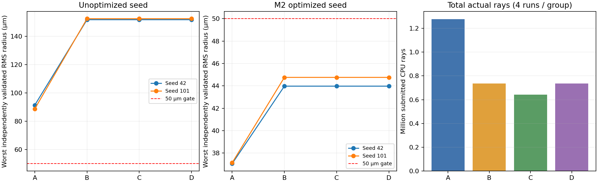

# M6 同预算短程对照（2026-10-27）

本轮 16 次探索已全部完成；每组 4 个配对案例，均有 2 个案例保留达标处方，最少达标片数均为 3。这里的成功包含起点本来已达标的情况，**不能宣称从未达标起点自动设计成功，也没有证明达标减片**。

A 为固定片数连续优化；B 为增删但跳过近轴恢复；C 增加近轴恢复；D 再增加渐进删除补救。拆并、材料与面型分支在四组全部关闭，连续变量权限相同。

两个任务分别为未优化三片和 M2 优化三片终点，均固定实际像面。各取种子 42、101，对每面曲率施加确定性 ±0.1% 扰动，同一配对起点指纹一致。原目标保持 50 mm、F/12.5、0–5°、RGB、RMS≤50 µm、最大半径≤150 µm、畸变≤3%、有效光线≥98%。训练使用相同 3 视场方向采样、1×8 瞳和 8 点面型；独立终验仍为正式 21 视场、10×32 瞳、边界/中心与64点面型，未降采样。

每次共同上限：6 次决策、600 函数尝试、100 梯度尝试、200万真实追迹（单阶段40万、终验预留20万）、60秒；局部4/全目标8更新、一阶恢复150函数。各组实际工作不同，不填充无用工作，也不延长预算。

| 组 | 有达标归档的案例 | 新增达标候选（排除种子） | 最少达标片数 | 函数总数 | 梯度总数 | 追迹总数 | 恢复成功/尝试 | 渐进触发案例 |
| --- | --- | --- | --- | --- | --- | --- | --- | --- |
| A | 2/4 | 4 | 3 | 244 | 216 | 1278960 | 0/0 | 0 |
| B | 2/4 | 0 | 3 | 174 | 158 | 736020 | 0/0 | 0 |
| C | 2/4 | 2 | 3 | 1092 | 130 | 642780 | 8/12 | 0 |
| D | 2/4 | 2 | 3 | 1198 | 158 | 736020 | 10/14 | 2 |

新增候选数包含同一三片拓扑的不同连续优化终点，不等于独立成功案例数。A 每个案例连续做六次满目标阶段，而 B/C/D 还支付结构决策、局部补偿和恢复的成本；相同上限下不能把更新步数当作相等计算量。

| 任务 | 种子 | 组 | 排序首选候选片数 | 焦距 mm | F 数 | 最差 RMS µm | 最低有效比例 | 达标 | 函数 / 梯度 / 追迹 |
| --- | --- | --- | --- | --- | --- | --- | --- | --- | --- |
| unoptimized | 42 | A | 3 | 49.032080 | 12.258020 | 91.390 | 100.00% | 否 | 61 / 54 / 319740 |
| unoptimized | 42 | B | 3 | 49.082618 | 12.270655 | 151.731 | 100.00% | 否 | 41 / 37 / 183630 |
| unoptimized | 42 | C | 3 | 49.082618 | 12.270655 | 151.731 | 100.00% | 否 | 217 / 23 / 137010 |
| unoptimized | 42 | D | 3 | 49.082618 | 12.270655 | 151.731 | 100.00% | 否 | 217 / 23 / 137010 |
| unoptimized | 101 | A | 3 | 49.047339 | 12.261835 | 88.743 | 100.00% | 否 | 61 / 54 / 319740 |
| unoptimized | 101 | B | 3 | 49.108284 | 12.277071 | 152.438 | 100.00% | 否 | 41 / 37 / 183630 |
| unoptimized | 101 | C | 3 | 49.108284 | 12.277071 | 152.438 | 100.00% | 否 | 217 / 23 / 137010 |
| unoptimized | 101 | D | 3 | 49.108284 | 12.277071 | 152.438 | 100.00% | 否 | 217 / 23 / 137010 |
| m2-endpoint | 42 | A | 3 | 49.571613 | 12.392903 | 37.048 | 100.00% | 是 | 61 / 54 / 319740 |
| m2-endpoint | 42 | B | 3 | 49.592152 | 12.398038 | 43.972 | 100.00% | 是 | 46 / 42 / 184380 |
| m2-endpoint | 42 | C | 3 | 49.592152 | 12.398038 | 43.972 | 100.00% | 是 | 329 / 42 / 184380 |
| m2-endpoint | 42 | D | 3 | 49.592152 | 12.398038 | 43.972 | 100.00% | 是 | 382 / 56 / 231000 |
| m2-endpoint | 101 | A | 3 | 49.570282 | 12.392571 | 37.129 | 100.00% | 是 | 61 / 54 / 319740 |
| m2-endpoint | 101 | B | 3 | 49.619360 | 12.404840 | 44.757 | 100.00% | 是 | 46 / 42 / 184380 |
| m2-endpoint | 101 | C | 3 | 49.619360 | 12.404840 | 44.757 | 100.00% | 是 | 329 / 42 / 184380 |
| m2-endpoint | 101 | D | 3 | 49.619360 | 12.404840 | 44.757 | 100.00% | 是 | 382 / 56 / 231000 |

首选按原搜索评分与达标状态排序，不额外按本报告的 RMS 重新挑选。数值均来自共享 Core 的独立终验；通光列只表示积分瞳有效比例，边界、畸变、制造等仍须全部通过。

未优化任务：A 的最差 RMS 为 88.743–91.390 µm，B/C/D 为 151.731–152.438 µm，全部高于50 µm。小预算下固定拓扑把更多工作用于持续优化，不能据此推断结构搜索在长程预算一定更差。

M2 终点任务：起点本来已通过；A 改善至37.048–37.129 µm，B保留种子43.972–44.757 µm，C/D额外归档的三片候选仍通过但评分低于种子。C相较B有更多恢复工作和额外合格终点，未获得合格二片。D在两案例触发0.7档过渡，随后 `TransitionRejected`，没有走完五档实体删除，也没有降低达标片数。失败本身保留，不能视为该规格无解。

每次运行的原计划、全谱系、所有拒绝/预算阶段、真实工作账和校验检查点位于对应子目录；所有归档处方均导出STAROPT并由Core读回复核。`summary.json`保留协议与二进制SHA-256。16份检查点实际保存后由C#存储器加载并比对完整身份；报告脚本补查同任务/种子输入、预算、训练配置一致，终点无在途阶段，逐事件追迹总和一致。

计时只供定位成本：串行跑16次，但首次JIT预热及部分后台测试重叠，共享CPU负载未隔离，不作性能排名。两种子和两个相近三片任务是探索性证据，不是代表性达标率、统计优越性、GPU配额、外部光学认证或完整2001+3001训练。

## 复现

```powershell
dotnet run --project labs/InitialStructure/tools/OpticalSystemDesign.InitialStructure.Benchmarks -c Release -- --topology-m6 labs/InitialStructure/benchmarks/autonomous-topology-v1/comparison-m6.json <新的输出目录>
```


