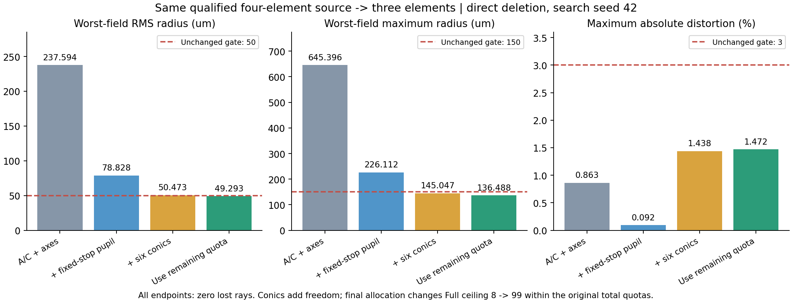

# 指定合格四片4→3恢复修复与同总预算短程对比

日期：2026-10-27。已完成。只用用户上一轮已达标四片，直接路线在原总配额内得到合格三片；成功需要补齐固定光阑的瞳倍率恢复、六个锥常数自由度及阶段额度重新分配。渐进路线仍失败。所有准备、对照、失败、检查点和额外诊断分别保留，不能把多轮成本拼为单次成功。

## 最终处方和原门槛

起点是[上轮固定接续合格四片](../wide21-gates-repair/fixed-repair/joint/qualified.staropt)，SHA256为`a84d87ad8b5a2e2b640c4e7b5bca2e4e98383070e9eab6cdd638a3665573b546`；不是同轮另一原起点联合四片，也未对源处方施加种子扰动。原始库处方来源为US02432387-1；本次从已交付物理合格解开始。

| 正式物理评价 | 合格四片起点 | 合格三片终点 | 原门槛 |
| --- | ---: | ---: | --- |
| 片数 | 4 | 3 | 原结构允许1–8片 |
| 焦距/mm | 25.123093 | 25.012716 | 25.462945±2% |
| F数 | 3.402415 | 3.402845 | 3.341594±2% |
| 最坏视场RMS半径/µm | 47.414336 | 49.292572 | ≤50 |
| 最坏视场最大半径/µm | 149.893620 | 136.488028 | ≤150 |
| 最大绝对畸变/% | 2.999853937 | 1.472027483 | ≤3 |
| 全35视场积分有效光线 | 各960/960 | 各960/960 | 原通光门槛 |
| 全35视场独立中心/边界检查 | 各99/99 | 各99/99 | 原通光门槛 |
| 制造/结构违规 | 0 | 0 | 原始全部约束 |

评价复用共享C# Core：35视场、三波长、10×32面积积分瞳及独立33条检查/波长，最大半径关于相同积分质心，检查不进入RMS。积分光线总计33,600、检查3,465，全部有效；实际追迹计数还包含瞄准/恢复尝试，不能等同这些样本数。21°半视场、原各面通光/机械口径、独立光阑位置与半径、像面/参考平面、光谱、真实材料和验收标准全部保持。

删除原第三片SF18，保留SK4/SK4/LAK09。补偿改变曲率、原±0.25mm位置窗口中的前后面位置及六个锥常数，不启用r4或更高多项式。位置窗口以每次结构试验起点为锚，Local/Full不重新居中。成功处方F数相对原目标+1.832994%，焦距-1.768173%，未缩口径或更改目标。RMS余量仅0.707428µm，尚未验证制造容差或多处方稳健性。

- [合格三片STAROPT，seed42](allocation-runs/four-to-three-42-C-allocated/trial-2.staropt)
- [同输入seed101合格三片](allocation-runs/four-to-three-101-C-allocated/trial-2.staropt)
- [可载入的新任务计划](allocation-runs/four-to-three-42-C-allocated/task.topology-plan.json)；[完整搜索检查点](allocation-runs/four-to-three-42-C-allocated/run.autonomous.json)
- [逐视场native回读记录](native-audit/native-audits.json)；[输入、权限、配额、梯度和账目核验](verification.json)

## 恢复失败的具体原因及修复

1. **有限差分占用恢复次数，且部分方向撞边厚约束。** 四种真实删除的旧150函数恢复中，删第一/二/四片分别有131/126/127次差分探测，仍未恢复；原第三片可以恢复但需80函数、72差分。共享Core增加固定平面ABCD自动导数，泛型信赖域支持传入当前点Jacobian；同一第三片恢复变为8函数、零差分，A/C终点保持原容差。函数/矩阵/Jacobian和失败几何探测照计，未把矩阵自动导数隐匿为零成本。边厚等硬约束不绕过；其他删除当前失败不等于物理无解。
2. **可选密集检查抢占补偿预算。** 以前只保护Local后的可选检查，恢复后的可选检查仍可耗尽训练追迹。新显式保护在完整检查额度不能预约时零光学计费延后该次，准确进入Local，再进入Full；最终独立物理验收和80万预留保持。相关回归捕获并修复了开发期间曾跳过Local的阶段衔接错误；早期失败测试日志也保留。
3. **恢复A/C不能守住独立光阑下的F数。** 旧直接删除三片可恢复A/C且零失光，但F约3.809，RMS约237.6µm、最大约645.4µm。固定光阑位置不变仍会因前组变化改变入口瞳倍率。新增父逆F的第三个一阶恢复目标，归一化残差为`parentF/childF-1`，导数和主波长定义均由Core返回。恢复阶段也可显式使用已准许的轴向窗口。修正后F回门槛，RMS78.828241µm/最大226.111795µm，仍失败；不能把一阶恢复成功当成像质合格。
4. **原曲率/位置权限与8次Full更新不足以达标。** 单独开放六个锥常数[-2,2]（沿用已有面型界限），原曲率/轴向界限不变，无结构面型分支，直接路线RMS50.472853µm、最大145.047326µm，只有RMS未过。锥常数是新增面型自由度，不能称为纯算法改进或仍为纯球面三片。
5. **无需改写v4接受规则。** 对上述终点的独立提议诊断，完整/半步使综合训练约束恶化；1/4步及更小步可被原v4接受。没有证据支持“过滤误拒”。失败来自Full8更新上限先到，而原总额/阶段追迹仍剩余。最终单独冻结分配对照，允许Full继续使用这些原有剩余额度后达标。

[四删除初始诊断](prepared/preparation.json)、[过滤提议诊断](filter-audit/filter-audit.json)、[原恢复80→8证据](final-test-evidence/recovery-probes.json)分别保留。

## 配对设计和公平预算边界

全部单次都从相同合格四片开始：两搜索种子42/101、直接C/加渐进D；关闭插入/拆并/换材/结构面型分支，仅聚焦4→3。此操作选择在所有模式相同，不改变结构或物理验收约束。两个种子未扰动输入几何，不能作为两份独立处方或统计成功率。

| 批次 | 变化 | 次数 | 合格三片 |
| --- | --- | ---: | ---: |
| [原恢复/预算/AD/位置](paired-runs/frozen-protocol.json) | control、budget、automatic、axial ×42/101×C/D | 16 | 0 |
| [瞳倍率恢复](pupil-runs/frozen-protocol.json) | pupil ×42/101×C/D，引用前批axial对照 | 4 | 0 |
| [锥常数补偿](conic-runs/frozen-protocol.json) | conic ×42/101×C/D，引用pupil对照 | 4 | 0 |
| [利用剩余阶段额度](allocation-runs/frozen-protocol.json) | allocated ×42/101×C/D，引用conic对照 | 4 | 2，均为直接C |

每批协议在运行前冻结，汇总记录协议和四个实际二进制SHA。后续诊断形成独立新批，不覆盖旧失败，也不将28次称为使用同一二进制或一次预算。各批具体终点及全部运行量见下表/原始汇总。

共同总上限：6决策、600函数、100次固定光学目标梯度、2,000,000次实际追迹、60秒；恢复150函数/30接受步，Local4，阶段追迹400,000，最终验收预留800,000。训练始终4×16、独立边界/最大统计、v4接受规则，正式验收同上。矩阵导数计入函数/矩阵/Jacobian，不占原定义为固定光学目标的`GradientEvaluations`；额外瞳调用单独`PupilEvaluations`。

最终allocated唯一阶段分配变化：Full提议上限8→99、段函数/梯度上限9→100，仍受原全局100梯度/600函数/200万追迹/60秒及原阶段40万限制。不能称与旧Full8相同段预算。成功单次实耗：

| 阶段 | 函数 | 光线梯度 | 实际追迹 | 结果 |
| --- | ---: | ---: | ---: | --- |
| 四片起点正式验收 | 1 | 0 | 446,064 | 合格 |
| 第一/二/三删除恢复合计 | 130 | 0 | 0 | 前两失败、第三恢复成功 |
| 两次可选检查 | 0 | 0 | 0 | 延后，Local及最终验收保留 |
| Local | 5 | 5 | 84,902 | 2次接受更新 |
| Full | 24 | 24 | 400,000 | 13次接受更新后阶段追迹截断 |
| 三片独立终验 | 1 | 0 | 425,420 | 合格 |
| **单次合计** | **161** | **29** | **1,356,386** | **4→3通过** |

另记71次矩阵、68次矩阵Jacobian、零差分；seed42总墙钟31.770秒，seed101为16.111秒。共享电脑负载不同，不能推断提速比例。记录最终状态`BudgetExhausted`指下一分支无法预约完整工作，已达标三片留在`AcceptedArchive`，不是未验证的训练快照。渐进最终两次均未通过，保留较差终点/恢复失败及预算截断。

## 验证、成本及保留边界

- 94/94定向后台CPU/离屏回归：自主92、共享Core统计2，无跳过；[自主TRX](tests/focused.trx)、[Core TRX](tests/core-metric.trx)。包括阶段衔接、零计费延后、停止续跑持久化、旧null身份、边厚/保护、原轴向窗口和禁止释放目标片、锥常数独立于结构分支。
- 四种删除×剩余12曲率/位置列×ABCD/逆F共240导数值与中心差分比较，最大绝对差6.73e-9；六锥常数的光斑/约束导数最大差3.28e-9。[逐列证据](final-test-evidence/matrix-element-001.json)、[锥常数](final-test-evidence/conic-gradients.json)。这是数值求导一致性，不增加外部精度认证。
- 8项native审计记录中，2项与已验光学指纹相同而显式复用，6项重新回读并完整Core验收，共额外2,473,788追迹。所有可用终点的逐场RMS/最大/畸变/有效数及焦距/F数与原记录吻合；合格三片无违规。
- 28次搜索总计37,367,812追迹；源准备446,064、过滤诊断136,604、native审计2,473,788另列，定向测试也不合并到搜索预算。28次单次均未超过总函数/梯度/追迹和配置60秒。最终成功运行已经重新计入自己的四片初验，无复用未计费物理评价。
- 默认App及证据工具Release构建0警告/0错误，定向源格式及差异检查通过；[App日志](build-app.log)、[工具日志](build-final-runner.log)、[格式日志](format.log)。
- 仅后台CPU两处理器、低优先级运行，无窗口启动/前台输入/GPU/完整精修/全仓测试/提交推送。Python仅处理离线证据/绘图；产品全部光学计算仍为共享C# Core。原AutoLens长训练保持停止，UpstreamE58未改。
- 新恢复、瞳倍率、锥常数开关为显式可空计划字段，普通新示例未自动启用；旧null行为/指纹保持。局部秩不足、恢复步数耗尽及受约束方向失败不证明物理无解。仅本处方/直接路线在新增锥常数和原总配额分配内成功，未认证原球面权限、其他处方、渐进路线或容差稳健性。

复核命令（读取已有证据，不运行训练）：`python validation/rechecks/2026-10-27/four-to-three-recovery/verify.py`。冻结协议位于[laboratory benchmark目录](../../../../labs/InitialStructure/benchmarks/autonomous-topology-v1/four-to-three-recovery-20261027.json)，可复跑时必须使用新的输出目录，工具拒绝覆盖既有证据。

## 全部28次结果

下表的RMS/最大只展示已完成物理验收的三片候选；无三片终点时写“无完整三片”，不能用未评完或过渡四片代替。F/G分别指函数/固定目标光线梯度。所有失败的完整原因、各阶段试验/提议/违规和处方保存在对应检查点；各目录含已导出的`best-failed.staropt`（若有未合格候选）。

| 单次记录 | 状态 | 三片RMS/最大 µm | 合格减片 | F/G/追迹 |
| --- | --- | ---: | --- | ---: |
| [42-C-control](paired-runs/four-to-three-42-C-control/run.autonomous.json) | BudgetExhausted | 237.668035/645.483008 | 否 | 397/14/1,479,264 |
| [42-C-budget](paired-runs/four-to-three-42-C-budget/run.autonomous.json) | Completed | 237.668035/645.483008 | 否 | 546/14/1,075,560 |
| [42-C-automatic](paired-runs/four-to-three-42-C-automatic/run.autonomous.json) | Completed | 237.668035/645.483008 | 否 | 186/14/1,075,588 |
| [42-C-axial](paired-runs/four-to-three-42-C-axial/run.autonomous.json) | Completed | 237.594117/645.396008 | 否 | 168/14/1,075,560 |
| [42-D-control](paired-runs/four-to-three-42-D-control/run.autonomous.json) | BudgetExhausted | 无完整三片 | 否 | 599/14/1,199,920 |
| [42-D-budget](paired-runs/four-to-three-42-D-budget/run.autonomous.json) | BudgetExhausted | 无完整三片 | 否 | 599/14/1,150,720 |
| [42-D-automatic](paired-runs/four-to-three-42-D-automatic/run.autonomous.json) | BudgetExhausted | 264.471924/705.300293 | 否 | 204/18/1,603,688 |
| [42-D-axial](paired-runs/four-to-three-42-D-axial/run.autonomous.json) | BudgetExhausted | 264.379686/705.157494 | 否 | 191/18/1,603,656 |
| [101-C-control](paired-runs/four-to-three-101-C-control/run.autonomous.json) | BudgetExhausted | 237.668035/645.483008 | 否 | 397/14/1,479,264 |
| [101-C-budget](paired-runs/four-to-three-101-C-budget/run.autonomous.json) | Completed | 237.668035/645.483008 | 否 | 546/14/1,075,560 |
| [101-C-automatic](paired-runs/four-to-three-101-C-automatic/run.autonomous.json) | Completed | 237.668035/645.483008 | 否 | 186/14/1,075,588 |
| [101-C-axial](paired-runs/four-to-three-101-C-axial/run.autonomous.json) | Completed | 237.594117/645.396008 | 否 | 168/14/1,075,560 |
| [101-D-control](paired-runs/four-to-three-101-D-control/run.autonomous.json) | BudgetExhausted | 无完整三片 | 否 | 599/14/1,199,920 |
| [101-D-budget](paired-runs/four-to-three-101-D-budget/run.autonomous.json) | BudgetExhausted | 无完整三片 | 否 | 599/14/1,150,720 |
| [101-D-automatic](paired-runs/four-to-three-101-D-automatic/run.autonomous.json) | BudgetExhausted | 264.471924/705.300293 | 否 | 204/18/1,603,688 |
| [101-D-axial](paired-runs/four-to-three-101-D-axial/run.autonomous.json) | BudgetExhausted | 264.379686/705.157494 | 否 | 191/18/1,603,656 |
| [42-C-pupil](pupil-runs/four-to-three-42-C-pupil/run.autonomous.json) | Completed | 78.828241/226.111795 | 否 | 148/14/1,099,400 |
| [42-D-pupil](pupil-runs/four-to-three-42-D-pupil/run.autonomous.json) | BudgetExhausted | 123.569438/368.717565 | 否 | 203/17/1,618,084 |
| [101-C-pupil](pupil-runs/four-to-three-101-C-pupil/run.autonomous.json) | Completed | 78.828241/226.111795 | 否 | 148/14/1,099,400 |
| [101-D-pupil](pupil-runs/four-to-three-101-D-pupil/run.autonomous.json) | BudgetExhausted | 123.569438/368.717565 | 否 | 203/17/1,618,084 |
| [42-C-conic](conic-runs/four-to-three-42-C-conic/run.autonomous.json) | Completed | 50.472853/145.047326 | 否 | 148/14/1,109,424 |
| [42-D-conic](conic-runs/four-to-three-42-D-conic/run.autonomous.json) | BudgetExhausted | 67.660403/210.652835 | 否 | 204/18/1,620,740 |
| [101-C-conic](conic-runs/four-to-three-101-C-conic/run.autonomous.json) | Completed | 50.472853/145.047326 | 否 | 148/14/1,109,424 |
| [101-D-conic](conic-runs/four-to-three-101-D-conic/run.autonomous.json) | BudgetExhausted | 67.660403/210.652835 | 否 | 204/18/1,620,740 |
| [42-C-allocated](allocation-runs/four-to-three-42-C-allocated/run.autonomous.json) | BudgetExhausted | 49.292572/136.488028 | 是 | 161/29/1,356,386 |
| [42-D-allocated](allocation-runs/four-to-three-42-D-allocated/run.autonomous.json) | BudgetExhausted | 155.725935/467.716616 | 否 | 215/29/1,615,916 |
| [101-C-allocated](allocation-runs/four-to-three-101-C-allocated/run.autonomous.json) | BudgetExhausted | 49.292572/136.488028 | 是 | 161/29/1,356,386 |
| [101-D-allocated](allocation-runs/four-to-three-101-D-allocated/run.autonomous.json) | BudgetExhausted | 155.725935/467.716616 | 否 | 215/29/1,615,916 |
