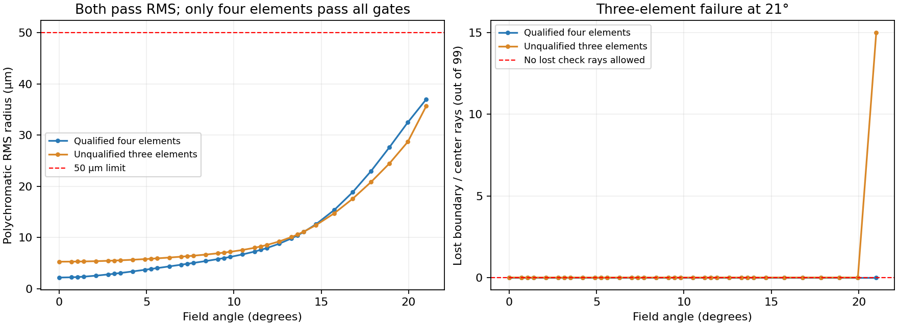

# 低F数、大视场代表处方减片复验（2026-10-27）

本轮没有得到原完整门槛下的合格减片结果。此前F/12.5、5°任务的单片结论不能直接推广。五份库中原处方的物理评测副本都未形成合格减片起点；另取本轮短程中已合格的四片结果，真正执行4→3，三片RMS虽达标，但21°边界失光仍未通过。

共完成**72次有界运行：40次原分配、24次同总预算的验收分配控制、8次合格起点闭环**。搜索状态为68次Completed、4次BudgetExhausted；Completed只表示调度结束，不能当作光学验收完成。所有失败、未评完和在途检查点保留，没有为了得到成功放宽目标或追加长训练。

## 输入与范围

先按固定F数/视场/片数分箱在库中48份候选作零追迹结构预检：0份可原样导入、47份因当前适配器不支持的字段/口径等状态拒绝、1份有限物距拒绝。16份无限远、独立平面光阑且空气分离的候选进入显式物理副本准备，其中10份通过，6份的接口/特征/间距等失败保留在[`prepared/preparation.json`](prepared/preparation.json)。

评测副本冻结编辑器评价行、变量/求解和OPD参考；原几何、材料、坐标、光谱和视场保持。入口瞳或F数定义由共享Core近轴光线校准为实体光阑，原一阶焦距/F数变化小于1e-9相对值；原半口径作为明确圆形物理限制，并启用实际瞄准。材料组件指纹须与原快照一致，胶合、倾斜/偏心或不支持的材料等不做近似替代。**这是有记录的物理评测副本，不能称未经修改的原生处方，亦无外部软件认证。** 原native文件SHA持续核对不变，前后快照与输入来源同目录保存。

在任何密集基准结果之前，按结构、F数和视场覆盖冻结以下五份。名称里的标称50mm不作目标，使用Core实际值：

| 任务 | 库中来源 | 片数 | 目标焦距 mm | 目标F数 | 最大半视场 |
| --- | --- | --- | --- | --- | --- |
| compact4 | Symmetric Double Gauss 50 mm | 4 | 24.0891 | 2.4089 | 14° |
| fast6 | US04396255-1 | 6 | 39.9696 | 2.0000 | 28° |
| wide4 | UK565851-2 | 4 | 25.3824 | 2.6298 | 35° |
| imager3-18 | US02270234-1 | 3 | 25.8915 | 4.6334 | 18° |
| imager3-21 | US02298090-1 | 3 | 26.2989 | 4.9304 | 21° |

种子42/101对原五份曲率做固定±0.1%扰动，配对模式的输入完全相同。C直接恢复、D增加渐进删除；legacy保留旧补偿流程，fixed开启阶段独立验收与下降保护。只改变这些预先声明的策略，不增加轴向/材料/面型自由度。曲率边界按原处方量级在预检时冻结，对各配对一致。保留原RGB、各自字段和实际固定像面。

共同上限为**6决策、600函数尝试、100梯度尝试、200万追迹、60秒**；局部4/全目标8更新，训练3视场方向、1×8瞳、8点面型，恢复150函数。统一独立门槛仍是焦距/F数±2%、RMS≤50µm、最大半径≤150µm、畸变≤3%、积分有效光线≥98%，并要求边界/中心检查无失光，以及原制造/几何约束。密集终验仍为每定义视场方向21位置的并集、10×32瞳、33边界/中心、64点面型；实际输入产生35或41等不同数量位置，不减采样。

## 五份原起点结果

| 任务 | 完整起点验收/主要失败 | 是否实际删片 |
| --- | --- | --- |
| compact4 | 20万及80万单次额度均未完整评完；已发现空气隙冲突、光斑超限，保留部分结果 | 未触发；起点未合格 |
| fast6 | 曲面剖面导数奇异/超定义域，几何检查中止；未进入正式光线评价 | 未触发；起点未合格 |
| wide4 | 完整验收失败：种子42最差RMS230.394µm、最大半径1799.049µm、最低有效比例94.063%，并有畸变及边界失败 | 未触发；起点未合格 |
| imager3-18 | 80万分配下完整验收：RMS46.465µm通过，但18°最大半径223.794µm超150µm；短程优化后仍216.183µm | 未触发；起点未合格 |
| imager3-21 | 80万分配下完整验收：RMS35.763µm、积分有效比例98.646%通过，但21°边界/中心99条中损失15条 | 未触发；起点未合格 |

表中详细数值取种子42，两个种子原始数据均保留。这五份不是五个已经合格的镜头，因此不能把它们归纳成五次“合格镜头删片失败”。对不合格父结构，当前搜索先连续补偿，随后可能尝试增片；本轮没有修改该调度规则。

首轮每次密集验收预留20万追迹，三个任务因瞄准/追迹成本在全部视场完成前耗尽，不能用其部分RMS作终点认证。另事先冻结24次**分配控制**，仅对这三组把原200万总额中的终验预留改成80万，其余目标、采样、上限、源和种子不变。它不是原20万分配下的成功，不能混为一张同配置成功率表；compact4仍未评完，且已存在制造冲突。原40次和后24次分别保留。

## 从真正合格四片出发的4→3控制

imager3-21在已记录的短程中通过**增片**得到合格四片。使用固定C/种子42的首份合格四片为新的起点，另冻结8次C/D×legacy/fixed×42/101闭环，仍保持200万总额/60秒和80万验收分配。这个起点的准备成本已在先前24次中记录，不能把两段当成一次预算；四片成功也不能冒充原三片的减片成功。此组不再扰动几何，两个种子只改变搜索随机流，结果相同，不当作独立镜头样本。

| 阶段/模式（种子42、C） | 片数 | 焦距 mm | F数 | 最差RMS µm | 最大半径 µm | 积分有效比例 | 21°边界/中心 | 全部门槛 |
| --- | --- | --- | --- | --- | --- | --- | --- | --- |
| 合格起点 | 4 | 26.320482 | 4.911866 | 36.969 | 133.315 | 100.000% | 99/99 | 通过 |
| legacy删片后 | 3 | 26.238881 | 4.920207 | 36.155 | 89.643 | 98.646% | 84/99 | 失败 |
| fixed删片后 | 3 | 26.306431 | 4.932803 | 35.642 | 94.347 | 98.646% | 84/99 | 失败 |

因此当前明确的减片失败原因是**大视场边缘失光，而非RMS超限**。修复策略的三片RMS35.642µm虽优于合格四片的36.969µm，仍有15条独立边界/中心检查失败。积分瞳947/960=98.646%通过98%门槛，也不能抵消独立边界硬门槛。另一个legacy三片分支最差RMS190.175µm且F数/最大半径越限；其他直接恢复和渐进分支失败完整保留。没有找到可直接推广前轮单片成功的证据。

| 合格起点模式 | 各4次状态 | 每次实际函数（C/D） | 每次梯度 | 每次实际追迹 | 最少合格片数 | 合格减片 |
| --- | --- | --- | --- | --- | --- | --- |
| legacy | 4次调度结束 | 284 / 434 | 28 | 1232500 | 4 | 0/4 |
| fixed | 4次预算预约不足，后续分支未完成 | 195 / 345 | 6 | 1610216 | 4 | 0/4 |

fixed四次保留了合格四片，但预算预约不足以再保证下一分支的完整验收，保存为BudgetExhausted，待恢复阶段为Recovery。实际约161万小于200万，因为剩余约39万不足既定80万验收预留，不能把这四次写成全部分支跑完。密集阶段复验在更大视场下成本明显增加，探索次数受到压缩；这项限制保留，不追加预算。

合格四片和失败三片都已导出STAROPT，并重新导入后用原完整协议复算，合格/失败与唯一`field:34:check-lost`均复现；额外审计追迹825296单独记录，不混入搜索预算。可直接检查[合格四片](native-failure-audit/qualified-source.staropt)、[明确未达标三片](native-failure-audit/unqualified-reduced.staropt)及[逐视场结果](native-failure-audit/native-checks.json)。



## 验证和复现

[`verification.json`](verification.json)核对72份检查点的函数/梯度/光线账、所有总上限、无在途预约、归档无过渡片、原源文件不变、各配对目标/权限一致、相同计算二进制，以及分配控制输入与首轮一致。每次运行器已用C#存储器读取并比对完整终点身份。全部0个合格减片结果，没有选择性隐藏失败。

所有运算串行、进程BelowNormal、DOTNET_PROCESSOR_COUNT=2；没有GPU、真实窗口或键鼠操作。搜索累计追迹43105800，最长实际搜索14.305秒，逐次消耗在汇总中；不同阶段/重采样/失败均计费。准备、原文件导入和追加native审计另列，不宣称隔离的速度对比。

只新增开发评测运行器、冻结输入与文档，生产Core/优化算法未改，不重跑全仓或旧长训练。首次从检查点派生新冻结输入时缺少字符串枚举转换，读取阶段中止、未开始训练；已补齐数字/字符串枚举读取，原失败日志和空输出目录保留，没有重复执行那8次。运行器Release构建、定向格式和文档检查日志同目录。

三个阶段的机器汇总分别为[原分配40次](runs/summary.json)、[分配控制24次](allocation-control/summary.json)、[合格起点8次](qualified-control-verified/summary.json)；[全部失败和指标](combined-results.json)便于后续分析。下一步需要优先处理边缘通光与可用自由度，并取得能先通过严格基准的低F数处方；本轮不能认定这些规格无解，也未认证全局最优或外部数值一致。

```powershell
$env:DOTNET_PROCESSOR_COUNT = '2'
dotnet build labs/InitialStructure/tools/OpticalSystemDesign.InitialStructure.Benchmarks -c Release --no-restore -m:1
dotnet labs/InitialStructure/tools/OpticalSystemDesign.InitialStructure.Benchmarks/bin/Release/net10.0/OpticalSystemDesign.InitialStructure.Benchmarks.dll --reduction-representative labs/InitialStructure/benchmarks/autonomous-topology-v1/representative-reduction-20261027.json <新原分配目录>
dotnet labs/InitialStructure/tools/OpticalSystemDesign.InitialStructure.Benchmarks/bin/Release/net10.0/OpticalSystemDesign.InitialStructure.Benchmarks.dll --reduction-representative labs/InitialStructure/benchmarks/autonomous-topology-v1/representative-allocation-20261027.json <新分配控制目录>
dotnet labs/InitialStructure/tools/OpticalSystemDesign.InitialStructure.Benchmarks/bin/Release/net10.0/OpticalSystemDesign.InitialStructure.Benchmarks.dll --reduction-representative labs/InitialStructure/benchmarks/autonomous-topology-v1/representative-qualified-20261027.json <新合格起点目录>
```
