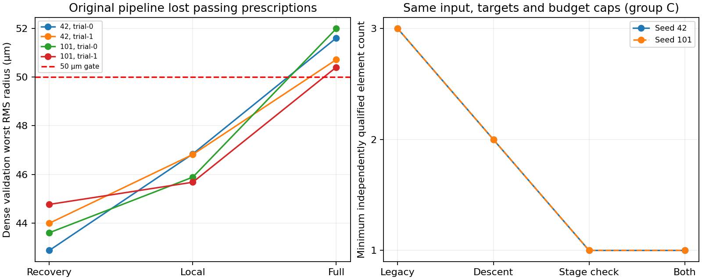

# 减片终点丢失：原因、修复和短程验证（2026-10-27）

在原M6相同目标、种子和预算上限下，修复后两种种子的C/D策略均保留了合格二片，并找到了合格单片。**原来的“减片不达标”在这些案例中主要是丢失已达标阶段终点，不能解释为必须继续长精修或镜片数不可减少。** 这是50mm、F/12.5、半视场5°的这一个三片起点任务；不代表原AutoLens手机F/1.8六片任务或普遍减片成功率。

## 原因证据

[`audit/phase-audit.json`](audit/phase-audit.json)由共享Core重新独立验收M6原记录的恢复/局部/全目标阶段，共34个阶段。原始M6记录未覆盖或重写。

| 种子 | 删片分支 | 恢复后最差RMS µm | 局部补偿后 µm | 全目标补偿后 µm | 原流程结果 |
| --- | --- | --- | --- | --- | --- |
| 42 | trial-0 | 42.8853 | 46.8445 | 51.6000 | 最后RMS越限，合格中间终点未留存 |
| 42 | trial-1 | 44.0008 | 46.8209 | 50.7142 | 最后RMS越限，合格中间终点未留存 |
| 101 | trial-0 | 43.6107 | 45.8912 | 51.9861 | 最后RMS越限，合格中间终点未留存 |
| 101 | trial-1 | 44.7738 | 45.6838 | 50.4034 | 最后RMS越限，合格中间终点未留存 |

四个恢复终点和局部终点都通过原全部门槛，最后仅RMS超50µm；焦距、F数、通光等已经合格。原调度无条件继续补偿、只在最后独立验收，因而把可行二片判成失败。D的0.7过渡也出现恢复43.969/44.748µm可行、最后52.122/52.507µm失败的相同现象。

第二个问题是固定拓扑优化仅检查数值有限，就接受目标函数上升的Adam提议。下降保护对此有效，但**稀疏训练目标下降仍可能使密集验收RMS变差**：目标函数同时把已容差合格的焦距/F数推向精确目标，和各视场像质存在实际取舍；不能把加权训练损失当验收。没有发现需要修改Core追迹、光斑定义或梯度公式的证据。

## 修复范围

- 新计划`CheckStageFeasibility=true`：恢复及局部补偿后先完整独立验收。原全部门槛已通过则结束该分支并归档，避免强制后续补偿破坏合格解；未通过再继续补偿。过渡片仅在除过渡标记外全部门槛通过时推进日程，绝不进入候选/达标归档。
- 阶段验收是持久化预约的独立阶段，函数、光线、时间全部计费，不借用最终验收预留；取消、同阶段恢复、未知在途计费和身份校验保持。新增事件保留正式Assessment，失败也可复查。
- 新阶段`RequireDescent=true`：有限但上升的提议实际计费后拒绝，缩短步长并清理该拒步状态；取消续跑复现相同坐标与矩。
- 新示例默认开启；两个可空开关及新字段在空值时不序列化，原M4/M5/M6记录仍按原策略与身份恢复。未改变UpstreamE58、Core光学或旧2001+3001协议，未恢复旧训练。

## 冻结的16次配对结果

协议为[reduction-repair-20261027.json](../../../../labs/InitialStructure/benchmarks/autonomous-topology-v1/reduction-repair-20261027.json)：M6同一M2起点、42/101、C/D、四种修复组合；每次6决策、600函数、100梯度、200万追迹、40万单阶段、20万终验预留、60秒；局部4/全目标8更新。原50mm/F12.5、50µm RMS、150µm最大光斑、3%畸变和98%有效比例均不变，完整终验21视场、10×32瞳、边界/中心、64点面型与RGB不变。

| 模式 | 完成 / 达预算 | 保留合格二片案例 | 保留合格单片案例 | 函数总数 | 梯度总数 | 实际追迹总数 | 上升提议拒绝数 |
| --- | --- | --- | --- | --- | --- | --- | --- |
| legacy | 4 / 0 | 0/4 | 0/4 | 1422 | 196 | 830760 | 0 |
| descent-only | 2 / 2 | 4/4 | 0/4 | 2396 | 112 | 551040 | 44 |
| feasibility-only | 4 / 0 | 4/4 | 4/4 | 1288 | 0 | 712320 | 0 |
| both | 4 / 0 | 4/4 | 4/4 | 1288 | 0 | 712320 | 0 |

C/D共享相同两个种子起点，4案例不是4个独立任务。下降保护单独运行中D两次达到总函数预算，仍保留已认证二片，未完成的剩余分支保留。阶段验收单独开启与两项都开启的结果一致，因这些可行恢复终点直接通过，梯度预算实际消耗为0；所以单片收益应归因于阶段验收，不能归因于下降保护。全部模式同上限、同初值，允许真实实耗不同；没有补跑更多更新或为成功放宽门槛。

| 种子 | C/D两项开启的最少片数 | 焦距 mm | F数 | 最差RMS µm | 积分瞳有效比例 | 全部门槛 |
| --- | --- | --- | --- | --- | --- | --- |
| 42 | 1 | 49.591999 | 12.398000 | 43.4011 | 100.00% | 通过 |
| 101 | 1 | 49.619207 | 12.404802 | 44.1374 | 100.00% | 通过 |

全部归档经Core STAROPT往返校验。最少片数的四份本地STAROPT另行重新导入为新拓扑，再用原目标完整验收，4/4通过，见[`export-checks.json`](export-checks.json)，额外审计追迹178080单独记录，未混入搜索预算。这里的native export指原生文件格式，不是Windows桌面交互。

逐次运行、全谱系、拒绝、预算消耗和二进制/输入指纹见[`paired-runs/summary.json`](paired-runs/summary.json)及各子目录校验记录；对照时二进制身份不因随后示例默认值、验证工具或格式整理变更而重写。审计代码是开发用C#工具，产品未引入Python运行依赖。

## 验证与限制

新增七项定向用例最终通过：下降拒步及精确续跑、42/101的二片正式归档、阶段检查点保存恢复/未知预约、终验预留和严格失败、过渡可行性/禁发布、新默认与旧M6零追迹读取。最初严格门槛夹具只允许一次决策，实际仅走起点全目标优化，未覆盖结构阶段；修正决策覆盖至原6次上限。还修正格式化后示例默认值插入遗漏；原失败TRX及日志保留。早期诊断启动参数误传日志也保留，未产生优化或修改原数据。

受影响CPU/离屏回归54/54通过（新增7、固定拓扑14、恢复5、自动搜索8、扩展13、桌面7），见`repair-scoped.trx`。默认Release构建结果见`verification.json`及TRX。未重跑全仓、CUDA、旧长训练或外部Zemax验证。所有本轮工作仅后台和离屏执行，未启动窗口、抢焦点或控制键鼠，未提交推送或发布。

仍有限制：局部补偿按前两个曲率而非邻域选参，自动变量集未释放轴向自由度，本轮未同时改变变量空间；阶段内短暂可行点尚未逐步密集验收；中间验收有额外成本，不能承诺所有困难任务都有相同收益。默认D的困难删片/渐进分支仍有恢复失败，不因找到另一路单片而隐去。渐进推进的覆盖另有故意把直接恢复限制为2次的定向测试，不能当作正式实验中完整五档成功证据。单一任务、两个种子不足以证明普遍减片能力或镜片数全局最优。

## 复现

```powershell
dotnet build labs/InitialStructure/tools/OpticalSystemDesign.InitialStructure.Benchmarks -c Release --no-restore -m:1
dotnet labs/InitialStructure/tools/OpticalSystemDesign.InitialStructure.Benchmarks/bin/Release/net10.0/OpticalSystemDesign.InitialStructure.Benchmarks.dll --topology-reduction-audit validation/rechecks/2026-10-27/autonomous-comparison-m6 <新的审计目录>
dotnet labs/InitialStructure/tools/OpticalSystemDesign.InitialStructure.Benchmarks/bin/Release/net10.0/OpticalSystemDesign.InitialStructure.Benchmarks.dll --topology-reduction-compare labs/InitialStructure/benchmarks/autonomous-topology-v1/reduction-repair-20261027.json validation/rechecks/2026-10-27/autonomous-comparison-m6 <新的对照目录>
```


