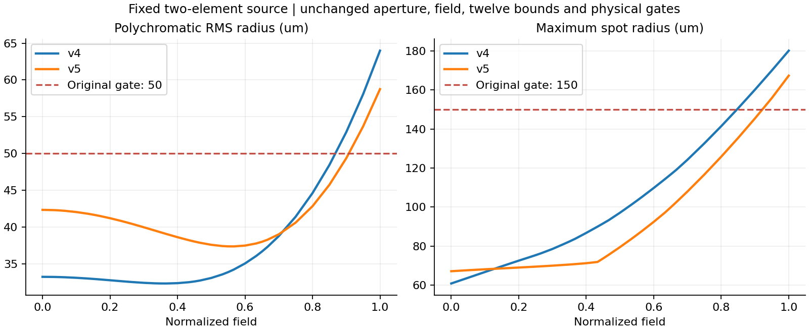

# 两片处方的视场间补偿冲突修复

2026-10-28，完成。使用上一轮指定的最好失败两片，修复求步与实际门槛指标不一致的问题。同预算对照中，原v4零接受更新，新显式v5接受14次；RMS **63.985121→58.752088µm（改善8.1785%）**、最大光斑 **180.146721→167.340368µm（改善7.1088%）**。两项仍超过原50/150µm门槛，**没有合格两片**；原合格三片和两版失败结果全部保留。

## 实际原因及修复范围

本轮源是[第二片优先的失败两片检查点](../three-to-two-continuation/selected-runs/reduce-3-2-42-C-geometry/run.autonomous.json)中的`trial-0`，不是先删第一片、RMS约318µm的另一失败。对这一最好两片重新检查，v4完整步至1/128步均增加实际门槛综合量，而不是此前另一处方的“综合下降、局部视场恶化”。[原v4复查](v4-filter/filter-audit.json)另计137,544追迹。

旧求步先要求所有失败行按共同百分比同时下降；该线性系统不可行时，退回普通最小二乘，使用原始带符号的焦距/F数偏差及已截断的约束Jacobian。实际接受指标却在焦距/F数保护带内没有惩罚，并使用RMS额外内部余量。这使回退优化的指标与接受指标不一致：源焦距/F数归一化偏差为`+0.905867/-0.893607`，都在原±0.95训练保护带内，旧回退仍试图将它们推向零，牺牲尚超限的边缘光斑。

已记录Core切向的方向核验：旧原始约束目标方向斜率为 **−2.731759**，实际门槛指标在裁剪前却为 **+0.050509**、裁剪后为 **+0.049634**，均为上升。另发现旧回退将首面轴向提议到原下界前约2.294µm，需要事后裁剪；这是额外不一致。**本例在裁剪前已经上升，不能把实际失败全部归因为裁剪反转。** [逐提议/受限位置诊断](diagnosis/diagnosis.json)、[数值核验](verification.json)保存完整原始量；裁剪能反转下降的独立合成回归也保留。

新显式`TransmissionPolicyVersion=5`以与接受指标一致的梯度求方向：使用同一Core有符号Jacobian，联合原参数界、原逐行不恶化条件及综合门槛下降条件。已合格行保留原允许范围，超限行允许暂不下降但不能恶化；不再要求每个超限行共同缩减同一百分比，也不在失败后返回未保护的普通最小二乘方向。投影在四个有界下降量、各4096轮内尝试，可取消；无可用下降方向时停止，而不反复提交已知不合适方向。全部使用已计费的同次Jacobian，没有额外光学评价。

**原v4非线性逐行接受规则、训练内部余量、独立物理验收和参数界保持。** v3/v4实现及普通新示例默认v4保持；v5仅显式开启，阶段指纹含版本，旧状态不能静默以v5续跑。自主搜索和桌面共用的执行资格认可显式v5，无旧原型升级、无检查点schema变更。光学值/导数、材料/几何及全部物理验收仍使用共享C# Core；未改Core光学公式或AutoLens。

## 同预算短程终点

两版均从同一已保存两片开始新鲜补偿，不继承上一轮已缩小的步长/矩；之前训练成本另列。严格使用上一轮原12变量的绝对边界，尤其首面`Z≥0`和原前后面±0.25mm窗口，**未按当前已移动处方重新居中**。四曲率、四轴向、四锥常数，尺度和曲率/锥常数原界均不变；没有放开高阶面型、材料、口径、光阑、像面或21°半视场。

| 正式物理量 | v4控制 | v5修复 | 原门槛 |
| --- | ---: | ---: | --- |
| 最坏视场RMS/µm | 63.985121 | 58.752088 | ≤50，均失败 |
| 最大半径/µm | 180.146721 | 167.340368 | ≤150，均失败 |
| 最大绝对畸变/% | 2.939632658 | 2.999702587 | ≤3，均通过 |
| 焦距/mm | 25.009834 | 24.990442 | 25.462945±2%，均通过 |
| F数 | 3.402402 | 3.405715 | 3.341594±2%，均通过 |
| 全35场积分/检查 | 各960/960、99/99 | 各960/960、99/99 | 原通光门槛通过 |
| 制造违规 | 0 | 0 | 原门槛通过 |
| 接受更新 | 0 | 14（Local1/Full13） | 不作为合格依据 |

独立评价仍35场、三波长10×32积分及每波长33条中心/边界检查，RMS/最大关于原积分质心，未改变原畸变定义。训练仍4×16、边界/最大检查及相同Local4/Full99。新鲜补偿的两版输入仅策略版本不同；完整JSON输入/结果可在[原始对照](paired-runs/summary.json)核对。

补偿使用已合格视场在原门槛内的余量：轴上RMS由33.217115增至42.327951µm，仍低于原50µm，同时边缘最坏值下降。这是原保护允许范围内的视场平衡，不能表述为所有原始像差数值逐场都下降；逐行保护针对超限量及新违规。

共同总上限：600函数、100固定目标光线梯度、2,000,000实际追迹、60秒；初验/最终验收各800,000上限，训练阶段各400,000，始终保留最终验收的原800,000预约。Full梯度尝试上限预留Local的5次后为95，确保全流程总100不增加；两版相同，该上限实际均未接近。

| 单次计费 | v4 | v5 |
| --- | ---: | ---: |
| 函数/光线梯度 | 31/29 | 29/27 |
| 初验+Local+Full+终验总追迹 | 1,336,986 | 1,284,568 |
| Full追迹 | 400,000 | 400,000 |
| 墙钟/秒 | 14.468 | 8.157 |

两版均由原Full阶段40万追迹截断，且终验完整完成。线性投影计算包含在同一60秒墙钟内，未冒充免费光线评价。共享电脑时长受负载影响，不作隔离提速倍率结论。两次是单一处方的确定性配对，不是多种子统计，也不是从三片开始的一次成功减片。

## 验证、保留结果和下一步边界

- **67个不同相关回归通过**：主组合66项（含5个本轮新用例），实际指标不一致补充1项；[主TRX](tests/focused.trx)、[补充TRX](tests/anchor-mismatch.trx)。先前3项模型/5项局部运行与最终用例重叠，不累计。验证旧v3/v4、逐场保护不交易新违规、边界裁剪反转、合格锚点不干扰门槛下降、v5精确取消续跑及拒绝v4状态、原执行资格/离屏界面。
- 全12变量门槛梯度与共享Core扰动一致，最大绝对差7.96e-9；原首面下界采用单侧差分，其他参数中心差分，未扩大界限。[梯度证据](final-test-evidence/merit-gradients.json)实际445,720测试诊断追迹；v5实际Core完整步至1/8步均通过原非线性保护，旧提议均拒绝，见[方向诊断](diagnosis/diagnosis.json)，另计154,638追迹。
- 两份STAROPT独立回读、全35场物理评价与搜索记录一致，均保留失败身份；[native审计](native-audit/native-audits.json)另计850,300追迹。输入SHA、相同源/目标/参数界、固定参考/口径/视场/材料、所有预算/计费及两个终点已核验；[核验脚本](verify.py)、[核验结果](verification.json)。两次搜索合计2,621,554追迹，不拼成一次成功预算；诊断、测试和native均单独记账。
- [新v5失败两片](paired-runs/v5/unqualified.staropt)、[旧v4失败两片](paired-runs/v4/unqualified.staropt)、[原合格三片](../../2026-10-27/four-to-three-recovery/allocation-runs/four-to-three-42-C-allocated/trial-2.staropt)均保留。原新Local/Full完整状态、提议/拒绝原因在各自JSON中，可复查，不把未达标两片放入合格结果。
- 默认App/工具Release及定向格式/文档链接检查完成，全程后台两CPU处理器、低优先级/离屏；无原生窗口/输入、GPU、全仓/完整精修/旧长训练、提交推送或发布。

剩余实质困难仍是边缘像差和可用畸变余量：新畸变仅低于3%约0.000297个百分点，RMS仍超8.752µm、最大超17.340µm。本轮只修复已证实的方向指标与边界不一致，未证明在原参数域存在全部合格的两片解。训练过程中还有固定机械参考/光阑严格检查的拒绝，保持原检查，未单独归因或放宽。下一步应在同一参数域分析活跃约束与剩余可行方向，不能仅按综合量下降或增加更新数宣布成功。

复核已有证据：`python validation/rechecks/2026-10-28/two-element-field-conflict/verify.py`。预冻结[协议](../../../../labs/InitialStructure/benchmarks/autonomous-topology-v1/two-element-field-conflict-20261028.json)与三个`--field-conflict-*`工具入口可复跑至新的目录，不覆盖历史失败。
