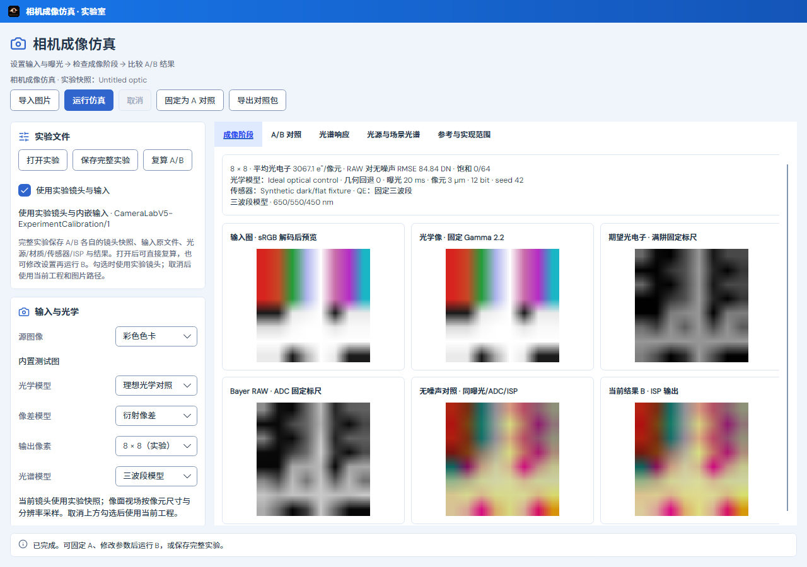
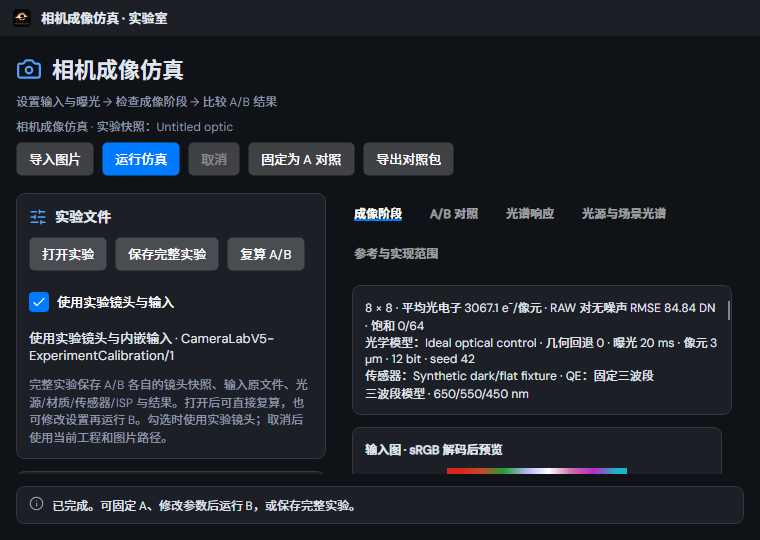

# 相机实验归档与暗场／平场标定

2026-10-29，当前工作区的定向验证；没有发布、原生桌面操作或全仓重跑。其他进行中的工作区改动保持原样。

## 交付范围

- 自包含 `.camera-experiment.zip`：A/B 各自的原始镜头快照、原图字节/指纹、光源/QE/反射谱、材质标签、传感器/标定/ISP、阶段图和 RAW/光电子。镜头在相机视场配置前冻结，复算保留其原文档名/修订。
- 打开恢复设置和 A/B，按冻结输入复算；可修改 B，切换内置图样后仍保留原内嵌图片，显式图片导入才替换它。取消实验输入勾选后使用当前工程。坏文件、取消和复算失败不替换有效数据。
- 共享 Core `DarkFlatScalarV1`：已知增益、两组暗曝光及匹配长曝光平场，估计黑电平、读噪、暗电流、DSNU、PRNU。四个 CFA 相位分别归一化，扣除有限帧均值时间噪声；原始帧、条件、来源和统计结果随模板/实验保存，重导入复算核对。
- 提供明确标记的合成 RAW 样例。未提供内置实测库、逐像元校正、自动增益/QE/满阱估计、像元面积积分、填充因子或温度模型；不宣称标准认证。

格式、公式假设和资源上限见[实验室说明](../../../../docs/CAMERA_IMAGING_LAB.md)。

## 最终验证

标准默认 Release App/测试项目构建成功，零警告、零错误。

| 记录 | 最新结果 | 范围 |
| --- | --- | --- |
| [final-verified.trx](final-verified.trx) | 65/65 | 原传感器/QE/连续谱/材质统计及参数文件回归，新增标定解析矩、模板/实验往返、损坏包/版本/取消、理想多材质/ISP 复算、输入线性化和明暗界面 |
| [lens-replay-verified.trx](lens-replay-verified.trx) | 1/1 | 4×4 Cooke 相机共享 Core 几何路径：A/B 冻结后删除原图、切换空工程及非顺序模式，分别复算 RAW/光电子/显示 RGB 均逐项相等，镜头 JSON 不变且主工程不变；切换内置理想图样再恢复原外部输入仍一致 |
| [final-ui-wording.trx](final-ui-wording.trx) | 2/2 | 最后补齐“当前镜头使用实验快照”的来源说明后，重建及明暗离屏复验；这两项已包含在 65 项中 |

去重后 **66 个不同用例最新结果全部通过**。`lens-replay.log` 的 UTC 时间戳仅用于记录物理复算步骤。镜头测试验证调用、冻结和重复计算，不扩大为新的 Zemax 数值认证或不同后端的逐位保证。

## 保留的早期运行记录

- `camera.trx`：较宽的 Debug 筛选在完成 86 项后由本任务停止，整体中止，不计为完成的回归组。
- `new-camera-release.trx`：早期 Release 筛选完成 9 项后停止，整体中止；对应的新功能由最终分组覆盖。
- 早期重建遇到上述 Debug testhost 占用测试 DLL，构建未完成；没有关闭用户应用。后续标准 Release 构建成功。
- `lens-replay-final.trx`、`final-service-core.trx`、`final-ui.trx`：受限运行器未能在 90 秒内连接 testhost，0 项执行，均中止。最后在可连接本地测试管道的后台运行器完成同一代码验证，没有桌面操作。
- 其余 `calibration-core.trx`、`calibration-service.trx`、`camera-core-regression.trx`、`experiment-ideal.trx`、`experiment-ui.trx` 为定位期间成功的分组，不重复计入最终数量。

## 可复用结果及离屏预览

- [冻结镜头/原图的 A/B 实验](artifacts/frozen-lens-input-AB.camera-experiment.zip)：原临时图片已删除，打开后可直接复算。
- [合成标定模板](artifacts/synthetic-calibrated.camera-sensor.json)与[合成标定实验](artifacts/synthetic-calibrated.camera-experiment.zip)：含原始标定帧，均不是实测传感器。
- [光学复算步骤](artifacts/lens-replay.log)。
- [样例文件大小与 SHA-256](artifacts-manifest.json)。

