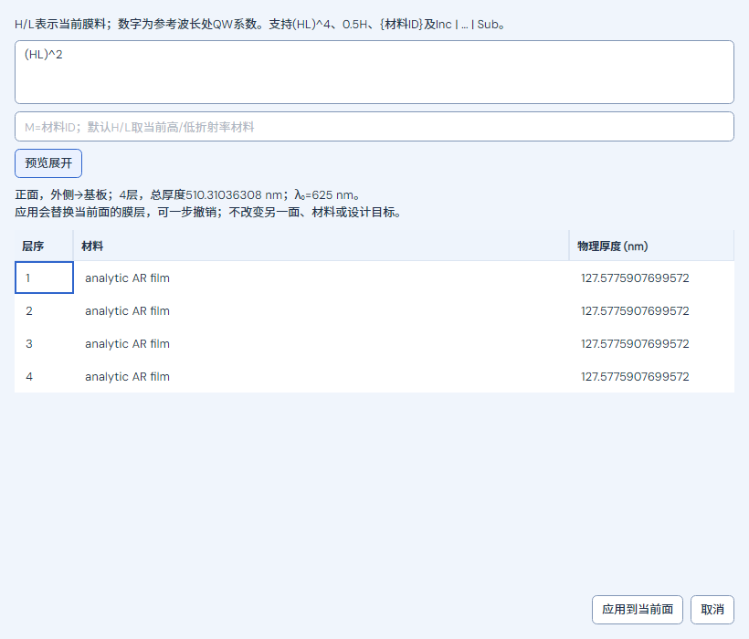
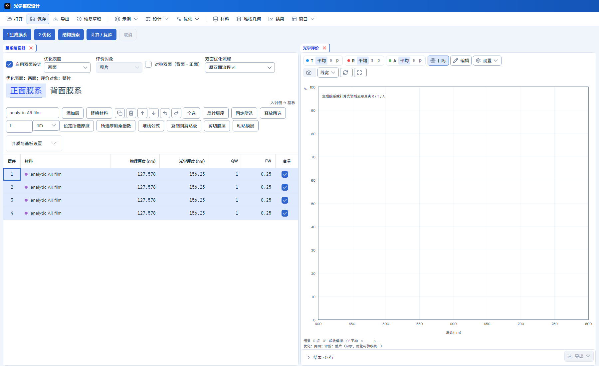
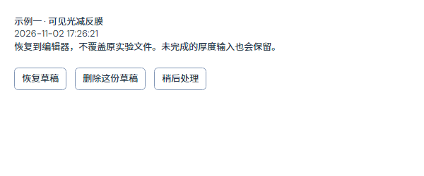

# 镀膜工程操作与双面解析优化验证

范围为独立λ₀、公式、完整材料剪贴板、独立草稿恢复，以及双面v2解析膜厚导数与恢复/质量阶段。原C#共享Core、材料n/k、单面/双面v1、正式加密与验收标准保持。实现见[说明](../../../../docs/COATING_WORKFLOW_ANALYTIC_2026-11-02.md)，任务范围见[计划](../../../../docs/COATING_WORKFLOW_ANALYTIC_PLAN_2026-11-02.md)。

最终正常默认Release App及内置模块依赖构建零警告、零错误。镀膜[164/164](final/final-coating.trx)、共享传播/约束/停靠[178/178](final/final-shared.trx)，合计**342个不同定向用例**，零失败/跳过；以这两份最终TRX去重，不累计专项和早期批次。[身份收据](receipt.json)核对正常App、镀膜测试和共享测试目录中的App/Core/Engine哈希一致，原单面功率与裸背面实现源码相对上一批哈希未变。整合日志为`test-final-coating.log`、`test-final-shared.log`，构建日志为`build-final.log`、`build-shared.log`。

严格文档审计通过（1905份文档，零断链、零代码围栏问题、零指南重复段落），见`documentation.log`。该检查不替代物理或原生交互验收。

早期日志保留：`workflow-core-first.trx`中的1项断言使用字典对象身份比较，改成序列化模型内容比较；`workflow-first.trx`的窄带锚点缺失已修正为共享目标网格，另两项断言错误地要求固定未优化一面的整片也必然达标，现明确保留其物理不可行结果。`test-interrupted-coating.log`是主动中断的整合运行，不是通过或已证实的超时；随后检查发现同步关闭等待异步草稿的潜在界面续接阻塞，已取消该续接依赖，并增加正在写盘时批准关闭的专项。修正后34项计算/关闭专项及最终342项均通过。不得把早期批次累计为当前通过率。

独立检查使用现有162组混合相干输入逐膜厚中心差分，覆盖两面材料、角度、吸收及s/p；额外覆盖平均偏振、厚基板透射下溢、无膜背面、膜厚/折射率调整、每面200层无损极高反射和倏逝出射。原120组薄膜与54组裸背面参考保持，原共享计算与约束回归另列。

离屏交互验证真实按钮、键盘输入、公式预览/应用、非连续选择的内存剪贴板、原子撤销、两面错误输入恢复、取消/放弃关闭及原文件字节不变。跨进程测试只启动测试辅助程序，写入完成后终止该自建进程，再启动新进程读回草稿；不访问用户桌面或系统剪贴板。

三个`duplex-budget-*.json`是同起点、12主迭代的v1/v2对照，记录真实结果及成本；v2恢复8、质量4，网格与每次灵敏度的工作量不同，不能称同总计算量。三组复杂起点均未达到全部原门槛，不能据此宣传普遍达标或加速；实际峰值/最差R等逐项结果以数据为准。

| 对照 | v1 | v2 | 原目标状态 |
|---|---|---|---|
| 减反：波段最大R | 31.4002% | 25.8530% | 均未达到2% |
| 高反：波段最低R | 82.1148% | 82.1148% | 均未达到98%，保留输入 |
| 窄带：峰值T / FWHM | 56.7522% / 19.6444 nm | 56.8203% / 19.6415 nm | 均未全部达到75%、15±1 nm等原门槛 |

普通指导功率点v1/v2分别为4257/792、4356/1023、21037/9824；v2另有396、396、3688个灵敏度点及388、388、19264次实际密集功率调用。不能把灵敏度点当作一次普通功率点相加以推导加速比。独立解析AR控制样例在正面、背面、联合和对称模式可通过原1%门槛；固定另一面的整片用例只要求不增加原超限，不伪造通过。

仅做后台/离屏验证，未进行前台原生交互、系统剪贴板跨应用、跨显示器/macOS GUI、安装发布或远端同步。证据只保存必要输入/结果、日志/TRX、当前预览与身份哈希，不保存完整源码或运行时副本。
