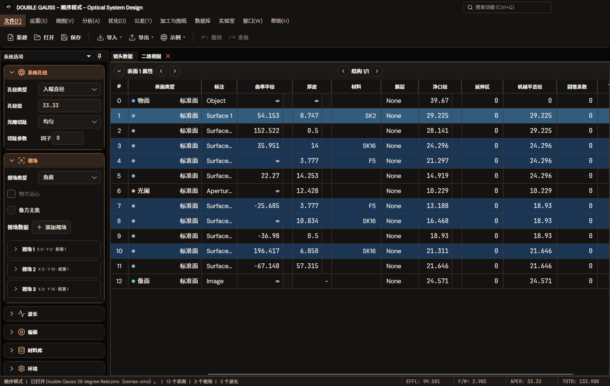

# 黑洞风格暗夜配色试版

2026-11-03。用户要求暗夜配色参考自己的黑洞图，先试一版。参考是产品现有[黑洞主图](../../../../src/OpticalSystemDesign.App/Assets/Brand/AppIconArtwork.png)和[启动背景](../../../../src/OpticalSystemDesign.App/Assets/Brand/Splash.png)，未生成或修改品牌位图。

## 视觉与边界

| 角色 | 本轮色值/行为 |
| --- | --- |
| 工作区 | 近黑 `#080808` |
| 面板 | 暖炭黑 `#151311`，次级面 `#1D1916` |
| 输入框 | 深暖灰 `#201A16` |
| 正文/次级文字 | 暖白 `#F4ECE5` / 暖灰 `#C8BBAF` |
| 执行强调 | 橙金 `#F0AE79`，悬停 `#FFD0A6`，按下 `#CD8B59` |
| 强调底上的文字 | 近黑 `#160D08`，保持可读对比度 |
| 普通选择 | 深暖棕 `#493023` |
| 材料提示 | 原蓝色数据提示；悬停、选中仍为可辨的蓝色 |

色板和原生资源集中在 `BlackHoleDarkTheme`，实际按钮和表格模板层在只匹配精确Dark变体的 `BlackHoleDarkThemeStyles` 中处理；`Lumen`继承的历史深色基底保留，避免连带改变其他主题。原Dark设置值、用户字体、标准图标和Chrome几何保持。物理波长、分析系列、光线/光学角色和状态颜色独立；没有向绘图区叠加黑洞图片、星空纹理或虚构数据。

## 实际预览

1500×950、13字号，产品MainWindow与原Double Gauss 28°文件：

[1120×800、18字号](previews/workbench-1120x800-18.png) · [原生控件与执行强调](previews/controls-zh-CN-13.png) · [英文18字号](previews/controls-en-US-18.png) · [日文13字号](previews/controls-ja-JP-13.png)

## 验证

正常默认Release输出完成App、两个内置模块依赖及测试项目构建；最终日志没有编译警告或错误。[最终26项TRX](final-26.trx)与[构建/运行日志](final-tests.log)：26通过、0失败、0跳过。此前重跑不叠加为新的通过数。

- 正文、次级/提示文字和实际按钮前景/背景对比度至少4.5:1。
- 中英日文、13/18字号；实际鼠标悬停/按下、禁用后恢复，普通按钮与执行按钮保持区别。
- Dark→Light→Dark→Lumen→Dark→Pixel→Dark，控件恢复本轮色板且保留输入/选择内容。Lumen原有“返回Dark后删除输入资源”的断言改为检查当前Dark输入色，而非丢弃切换检查。
- 实际工作台两种尺寸正常加载，材料行可见绘制层保持蓝色及可读文字；主题显示/切换前后的镜头恢复状态一致。
- 原有主题资源、材料行和普通按钮切换检查通过。色板资源检查使用注册的当前Dark，而非仅检查已保留的历史深色基底。

首轮测试代码缺少图标命名空间而未进入执行，保留[编译日志](tests.log)。随后首轮25项中3项发现执行按钮被原生普通按钮层盖住，见[失败TRX](dark-theme.trx)与[原日志](tests-runtime.log)；现通过精确主题样式修正实际呈现层，同时补齐材料行可见层。最终26项完整通过。

只使用后台Avalonia/Skia离屏窗口和独立临时工作区，不读取或改写用户主题设置、不开启/控制真实桌面窗口，未安装、发布或推送，未重跑完整光学精度矩阵。配色属于已实现的可评审试版，不表示用户已经确认最终风格。源文件、品牌来源及运行程序集身份见[验证收据](verification.json)。

整理收据时默认App输出已被并行工作重建，与本轮测试目录的App副本不同；没有把两个完整程序集宣称为同一版本。通过[Portable PDB源文件校验](compiled-source-audit.json)，本轮四个产品文件在测试副本及当时默认App输出中均逐项匹配当前源码，共8项匹配；验证范围限于本轮主题。没有为追随其他工作区改动反复重跑整个应用。
