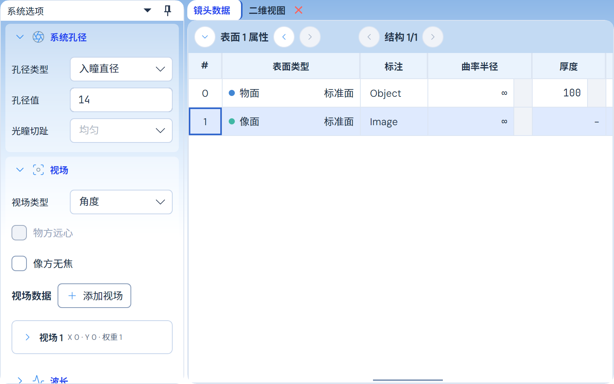

# 文档页签关闭按钮去除白色底块

2026-11-03。用户指出红色 X 后面的白底未融入浅蓝页签。原因是 `StandardActionButtonStyles` 的普通 Light 操作按钮规则也命中了 Dock 文档关闭按钮，将本应透明的空闲底色改为白色。

复用原 Dock 关闭模板时标记 `dock-document-close`，普通操作按钮规则排除此角色，恢复 Dock 原有透明底及悬停/按下反馈。原红色状态、禁用提示、图形、尺寸、命中区和关闭命令不变；普通与紧凑关闭呈现共用此模板。没有修改其他按钮、处方、计算或导出。

## 验证

正常默认Release App、依赖及测试项目构建完成。[最终10项](final-close.trx)全部通过、零跳过：五种主题下的普通/紧凑关闭呈现使用透明空闲底，悬停仍有底色反馈，红色常态/悬停/按下和禁用色保持，真实鼠标动作只关闭目标文档；另外五项确认普通操作按钮的配色、状态和添加视场等动作保持。

截图为实际 PanelManager/Dock 工作区的2倍离屏渲染，Light 使用产品同一窗口渐变；其他主题截图同目录保留。这里未复刻完整主窗口标题栏，未将概念图当作实际界面。

[首轮记录](before.trx)保留 Light 的真实 `Close button covers the tab with White` 失败；其他四项失败来自新增检查未实例化隐藏紧凑按钮的模板，不是四个主题的产品回退。补齐原生 `ApplyTemplate` 后，两类按钮均执行背景和状态断言，最终10项通过。复跑不累加为新的不同用例。

源码、测试身份和截图指纹见[收据](verification.json)。只在后台离屏验证；未控制、关闭或重启用户窗口，未推送发布，也未重跑完整光学精度矩阵。
