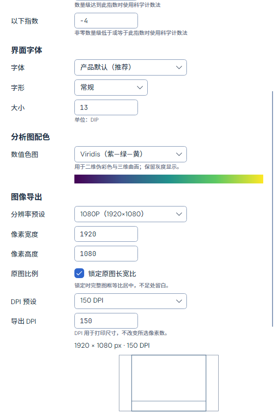
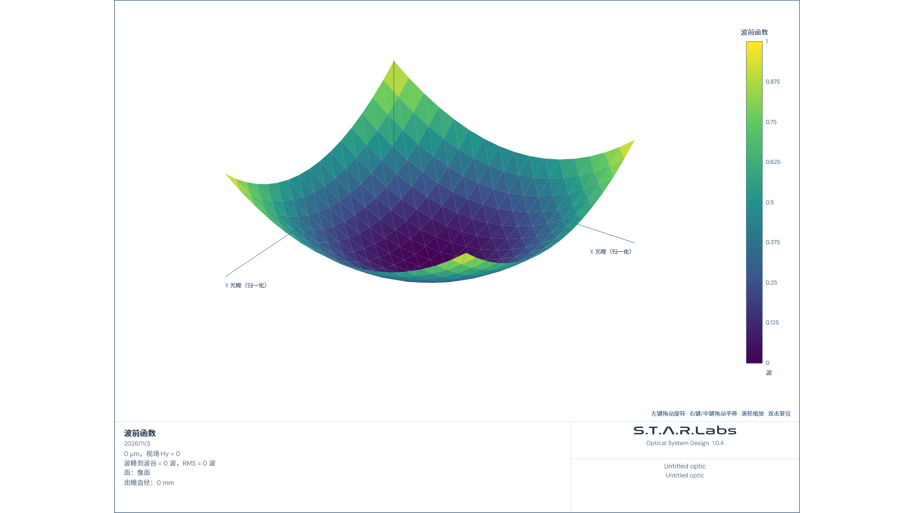

# 图像导出画布与独立 DPI：可调整草案

2026-11-03。按用户补充实现设置和预览，**分辨率方案尚未定稿**。这是界面及无损导出的定向验证，不是全仓回归或新的外部光学精度认证。仅后台离屏，未打开、操作或重启用户的应用。

## 当前行为

| 设置 | 草案行为 |
| --- | --- |
| 尺寸预设 | 1080P（1920×1080，默认）、2560×1440、4K（3840×2160）、自定义宽高 |
| 最终尺寸 | 始终显示实际宽 × 高像素；手动改尺寸自动识别预设或切到自定义 |
| DPI | 96、150（默认）、300、600及自定义；独立于宽高，写入真实PNG物理密度元数据 |
| 锁定原图比例 | 默认开启；整幅图框等比居中放入画布，空白在图框外；关闭时整图拉伸铺满 |
| 内容 | 完整绘图区、色标、图例、坐标与底部说明，保留当前相机、平移、缩放和曲线筛选 |
| 格式 | 绘图导出无损PNG；图像模拟原始像素另支持真实24位无压缩BMP；拒绝JPEG输出，继续支持JPEG输入 |
| 报告 | 继续使用同一原始绘图及外框、原图比例和既定纸面尺寸，不把画布留白嵌入报告而缩小文字 |

源图仍是1200×900 DIP，绘图区740、图签160，外加1 DIP边框；不按导出尺寸重新排版。默认画布中的图框为1440×1080，从X=240居中开始；2560×1440内的图框为1919×1440，3840×2160内为2879×2160，存在不可避免的整数像素取整。竖向自定义画布也支持上下留白。报告默认1440×1080的原图及约184.60×138.53 mm纸面尺寸保持。

宽高分别允许128–8192，DPI允许24–600；组合画布仍受原有有界图像分配保护，不能因单边有效而无限申请内存。保存前冻结画面及DPI，取消或失败不替换已有文件。只有导出设置变化时不重新计算光学结果。

## 实际预览

下面是实际设置窗口的离屏截图，已滚动到图像导出区域；底部示意只表达画布和图框布局，不含模拟的光学数据。

[英文深色](settings-default-en-US-Dark.png) · [日文浅色](settings-default-ja-JP-Light.png)

下图是导出路径生成的1920×1080 PNG，用测试DTO检查源图几何及完整图框；其中的元数据不是外部精度案例。真实镜头的二维/三维波前另由ScientificColorMapTests核对。

[2560×1440 PNG](wavefront-1440.png) · [3840×2160 PNG](wavefront-2160.png)

## 验证记录

最终 **172个不同定向用例通过**，零失败/跳过：主产品165项、镀膜7项。不将中间阶段重复用例相加。

- [主产品最终TRX](final/exports-final.trx)：165/165。
- [镀膜最终TRX](coating-final/coating-final.trx)：7/7。
- [编译与源码身份收据](receipt.json)：25份相关产品源码在主产品测试、镀膜测试与正常App三个PDB中的75个绑定全部一致。Core及内置模块计算源码相对HEAD无改动。
- [文档检查](documentation-scope.json)：1952份文档的严格检查通过，失效链接、未闭合代码块、当前指南重复段落及生命周期问题均为0；本记录的相对链接另行核对。

最终运行前，两个测试输出与正常App均为`9cc670ca…`，已记录在[运行前身份](pre-final-identities.json)。运行后两个测试输出仍保持该版本；共享工作区其他任务随后将正常App重建为`4c1c0acf…`，所以收据中的`normalAppIdentical=false`如实保留。本轮25份相关源码与后来正常App的PDB仍一致，但不能把172项结果扩展成随后整包的完整验收。构建记录中的正常产品及测试项目均有零警告/错误的成功构建；一次并发文件占用单列在下文。

覆盖设置默认值、旧高度设置迁移、三语、持久化与失败回滚；三个尺寸预设、竖向画布、比例锁定/解除、96/150/300/600 DPI及自定义；PNG真实签名、pHYs和完整像素；现有PNG/BMP保存保护；实时图框、光学布局、实体模型、曲线筛选与相机、SFR；Word/PDF/HTML/Markdown原图、图签和纸面尺寸。

锁定比例的普通PNG中，图框内部与同高度报告原图逐像素相同。合成时先按像素复制源图，再在目标画布放置，避免位图内部DPI二次缩放；使用Source合成保留抗锯齿边缘的原Alpha，避免SourceOver二次混色。DPI只写入打印元数据，不改变图像像素。

中间的initial/copy失败记录保留；alpha阶段13项先行检查通过。首轮较广检查有1项旧测试仍直接将源DIP当画布像素，取到新增留白；修正为源图框坐标映射后2项复核通过，原“每个空子图必须保留轴与网格”及恢复像素断言未放宽。一次构建与共享工作区另一个构建发生文件占用；未终止其他进程，后续测试项目复用正常产品输出完成构建。最后统一产品版本重新运行，避免混用二进制得出结论。

维护说明见[用户指南](../../../../docs/USER_GUIDE.md)、[UI规范](../../../../docs/UI_DESIGN_SPEC.md)、[报告原图规则](../../../../docs/MARKDOWN_REPORT_EXPORT.md)。验证汇总入口：[Summarize.ps1](../../../../tools/diagnostics/ExportCanvasDraft20261103/Summarize.ps1)。
