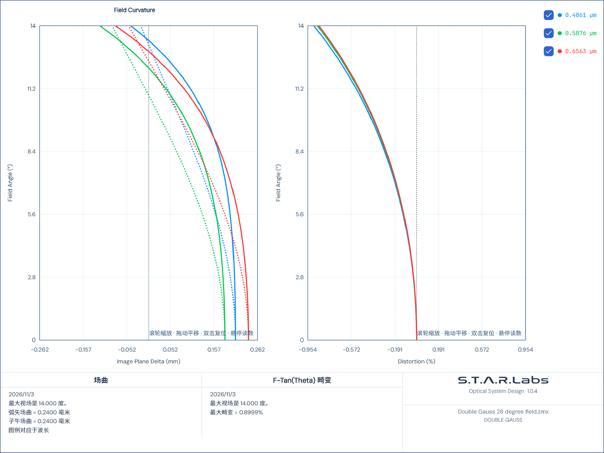

# 场曲与畸变子图的比例布局

日期：2026-11-03。用户截图中的场曲/畸变共图左侧有标题、右侧无标题，原来各绘图控件按自己的标题分别预留顶部空间，导致实际绘图区高度不同。

现有两个并列图共用父网格的自动标题行，标题按当前字体、内容和可用宽度测量；无标题的一侧占用同一标题行。绘图区放在同一 `*` 行，列宽按相同星号权重分配，标题顶部留白为当前标题字号的一倍。未引入固定子图高度、像素补偿、屏幕截图尺寸或按标题文本选择算法的分支。入口由 `AnalysisPresentationKind.FieldCurvatureAndDistortion` 选择，其他子图排列方式保留。

## 最终验证

- 默认 Release 输出完成 App、两个内置模块依赖和测试项目构建；最终构建日志无警告或错误。
- [最终 TRX](final-25.trx)：25/25，通过；[构建与运行日志](final-tests.log)。其中5个新增几何/导出用例及20个相邻图签、图例选择回归，不叠加此前重跑次数。
- 混合有/无标题、单行/多行标题，Light/Dark/Pixel/Isekai，13/18/22字号；960×620、780×420、1400×800容器下，实际绘图区的上下边界、高度和宽度一致，随容器变化重新分配尺寸。
- 使用产品内原始 `Double Gauss 28 degree field.zmx` 经共享 Core 实际计算场曲/畸变，1600×1000、520×360、1900×1150窗口下验证源图几何一致。传给界面的原始曲线保留，分析与显示前后的文档恢复状态一致。
- 2404×1804 PNG全像素SHA-256在上述窗口变化前后相同。工程报告入口生成的同一源图与界面PNG逐像素一致；未生成或重新认证Word/PDF最终容器文件。
- 仅调整桌面布局；未修改Core求解器、镜头处方、采样、参考数据或数值验收容差。后台Avalonia/Skia离屏验证，没有控制、关闭或重启用户窗口，未安装、发布或推送。

实际完整PNG：

## 保留的阶段结果

受限环境首次测试未能进入构建或执行用例，已停止，不能计为通过。正常环境的首轮5项检查中，多行标题有2项未对齐，见[原失败TRX](plot-alignment.trx)和[原日志](test-final.log)；独立子网格共享尺寸方案已改为共同父网格的同一标题行，最终25项完整通过。中间的5项和20项复验也保留，但不重复计入最终用例数。

文件身份、工作区基点和实际程序集指纹见[验证收据](verification.json)。源码基点之后存在本轮未提交布局改动及其他任务已有的镀膜编辑改动；此记录只认证上述子图范围，不把其他工作区功能或历史光学矩阵视为本轮验收。
