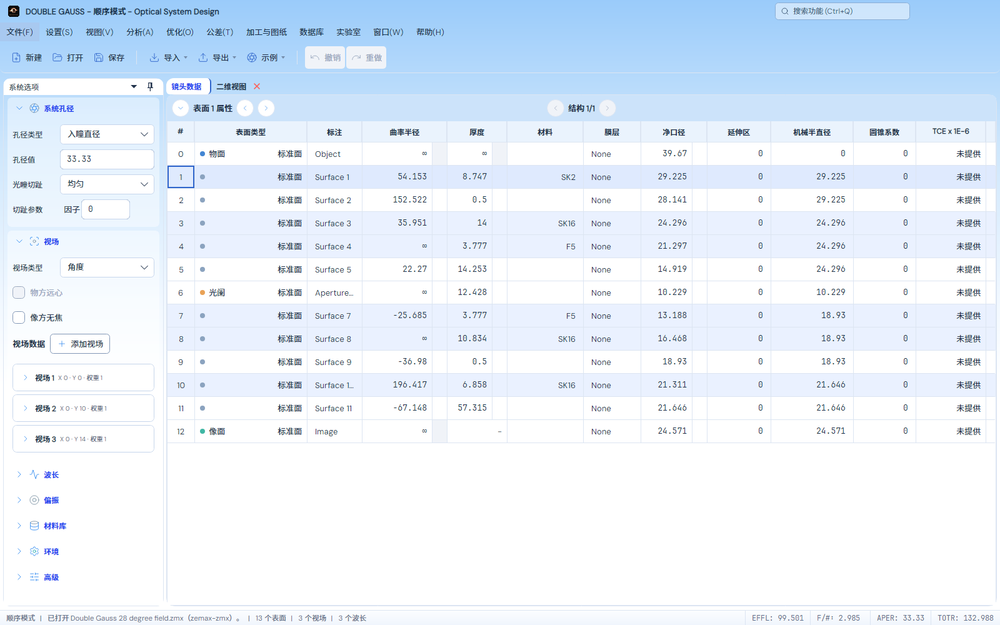

# 普通 Light 浅蓝背景调亮预览

2026-11-03，用户要求“蓝色改亮一些我看看”。本轮在实际产品配色中调亮背景一档，保留同一窗口纵向相对渐变及原布局。

| 位置 | 调整前 | 调亮后 |
| --- | --- | --- |
| 窗口顶部 | `#8DB7E7` | `#9ACBFA` |
| 窗口高度23% | `#C4DCF5` | `#CDE6FC` |
| 窗口高度48% | `#EEF6FF` | `#F1F8FF` |
| 表面属性栏 | `#C3DAF3` | `#CCE3FA` |

62%及以下仍为白色。侧栏半透明分组、白色输入/数据区、深蓝文字、页签 X 的透明底及其他主题保持；未调整材料、光线、数值图色表或计算。

## 实际界面

[900×700、18字号](previews/workbench-900x700-18.png) · [640×500、13字号](previews/workbench-640x500-13.png)

## 验证范围

正常默认Release App及依赖构建完成。[5/5项定向检查通过](brighter.trx)，无失败或跳过；复用实际主窗口检查的原断言，覆盖三个初始尺寸、字号、窗口增大/还原、侧栏边距/间隙/分组正文和白色输入像素、滚动、Dark/Lumen返回以及原Double Gauss镜头恢复状态。文字对比度检查使用实际顶部蓝色资源，不再保存过期的顶部色值副本。

这里是实际Avalonia/Skia离屏渲染，未使用生成图片；没有操作或重启用户窗口，没有发布或推送，不作为全仓或外部光学精度认证。源码及截图指纹见[收据](verification.json)。历史70项、侧栏37项及X按钮10项属于各自原记录，本轮不累加这些数量。
