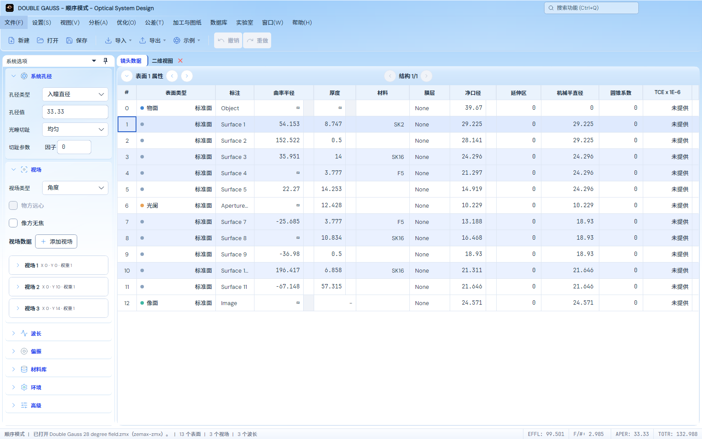

# 普通 Light 玻璃材质实现

2026-11-03，用户确认按[玻璃概念稿](reference.png)实现，要求保持当前布局、渐变比例及清晰的表格和文字。该参考是视觉概念，未作为光学数值或精度输入。参考文件与生成原件SHA-256核对相同，产品不加载这张图片。

## 实现

`LightGlassMaterial` 提供不可变的半透明白色反光、玻璃分组、亮边和表面属性栏高光画刷。标题与 Ribbon 由已有背景层绘制透光反射；Ribbon 原有 `ThemeChromeOverlay` 在内容后绘制细亮边。侧栏分组采用透明白色渐变及浅阴影，保留透明正文；停靠内容框使用原1 DIP边框绘制亮边。

蓝色背景仍只有一个窗口级纵向渐变，0/23/48/62/100%位置及底色色值均保持。没有添加布局占位、更改边距/圆角尺寸/字体或把侧栏重新铺成不透明白色。输入、表格、数值与分析图保持原表面，文字和表格没有模糊滤镜；物理/材料/数值图色表与计算没有修改。玻璃样式精确限定普通 Light，其他主题沿用原资源和装饰。

## 实际界面

以下为实际主窗口的 Avalonia/Skia 离屏渲染：

[900×700、18字号](previews/workbench-900x700-18.png) · [640×500、13字号](previews/workbench-640x500-13.png) · [滚动状态](previews/workbench-900x700-18-scrolled.png)

## 验证

正常默认Release App、内置依赖与测试项目构建完成。最终 **49个不同定向用例全部通过**，零失败/跳过：

- [实际渐变/材质4项](actual-glass.trx)：原蓝色渐变的比例断言保持；640/900/1600宽、13/18字号、增大/还原窗口、滚动及Dark/Lumen返回；实际侧栏边距、间隙、分组正文像素和白色输入、原镜头恢复状态；文字与表格的 `Effect` 为空。半透明分组由旧纯色换为材质渐变后，期望像素按实际渐变/透明度合成核对，原±3 RGB渲染误差标准未放宽。
- [交互45项](glass-interaction.trx)：搜索与标题栏、正常/紧凑关闭按钮及真实点击、侧栏展开/悬停、12 DIP停靠圆角与边缘对齐、主题往返及资源。没有用重复执行次数增加通过数。
- [表格正文全像素比较](table-pixels.json)：比较本轮1600宽截图与[前一版调亮截图](../light-blue-brighter/previews/workbench-1600x1000-13.png)，同一 `(268,230,1324,475)` 正文区域共628,900像素，差异为0。该范围包含实际行、数值、选中/材料色及网格，装饰没有覆盖表格内容；不把该截图检查扩大成全应用或数值精度认证。

初始两次构建试接入未执行测试，保留 `glass-pixels.log`（Border的Render不可重写）和 `glass-pixels-final.log`（GradientStops构造方式及同时发生的独立探测器导出编辑中间态错误）。随后改用现有背景/装饰层和支持的集合初始化，独立文件自行完成编辑，未修改该探测器实现；正常最终构建和上述49项通过。

源码、编译来源、参考及截图指纹见[验证收据](verification.json)。始终后台离屏，未控制、关闭或重启用户应用；未推送或发布，未重跑完整光学精度矩阵。历史70/37/10/5项均保留各自原身份，不与本轮相加。
