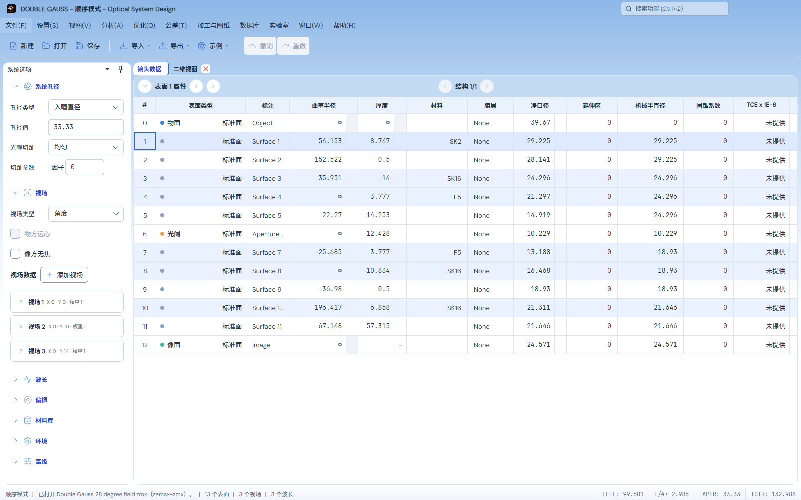

# 亮色工作台的浅蓝渐变

2026-11-03。用户指定[第一张浅蓝概念稿](reference.png)作为实现方向；该图只作为视觉参考，不作为光学数据或计算精度参考。本轮没有采用后续灰蓝或暖橙稿，也没有把参考图中的数据复制到产品。

后续用户指出侧栏仍被白底遮挡，确实属于本轮检查遗漏：这里的像素断言只采窗口外沿。当前侧栏实现及补充验证见[侧栏遮挡修复](../light-sidebar-backdrop/README.md)；本页保留首轮当时的截图和70项验证身份，不能据此认定侧栏内部已通过。

## 已实现

主窗口最外层绘制唯一纵向背景：0% `#8DB7E7`、23% `#C4DCF5`、48% `#EEF6FF`、62%至100%白色。坐标相对整个客户区，随窗口高度等比例变化，不设置固定的渐变像素高度。

标题、菜单、工具栏和停靠外沿透出这一背景，避免各自重新开始渐变。表格、普通输入、分析和二维/三维布局源图保持白色，侧栏白色分组和原有间距/圆角保持。表头与表面属性栏使用对应浅蓝；标题、菜单、检索采用深蓝文字。执行按钮、材料提示、波长/系列/物理角色和状态语义保留。

`LocalIcon`在实际祖先控件、边框和面板上判断对比度；不透明Pad线性渐变在图标中心的实际坐标取色，必要时使用可读的宿主前景。SVG图形、三角色主题包及其他主题本身未替换。

## 实际界面

本轮当时的默认工作台按原规则只打开镜头数据和二维视图页签，不为了仿照概念稿额外拆分面板。以下是原Double Gauss文件的实际离屏界面，不是生成图片；侧栏后续修正见上方链接：

[900×700、18字号](previews/workbench-900x700-18.png) · [640×500、13字号](previews/workbench-640x500-13.png)

## 验证及保留的失败

默认Release输出完成App、两个内置模块依赖与测试项目构建。去重70个不同用例通过，原始TRX按完整用例名合并，不叠加复跑次数：

- [主批69项](final-ui.trx)为67通过、2项旧菜单禁用色断言失败；产品已显示本轮指定的深色提示，但断言仍期待旧深蓝底上的浅色。同步预期后，[原两项复验](corrected-menu-final.trx)完整通过，主批全部69个身份均有通过结果。
- [独立完整PNG检查](isolated-export.trx)1项通过，验证实际FFT PSF源图在窗口缩放和适应/100%切换前后的2404×1804全像素一致性。该项不与主批重叠。
- 新增实际工作台检查覆盖三个初始尺寸、13/18字号、反复调整窗口，采样原有外沿的实际渲染颜色，确认上部为蓝色、下部为白色；主题切换与镜头恢复状态保持。
- 标题/菜单/搜索可读性、原生窗口按钮、蓝色控件交互、图标、材料与停靠检查保持。光学处方、采样、参考数据和数值容差未改。

首轮[34项记录](light-gradient.trx)有3项仍期待白色搜索文字；同期保留旧的局部标题渐变断言，现均改为窗口级背景及深蓝文字。后续把导出与大量界面会话混跑时遇到Avalonia绘图对象线程归属错误，见[70项混跑记录](light-gradient-final.trx)和[日志](tests-final.log)，因此该导出检查在独立新进程按原断言执行并通过，没有修改导出产品代码或放宽标准。一次复验因其他后台testhost占用测试程序集而未执行，保留[文件锁日志](corrected-menu.log)；只读确认其自行退出后完成复验，没有结束其他进程。

实际命令、去重清单、相关PDB源码校验、参考和图像指纹见[验证收据](verification.json)。本轮仅后台Avalonia/Skia验证，未控制或重启用户窗口，未安装、发布或推送，也未重跑完整光学精度矩阵。工作区同时存在其他任务的改动，本记录只认证此配色与上述交互/导出范围。
