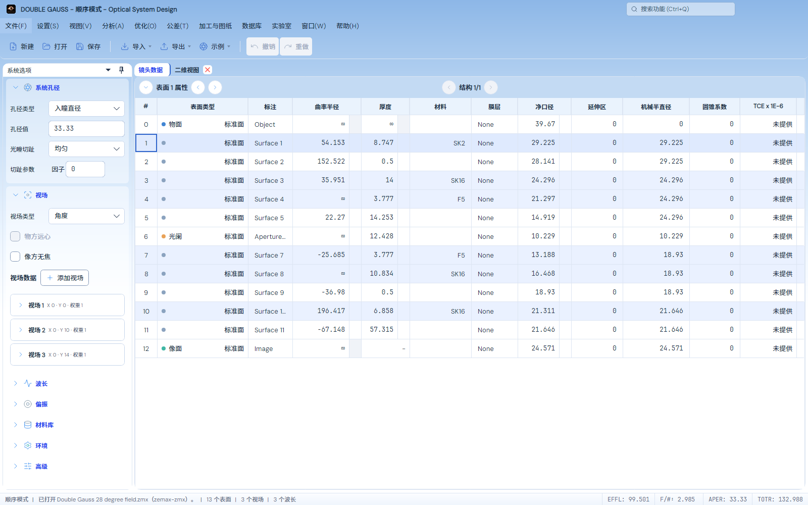

# 左侧系统选项渐变遮挡修复

2026-11-03，接续[浅蓝渐变首轮记录](../light-gradient/README.md)。用户指出左侧底色仍被盖住；首轮的实际像素检查仅取窗口外沿，确实没有认证侧栏内部。本记录单独保留复现和最终结果，不把首轮70项或中间复跑叠加成新的通过数。

## 原因与修正

实际主窗口的视觉祖先记录显示，侧栏经过 Dock 的 `ToolControl / PART_Border` 和 `ToolChromeControl`，两者都填充白色；原来的透明工作区资源没有穿透这两层。只去掉这两层后，卡片间隙已露蓝，但分组正文的大面积白底仍遮住渐变。

主工作区增加 `optical-workspace` 样式作用域，仅普通 Light 的上述工具容器正文透明。系统选项外层分组改为 `#70FFFFFF` 半透明白色，正文容器透明，空闲分组标题透出该底；嵌套视场/波长卡片与输入框保留原表面。其他主题的新分组资源默认映射回各自 `Surface`；其他实验室的 Dock 不应用此主工作区样式。

仍由一个窗口级相对纵向渐变绘制背景，原色标和48%/62%位置不变，没有增加固定高度或随侧栏滚动重新开始的渐变。处方、采样、参考数据、数值容差及表格/分析源图未修改。

## 最终实际界面

以下是打开原 Double Gauss 文件的 Avalonia/Skia 离屏渲染，不是概念图：

[900×700、18字号](previews/workbench-900x700-18.png) · [640×500、13字号](previews/workbench-640x500-13.png) · [900宽滚动后](previews/workbench-900x700-18-scrolled.png)

## 验证

最终 **37个不同定向用例通过，零失败/跳过**：

- [最终渐变4项](final-gradient.trx)：640/900/1600宽、13/18字号及增大再还原窗口；侧栏内边距的多个高度、卡片间隙和分组正文像素与同一窗口背景核对，输入框保持白色。返回 Light 后滚动及还原继续核对，镜头恢复状态保持相同。
- [相邻回归33项](adjacent.trx)：原工作区尺寸/停靠布局、分组展开与悬停、Light/Dark/Isekai/Pixel切换、菜单与控件状态、主题资源和对比度。此批使用同一正常Release测试输出，单独测试进程运行。
- 正常默认Release App、内置模块依赖及测试项目完成构建；相关编译源码和文件指纹见[验证收据](verification.json)。不包含整仓测试、光学精度矩阵或原生桌面人工验收。

保留[修复前3/3失败](before.trx)和[原始白底截图](before/workbench-1600x1000-13.png)：例如1600宽时侧栏 `(9,274)` 实际 `#FFFFFFFF`，应为窗口渐变 `#FFCBE1F7`。`before/sidebar-layers-*.json` 标出两层 White；最终 `previews/sidebar-layers-*.json` 中对应层为 Transparent。

[仅去掉外层后的4项检查](after.trx)和 `after/` 截图是中间阶段，尚未包含分组正文及滚动像素检查；不作为最终分组效果的认证。最终已补齐这些断言，未通过放宽像素标准掩盖白底。

验证始终在后台离屏执行，使用独立临时会话；未控制、关闭或重启用户窗口，未发布或推送。
