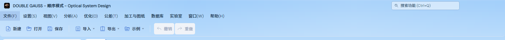
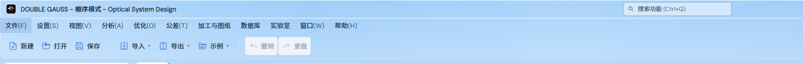

# Light 顶栏玻璃白线修正（2026-11-04）

用户截图指出菜单顶端的贯穿白线和玻璃轮廓过硬。Light 原先在 Ribbon 原生底边之外，以 `LightGlassDecorationRenderer` 再画一整圈接近不透明的白色圆角线；标题也有高强度、零模糊的内侧高光。

现移除 Ribbon 额外轮廓，复用 `NoThemeDecorationRenderer`，保留底部圆角、原生底边、透明反光面和窗口级蓝色渐变。`FrameShadow` 改为低强度、宽柔光，仅作用于背景绘制。布局、字体、输入/表格/绘图区和其他主题的资源保持原有定义。

验证在后台离屏进行，不启动或控制用户桌面窗口。以下为本次证据的唯一目录。

- `before/`：修改前的实际主窗口截图，包含 1600×1000、900×700 和 640×500；原有 4 项 Light 检查通过，原检查未覆盖白线。
- `after/`：修改后的同尺寸截图及滚动/尺寸状态。
- `toolbar/`：两倍像素比例下的 Light/Dark/Pixel/Isekai 工具栏截图。
- `pixel-comparison.json`：1600×1000 实际帧的同位置取样。标题顶行相对下方 3 像素的红通道突增从 75 降为 4，Ribbon 顶行从 77 降为 -1；对应位置的白线已消失。
- 最终回归在 `LightGradientThemeTests` 中直接比较标题和 Ribbon 顶部实际像素与邻近行，覆盖尺寸变化、字体变化、滚动和 Light/Dark/Lumen 往返，并保留输入表面、背景连续性与交互检查。

测试筛选：`LightGradientThemeTests | CompactRibbonTests | SystemPropertiesPanelSectionThemeTests`。最终真实窗口/侧栏 5 项通过，见 `corner-fixture-retry.trx` 中这两个测试类的原始结果；工具栏夹具修正后单独复验 **11/11 通过**，见 `toolbar-final.trx`。`verification-summary.json` 按名称去重列出 16 项通过结果及原始来源；没有将重跑累计为更多测试，也不将中间失败的整轮标为通过。独立测试输出使用 `local-data/light-glass-bin`，完成后移除；它不是发布或证据载荷。

验证过程中遇到共享工作区的新 Isekai 材质初始化异常（Avalonia `DrawingGroup` 无法记录 `DrawBitmap`），使 15 项界面测试在启动阶段失败，另 1 项资源检查通过；该问题随后已在共享材质实现中修正，不将这次失败计作白线修正的通过结果。首次构建还遇到 `AnalysisBookWorkspace` 中 `Dock.Top` 的命名空间冲突，已使用完整 `Avalonia.Controls.Dock.Top` 消歧。

初次完整界面检查中，Light 的三个旧圆角截图断言把白底上的透明玻璃误判为整行缺失：移除装饰线后，角外白底和行中白底自然相同。已仅将工具栏夹具的背景改为可区分的浅蓝色，保留圆角外像素、行中填充和全部布局断言，未为该测试恢复产品白线。背景必须在挂载后清除原动态绑定并设置，否则资源解析会恢复白底；该次重试见 `corner-fixture-retry.trx`。原始失败保留在 `corner-fixture-failure.trx` 和 `white-background-fixture.png`；启动失败保留在 `startup-failure.trx`。

默认输出路径的 Release App（含内置模块）构建完成，0 警告、0 错误，见 `app-build.txt`。构建核对时，默认 App 与离屏测试使用的 App 程序集逐字节一致，哈希及本次源文件身份见 `identity.json`。清理独立测试输出前，共享工作区后续构建已替换默认程序集，另行记录该次观察；本次四个源文件的哈希未改变，不将后续构建冒充本次受测程序。仅本次 UI 范围，不代表全仓数值认证或已发布安装包。

修改后的实际顶栏：

修改前：

