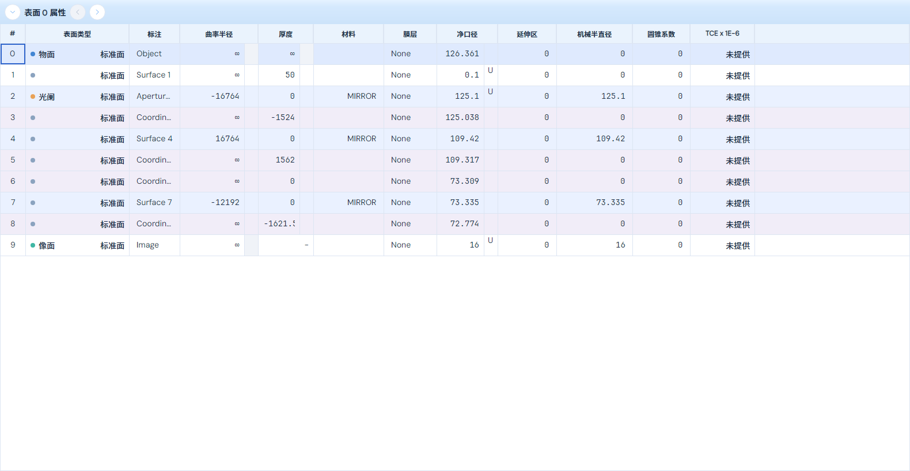
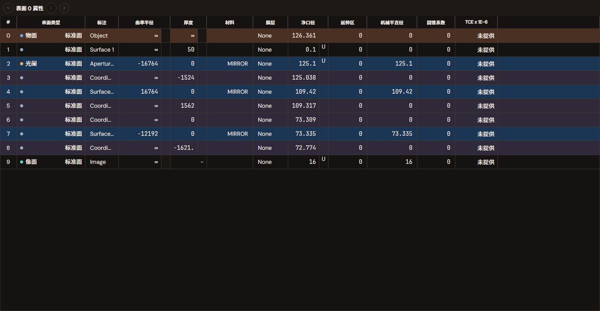

# 坐标间断参考面行色

镜头编辑表按实际坐标参考交互模型取得只读类型标记，沿用数据行的加载和复用入口。坐标参考面采用安静紫灰色，与普通面及蓝色材料面区分。继承玻璃介质的参考面优先使用紫灰色。五主题各自提供常态、悬停、选中、选中悬停四种色阶，正文对比度逐项至少4.5:1。[当前配色表](../../../../docs/UI_DESIGN_SPEC.md#颜色)

颜色直接作用于原生行模板底板及冻结/滚动单元格。禁用和验证状态继续由原生控件表达。行编辑现在只在材料实际改变时更新材料交互，保留仅改标注或数值时的特殊参考面身份。

默认Release主程序和测试项目构建零警告、零错误。最终单批 **19/19通过，0失败/跳过**。五主题真实Yolo示例覆盖四种交互状态、禁用恢复、参考面改名、普通面使用类似标注、滚动复用、保存重开和换文件。另有五主题配色对比度、材料行编辑/撤销/选中，以及现有列布局和工程保存回归。[摘要与源码身份](results.json) · [最终TRX](coordinate-rows-delivery.trx) · [构建](build-delivery.log)

初轮夹具使用的干涉仪示例未保留可见坐标参考面，记录8过/5失败。改用用户截图对应的Yolo示例后发现，普通行提交会重新设置未改变的材料交互，使参考面在改名时失去类型身份，记录8过/5失败；修正材料变更判定后19项通过。两份原始失败记录各自保留。[初轮夹具](coordinate-rows.trx) · [编辑身份复现](coordinate-rows-final.trx)

[光域](coordinate-reference-Lumen.png) · [异世界](coordinate-reference-Isekai.png) · [像素](coordinate-reference-Pixel.png)
