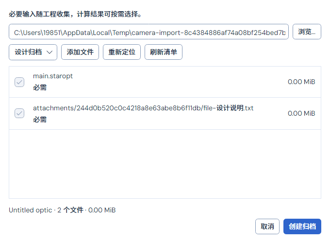
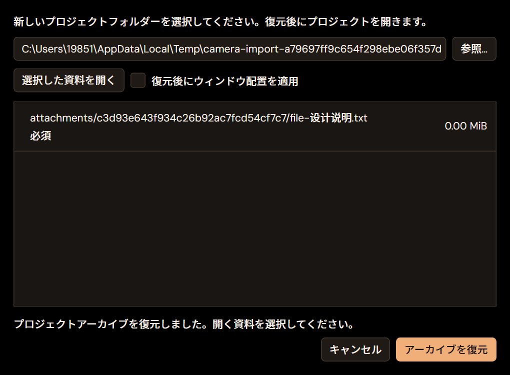
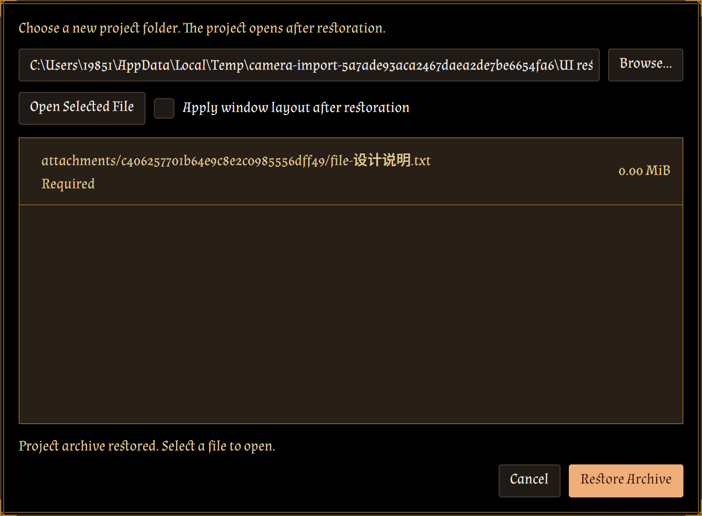

# 工程归档功能验收

2026-11-20，Windows x64，.NET 10 Release。单文件 `.starpack` 归档已接入“文件”功能区、工程打开和启动文件入口。操作与格式见[工程归档指南](../../../../docs/PROJECT_ARCHIVES.md)。

- 26 项归档功能检查通过，涵盖未保存工程、多配置快照、去重、资料重开、删除源文件后的恢复、相机图片重绑、数据库换会话与再次归档、取消、预算、损坏和已有目标保留。
- 27 项现有工程保存、格式边界及有界文件读写回归通过。
- Release 解决方案构建零警告、零错误；三语提取/同步零缺失、零错误。
- 四个实验室输入、相机/镀膜/装调结果、初始结构自主计划、优化、公差和工作区设置均通过其现有入口恢复；没有启动结构搜索或完整精度计算。
- ZIP64 大偏移使用虚拟稀疏流，流式写入使用超过 4 GiB 的预算及小载荷检查。未运行真实多 GiB 性能测试或其他操作系统上的原生窗口测试。

本轮按用户要求只做功能验收，未运行 95 镜头完整精度矩阵。此记录不更新已有数值结论。

[机器记录与源文件摘要](results.json)记录测试筛选、通过数、源码和截图身份。压缩 TRX 保存本轮的两组定向结果。

## 创建与恢复窗口

真实 Avalonia 窗口在后台离屏运行，截图检查原生控件、长路径、中文文件名、主题文字和命令边界，未操作用户正在运行的程序。

Light／中文／100% 创建：

Dark／日文／150% 恢复：

Isekai／英文／200% 恢复：

