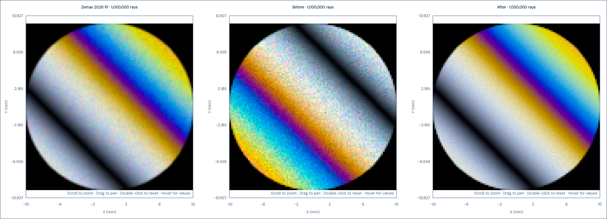

# 彩色条纹的原生比较与修正

用户本轮明确要求与原软件结果比较，并修正彩色条纹差异。本轮使用已经安装的
**OpticStudio 2026 R1.00** 的独立 ZOS-API Server（无窗口）读取任务目录中的原始ZMX副本，
重新追迹并导出实际逐像素功率、XYZ及RGB。未接入用户会话、操作桌面、保存用户源文件或
安装软件；新的原生捕获范围仅为这个明确请求的实例及必要控制点。

左为原生实际输出，中为上一轮计算结果，右为修正后实际结果。三个图使用同样的坐标、
产品字体和RGB绘图路径；没有旋转参考图、配色替换或绘制模拟条纹来掩盖计算差异。

## 数值结果

所有场景均为原例的100×100像素、100万条光线、440–640 nm/20波段、波片模式3、仅折射、
无散射和无平滑。比较内域为半径9 mm，条纹剖面按3像素反对角线分组，避免把不同采样的
边缘像素当作光学差异。完整定义和结果见[comparison.json](comparison.json)。

| 项目 | 修正前 | 修正后 |
| --- | ---: | ---: |
| 探测器功率 / W（原生0.4468056613） | 0.4466613467 | 0.4469117622 |
| 相对功率差 | −0.03230% | +0.02375% |
| 全图像素功率相关系数 | 0.269009 | 0.998508 |
| 条纹功率剖面相关系数 | −0.155962 | 0.999983 |
| 内域RGB均方根差 / 8位色阶 | 101.83 | 9.95 |
| 条纹RGB剖面均方根差 / 8位色阶 | 99.67 | 3.46 |

将原生XYZ直接送入产品转换函数，其RGB与原生RGB最大差 **小于1色阶**，均方根差
**0.3395色阶**，表明颜色显示函数已匹配至8位量化范围。独立积分/采样仍产生单像素噪声，
不宣称100万个私有发射节点、每个带噪像素或任意非序列场景逐值相同。

## 已确认并修正的原因

1. 矩形体斜面符号相反。原生 y=−3/0/+3 mm 的共享面交点分别为
   0.5722368956/0.5619999766/0.5517630577 mm，确认应使用
   `z=z_vertex+x tan(θx)+y tan(θy)`，不是反转显示图。
2. `NSBR 0 3 1` 的1是 **仅追迹折射**，此前被误读为允许反射。现在保留原始分支选择，
   未追迹反射进入截断能量账目。原生100万次探测器命中不再被多次鬼反射命中替代。
3. 原光谱拟合采用零初值的非负解，原有均匀先验保留了不相同的谱形。新的20个权重与
   原生处方报告最大差小于1e-5；剩余细差来自原始1 nm CIE数据与原软件旧观察者插值。
4. 共同路径波片相位必须使用入口切向波矢连续性，以及非常本征模式能量方向上的相位
   投影，不能只在普通方向查询相位椭球。共享Core椭球求解已复用到顺序/非序列入口。
   三个原生单光线的归一化U及经时间相位约定转换后的V，最大差小于4e-8。
5. 入晶体Fresnel功率按普通/非常分量加权，保留波片共同路径的横向Jones幅值。
   单瓦控制的透射通量仍有约6.0e-7 W内部交界残差，作为已知数值边界保留，未以常数校准。
6. 原例为Sobol采样，之前没有映射。现在按真正的Sobol方向数发射，光源采样独立于分支
   遍历，重复/累加保留种子与协议。发射点顺序不要求复制私有实现。
7. 真彩色应在sRGB传递前按全部线性RGB通道的共同峰值曝光，原先按Y曝光会提前截断颜色。
   数值W、W/mm²不受显示曝光影响。并排绘图还修复了局部背景错误使用父坐标偏移的问题。

## 证据和验证

- [native/environment.json](native/environment.json)：26.1.0、Server模式及有效API许可布尔值，无许可密钥。
- [原生处方](native/prescription.txt)、[原生设置](native/settings.json)、[光谱表](native/source-spectrum.json)。
- [原生XYZ/功率](native/detector.json)、[原生RGB](native/viewer-rgb.json)、[单光线控制](native/ray-controls.json)、
  [原生64条发射样本](native/ray-samples.json)。
- [修正后逐波长功率/RGB及能量账目](after.json)；初版数据复用
  [原文件](../nsc-color-fringes/million-ray-data.json)，不重复保存。
- [42项原始xUnit定向检查](assertions.log)及[额外1项并排导出/背景断言](comparison-render.log)通过，
  合计43个不同检查，重复运行不累计。包含原生波长权重、三个斜面/相位/功率控制、
  RGB直接转换、Sobol已知节点与分层、能量、数据库、编辑、保存重开及三主题/语言/DPI。
  沙箱下直接调用原始测试及InlineData，不冒充标准VSTest运行。
- 共享椭球求解收敛后，[12项既有顺序晶体控制](shared-crystal-regression.log)通过，覆盖倾斜、轴向、
  玻璃出射及批量/标量追迹，并保留原生光程门槛。加上上述43项，本轮合计55个不同检查。
- [默认Release依赖图](build.log)与[最终绘图App构建](final-app-build.log)均零警告/错误。
  未运行95个顺序镜头全精度矩阵，未发布或重启用户应用。

完整工程的新分支和Sobol设置使用按需STAROPT载荷28。旧版保存的反向实体、旧光谱和错误
分支选择无法凭名字可靠推断，应从未改动的原始ZMX重新导入。产品使用方法见
[彩色波片说明](../../../../docs/NSC_COLOR_FRINGES.md)。

[receipt.json](receipt.json)绑定用户原件/任务副本的相同SHA-256、版本、源码和数据身份。
原生比较工具为仓库中的
[NativeCapture.cs](../../../../tools/diagnostics/NscColorParity20261121/NativeCapture.cs)，
纯C#计算与指标为[Comparison.csproj](../../../../tools/diagnostics/NscColorParity20261121/Comparison.csproj)。
前者用本机Framework编译器引用已安装的ZOS-API程序集，不打包厂商DLL；后者使用正常.NET SDK：
`dotnet run --project tools/diagnostics/NscColorParity20261121/Comparison.csproj -c Release -- --trace`
计算一次百万光线结果，`--metrics`读取实际两侧数据重算表格。不要在正在运行的同一输出路径
重新编译驱动；本轮曾遇到自身apphost锁，已等待/停止该次驱动后正常构建，未操作其他进程。
