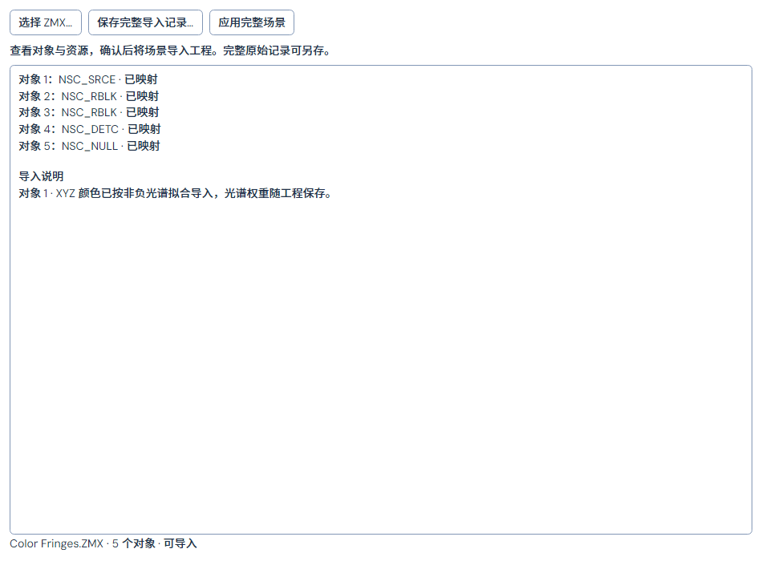
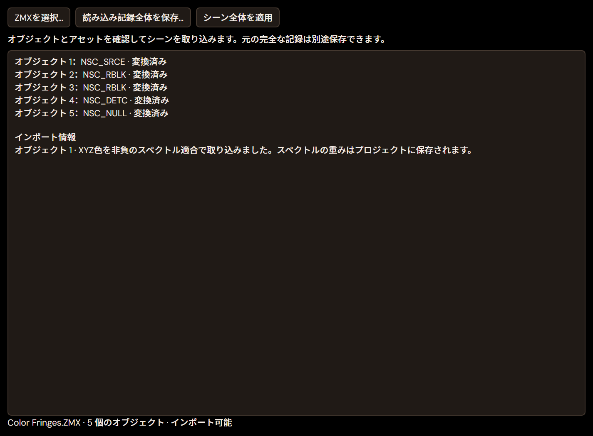
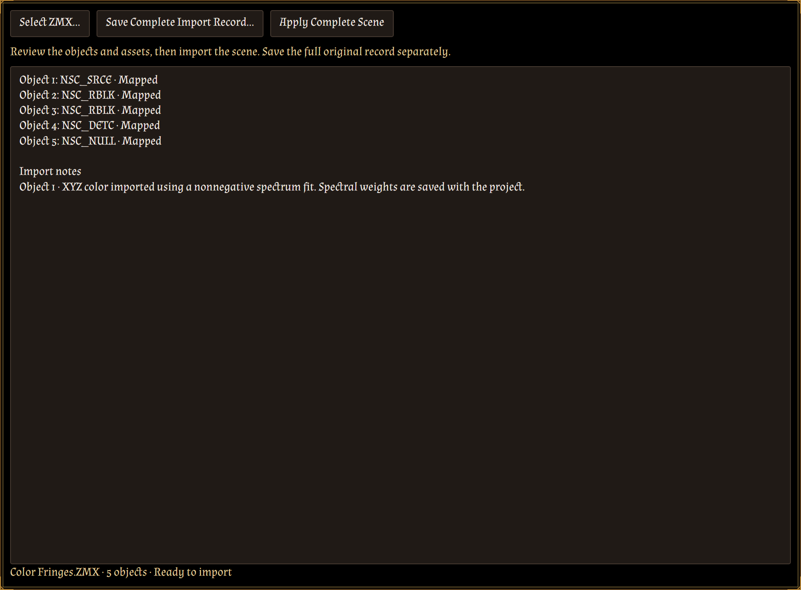

# 非序列导入修复与逐文件检查

2026-11-23，Windows x64，.NET 10 Release。

106 个内置 ZMX 全部完成检查，输入字节保持一致。修复前 1 个文件可应用、209 个对象可映射；修复后为 **4 个文件、307 个对象**。本轮修复的是已有模型的导入和流程缺陷；其余 102 个文件按各自的类型、属性、端口和资产需求列在[逐文件清单](files.md)，各原因可以重叠。

修复内容与定义依据见[导入指南](../../../../docs/NONSEQUENTIAL_IMPORT.md)。其中包括备注与文件引用分离、绝对/相对参考、同列参数拾取、变量当前值、随机偏振、矩形体材料行为、已有解析几何及非球面组件映射、普通探测器的偏振分量。UI 将普通说明与实际问题分开，重复属性提示合并，完整原记录仍可保存。

37 项定向检查通过，覆盖导入/撤销、损坏和未知属性的事务边界、实际追迹、STAROPT 保存重开、彩色探测器与三主题真实窗口。三个新增可应用示例各光源使用 64 条光线进行功能检查。主程序及主测试依赖构建零警告、零错误；三语目录检查零缺失、零错误。未执行 95 镜头完整精度矩阵，也未新增外部软件数值对照。

批量维护工具实际执行 `--audit` 时出现 NuGet 漏洞服务不可达的 NU1900 提示，随后正常完成全部文件检查；提示保存在执行日志中。测试、原始文件检查和实际结果未受影响。

- [结果、源文件及证据摘要](results.json)
- `audit.json.gz`：全部文件的完整当前诊断和原始字节身份；`functional.trx.gz`：37 项定向结果。
- `build.log.gz`、`audit-execution.log.gz`：本轮编译和批量检查日志。

## 实际导入窗口

Light／中文／100%：

Dark／日文／150%：

Isekai／英文／200%：

