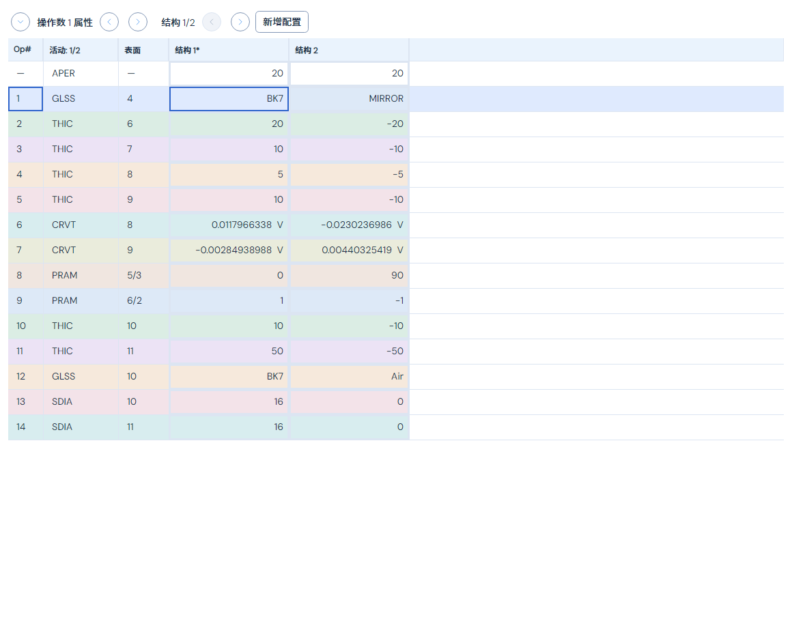
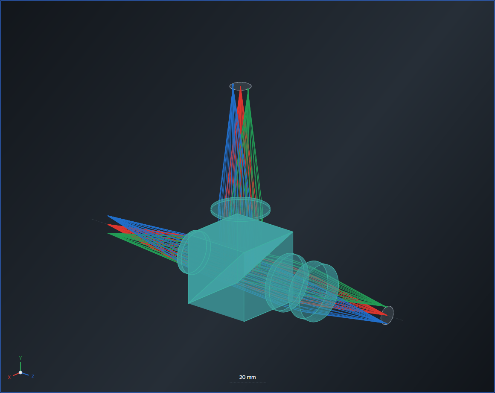

# 分光镜多重结构与布局修复

2026-11-26，功能验收完成。输入为菜单示例 `Miscellaneous/Beam splitter.zmx`，两个结构、每个结构 13 个处方面。源文件 SHA-256 为 `6531e67cfdc292d68ad4c5bd23fef5912f69ad9a69879047ec52e818a8b399a2`，与已冻结的原软件对照输入一致。

## 已修复的行为

- 多重结构表保留原顺序的 14 行操作数，包括第 4、10 面的两条 GLSS 材料行。材料以名称编辑，保留每个结构的材料快照及反射交互，支持撤销、重做及 STAROPT 重开。APER 继续作为独立的只读孔径摘要。
- 坐标间断及倾斜面参数显示为 PRAM，表面列使用原一基表面号／参数号：5/3 与 6/2。两结构采用 176 DIP 列宽，完整显示曲率和 V/P；三结构及以上采用原紧凑列宽。
- 结构 2 的第 10、11 面半口径保留为 0，停用相应浮动孔径。显式 CLAP 等表面孔径继续截光；正口径、零口径之间的编辑及保存重开保持一致。原先每结构 21 条采样光线中，结构 2 有 20 条被错误的 0.1 mm 孔径截在第 10 面，修复后两结构各 21 条全部到达像面。
- 倾斜平面纳入平面棱镜网格，矩形端面和侧壁按真实平面交点形成；两个结构中的分光棱镜均保留四角边界。三维布局和实体模型按实际几何／光路包围范围等比取景。该范围随场景传递并在所有结构下合并，显示开关及透明度共用同一范围；旋转保持拟合支点和比例，适配／预设视图重新拟合。无填充端面的独立轮廓在实体模式中继续显示。

## 验收结果

**242 项相关功能回归去重通过，0 失败。** 新增 8 项导入、追迹、材料编辑、原生往返及网格用例，以及 5 项真实离屏主题用例。最后一轮 40/40 通过，包括显示开关、透明度、独立轮廓、旋转后重绘和实际分光镜页面。结果按用例名称保留最后一次执行状态，详见 [results.json](results.json)。

标准 Release 构建 0 警告、0 错误；本地化检查 4576 个译项、4101 处 UI 文本，0 缺失、0 错误。保存的 20 张图来自生产表格与生产场景控件：五主题各有多重结构表、前视实体图、等轴测实体图及透明实体图。模型显示三个物高视场、550 nm 主波长、每视场 21 个瞳点，两结构共 126 条实际光线，按视场着色。

验收采用功能回归；完整 95 镜头精度矩阵保持原有验收范围。核对的既有原软件记录为结构 2、轴上视场、Py=0.8、550 nm 的[单光线报告](../../../../artifacts/zemax-sequential-corpus/20261021/full-v1/analyses/0984-030-beam-splitter-c2-primary-f1-w1-single-ray-trace/native/data.txt)，其像面局部 Y 为 0.01281392995 mm，已作为本例控制值。

额外执行的通用架构检查有 7 项失败，涉及已有的 Core 类型暴露、字体／配色／阴影及进度条分层规则，列为独立待办。完整发现位于回执包的 `architecture-findings.txt`，原始失败记录保留。

## 实际画面

## 回执

- [原始构建、测试、本地化及中间诊断](receipts.zip)：包含早期 6 项检查失败、取景／窄窗交互修正前的回归、最后一轮原始 TRX 和构建输出。
- [本轮源码与输入摘要](source-hashes.json)：24 个验证输入文件。
- [验收结果](results.json)：242 项逐条状态。

从原始 ZMX 重新打开可恢复处方中的零值；之后保存的 STAROPT 保留 GLSS 行、零半口径及浮动孔径绑定，按需采用工程载荷 v31。
