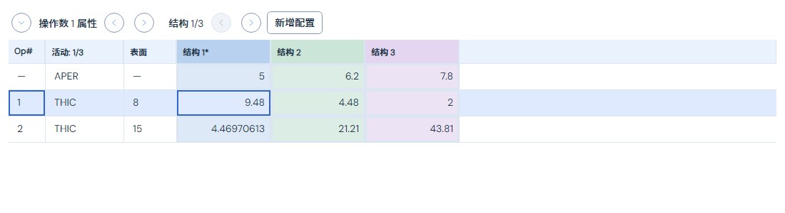
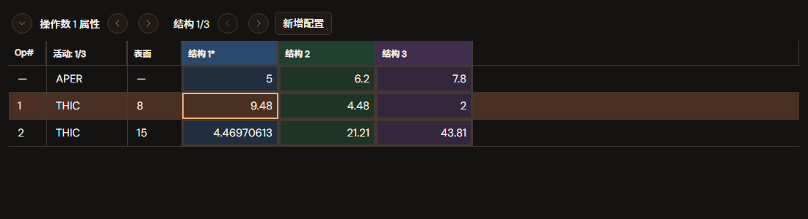

# 多结构操作数列颜色（2026-11-26）

本阶段的按结构列配色已被用户更正并撤销。当前实现按操作数类型统一着色，见[类型配色修正](../operand-type-colors/README.md)；本目录只保留上一阶段的实际方向和验证记录，不作为当前 UI 规范。

原界面只区分活动列、非活动可编辑列和只读行，所有非活动操作数使用同一警告黄色，并没有结构编号对应的分类颜色。

现由 `ConfigurationColumnColors` 在实际主题资源生成后提供八组不可变柔和底色。正文按结构编号固定分配，原生列标题使用同色系，活动标题加深；选中单元格仍使用原主题选择底色、文字和边框。表面号、数值、`V`/`P` 标记、活动 `*`、列宽、行高、编辑和撤销路径保持。

五主题分别检查实际单元格/标题像素的区别、文本对比度、切换活动结构后的颜色稳定性、选中反馈、主题往返、增加结构与文件切换。现有多结构矩阵和编辑器检查覆盖变量、拾取、无效草稿和撤销；只运行该功能的定向检查，不运行全量光学精度矩阵。

首次独立输出构建遇到共享 App 中间程序集的并发文件占用，未关闭其他进程。最终结果、默认 Release 构建与截图在本目录保存；测试临时运行目录 `local-data/configuration-colors-validation` 完成后清理。全程离屏，没有操作或重启用户窗口。

最终 `colors-verified.trx`：**14/14 通过**，0 失败、0 跳过，包含 5 个主题的颜色检查及 9 项原矩阵/编辑器检查。默认 App 的 `app-build.txt` 为 0 警告、0 错误。`identity.json` 记录源文件、示例、测试和默认构建的身份；不将不同轮次共享构建宣称为同一程序集，也不将重跑累加为更多通过项。

中间已通过的同范围结果由最终记录覆盖，不保留重复载荷。修正了测试中一处可空性注释；复验曾被共享新增分光布局测试缺少主题命名空间引用阻断，补齐引用后继续。并发补齐造成的重复 using 在最终成功运行后去重，未改变测试行为。未修改该布局的行为或停止其进程。

