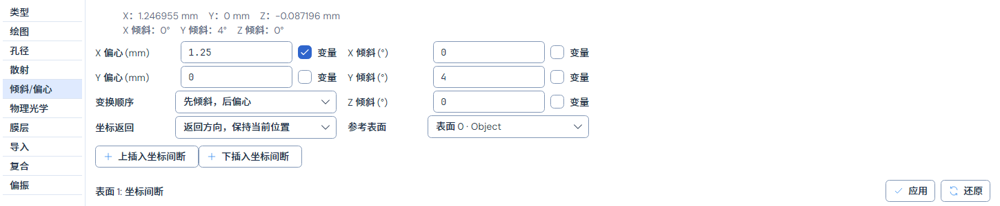

# 坐标间断设计与两列编辑复核

日期：2026-11-26。当前实现补齐独立坐标行的插入、参数编辑、变换顺序、优化变量、持续参考面返回、删除保护、撤销及原生重开。实际功能使用共享 Core，不以绘图或表面名称代替变换。当前工作区同时存在其他任务修改，本记录不代表完整产品精度认证。

## 实际操作与画面

镜头表右键及属性“倾斜/偏心”页均有上下插入命令。普通物理面保持原类型，零变换新行延续原介质；坐标参数编辑作用于当前结构，结构插入/删除同步各配置。拾取或求解控制项只读，非法输入及过期修订不改变计算状态。旧工程没有原始参数时，明确显示保留坐标基准。

按用户指出的单列截断问题，正常宽度固定为两个紧凑参数列：左列 X/Y 偏心、顺序和返回；右列三轴倾斜和参考面。保持原属性区 **300 DIP** 高度。输入框不占满整行，说明放入提示；窄窗换行并可滚动至全部命令，应用/还原固定在底部。

实际离屏画面覆盖 Light、Dark、Lumen、Isekai、Pixel，中文/英文/日文及 100%/150%/200% 合成像素；没有控制或重启用户程序。`rendered/*-narrow.png` 为 800-DIP 宽度滚动状态。以下是实际属性控件的直接渲染，不是设计稿：

## 定向检查

- `complete.trx`：328 项相关检查，326 通过，2 项窄窗按钮可见范围失败。
- 修正内容宽度与底部滚动余量后，`layout-complete.trx` 的 6 项实际界面复验全部通过，覆盖前述两项失败。
- 按精确用例名称以末轮覆盖合并，**328 项去重结果全部通过**；新增坐标类用例 20 项包含其中，不额外累加。详细合并规则和源/输出哈希在 `results.json`。
- 覆盖真实折射随偏心/倾斜变化、清零恢复光线，空气/晶体中零变换插入保持物理坐标和追迹，顺序与单位、动态返回及引用重映射，评价函数面槽、拾取保护、当前配置边界，失败回滚、撤销/重做和保存重开。
- 标准 Release 主程序及其依赖构建完成，`build-final.log` 为 0 警告、0 错误；三语目录检查 0 缺失、0 错误。没有运行完整测试套件或完整镜头数值分析矩阵。

## 同源计算保持性

`after.json` 重读原 95 个菜单输入、115 个配置。隔离 C# 对照保持当前其他 Core 源码和材料一致，只把坐标链安装实现换回 `018c16a0` 的实现，签名增加未使用参数以适配当前调用。对照定义的来源与哈希见 `ab-control.json`，输出为 `ab-before.json`。两边使用同一实际共享追迹工具，不提供产品运行结果。

`comparison.json`：317 条有效控制光线保持一致，28 条原本不可用的控制光线保留原状态；最大数值差约 **4.26e-14**。这是本次坐标链修改的内部 A/B 核对，不能代替外部分析精度认证。原文件哈希与面数核对同时保留。

对照编译的临时 C# 工程使用原 Core 源文件及相同逻辑名的嵌入材料资源，唯独 `ZemaxZmxReader.CoordinateVariables.cs` 来自上述提交；ILGPU 依赖仍为现有 1.5.3。`ab-build-run.log` 保留临时工程路径属性的两条构建警告；它们不是标准产品构建的结果。没有复制一套原始镜头或材料库。

直接与 2026-11-24 全部旧输出比较的 `historical-comparison.json` **仍为失败**。三支模型受当前工作区其他材料导入更改影响；未通过调整处方或容差消除旧差异。隔离 A/B 的目的正是把这类变化与本次坐标链修改区分开。

## 已有逐面参考

`native-rays.json` 复用同源 Rochon 的 8 份既有 2026 R1 请求，共 72 行，位置、能量方向与后续几何段长通过原有容差。源文件、原请求/报告、环境和容差文件哈希均在记录中；没有重新采集外部程序，也没有升级为完整相位、偏振或全部分析认证。

## 中间失败与范围

结果固化后，共享导入器及服务接口仍有其他任务继续修改，当前 Core 程序集也已变化。`results.json` 保留本次源码哈希、后续差异及程序集身份，不把后来的并行修改自动算作本次复验通过；本功能的独立实现文件保持一致。

保留首次编译错误、受限测试连接超时、源单位与显示单位混淆的测试修正，以及布局中间失败记录。一次过宽的 `Snapshot` 名称筛选误触已排除的历史数值用例，随后停止本任务的该次测试进程；`regression.log` 不属于通过记录，没有为该历史用例改写数据或门槛。正式筛选已缩到明确的类并带 `AcceptanceScope!=RetiredReference`，见 `filter.txt`。

坐标返回必须引用前面的既有表面，支持方向或完整原点及方向返回；后者可包含有符号虚传播，仍受实际介质传播能力限制。未映射的参数依赖明确阻止编辑，不用固定近似冒充实时求解。快照 schema 11 / 原生工程 v30 的定义见[格式说明](../../../../docs/STAROPT_FILE_FORMAT.md)，操作见[表面属性](../../../../docs/SURFACE_PROPERTIES_EDITOR.md#坐标间断的设计与编辑)。
