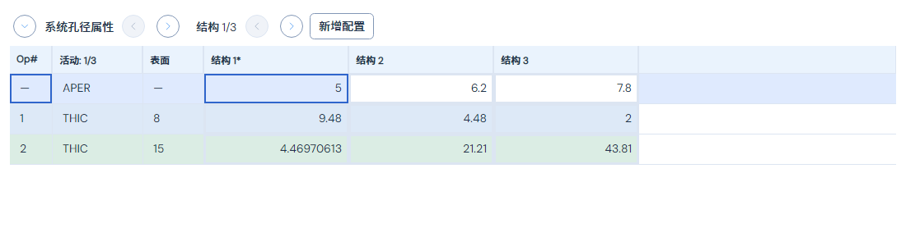

# 操作数按行配色（2026-11-26）

此处是按行序轮换颜色的中间阶段，已按用户后续澄清撤销。当前同一操作数类型的全部行共用固定颜色，见[按操作数类型统一配色](../operand-type-colors/README.md)。本记录不再代表当前规则。

按用户“按照行来，不是按照结构”的更正，撤销结构列配色与彩色列标题。同一操作数行从原生冻结文本列（行号、代码、表面号）到所有结构值使用相同柔和底色，邻行区分，八色循环。只读 APER 行和列标题回到普通主题底色，活动结构的 `*` 保留。

复用不可变主题色，由 `OperandRowColors` 提供。行色仅随显示行序分配，不改变核心操作数编号或数值；切换活动结构和增减结构不重新按列分配。原生文本列、剪贴板和键盘行为保留；选中提示优先使用原主题反馈，变量与拾取标记、编辑守卫及撤销保持。

定向验证覆盖五主题下的同一行跨结构同色、冻结列与数值列的实际像素相同、邻行不同、标题恢复统一底色、对比度、选中、活动切换、主题往返、增加结构和文件切换；继续运行已有多配置矩阵/编辑器行为检查。全程后台离屏，没有控制或重启用户窗口；临时运行输出完成后清理。

最终 `rows-final.trx` **14/14 通过**，0 失败、0 跳过，包含 5 项行配色检查及 9 项原编辑器/矩阵检查。默认输出的 `app-build.txt` 为 0 警告、0 错误。`identity.json` 记录相关源文件和各次构建身份，不将不同轮次共享程序集宣称为逐字节一致。

`rows-initial.trx` 保留 12/14 的中间结果：当前结构列已扩为 176 DIP，原窄窗夹具仍在第三个标题可能位于窗外时点击其中心，导致两个双击激活检查失败。已让夹具先将真实目标列滚动到可见位置，再保留原双击激活断言；未缩窄产品列宽或改动激活处理。

实际修正后画面：

