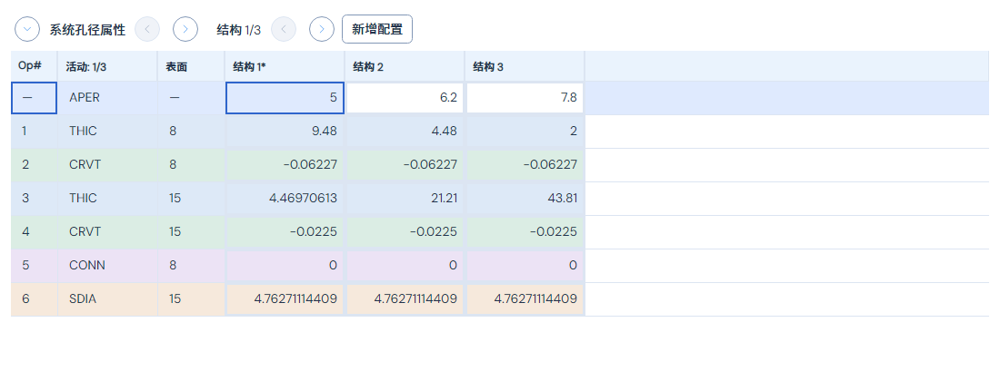

# 同一操作数类型统一配色（2026-11-26）

按用户“同一个操作数全部一样的颜色”的澄清，改为类型固定配色：全部 THIC、全部 CRVT 等分别同色，PRAM 的不同表面/参数及形状/GRIN 绑定归为同类；GLAS、GLSS、CONN、SDIA 各有固定色系。类型来自实际绑定枚举，未解析显示文字，不随行序、数值或结构编号分配。

整行仍覆盖原生冻结文本列及全部结构值。APER 和列标题维持普通主题，选择/焦点、活动星号、V/P、编辑及撤销保持。配色校验使用交错排列的两条 THIC、两条 CRVT、CONN 与 SDIA，检查跨结构和非相邻同行类型一致、不同类型区分、实际像素、重排行序及五主题切换；继续核对原矩阵/编辑器行为。

验证使用后台离屏会话，不控制或重启用户窗口，不运行完整光学精度矩阵。最终结果、默认 Release 构建、截图和源文件身份存于本目录，完成后清理独立临时运行目录。

`types-final.trx` **14/14 通过**，0 失败、0 跳过；包含 5 项五主题类型配色检查及 9 项现有矩阵/编辑器行为检查。`app-build.txt` 为默认 Release App，0 警告、0 错误。`identity.json` 分别记录源文件、默认构建和独立测试输出身份，不将共享工作区不同轮次构建混为一份已验证程序集。

