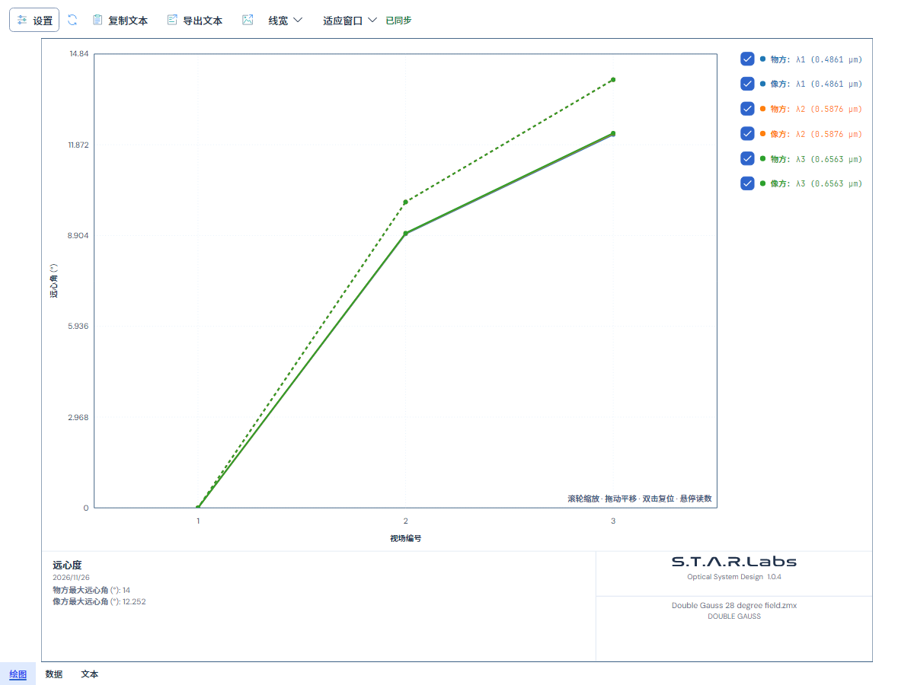

# 远心度分析专项验证（2026-11-26）

实现及操作见[远心度分析](../../../../docs/TELECENTRICITY_ANALYSIS.md)。本目录是该功能的验证与截图记录。

## 最终结果

- `telecentricity-final.trx`：**31/31 通过**，0 失败、0 跳过。包含 9 项远心度计算/应用契约检查、3 项真实页面检查，以及相邻线宽、图标、帮助数学目录和分析入口检查。只计该轮，不叠加早期重跑。
- `app-build.txt`：默认输出路径的 Release App，含四个内置模块，构建 **0 警告、0 错误**。
- `screenshots/`：实际 Double Gauss 分析页在 1200×900、720×600 的 Light、Dark、Isekai 画面；Dark 使用 18 字号。三份 `*-export.png` 是分析面板的实际 PNG 导出。
- `identity.json`：相关源文件及程序集、原始菜单示例输入的 SHA-256。共享工作区的默认输出与独立测试输出分别记录，不据此声称两个不同轮次构建逐字节一致。

最终筛选为 `TelecentricityTests | TelecentricityUiTests | AnalysisCurveWidthTests | SemanticIconTests | UserGuideMathematicsTests | ZernikeEntryRemovalTests`。测试使用独立 `local-data/telecentricity-validation`，完成后删除该临时运行目录；没有关闭其他进程。

## 核对内容

独立自由传播几何检查包含纯 Y、X/Y 混合及反向视场，按物距与横向距离计算主光线角。理想薄透镜检查包含前焦光阑的像方远心，以及物方 NA/远心发射契约下的后焦光阑布局。另验证局部倾斜像面使用入射方向、带符号投影角、全部/单波长、零权重波长、相反视场不互相抵消、取消和原镜头不变。

显式物理孔径阻挡保留 `—` 和 NaN 曲线缺口，全部阻挡返回不可用，部分阻挡只统计有效结果。像面前终止追迹，避免像面后的折射或膜层强度改变到达角的定义。

实际应用使用菜单示例 `Objectives/Double Gauss 28 degree field.zmx`，3 视场、3 波长，9 条主光线和 6 条曲线。测试穿过正式分析服务、类型化轴映射、实际 `AnalysisPanel`、独立图例勾选及 PNG 捕获；改变线宽产生不同绘图像素而不修改文档。数据/文本页及图签共享同一计算结果。

这是新增分析的独立控制与功能检查，不是全部 95 镜头的新数值验收、外部软件认证或安装包发布。没有打开、控制或重启用户的运行窗口。

## 中间问题与保留记录

- `initial.trx` 保留两项最初夹具失败：仅设置绘图净半径不能构成物理遮挡；无限入瞳的物方远心布局需要声明物方 NA，而不是有限入瞳直径。按既有物理接口修正夹具后通过，未放宽角度断言。
- `final.trx` 是较早的一轮 29/31：新分析的大字号通用图签超高，以及共享工作区另一路新增偏振条目尚未接上帮助目录。远心度改为类型化两行最大角摘要，帮助覆盖在共享实现补齐后，最终全筛选通过。
- `legend-before-localization.png` 是开发中英文图例仍有中文前缀的画面，现由远心度类型化摘要的显示适配器显式翻译；源数据和数值不变。最终截图覆盖该修正。
- 另处理两项共享构建阻塞：数组令牌使用 `Length`；应用坐标编辑需要可访问的 `Optic.HasImportedSurfaceTiltDecenter` 标记。未替换或撤销其他任务中的坐标、导入与偏振实现。

修改后的实际界面：

