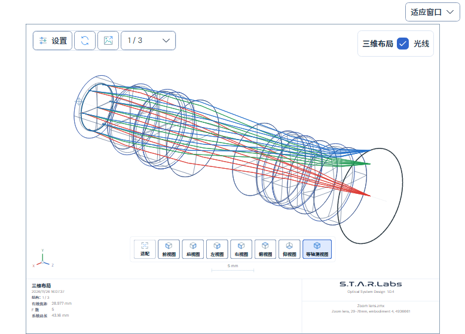
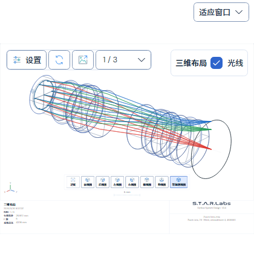

# 三维布局下方视图栏同步缩放

2026-11-26。用户指出三维图纸缩小后，下方“适配／前视图／后视图”等按钮仍过大。原因是预设和上方命令共同位于 `DiagramOverlayPresenter` 的原生尺寸界面层，未参与源图的 Viewbox 倍率。

三维布局预设现在位于场景源图中，复用整个图纸的等比显示变换；源字号、图标尺寸和间距没有单独缩小。原生命中区域跟随同一变换，100% 恢复源尺寸，可以随图纸滚动访问。上方设置／刷新／导出维持原生界面尺寸，实体模型的全视口及原生导航保留。PNG 仍由实际场景与图签独立绘制，不包含导航。

## 结果

| 检查 | 结果 | 原始记录 |
| --- | --- | --- |
| 视角文字、选中状态、显示倍率、实际点击、键盘、相机及主题 | 10/10 | [TRX](navigation-and-export.trx) |
| 二维／三维／实体模型宽窄窗口的导出与控件排除 | 6/6 | [相同 TRX](navigation-and-export.trx) |
| 二维／三维调整窗口后的相机和 PNG 一致性、实体模型原生控件 | 3/3 | [TRX](resize-and-solid-model.trx) |
| 主程序默认 Release 构建 | 0 警告，0 错误 | [构建日志](default-app-build.log) |

共 19 个不同用例通过，0 失败、0 跳过，未重复计算重叠用例。测试使用真实 `Zoom systems/Zoom lens.zmx`（含多结构）和 Cooke 场景。三维预设覆盖五主题、三语和 13/18 DIP；大字号的既有图签越界规则仍拒绝导出，未绕过此保护。有效 Fit 场景检查 778×560、420×420、1500×1000 的按钮屏幕宽高与图纸倍率一致，上方设置按钮尺寸不变，页面变化保留原 Zoom／Pan、场景身份和工程 revision。Fit／100% 往返后使用实际离屏指针命中检查预设，并验证 Space、方向键和 Home。

使用独立 Avalonia Headless／Skia 和测试输出目录，不启动、重启或操控用户窗口。没有运行完整数值矩阵、报告格式全验收或操作系统多屏 DPI 认证。`summary.json` 记录当前源文件及被测程序集身份；临时测试运行目录在完成后删除，不重复保存运行时或历史测试资产。

## 实际画面

图纸缩小后，下方预设与图纸等比显示，上方命令保留原生界面尺寸：

其他主题的同尺寸画面：[Dark](screenshots/view-buttons-OpticalLayout-Dark-en-US-400-fit-778x560.png)、[Pixel](screenshots/view-buttons-OpticalLayout-Pixel-zh-CN-778-fit-778x560.png)、[Lumen](screenshots/view-buttons-OpticalLayout-Lumen-en-US-778-fit-778x560.png)、[Isekai](screenshots/view-buttons-OpticalLayout-Isekai-en-US-778-fit-778x560.png)。导出图纸位于 `exports/`，命令及导航不进入导出。

复验命令与身份保留于 [summary.json](summary.json)，测试输出见 [首组日志](navigation-and-export.log) 和 [补充日志](resize-and-solid-model.log)。本轮仅修改 `ViewerPanel.Build3DWorkspace` 的导航归属及高度约束，保留工作区中此前的二维适配、图签导出及其他并行修改。
