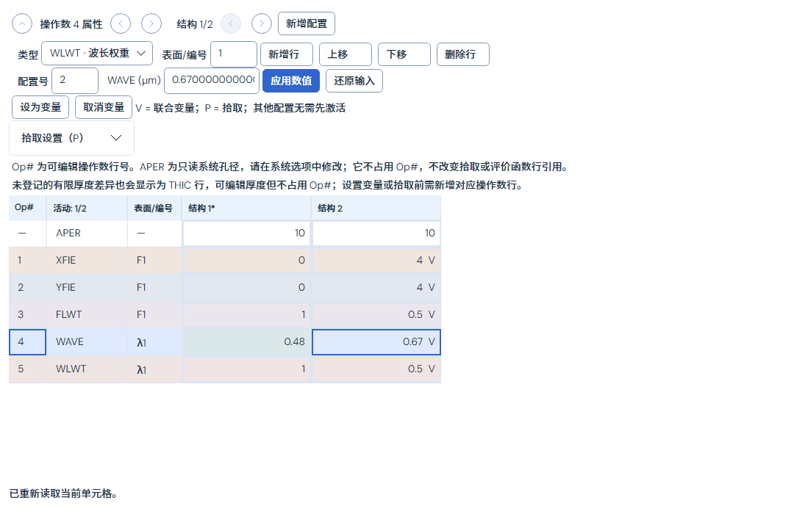
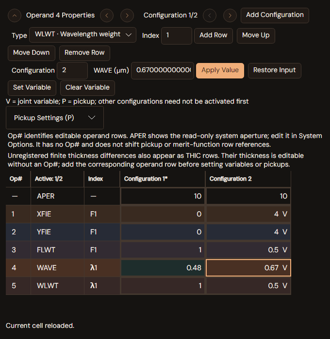

# 多结构系统操作数：第一批接通

2026-11-27。五类新行 XFIE／YFIE／FLWT／WAVE／WLWT 已进入实际 Core 模型、应用服务和桌面工作流。定义、单位、保存和剩余边界见[实现契约](../../../../docs/MULTI_CONFIGURATION_SYSTEM_OPERANDS.md)，其余批次见[接通计划](../../../../docs/OPERAND_COMPATIBILITY_PLAN.md)。

## 最终结果

| 范围 | 结果 | 记录 |
| --- | --- | --- |
| 新操作数及原变量、拾取、表格、类型颜色、镜头缩放、非法原生保存 | 210/210，通过；0 跳过 | [TRX](system-operands-verified.trx)、[日志](system-operands-verified.log) |
| 最终新功能与五主题三语复验，含伪装旧版本的有效校验和载荷 | 28/28；与上组重叠，不累加 | [TRX](system-operands-last.trx)、[日志](system-operands-last.log) |
| 主程序默认 Release 构建 | 0 警告，0 错误 | [日志](default-app-build-final.log) |
| 正式生成词库及校验 | 0 缺失，0 错误 | [生成](localization-sync-verified.log)、[检查](localization-check.log) |

共 210 个不同用例完成，28 个新功能用例包括五类独立值／变量／拾取、五类实际联合 DLS、非法数值及失败回滚、ZMX／STAROPT 往返与应用撤销、非法导入、物理波长变化、长度型视场单位、普通系统编辑及引用保护、五主题原生编辑。使用超出镜头表面数量的第 9 个视场／波长证明其不会被误当成表面。最后复验将同一个有效 STAROPT 载荷的版本从 32 改成 31 并重算 SHA-256，验证加载仍拒绝新类型。

正式优化采用多个结构和 MCOV 实际行评价，检查最终目标、当前结构隔离及整体撤销／重做。共享近轴计算验证更改主波长后的焦距确实变化，且与同一快照的新模型一致。非毫米 ZMX 对长度型视场转换到 mm，同时 WAVE 保持 µm。原普通表面变量、曲率坐标转换和混合拾取图继续通过。

## 中间问题保留

- [首次编译日志](core-and-integration.log)：同工作区绘图导出文件在编辑期间出现 `OpticalDrawingDxf` 名称错误，测试未执行；后续编译自然恢复，没有修改该并行文件。
- [首次实际测试](core-and-integration-final.trx)：151/155，通过；四项失败保留。修正导入夹具缺失 MODE SEQ、视场变量默认局部范围不足，以及无限物距绑定的异常类型；有限物距继续支持。
- [离屏测试编译记录](system-operands-final.log)：新增测试委托返回类型错误，测试未执行；修正为正式异步调度签名。
- [首次词库同步](localization-sync.log)：五个操作数代码缺少保留内容声明；补齐逐项原因后正式生成和检查通过。离屏发现的英文残留标签已用正式词库修正，最终画面覆盖原图。

这些失败不是最终通过记录，也不计入当前通过数。没有运行完整精度矩阵、安装交付、原生桌面／多屏 DPI 或新的商业软件数值捕获。未控制、重启或关闭用户程序。临时运行时和物化的历史夹具完成后删除，仅保留源身份、结果和画面，不复制原始样例或光学参考。

## 实际页面

其他主题：[Pixel 日文](screenshots/system-operands-Pixel-ja-JP-1080.png)、[Lumen English](screenshots/system-operands-Lumen-en-US-1080.png)、[Isekai English](screenshots/system-operands-Isekai-en-US-680.png)。

## 后续范围

本轮接通的是多重结构行，未增加评价函数 341/383 的执行计数。TEMP／PRES 的完整热光学、其他孔径／光阑／状态行，以及 POP、鬼像、光纤耦合、剩余专门分析和扩展执行接口仍按各自边界排期。未知外部求解列继续诊断保留；本地仿射拾取通过不等于外部所有求解代码已兼容。
